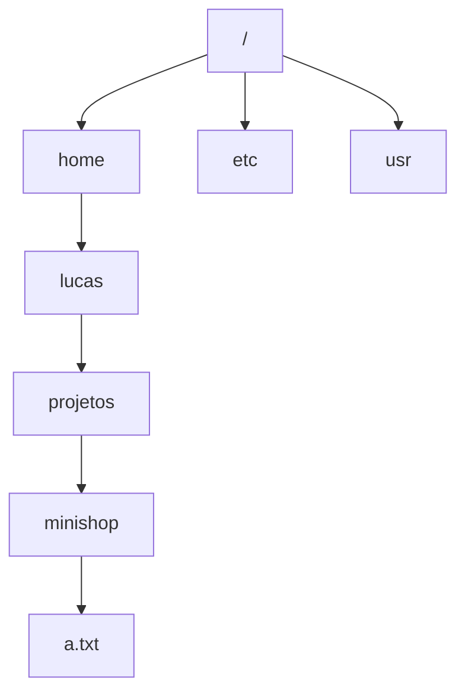

# 01. Terminal, sistema de arquivos e permissões

> ⏱️ ~1h30 · Módulo 0 · Pré-requisitos: nenhum

## 🎯 Objetivos
Ao final desta aula você consegue:
- Navegar entre pastas e explicar a diferença entre caminho absoluto e relativo
- Criar, copiar, mover, ler e apagar arquivos pelo terminal
- Combinar comandos com pipe (`|`) e redirecionamento (`>`, `>>`)
- Ler a saída de `ls -l` e alterar permissões com `chmod`
- Pedir ajuda com `--help` e `man`

## 🤔 Por que isso importa
Servidores, containers, CI e deploy não têm interface gráfica. Todo o resto do curso (Git, Python, Docker, AWS) é operado por comandos. Um júnior que trava no terminal perde tempo em tudo.

## 💡 Intuição (explicação simples)
O terminal é **pedir as coisas ao computador por escrito**, em vez de apontar e clicar. É como fazer o pedido ao garçom por bilhete: você precisa saber o nome exato do prato (comando) e dizer onde quer a entrega (pasta). Em troca, o bilhete pode ser repetido, copiado e automatizado, coisa que um clique não permite.

## 🔬 Como funciona por dentro
- O **terminal** é só a janela. Quem interpreta o que você digita é o **shell** (aqui, o `bash`). Ele separa o texto em palavras, acha o programa e o executa.
- Para achar o programa, o shell procura nas pastas listadas na variável **`PATH`**, na ordem. `command not found` quer dizer “não está em nenhuma pasta do `PATH`”.
- O sistema de arquivos do Linux é **uma árvore única** que começa em `/` (raiz):



- **Caminho absoluto** começa em `/` (`/home/lucas/projetos/minishop`). **Relativo** parte de onde você está (`projetos/minishop`, `..` = pasta acima, `.` = pasta atual, `~` = sua home).
- **Permissões.** Todo arquivo tem um dono, um grupo e três blocos de permissão: dono, grupo e outros. Cada bloco tem `r` (ler = 4), `w` (escrever = 2) e `x` (executar = 1). Somando: `rw-` = 6, `rwx` = 7, `r--` = 4.
- **Fluxos.** Todo programa tem entrada padrão (stdin), saída padrão (stdout) e saída de erro (stderr). `>` manda o stdout para um arquivo (sobrescrevendo), `>>` acrescenta no fim, `|` liga o stdout de um comando ao stdin do próximo.

> **Windows:** use o **WSL2** (Ubuntu) e trabalhe *dentro* dele, em `~/projetos`, não em `/mnt/c`. Instalação: [Microsoft Learn: instalar o WSL](https://learn.microsoft.com/pt-br/windows/wsl/install). **macOS:** o Terminal usa `zsh`; os comandos desta aula funcionam igual.

## 🛠️ Exemplo prático
Cada bloco foi executado em um Linux real; a saída mostrada é a obtida (datas e nomes de usuário variam).

**1. Onde estou e o que tem aqui**
```bash
pwd                      # print working directory
mkdir -p projetos/minishop && cd projetos/minishop
touch a.txt              # cria arquivo vazio
echo "oi" > a.txt        # escreve "oi" (sobrescreve)
ls -la
cat a.txt
```
Saída:
```text
total 4
drwxrwxr-x 2 lucas lucas 60 Nov  7 21:15 .
drwxrwxr-x 3 lucas lucas 60 Nov  7 21:15 ..
-rw-rw-r-- 1 lucas lucas  3 Nov  7 21:15 a.txt
oi
```
`-a` mostra os arquivos ocultos (nome começa com `.`), `-l` o formato longo. O `3` é o tamanho em bytes: `o`, `i` e a quebra de linha.

**2. Permissões**
```bash
ls -l a.txt        # -rw-rw-r--  (dono rw, grupo rw, outros r)
chmod 600 a.txt    # dono: 6=rw-, grupo: 0, outros: 0
ls -l a.txt
chmod +x a.txt     # adiciona x para todos
ls -l a.txt
```
```text
-rw------- 1 lucas lucas 3 Nov  7 21:15 a.txt
-rwx--x--x 1 lucas lucas 3 Nov  7 21:15 a.txt
```
Leitura de `-rw-------`: o primeiro caractere é o tipo (`-` arquivo, `d` pasta); depois vêm `rw-` (dono), `---` (grupo), `---` (outros). Chaves privadas SSH precisam estar em `600`, senão o SSH as recusa.

**3. Pipe e redirecionamento**
```bash
printf "banana\nmaçã\nbanana\nuva\n" > frutas.txt
sort frutas.txt | uniq -c | sort -rn      # conta repetidas e ordena
grep -n "ban" frutas.txt                  # linhas que contêm "ban"
ls /nao-existe 2> erros.txt               # redireciona só o stderr
```
```text
      2 banana
      1 uva
      1 maçã
1:banana
3:banana
```
(A ordem de `uva` e `maçã` depende do idioma/`locale` do seu sistema.)

**4. Copiar, mover, apagar e pedir ajuda**
```bash
cp a.txt b.txt && mv b.txt c.txt && rm c.txt
ls --help | head -n 3
man ls            # q para sair
```

Atalhos que valem ouro: `Tab` completa nomes, `↑` repete comandos, `Ctrl+C` interrompe, `Ctrl+R` busca no histórico, `history` lista o que você digitou.

## ⚠️ Erros comuns e boas práticas
| Mensagem | Causa | Solução |
|---|---|---|
| `bash: foo: command not found` | Programa não instalado ou fora do `PATH`, ou erro de digitação | Confira a grafia; `which foo`; instale |
| `No such file or directory` | Caminho errado ou arquivo em outra pasta | `pwd` e `ls` para ver onde está |
| `Permission denied` | Sem permissão de ler/escrever/executar | `ls -l`; `chmod` se for seu arquivo. Não resolva com `sudo` sem entender o porquê |
| `rm: cannot remove 'x': Is a directory` | `rm` não apaga pastas sozinho | `rm -r pasta` (com cuidado) |

- **`rm` não tem lixeira.** `rm -rf` com caminho errado (ex.: `rm -rf ~ /pasta` com um espaço) apaga seus dados. Rode `ls` com o mesmo caminho antes.
- Evite espaços em nomes de arquivos e pastas. Se existirem, use aspas: `cd "Meus Documentos"`.
- Não use `sudo` para “fazer funcionar”: ele esconde o problema de permissões e cria arquivos do `root` na sua pasta.

## 🧩 Exercícios
**1. Fixação**
a) Qual a diferença entre `cd ..` e `cd ~`?
b) O que significa `-rwxr-x---`? Qual o número do `chmod` equivalente?
c) O que `cmd >> log.txt` faz de diferente de `cmd > log.txt`?

<details><summary>Solução</summary>

a) `cd ..` sobe uma pasta a partir da atual; `cd ~` vai para a sua home de qualquer lugar.
b) Arquivo comum; dono `rwx` (7), grupo `r-x` (5), outros `---` (0): **750**.
c) `>>` acrescenta no fim do arquivo; `>` apaga o conteúdo anterior e escreve do zero.
</details>

**2. Aplicação no projeto MiniShop**
Crie a estrutura de trabalho:
```text
~/projetos/minishop/
├── docs/
├── src/
└── README.md
```
Critérios de pronto:
- [ ] `ls ~/projetos/minishop` mostra `docs  README.md  src`
- [ ] O `README.md` tem uma linha de título, criada por `echo` com redirecionamento (sem abrir editor)
- [ ] Você consegue, a partir de `docs/`, listar o `README.md` usando um caminho **relativo**
- [ ] Você usou `Tab` pelo menos uma vez para completar um nome

<details><summary>Solução de referência</summary>

```bash
mkdir -p ~/projetos/minishop/{docs,src}
cd ~/projetos/minishop
echo "# MiniShop" > README.md
cd docs && ls ../README.md      # relativo
```
</details>

**3. Desafio (opcional)**
Usando só pipes, mostre os 3 arquivos maiores de `/usr/bin`.

<details><summary>Solução</summary>

```bash
ls -S /usr/bin | head -n 3          # -S ordena por tamanho
ls -lS /usr/bin | head -n 4         # com tamanhos (a 1ª linha é o "total")
```
</details>

## 🎤 Na entrevista
- **O que `chmod 755 script.sh` faz?** Dá leitura, escrita e execução ao dono (7) e leitura e execução ao grupo e aos outros (5 e 5). É o padrão para scripts executáveis.
- **Qual a diferença entre `>` e `>>`?** `>` sobrescreve o arquivo; `>>` acrescenta no fim.
- **O que é o `PATH`?** Lista ordenada de pastas onde o shell procura os programas que você digita; por isso o mesmo comando pode apontar para versões diferentes conforme a ordem.

## 📚 Para ir além
- 📄 Documentação oficial: [Microsoft Learn: instalar o WSL](https://learn.microsoft.com/pt-br/windows/wsl/install). Passo a passo oficial para quem usa Windows.
- 🎥 Vídeo (EN): *The Missing Semester of Your CS Education*, curso do MIT (aula “The Shell”), em [missing.csail.mit.edu](https://missing.csail.mit.edu/). Aulas gravadas de ~1h; aproveite a primeira.
- 📑 Artigo/tutorial: [The Linux Commands Handbook (freeCodeCamp)](https://www.freecodecamp.org/news/the-linux-commands-handbook/). Referência de comandos com exemplos, em EN; use como consulta.
- 🏋️ Prática extra: refaça os exemplos 1 a 4 sem olhar a aula, depois de um dia.

## ✅ Checklist da aula
- [ ] Rodei todos os exemplos e a saída bateu
- [ ] Provoquei `No such file or directory` e `Permission denied` de propósito
- [ ] Criei a estrutura `~/projetos/minishop`
- [ ] Li 10 min de documentação em inglês (qualquer link acima)
