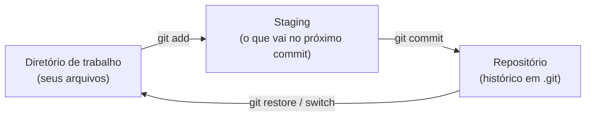

# 03. Git: commit, histórico e .gitignore

> ⏱️ ~1h30 · Módulo 0 · Pré-requisitos: [01](01-terminal-e-arquivos.md), [02](02-python-venv-uv.md)

## 🎯 Objetivos
Ao final desta aula você consegue:
- Explicar as três áreas do Git (diretório de trabalho, staging e repositório)
- Criar um repositório, fazer commits e ler o histórico
- Desfazer alterações locais com segurança
- Escrever um `.gitignore` e uma mensagem de commit clara
- Evitar que segredos entrem no histórico

## 🤔 Por que isso importa
Todo time usa Git. Sem ele você não colabora, não revisa código, não volta atrás depois de um erro e não faz deploy automatizado. É a habilidade mais cobrada depois da própria linguagem.

## 💡 Intuição (explicação simples)
Git é o **histórico de versões de um documento, mas com pontos de salvamento que você escolhe**, como num videogame. Cada commit é um *save* com um bilhete explicando o que mudou. Você pode voltar a qualquer save, comparar dois saves e abrir “universos paralelos” (branches) para testar ideias sem estragar o jogo principal.

## 🔬 Como funciona por dentro
Três áreas:



- Um **commit** é um instantâneo do projeto inteiro (não só a diferença), identificado por um hash (ex.: `450db9f`), com autor, data, mensagem e um ponteiro para o commit anterior. O histórico é uma cadeia desses ponteiros.
- O **staging** existe para você montar commits coerentes: pode alterar 5 arquivos e commitar só 2.
- **Branch** é só um ponteiro móvel para um commit; `HEAD` indica onde você está agora.
- Tudo mora na pasta oculta `.git/`. Apagá-la apaga o histórico.

## 🛠️ Exemplo prático
Executado com Git 2.53 em uma pasta limpa.

**1. Identificação (uma vez por máquina)**
```bash
git config --global user.name "Seu Nome"
git config --global user.email "voce@exemplo.com"
git config --global init.defaultBranch main
```
**2. Primeiro commit**

O `uv init` da aula 02 já criou o repositório. Se você usar uma pasta sem `uv`, rode `git init`.
```bash
cd ~/projetos/minishop
git status -s
git add -A
git commit -m "chore: initial project"
git log --oneline
```
```text
?? .gitignore
?? .python-version
?? README.md
?? main.py
?? pyproject.toml
?? uv.lock
450db9f chore: initial project
```
`??` = arquivo ainda não rastreado. Depois de um `git add`, o `git status -s` mostra `A`; depois de modificar um arquivo já rastreado, `M`.

**3. Ver o que mudou antes de commitar**
```bash
echo "Loja virtual de estudo." >> README.md
git diff                 # mudanças ainda não adicionadas
git add README.md
git diff --staged        # o que vai no commit
git commit -m "docs: describe the project in README"
```
**4. Desfazer (com cuidado)**
```bash
git restore arquivo.py            # descarta alterações NÃO commitadas (irreversível!)
git restore --staged arquivo.py   # tira do staging, mantém a alteração
git revert <hash>                 # cria um commit que desfaz outro (seguro, preserva histórico)
```
**5. `.gitignore`**

Arquivos que **nunca** devem ir para o Git: ambiente virtual, caches, segredos, arquivos do editor.
```gitignore
.venv/
__pycache__/
*.pyc
.env
.vscode/
```
O `uv init` já gera parte disso; **`.env` você precisa adicionar**. Para checar se um arquivo está sendo ignorado: `git check-ignore -v .env`.

**6. Boas mensagens de commit.** Use o padrão [Conventional Commits](https://www.conventionalcommits.org/pt-br/v1.0.0/), em inglês e no imperativo:
```text
feat: add product search endpoint
fix: prevent negative stock on checkout
docs: explain how to run tests
chore: update dependencies
```

## ⚠️ Erros comuns e boas práticas
| Mensagem | Causa | Solução |
|---|---|---|
| `Author identity unknown` / `Please tell me who you are` | Falta `user.name`/`user.email` | Passo 1 |
| `fatal: not a git repository` | Fora de uma pasta com `.git` | `cd` para a pasta certa ou `git init` |
| `nothing to commit, working tree clean` | Nada alterado, ou esqueceu de salvar o arquivo | Salve o arquivo; confira `git status` |
| Commitou um arquivo que devia ser ignorado | `.gitignore` só vale para arquivos ainda não rastreados | `git rm --cached arquivo` e commite |

- 🔒 **Se você commitou uma senha/chave, considere-a vazada.** Apagar o arquivo no commit seguinte não remove do histórico. Revogue/troque o segredo imediatamente. É um dos erros mais comuns (e caros) de júnior.
- Commits pequenos e com um propósito só. “Atualizações” e “ajustes” não dizem nada daqui a seis meses.
- Rode `git status` e `git diff` antes de todo commit.

## 🧩 Exercícios
**1. Fixação**
a) Qual a diferença entre `git add` e `git commit`?
b) Você alterou `app.py` e quer descartar a alteração. Qual comando? Qual o risco?

<details><summary>Solução</summary>

a) `add` coloca a alteração no staging; `commit` grava o staging no histórico.
b) `git restore app.py`. O risco é perder a alteração para sempre, pois ela não estava em nenhum commit.
</details>

**2. Aplicação no projeto MiniShop**
Criar o histórico inicial do repositório.

Critérios de pronto:
- [ ] `git log --oneline` mostra pelo menos 3 commits com mensagens em inglês no padrão Conventional Commits
- [ ] `.gitignore` contém `.venv/` e `.env`
- [ ] Você criou um `.env` com `SECRET_KEY=teste` e o `git status` **não** o mostra
- [ ] `git status` termina em “working tree clean”

<details><summary>Solução de referência</summary>

```bash
cd ~/projetos/minishop
printf ".env\n.vscode/\n" >> .gitignore
git add .gitignore && git commit -m "chore: ignore env and editor files"
echo "SECRET_KEY=teste" > .env
git status -s                       # .env não aparece
git check-ignore -v .env            # mostra a regra que o ignora
echo "Loja virtual de estudo." >> README.md
git commit -am "docs: describe the project in README"
git log --oneline
```
</details>

**3. Desafio (opcional)**
Use `git log --oneline --graph --all` e `git show <hash>` para descobrir em qual commit uma linha foi adicionada. Depois leia sobre `git blame`.

## 🎤 Na entrevista
- **Qual a diferença entre `git merge` e `git rebase`?** Ambos integram mudanças. O merge junta duas linhas de histórico com um commit de merge e preserva o que aconteceu; o rebase reaplica seus commits sobre outra base, deixando o histórico linear, mas reescrevendo-o (nunca faça em branches compartilhadas).
- **O que é o staging area?** Área intermediária onde se escolhe o que entra no próximo commit.
- **Commitei uma senha, e agora?** Revogar/trocar a senha primeiro; depois limpar o histórico se necessário. Apagar em novo commit não basta.

## 📚 Para ir além
- 📄 Documentação oficial: [Pro Git (PT-BR)](https://git-scm.com/book/pt-br/v2). Livro gratuito e oficial; leia os capítulos 1 e 2.
- 📄 Documentação oficial: [gitignore](https://git-scm.com/docs/gitignore). Referência da sintaxe dos padrões.
- 📑 Artigo/tutorial: [Conventional Commits](https://www.conventionalcommits.org/pt-br/v1.0.0/). Especificação curta, lê-se em 5 minutos.
- 🏋️ Prática extra: [Learn Git Branching](https://learngitbranching.js.org/?locale=pt_BR). Exercícios visuais e interativos (use a introdução agora; os de branch, na aula 04).

## ✅ Checklist da aula
- [ ] `git config --global --list` mostra nome e e-mail
- [ ] Fiz 3 commits no padrão Conventional Commits
- [ ] Meu `.env` não aparece no `git status`
- [ ] Sei explicar working tree, staging e repositório
