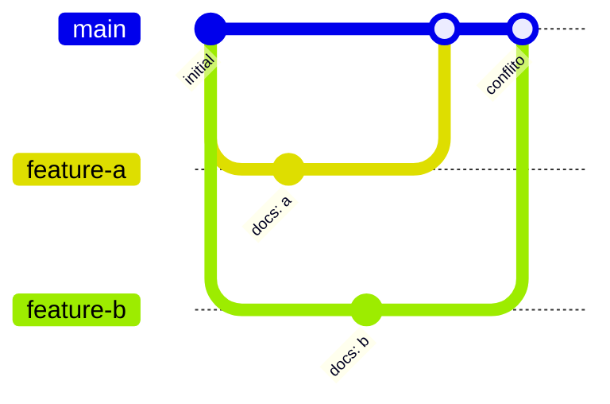

# 04. GitHub: branches, merge, pull request e conflitos

> ⏱️ ~1h30 · Módulo 0 · Pré-requisitos: [03](03-git-local.md)

## 🎯 Objetivos
Ao final desta aula você consegue:
- Conectar um repositório local a um remoto no GitHub (`push`, `pull`, `clone`)
- Trabalhar em branches e integrá-las com merge
- Abrir, revisar e mesclar um pull request
- Resolver um conflito de merge
- Autenticar-se com segurança (2FA e SSH/`gh`)

## 🤔 Por que isso importa
Em um time ninguém trabalha direto na `main`. O fluxo é: criar branch → commitar → abrir PR → receber revisão → mesclar. O GitHub também é seu portfólio: recrutadores abrem o seu perfil.

## 💡 Intuição (explicação simples)
Imagine um documento compartilhado numa pasta na nuvem. Em vez de todos editarem o mesmo arquivo ao mesmo tempo, cada pessoa **tira uma cópia (branch)**, edita sozinha e depois pede: “por favor, revisem e incorporem minha cópia ao original” (o **pull request**). Se duas pessoas mexeram na mesma linha, alguém precisa decidir qual versão fica (o **conflito**).

## 🔬 Como funciona por dentro
- **Remoto** (`origin`) é uma cópia do repositório em outro lugar (GitHub). `git push` envia seus commits; `git fetch` traz os novos sem integrar; `git pull` = `fetch` + `merge`; `git clone` baixa tudo pela primeira vez.
- **Pull request** não é um recurso do Git, é do GitHub: uma página que compara sua branch com a `main`, com discussão, revisão e checagens automáticas.
- **Merge** cria um commit com dois pais quando as linhas divergiram. Se o Git não consegue combinar sozinho (as duas branches alteraram as mesmas linhas), ele para e marca o **conflito**.



## 🛠️ Exemplo prático
> ⚠️ Os passos 1, 2 e 5 usam uma conta GitHub e **não foram executados pelo autor** (exigem login). Os passos 3 e 4 (branch, merge e conflito) foram executados localmente, e as saídas abaixo são reais.

**1. Autenticar** (uma vez). Ative a autenticação em dois fatores na conta ([docs](https://docs.github.com/en/authentication/securing-your-account-with-two-factor-authentication-2fa)). Depois, o jeito mais simples:
```bash
gh auth login        # escolha GitHub.com, HTTPS ou SSH e siga o navegador
```
Alternativa: [chaves SSH](https://docs.github.com/pt/authentication/connecting-to-github-with-ssh). Nunca cole *tokens* em arquivos versionados.

**2. Criar o repositório remoto e enviar**
```bash
cd ~/projetos/minishop
gh repo create minishop --private --source=. --remote=origin --push
```
Ou crie pelo site, depois:
```bash
git remote add origin git@github.com:SEU_USUARIO/minishop.git
git push -u origin main
```

**3. Branch e merge**
```bash
git switch -c feature/readme-install     # cria e entra na branch
echo "## Como rodar" >> README.md
git commit -am "docs: add run section"
git switch main
git merge feature/readme-install         # fast-forward se a main não andou
git branch -d feature/readme-install
```

**4. Provocando e resolvendo um conflito**
```bash
git switch -c feature-a && echo "linha A" >> README.md && git commit -qam "docs: a"
git switch main && git switch -c feature-b && echo "linha B" >> README.md && git commit -qam "docs: b"
git switch main && git merge feature-a      # entra sem problemas
git merge feature-b
```
```text
Auto-merging README.md
CONFLICT (content): Merge conflict in README.md
Automatic merge failed; fix conflicts and then commit the result.
```
`git status -s` mostra `UU README.md` (alterado dos dois lados). O arquivo ficou assim:
```text
<<<<<<< HEAD
linha A
=======
linha B
>>>>>>> feature-b
```
Entre `<<<<<<< HEAD` e `=======` está a versão da branch atual; entre `=======` e `>>>>>>>`, a que está chegando. Resolva **editando o arquivo** para o resultado correto (neste caso, manter as duas linhas) e **apagando os marcadores**:
```text
linha A
linha B
```
```bash
git add README.md
git commit            # conclui o merge (a mensagem padrão serve)
```
Para desistir: `git merge --abort`. O VS Code mostra botões “Accept Current / Incoming / Both” sobre cada conflito.

**5. Pull request**
```bash
git switch -c feat/add-license
echo "MIT" > LICENSE && git add LICENSE && git commit -m "chore: add license"
git push -u origin feat/add-license
gh pr create --fill          # ou clique no link que o push imprime
gh pr merge --squash --delete-branch   # depois da revisão
git switch main && git pull
```
Em projeto real, a `main` fica protegida: só entra via PR, com revisão e CI verde.

## ⚠️ Erros comuns e boas práticas
| Mensagem | Causa | Solução |
|---|---|---|
| `Permission denied (publickey)` | SSH sem chave cadastrada no GitHub | Gere a chave, cadastre-a, ou use `gh auth login` com HTTPS |
| `rejected ... (non-fast-forward)` / `Updates were rejected` | O remoto tem commits que você não tem | `git pull` (resolva conflitos) e `git push` de novo. **Evite** `--force` |
| `fatal: refusing to merge unrelated histories` | Dois repositórios criados separadamente | Prefira clonar o remoto; avalie `--allow-unrelated-histories` |
| `error: Your local changes would be overwritten by merge` | Alterações não commitadas atrapalham | Commite ou `git stash` antes |
| Conflito aparece e “quebrou o arquivo” | Marcadores `<<<<<<<` ficaram no código | Procure por `<<<<<<<` antes de commitar (`grep -rn "<<<<<<<" .`) |

- PRs **pequenos** (< 400 linhas) são revisados melhor e mais rápido. Descreva o *porquê*, não só o *quê*.
- Nunca faça `git push --force` na `main`. Em branch sua, prefira `--force-with-lease`.
- Atualize sua branch com a `main` com frequência para os conflitos serem pequenos.
- Repositório do MiniShop: crie como **privado** enquanto não houver `.env`/segredos auditados; publique no Módulo 16.

## 🧩 Exercícios
**1. Fixação**
a) Qual a diferença entre `git fetch` e `git pull`?
b) O que significam `<<<<<<< HEAD`, `=======` e `>>>>>>>`?

<details><summary>Solução</summary>

a) `fetch` só baixa as novidades do remoto; `pull` baixa e já integra (merge) na branch atual.
b) Início da versão local (HEAD), separador, e fim da versão que está chegando da outra branch.
</details>

**2. Aplicação no projeto MiniShop**
Publicar o repositório e fazer o primeiro PR.

Critérios de pronto:
- [ ] Repositório `minishop` no GitHub, com README, `.gitignore` e `pyproject.toml`
- [ ] A `main` **não** contém `.env` nem `.venv`
- [ ] Existe um PR mesclado vindo de uma branch `docs/...` ou `feat/...`
- [ ] Você provocou e resolveu um conflito em um repositório de teste (descartável)
- [ ] 2FA ativado na conta

<details><summary>Solução de referência</summary>

```bash
gh repo create minishop --private --source=. --remote=origin --push
git switch -c docs/readme-setup
printf "\n## Setup\n\n    uv sync\n    uv run main.py\n" >> README.md
git commit -am "docs: add setup instructions"
git push -u origin docs/readme-setup
gh pr create --fill && gh pr merge --squash --delete-branch
git switch main && git pull && git log --oneline
```
</details>

**3. Desafio (opcional)**
Em um segundo clone do mesmo repositório (outra pasta), simule “outra pessoa” alterando a mesma linha do README. Resolva o conflito pelo VS Code e abra um PR descrevendo a decisão.

## 🎤 Na entrevista
- **Como você resolve um conflito de merge?** Abro o arquivo, vejo as duas versões entre os marcadores, escolho/combino o resultado correto (conversando com quem escreveu a outra parte, se preciso), removo os marcadores, rodo os testes, `git add` e concluo o merge.
- **O que é um pull request e o que você olha ao revisar um?** Pedido para integrar uma branch, com revisão. Olho: se resolve o problema descrito, legibilidade, testes, riscos de segurança e impacto em outras partes.
- **Por que não usar `git push --force` na main?** Reescreve o histórico compartilhado e pode apagar commits de outras pessoas.

## 📚 Para ir além
- 📄 Documentação oficial: [GitHub Hello World (PT-BR)](https://docs.github.com/pt/get-started/start-your-journey/hello-world). Primeiro repositório, branch e PR, no navegador.
- 📄 Documentação oficial: [Resolvendo conflito de merge pela linha de comando](https://docs.github.com/pt/pull-requests/collaborating-with-pull-requests/addressing-merge-conflicts/resolving-a-merge-conflict-using-the-command-line). Passo a passo oficial.
- 🏋️ Prática extra: [Learn Git Branching](https://learngitbranching.js.org/?locale=pt_BR). Termine as seções “Main” e “Remote”.
- 📑 Artigo/tutorial: [Pro Git, cap. 3 (branches)](https://git-scm.com/book/pt-br/v2). Modelo mental de branch e merge.

## ✅ Checklist da aula
- [ ] Repositório publicado e `origin` configurado
- [ ] Fiz um PR do início ao fim
- [ ] Resolvi um conflito sem deixar marcadores
- [ ] Ativei 2FA
