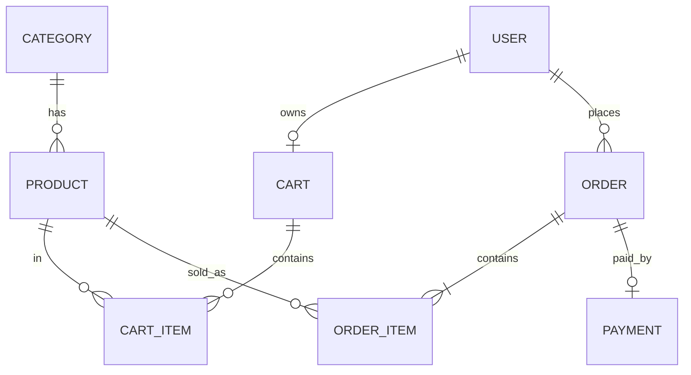
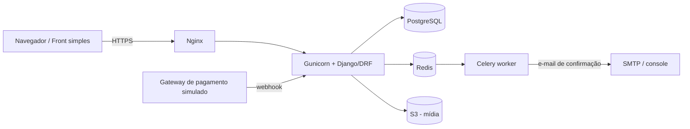

# Projeto central: MiniShop

Loja virtual simples. Os nomes abaixo são **definitivos** e iguais em todas as aulas.

## Domínio e entidades
| Entidade (model) | Campos principais |
|---|---|
| `Category` | `id`, `name`, `slug` |
| `Product` | `id`, `category` (FK), `sku` (único), `name`, `slug` (único), `description`, `price` (Decimal), `stock` (int), `is_active`, `created_at` |
| `User` (Django `AbstractUser`) | `id`, `email`, `password`, … |
| `Cart` / `CartItem` | `user` (1:1) · `cart`, `product`, `quantity` |
| `Order` | `id`, `user`, `status` (`pending`, `paid`, `cancelled`), `total`, `created_at` |
| `OrderItem` | `order`, `product`, `quantity`, `unit_price` (preço congelado no momento da compra) |
| `Payment` | `order` (1:1), `provider_ref`, `status`, `paid_at` |

## Diagrama ER


## Arquitetura alvo


## Regras de negócio fixas
- Dinheiro sempre em `Decimal`, nunca `float`.
- Criar pedido = transação: baixa de estoque + `Order` + `OrderItem`; sem estoque, nada é gravado.
- Pagamento simulado chega por webhook idempotente (`provider_ref` único).
- E-mail de confirmação sai por fila, após o pagamento.

## Estrutura de código
```
minishop/
├── config/          # settings por ambiente
├── apps/{catalog,accounts,cart,orders,payments}/
├── services/  repositories/   # a partir do Módulo 8
├── frontend/        # página simples consumindo a API
├── projeto/sql/     # banco da loja em SQL puro (Módulo 3)
├── docker-compose.yml  Dockerfile  .github/workflows/
└── seed/            # dados de exemplo (fixtures + script)
```
**Seed:** 5 categorias, ~50 produtos, 3 usuários (cliente, cliente 2, admin) — criado no Módulo 3 (SQL) e reaproveitado no 5 (fixtures).
