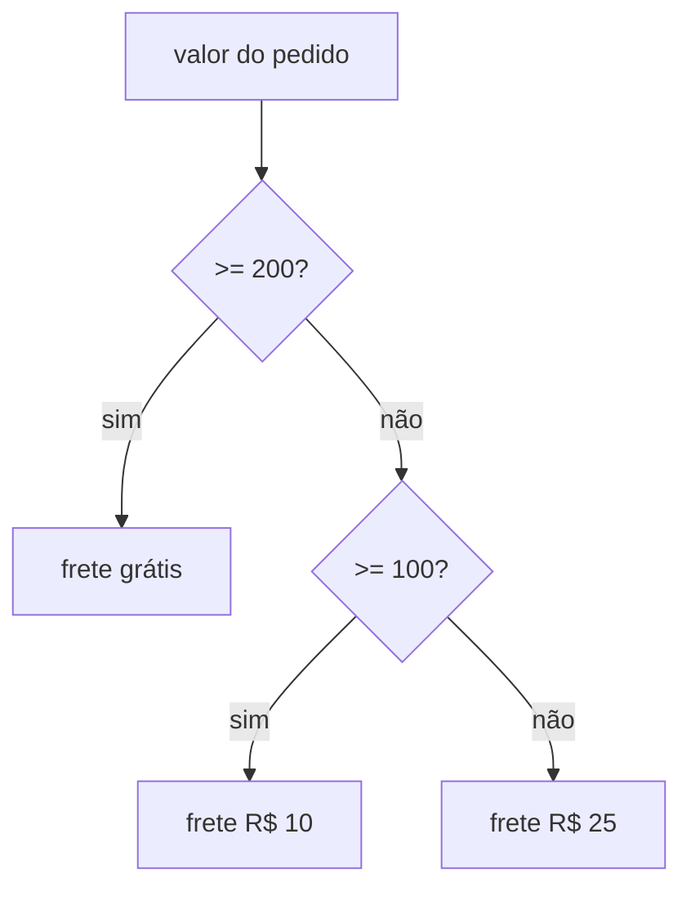

# 02. Condicionais

> ⏱️ ~1h30 · Módulo 1 · Pré-requisitos: [01](01-tipos-variaveis-io.md)

## 🎯 Objetivos
Ao final desta aula você consegue:
- Escrever decisões com `if`, `elif` e `else`
- Combinar condições com `and`, `or`, `not` e entender “curto-circuito”
- Explicar o que é *truthy* e *falsy*
- Usar o operador ternário e `match`
- Evitar erros de lógica nos limites (*off-by-one*)

## 🤔 Por que isso importa
Regras de negócio são condicionais: “frete grátis acima de R$ 200”, “só permite comprar se houver estoque”, “usuário admin vê o painel”. Quase todo bug de lógica nasce em uma condição mal escrita.

## 💡 Intuição (explicação simples)
É o **fluxograma de uma decisão do dia a dia**: “Se estiver chovendo, levo guarda-chuva; senão, se estiver nublado, levo casaco; senão, saio assim.” O computador testa as condições **de cima para baixo** e executa só o primeiro caminho verdadeiro.

## 🔬 Como funciona por dentro

- O Python usa **indentação** (4 espaços) para delimitar blocos. Indentar errado muda o significado ou dá `IndentationError`.
- Qualquer valor pode ser usado como condição. São **falsy**: `False`, `None`, `0`, `0.0`, `""`, `[]`, `{}`, `set()`, `Decimal("0")`. Todo o resto é **truthy**.
- `and`/`or` têm **curto-circuito**: `a and b` só avalia `b` se `a` for truthy. E devolvem um dos operandos, não necessariamente `True`/`False`.
- Comparações podem ser encadeadas: `18 <= idade < 65`.

## 🛠️ Exemplo prático
**1. if / elif / else (frete)**
```python
from decimal import Decimal

def frete(valor: Decimal) -> Decimal:
    if valor >= 200:
        return Decimal("0")
    elif valor >= 100:
        return Decimal("10")
    else:
        return Decimal("25")

for v in ("250", "200", "150", "99.99"):
    print(v, "->", frete(Decimal(v)))
```
```text
250 -> 0
200 -> 0
150 -> 10
99.99 -> 25
```

**2. Truthy/falsy e curto-circuito**
```python
for x in (0, 1, "", "a", [], [0], None):
    print(repr(x), "->", "verdadeiro" if x else "falso")

carrinho = []
print(carrinho and carrinho[0])        # lista vazia: nem avalia carrinho[0]
nome = "" or "Visitante"              # valor padrão
print(nome)
```
```text
0 -> falso
1 -> verdadeiro
'' -> falso
'a' -> verdadeiro
[] -> falso
[0] -> verdadeiro
None -> falso
[]
Visitante
```

**3. Comparação encadeada e operador ternário**
```python
idade = 30
print(18 <= idade < 65)
faixa = "adulto" if idade >= 18 else "menor"
print(faixa)
```
```text
True
adulto
```

**4. `match` (Python 3.10+): vários casos de um mesmo valor**
```python
def descricao_status(status: str) -> str:
    match status:
        case "pending":
            return "Aguardando pagamento"
        case "paid":
            return "Pago"
        case "cancelled" | "refunded":
            return "Encerrado"
        case _:
            return "Status desconhecido"

print(descricao_status("paid"), "|", descricao_status("refunded"), "|", descricao_status("x"))
```
```text
Pago | Encerrado | Status desconhecido
```

## ⚠️ Erros comuns e boas práticas
| Mensagem / sintoma | Causa | Solução |
|---|---|---|
| `IndentationError: expected an indented block after 'if' statement` | Corpo do `if` sem recuo | Recue 4 espaços |
| `SyntaxError: invalid syntax` em `if x = 3:` | `=` em vez de `==` | Use `==` |
| Condição “sempre verdadeira”: `if x == 1 or 2:` | `2` é truthy por si só | `if x == 1 or x == 2:` ou `if x in (1, 2):` |
| Limite errado | `>` onde era `>=` | Teste **nos limites**: 99, 100, 101 |

- Compare com `None` por identidade: `if x is None`, não `== None`.
- Prefira **retornos antecipados** (*guard clauses*) a `if` aninhado em 4 níveis.
- Não escreva `if flag == True`; escreva `if flag`.

## 🧠 Pausa para lógica
**Problema (ano bissexto).** Um ano é bissexto se for divisível por 4, exceto os divisíveis por 100, a menos que também sejam por 400. Escreva `bissexto(ano)` e teste 1900, 2000, 2024 e 2100.

<details><summary>Dica</summary>
Teste a regra mais específica primeiro, ou escreva tudo em uma expressão booleana: <code>(div4 and not div100) or div400</code>.
</details>

<details><summary>Solução comentada</summary>

```python
def bissexto(ano: int) -> bool:
    return (ano % 4 == 0 and ano % 100 != 0) or ano % 400 == 0

print({a: bissexto(a) for a in (1900, 2000, 2024, 2100)})
```
```text
{1900: False, 2000: True, 2024: True, 2100: False}
```
</details>

**Variação mais difícil:** escreva a mesma função com `if/elif/else` sem usar `and`/`or`.

## 🧩 Exercícios
**1. Fixação**
O que imprime `print(bool([]), bool([0]), bool("False"), bool(0.0))`?

<details><summary>Solução</summary>

```python
print(bool([]), bool([0]), bool("False"), bool(0.0))
```
```text
False True True False
```
Lista vazia é falsa; lista com um elemento é verdadeira (mesmo sendo `0`); qualquer texto não vazio é verdadeiro, até `"False"`.
</details>

**2. Aplicação no projeto MiniShop**
Crie `src/regras.py` com `desconto(valor, cliente_vip)`: 10% acima de R$ 100, mais 5% extra se for VIP; nunca passa de 15%.

Critérios de pronto:
- [ ] Usa `Decimal` e devolve o valor final
- [ ] Testado manualmente nos limites: 99.99, 100, 100.01, com e sem VIP
- [ ] Sem `if` aninhado em mais de 2 níveis
- [ ] Commit `feat: add discount rules`

<details><summary>Solução de referência</summary>

```python
from decimal import Decimal

def desconto(valor: Decimal, cliente_vip: bool) -> Decimal:
    pct = Decimal("0")
    if valor > 100:
        pct += Decimal("0.10")
    if cliente_vip:
        pct += Decimal("0.05")
    pct = min(pct, Decimal("0.15"))
    return (valor * (1 - pct)).quantize(Decimal("0.01"))

for v, vip in (("99.99", False), ("100", False), ("100.01", True), ("100.01", False)):
    print(v, vip, desconto(Decimal(v), vip))
```
```text
99.99 False 99.99
100 False 100.00
100.01 True 85.01
100.01 False 90.01
```
Observe: “acima de R$ 100” é `>`, então 100 não ganha o desconto.
</details>

**3. Desafio (opcional)**
Reescreva `frete` usando uma tabela (lista de tuplas `(limite, valor)`) em vez de `if/elif`. Qual é mais fácil de mudar?

## 🎤 Na entrevista
- **O que é *truthy*/*falsy*?** Valores que, usados como condição, valem verdadeiro ou falso. Falsy: `False`, `None`, `0`, vazios (`""`, `[]`, `{}`, `set()`).
- **Diferença entre `==` e `is`?** `==` compara valores; `is` compara identidade (mesmo objeto). Use `is` para `None`.
- **O que é curto-circuito?** `and`/`or` param de avaliar assim que o resultado é conhecido, o que permite `if lista and lista[0] > 3` sem erro.

## 📚 Para ir além
- 📄 Documentação oficial: [if, for e match no tutorial](https://docs.python.org/3/tutorial/controlflow.html). Referência de `if`, `match` e demais controles.
- 📄 Documentação oficial: [Testes de valor verdade](https://docs.python.org/3/library/stdtypes.html#truth-value-testing). Lista exata do que é falsy.
- 🏋️ Prática extra: escreva `fizzbuzz(n)` de 1 a 30 (múltiplos de 3 → Fizz, de 5 → Buzz, de ambos → FizzBuzz).

## ✅ Checklist da aula
- [ ] Testei meus `if` nos valores-limite
- [ ] Sei listar os valores falsy
- [ ] Usei `is None` e não `== None`
- [ ] Fiz o commit do exercício
