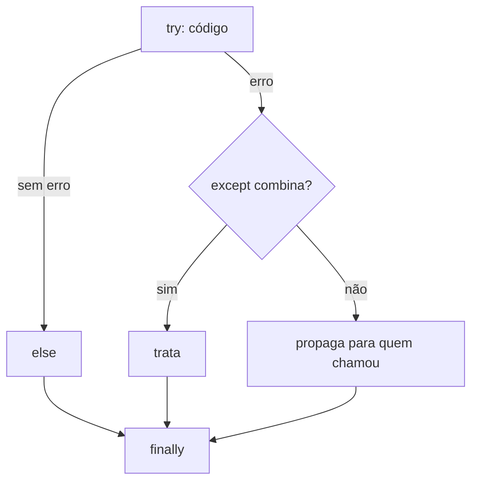

# 08. Exceções

> ⏱️ ~1h30 · Módulo 1 · Pré-requisitos: [07](07-strings-comprehensions.md)

## 🎯 Objetivos
Ao final desta aula você consegue:
- Tratar erros com `try`/`except`/`else`/`finally`
- Levantar exceções com `raise` e criar exceções próprias
- Escolher a exceção certa e capturar de forma específica
- Explicar o fluxo de propagação de uma exceção pela pilha
- Diferenciar validar antes (LBYL) de tentar e tratar (EAFP)

## 🤔 Por que isso importa
O mundo real falha: arquivo inexistente, usuário digita letra no lugar de número, banco fora do ar, estoque insuficiente. Um sistema sem tratamento de erro vira tela branca; um com tratamento ruim esconde bugs. Em web, exceções viram respostas HTTP 400/404/500.

## 💡 Intuição (explicação simples)
Imagine uma linha de produção com **um botão de emergência**. Quando uma estação encontra um problema que não sabe resolver, aperta o botão (`raise`), a esteira para e o alarme sobe pelas estações até alguém responsável (`except`) tratar. Se ninguém trata, a fábrica inteira para (o programa cai com um traceback).

## 🔬 Como funciona por dentro

- Uma exceção é um **objeto** (instância de uma classe que herda de `BaseException`; normalmente `Exception`).
- Ao ser levantada, o interpretador **desempilha** as funções até achar um `except` compatível. O traceback registra esse caminho.
- `else` roda se **não** houve erro; `finally` roda **sempre** (ideal para liberar recursos).
- Hierarquia útil: `Exception` → `ValueError`, `TypeError`, `KeyError`/`IndexError` (ambas `LookupError`), `ZeroDivisionError`, `FileNotFoundError` (`OSError`).
- Mensagens ruins nascem de `except:` sem tipo ou `except Exception: pass`, que **engolem** bugs.

## 🛠️ Exemplo prático
**1. try / except / else / finally**
```python
def dividir(a, b):
    try:
        r = a / b
    except ZeroDivisionError:
        print("não dá para dividir por zero")
        return None
    else:
        print("divisão ok")
        return r
    finally:
        print("fim da tentativa")

print(dividir(10, 2))
print(dividir(1, 0))
```
```text
divisão ok
fim da tentativa
5.0
não dá para dividir por zero
fim da tentativa
None
```

**2. Vários tipos e acesso à exceção**
```python
def ler_quantidade(texto):
    try:
        qtd = int(texto)
    except ValueError as e:
        print("erro:", e)
        return 0
    return qtd

print(ler_quantidade("5"), ler_quantidade("cinco"))
```
```text
erro: invalid literal for int() with base 10: 'cinco'
5 0
```

**3. `raise` e exceção própria (regra de negócio)**
```python
class EstoqueInsuficiente(Exception):
    def __init__(self, sku, pedido, disponivel):
        super().__init__(f"{sku}: pedido {pedido}, disponível {disponivel}")
        self.sku, self.pedido, self.disponivel = sku, pedido, disponivel

estoque = {"MS-01": 3}

def baixar(sku, qtd):
    if qtd <= 0:
        raise ValueError("quantidade deve ser positiva")
    if estoque[sku] < qtd:
        raise EstoqueInsuficiente(sku, qtd, estoque[sku])
    estoque[sku] -= qtd

for sku, qtd in (("MS-01", 2), ("MS-01", 5), ("MS-01", 0), ("XX", 1)):
    try:
        baixar(sku, qtd)
        print("ok", sku, qtd)
    except EstoqueInsuficiente as e:
        print("sem estoque ->", e)
    except ValueError as e:
        print("dado inválido ->", e)
    except KeyError as e:
        print("SKU inexistente ->", e)
```
```text
ok MS-01 2
sem estoque -> MS-01: pedido 5, disponível 1
dado inválido -> quantidade deve ser positiva
SKU inexistente -> 'XX'
```

**4. Propagação e `raise ... from`**
```python
def camada_baixa():
    return int("x")

def camada_alta():
    try:
        camada_baixa()
    except ValueError as e:
        raise RuntimeError("falha ao carregar produto") from e   # preserva a causa

try:
    camada_alta()
except RuntimeError as e:
    print(e, "| causa:", repr(e.__cause__))
```
```text
falha ao carregar produto | causa: ValueError("invalid literal for int() with base 10: 'x'")
```

**5. EAFP vs LBYL**
```python
cadastro = {"a": 1}
# LBYL: olhar antes de pular
if "b" in cadastro:
    v = cadastro["b"]
else:
    v = 0
# EAFP: é mais fácil pedir perdão (estilo Python)
try:
    v2 = cadastro["b"]
except KeyError:
    v2 = 0
print(v, v2)
```
```text
0 0
```

## ⚠️ Erros comuns e boas práticas
- **`except:` ou `except Exception: pass`** esconde bugs. Capture o tipo específico e registre (log) ou propague.
- Coloque no `try` **só** a linha que pode falhar, não o programa todo.
- Não use exceção para fluxo normal de alto volume; é mais lenta que um `if`.
- Não retorne `None`/`-1` “para indicar erro” sem necessidade; levante uma exceção com mensagem útil.
- Mensagens reais: `FileNotFoundError: [Errno 2] No such file or directory: 'x.csv'`, `KeyError: 'sku'`, `ValueError: invalid literal for int() with base 10: 'abc'`, `AttributeError: 'NoneType' object has no attribute 'nome'` (muito comum: uma função devolveu `None` e você a usou como objeto).

## 🧠 Pausa para lógica
**Problema (entrada válida).** Escreva `ler_inteiro_positivo(texto)` que devolve o `int` ou levanta `ValueError` com mensagem clara se for vazio, não numérico ou ≤ 0. Depois, um laço que pede até receber um valor válido (máximo 3 tentativas).

<details><summary>Dica</summary>
Use <code>.strip()</code>, converta dentro de <code>try</code> e valide o intervalo fora do <code>try</code>. Para o laço, <code>for tentativa in range(3)</code> com <code>return</code> no sucesso.
</details>

<details><summary>Solução comentada</summary>

```python
def ler_inteiro_positivo(texto: str) -> int:
    texto = texto.strip()
    if not texto:
        raise ValueError("valor vazio")
    try:
        n = int(texto)
    except ValueError:
        raise ValueError(f"'{texto}' não é um número inteiro") from None
    if n <= 0:
        raise ValueError("o valor deve ser maior que zero")
    return n

for tentativa in range(3):
    try:
        qtd = ler_inteiro_positivo(input("Quantidade: "))
        break
    except ValueError as e:
        print("  inválido:", e)
else:
    qtd = None
print("resultado:", qtd)
```
```text
Quantidade: abc
  inválido: 'abc' não é um número inteiro
Quantidade: 
  inválido: valor vazio
Quantidade: -4
  inválido: o valor deve ser maior que zero
resultado: None
```
Neste exemplo, as três entradas (`abc`, vazio, `-4`) falham e o laço termina com `None`; a 4ª resposta (`7`) nunca é lida porque o máximo é 3 tentativas.
</details>

**Variação mais difícil:** faça o laço aceitar o valor `7` trocando o limite para 4 tentativas e escreva um teste para cada caminho.

## 🧩 Exercícios
**1. Fixação**
Que exceção cada linha levanta? `int("3.5")`, `[1,2][5]`, `{}["a"]`, `None.nome`, `"a" + 1`.

<details><summary>Solução</summary>

```python
casos = [lambda: int("3.5"), lambda: [1, 2][5], lambda: {}["a"], lambda: None.nome, lambda: "a" + 1]
for f in casos:
    try:
        f()
    except Exception as e:
        print(type(e).__name__)
```
```text
ValueError
IndexError
KeyError
AttributeError
TypeError
```
</details>

**2. Aplicação no projeto MiniShop**
Em `src/erros.py`, defina `MiniShopError` (base), `ProdutoNaoEncontrado` e `EstoqueInsuficiente`. Use-as em uma função `retirar_do_estoque(catalogo, sku, qtd)`.

Critérios de pronto:
- [ ] Todas as exceções herdam de `MiniShopError`
- [ ] Mensagens incluem SKU e quantidades
- [ ] Quem chama consegue capturar `MiniShopError` para tratar qualquer erro de negócio
- [ ] Commit `feat: add domain exceptions`

<details><summary>Solução de referência</summary>

```python
class MiniShopError(Exception):
    """Base de todos os erros de negócio."""

class ProdutoNaoEncontrado(MiniShopError):
    pass

class EstoqueInsuficiente(MiniShopError):
    pass

def retirar_do_estoque(catalogo, sku, qtd):
    if sku not in catalogo:
        raise ProdutoNaoEncontrado(f"SKU {sku} não existe")
    if catalogo[sku] < qtd:
        raise EstoqueInsuficiente(f"SKU {sku}: pedido {qtd}, disponível {catalogo[sku]}")
    catalogo[sku] -= qtd

cat = {"MS-01": 3}
for sku, q in (("MS-01", 2), ("MS-01", 5), ("ZZ", 1)):
    try:
        retirar_do_estoque(cat, sku, q)
        print("ok", cat)
    except MiniShopError as e:
        print(type(e).__name__, "->", e)
```
```text
ok {'MS-01': 1}
EstoqueInsuficiente -> SKU MS-01: pedido 5, disponível 1
ProdutoNaoEncontrado -> SKU ZZ não existe
```
</details>

**3. Desafio (opcional)**
Crie um decorator-like simples (função que recebe outra) `tentar_novamente(f, vezes)` que repete a chamada se levantar `ConnectionError`. (Prévia de retentativas, Módulo 7.)

## 🎤 Na entrevista
- **Qual a diferença entre `except Exception` e `except:`?** `except:` captura tudo, inclusive `KeyboardInterrupt` e `SystemExit`; ambos são desaconselhados sem necessidade. Prefira o tipo específico.
- **Quando roda o `finally`?** Sempre, com ou sem exceção; serve para liberar recursos.
- **Para que serve `raise ... from e`?** Encadear a exceção original como causa, preservando o contexto para depuração.

## 📚 Para ir além
- 📄 Documentação oficial: [Tutorial: erros e exceções](https://docs.python.org/3/tutorial/errors.html). try/except/else/finally e exceções próprias.
- 📄 Documentação oficial: [Hierarquia de exceções embutidas](https://docs.python.org/3/library/exceptions.html#exception-hierarchy). Árvore completa de classes.
- 🏋️ Prática extra: leia 10 tracebacks de erros reais (Stack Overflow) e identifique o tipo e a linha de cada um.

## ✅ Checklist da aula
- [ ] Capturei exceções específicas, nunca `except:` solto
- [ ] Criei a hierarquia `MiniShopError`
- [ ] Usei `raise ... from`
- [ ] Fiz o commit do exercício
