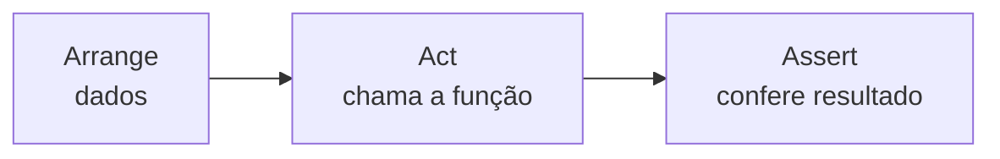

# 11. Testes com pytest (primeiros passos)

> ⏱️ ~1h30 · Módulo 1 · Pré-requisitos: [08](08-excecoes.md), [10](10-modulos-pacotes.md)

## 🎯 Objetivos
Ao final desta aula você consegue:
- Instalar o pytest e rodar testes pela linha de comando
- Escrever testes com `assert` seguindo o padrão Arrange-Act-Assert
- Testar exceções com `pytest.raises`
- Reduzir repetição com `@pytest.mark.parametrize`
- Ler a saída de uma falha e corrigir o código

## 🤔 Por que isso importa
Vagas júnior citam testes automatizados como requisito ou diferencial (40% das vagas na nossa amostra do LinkedIn). Testes permitem mudar o código sem medo, são a base do CI (Módulo 12) e provam que seu portfólio funciona.

## 💡 Intuição (explicação simples)
Testar à mão é **provar a cadeira sentando nela toda vez que mexer na perna**. Um teste automatizado é uma **máquina de inspeção na fábrica**: roda em segundos, sempre da mesma forma, e apita quando algo quebra. Cada teste é uma pergunta com resposta conhecida: “se eu chamar `desconto(100)`, devo obter `90`?”.

## 🔬 Como funciona por dentro
- O pytest **descobre** arquivos `test_*.py` (ou `*_test.py`) e dentro deles funções `test_*`. Executa cada uma isoladamente.
- Um teste passa se terminar sem exceção; falha se uma exceção (como `AssertionError`) escapar.
- O pytest **reescreve** os `assert` para mostrar valores intermediários quando falha: por isso basta `assert resultado == esperado`, sem `assertEqual`.
- Padrão **AAA**: *Arrange* (preparar dados), *Act* (executar), *Assert* (verificar).
- Um bom teste é pequeno, rápido, independente dos outros e tem nome que descreve o comportamento: `test_desconto_nao_passa_de_15_por_cento`.



## 🛠️ Exemplo prático
Instalação no projeto: `uv add --dev pytest` e rodar com `uv run pytest`. Os blocos abaixo usam um mini-projeto temporário.

**1. O código a testar**
```python
from decimal import Decimal

def desconto(valor: Decimal, vip: bool = False) -> Decimal:
    """10% acima de 100; +5% se VIP; teto de 15%."""
    if valor < 0:
        raise ValueError("valor negativo")
    pct = Decimal("0")
    if valor > 100:
        pct += Decimal("0.10")
    if vip:
        pct += Decimal("0.05")
    return (valor * (1 - min(pct, Decimal("0.15")))).quantize(Decimal("0.01"))
```

**2. Os testes**
```python
from decimal import Decimal
import pytest
from regras import desconto

def test_sem_desconto_abaixo_de_100():
    assert desconto(Decimal("99.99")) == Decimal("99.99")

def test_limite_exato_nao_tem_desconto():
    assert desconto(Decimal("100")) == Decimal("100.00")

def test_vip_acumula_ate_15_por_cento():
    assert desconto(Decimal("200"), vip=True) == Decimal("170.00")

def test_valor_negativo_levanta_erro():
    with pytest.raises(ValueError, match="negativo"):
        desconto(Decimal("-1"))

@pytest.mark.parametrize(
    "valor, vip, esperado",
    [
        ("50", False, "50.00"),
        ("50", True, "47.50"),
        ("100.01", False, "90.01"),
        ("1000", True, "850.00"),
    ],
)
def test_varios_casos(valor, vip, esperado):
    assert desconto(Decimal(valor), vip) == Decimal(esperado)
```

**3. Rodar**
```bash
python -m pytest -q -p no:cacheprovider
```
```text
........                                                                 [100%]
8 passed in 0.01s
```

**4. Ver uma falha de verdade.** Vamos “quebrar” a regra (trocar `>` por `>=`) e rodar de novo:
```bash
sed -i 's/valor > 100/valor >= 100/' regras.py
python -m pytest -q -p no:cacheprovider 2>&1 | tail -12
sed -i 's/valor >= 100/valor > 100/' regras.py
```
```text

    def test_limite_exato_nao_tem_desconto():
>       assert desconto(Decimal("100")) == Decimal("100.00")
E       AssertionError: assert Decimal('90.00') == Decimal('100.00')
E        +  where Decimal('90.00') = desconto(Decimal('100'))
E        +    where Decimal('100') = Decimal('100')
E        +  and   Decimal('100.00') = Decimal('100.00')

test_regras.py:9: AssertionError
=========================== short test summary info ============================
FAILED test_regras.py::test_limite_exato_nao_tem_desconto - AssertionError: a...
1 failed, 7 passed in 0.01s
```
Leia de baixo para cima: o resumo no fim diz qual teste falhou (`FAILED ...`); acima, a linha do `assert` com os valores reais (`Decimal('90.00') == Decimal('100.00')`). O teste de limite pegou o bug que uma revisão rápida deixaria passar.

**5. Opções úteis**
```bash
uv run pytest -x            # para no primeiro erro
uv run pytest -k vip        # só testes cujo nome contém "vip"
uv run pytest -v            # lista cada teste
uv run pytest tests/test_regras.py::test_valor_negativo_levanta_erro   # um teste
```

## ⚠️ Erros comuns e boas práticas
| Mensagem | Causa | Solução |
|---|---|---|
| `no tests ran` / `collected 0 items` | Arquivo ou função sem prefixo `test_` | Renomeie |
| `ModuleNotFoundError: No module named 'regras'` | O pytest não achou seu código | Rode da raiz do projeto; configure `pythonpath` em `pyproject.toml` (`[tool.pytest.ini_options] pythonpath = ["."]`) |
| `AssertionError` com `assert 90.0 == 100.0` | Comportamento diferente do esperado | Leia os valores; corrija o código **ou** o teste, se o teste estava errado |
| Teste passa sozinho, falha em conjunto | Teste depende de estado de outro | Torne cada teste independente |

- Teste comportamento, não implementação.
- Teste os **limites** (99,99 / 100 / 100,01), o caso vazio e o caso de erro.
- Nunca escreva testes que dependem de ordem, relógio, internet ou arquivos globais sem controle (Módulo 10 mostra `fixtures` e `mocks`).
- Um teste que nunca falha não testa nada: quebre o código de propósito para vê-lo falhar.

## 🧠 Pausa para lógica
**Problema (testar primeiro).** Escreva, **antes** da função, os testes de `eh_palindromo(texto)`: ignora maiúsculas, espaços e acentos. Depois implemente até passar. (Prévia de TDD.)

<details><summary>Dica</summary>
Casos: <code>"Ana"</code>, uma frase com acentos e pontuação (<code>"Socorram-me, subi no ônibus em Marrocos"</code>), um texto que não é palíndromo, o vazio e um único caractere.
</details>

<details><summary>Solução comentada</summary>

```python
import re, unicodedata

def eh_palindromo(texto: str) -> bool:
    base = unicodedata.normalize("NFKD", texto).encode("ascii", "ignore").decode().lower()
    limpo = re.sub(r"[^a-z0-9]", "", base)
    return limpo == limpo[::-1]

assert eh_palindromo("Ana")
assert eh_palindromo("Socorram-me, subi no ônibus em Marrocos")
assert not eh_palindromo("Python")
assert eh_palindromo("")           # decisão: vazio é palíndromo
```
Repare que o caso “vazio” é uma **decisão de projeto** que o teste documenta.
</details>

**Variação mais difícil:** transforme os `assert` em `parametrize` e acrescente números (`"12321"`).

## 🧩 Exercícios
**1. Fixação**
Escreva `test_` para `max_de_tres(a, b, c)` cobrindo: maior no início, no meio, no fim e empate.

<details><summary>Solução</summary>

```python
import pytest

def max_de_tres(a, b, c):
    return max(a, b, c)

@pytest.mark.parametrize("a,b,c,esp", [(3, 1, 2, 3), (1, 3, 2, 3), (1, 2, 3, 3), (2, 2, 1, 2)])
def test_max(a, b, c, esp):
    assert max_de_tres(a, b, c) == esp

test_max(3, 1, 2, 3)
```
</details>

**2. Aplicação no projeto MiniShop**
Crie a pasta `tests/` e escreva testes para `slugify` (aula 07), `total_carrinho` (aula 04) e `EstoqueInsuficiente` (aula 08).

Critérios de pronto:
- [ ] `uv add --dev pytest` feito e `uv run pytest` verde
- [ ] Pelo menos 8 testes, com 1 `parametrize` e 1 `pytest.raises`
- [ ] Você quebrou uma função de propósito e viu o teste falhar
- [ ] `pythonpath` configurado em `pyproject.toml`
- [ ] Commit `test: add unit tests for helpers`

<details><summary>Solução de referência</summary>

```toml
# pyproject.toml
[tool.pytest.ini_options]
pythonpath = ["."]
testpaths = ["tests"]
```
```python
# tests/test_texto.py
import pytest
from minishop_cli.texto import slugify

@pytest.mark.parametrize("entrada, esperado", [
    ("Teclado Mecânico RGB", "teclado-mecanico-rgb"),
    ("  Café & Pão!  ", "cafe-pao"),
    ("", ""),
    ("@@@", ""),
])
def test_slugify(entrada, esperado):
    assert slugify(entrada) == esperado
```
</details>

**3. Desafio (opcional)**
Rode `uv run pytest --durations=3` e descubra qual teste é o mais lento. Instale `pytest-cov` e veja a cobertura (`uv run pytest --cov`).

## 🎤 Na entrevista
- **O que é um bom teste unitário?** Pequeno, rápido, independente, determinístico, com nome descritivo e que verifica um comportamento.
- **Para que serve `parametrize`?** Rodar o mesmo teste com vários conjuntos de dados sem duplicar código.
- **Teste unitário vs de integração?** Unitário isola uma peça (sem banco/rede); integração verifica peças trabalhando juntas (ex.: view + banco).

## 📚 Para ir além
- 📄 Documentação oficial: [pytest: get started](https://docs.pytest.org/en/stable/getting-started.html). Instalação e primeiros testes.
- 📄 Documentação oficial: [parametrize](https://docs.pytest.org/en/stable/how-to/parametrize.html). Como parametrizar.
- 🏋️ Prática extra: reescreva o `fizzbuzz` da aula 02 guiado por testes.

## ✅ Checklist da aula
- [ ] `uv run pytest` verde
- [ ] Vi um teste falhar e li a mensagem
- [ ] Testei limites e erros
- [ ] Fiz o commit do exercício
