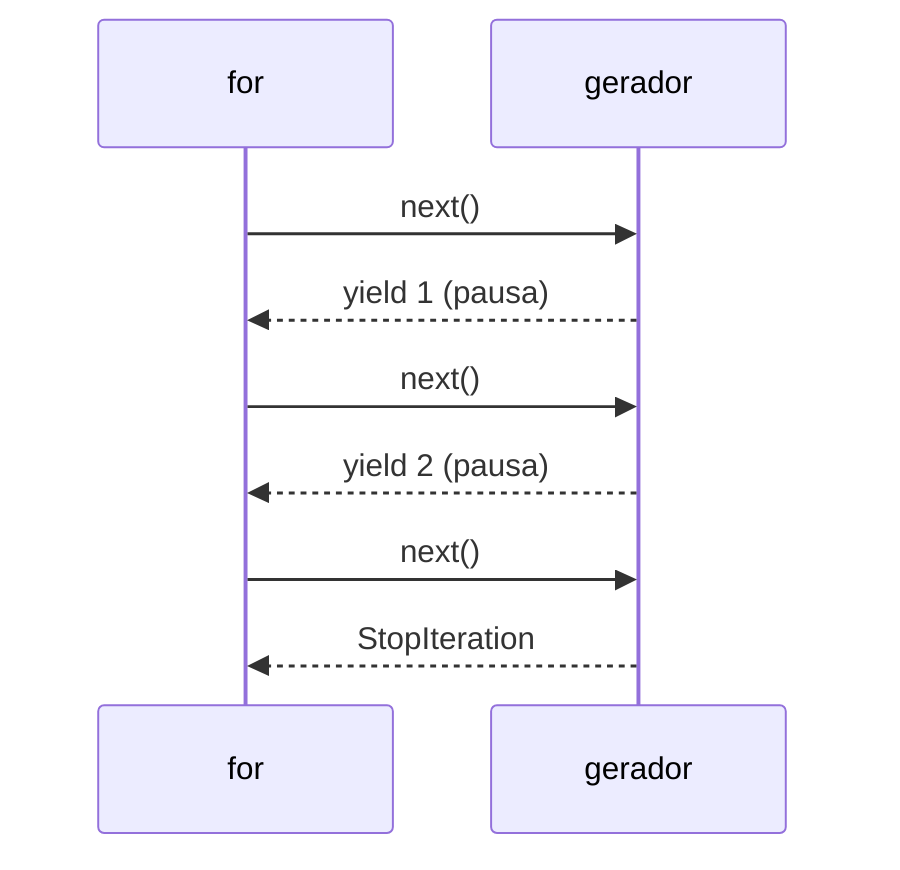

# 15. Iteradores e geradores

> ⏱️ ~1h30 · Módulo 1 · Pré-requisitos: [03](03-lacos.md), [07](07-strings-comprehensions.md), [14](14-metodos-especiais-type-hints.md)

## 🎯 Objetivos
Ao final desta aula você consegue:
- Explicar o protocolo de iteração (`__iter__` e `__next__`) e o que o `for` faz
- Escrever funções geradoras com `yield`
- Usar expressões geradoras e `itertools` básicos
- Explicar por que geradores economizam memória
- Reconhecer onde o Django usa avaliação preguiçosa (QuerySets)

## 🤔 Por que isso importa
Para ler um arquivo de 2 GB ou 1 milhão de linhas do banco, você não pode carregar tudo na memória. Geradores processam item a item. O ORM do Django é preguiçoso: `Product.objects.filter(...)` não vai ao banco até você iterar. Entender isso evita consultas desnecessárias.

## 💡 Intuição (explicação simples)
Uma **lista** é um **livro inteiro impresso**: está tudo pronto na estante, ocupando espaço. Um **gerador** é um **contador de histórias**: conta a próxima frase só quando você pede, e não precisa saber o final de antemão. Você pode até ter um contador de histórias que nunca acaba (infinito), algo impossível em um livro.

## 🔬 Como funciona por dentro
- **Iterável**: objeto que sabe devolver um iterador (`__iter__`). **Iterador**: objeto com `__next__` que entrega o próximo valor e levanta `StopIteration` ao acabar.
- O `for x in obj:` faz: `it = iter(obj)`; repete `x = next(it)` até `StopIteration`.
- Uma **função geradora** contém `yield`. Chamá-la **não executa** o corpo: devolve um gerador. A cada `next()`, a função roda até o próximo `yield`, **congela** (guarda variáveis locais e posição) e devolve o valor.
- Um gerador só pode ser percorrido **uma vez** (é “consumido”).
- Memória: lista de 1 milhão = ~8 MB só de referências; gerador = poucas centenas de bytes.



## 🛠️ Exemplo prático
**1. O que o `for` faz por baixo**
```python
nums = [10, 20]
it = iter(nums)
print(next(it), next(it))
try:
    next(it)
except StopIteration:
    print("acabou")
```
```text
10 20
acabou
```

**2. Escrevendo um iterador “na mão”**
```python
class Contagem:
    def __init__(self, ate): self.ate, self.n = ate, 0
    def __iter__(self): return self
    def __next__(self):
        if self.n >= self.ate:
            raise StopIteration
        self.n += 1
        return self.n

print(list(Contagem(3)))
```
```text
[1, 2, 3]
```

**3. A mesma coisa com `yield` (bem mais curto)**
```python
def contagem(ate):
    n = 0
    while n < ate:
        n += 1
        yield n            # pausa aqui e devolve n

g = contagem(3)
print(g, next(g), list(g), list(g))     # gerador é consumido: a 2ª list() vem vazia
```
```text
<generator object contagem at 0x74380a276800> 1 [2, 3] []
```

**4. Geradores para dados grandes (paginação sem carregar tudo)**
```python
def paginas(itens, tamanho):
    for i in range(0, len(itens), tamanho):
        yield itens[i:i + tamanho]

print(list(paginas(list(range(1, 8)), 3)))

def linhas_com_erro(linhas):
    for n, linha in enumerate(linhas, start=1):
        if "ERROR" in linha:
            yield n, linha.strip()

log = ["ok\n", "ERROR disco\n", "ok\n", "ERROR rede\n"]
print(list(linhas_com_erro(log)))
```
```text
[[1, 2, 3], [4, 5, 6], [7]]
[(2, 'ERROR disco'), (4, 'ERROR rede')]
```

**5. Expressão geradora e memória**
```python
import sys
lista = [n * n for n in range(1_000_000)]
gen = (n * n for n in range(1_000_000))
print(sys.getsizeof(lista) > 1_000_000, sys.getsizeof(gen) < 300)
print(sum(gen))
```
```text
True True
333332833333500000
```

**6. `itertools`**
```python
from itertools import islice, count, chain, groupby

def naturais():
    n = 1
    while True:                  # gerador infinito
        yield n
        n += 1

print(list(islice(naturais(), 5)), list(islice(count(10, 5), 3)))
print(list(chain([1, 2], (3,), "ab")))
vendas = sorted([("mouse", 1), ("cabo", 2), ("mouse", 5)])
print({k: sum(q for _, q in g) for k, g in groupby(vendas, key=lambda t: t[0])})
```
```text
[1, 2, 3, 4, 5] [10, 15, 20]
[1, 2, 3, 'a', 'b']
{'cabo': 2, 'mouse': 6}
```

## ⚠️ Erros comuns e boas práticas
| Mensagem / sintoma | Causa | Solução |
|---|---|---|
| Segundo `list(gen)` vem vazio | Gerador já foi consumido | Recrie o gerador ou guarde em lista |
| `TypeError: 'generator' object is not subscriptable` | Tentou `gen[0]` | Converta com `list()` ou use `next()` |
| `TypeError: 'int' object is not iterable` | Passou número onde esperava iterável | Use `range(n)` |
| `StopIteration` escapando | `next()` sem `default` num iterador vazio | `next(it, None)` |

- Use gerador quando só precisa percorrer uma vez; use lista quando precisa de `len`, índice ou várias passadas.
- `groupby` só agrupa elementos **consecutivos**: ordene antes.
- Em Django, `queryset.iterator()` evita carregar tudo; `.count()` é melhor que `len(queryset)`.

## 🧠 Pausa para lógica
**Problema (Fibonacci infinito).** Crie um gerador `fibonacci()` infinito e use-o para (a) os 10 primeiros valores, (b) o primeiro valor acima de 1000.

<details><summary>Dica</summary>
Mantenha dois valores <code>a, b = 0, 1</code>, faça <code>yield a</code> e atualize com <code>a, b = b, a + b</code>. Use <code>islice</code> e <code>next</code> com expressão geradora.
</details>

<details><summary>Solução comentada</summary>

```python
from itertools import islice

def fibonacci():
    a, b = 0, 1
    while True:
        yield a
        a, b = b, a + b

print(list(islice(fibonacci(), 10)))
print(next(n for n in fibonacci() if n > 1000))
```
```text
[0, 1, 1, 2, 3, 5, 8, 13, 21, 34]
1597
```
Nunca existe uma lista infinita na memória: cada valor é calculado quando pedido.
</details>

**Variação mais difícil:** gere todos os números primos com um gerador e pegue o 100º.

## 🧩 Exercícios
**1. Fixação**
Escreva um gerador `pares(limite)` que produz os pares de 0 até `limite` (inclusive).

<details><summary>Solução</summary>

```python
def pares(limite):
    for n in range(0, limite + 1, 2):
        yield n
print(list(pares(10)))
```
```text
[0, 2, 4, 6, 8, 10]
```
</details>

**2. Aplicação no projeto MiniShop**
Em `minishop_cli/importacao.py`, crie `ler_produtos_csv(caminho)` como **gerador** que lê o CSV linha a linha e produz `Produto`; as linhas inválidas são ignoradas e contadas (use uma classe ou retorne `(produto, erro)`).

Critérios de pronto:
- [ ] A função usa `yield` e não monta lista com o arquivo todo
- [ ] Testada com um CSV de 3 linhas (1 inválida) via `tmp_path` do pytest
- [ ] Você mediu a memória/tempo com um CSV de 200 mil linhas gerado por script
- [ ] Commit `feat: stream csv import with a generator`

<details><summary>Solução de referência</summary>

```python
import csv, io
from decimal import Decimal, InvalidOperation

def ler_produtos_csv(arquivo):
    """Gera (linha, produto, erro); produto é dict ou None."""
    for n, row in enumerate(csv.DictReader(arquivo), start=2):
        try:
            yield n, {"sku": row["sku"], "nome": row["nome"], "preco": Decimal(row["preco"]), "qtd": int(row["qtd"])}, None
        except (InvalidOperation, ValueError, KeyError) as e:
            yield n, None, str(e)

dados = io.StringIO("sku,nome,preco,qtd\nA,Mouse,10.5,2\nB,Cabo,xx,1\nC,Hub,5,3\n")
for n, prod, erro in ler_produtos_csv(dados):
    print(n, prod["sku"] if prod else "ERRO")
```
```text
2 A
3 ERRO
4 C
```
</details>

**3. Desafio (opcional)**
Use `yield from` para achatar uma lista de listas aninhadas em qualquer profundidade (`achatar([1,[2,[3]]])`).

## 🎤 Na entrevista
- **Diferença entre iterável e iterador?** Iterável tem `__iter__` e devolve um iterador; iterador tem `__next__` e mantém a posição. Um iterador também é iterável.
- **O que `yield` faz?** Pausa a função, devolve um valor e preserva o estado local para retomar no próximo `next()`.
- **Quando preferir gerador a lista?** Quando os dados são grandes ou infinitos e você os percorre uma vez; economiza memória.

## 📚 Para ir além
- 📄 Documentação oficial: [Tutorial: iteradores e geradores](https://docs.python.org/3/tutorial/classes.html#iterators). Protocolo de iteração.
- 📄 Documentação oficial: [`itertools`](https://docs.python.org/3/library/itertools.html). Ferramentas prontas e “receitas”.
- 📄 Documentação oficial: [HOWTO: geradores](https://docs.python.org/3/howto/functional.html#generators). Explicação com exemplos.
- 🏋️ Prática extra: leia um arquivo de log com gerador e conte linhas por nível (INFO/ERROR).

## ✅ Checklist da aula
- [ ] Escrevi um iterador com `__next__` e um gerador com `yield`
- [ ] Observei o gerador ser consumido
- [ ] Comparei memória de lista vs gerador
- [ ] Fiz o commit do exercício
