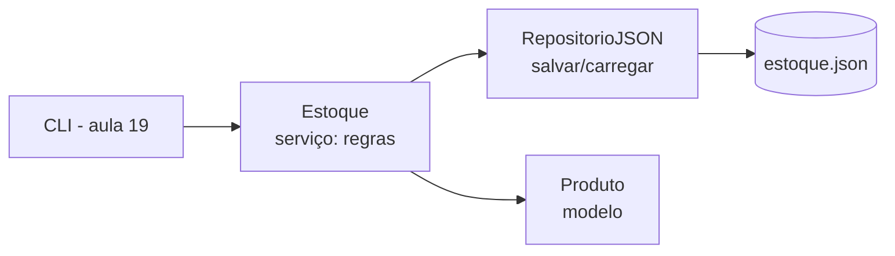

# 18. Mini-projeto: CLI de estoque (parte 1)

> ⏱️ ~1h30 · Módulo 1 · Pré-requisitos: aulas [01](01-tipos-variaveis-io.md) a [17](17-recursao-big-o.md)

## 🎯 Objetivos
Ao final desta aula você consegue:
- Organizar um programa em camadas simples: modelo, repositório e serviço
- Aplicar classes, exceções, `Decimal`, JSON e type hints em conjunto
- Escrever testes que usam arquivos temporários (`tmp_path`)
- Persistir dados de forma segura (gravação atômica)
- Preparar a base que será reaproveitada nos models do Django

## 🤔 Por que isso importa
Juntar tudo em um programa que funciona é o que diferencia “estudei os conceitos” de “sei programar”. A separação **modelo / repositório / serviço** que você fará aqui reaparece no Django (models, managers, services) e no Módulo 8.

## 💡 Intuição (explicação simples)
Uma **loja física**: o **modelo** é a etiqueta do produto (o que ele é); o **repositório** é o armário/almoxarifado (onde se guarda e de onde se tira); o **serviço** é o atendente, que conhece as regras (“não vendo o que não tenho”). O cliente (a CLI, na próxima aula) fala só com o atendente.

## 🔬 Como funciona por dentro

Decisões de projeto:
- `Produto` é uma **dataclass** que valida no `__post_init__`; preço `Decimal`, quantidade `int >= 0`.
- O repositório só sabe **ler e gravar**; o serviço só sabe **regras**; nenhum dos dois imprime nada (quem imprime é a CLI). Isso os torna fáceis de testar.
- Cada operação do serviço salva em seguida. É simples e seguro para um único usuário; o Módulo 3 mostra por que vários usuários simultâneos exigem um banco de verdade.

## 🛠️ Exemplo prático
Estrutura final do projeto:
```text
minishop_cli/
├── __init__.py
├── erros.py
├── modelos.py
├── repositorio.py
└── servico.py
tests/
├── test_modelos.py
└── test_servico.py
```

**1. Erros do domínio**
```python
"""CLI de estoque do MiniShop."""
```
```python
class MiniShopError(Exception):
    """Base de todos os erros de negócio."""

class DadosInvalidos(MiniShopError):
    pass

class SkuDuplicado(MiniShopError):
    pass

class ProdutoNaoEncontrado(MiniShopError):
    pass

class EstoqueInsuficiente(MiniShopError):
    pass

class EstoqueCorrompido(MiniShopError):
    pass
```

**2. Modelo**
```python
from __future__ import annotations

from dataclasses import dataclass
from decimal import Decimal, InvalidOperation

from .erros import DadosInvalidos


@dataclass
class Produto:
    sku: str
    nome: str
    preco: Decimal
    qtd: int = 0

    def __post_init__(self) -> None:
        self.sku = self.sku.strip().upper()
        self.nome = self.nome.strip()
        if not self.sku or not self.nome:
            raise DadosInvalidos("sku e nome são obrigatórios")
        try:
            self.preco = Decimal(str(self.preco))
        except InvalidOperation:
            raise DadosInvalidos(f"preço inválido: {self.preco!r}") from None
        if self.preco < 0:
            raise DadosInvalidos("preço não pode ser negativo")
        if not isinstance(self.qtd, int) or isinstance(self.qtd, bool) or self.qtd < 0:
            raise DadosInvalidos("quantidade deve ser um inteiro >= 0")

    @property
    def valor_em_estoque(self) -> Decimal:
        return self.preco * self.qtd

    def para_dict(self) -> dict:
        return {"sku": self.sku, "nome": self.nome, "preco": str(self.preco), "qtd": self.qtd}

    @classmethod
    def de_dict(cls, d: dict) -> Produto:
        return cls(d["sku"], d["nome"], d["preco"], d["qtd"])
```

**3. Repositório (JSON, gravação atômica)**
```python
import json
from pathlib import Path

from .erros import EstoqueCorrompido
from .modelos import Produto


class RepositorioJSON:
    def __init__(self, caminho: str | Path) -> None:
        self.caminho = Path(caminho)

    def carregar(self) -> dict[str, Produto]:
        try:
            bruto = json.loads(self.caminho.read_text(encoding="utf-8"))
        except FileNotFoundError:
            return {}
        except json.JSONDecodeError as e:
            raise EstoqueCorrompido(f"{self.caminho} está corrompido: {e}") from e
        try:
            return {d["sku"]: Produto.de_dict(d) for d in bruto}
        except (KeyError, TypeError) as e:
            raise EstoqueCorrompido(f"{self.caminho} tem registros inválidos: {e}") from e

    def salvar(self, produtos: dict[str, Produto]) -> None:
        dados = [p.para_dict() for p in produtos.values()]
        tmp = self.caminho.with_suffix(self.caminho.suffix + ".tmp")
        tmp.write_text(json.dumps(dados, indent=2, ensure_ascii=False), encoding="utf-8")
        tmp.replace(self.caminho)          # troca atômica: nunca fica meio gravado
```

**4. Serviço (as regras)**
```python
from decimal import Decimal

from .erros import DadosInvalidos, EstoqueInsuficiente, ProdutoNaoEncontrado, SkuDuplicado
from .modelos import Produto
from .repositorio import RepositorioJSON


class Estoque:
    def __init__(self, repo: RepositorioJSON) -> None:
        self._repo = repo
        self._produtos = repo.carregar()

    def __len__(self) -> int:
        return len(self._produtos)

    def __contains__(self, sku: object) -> bool:
        return isinstance(sku, str) and sku.strip().upper() in self._produtos

    def adicionar(self, sku: str, nome: str, preco, qtd: int = 0) -> Produto:
        produto = Produto(sku, nome, preco, qtd)
        if produto.sku in self._produtos:
            raise SkuDuplicado(f"SKU {produto.sku} já existe")
        self._produtos[produto.sku] = produto
        self._repo.salvar(self._produtos)
        return produto

    def obter(self, sku: str) -> Produto:
        chave = sku.strip().upper()
        try:
            return self._produtos[chave]
        except KeyError:
            raise ProdutoNaoEncontrado(f"SKU {chave} não existe") from None

    def repor(self, sku: str, n: int) -> Produto:
        if n <= 0:
            raise DadosInvalidos("quantidade deve ser positiva")
        produto = self.obter(sku)
        produto.qtd += n
        self._repo.salvar(self._produtos)
        return produto

    def retirar(self, sku: str, n: int) -> Produto:
        if n <= 0:
            raise DadosInvalidos("quantidade deve ser positiva")
        produto = self.obter(sku)
        if n > produto.qtd:
            raise EstoqueInsuficiente(f"{produto.sku}: pedido {n}, disponível {produto.qtd}")
        produto.qtd -= n
        self._repo.salvar(self._produtos)
        return produto

    def listar(self, busca: str = "", ordem: str = "nome") -> list[Produto]:
        termo = busca.strip().lower()
        itens = [p for p in self._produtos.values() if termo in p.nome.lower() or termo in p.sku.lower()]
        chaves = {"nome": lambda p: p.nome.lower(), "preco": lambda p: p.preco, "qtd": lambda p: p.qtd}
        if ordem not in chaves:
            raise DadosInvalidos(f"ordem inválida: {ordem}")
        return sorted(itens, key=chaves[ordem])

    def valor_total(self) -> Decimal:
        return sum((p.valor_em_estoque for p in self._produtos.values()), Decimal("0"))

    def abaixo_do_minimo(self, minimo: int = 5) -> list[Produto]:
        return sorted((p for p in self._produtos.values() if p.qtd < minimo), key=lambda p: p.qtd)
```

**5. Testes**
```python
from decimal import Decimal

import pytest

from minishop_cli.erros import DadosInvalidos
from minishop_cli.modelos import Produto


def test_normaliza_sku_e_converte_preco():
    p = Produto(" ms-01 ", "Mouse", "49.90", 3)
    assert p.sku == "MS-01"
    assert p.preco == Decimal("49.90")
    assert p.valor_em_estoque == Decimal("149.70")


@pytest.mark.parametrize("sku,nome,preco,qtd", [
    ("", "Mouse", "1", 0),
    ("A", "", "1", 0),
    ("A", "Mouse", "abc", 0),
    ("A", "Mouse", "-1", 0),
    ("A", "Mouse", "1", -1),
    ("A", "Mouse", "1", 1.5),
])
def test_dados_invalidos(sku, nome, preco, qtd):
    with pytest.raises(DadosInvalidos):
        Produto(sku, nome, preco, qtd)


def test_round_trip_dict():
    p = Produto("A", "Mouse", "9.90", 2)
    assert Produto.de_dict(p.para_dict()) == p
```
```python
from decimal import Decimal

import pytest

from minishop_cli.erros import (DadosInvalidos, EstoqueCorrompido, EstoqueInsuficiente,
                                ProdutoNaoEncontrado, SkuDuplicado)
from minishop_cli.repositorio import RepositorioJSON
from minishop_cli.servico import Estoque


@pytest.fixture
def estoque(tmp_path):
    return Estoque(RepositorioJSON(tmp_path / "estoque.json"))


def test_adicionar_e_persistir(tmp_path):
    caminho = tmp_path / "e.json"
    Estoque(RepositorioJSON(caminho)).adicionar("ms-01", "Mouse", "49.90", 10)
    reaberto = Estoque(RepositorioJSON(caminho))          # nova instância lê o arquivo
    assert "MS-01" in reaberto and len(reaberto) == 1


def test_sku_duplicado(estoque):
    estoque.adicionar("A", "Mouse", "1")
    with pytest.raises(SkuDuplicado):
        estoque.adicionar("a", "Outro", "2")


def test_repor_e_retirar(estoque):
    estoque.adicionar("A", "Mouse", "10", 5)
    estoque.repor("A", 5)
    assert estoque.retirar("A", 3).qtd == 7


def test_retirar_alem_do_estoque_nao_altera(estoque):
    estoque.adicionar("A", "Mouse", "10", 2)
    with pytest.raises(EstoqueInsuficiente):
        estoque.retirar("A", 3)
    assert estoque.obter("A").qtd == 2


@pytest.mark.parametrize("n", [0, -1])
def test_quantidade_nao_positiva(estoque, n):
    estoque.adicionar("A", "Mouse", "10", 2)
    with pytest.raises(DadosInvalidos):
        estoque.repor("A", n)


def test_produto_inexistente(estoque):
    with pytest.raises(ProdutoNaoEncontrado):
        estoque.obter("X")


def test_listar_busca_e_ordem(estoque):
    estoque.adicionar("A", "Teclado", "120", 1)
    estoque.adicionar("B", "Mouse", "50", 9)
    estoque.adicionar("C", "Mouse gamer", "200", 3)
    assert [p.sku for p in estoque.listar("mouse")] == ["B", "C"]
    assert [p.sku for p in estoque.listar(ordem="preco")] == ["B", "A", "C"]
    with pytest.raises(DadosInvalidos):
        estoque.listar(ordem="cor")


def test_valor_total_e_minimo(estoque):
    estoque.adicionar("A", "Teclado", "120.00", 1)
    estoque.adicionar("B", "Mouse", "49.90", 10)
    assert estoque.valor_total() == Decimal("619.00")
    assert [p.sku for p in estoque.abaixo_do_minimo(5)] == ["A"]


def test_arquivo_corrompido(tmp_path):
    caminho = tmp_path / "e.json"
    caminho.write_text("{ não é json", encoding="utf-8")
    with pytest.raises(EstoqueCorrompido):
        Estoque(RepositorioJSON(caminho))
```

**6. Rodar os testes**
```bash
python -m pytest -q -p no:cacheprovider
```
```text
..................                                                       [100%]
18 passed in 0.02s
```

**7. Usar na mão (REPL)**
```python
from minishop_cli.repositorio import RepositorioJSON
from minishop_cli.servico import Estoque

e = Estoque(RepositorioJSON("demo.json"))
e.adicionar("ms-01", "Mouse", "49.90", 10)
e.adicionar("tc-02", "Teclado", "120.00", 4)
e.retirar("MS-01", 3)
for p in e.listar():
    print(p.sku, p.nome, p.preco, p.qtd)
print("total:", e.valor_total())
print(open("demo.json", encoding="utf-8").read()[:80].strip())
```
```text
MS-01 Mouse 49.90 7
TC-02 Teclado 120.00 4
total: 829.30
[
  {
    "sku": "MS-01",
    "nome": "Mouse",
    "preco": "49.90",
    "qtd":
```

## ⚠️ Erros comuns e boas práticas
| Mensagem | Causa | Solução |
|---|---|---|
| `ModuleNotFoundError: No module named 'minishop_cli'` ao rodar `pytest` | O pytest não vê a raiz do projeto | `[tool.pytest.ini_options] pythonpath = ["."]` no `pyproject.toml` |
| `ImportError: attempted relative import with no known parent package` | Rodou `python minishop_cli/servico.py` | Use `python -m minishop_cli...` ou importe via pacote |
| Teste lê/grava o `estoque.json` real | Esqueceu `tmp_path` | Sempre injete o caminho do repositório |
| `decimal.InvalidOperation` vazando | Conversão sem tratamento | Converta no modelo e levante `DadosInvalidos` |

- O serviço não conhece `print` nem `input`; a interface é responsabilidade da CLI.
- Valide **na borda** (modelo/serviço) e confie dentro.
- Teste primeiro os caminhos tristes (inválido, duplicado, insuficiente): são onde moram os bugs.

## 🧠 Pausa para lógica
**Problema (concorrência de arquivo).** Dois terminais executam `retirar A 3` ao mesmo tempo com 5 unidades em estoque. Qual o resultado possível e por quê? Como um banco de dados evita isso?

<details><summary>Dica</summary>
Pense na sequência: ambos <em>leem</em> 5, ambos conferem que 3 ≤ 5, ambos gravam 2. Onde está o buraco entre “ler” e “gravar”?
</details>

<details><summary>Solução comentada</summary>

Cada processo carrega o estado no início (`qtd=5`), valida e grava `qtd=2`. Resultado: **6 unidades retiradas de um estoque de 5**, e o arquivo diz 2. É uma *race condition* (condição de corrida): a leitura e a escrita não são uma operação indivisível.

Soluções reais: **transação com trava de linha** (`SELECT ... FOR UPDATE`) ou atualização condicional (`UPDATE ... SET qtd = qtd - 3 WHERE qtd >= 3`), tema do Módulo 3 (ACID) e do Módulo 5 (aula 17, pedido com estoque). Em arquivo, só com travas de arquivo, o que mostra por que existem bancos.
</details>

**Variação mais difícil:** simule a corrida com `threading` e duas retiradas simultâneas sobre o objeto `Estoque` em memória. Consegue reproduzir o erro?

## 🧩 Exercícios
**1. Fixação**
Acrescente ao serviço `remover(sku)`, que apaga o produto (e levanta `ProdutoNaoEncontrado` se não existir), com um teste.

<details><summary>Solução</summary>

```python
# no serviço:
#   def remover(self, sku):
#       produto = self.obter(sku)
#       del self._produtos[produto.sku]
#       self._repo.salvar(self._produtos)
# no teste:
#   def test_remover(estoque):
#       estoque.adicionar("A", "Mouse", "1"); estoque.remover("A")
#       assert "A" not in estoque
```
</details>

**2. Aplicação no projeto MiniShop**
Monte o pacote com os arquivos desta aula no seu repositório e faça os testes passarem.

Critérios de pronto:
- [ ] Estrutura `minishop_cli/` + `tests/` como acima
- [ ] `uv run pytest` verde (≥ 15 testes)
- [ ] Cobertura dos caminhos de erro (duplicado, insuficiente, inexistente, corrompido)
- [ ] `estoque.json` e `*.tmp` no `.gitignore`
- [ ] Commits pequenos: `feat: add product model`, `feat: add json repository`, `feat: add stock service`, `test: cover stock service`

<details><summary>Solução de referência</summary>

O código completo está nos blocos desta aula. Rode:
```bash
uv add --dev pytest
uv run pytest -q
git add -A && git commit -m "feat: add stock service with json repository"
```
</details>

**3. Desafio (opcional)**
Troque o `RepositorioJSON` por um `RepositorioMemoria` (dict em RAM) com a mesma interface e rode a mesma suíte de testes. O serviço mudou? (Pista para o padrão Repository, Módulo 8.)

## 🎤 Na entrevista
- **Por que separar modelo, repositório e serviço?** Responsabilidades distintas: dados e validação, acesso/persistência, regras de negócio. Facilita testar e trocar a persistência (arquivo → banco).
- **Como você garante que uma gravação em arquivo não corrompe os dados?** Grava em arquivo temporário e troca atomicamente (`replace`).
- **O que é uma condição de corrida?** Resultado que depende da ordem/tempo de execução de operações concorrentes sobre um mesmo recurso.

## 📚 Para ir além
- 📄 Documentação oficial: [pytest: `tmp_path`](https://docs.pytest.org/en/stable/how-to/tmp_path.html). Arquivos temporários nos testes.
- 📄 Documentação oficial: [`pathlib.Path.replace`](https://docs.python.org/3/library/pathlib.html#pathlib.Path.replace). Renomeação atômica.
- 📑 Artigo/tutorial: [Real Python](https://realpython.com): busque “Python project layout” e “pytest tmp_path”. ⚠️ Não verifiquei URLs específicas do site; pesquise pelo título.
- 🏋️ Prática extra: acrescente `atualizar_preco(sku, preco)` com testes.

## ✅ Checklist da aula
- [ ] Pacote criado e testes verdes
- [ ] Entendi o papel de cada camada
- [ ] Vi (ou simulei) a condição de corrida
- [ ] Fiz os commits do projeto
