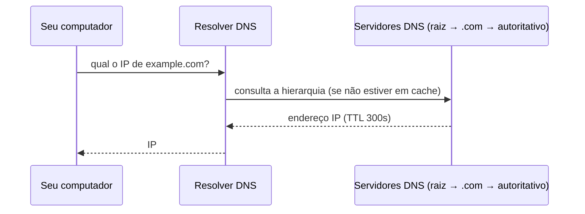
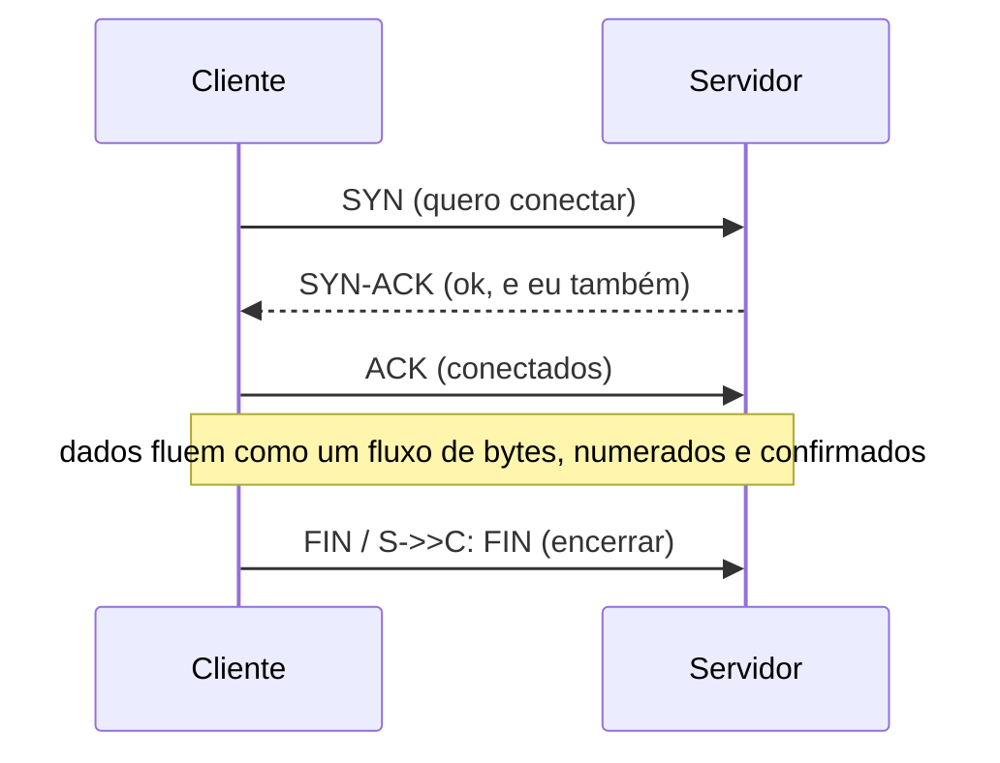

# 01. Cliente-servidor, IP, DNS, portas e TCP

> ⏱️ ~1h30 · Módulo 2 · Pré-requisitos: [Módulo 1](../01-python-logica/README.md) (funções, bytes/strings, `with`)

## 🎯 Objetivos
Ao final desta aula você consegue:
- Explicar o modelo cliente-servidor e o que é um endereço IP e uma porta
- Descrever o que o DNS faz antes de qualquer requisição
- Explicar o *three-way handshake* do TCP e por que TCP entrega bytes em ordem
- Criar um servidor e um cliente TCP com `socket`
- Diferenciar `127.0.0.1`, `0.0.0.0` e `localhost`, e diagnosticar “connection refused”

## 🤔 Por que isso importa
Quando seu deploy “não responde”, a causa está numa destas camadas: nome não resolve (DNS), porta fechada ou bloqueada (firewall/Security Group), servidor escutando só em `127.0.0.1` dentro do container. Quem entende a camada de baixo depura em minutos o que outros levam um dia.

## 💡 Intuição (explicação simples)
- **Cliente-servidor** = **cliente e balcão**: o cliente pede, o servidor atende. O servidor fica esperando; o cliente toma a iniciativa.
- **IP** = **endereço do prédio**; **porta** = **número do apartamento/guichê**. O prédio tem muitos guichês: o 80 atende HTTP, o 5432 atende PostgreSQL.
- **DNS** = **lista telefônica**: você sabe o nome (`example.com`), ela devolve o número (IP).
- **TCP** = **ligação telefônica com confirmação**: antes de falar, os dois confirmam que estão na linha; cada trecho é confirmado e, se algo se perder, é repetido, e a ordem é preservada.

## 🔬 Como funciona por dentro
**DNS.** Seu computador pergunta ao *resolver* (do provedor, ou 1.1.1.1/8.8.8.8). Se ele não souber (cache), consulta a hierarquia: raiz → `.com` → servidor autoritativo do domínio, que responde o IP. A resposta vem com um **TTL** (quanto tempo pode ser guardada). Registros comuns: `A` (IPv4), `AAAA` (IPv6), `CNAME` (apelido), `MX` (e-mail), `TXT`.



**IP e portas.** Um socket é o par **(IP, porta)**. Uma conexão TCP é identificada por 4 valores: IP/porta de origem e IP/porta de destino. Portas 0–1023 são “bem conhecidas” (exigem privilégio); o cliente recebe uma porta temporária alta.

| Porta | Serviço |
|---|---|
| 22 | SSH |
| 53 | DNS |
| 80 / 443 | HTTP / HTTPS |
| 5432 | PostgreSQL |
| 6379 | Redis |
| 8000 | servidor de desenvolvimento (Django) |

**Endereços especiais.** `127.0.0.1` (e o nome `localhost`) = a própria máquina, inacessível de fora. `0.0.0.0` ao *escutar* = “todas as interfaces” (acessível de fora). Em Docker, um app que escuta em `127.0.0.1` dentro do container **não é alcançável** do host; precisa escutar em `0.0.0.0` (Módulo 11).

**TCP.** Antes de transmitir, há o *handshake*:


TCP é um **fluxo de bytes**, não de mensagens: não preserva as fronteiras do que você enviou. Dois `send` podem chegar juntos em um `recv`. Por isso protocolos como o HTTP definem como delimitar mensagens (linhas, `Content-Length`). UDP (sem conexão, sem garantia) é usado onde velocidade importa mais que entrega (DNS, vídeo ao vivo).

## 🛠️ Exemplo prático
Os exemplos rodam na sua máquina (sem internet), exceto o de DNS real.

**1. Resolvendo nomes**
```python
import socket

print(socket.gethostbyname("localhost"))
for familia, _, _, _, endereco in socket.getaddrinfo("localhost", 80, type=socket.SOCK_STREAM):
    print(familia.name, endereco[0])
```
```text
127.0.0.1
AF_INET6 ::1
AF_INET 127.0.0.1
```
No terminal, com a internet (os IPs variam com o tempo e o provedor):
```bash
dig +short example.com A | head -n 2
dig +noall +answer example.com A
```
```text
104.20.23.154
172.66.147.243
example.com.		144	IN	A	172.66.147.243
example.com.		144	IN	A	104.20.23.154
```

**2. Um servidor TCP “eco” e um cliente**
```python
import socket
import threading

def servidor(sock):
    conn, addr = sock.accept()             # bloqueia até alguém conectar
    with conn:
        dados = conn.recv(1024)            # até 1024 bytes
        conn.sendall(b"eco: " + dados)

srv = socket.socket(socket.AF_INET, socket.SOCK_STREAM)
srv.setsockopt(socket.SOL_SOCKET, socket.SO_REUSEADDR, 1)
srv.bind(("127.0.0.1", 50007))
srv.listen()
threading.Thread(target=servidor, args=(srv,), daemon=True).start()

with socket.create_connection(("127.0.0.1", 50007)) as cli:
    print("meu endereço local:", cli.getsockname()[0], "| servidor:", cli.getpeername())
    cli.sendall("olá, servidor".encode("utf-8"))   # a rede só transporta bytes
    print(cli.recv(1024).decode("utf-8"))
srv.close()
```
```text
meu endereço local: 127.0.0.1 | servidor: ('127.0.0.1', 50007)
eco: olá, servidor
```
Repare: texto vira bytes (`encode`) na ida e volta (`decode`). A porta de origem do cliente é efêmera e sorteada pelo sistema; a do servidor é a que escolhemos (50007).

**3. TCP é fluxo de bytes (sem fronteiras de mensagem)**
```python
import socket
import threading
import time

srv = socket.socket()
srv.setsockopt(socket.SOL_SOCKET, socket.SO_REUSEADDR, 1)
srv.bind(("127.0.0.1", 50008)); srv.listen()
recebido = []

def servidor():
    conn, _ = srv.accept()
    time.sleep(0.3)                 # deixa as duas mensagens chegarem
    recebido.append(conn.recv(1024))
    conn.close()

t = threading.Thread(target=servidor); t.start()
cli = socket.create_connection(("127.0.0.1", 50008))
cli.sendall(b"msg1;"); cli.sendall(b"msg2;")
t.join(); cli.close(); srv.close()
print(recebido)                     # normalmente um único recv com as duas
```
```text
[b'msg1;msg2;']
```
Moral: o receptor não sabe onde uma mensagem termina. Quem define isso é o protocolo de cima (delimitador, tamanho, ou HTTP).

**4. Porta fechada e porta aberta**
```python
import socket
for porta in (50099, 22):
    try:
        socket.create_connection(("127.0.0.1", porta), timeout=1).close()
        print(porta, "aberta")
    except ConnectionRefusedError:
        print(porta, "recusada (ninguém escutando)")
    except OSError as e:
        print(porta, type(e).__name__)
```
```text
50099 recusada (ninguém escutando)
22 recusada (ninguém escutando)
```
**5. Quem está escutando na sua máquina**
```bash
ss -ltn | head -n 5
```
```text
State  Recv-Q Send-Q      Local Address:Port  Peer Address:Port
LISTEN 0      4096        127.0.0.53%lo:53         0.0.0.0:*   
LISTEN 0      4096            127.0.0.1:631        0.0.0.0:*   
LISTEN 0      32          192.168.122.1:53         0.0.0.0:*   
LISTEN 0      4096           127.0.0.54:53         0.0.0.0:*
```
(`-l` listening, `-t` TCP, `-n` numérico. A saída depende do que roda no seu computador.)

## ⚠️ Erros comuns e boas práticas
| Mensagem | Causa | Solução |
|---|---|---|
| `ConnectionRefusedError: [Errno 111] Connection refused` | Nada escutando nessa porta (servidor desligado, porta errada) | Suba o servidor; confira porta com `ss -ltn` |
| `OSError: [Errno 98] Address already in use` | Porta ocupada por outro processo (ou socket ainda em `TIME_WAIT`) | Outra porta; `SO_REUSEADDR`; ache o dono: `ss -ltnp` |
| `socket.gaierror: [Errno -2] Name or service not known` | DNS não resolve (erro de digitação, sem internet) | Confira o nome; `dig nome` |
| `TimeoutError: timed out` | Firewall/Security Group descartando, ou host fora do ar | Teste com `curl -v`; revise regras de rede |
| Acessa de fora e não conecta | Servidor escutando só em `127.0.0.1` | Escutar em `0.0.0.0` (com cuidado) |

- **Refused** (resposta imediata) significa “cheguei lá e ninguém atende”; **timeout** significa “nem resposta recebi” (firewall, rota). Os dois têm causas diferentes.
- Nunca exponha banco ou Redis na internet (`0.0.0.0` + porta aberta). Mantenha-os em rede privada (Módulos 11 e 13).
- Sempre defina `timeout` em conexões de rede; sem ele, seu programa pode esperar para sempre.

## 🧠 Pausa para lógica
**Problema (IP e rede).** Um endereço IPv4 são 4 números de 0 a 255, ou seja, um inteiro de 32 bits. Escreva `ip_para_int("192.168.1.10")` e `pertence(ip, "192.168.1.0/24")` (um CIDR `/24` fixa os 24 primeiros bits) usando operações de bits, e confira com o módulo `ipaddress`.

<details><summary>Dica</summary>
<code>int = (a &lt;&lt; 24) | (b &lt;&lt; 16) | (c &lt;&lt; 8) | d</code>. A máscara de um <code>/n</code> é <code>(0xFFFFFFFF &lt;&lt; (32 - n)) &amp; 0xFFFFFFFF</code>. O IP pertence se <code>ip &amp; máscara == rede &amp; máscara</code>.
</details>

<details><summary>Solução comentada</summary>

```python
import ipaddress

def ip_para_int(ip: str) -> int:
    a, b, c, d = (int(p) for p in ip.split("."))
    if not all(0 <= x <= 255 for x in (a, b, c, d)):
        raise ValueError(f"IP inválido: {ip}")
    return (a << 24) | (b << 16) | (c << 8) | d

def pertence(ip: str, cidr: str) -> bool:
    rede, bits = cidr.split("/")
    mascara = (0xFFFFFFFF << (32 - int(bits))) & 0xFFFFFFFF
    return ip_para_int(ip) & mascara == ip_para_int(rede) & mascara

casos = [("192.168.1.10", "192.168.1.0/24"), ("192.168.2.10", "192.168.1.0/24"), ("10.0.5.9", "10.0.0.0/8")]
for ip, cidr in casos:
    esperado = ipaddress.ip_address(ip) in ipaddress.ip_network(cidr)
    print(ip, cidr, pertence(ip, cidr), esperado)
print(ip_para_int("0.0.1.0"))
```
```text
192.168.1.10 192.168.1.0/24 True True
192.168.2.10 192.168.1.0/24 False False
10.0.5.9 10.0.0.0/8 True True
256
```
É exatamente a lógica de uma regra de Security Group da AWS ou de firewall (Módulo 13): “permitir o tráfego vindo de `10.0.0.0/16`”. Um `/32` é um único IP; `0.0.0.0/0` é “qualquer um”.
</details>

**Variação mais difícil:** quantos endereços há em um `/24`? E em um `/20`? Quantos são utilizáveis para máquinas (descontando rede e broadcast)?

## 🧩 Exercícios
**1. Fixação**
a) Em `http://localhost:8000`, quem é o host e quem é a porta? b) O que acontece se o servidor escuta em `127.0.0.1` dentro de um container e você acessa do host? c) Qual a diferença entre `Connection refused` e `timed out`?

<details><summary>Solução</summary>

a) Host `localhost` (resolve para `127.0.0.1`/`::1`), porta `8000`. b) Não conecta: `127.0.0.1` do container é outra “máquina”; é preciso escutar em `0.0.0.0`. c) Refused: o host respondeu que ninguém atende na porta; timeout: nenhuma resposta (pacotes descartados por firewall ou host inalcançável).
</details>

**2. Aplicação no projeto MiniShop**
Escreva `minishop_net/ping.py` com a função `porta_aberta(host, porta, timeout=1.0) -> bool` e um script que checa as portas que o MiniShop usará (8000 app, 5432 PostgreSQL, 6379 Redis) em `localhost`.

Critérios de pronto:
- [ ] Usa `socket.create_connection` com `timeout` e `with`
- [ ] Trata `ConnectionRefusedError`, `TimeoutError` e `socket.gaierror` sem derrubar o script
- [ ] Imprime uma tabela `porta  serviço  aberta/fechada`
- [ ] Teste pytest que sobe um servidor temporário na porta 0 (o SO escolhe) e confirma `True`; outro com porta fechada confirma `False`
- [ ] Commit `feat: add port checker`

<details><summary>Solução de referência</summary>

```python
import socket

def porta_aberta(host: str, porta: int, timeout: float = 1.0) -> bool:
    try:
        with socket.create_connection((host, porta), timeout=timeout):
            return True
    except (ConnectionRefusedError, TimeoutError, socket.gaierror, OSError):
        return False

# teste: servidor temporário na porta 0 (o SO escolhe uma livre)
srv = socket.socket(); srv.bind(("127.0.0.1", 0)); srv.listen()
porta = srv.getsockname()[1]
print(porta_aberta("127.0.0.1", porta), end=" ")
srv.close()
print(porta_aberta("127.0.0.1", porta))
for p, nome in ((8000, "app"), (5432, "postgres"), (6379, "redis")):
    print(p, nome, "aberta" if porta_aberta("localhost", p, 0.3) else "fechada")
```
```text
True False
8000 app fechada
5432 postgres fechada
6379 redis fechada
```
</details>

**3. Desafio (opcional)**
Estenda o eco para atender vários clientes (uma thread por conexão) e para tratar mensagens terminadas por `\n` (juntando pedaços de `recv`).

## 🎤 Na entrevista
- **O que acontece quando você digita `example.com` no navegador, até chegar ao servidor?** O navegador consulta o cache e o resolver DNS para obter o IP; abre uma conexão TCP (handshake) na porta 443; negocia TLS; só então envia a requisição HTTP. (As etapas seguintes vêm nas próximas aulas.)
- **Qual a diferença entre TCP e UDP?** TCP: orientado a conexão, confiável, ordenado. UDP: sem conexão, sem garantia de entrega ou ordem, mais leve.
- **Qual a diferença entre `127.0.0.1` e `0.0.0.0`?** `127.0.0.1` é a própria máquina (loopback); `0.0.0.0`, ao escutar, significa todas as interfaces (acessível de outras máquinas).

## 📚 Para ir além
- 📄 Documentação oficial: [`socket` (docs.python.org)](https://docs.python.org/3/library/socket.html). Referência e exemplos de cliente e servidor.
- 📄 Documentação oficial: [HOWTO de sockets](https://docs.python.org/3/howto/sockets.html). Explica o conceito passo a passo.
- 📄 Documentação oficial: [`ipaddress`](https://docs.python.org/3/library/ipaddress.html). IPs e redes (CIDR).
- 📑 Artigo/tutorial: [Como a internet funciona (MDN)](https://developer.mozilla.org/pt-BR/docs/Learn_web_development/Howto/Web_mechanics/How_does_the_Internet_work). Visão geral para iniciantes.
- 🏋️ Prática extra: rode `dig +trace example.com` e identifique cada nível da hierarquia DNS.

## ✅ Checklist da aula
- [ ] Rodei o servidor e o cliente de eco
- [ ] Provoquei `Connection refused` e `Address already in use`
- [ ] Sei dizer o que é IP, porta, DNS e handshake TCP
- [ ] Fiz o commit do exercício
