# 04. DevTools, `curl` e Bruno/HTTPie

> ⏱️ ~1h30 · Módulo 2 · Pré-requisitos: [02](02-http-metodos-status-headers.md), [03](03-tls-cookies-sessoes-json-urls.md)

## 🎯 Objetivos
Ao final desta aula você consegue:
- Inspecionar requisições no DevTools do navegador (Network, Application, Console)
- Montar requisições com `curl` (método, headers, corpo JSON, cookies, autenticação)
- Medir onde o tempo de uma requisição é gasto (DNS, TCP, TLS, servidor)
- Reproduzir uma chamada do navegador no terminal (“Copy as cURL”)
- Escolher entre `curl`, HTTPie e Bruno para testar APIs

## 🤔 Por que isso importa
“A API não funciona” não é um diagnóstico. Um dev júnior que abre a aba Network, vê `403` com a resposta de erro e reproduz a chamada com `curl` resolve em minutos e fala a língua do time de backend e do front. É também a principal ferramenta para testar a API do MiniShop nos próximos módulos.

## 💡 Intuição (explicação simples)
Se HTTP é o balcão, estas ferramentas são **a câmera de segurança (DevTools: mostra tudo o que passou)**, **o telefone para ligar você mesmo (curl: faz o pedido por texto)** e **o caderno de ligações (Bruno: guarda suas chamadas organizadas e repetíveis)**.

## 🔬 Como funciona por dentro
**DevTools (F12 ou `Ctrl+Shift+I`).** O navegador registra cada requisição que a página faz:
- **Network:** lista com método, status, tipo, tamanho e tempo. Clique em uma para ver *Headers* (requisição e resposta), *Payload* (o que foi enviado), *Preview/Response* (o corpo) e *Timing* (DNS, conexão, TLS, espera do servidor, download). Filtre por **Fetch/XHR** para ver só chamadas de API. Marque **Preserve log** (para não perder o histórico em redirecionamentos) e **Disable cache**. Botão direito → **Copy → Copy as cURL**.
- **Application (Chrome) / Storage (Firefox):** cookies com seus atributos, `localStorage`, `sessionStorage`.
- **Console:** executa JavaScript na página, por exemplo `await (await fetch('/api/produtos')).json()`.

**Timing de uma requisição** (o que o `curl -w` também mede):

```mermaid
gantt
    dateFormat X
    axisFormat %s
    section Requisição
    DNS            :0, 1
    TCP            :1, 2
    TLS            :2, 4
    Servidor (TTFB):4, 7
    Download       :7, 8
```

`TTFB` (*time to first byte*) é o tempo até o primeiro byte da resposta: reflete o processamento do servidor (view + banco). Se o TTFB é alto, o problema é no backend; se DNS/TLS são altos, é rede.

**Ferramentas de linha de comando e gráficas**

| Ferramenta | Tipo | Bom para |
|---|---|---|
| `curl` | linha de comando, onipresente | scripts, servidores, depuração rápida, documentação |
| HTTPie (`http`) | linha de comando legível | uso interativo com saída colorida e JSON fácil |
| Bruno | app gráfico, coleções em arquivos de texto (versionáveis no Git) | testar e documentar a API em equipe |
| Postman/Insomnia | apps gráficos | alternativas comuns em empresas |

## 🛠️ Exemplo prático
**1. Um servidor de laboratório (rotas variadas)**
```python
import json
import threading
import time
from http.server import BaseHTTPRequestHandler, HTTPServer
from urllib.parse import parse_qs, urlparse

PRODUTOS = {"MS-01": {"sku": "MS-01", "nome": "Mouse", "preco": "49.90"},
            "TC-02": {"sku": "TC-02", "nome": "Teclado", "preco": "120.00"}}

class Lab(BaseHTTPRequestHandler):
    protocol_version = "HTTP/1.1"
    def log_message(self, *a): pass

    def enviar(self, status, corpo=None, headers=None):
        dados = b"" if corpo is None else json.dumps(corpo, ensure_ascii=False).encode()
        self.send_response(status)
        self.send_header("Content-Type", "application/json; charset=utf-8")
        self.send_header("Content-Length", str(len(dados)))
        for k, v in (headers or {}).items():
            self.send_header(k, v)
        self.end_headers()
        self.wfile.write(dados)

    def do_HEAD(self):                      # mesmos headers do GET, sem corpo
        self.send_response(200)
        self.send_header("Content-Type", "application/json; charset=utf-8")
        self.end_headers()

    def do_GET(self):
        u = urlparse(self.path)
        if u.path == "/produtos":
            q = parse_qs(u.query).get("busca", [""])[0].lower()
            self.enviar(200, [p for p in PRODUTOS.values() if q in p["nome"].lower()])
        elif u.path == "/antigo":
            self.enviar(301, None, {"Location": "/produtos"})
        elif u.path == "/lento":
            time.sleep(0.4)
            self.enviar(200, {"ok": True})
        elif u.path == "/privado":
            if self.headers.get("Authorization") != "Bearer segredo123":
                return self.enviar(401, {"erro": "token ausente ou inválido"}, {"WWW-Authenticate": "Bearer"})
            self.enviar(200, {"usuario": "ana"})
        elif u.path == "/quebrado":
            self.enviar(500, {"erro": "falha interna"})
        else:
            self.enviar(404, {"erro": "não encontrado"})

    def do_POST(self):
        tam = int(self.headers.get("Content-Length", 0))
        try:
            novo = json.loads(self.rfile.read(tam) or b"null")
        except json.JSONDecodeError:
            return self.enviar(400, {"erro": "JSON inválido"})
        if not isinstance(novo, dict) or "sku" not in novo:
            return self.enviar(422, {"erro": "campo sku é obrigatório"})
        if novo["sku"] in PRODUTOS:
            return self.enviar(409, {"erro": "SKU já existe"})
        PRODUTOS[novo["sku"]] = novo
        self.enviar(201, novo, {"Location": f"/produtos/{novo['sku']}"})

srv = HTTPServer(("127.0.0.1", 8767), Lab)
threading.Thread(target=srv.serve_forever, daemon=True).start()
print("laboratório em http://127.0.0.1:8767")
```
```text
laboratório em http://127.0.0.1:8767
```

**2. Os primeiros comandos**
```bash
curl -s http://127.0.0.1:8767/produtos                    # só o corpo
echo; echo "--- -i (inclui os headers da resposta)"
curl -i -s http://127.0.0.1:8767/produtos?busca=mouse
echo; echo "--- -I (só HEAD/headers)"
curl -sI http://127.0.0.1:8767/produtos | head -n 3
```
```text
[{"sku": "MS-01", "nome": "Mouse", "preco": "49.90"}, {"sku": "TC-02", "nome": "Teclado", "preco": "120.00"}]
--- -i (inclui os headers da resposta)
HTTP/1.1 200 OK
Server: BaseHTTP/0.6 Python/3.13.18
Date: Sun, 08 Nov 2026 00:44:24 GMT
Content-Type: application/json; charset=utf-8
Content-Length: 53

[{"sku": "MS-01", "nome": "Mouse", "preco": "49.90"}]
--- -I (só HEAD/headers)
HTTP/1.1 200 OK
Server: BaseHTTP/0.6 Python/3.13.18
Date: Sun, 08 Nov 2026 00:44:24 GMT
```
Opções mais usadas: `-s` silencioso, `-i` mostra headers da resposta, `-v` mostra tudo (inclusive a requisição), `-X MÉTODO`, `-H "Nome: valor"`, `-d` corpo, `-o arquivo` salva, `-L` segue redirecionamentos, `-b/-c` cookies, `-w` formato de saída, `--max-time` limite.

**3. POST com JSON e os erros**
```bash
echo "# criar (201)"
curl -s -i -X POST http://127.0.0.1:8767/produtos -H "Content-Type: application/json" \
     -d '{"sku":"CB-03","nome":"Cabo USB","preco":"9.90"}' | grep -iE "^HTTP|^Location|^\{"
echo "# duplicado (409)";  curl -s -w ' [%{http_code}]\n' -X POST http://127.0.0.1:8767/produtos --json '{"sku":"CB-03"}'
echo "# sem sku (422)";    curl -s -w ' [%{http_code}]\n' -X POST http://127.0.0.1:8767/produtos --json '{"nome":"x"}'
echo "# JSON quebrado (400)"; curl -s -w ' [%{http_code}]\n' -X POST http://127.0.0.1:8767/produtos -H 'Content-Type: application/json' -d '{quebrado'
```
```text
# criar (201)
HTTP/1.1 201 Created
Location: /produtos/CB-03
{"sku": "CB-03", "nome": "Cabo USB", "preco": "9.90"}
# duplicado (409)
{"erro": "SKU já existe"} [409]
# sem sku (422)
{"erro": "campo sku é obrigatório"} [422]
# JSON quebrado (400)
{"erro": "JSON inválido"} [400]
```
(`--json` já define `Content-Type` e `Accept` como JSON e usa POST; está disponível nas versões recentes do `curl`.) Cuidado com aspas no shell: use aspas simples em volta do JSON.

**4. Redirecionamento, autenticação e erro de servidor**
```bash
echo "# 301 sem -L:";  curl -s -o /dev/null -w '%{http_code} -> %{redirect_url}\n' http://127.0.0.1:8767/antigo
echo "# com -L:";      curl -sL -o /dev/null -w '%{http_code} (final: %{url_effective})\n' http://127.0.0.1:8767/antigo
echo "# sem token:";   curl -s -w ' [%{http_code}]\n' http://127.0.0.1:8767/privado
echo "# com token:";   curl -s -w ' [%{http_code}]\n' -H "Authorization: Bearer segredo123" http://127.0.0.1:8767/privado
echo "# erro 500:";    curl -s -w ' [%{http_code}]\n' http://127.0.0.1:8767/quebrado
echo "# formatar JSON:"; curl -s http://127.0.0.1:8767/produtos | python -m json.tool | head -n 8
```
```text
# 301 sem -L:
301 -> http://127.0.0.1:8767/produtos
# com -L:
200 (final: http://127.0.0.1:8767/produtos)
# sem token:
{"erro": "token ausente ou inválido"} [401]
# com token:
{"usuario": "ana"} [200]
# erro 500:
{"erro": "falha interna"} [500]
# formatar JSON:
[
    {
        "sku": "MS-01",
        "nome": "Mouse",
        "preco": "49.90"
    },
    {
        "sku": "TC-02",
```
**5. Ver a requisição que o `curl` enviou (`-v`)**
```bash
curl -sv -H "Accept: application/json" http://127.0.0.1:8767/produtos?busca=teclado -o /dev/null 2>&1 | grep -E '^[<>]'
```
```text
> GET /produtos?busca=teclado HTTP/1.1
> Host: 127.0.0.1:8767
> User-Agent: curl/8.18.0
> Accept: application/json
> 
< HTTP/1.1 200 OK
< Server: BaseHTTP/0.6 Python/3.13.18
< Date: Sun, 08 Nov 2026 00:44:24 GMT
< Content-Type: application/json; charset=utf-8
< Content-Length: 56
<
```
Linhas `>` são a requisição enviada; `<` são a resposta recebida. É a mesma anatomia da aula 02.

**6. Medir o tempo (local e na internet)**
```bash
FMT='dns=%{time_namelookup}s tcp=%{time_connect}s tls=%{time_appconnect}s ttfb=%{time_starttransfer}s total=%{time_total}s\n'
echo "# local, rota lenta (400 ms de processamento):"
curl -s -o /dev/null -w "$FMT" http://127.0.0.1:8767/lento
echo "# internet (HTTPS) — valores variam:"
curl -s -o /dev/null -w "$FMT" https://example.com
```
```text
# local, rota lenta (400 ms de processamento):
dns=0.000014s tcp=0.000094s tls=0.000000s ttfb=0.400615s total=0.400651s
# internet (HTTPS) — valores variam:
dns=0.001277s tcp=0.014065s tls=0.032144s ttfb=0.046644s total=0.046706s
```
Note: localmente `tls=0` (sem HTTPS) e o TTFB acompanha o `sleep(0.4)`; na internet DNS, TCP e TLS pesam.

**7. HTTPie (alternativa legível)** — instala sob demanda com `uv`:
```bash
uv run --with httpie http --ignore-stdin --print=Hhb GET http://127.0.0.1:8767/produtos busca==mouse 2>&1 | head -n 18
```
```text
GET /produtos?busca=mouse HTTP/1.1
Accept-Encoding: gzip, deflate
Accept: */*
Connection: keep-alive
User-Agent: HTTPie/3.2.4
Host: 127.0.0.1:8767

HTTP/1.1 200 OK
Server: BaseHTTP/0.6 Python/3.13.18
Date: Sun, 08 Nov 2026 00:44:25 GMT
Content-Type: application/json; charset=utf-8
Content-Length: 53

[{"sku": "MS-01", "nome": "Mouse", "preco": "49.90"}]
```
No HTTPie (use `--ignore-stdin` em scripts, senão ele espera o corpo pela entrada padrão): `chave==valor` é query string, `chave=valor` é campo JSON (`http POST url sku=A nome=B`), `Header:valor` define um header.

## 🔎 Fazendo no navegador (passo a passo)
> ⚠️ Esta seção usa a interface gráfica e **não foi executada pelo autor**; os nomes dos menus podem variar entre versões do navegador.

1. Abra qualquer site, pressione `F12` e vá em **Network**. Recarregue com `Ctrl+R`.
2. Clique na primeira linha (o documento HTML). Em **Headers**, localize *Request Method*, *Status Code* e *Remote Address*; em **Timing**, o TTFB.
3. Filtre por **Fetch/XHR**; clique em uma chamada de API e abra *Response*.
4. Clique com o botão direito → **Copy → Copy as cURL (bash)** e cole no terminal. Você reproduziu a chamada do navegador.
5. Em **Application → Cookies**, veja os atributos `HttpOnly`, `Secure`, `SameSite` (aula 03).
6. No **Console**, rode `await (await fetch('/')).status`.

## 🧰 Bruno
Bruno é um cliente de API gráfico que guarda cada requisição como **arquivo de texto**, então a coleção entra no Git junto com o código. Fluxo: criar coleção na pasta do projeto (`minishop/api-collection/`) → *New Request* (método + URL) → aba *Headers*/*Body* → *Send*; variáveis de ambiente (`{{base_url}}`) para alternar entre local e produção; abas de *Tests/Assert* para validar a resposta. Documentação: [docs.usebruno.com](https://docs.usebruno.com). ⚠️ Instalação e interface dependem do seu sistema e **não foram testadas** aqui.

## ⚠️ Erros comuns e boas práticas
| Mensagem / sintoma | Causa | Solução |
|---|---|---|
| `curl: (7) Failed to connect to 127.0.0.1 port 8767` | Servidor desligado ou porta errada | Suba o servidor; confira a porta |
| `curl: (6) Could not resolve host` | DNS/nome errado | Confira o host |
| `curl: (60) SSL certificate problem` | Certificado inválido/autoassinado | Corrija o certificado; `-k` só em laboratório, nunca em produção |
| `{"erro":"JSON inválido"}` com seu JSON “certo” | Aspas duplas no shell comendo as aspas do JSON | Use aspas simples em volta do JSON |
| `curl` “não mostra nada” | Resposta `204` ou saída silenciosa | Use `-i` ou `-w '%{http_code}'` |
| Funciona no navegador e falha no `curl` | Faltam cookies/headers (Origin, Cookie, Authorization) | “Copy as cURL” e compare |
| Redirecionamento infinito | Regra `http→https` mal configurada | `curl -iL --max-redirs 5` |

- Nunca cole tokens e cookies reais em chats, issues ou commits. “Copy as cURL” leva as credenciais junto.
- Para scripts, prefira `curl -fsS` (falha em erros HTTP, silencioso mas mostra erros) e cheque o código de saída.
- Versione a coleção do Bruno **sem** segredos (use variáveis de ambiente fora do Git).

## 🧠 Pausa para lógica
**Problema (medir latência).** Escreva `medir(url, n)` que faz `n` requisições e devolve média, mínimo, máximo e o percentil 95 (p95). Por que a média sozinha engana?

<details><summary>Dica</summary>
Ordene os tempos; o p95 é o valor na posição <code>ceil(0.95 * n) - 1</code>. Use <code>time.perf_counter()</code> e <code>urllib.request</code>.
</details>

<details><summary>Solução comentada</summary>

```python
import math
import time
import urllib.request

def percentil(tempos, p):
    ordenados = sorted(tempos)
    return ordenados[math.ceil(p / 100 * len(ordenados)) - 1]

def medir(url, n=20):
    tempos = []
    for _ in range(n):
        t0 = time.perf_counter()
        urllib.request.urlopen(url).read()
        tempos.append((time.perf_counter() - t0) * 1000)
    return {"media": sum(tempos) / n, "min": min(tempos), "max": max(tempos), "p95": percentil(tempos, 95)}

r = medir("http://127.0.0.1:8767/produtos", 20)
print({k: round(v, 2) for k, v in r.items()})
amostra = [10, 11, 10, 12, 11, 10, 13, 10, 11, 500]
print("p95 =", percentil(amostra, 95), "ms | média =", sum(amostra) / len(amostra), "ms | mediana =", sorted(amostra)[len(amostra) // 2], "ms")
```
```text
{'media': 0.37, 'min': 0.15, 'max': 1.55, 'p95': 0.56}
p95 = 500 ms | média = 59.8 ms | mediana = 11 ms
```
Uma única requisição de 500 ms entre dez de ~11 ms distorce a média (60 ms) e o p95 mostra o outlier. Em produção, a cauda lenta (p95/p99) é o que o usuário sente (Módulo 14).
</details>

**Variação mais difícil:** rode as 20 requisições em paralelo com `ThreadPoolExecutor` e compare. O que mudou? (Prévia do Módulo 7.)

## 🧩 Exercícios
**1. Fixação**
Escreva o comando `curl` que (a) cria um produto com JSON, (b) lista com `busca=cabo`, (c) mostra só o código HTTP de `/quebrado`.

<details><summary>Solução</summary>

```bash
curl -s --json '{"sku":"XX-9","nome":"Fone","preco":"89.90"}' http://127.0.0.1:8767/produtos
curl -s "http://127.0.0.1:8767/produtos?busca=cabo"
curl -s -o /dev/null -w '%{http_code}\n' http://127.0.0.1:8767/quebrado
```
(Entre aspas na URL com `?`, porque o shell pode interpretar `?` como curinga.)
</details>

**2. Aplicação no projeto MiniShop**
Crie `docs/testando-a-api.md` com um roteiro de `curl` para cada rota do contrato HTTP que você desenhou na aula 02, e uma coleção no Bruno (`api-collection/`) com as mesmas requisições.

Critérios de pronto:
- [ ] Cada rota tem um exemplo de sucesso e um de erro (com o status esperado)
- [ ] O token e a URL base estão em variáveis (`$BASE`, `{{base_url}}`), sem segredos no Git
- [ ] Um script `scripts/smoke.sh` roda os `curl` e falha (`exit 1`) se algum status for inesperado
- [ ] Você medeu o TTFB da listagem e anotou o valor
- [ ] Commit `docs: add api testing guide and bruno collection`

<details><summary>Solução de referência</summary>

```bash
#!/usr/bin/env bash
set -euo pipefail
BASE="${BASE:-http://127.0.0.1:8000}"
checar() {  # checar ESPERADO MÉTODO URL [curl-args...]
  esperado=$1; shift
  codigo=$(curl -s -o /dev/null -w '%{http_code}' "$@")
  if [ "$codigo" != "$esperado" ]; then echo "FALHOU: esperado $esperado, veio $codigo ($*)"; exit 1; fi
  echo "ok $codigo $*"
}
checar 200 "$BASE/produtos"
checar 404 "$BASE/produtos/NAO-EXISTE"
```
</details>

**3. Desafio (opcional)**
No navegador, use “Copy as cURL” em uma chamada real de um site e retire tudo o que não é essencial até a chamada continuar funcionando. Quais headers eram dispensáveis?

## 🎤 Na entrevista
- **Como você depura uma chamada de API que falha?** Reproduzo com `curl`/Bruno, olho status e corpo de erro, confiro headers (`Authorization`, `Content-Type`), comparo com a chamada do navegador (DevTools), e verifico os logs do servidor.
- **O que é TTFB e o que um valor alto indica?** Tempo até o primeiro byte da resposta; alto indica lentidão de processamento no servidor (código, banco), não de rede.
- **Para que servem `curl -v` e “Copy as cURL”?** Ver a requisição/resposta completa e reproduzir exatamente o que o navegador enviou.

## 📚 Para ir além
- 📄 Documentação oficial: [curl: manual](https://curl.se/docs/manpage.html). Todas as opções (use a busca da página).
- 📄 Documentação oficial: [Chrome DevTools: Network](https://developer.chrome.com/docs/devtools/network) e [Firefox: Network Monitor](https://firefox-source-docs.mozilla.org/devtools-user/network_monitor/). Guias oficiais.
- 📄 Documentação oficial: [HTTPie CLI](https://httpie.io/docs/cli) e [Bruno](https://docs.usebruno.com). Referências das duas ferramentas.
- 🏋️ Prática extra: use `curl -w` para comparar o TTFB de três sites diferentes e explique as diferenças.

## ✅ Checklist da aula
- [ ] Reproduzi uma chamada do navegador com `curl`
- [ ] Criei recursos com `curl` e provoquei 400, 401, 409, 422 e 500
- [ ] Medi DNS/TCP/TLS/TTFB
- [ ] Explorei o DevTools e o Bruno (ou HTTPie)
- [ ] Fiz o commit do exercício
