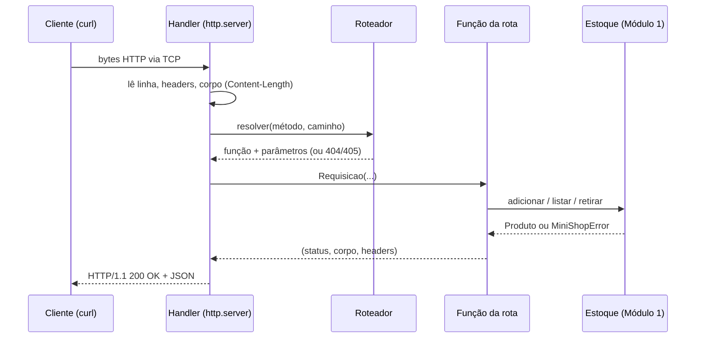

# 05. Mini-projeto: servidor HTTP mínimo com a biblioteca padrão

> ⏱️ ~1h30 · Módulo 2 · Pré-requisitos: aulas [01](01-cliente-servidor-dns-tcp.md) a [04](04-devtools-curl-bruno.md); [CLI de estoque do Módulo 1](../01-python-logica/19-projeto-cli-estoque-2.md)

## 🎯 Objetivos
Ao final desta aula você consegue:
- Construir um servidor HTTP que serve o estoque do MiniShop em JSON, sem framework
- Implementar roteamento com parâmetros de caminho (`/produtos/<sku>`)
- Mapear exceções de domínio para status codes e padronizar o formato de erro
- Atender requisições concorrentes com segurança (`ThreadingHTTPServer` e trava)
- Listar tudo o que um framework (Django) faz por você e que você acabou de escrever à mão

## 🤔 Por que isso importa
O Django, o Flask e o FastAPI fazem exatamente isto: ler bytes, transformar em requisição, escolher uma função pela URL, converter erros em respostas e escrever HTTP de volta. Quem já escreveu um roteador e um tratador de erros enxerga o framework como “o que eu já sei, mais organizado”, e não como mágica.

## 💡 Intuição (explicação simples)
É montar **o balcão de atendimento da loja do zero**: contratar o recepcionista que lê o pedido (parser HTTP), o **mapa de guichês** que diz para qual atendente enviar cada pedido (roteador), os **atendentes** (funções de rota) que consultam o estoque (serviço do Módulo 1) e o **formulário padrão de resposta** (JSON + status code). Quando o framework chegar, ele vende o balcão pronto.

## 🔬 Como funciona por dentro

Camadas do projeto:
```text
minishop_http/
├── roteador.py   # Requisicao, Roteador, exceções de roteamento
├── app.py        # as rotas (usa o Estoque do Módulo 1)
├── servidor.py   # traduz HTTP <-> Requisicao/Resposta, erros -> status
└── __main__.py   # python -m minishop_http
```
Decisões:
- `ThreadingHTTPServer` cria uma thread por conexão. Duas threads alterando o mesmo estoque causam a *race condition* da aula 1.18, então as escritas ficam protegidas por um `Lock`.
- Toda resposta tem `Content-Length` (permite conexões *keep-alive*) e `Content-Type: application/json; charset=utf-8`.
- Erros de negócio viram 4xx com `{"erro": "..."}`; erros inesperados viram `500` com mensagem genérica (o detalhe vai para o log, nunca para o cliente).
- A listagem é paginada (`pagina`, `tamanho`), com a aritmética de *offset* da aula 1.03.

| Exceção | Status |
|---|---|
| JSON inválido ou parâmetro malformado | 400 |
| `ProdutoNaoEncontrado` / rota inexistente | 404 |
| método não permitido na rota | 405 + `Allow` |
| `SkuDuplicado`, `EstoqueInsuficiente` | 409 |
| `DadosInvalidos` | 422 |
| qualquer outra | 500 |

## 🛠️ Exemplo prático
Pré-requisito: o pacote `minishop_cli` do Módulo 1 (modelo, repositório e serviço `Estoque`).

**1. O roteador**
```python
"""Servidor HTTP mínimo do MiniShop (somente biblioteca padrão)."""
```
```python
import json
import re
from dataclasses import dataclass, field


class RotaNaoEncontrada(Exception):
    pass


class MetodoNaoPermitido(Exception):
    def __init__(self, permitidos):
        super().__init__("método não permitido")
        self.permitidos = sorted(permitidos)


class RequisicaoInvalida(Exception):
    """Erro do cliente na forma da requisição (vira 400)."""


@dataclass
class Requisicao:
    metodo: str
    caminho: str
    query: dict[str, list[str]]
    headers: dict[str, str]
    corpo: bytes = b""
    params: dict[str, str] = field(default_factory=dict)

    def json(self):
        try:
            return json.loads(self.corpo or b"null")
        except json.JSONDecodeError as e:
            raise RequisicaoInvalida("JSON inválido") from e

    def primeiro(self, nome: str, padrao: str = "") -> str:
        return self.query.get(nome, [padrao])[0]


class Roteador:
    def __init__(self):
        self._rotas = []        # (método, regex, função)

    def rota(self, metodo: str, padrao: str):
        """Decorator: @r.rota("GET", "/produtos/<sku>")."""
        regex = re.compile("^" + re.sub(r"<(\w+)>", r"(?P<\1>[^/]+)", padrao) + "$")

        def decorador(func):
            self._rotas.append((metodo.upper(), regex, func))
            return func
        return decorador

    def resolver(self, metodo: str, caminho: str):
        permitidos = set()
        for m, regex, func in self._rotas:
            achou = regex.match(caminho)
            if not achou:
                continue
            if m == metodo.upper():
                return func, achou.groupdict()
            permitidos.add(m)
        if permitidos:
            raise MetodoNaoPermitido(permitidos)
        raise RotaNaoEncontrada(caminho)
```

**2. As rotas (a aplicação)**
```python
from threading import Lock

from minishop_cli.erros import DadosInvalidos
from .roteador import RequisicaoInvalida, Roteador


def _inteiro(req, nome, padrao, minimo, maximo=None):
    bruto = req.primeiro(nome, str(padrao))
    try:
        valor = int(bruto)
    except ValueError:
        raise RequisicaoInvalida(f"parâmetro '{nome}' deve ser um inteiro") from None
    if valor < minimo or (maximo is not None and valor > maximo):
        raise RequisicaoInvalida(f"parâmetro '{nome}' fora do intervalo")
    return valor


def criar_roteador(estoque) -> Roteador:
    r = Roteador()
    trava = Lock()      # serializa as escritas (threads!)

    @r.rota("GET", "/saude")
    def saude(req):
        return 200, {"status": "ok", "produtos": len(estoque)}, {}

    @r.rota("GET", "/produtos")
    def listar(req):
        pagina = _inteiro(req, "pagina", 1, 1)
        tamanho = _inteiro(req, "tamanho", 10, 1, 100)
        itens = estoque.listar(req.primeiro("busca"), req.primeiro("ordem", "nome"))
        inicio = (pagina - 1) * tamanho
        return 200, {
            "total": len(itens),
            "pagina": pagina,
            "tamanho": tamanho,
            "total_paginas": -(-len(itens) // tamanho),
            "itens": [p.para_dict() for p in itens[inicio:inicio + tamanho]],
        }, {}

    @r.rota("GET", "/produtos/<sku>")
    def obter(req):
        return 200, estoque.obter(req.params["sku"]).para_dict(), {}

    @r.rota("POST", "/produtos")
    def criar(req):
        dados = req.json()
        if not isinstance(dados, dict):
            raise DadosInvalidos("o corpo deve ser um objeto JSON")
        with trava:
            p = estoque.adicionar(dados.get("sku", ""), dados.get("nome", ""),
                                  dados.get("preco"), dados.get("qtd", 0))
        return 201, p.para_dict(), {"Location": f"/produtos/{p.sku}"}

    @r.rota("POST", "/produtos/<sku>/retirar")
    def retirar(req):
        dados = req.json()
        qtd = dados.get("qtd") if isinstance(dados, dict) else None
        if not isinstance(qtd, int) or isinstance(qtd, bool):
            raise DadosInvalidos("qtd deve ser um inteiro")
        with trava:
            return 200, estoque.retirar(req.params["sku"], qtd).para_dict(), {}

    return r
```

**3. O servidor (HTTP ↔ aplicação)**
```python
import json
import sys
import traceback
from http.server import BaseHTTPRequestHandler, ThreadingHTTPServer
from urllib.parse import parse_qs, unquote, urlparse

from minishop_cli.erros import (DadosInvalidos, EstoqueInsuficiente, ProdutoNaoEncontrado,
                                SkuDuplicado)
from .roteador import (MetodoNaoPermitido, Requisicao, RequisicaoInvalida,
                       RotaNaoEncontrada)

LIMITE_CORPO = 1_000_000          # 1 MB

STATUS_POR_ERRO = [               # a ordem importa: do mais específico ao mais geral
    (RequisicaoInvalida, 400),
    (ProdutoNaoEncontrado, 404),
    (SkuDuplicado, 409),
    (EstoqueInsuficiente, 409),
    (DadosInvalidos, 422),
]


def criar_servidor(roteador, host="127.0.0.1", porta=8000, log=print):
    class Handler(BaseHTTPRequestHandler):
        protocol_version = "HTTP/1.1"
        server_version = "MiniShop/0.2"

        def log_message(self, formato, *args):
            log(f"{self.client_address[0]} {formato % args}")

        def enviar(self, status, corpo=None, headers=None):
            dados = b"" if corpo is None else json.dumps(corpo, ensure_ascii=False).encode("utf-8")
            self.send_response(status)
            self.send_header("Content-Type", "application/json; charset=utf-8")
            self.send_header("Content-Length", str(len(dados)))
            for nome, valor in (headers or {}).items():
                self.send_header(nome, valor)
            self.end_headers()
            self.wfile.write(dados)

        def tratar(self):
            try:
                tamanho = int(self.headers.get("Content-Length") or 0)
            except ValueError:
                self.close_connection = True
                return self.enviar(400, {"erro": "Content-Length inválido"})
            if tamanho > LIMITE_CORPO:
                self.close_connection = True
                return self.enviar(413, {"erro": "corpo grande demais"})
            corpo = self.rfile.read(tamanho) if tamanho else b""
            url = urlparse(self.path)
            try:
                func, params = roteador.resolver(self.command, unquote(url.path))
                req = Requisicao(
                    metodo=self.command, caminho=url.path, query=parse_qs(url.query),
                    headers={k.lower(): v for k, v in self.headers.items()}, corpo=corpo,
                    params={k: unquote(v) for k, v in params.items()},
                )
                status, resposta, headers = func(req)
            except RotaNaoEncontrada:
                status, resposta, headers = 404, {"erro": "rota não encontrada"}, {}
            except MetodoNaoPermitido as e:
                status, resposta, headers = 405, {"erro": "método não permitido"}, {"Allow": ", ".join(e.permitidos)}
            except Exception as e:
                for tipo, codigo in STATUS_POR_ERRO:
                    if isinstance(e, tipo):
                        status, resposta, headers = codigo, {"erro": str(e)}, {}
                        break
                else:                                   # bug inesperado: não vaze detalhes
                    traceback.print_exc(file=sys.stderr)
                    status, resposta, headers = 500, {"erro": "erro interno"}, {}
            self.enviar(status, resposta, headers)

        do_GET = do_POST = do_PUT = do_PATCH = do_DELETE = tratar

    servidor = ThreadingHTTPServer((host, porta), Handler)
    servidor.daemon_threads = True
    return servidor
```
```python
import argparse

from minishop_cli.repositorio import RepositorioJSON
from minishop_cli.servico import Estoque

from .app import criar_roteador
from .servidor import criar_servidor


def main() -> None:
    p = argparse.ArgumentParser(prog="minishop_http")
    p.add_argument("--host", default="127.0.0.1")
    p.add_argument("--porta", type=int, default=8000)
    p.add_argument("--arquivo", default="estoque.json")
    args = p.parse_args()
    estoque = Estoque(RepositorioJSON(args.arquivo))
    servidor = criar_servidor(criar_roteador(estoque), args.host, args.porta)
    print(f"MiniShop em http://{args.host}:{args.porta}  (Ctrl+C para parar)")
    try:
        servidor.serve_forever()
    except KeyboardInterrupt:
        print("\nencerrando")
    finally:
        servidor.server_close()


if __name__ == "__main__":
    main()
```
Para rodar de verdade: `uv run python -m minishop_http --arquivo estoque.json` e acessar `http://127.0.0.1:8000/produtos`.

**4. Subindo e usando (dados de exemplo)**
```python
import threading
from minishop_cli.repositorio import RepositorioJSON
from minishop_cli.servico import Estoque
from minishop_http.app import criar_roteador
from minishop_http.servidor import criar_servidor

estoque = Estoque(RepositorioJSON("loja.json"))
for sku, nome, preco, qtd in [("MS-01", "Mouse", "49.90", 10), ("TC-02", "Teclado", "120.00", 4),
                              ("CB-03", "Cabo USB", "9.90", 25), ("MN-04", "Monitor", "899.00", 2),
                              ("WC-05", "Webcam", "199.90", 6)]:
    estoque.adicionar(sku, nome, preco, qtd)
logs = []
servidor = criar_servidor(criar_roteador(estoque), porta=8768, log=logs.append)
threading.Thread(target=servidor.serve_forever, daemon=True).start()
print("no ar em http://127.0.0.1:8768")
```
```text
no ar em http://127.0.0.1:8768
```
```bash
B=http://127.0.0.1:8768
echo "# saúde";            curl -s $B/saude; echo
echo "# página 1 (tamanho 2, ordenado por preço)"; curl -s "$B/produtos?tamanho=2&ordem=preco" | python -m json.tool | head -n 22
echo "# busca"; curl -s "$B/produtos?busca=cabo" | python -c "import sys,json; d=json.load(sys.stdin); print(d['total'], [i['sku'] for i in d['itens']])"
echo "# um produto"; curl -s -w ' [%{http_code}]\n' $B/produtos/ms-01
echo "# inexistente"; curl -s -w ' [%{http_code}]\n' $B/produtos/ZZ-99
```
```text
# saúde
{"status": "ok", "produtos": 5}
# página 1 (tamanho 2, ordenado por preço)
{
    "total": 5,
    "pagina": 1,
    "tamanho": 2,
    "total_paginas": 3,
    "itens": [
        {
            "sku": "CB-03",
            "nome": "Cabo USB",
            "preco": "9.90",
            "qtd": 25
        },
        {
            "sku": "MS-01",
            "nome": "Mouse",
            "preco": "49.90",
            "qtd": 10
        }
    ]
}
# busca
1 ['CB-03']
# um produto
{"sku": "MS-01", "nome": "Mouse", "preco": "49.90", "qtd": 10} [200]
# inexistente
{"erro": "SKU ZZ-99 não existe"} [404]
```
```bash
B=http://127.0.0.1:8768
echo "# criar"; curl -s -i --json '{"sku":"HB-06","nome":"Hub USB","preco":"79.90","qtd":3}' $B/produtos | grep -iE "^HTTP|^Location|^\{"
echo "# duplicado";  curl -s -w ' [%{http_code}]\n' --json '{"sku":"HB-06","nome":"Outro","preco":"1"}' $B/produtos
echo "# inválido";   curl -s -w ' [%{http_code}]\n' --json '{"sku":"X-1","nome":"Sem preço"}' $B/produtos
echo "# JSON ruim";  curl -s -w ' [%{http_code}]\n' -H 'Content-Type: application/json' -d '{ruim' $B/produtos
echo "# retirar ok"; curl -s -w ' [%{http_code}]\n' --json '{"qtd":2}' $B/produtos/MS-01/retirar
echo "# retirar demais"; curl -s -w ' [%{http_code}]\n' --json '{"qtd":99}' $B/produtos/MS-01/retirar
echo "# método errado"; curl -s -i -X DELETE $B/produtos | grep -iE "^HTTP|^Allow|^\{"
echo "# paginação inválida"; curl -s -w ' [%{http_code}]\n' "$B/produtos?pagina=abc"
echo "# rota inexistente";  curl -s -w ' [%{http_code}]\n' $B/nada
```
```text
# criar
HTTP/1.1 201 Created
Location: /produtos/HB-06
{"sku": "HB-06", "nome": "Hub USB", "preco": "79.90", "qtd": 3}
# duplicado
{"erro": "SKU HB-06 já existe"} [409]
# inválido
{"erro": "preço inválido: None"} [422]
# JSON ruim
{"erro": "JSON inválido"} [400]
# retirar ok
{"sku": "MS-01", "nome": "Mouse", "preco": "49.90", "qtd": 8} [200]
# retirar demais
{"erro": "MS-01: pedido 99, disponível 8"} [409]
# método errado
HTTP/1.1 405 Method Not Allowed
Allow: GET, POST
{"erro": "método não permitido"}
# paginação inválida
{"erro": "parâmetro 'pagina' deve ser um inteiro"} [400]
# rota inexistente
{"erro": "rota não encontrada"} [404]
```
```python
print(len(logs), "linhas de log; exemplos:")
for linha in logs[:3]:
    print(" ", linha)
```
```text
14 linhas de log; exemplos:
  127.0.0.1 "GET /saude HTTP/1.1" 200 -
  127.0.0.1 "GET /produtos?tamanho=2&ordem=preco HTTP/1.1" 200 -
  127.0.0.1 "GET /produtos?busca=cabo HTTP/1.1" 200 -
```

**5. Testes (servidor real em porta livre)**
```python
import json
import threading
import urllib.error
import urllib.request

import pytest

from minishop_cli.repositorio import RepositorioJSON
from minishop_cli.servico import Estoque
from minishop_http.app import criar_roteador
from minishop_http.servidor import criar_servidor


@pytest.fixture
def api(tmp_path):
    estoque = Estoque(RepositorioJSON(tmp_path / "e.json"))
    for sku, nome, preco, qtd in [("A", "Mouse", "50", 10), ("B", "Teclado", "120", 4), ("C", "Cabo", "10", 25)]:
        estoque.adicionar(sku, nome, preco, qtd)
    servidor = criar_servidor(criar_roteador(estoque), porta=0, log=lambda m: None)
    threading.Thread(target=servidor.serve_forever, kwargs={"poll_interval": 0.05}, daemon=True).start()
    yield f"http://127.0.0.1:{servidor.server_address[1]}", estoque
    servidor.shutdown()
    servidor.server_close()


def chamar(base, metodo, caminho, corpo=None):
    dados = None if corpo is None else (corpo if isinstance(corpo, bytes) else json.dumps(corpo).encode())
    req = urllib.request.Request(base + caminho, data=dados, method=metodo,
                                 headers={"Content-Type": "application/json"})
    try:
        with urllib.request.urlopen(req) as r:
            return r.status, dict(r.headers), json.loads(r.read() or b"null")
    except urllib.error.HTTPError as e:
        return e.code, dict(e.headers), json.loads(e.read() or b"null")


def test_saude(api):
    status, _, corpo = chamar(api[0], "GET", "/saude")
    assert status == 200 and corpo == {"status": "ok", "produtos": 3}


def test_listagem_paginada(api):
    status, _, corpo = chamar(api[0], "GET", "/produtos?tamanho=2&pagina=2&ordem=preco")
    assert status == 200 and corpo["total"] == 3 and corpo["total_paginas"] == 2
    assert [i["sku"] for i in corpo["itens"]] == ["B"]


def test_busca(api):
    _, _, corpo = chamar(api[0], "GET", "/produtos?busca=mou")
    assert [i["sku"] for i in corpo["itens"]] == ["A"]


@pytest.mark.parametrize("caminho", ["/produtos?pagina=0", "/produtos?pagina=x", "/produtos?tamanho=101"])
def test_parametros_invalidos(api, caminho):
    assert chamar(api[0], "GET", caminho)[0] == 400


def test_obter_e_404(api):
    assert chamar(api[0], "GET", "/produtos/a")[2]["nome"] == "Mouse"
    assert chamar(api[0], "GET", "/produtos/ZZ")[0] == 404
    assert chamar(api[0], "GET", "/nada")[0] == 404


def test_criar_201_com_location(api):
    status, headers, corpo = chamar(api[0], "POST", "/produtos", {"sku": "d", "nome": "Hub", "preco": "9.9"})
    assert status == 201 and headers["Location"] == "/produtos/D" and corpo["sku"] == "D"


def test_erros_de_criacao(api):
    base = api[0]
    assert chamar(base, "POST", "/produtos", {"sku": "A", "nome": "x", "preco": "1"})[0] == 409
    assert chamar(base, "POST", "/produtos", {"sku": "Z", "nome": "x"})[0] == 422
    assert chamar(base, "POST", "/produtos", b"{ruim")[0] == 400
    assert chamar(base, "POST", "/produtos", [1, 2])[0] == 422


def test_metodo_nao_permitido(api):
    status, headers, _ = chamar(api[0], "DELETE", "/produtos")
    assert status == 405 and headers["Allow"] == "GET, POST"


def test_retirar(api):
    assert chamar(api[0], "POST", "/produtos/A/retirar", {"qtd": 3})[2]["qtd"] == 7
    assert chamar(api[0], "POST", "/produtos/A/retirar", {"qtd": 99})[0] == 409
    assert chamar(api[0], "POST", "/produtos/A/retirar", {"qtd": "3"})[0] == 422


def test_erro_inesperado_nao_vaza_detalhes(api, monkeypatch):
    base, estoque = api
    monkeypatch.setattr(estoque, "listar", lambda *a, **k: 1 / 0)
    status, _, corpo = chamar(base, "GET", "/produtos")
    assert status == 500 and corpo == {"erro": "erro interno"}


def test_retiradas_concorrentes_nao_estouram_o_estoque(api):
    base, estoque = api
    resultados = []

    def comprar():
        resultados.append(chamar(base, "POST", "/produtos/A/retirar", {"qtd": 1})[0])

    ts = [threading.Thread(target=comprar) for _ in range(30)]
    [t.start() for t in ts]
    [t.join() for t in ts]
    assert resultados.count(200) == 10 and resultados.count(409) == 20
    assert estoque.obter("A").qtd == 0
```
```bash
python -m pytest tests/test_http.py -q -p no:cacheprovider 2>&1 | tail -n 5
```
```text
.............                                                            [100%]
13 passed in 1.77s
```

## ⚠️ Erros comuns e boas práticas
| Mensagem / sintoma | Causa | Solução |
|---|---|---|
| `OSError: [Errno 98] Address already in use` | Porta ocupada (servidor anterior ainda rodando) | `ss -ltnp \| grep 8000`; encerre ou use outra porta |
| `curl` trava esperando resposta | Handler não enviou `Content-Length` (conexão keep-alive) | Sempre envie `Content-Length` (ou feche a conexão) |
| `BrokenPipeError` no log | Cliente desconectou antes da resposta | Normal; ignore ou trate |
| `{"erro": "..."}` com status 200 | Esqueceu de passar o status | Use o código certo (aula 02) |
| Dois clientes bagunçam o estoque | Escritas concorrentes sem trava | `Lock` em volta das mutações (ou um banco com transação, Módulo 3) |
| Servidor “morre” com uma exceção | Exceção não tratada fora do handler | Capture tudo no `tratar` e devolva 500 |

- **Servir produção com `http.server`? Não.** Ele não foi feito para segurança, desempenho ou HTTP/2. Em produção usa-se Gunicorn/Uvicorn atrás de Nginx (Módulo 11). Esta aula é didática.
- Valide **todo** dado de entrada (tamanho, tipo, intervalo) e limite o tamanho do corpo.
- Nunca devolva `traceback` ao cliente; registre no servidor.
- Separe `protocolo` (servidor.py) de `regras` (app.py e `minishop_cli`): foi isso que permitiu reaproveitar o Módulo 1 sem alterá-lo.

## O que um framework faz por você
| Você escreveu | No Django | No FastAPI |
|---|---|---|
| `Roteador` com regex | `urls.py` (`path("produtos/<str:sku>/", ...)`) | decorators `@app.get("/produtos/{sku}")` |
| `Requisicao` | `HttpRequest` (`request.GET`, `request.body`) | parâmetros tipados na função |
| `tratar` + `STATUS_POR_ERRO` | middleware e handlers de exceção | `exception_handler` |
| `json.dumps` + headers | `JsonResponse` | retorno de dict/modelo Pydantic |
| `_inteiro` e validações | `Form`/DRF serializers | Pydantic |
| `Lock` | transações do banco | idem |
| `ThreadingHTTPServer` | Gunicorn (WSGI) | Uvicorn (ASGI) |

## 🧠 Pausa para lógica
**Problema (roteamento).** Dado o padrão `/produtos/<sku>/retirar` e o caminho `/produtos/MS-01/retirar`, extraia `{"sku": "MS-01"}` **sem** expressões regulares, comparando segmento a segmento. O que acontece com `/produtos/novo` quando existem as rotas `/produtos/<sku>` e `/produtos/novo`? Quem deve ter prioridade?

<details><summary>Dica</summary>
Divida ambos por <code>"/"</code>. Os tamanhos precisam ser iguais; cada segmento é literal (tem de bater) ou <code>&lt;nome&gt;</code> (captura). Para a prioridade, conte quantos segmentos literais cada rota tem.
</details>

<details><summary>Solução comentada</summary>

```python
def casar(padrao: str, caminho: str):
    ps, cs = padrao.strip("/").split("/"), caminho.strip("/").split("/")
    if len(ps) != len(cs):
        return None
    params = {}
    for p, c in zip(ps, cs):
        if p.startswith("<") and p.endswith(">"):
            params[p[1:-1]] = c
        elif p != c:
            return None
    return params

print(casar("/produtos/<sku>/retirar", "/produtos/MS-01/retirar"))
print(casar("/produtos/<sku>", "/produtos/MS-01/retirar"), casar("/produtos/<sku>", "/produtos/novo"))

rotas = ["/produtos/<sku>", "/produtos/novo"]
literais = lambda r: sum(not s.startswith("<") for s in r.strip("/").split("/"))
print(sorted((r for r in rotas if casar(r, "/produtos/novo") is not None), key=literais, reverse=True))
```
```text
{'sku': 'MS-01'}
None {'sku': 'novo'}
['/produtos/novo', '/produtos/<sku>']
```
A rota **mais específica** (mais segmentos literais) deve vencer: `/produtos/novo` antes de `/produtos/<sku>`. No nosso roteador a ordem de registro decide (a primeira que casa); o Django também usa a ordem da lista `urlpatterns`, por isso rotas fixas vêm antes das com parâmetro.
</details>

**Variação mais difícil:** como suportar tipos no parâmetro (`<int:id>`) validando e convertendo o valor? (É o que o Django faz com *path converters*.)

## 🧩 Exercícios
**1. Fixação**
Que status o servidor devolve para: (a) `PUT /produtos/A`; (b) `GET /produtos?tamanho=500`; (c) `POST /produtos` com `{"sku":"A","nome":"x","preco":"1"}` (A já existe)? E como confirmar com `curl`?

<details><summary>Solução</summary>

(a) 405 com `Allow: GET` (a rota `/produtos/<sku>` só aceita GET). (b) 400 (tamanho fora do intervalo). (c) 409 (SKU duplicado). Confirme com `curl -s -i -X PUT .../produtos/A`, `curl -s -w '%{http_code}' ".../produtos?tamanho=500"`, etc.
</details>

**2. Aplicação no projeto MiniShop (entrega do módulo)**
Monte `minishop_http/` com os arquivos desta aula, reaproveitando o `minishop_cli`, e publique a versão `v0.2-http-minimo`.

Critérios de pronto:
- [ ] `uv run python -m minishop_http --arquivo estoque.json` sobe o servidor e `curl localhost:8000/produtos` lista o catálogo da CLI (use `seed/produtos.csv` importado)
- [ ] `uv run pytest -q` verde (testes da CLI + os 13+ de HTTP)
- [ ] Erros no formato `{"erro": "..."}` com 400, 404, 405, 409, 422 e 500 demonstrados
- [ ] Acrescente `DELETE /produtos/<sku>` (204; 404 se não existir) com teste
- [ ] Acrescente `GET /produtos/<sku>` com cabeçalho `ETag` ou `Cache-Control` e explique a escolha no README
- [ ] `docs/arquitetura-http.md` com o diagrama de sequência desta aula
- [ ] Tag: `git tag v0.2-http-minimo && git push --tags`

<details><summary>Solução de referência (DELETE)</summary>

```python
# em minishop_cli/servico.py (aula 1.18, exercício de fixação)
def remover(self, sku: str) -> None:
    produto = self.obter(sku)
    del self._produtos[produto.sku]
    self._repo.salvar(self._produtos)

# em minishop_http/app.py
@r.rota("DELETE", "/produtos/<sku>")
def remover(req):
    with trava:
        estoque.remover(req.params["sku"])
    return 204, None, {}
```
</details>

**3. Desafio (opcional)**
Acrescente o suporte a `HEAD`, `OPTIONS` (devolvendo `Allow`) e `Accept: text/csv` na listagem (resposta em CSV). Cuidado: o `enviar` hoje só fala JSON.

## 🎤 Na entrevista
- **O que um framework web faz que você acabou de implementar?** Interpreta o protocolo HTTP (requisição/resposta), roteia a URL para uma função, valida/converte dados, traduz exceções em status codes, serializa a resposta e lida com concorrência (via servidor WSGI/ASGI).
- **Por que as escritas concorrentes precisaram de um `Lock`?** Duas threads leem o mesmo estoque antes de uma gravar, e a venda ultrapassa o saldo (race condition). Em sistemas reais a garantia vem da transação do banco.
- **Por que não devolver a mensagem da exceção em um erro 500?** Pode vazar detalhes internos (caminhos, SQL, versões) úteis a atacantes; o cliente recebe uma mensagem genérica e o detalhe vai para o log.

## 📚 Para ir além
- 📄 Documentação oficial: [`http.server`](https://docs.python.org/3/library/http.server.html). Aviso oficial: não recomendado para produção.
- 📄 Documentação oficial: [`socketserver`](https://docs.python.org/3/library/socketserver.html) (base de `ThreadingHTTPServer`). Modelos de servidor com threads.
- 📄 Documentação oficial: [PEP 3333 (WSGI)](https://peps.python.org/pep-3333/) e [ASGI](https://asgi.readthedocs.io/en/latest/). Interfaces entre servidor e aplicação (Módulo 7).
- 📄 Documentação oficial: [Cache HTTP e ETag (MDN)](https://developer.mozilla.org/pt-BR/docs/Web/HTTP). Procure “Caching” na documentação de HTTP.
- 🏋️ Prática extra: some um *middleware* ao servidor (função que embrulha `tratar`) para registrar o tempo de cada requisição.

## ✅ Checklist da aula
- [ ] Servidor sobe e atende `curl` e testes automatizados
- [ ] Provoquei 400, 404, 405, 409, 422 e 500
- [ ] Entendi por que a trava e o limite de corpo existem
- [ ] Tag `v0.2-http-minimo` criada
