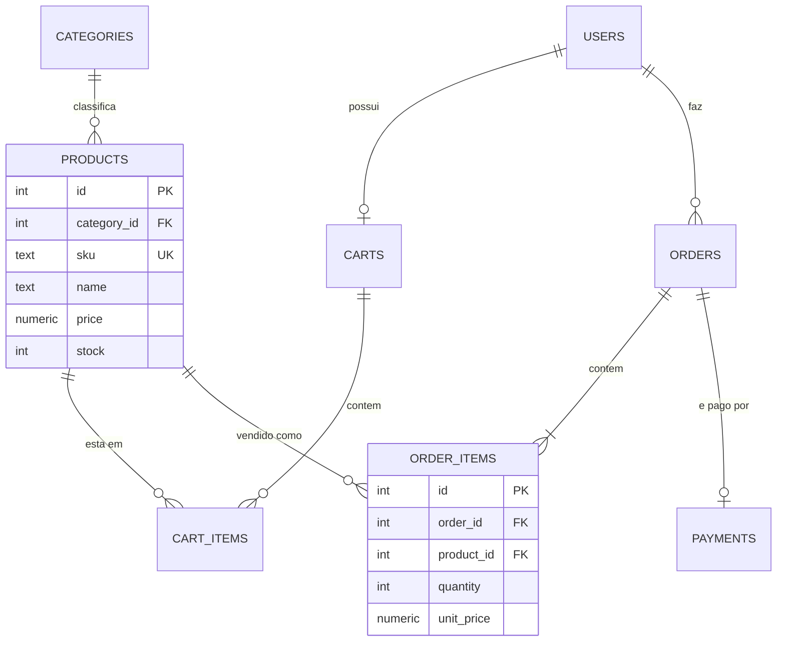
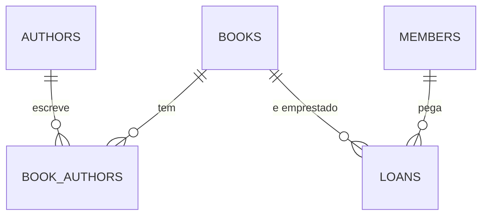

# 01. Por que usar banco; modelagem e diagrama ER

> ⏱️ ~1h30 · Módulo 3 · Pré-requisitos: [Módulo 1](../01-python-logica/README.md) (dicts, JSON, classes), [Módulo 2](../02-como-a-web-funciona/README.md)

## 🎯 Objetivos
Ao final desta aula você consegue:
- Explicar por que arquivos (JSON/CSV) não bastam quando há vários usuários e muitos dados
- Descrever o modelo relacional: tabelas, linhas, colunas, chave primária e chave estrangeira
- Identificar relacionamentos 1:1, 1:N e N:N e representar N:N com tabela de junção
- Ler e desenhar um diagrama ER em Mermaid
- Tomar decisões de modelagem (tipo para dinheiro, chave artificial, datas em UTC)

## 🤔 Por que isso importa
O MiniShop da CLI (Módulo 1) e do servidor (Módulo 2) guarda tudo em um JSON. Funciona para uma pessoa; quebra com duas pedindo ao mesmo tempo. Todo sistema web real tem um banco, e a **modelagem** (quais tabelas e como se ligam) é a decisão mais cara de mudar depois. Um erro aqui vira meses de retrabalho.

## 💡 Intuição (explicação simples)
Um banco relacional é um **conjunto de planilhas ligadas por um código em comum**. A planilha de *produtos* guarda `categoria_id = 3` em vez de repetir “Periféricos” em cada linha; a planilha de *categorias* diz o que é o 3. Mude o nome da categoria em um só lugar e todos os produtos refletem. E, ao contrário de uma planilha na nuvem editada por dez pessoas, o banco tem um **gerente** que impede duas pessoas de estragarem o mesmo dado ao mesmo tempo e garante que o dado nunca fique pela metade.

## 🔬 Como funciona por dentro
**O que o arquivo JSON não resolve** (e o banco sim):

| Problema | Com arquivo JSON | Com banco relacional |
|---|---|---|
| Concorrência | “lê tudo, altera, grava tudo”: duas pessoas se sobrescrevem (*lost update*) | operações atômicas e transações com isolamento |
| Consulta | carregar o arquivo inteiro e filtrar em Python: O(n) | **índices** e planejador de consultas (aula 08) |
| Integridade | nada impede `categoria_id` inexistente, preço negativo, SKU repetido | **constraints**: chave estrangeira, `CHECK`, `UNIQUE`, `NOT NULL` |
| Durabilidade | queda no meio da gravação corrompe o arquivo | log de transações (WAL): o que foi confirmado não se perde |
| Escala | tudo na memória | só lê as páginas necessárias do disco |
| Relações | duplicar dados ou ligar à mão | `JOIN` |

**Modelo relacional** (Codd, 1970): dados em **relações** (tabelas) formadas por **linhas** (registros) e **colunas** (atributos, cada uma com um tipo). SQL é a linguagem declarativa: você diz **o que** quer, o banco decide **como** buscar.

- **Chave primária (PK):** coluna(s) que identifica cada linha de forma única e nunca nula (`products.id`).
- **Chave estrangeira (FK):** coluna que aponta para a PK de outra tabela (`products.category_id → categories.id`). O banco **recusa** valores que não existam lá.
- **Chave natural × artificial (surrogate):** natural vem do negócio (CPF, e-mail, SKU); artificial é um número gerado (`id`). Convenção deste curso: PK artificial `id` + `UNIQUE` nas chaves naturais que importam (e-mail, SKU).

**Relacionamentos** (cardinalidade):

| Tipo | Exemplo | Como se modela |
|---|---|---|
| 1:1 | usuário ↔ carrinho | FK com `UNIQUE` (ou mesma PK) |
| 1:N | categoria → produtos; usuário → pedidos | FK no lado “N” |
| N:N | pedidos ↔ produtos | **tabela de junção** com duas FKs (`order_items`), podendo ter atributos próprios (quantidade, preço) |

**Diagrama ER do MiniShop** (a notação `||--o{` lê-se “um para zero ou muitos”):

Passos práticos de modelagem: (1) liste os **substantivos** do problema (candidatos a tabela); (2) liste os **verbos** (candidatos a relacionamento); (3) defina a cardinalidade de cada um perguntando “um X tem quantos Y? e um Y, quantos X?”; (4) escolha PKs, tipos e restrições; (5) revise com casos reais.

**Decisões de modelagem que valem em todo projeto**
- **Dinheiro:** `NUMERIC(10,2)` (exato). Nunca `float`/`real`/`double` (a mesma razão do Módulo 1).
- **Datas/horas:** `timestamptz` (guarda UTC) e converte para o fuso só na tela.
- **Textos:** `text` no PostgreSQL (não há ganho em `varchar(255)`); valide tamanho na aplicação ou com `CHECK`.
- **Booleanos:** `boolean`, não `'S'/'N'`.
- **Nomes:** `snake_case`, tabelas no plural (`products`), colunas em inglês, igual aos models do Django (Módulo 5).
- **Preço no item do pedido:** `order_items.unit_price` guarda o preço **no momento da compra**. Se o preço do produto mudar, pedidos antigos não podem mudar.

## 🛠️ Exemplo prático
Os exemplos desta aula usam só Python (o SQLite faz parte da biblioteca padrão), para você sentir o problema antes de instalar o PostgreSQL na aula 03.

**1. A condição de corrida do arquivo (determinística: forçamos a ordem)**
```python
import json
import threading
from pathlib import Path

arq = Path("estoque.json")
arq.write_text(json.dumps({"MS-01": 5}))
a_leu, b_gravou = threading.Event(), threading.Event()

def vendedor_a():                       # lê, e DEMORA antes de gravar
    est = json.loads(arq.read_text())
    a_leu.set()
    b_gravou.wait()                     # B grava enquanto A "pensa"
    est["MS-01"] -= 3
    arq.write_text(json.dumps(est))

def vendedor_b():
    a_leu.wait()
    est = json.loads(arq.read_text())   # também vê 5
    est["MS-01"] -= 4
    arq.write_text(json.dumps(est))
    b_gravou.set()

ta, tb = threading.Thread(target=vendedor_a), threading.Thread(target=vendedor_b)
ta.start(); tb.start(); ta.join(); tb.join()
print("estoque final:", json.loads(arq.read_text()), "(vendeu 3 + 4 = 7 de um estoque de 5!)")
```
```text
estoque final: {'MS-01': 2} (vendeu 3 + 4 = 7 de um estoque de 5!)
```
O estoque final deveria ser inválido (−2); o arquivo diz 2: a venda de B sumiu (*lost update*). Na vida real o intervalo entre ler e gravar é de milissegundos, mas com muitos usuários isso acontece.

**2. O mesmo cenário com um banco (SQLite) e uma atualização atômica**
```python
import sqlite3

con = sqlite3.connect(":memory:")
con.execute("CREATE TABLE products (sku TEXT PRIMARY KEY, stock INTEGER NOT NULL CHECK (stock >= 0))")
con.execute("INSERT INTO products VALUES ('MS-01', 5)")

def vender(qtd):
    cur = con.execute("UPDATE products SET stock = stock - ? WHERE sku = 'MS-01' AND stock >= ?", (qtd, qtd))
    con.commit()
    return cur.rowcount                  # quantas linhas foram alteradas

print("venda de 3:", "ok" if vender(3) else "recusada")
print("venda de 4:", "ok" if vender(4) else "recusada (sem estoque)")
print(con.execute("SELECT stock FROM products").fetchone())
```
```text
venda de 3: ok
venda de 4: recusada (sem estoque)
(2,)
```
A decisão (“há estoque suficiente?”) e a alteração acontecem **na mesma instrução**, dentro do banco, que serializa o acesso. Nunca mais “lê, pensa, grava”. Este padrão será a base do pedido com estoque no Módulo 5.

**3. A integridade que o arquivo não dá**
```python
import sqlite3

con = sqlite3.connect(":memory:")
con.execute("PRAGMA foreign_keys = ON")
con.executescript("""
CREATE TABLE categories (id INTEGER PRIMARY KEY, name TEXT NOT NULL UNIQUE);
CREATE TABLE products (
    id INTEGER PRIMARY KEY,
    category_id INTEGER NOT NULL REFERENCES categories(id),
    price NUMERIC NOT NULL CHECK (price >= 0));
INSERT INTO categories VALUES (1, 'Periféricos');
""")
for sql in ("INSERT INTO products VALUES (1, 1, 49.9)",     # ok
            "INSERT INTO products VALUES (2, 99, 10)",      # categoria inexistente
            "INSERT INTO products VALUES (3, 1, -5)",       # preço negativo
            "INSERT INTO categories VALUES (2, 'Periféricos')"):  # nome repetido
    try:
        con.execute(sql)
        print("ok      ", sql)
    except sqlite3.IntegrityError as e:
        print("RECUSADO", sql, "->", e)
```
```text
ok       INSERT INTO products VALUES (1, 1, 49.9)
RECUSADO INSERT INTO products VALUES (2, 99, 10) -> FOREIGN KEY constraint failed
RECUSADO INSERT INTO products VALUES (3, 1, -5) -> CHECK constraint failed: price >= 0
RECUSADO INSERT INTO categories VALUES (2, 'Periféricos') -> UNIQUE constraint failed: categories.name
```
**4. Um “join” feito à mão (para entender o que o banco faz)**
```python
import timeit

categorias = [{"id": i, "nome": f"Cat {i}"} for i in range(1, 501)]
produtos = [{"id": n, "categoria_id": n % 500 + 1} for n in range(1, 5001)]

def join_ingenuo():                       # para cada produto, percorre todas as categorias: O(n*m)
    return [(p["id"], c["nome"]) for p in produtos for c in categorias if c["id"] == p["categoria_id"]]

def join_hash():                          # monta um dict das categorias (hash) e consulta: O(n+m)
    por_id = {c["id"]: c for c in categorias}
    return [(p["id"], por_id[p["categoria_id"]]["nome"]) for p in produtos]

assert join_ingenuo() == join_hash()
print(f"ingênuo: {timeit.timeit(join_ingenuo, number=1):.3f}s | hash: {timeit.timeit(join_hash, number=1):.4f}s")
```
```text
ingênuo: 0.067s | hash: 0.0003s
```
(Tempos variam.) O banco escolhe entre estratégias parecidas (*nested loop*, *hash join*, *merge join*) conforme o tamanho das tabelas e os índices disponíveis: é o trabalho do planejador (aula 08).

## ⚠️ Erros comuns e boas práticas
| Erro de modelagem | Consequência | Melhor |
|---|---|---|
| Guardar lista em uma coluna (`"1,5,9"`) | não dá para filtrar, ligar nem validar | tabela de junção |
| `float` para dinheiro | centavos errados | `NUMERIC(10,2)` |
| Usar e-mail/CPF como PK | muda ou vaza em URLs e FKs | PK artificial + `UNIQUE` |
| Apagar linhas que têm histórico (pedidos) | perde auditoria | marcar como inativa (`is_active`) |
| Preço só no produto | pedido antigo muda quando o preço muda | `unit_price` no item |
| Sem `created_at` | impossível auditar ou ordenar | `timestamptz NOT NULL DEFAULT now()` |
| Tudo em uma tabelona | redundância e anomalias (aula 02) | normalizar |

- Comece pelo **diagrama**, depois escreva o SQL. Errar no papel custa minutos.
- Nomeie com consistência (plural, `snake_case`, `_id` nas FKs).
- Nunca guarde segredos em texto puro (senhas: só *hash*, Módulo 9).

## 🧠 Pausa para lógica
**Problema (relações).** Dado o ER do MiniShop, responda em português e depois em código: (a) quantos pedidos tem um usuário? (b) um produto pode estar em quantos pedidos? (c) por que `order_items` precisa de `unit_price` e `quantity`? Então implemente `produtos_por_categoria(produtos, categorias)` que agrupa os produtos por **nome** de categoria em O(n+m).

<details><summary>Dica</summary>
Para (a) e (b) pense nos dois sentidos da relação (“um … tem quantos …?”). No código, monte um dict <code>id → nome</code> das categorias e um <code>defaultdict(list)</code> para os grupos.
</details>

<details><summary>Solução comentada</summary>

(a) Zero ou muitos (1:N). (b) Zero ou muitos: a relação pedidos↔produtos é N:N, resolvida por `order_items`. (c) São atributos **da relação**, não do pedido nem do produto: quantas unidades de *este* produto *neste* pedido e a que preço.

```python
from collections import defaultdict

categorias = [{"id": 1, "nome": "Periféricos"}, {"id": 2, "nome": "Áudio"}, {"id": 3, "nome": "Cabos"}]
produtos = [{"nome": "Mouse", "categoria_id": 1}, {"nome": "Fone", "categoria_id": 2},
            {"nome": "Teclado", "categoria_id": 1}, {"nome": "Órfão", "categoria_id": 99}]

def produtos_por_categoria(produtos, categorias):
    nome_de = {c["id"]: c["nome"] for c in categorias}        # O(m)
    grupos = defaultdict(list)
    for p in produtos:                                          # O(n)
        grupos[nome_de.get(p["categoria_id"], "(sem categoria)")].append(p["nome"])
    return dict(grupos)

print(produtos_por_categoria(produtos, categorias))
```
```text
{'Periféricos': ['Mouse', 'Teclado'], 'Áudio': ['Fone'], '(sem categoria)': ['Órfão']}
```
O “Órfão” aponta para uma categoria que não existe: num banco, a **chave estrangeira** teria impedido o cadastro.
</details>

**Variação mais difícil:** liste também as categorias sem nenhum produto (a ideia do `LEFT JOIN` da aula 05).

## 🧩 Exercícios
**1. Fixação**
Modele uma biblioteca: livros, autores (um livro pode ter vários autores e um autor, vários livros), sócios e empréstimos. Liste as tabelas, as PKs/FKs e a tabela de junção.

<details><summary>Solução</summary>

Tabelas: `authors(id, name)`, `books(id, title, isbn UNIQUE)`, `book_authors(book_id FK, author_id FK, PK(book_id, author_id))` (N:N), `members(id, name, email UNIQUE)`, `loans(id, member_id FK, book_id FK, loaned_at, due_at, returned_at NULL)` (N:N entre sócios e livros ao longo do tempo, com atributos próprios).


</details>

**2. Aplicação no projeto MiniShop**
Escreva `docs/modelo-er.md` com o diagrama ER completo do MiniShop e um parágrafo de justificativa por decisão.

Critérios de pronto:
- [ ] Diagrama Mermaid com as 8 tabelas do ER acima (categories, products, users, carts, cart_items, orders, order_items, payments) e suas cardinalidades
- [ ] Cada tabela lista PK, FKs e colunas com tipo (`NUMERIC(10,2)`, `timestamptz`…)
- [ ] Explica por que `order_items.unit_price` existe e por que `cart_items` não o tem
- [ ] Explica por que `payments.order_id` é `UNIQUE`
- [ ] Você abriu o diagrama no GitHub (ele renderiza Mermaid) e conferiu
- [ ] Commit `docs: add minishop er model`

<details><summary>Solução de referência</summary>

O diagrama da seção “Como funciona por dentro” é a base (acrescente os atributos de todas as tabelas). Pontos de justificativa: o item do carrinho usa o **preço atual** do produto (ainda não é compra); o item do pedido **congela** o preço; `payments.order_id UNIQUE` porque, neste modelo, um pedido tem no máximo um pagamento; PKs artificiais para estabilidade; e-mail e SKU como chaves naturais `UNIQUE`.
</details>

**3. Desafio (opcional)**
Como você modelaria **variações de produto** (camiseta M/G/GG em cores diferentes, cada uma com estoque próprio) sem duplicar o produto? Desenhe o ER.

## 🎤 Na entrevista
- **Por que usar um banco de dados em vez de arquivos?** Concorrência segura, consultas eficientes com índices, integridade (constraints), durabilidade (transações/WAL) e escalabilidade, além de uma linguagem declarativa (SQL).
- **Qual a diferença entre PK e FK?** PK identifica unicamente uma linha da própria tabela; FK referencia a PK de outra tabela e garante integridade referencial.
- **Como se modela um relacionamento N:N?** Com uma tabela de junção contendo FKs para as duas tabelas (e, se preciso, atributos da relação, como quantidade e preço).

## 📚 Para ir além
- 📄 Documentação oficial: [PostgreSQL: conceitos](https://www.postgresql.org/docs/current/tutorial-concepts.html). Introdução curta: bancos relacionais, tabelas, linhas.
- 📄 Documentação oficial: [Mermaid: diagrama entidade-relacionamento](https://mermaid.js.org/syntax/entityRelationshipDiagram.html). Sintaxe das cardinalidades e atributos.
- 📄 Documentação oficial: [`sqlite3` (Python)](https://docs.python.org/3/library/sqlite3.html). Banco embutido na biblioteca padrão, ótimo para experimentar.
- 🎥 Vídeo (EN): *CS50's Introduction to Databases with SQL* (Harvard), em [cs50.harvard.edu/sql](https://cs50.harvard.edu/sql/). Curso gratuito; assista à primeira semana (relações e modelagem).
- 🏋️ Prática extra: desenhe o ER de um sistema que você usa (delivery, streaming) em 15 minutos.

## ✅ Checklist da aula
- [ ] Reproduzi o *lost update* com arquivo e o evitei com `UPDATE` atômico
- [ ] Provoquei 4 violações de integridade no SQLite
- [ ] Sei desenhar 1:1, 1:N e N:N e explicar a tabela de junção
- [ ] Entreguei `docs/modelo-er.md`
