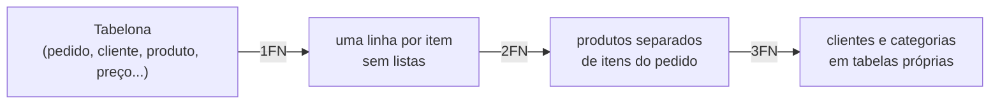

# 02. Normalização (1FN a 3FN) e quando desnormalizar

> ⏱️ ~1h30 · Módulo 3 · Pré-requisitos: [01](01-por-que-banco-modelagem-er.md)

## 🎯 Objetivos
Ao final desta aula você consegue:
- Identificar as anomalias de inserção, atualização e remoção em uma tabela mal projetada
- Aplicar a 1FN, 2FN e 3FN passo a passo
- Explicar dependência funcional, chave candidata e dependência transitiva
- Decidir quando desnormalizar de propósito e como manter a consistência
- Distinguir desnormalização de “dado histórico” (`unit_price`)

## 🤔 Por que isso importa
A maior parte dos bugs de dados vem de **informação duplicada que ficou diferente**: o mesmo cliente com dois endereços, o mesmo produto com dois preços. Normalizar é a técnica sistemática para eliminar essa duplicação. E saber quando **não** normalizar (relatórios, contadores) é o que diferencia quem entende de quem decorou regras.

## 💡 Intuição (explicação simples)
Uma planilha de pedidos com o nome e o endereço do cliente repetidos em toda linha é como **escrever o telefone da sua mãe na capa de cada caderno**. Mudou o número? Você precisa lembrar de corrigir todos, e vai esquecer um. Normalizar é **guardar o telefone numa agenda só e escrever, nos cadernos, “veja a agenda, página 3”** (a chave estrangeira).

Regra de bolso das formas normais, em uma frase cada:
- **1FN:** uma célula, um valor (nada de listas) e linhas identificáveis.
- **2FN:** cada coluna depende da chave **inteira**, não de pedaço dela.
- **3FN:** cada coluna depende **só** da chave, não de outra coluna comum. (“A chave, toda a chave e nada além da chave.”)

## 🔬 Como funciona por dentro
**Dependência funcional.** `A → B` significa: dado o valor de A, o valor de B é determinado. `email → nome` (cada e-mail tem um nome); `sku → preço`; `cep → cidade`. Uma **chave candidata** é um conjunto mínimo de colunas que determina todas as outras. Normalizar é reorganizar as tabelas para que **toda dependência funcional parta de uma chave**.

**Anomalias** em uma tabelona de pedidos `(pedido, cliente_email, cliente_nome, cliente_cidade, produto, categoria, preço, qtd)`:
- **Atualização:** mudar o nome de um cliente exige alterar N linhas; esquecer uma gera inconsistência.
- **Inserção:** não dá para cadastrar um produto que nunca foi vendido (não há pedido para pendurá-lo).
- **Remoção:** ao apagar o único pedido de um produto, perde-se a informação do próprio produto.

**As formas normais, com exemplo**

| Forma | Viola quando… | Correção |
|---|---|---|
| 1FN | célula com lista (`"mouse, teclado"`), colunas repetidas (`item1`, `item2`) | uma linha por item |
| 2FN | chave composta `(pedido, produto)` e `preço` depende só de `produto` | mover para a tabela do produto |
| 3FN | `cliente_cidade` depende de `cliente_email`, que não é a chave do pedido (transitiva) | tabela de clientes |



**Quando desnormalizar (com consciência).** Normalização otimiza **escrita e consistência**; em leitura pesada ela custa `JOIN`s. Casos legítimos:
1. **Valor derivado caro de recalcular:** `orders.total` (soma dos itens). Mantenha-o consistente (na mesma transação) e confira com uma consulta de auditoria.
2. **Contadores:** `products.stock`, número de comentários.
3. **Relatórios/dashboards:** tabelas de resumo atualizadas por rotina.
4. **Cache** (Redis) fora do banco.

**Atenção:** `order_items.unit_price` **não** é desnormalização: é um **fato histórico** (o preço *daquela compra*). Se fosse apenas uma cópia de `products.price`, estaria errado; mas ela existe justamente para não mudar quando o produto mudar.

## 🛠️ Exemplo prático
O banco PostgreSQL será instalado na aula 03; aqui você já pode **ler** o SQL e ver as saídas reais (rodamos em PostgreSQL 18).

**1. A tabelona e suas anomalias**
```sql
CREATE TABLE pedidos_planilha (
    pedido        int,
    cliente_email text,
    cliente_nome  text,
    cidade        text,
    produtos      text,      -- lista dentro da célula: viola a 1FN
    categoria     text,
    total         numeric
);
INSERT INTO pedidos_planilha VALUES
 (1, 'ana@x.test',   'Ana Souza',  'Recife', 'Mouse, Teclado', 'Periféricos', 410.00),
 (2, 'ana@x.test',   'Ana Souza',  'Recife', 'Webcam',         'Periféricos', 219.90),
 (3, 'bruno@x.test', 'Bruno Lima', 'Natal',  'Fone, Mouse',    'Áudio',       339.80);

-- Quantos pedidos contêm Mouse? Procurar texto dentro de lista é frágil:
SELECT pedido FROM pedidos_planilha WHERE produtos LIKE '%Mouse%';
-- Anomalia de atualização: corrigir o nome da Ana "esquecendo" uma linha
UPDATE pedidos_planilha SET cliente_nome = 'Ana S. Souza' WHERE pedido = 1;
SELECT DISTINCT cliente_email, cliente_nome FROM pedidos_planilha ORDER BY 1, 2;
```
```text
 pedido 
--------
      1
      3
(2 rows)

 cliente_email | cliente_nome 
---------------+--------------
 ana@x.test    | Ana Souza
 ana@x.test    | Ana S. Souza
 bruno@x.test  | Bruno Lima
(3 rows)
```
Resultado: a mesma cliente com **dois nomes**. Além disso, não há como cadastrar um produto sem pedido e a “lista” em `produtos` não permite somar, filtrar nem validar.

**2. 1FN: um valor por célula**
```sql
CREATE TABLE itens_1fn AS
SELECT p.pedido, p.cliente_email, p.cliente_nome, p.cidade, trim(item) AS produto, p.categoria
FROM pedidos_planilha p, LATERAL unnest(string_to_array(p.produtos, ',')) AS item;
SELECT * FROM itens_1fn ORDER BY pedido, produto;
```
```text
 pedido | cliente_email | cliente_nome | cidade | produto |  categoria  
--------+---------------+--------------+--------+---------+-------------
      1 | ana@x.test    | Ana S. Souza | Recife | Mouse   | Periféricos
      1 | ana@x.test    | Ana S. Souza | Recife | Teclado | Periféricos
      2 | ana@x.test    | Ana Souza    | Recife | Webcam  | Periféricos
      3 | bruno@x.test  | Bruno Lima   | Natal  | Fone    | Áudio
      3 | bruno@x.test  | Bruno Lima   | Natal  | Mouse   | Áudio
(5 rows)
```
(`unnest(string_to_array(...))` transforma a lista em linhas: usamos isso só para migrar os dados; o que importa é o resultado: **uma linha por item**.) Mas repare: o `Mouse` do pedido 1 aparece como “Periféricos” e o `Mouse` do pedido 3 como “Áudio”. A planilha guardava a categoria **por pedido**, e não por produto, então o mesmo produto ficou com duas categorias. Na tabela correta, a categoria pertence ao **produto**.

**3. 2FN e 3FN: o modelo normalizado**
```sql
CREATE TABLE categorias (id int PRIMARY KEY, nome text NOT NULL UNIQUE);
CREATE TABLE clientes   (id int PRIMARY KEY, email text NOT NULL UNIQUE, nome text NOT NULL, cidade text NOT NULL);
CREATE TABLE produtos   (id int PRIMARY KEY, nome text NOT NULL UNIQUE, categoria_id int NOT NULL REFERENCES categorias(id), preco numeric(10,2) NOT NULL);
CREATE TABLE pedidos    (id int PRIMARY KEY, cliente_id int NOT NULL REFERENCES clientes(id));
CREATE TABLE itens      (pedido_id int REFERENCES pedidos(id), produto_id int REFERENCES produtos(id), qtd int NOT NULL CHECK (qtd > 0),
                         preco_unit numeric(10,2) NOT NULL, PRIMARY KEY (pedido_id, produto_id));

INSERT INTO categorias VALUES (1, 'Periféricos'), (2, 'Áudio');
INSERT INTO clientes   VALUES (1, 'ana@x.test', 'Ana Souza', 'Recife'), (2, 'bruno@x.test', 'Bruno Lima', 'Natal');
INSERT INTO produtos   VALUES (1, 'Mouse', 1, 89.90), (2, 'Teclado', 1, 320.10), (3, 'Webcam', 1, 219.90), (4, 'Fone', 2, 249.90),
                              (5, 'Caixa de som', 2, 179.90);      -- produto SEM pedido: agora é possível!
INSERT INTO pedidos    VALUES (1, 1), (2, 1), (3, 2);
INSERT INTO itens      VALUES (1, 1, 1, 89.90), (1, 2, 1, 320.10), (2, 3, 1, 219.90), (3, 4, 1, 249.90), (3, 1, 1, 89.90);

-- Atualizar o nome da Ana: UMA linha, sem inconsistência possível
UPDATE clientes SET nome = 'Ana S. Souza' WHERE email = 'ana@x.test';

SELECT p.id AS pedido, c.nome AS cliente, pr.nome AS produto, k.nome AS categoria, i.qtd, i.preco_unit
FROM itens i
JOIN pedidos p ON p.id = i.pedido_id
JOIN clientes c ON c.id = p.cliente_id
JOIN produtos pr ON pr.id = i.produto_id
JOIN categorias k ON k.id = pr.categoria_id
ORDER BY p.id, pr.nome;
```
```text
 pedido |   cliente    | produto |  categoria  | qtd | preco_unit 
--------+--------------+---------+-------------+-----+------------
      1 | Ana S. Souza | Mouse   | Periféricos |   1 |      89.90
      1 | Ana S. Souza | Teclado | Periféricos |   1 |     320.10
      2 | Ana S. Souza | Webcam  | Periféricos |   1 |     219.90
      3 | Bruno Lima   | Fone    | Áudio       |   1 |     249.90
      3 | Bruno Lima   | Mouse   | Periféricos |   1 |      89.90
(5 rows)
```
O que mudou: **2FN** (preço e categoria saíram da tabela de itens e foram para `produtos`, porque dependem só do produto) e **3FN** (a cidade e o nome saíram do pedido para `clientes`; a categoria saiu do produto para `categorias`). Cada fato mora em **um** lugar.

**4. Desnormalização controlada: `total` do pedido**
```sql
ALTER TABLE pedidos ADD COLUMN total numeric(12,2);
UPDATE pedidos p SET total = (SELECT sum(qtd * preco_unit) FROM itens i WHERE i.pedido_id = p.id);
SELECT * FROM pedidos ORDER BY id;

-- consulta de AUDITORIA: o total gravado bate com a soma dos itens?
SELECT p.id, p.total AS gravado, s.soma AS calculado
FROM pedidos p JOIN (SELECT pedido_id, sum(qtd * preco_unit) AS soma FROM itens GROUP BY pedido_id) s ON s.pedido_id = p.id
WHERE p.total IS DISTINCT FROM s.soma;
```
```text
 id | cliente_id | total  
----+------------+--------
  1 |          1 | 410.00
  2 |          1 | 219.90
  3 |          2 | 339.80
(3 rows)

 id | gravado | calculado 
----+---------+-----------
(0 rows)
```
A auditoria devolve **zero linhas** enquanto estiver consistente. Se alguém alterar um item sem atualizar o total, a consulta aponta o pedido divergente. Você pagou por redundância (risco de inconsistência) em troca de ler o total sem somar os itens, e mitiga o risco com transação (aula 09) e auditoria.

**5. Preço histórico não é redundância**
```sql
UPDATE produtos SET preco = 99.90 WHERE nome = 'Mouse';           -- o preço de tabela subiu
SELECT pr.nome, pr.preco AS preco_hoje, i.preco_unit AS pago_no_pedido
FROM itens i JOIN produtos pr ON pr.id = i.produto_id WHERE pr.nome = 'Mouse' ORDER BY i.pedido_id;
```
```text
 nome  | preco_hoje | pago_no_pedido 
-------+------------+----------------
 Mouse |      99.90 |          89.90
 Mouse |      99.90 |          89.90
(2 rows)
```
Os pedidos antigos continuam com `89.90`: o histórico fiscal está preservado.

## ⚠️ Erros comuns e boas práticas
| Erro | Consequência | Solução |
|---|---|---|
| Normalizar demais (tabela para cada coisinha) | `JOIN`s demais, modelo difícil | pare na 3FN; avalie caso a caso |
| Desnormalizar sem plano de consistência | dados divergentes | transação + consulta de auditoria + testes |
| Tratar `unit_price` como cópia “a sincronizar” | pedido antigo muda | é histórico: nunca atualize |
| Guardar `idade` em vez de `data_nascimento` | dado vira falso com o tempo | guarde o fato imutável e derive |
| Duas fontes da verdade (`categoria` em dois lugares) | uma fica desatualizada | uma só tabela e FK |
| `NULL` significando coisas diferentes | ambiguidade | decida: “desconhecido”, “não se aplica”, “vazio” |

- Primeiro garanta a **3FN**; desnormalize só com medição ou necessidade comprovada.
- Todo dado derivado precisa de **dono** (o código que o atualiza) e de **teste**.
- Em dúvida entre 3FN e “tabelona”, escolha 3FN: é mais barato desnormalizar depois do que desfazer uma bagunça.

## 🧠 Pausa para lógica
**Problema (dependência funcional).** Dada uma lista de linhas (dicts), escreva `determina(linhas, a, b)` que diz se `a → b` (para cada valor de `a` existe um único valor de `b`). Use-a para descobrir quais colunas violam a 3FN em uma tabela de pedidos.

<details><summary>Dica</summary>
Percorra as linhas guardando em um dict <code>valor_de_a → valor_de_b</code>. Se encontrar o mesmo <code>a</code> com <code>b</code> diferente, a dependência não vale.
</details>

<details><summary>Solução comentada</summary>

```python
def determina(linhas, a, b):
    visto = {}
    for l in linhas:
        if visto.setdefault(l[a], l[b]) != l[b]:
            return False
    return True

pedidos = [
    {"pedido": 1, "email": "ana@x.test", "nome": "Ana", "cidade": "Recife", "produto": "Mouse"},
    {"pedido": 1, "email": "ana@x.test", "nome": "Ana", "cidade": "Recife", "produto": "Teclado"},
    {"pedido": 2, "email": "ana@x.test", "nome": "Ana", "cidade": "Recife", "produto": "Webcam"},
    {"pedido": 3, "email": "bruno@x.test", "nome": "Bruno", "cidade": "Natal", "produto": "Fone"},
    {"pedido": 3, "email": "bruno@x.test", "nome": "Bruno", "cidade": "Natal", "produto": "Mouse"},
]
for a, b in [("email", "nome"), ("email", "cidade"), ("pedido", "email"), ("produto", "pedido"), ("pedido", "produto")]:
    print(f"{a} -> {b}: {determina(pedidos, a, b)}")
```
```text
email -> nome: True
email -> cidade: True
pedido -> email: True
produto -> pedido: False
pedido -> produto: False
```
`email → nome` e `pedido → email` valem: logo `pedido → nome` é **transitiva** (pedido → email → nome): `nome` e `cidade` devem sair para a tabela de clientes (3FN). `pedido → produto` e `produto → pedido` são falsas (um pedido tem vários produtos e um produto aparece em vários pedidos): é a relação N:N, que pede uma linha por item (tabela de junção).
</details>

**Variação mais difícil:** dada uma tabela, ache todas as dependências `A → B` entre pares de colunas e marque as que parecem chaves candidatas (colunas cujos valores são todos distintos).

## 🧩 Exercícios
**1. Fixação**
Em `(pedido, produto, qtd, nome_produto, nome_cliente)` com chave `(pedido, produto)`: que forma normal é violada por `nome_produto`? E por `nome_cliente`? Como corrigir?

<details><summary>Solução</summary>

`nome_produto` depende só de `produto` (parte da chave): viola a **2FN**; `nome_cliente` depende do cliente do pedido, e não da chave `(pedido, produto)` completa (nem sequer de `produto`): também 2FN (depende só de `pedido`), com traço de dependência transitiva (3FN) se o pedido apontar para um cliente. Correção: `produtos(id, nome)`, `clientes(id, nome)`, `pedidos(id, cliente_id)`, `itens(pedido_id, produto_id, qtd)`.
</details>

**2. Aplicação no projeto MiniShop**
Revise o modelo do MiniShop (`docs/modelo-er.md`) à luz da normalização e documente as decisões.

Critérios de pronto:
- [ ] Tabela “Forma normal por tabela” indicando que cada tabela está na 3FN (ou por que não)
- [ ] Lista de **dados derivados/desnormalizados** (`orders.total`, `products.stock`) com o plano de consistência de cada um
- [ ] Explicação de `order_items.unit_price` como fato histórico
- [ ] Uma consulta de auditoria `orders.total` × soma de `order_items` (pode ser escrita agora e executada na aula 06)
- [ ] Commit `docs: review er model for normalization`

<details><summary>Solução de referência</summary>

| Tabela | 3FN? | Observação |
|---|---|---|
| categories, users, products, carts, cart_items, payments | sim | cada coluna depende só da PK |
| orders | sim, com `total` derivado | `total` é desnormalização consciente: mantida na mesma transação que cria os itens |
| order_items | sim | `unit_price` é histórico, não cópia |

```sql
SELECT o.id, o.total AS gravado, s.soma
FROM orders o JOIN (SELECT order_id, sum(quantity * unit_price) soma FROM order_items GROUP BY order_id) s ON s.order_id = o.id
WHERE o.total <> s.soma;
```
</details>

**3. Desafio (opcional)**
Pesquise a **BCNF** e a **4FN** e dê um exemplo de tabela em 3FN que ainda sofre anomalias.

## 🎤 Na entrevista
- **O que é normalização e por que fazer?** Organizar tabelas para eliminar redundância e anomalias de inserção, atualização e remoção, garantindo que cada fato esteja em um só lugar.
- **Explique 1FN, 2FN e 3FN.** 1FN: valores atômicos e linhas identificáveis; 2FN: nenhuma coluna depende de parte da chave composta; 3FN: nenhuma coluna depende de outra coluna não-chave (“a chave, toda a chave e nada além da chave”).
- **Quando desnormalizar?** Quando a leitura é crítica e o custo de `JOIN`/agregação pesa, em contadores e totais derivados, ou em tabelas de relatório, sempre com plano para manter a consistência.

## 📚 Para ir além
- 📄 Documentação oficial: [PostgreSQL: Constraints](https://www.postgresql.org/docs/current/ddl-constraints.html). Como o banco garante a integridade que a normalização pressupõe.
- 📄 Documentação oficial: [PostgreSQL: consultas (`LATERAL`, `unnest`)](https://www.postgresql.org/docs/current/queries.html). Referência dos recursos usados na migração.
- 🎥 Vídeo (EN): *CS50 SQL* ([cs50.harvard.edu/sql](https://cs50.harvard.edu/sql/)), aula sobre modelagem e normalização.
- 🏋️ Prática extra: pegue uma planilha real sua (finanças, estudo) e normalize-a em tabelas.

## ✅ Checklist da aula
- [ ] Provoquei a anomalia de atualização na tabelona
- [ ] Normalizei até a 3FN e rodei as consultas
- [ ] Sei dizer o que é desnormalização consciente e o que é dado histórico
- [ ] Revisei o modelo do MiniShop
