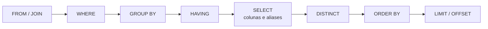

# 04. SELECT, WHERE, ORDER BY e LIMIT

> ⏱️ ~1h30 · Módulo 3 · Pré-requisitos: [03](03-postgres-docker-ddl-dml.md) (banco `loja` carregado)

## 🎯 Objetivos
Ao final desta aula você consegue:
- Escrever consultas com `SELECT`, aliases, expressões e `DISTINCT`
- Filtrar com `WHERE` usando `AND`, `OR`, `NOT`, `IN`, `BETWEEN`, `LIKE`/`ILIKE` e `IS NULL`
- Ordenar por várias colunas e controlar o lugar dos `NULL`s
- Paginar com `LIMIT`/`OFFSET` e explicar o problema de ordenação não determinística
- Usar `CASE`, `coalesce` e funções de data e texto

## 🤔 Por que isso importa
A listagem de produtos do MiniShop (filtro, busca, ordenação, paginação) é exatamente uma consulta `SELECT ... WHERE ... ORDER BY ... LIMIT ... OFFSET`. O ORM do Django gera esse SQL por baixo (aula 5.5); quem lê e entende o SQL consegue achar por que uma página está lenta.

## 💡 Intuição (explicação simples)
`SELECT` é **fazer um pedido ao bibliotecário**: “traga estes dados (colunas), das estantes tais (tabelas), só os que cumprem estas condições (`WHERE`), nesta ordem (`ORDER BY`), e só os 10 primeiros (`LIMIT`)”. Você descreve **o quê**; ele decide **como** buscar.

## 🔬 Como funciona por dentro
Você escreve o `SELECT` primeiro, mas o banco **avalia numa ordem lógica diferente**:


Consequências práticas: o alias definido no `SELECT` **não existe** no `WHERE` (o `WHERE` roda antes), mas existe no `ORDER BY`; `WHERE` filtra linhas, `HAVING` filtra grupos (aula 06).

- **Lógica de três valores:** comparar com `NULL` dá *desconhecido*, e o `WHERE` só deixa passar linhas **verdadeiras**. Por isso `WHERE x <> 5` **não** devolve linhas com `x NULL`.
- **Precedência:** `NOT` > `AND` > `OR`. Use parênteses sempre que misturar `AND` e `OR`.
- **`LIKE`** diferencia maiúsculas; **`ILIKE`** (PostgreSQL) não. `%` = qualquer sequência, `_` = um caractere.
- **Sem `ORDER BY`, a ordem das linhas é indefinida**, mesmo que “pareça” ordenada. E se a coluna de ordenação tem valores repetidos, a ordem entre os empatados também é indefinida: acrescente um desempate único (`id`).
- **`OFFSET n`** precisa gerar e descartar as `n` primeiras linhas; páginas profundas ficam lentas.

## 🛠️ Exemplo prático
Todos os blocos usam o banco `loja` da aula 03 (`recursos/sql/loja.sql`). As saídas abaixo são reais.

**1. Projeção, aliases e expressões**
```sql
SELECT sku, name AS produto, price, stock, price * stock AS valor_em_estoque
FROM products
ORDER BY id
LIMIT 5;
```
```text
  sku  |     produto      | price  | stock | valor_em_estoque 
-------+------------------+--------+-------+------------------
 PF-01 | Mouse sem fio    |  89.90 |     4 |           359.60
 PF-02 | Mouse gamer RGB  | 159.90 |    11 |          1758.90
 PF-03 | Teclado mecânico | 329.00 |    18 |          5922.00
 PF-04 | Teclado compacto | 149.90 |    25 |          3747.50
 PF-05 | Webcam Full HD   | 219.90 |     0 |             0.00
(5 rows)
```
```sql
SELECT DISTINCT category_id FROM products ORDER BY category_id;
SELECT count(*) AS total, count(DISTINCT category_id) AS categorias FROM products;
```
```text
 category_id 
-------------
           1
           2
           3
           4
           5
(5 rows)

 total | categorias 
-------+------------
    50 |          5
(1 row)
```
**2. Filtros básicos**
```sql
SELECT sku, name, price FROM products
WHERE price BETWEEN 100 AND 200 AND is_active
ORDER BY price;

SELECT sku, name FROM products WHERE category_id IN (2, 4) AND stock = 0;
```
```text
  sku  |              name               | price  
-------+---------------------------------+--------
 PF-08 | Suporte para notebook           | 119.90
 PF-04 | Teclado compacto                | 149.90
 MN-09 | Barra de luz para monitor       | 159.90
 PF-02 | Mouse gamer RGB                 | 159.90
 AR-01 | SSD 240 GB                      | 169.90
 AU-04 | Caixa de som portátil           | 179.90
 MN-07 | Suporte articulado para monitor | 189.90
 AU-05 | Caixa de som 2.1                | 199.90
(8 rows)

  sku  |          name          
-------+------------------------
 AU-08 | Adaptador de áudio USB
 CB-04 | Cabo USB-C 1m
(2 rows)
```
`BETWEEN 100 AND 200` inclui os dois extremos. `IN (2, 4)` equivale a `= 2 OR = 4`.

**3. Busca por texto**
```sql
SELECT sku, name FROM products WHERE name ILIKE '%mouse%' ORDER BY name;
SELECT sku, name FROM products WHERE name LIKE 'Mouse%';          -- começa com "Mouse" (diferencia caixa)
SELECT sku, name FROM products WHERE sku LIKE 'AU-0_';            -- _ casa exatamente 1 caractere
```
```text
  sku  |      name       
-------+-----------------
 PF-02 | Mouse gamer RGB
 PF-06 | Mousepad grande
 PF-01 | Mouse sem fio
(3 rows)

  sku  |      name       
-------+-----------------
 PF-01 | Mouse sem fio
 PF-02 | Mouse gamer RGB
 PF-06 | Mousepad grande
(3 rows)

  sku  |          name          
-------+------------------------
 AU-01 | Fone Bluetooth
 AU-02 | Fone com fio
 AU-03 | Headset gamer
 AU-04 | Caixa de som portátil
 AU-05 | Caixa de som 2.1
 AU-06 | Microfone USB
 AU-07 | Microfone de lapela
 AU-08 | Adaptador de áudio USB
 AU-09 | Soundbar
(9 rows)
```
**4. Precedência de `AND`/`OR` (um bug clássico)**
```sql
-- Intenção: produtos de Áudio ou Cabos que custam menos de 50
SELECT sku, price, category_id FROM products
WHERE category_id = 2 OR category_id = 4 AND price < 50      -- ERRADO: AND vence o OR
ORDER BY price DESC LIMIT 5;

SELECT sku, price, category_id FROM products
WHERE (category_id = 2 OR category_id = 4) AND price < 50    -- CERTO
ORDER BY price DESC LIMIT 5;
```
```text
  sku  | price  | category_id 
-------+--------+-------------
 AU-09 | 449.90 |           2
 AU-06 | 349.90 |           2
 AU-03 | 299.90 |           2
 AU-01 | 249.90 |           2
 AU-05 | 199.90 |           2
(5 rows)

  sku  | price | category_id 
-------+-------+-------------
 AU-10 | 49.90 |           2
 CB-02 | 49.90 |           4
 CB-03 | 44.90 |           4
 CB-07 | 39.90 |           4
 CB-05 | 34.90 |           4
(5 rows)
```
O primeiro devolve produtos de Áudio (`category_id = 2`) caros, como a Soundbar de R$ 449,90, que não deveriam estar ali: o banco leu `category_id = 2 OR (category_id = 4 AND price < 50)`, e o `price < 50` só valeu para os Cabos. O segundo, com parênteses, devolve só itens baratos.

**5. `NULL`: o `WHERE` e a lógica de três valores**
```sql
SELECT count(*) AS total_pagamentos,
       count(*) FILTER (WHERE paid_at IS NULL) AS sem_data,
       count(*) FILTER (WHERE paid_at <> '2026-01-01') AS diferente_de_uma_data     -- NULL não entra!
FROM payments;
SELECT order_id, status FROM payments WHERE paid_at IS NULL;
```
```text
 total_pagamentos | sem_data | diferente_de_uma_data 
------------------+----------+-----------------------
               13 |        1 |                    12
(1 row)

 order_id | status  
----------+---------
        4 | refused
(1 row)
```
`paid_at <> '2026-01-01'` ignora as linhas com `paid_at NULL`: o resultado não soma com o total. Para incluí-las: `paid_at IS DISTINCT FROM '2026-01-01'`.

**6. `ORDER BY`: vários critérios, direção e `NULL`**
```sql
SELECT sku, category_id, price FROM products
ORDER BY category_id ASC, price DESC, id
LIMIT 6;

SELECT order_id, status, paid_at FROM payments ORDER BY paid_at DESC NULLS LAST LIMIT 4;
```
```text
  sku  | category_id | price  
-------+-------------+--------
 PF-03 |           1 | 329.00
 PF-05 |           1 | 219.90
 PF-02 |           1 | 159.90
 PF-04 |           1 | 149.90
 PF-10 |           1 | 129.90
 PF-08 |           1 | 119.90
(6 rows)

 order_id |  status  |        paid_at         
----------+----------+------------------------
       18 | approved | 2026-10-20 16:48:00+00
       17 | approved | 2026-10-06 15:38:00+00
       14 | approved | 2026-08-19 17:28:00+00
       13 | approved | 2026-08-07 14:16:00+00
(4 rows)
```
No PostgreSQL, `NULL` vem **por último** em `ASC` e **primeiro** em `DESC`, a menos que você use `NULLS FIRST/LAST`.

**7. Paginação com `LIMIT`/`OFFSET`**
```sql
-- página 3, 10 itens por página: OFFSET = (3 - 1) * 10
SELECT id, sku, name FROM products WHERE is_active ORDER BY id LIMIT 10 OFFSET 20;
SELECT ceil(count(*) / 10.0)::int AS total_paginas FROM products WHERE is_active;
```
```text
 id |  sku  |                name                
----+-------+------------------------------------
 22 | MN-02 | Monitor 24 polegadas Full HD
 23 | MN-03 | Monitor 27 polegadas QHD
 24 | MN-04 | Monitor 27 polegadas 4K
 25 | MN-05 | Monitor curvo 32 polegadas
 26 | MN-06 | Monitor portátil 15 polegadas
 27 | MN-07 | Suporte articulado para monitor
 28 | MN-08 | Película antirreflexo 24 polegadas
 29 | MN-09 | Barra de luz para monitor
 31 | CB-01 | Cabo HDMI 2m
 32 | CB-02 | Cabo HDMI 5m
(10 rows)

 total_paginas 
---------------
             5
(1 row)
```
Cálculo: `OFFSET = (página - 1) * tamanho`; `total_paginas = ceil(total / tamanho)`, a mesma conta da aula 1.03 e do `GET /produtos` da aula 2.05.

**8. Paginação por “cursor” (keyset): evita o custo do `OFFSET`**
```sql
-- "Página seguinte" depois do último item visto (price = 89.90, id = 1): compara o par (price, id)
SELECT id, sku, price FROM products
WHERE is_active AND (price, id) > (89.90, 1)
ORDER BY price, id
LIMIT 5;
```
```text
 id |  sku  | price  
----+-------+--------
 38 | CB-08 |  89.90
 17 | AU-07 |  99.90
 50 | AR-10 |  99.90
  8 | PF-08 | 119.90
  4 | PF-04 | 149.90
(5 rows)
```
Em vez de descartar `n` linhas, o banco **pula direto** (com índice em `(price, id)`) para depois do último item visto. É mais rápido em páginas profundas e não “pula/repete” itens quando há inserções entre as páginas. O custo: não dá para ir direto à página 50.

**9. `CASE`, `coalesce` e funções**
```sql
SELECT sku, name,
       CASE WHEN stock = 0 THEN 'esgotado'
            WHEN stock < 10 THEN 'poucas unidades'
            ELSE 'disponível' END AS situacao,
       upper(left(name, 12)) AS nome_curto,
       length(name) AS tamanho
FROM products
ORDER BY stock, id
LIMIT 5;
```
```text
  sku  |          name          |    situacao     |  nome_curto  | tamanho 
-------+------------------------+-----------------+--------------+---------
 PF-05 | Webcam Full HD         | esgotado        | WEBCAM FULL  |      14
 AU-08 | Adaptador de áudio USB | esgotado        | ADAPTADOR DE |      22
 CB-04 | Cabo USB-C 1m          | esgotado        | CABO USB-C 1 |      13
 AU-02 | Fone com fio           | poucas unidades | FONE COM FIO |      12
 CB-05 | Cabo USB-C 2m          | poucas unidades | CABO USB-C 2 |      13
(5 rows)
```
```sql
SELECT id, created_at::date AS dia, to_char(created_at, 'DD/MM/YYYY HH24:MI') AS formatado,
       date_trunc('month', created_at)::date AS mes, extract(dow FROM created_at) AS dia_semana,
       created_at > now() - interval '9 months' AS recente
FROM orders ORDER BY created_at LIMIT 4;
SELECT coalesce(paid_at::text, 'não pago') AS pago_em, order_id FROM payments ORDER BY order_id LIMIT 3;
```
```text
 id |    dia     |    formatado     |    mes     | dia_semana | recente 
----+------------+------------------+------------+------------+---------
  1 | 2026-02-23 | 23/02/2026 17:37 | 2026-02-01 |          1 | t
  2 | 2026-03-10 | 10/03/2026 22:05 | 2026-03-01 |          2 | t
  3 | 2026-03-15 | 15/03/2026 22:19 | 2026-03-01 |          0 | t
  4 | 2026-03-31 | 31/03/2026 18:36 | 2026-03-01 |          2 | t
(4 rows)

        pago_em         | order_id 
------------------------+----------
 2026-03-10 22:10:00+00 |        2
 2026-03-15 22:24:00+00 |        3
 não pago               |        4
(3 rows)
```
Datas: guarde sempre `timestamptz` e formate só na saída. `now()` é a hora da transação; `interval` soma/subtrai períodos.

## ⚠️ Erros comuns e boas práticas
| Mensagem / sintoma | Causa | Solução |
|---|---|---|
| `ERROR: column "produto" does not exist` | Usou alias do `SELECT` no `WHERE` | Repita a expressão, ou use subconsulta/CTE |
| `ERROR: column "xyz" does not exist` | Nome errado (ou aspas duplas criando identificador com maiúsculas) | Confira `\d tabela`; evite aspas duplas |
| Linhas “sumiram” com `<>` | `NULL` na coluna | `IS DISTINCT FROM` ou trate o `NULL` |
| `OR` devolvendo linhas demais | Precedência de `AND`/`OR` | Parênteses |
| Páginas repetem ou pulam itens | `ORDER BY` sem desempate único | `ORDER BY coluna, id` |
| Paginação lenta nas páginas finais | `OFFSET` grande | Paginação por cursor (keyset) |
| `ERROR: operator does not exist: integer = text` | Tipos incompatíveis | `CAST`/`::`, ou compare com literal do tipo certo |
| `SELECT *` em código de produção | Traz colunas desnecessárias, quebra quando a tabela muda | Liste as colunas |

- Texto vai entre **aspas simples**; aspas duplas são para identificadores.
- Para paginar, ordene sempre por algo **único**; sem isso, a paginação é não determinística.
- Nunca monte SQL concatenando a entrada do usuário (injection, aula 10).
- Antes de uma consulta pesada em produção, use `LIMIT` e `EXPLAIN` (aula 08).

## 🧠 Pausa para lógica
**Problema (paginação).** Dada `pagina` e `tamanho`, produza o `LIMIT`/`OFFSET`. Em seguida, mostre por que paginar por `price` sem desempate pode repetir ou perder itens quando há preços iguais, e corrija. Por fim, escreva a consulta da “próxima página” por cursor.

<details><summary>Dica</summary>
Preços iguais deixam o banco livre para ordenar os empatados de qualquer jeito entre uma consulta e outra. Inclua <code>id</code> no <code>ORDER BY</code>. Para o cursor, compare a tupla <code>(price, id)</code> com a do último item.
</details>

<details><summary>Solução comentada</summary>

```python
def limit_offset(pagina: int, tamanho: int) -> str:
    if pagina < 1 or tamanho < 1:
        raise ValueError("pagina e tamanho devem ser >= 1")
    return f"LIMIT {tamanho} OFFSET {(pagina - 1) * tamanho}"

print(limit_offset(1, 10), "|", limit_offset(3, 10), "|", limit_offset(2, 25))
```
```text
LIMIT 10 OFFSET 0 | LIMIT 10 OFFSET 20 | LIMIT 25 OFFSET 25
```
```sql
-- Há preços repetidos? Esses empates tornam "ORDER BY price" ambíguo:
SELECT price, count(*) FROM products GROUP BY price HAVING count(*) > 1 ORDER BY price;
-- Ordem estável e única: price, id
SELECT id, price FROM products WHERE is_active ORDER BY price, id LIMIT 3 OFFSET 0;
SELECT id, price FROM products WHERE is_active ORDER BY price, id LIMIT 3 OFFSET 3;
```
```text
 price  | count 
--------+-------
  29.90 |     2
  34.90 |     2
  39.90 |     3
  49.90 |     2
  59.90 |     2
  69.90 |     3
  79.90 |     2
  89.90 |     2
  99.90 |     2
 159.90 |     2
 249.90 |     2
 449.90 |     2
 549.90 |     2
(13 rows)

 id | price 
----+-------
 34 | 24.90
 36 | 27.90
 18 | 29.90
(3 rows)

 id | price 
----+-------
 31 | 29.90
 35 | 34.90
 39 | 34.90
(3 rows)
```
Com `ORDER BY price, id`, a ordem total é única: nenhuma linha aparece em duas páginas nem fica de fora. No keyset, o cursor é o último `(price, id)` da página anterior (`WHERE (price, id) > (...)`).
</details>

**Variação mais difícil:** no keyset com `ORDER BY price DESC, id DESC`, como fica a condição do cursor? E como paginar para *trás*?

## 🧩 Exercícios
**1. Fixação**
Escreva as consultas: (a) os 5 produtos mais caros ativos; (b) produtos esgotados (estoque 0) com o nome da coluna `situacao = 'esgotado'`; (c) produtos cujo nome contém “USB” (sem diferenciar caixa), por ordem alfabética; (d) pedidos de 2026 maiores que R$ 1.000, do mais recente ao mais antigo.

<details><summary>Solução</summary>

```sql
SELECT sku, name, price FROM products WHERE is_active ORDER BY price DESC, id LIMIT 5;
SELECT sku, name, 'esgotado' AS situacao FROM products WHERE stock = 0 ORDER BY sku;
SELECT sku, name FROM products WHERE name ILIKE '%usb%' ORDER BY name;
SELECT id, total, created_at::date FROM orders
WHERE created_at >= '2026-01-01' AND created_at < '2027-01-01' AND total > 1000 ORDER BY created_at DESC;
```
```text
  sku  |             name              |  price  
-------+-------------------------------+---------
 MN-04 | Monitor 27 polegadas 4K       | 2199.00
 MN-05 | Monitor curvo 32 polegadas    | 1899.00
 MN-03 | Monitor 27 polegadas QHD      | 1399.00
 MN-06 | Monitor portátil 15 polegadas |  999.00
 MN-02 | Monitor 24 polegadas Full HD  |  849.00
(5 rows)

  sku  |          name          | situacao 
-------+------------------------+----------
 AU-08 | Adaptador de áudio USB | esgotado
 CB-04 | Cabo USB-C 1m          | esgotado
 PF-05 | Webcam Full HD         | esgotado
(3 rows)

  sku  |           name            
-------+---------------------------
 AU-08 | Adaptador de áudio USB
 CB-08 | Adaptador USB-C para HDMI
 CB-04 | Cabo USB-C 1m
 CB-05 | Cabo USB-C 2m
 CB-09 | Extensão USB 3.0
 PF-07 | Hub USB 4 portas
 AU-06 | Microfone USB
(7 rows)

 id |  total   | created_at 
----+----------+------------
 15 |  2568.50 | 2026-09-05
 13 |  4957.60 | 2026-08-07
 12 |  1289.30 | 2026-07-20
 10 | 10913.80 | 2026-06-29
  7 |  7395.60 | 2026-05-15
  5 |  5639.85 | 2026-04-14
(6 rows)
```
Para intervalos de datas prefira `>=` início e `<` fim exclusivo (evita erros de borda com horas).
</details>

**2. Aplicação no projeto MiniShop**
Escreva `projeto/sql/consultas/catalogo.sql` com as consultas que a futura tela de catálogo usará.

Critérios de pronto:
- [ ] (1) Listagem: produtos **ativos e com estoque**, com nome da categoria *(a categoria exige JOIN: deixe para a aula 05; aqui use `category_id`)*, ordenados por nome, paginados (`:pagina`, `:tamanho` como comentário de parâmetros)
- [ ] (2) Busca por nome com `ILIKE` e **faixa de preço** opcional (`min`/`max`)
- [ ] (3) Ordenações: menor preço, maior preço, mais novos, com desempate por `id`
- [ ] (4) Contagem total correspondente a cada filtro (para calcular `total_paginas`)
- [ ] (5) Versão por cursor (keyset) da listagem por preço
- [ ] Cada consulta com um comentário do que faz e executa sem erro no banco `loja`
- [ ] Commit `feat(sql): add catalog queries`

<details><summary>Solução de referência</summary>

```sql
-- (1) listagem paginada  (pagina=2, tamanho=5)
SELECT id, sku, name, price, stock FROM products
WHERE is_active AND stock > 0 ORDER BY name, id LIMIT 5 OFFSET 5;
-- (2) busca + faixa de preço
SELECT id, name, price FROM products
WHERE is_active AND name ILIKE '%cabo%' AND price BETWEEN 20 AND 50 ORDER BY price, id;
-- (4) contagem do filtro (2)
SELECT count(*) FROM products WHERE is_active AND name ILIKE '%cabo%' AND price BETWEEN 20 AND 50;
-- (5) cursor: depois de (price=44.90, id=...)
SELECT id, name, price FROM products WHERE is_active AND (price, id) > (44.90, 0) ORDER BY price, id LIMIT 3;
```
```text
 id |  sku  |         name          | price  | stock 
----+-------+-----------------------+--------+-------
 31 | CB-01 | Cabo HDMI 2m          |  29.90 |    14
 32 | CB-02 | Cabo HDMI 5m          |  49.90 |    21
 35 | CB-05 | Cabo USB-C 2m         |  34.90 |     2
 15 | AU-05 | Caixa de som 2.1      | 199.90 |    22
 14 | AU-04 | Caixa de som portátil | 179.90 |    15
(5 rows)

 id |         name          | price 
----+-----------------------+-------
 34 | Cabo USB-C 1m         | 24.90
 36 | Cabo de rede Cat6 5m  | 27.90
 31 | Cabo HDMI 2m          | 29.90
 35 | Cabo USB-C 2m         | 34.90
 33 | Cabo DisplayPort 1,8m | 44.90
 32 | Cabo HDMI 5m          | 49.90
(6 rows)

 count 
-------
     6
(1 row)

 id |         name          | price 
----+-----------------------+-------
 33 | Cabo DisplayPort 1,8m | 44.90
 20 | Fone intra-auricular  | 49.90
 32 | Cabo HDMI 5m          | 49.90
(3 rows)
```
</details>

**3. Desafio (opcional)**
Escreva uma consulta que devolva, em uma só instrução, a página de produtos **e** o total de linhas do filtro (pesquise `count(*) OVER ()`).

## 🎤 Na entrevista
- **Qual a ordem de execução lógica de um `SELECT`?** `FROM/JOIN` → `WHERE` → `GROUP BY` → `HAVING` → `SELECT` → `DISTINCT` → `ORDER BY` → `LIMIT/OFFSET`.
- **Por que `WHERE col = NULL` não funciona?** Comparação com `NULL` resulta em desconhecido; use `IS NULL`.
- **Qual o problema de `OFFSET` grande e como contorná-lo?** O banco precisa produzir e descartar as linhas puladas; paginação por cursor (keyset) com índice evita isso.
- **Diferença entre `WHERE` e `HAVING`?** `WHERE` filtra linhas antes de agrupar; `HAVING` filtra grupos depois da agregação.

## 📚 Para ir além
- 📄 Documentação oficial: [Consultas (PostgreSQL)](https://www.postgresql.org/docs/current/queries.html). `SELECT`, `WHERE`, `ORDER BY`, `LIMIT` em profundidade.
- 📄 Documentação oficial: [`psql`](https://www.postgresql.org/docs/current/app-psql.html). Atalhos para trabalhar no terminal.
- 🎥 Vídeo (EN): *CS50 SQL* ([cs50.harvard.edu/sql](https://cs50.harvard.edu/sql/)), semana de consultas (`SELECT`).
- 🏋️ Prática extra: escreva 10 consultas diferentes sobre `products` e `orders` e explique cada uma em uma frase.

## ✅ Checklist da aula
- [ ] Rodei as consultas e conferi as saídas
- [ ] Provoquei os erros de alias, precedência e `NULL`
- [ ] Sei calcular `OFFSET` e conheço o keyset
- [ ] Entreguei `catalogo.sql`
