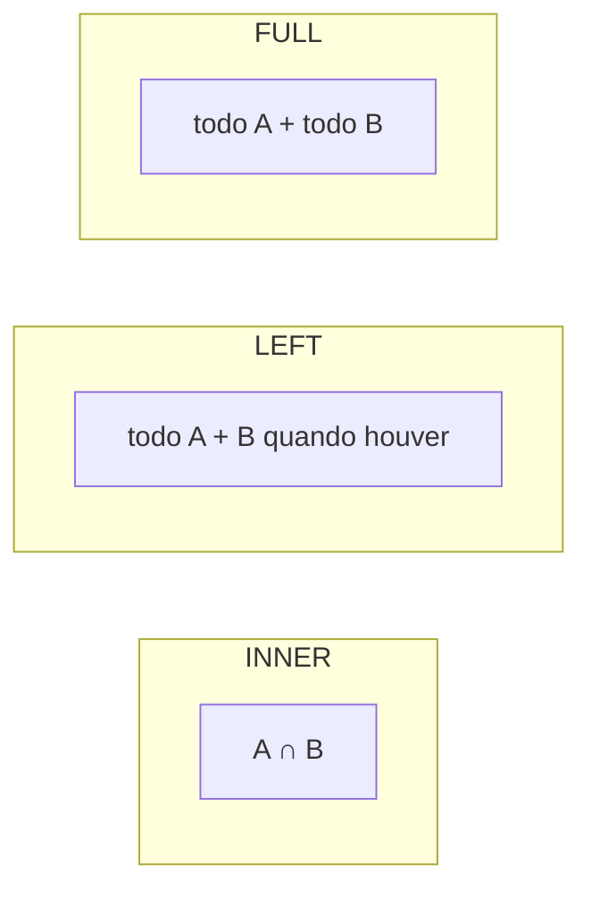

# 05. JOINs

> ⏱️ ~1h30 · Módulo 3 · Pré-requisitos: [04](04-select-where-order-limit.md)

## 🎯 Objetivos
Ao final desta aula você consegue:
- Combinar tabelas com `INNER JOIN`, `LEFT JOIN`, `FULL JOIN` e `CROSS JOIN`
- Escolher o `JOIN` certo e prever o número de linhas do resultado
- Encontrar “o que não tem par” (produtos nunca vendidos, clientes sem pedido) com *anti-join*
- Evitar o erro de multiplicar linhas e inflar somas
- Ligar várias tabelas (N:N) e diferenciar `ON` de `WHERE` em joins externos

## 🤔 Por que isso importa
Os dados normalizados (aula 02) ficam espalhados em tabelas; quase toda tela precisa juntá-los: o pedido com o nome do cliente e os produtos. `JOIN` mal escrito é a causa de relatórios com números errados (duplicados) e de consultas lentas. No Django, `select_related` e `prefetch_related` (aula 5.7) existem por causa deles.

## 💡 Intuição (explicação simples)
Imagine duas listas em papel: pedidos e clientes. `JOIN` é **ligar com um fio** cada pedido ao seu cliente (pelo código em comum) e montar uma linha larga com os dois. A diferença entre os tipos é o que fazer com os que **ficaram sem fio**:
- `INNER`: leve só os que têm par dos dois lados.
- `LEFT`: leve **todos da lista da esquerda**, com par ou sem (o lado direito fica `NULL`).
- `FULL`: leve todos dos dois lados.
- `CROSS`: ligue **todos com todos** (produto cartesiano).

## 🔬 Como funciona por dentro

| JOIN | Linhas devolvidas |
|---|---|
| `A INNER JOIN B ON …` | pares que satisfazem o `ON` |
| `A LEFT JOIN B ON …` | todo A; sem par, as colunas de B ficam `NULL` |
| `A RIGHT JOIN B ON …` | espelho do `LEFT` (raro: troque a ordem e use `LEFT`) |
| `A FULL JOIN B ON …` | todo A e todo B |
| `A CROSS JOIN B` | |A| × |B| linhas |

- **Multiplicação de linhas:** se uma linha de A casa com 3 de B, ela aparece **3 vezes**. Ao juntar `orders` com `order_items`, o `total` do pedido se repete em cada item: somar `orders.total` depois do join **infla** o valor.
- **`ON` × `WHERE` em joins externos:** a condição no `ON` define *quem casa*; no `WHERE` filtra o resultado já montado. Colocar no `WHERE` uma condição sobre a tabela da direita de um `LEFT JOIN` descarta as linhas `NULL` e o transforma, na prática, em `INNER`.
- **Como o banco executa:** escolhe entre *nested loop* (poucas linhas ou índice), *hash join* (monta uma tabela hash do lado menor, como na aula 3.01) e *merge join* (entradas ordenadas). Você escreve **o quê**; o planejador escolhe **como** (aula 08).

## 🛠️ Exemplo prático
Banco `loja` (aula 03). Saídas reais.

**1. `INNER JOIN`: produto com a sua categoria**
```sql
SELECT p.sku, p.name, c.name AS categoria, p.price
FROM products p
JOIN categories c ON c.id = p.category_id
WHERE p.is_active
ORDER BY p.price DESC, p.id
LIMIT 5;
```
```text
  sku  |             name              | categoria |  price  
-------+-------------------------------+-----------+---------
 MN-04 | Monitor 27 polegadas 4K       | Monitores | 2199.00
 MN-05 | Monitor curvo 32 polegadas    | Monitores | 1899.00
 MN-03 | Monitor 27 polegadas QHD      | Monitores | 1399.00
 MN-06 | Monitor portátil 15 polegadas | Monitores |  999.00
 MN-02 | Monitor 24 polegadas Full HD  | Monitores |  849.00
(5 rows)
```
`p` e `c` são **aliases** de tabela. `JOIN` sem prefixo é `INNER JOIN`. Quando as colunas têm o mesmo nome nos dois lados, `USING (coluna)` abrevia o `ON`.

**2. Juntando várias tabelas: o pedido completo (N:N)**
```sql
SELECT o.id AS pedido, u.name AS cliente, o.status, p.name AS produto, oi.quantity, oi.unit_price,
       oi.quantity * oi.unit_price AS subtotal
FROM orders o
JOIN users u        ON u.id = o.user_id
JOIN order_items oi ON oi.order_id = o.id
JOIN products p     ON p.id = oi.product_id
WHERE o.id IN (7, 8)
ORDER BY o.id, p.name;
```
```text
 pedido |   cliente   | status |           produto            | quantity | unit_price | subtotal 
--------+-------------+--------+------------------------------+----------+------------+----------
      7 | Diego Alves | paid   | Headset gamer                |        3 |     299.90 |   899.70
      7 | Diego Alves | paid   | Microfone de lapela          |        1 |      99.90 |    99.90
      7 | Diego Alves | paid   | Monitor 21 polegadas Full HD |        1 |     699.00 |   699.00
      7 | Diego Alves | paid   | Monitor curvo 32 polegadas   |        3 |    1899.00 |  5697.00
      8 | Ana Souza   | paid   | Cabo HDMI 2m                 |        1 |      29.90 |    29.90
      8 | Ana Souza   | paid   | Case para SSD NVMe           |        3 |      99.90 |   299.70
      8 | Ana Souza   | paid   | Fone intra-auricular         |        1 |      49.90 |    49.90
(7 rows)
```
`order_items` é a tabela de junção da relação N:N entre pedidos e produtos (aula 01).

**3. `LEFT JOIN`: quem não tem par aparece com `NULL`**
```sql
SELECT u.name, count(o.id) AS pedidos, coalesce(sum(o.total), 0) AS total_comprado
FROM users u
LEFT JOIN orders o ON o.user_id = u.id
GROUP BY u.id, u.name
ORDER BY pedidos DESC, u.id;
```
```text
     name      | pedidos | total_comprado 
---------------+---------+----------------
 Bruno Lima    |       7 |       12705.32
 Ana Souza     |       6 |        1965.64
 Diego Alves   |       4 |       21777.70
 Carla Mendes  |       1 |        1289.30
 Elisa Prado   |       0 |              0
 Administrador |       0 |              0
(6 rows)
```
Com `INNER JOIN`, a Elisa e o Administrador (sem pedidos) sumiriam do relatório. `count(o.id)` conta só os pedidos reais (`count(*)` contaria 1 para quem não tem nenhum).

**4. *Anti-join*: o que não tem par**
```sql
-- produtos NUNCA vendidos (3 formas equivalentes; as duas primeiras são as mais usadas)
SELECT p.sku, p.name FROM products p
LEFT JOIN order_items oi ON oi.product_id = p.id
WHERE oi.id IS NULL AND p.is_active ORDER BY p.sku LIMIT 5;

SELECT p.sku, p.name FROM products p
WHERE NOT EXISTS (SELECT 1 FROM order_items oi WHERE oi.product_id = p.id) AND p.is_active
ORDER BY p.sku LIMIT 5;

SELECT count(*) AS nunca_vendidos_ativos FROM products p
WHERE p.is_active AND p.id NOT IN (SELECT product_id FROM order_items);   -- cuidado com NULL em NOT IN
```
```text
  sku  |          name          
-------+------------------------
 AR-01 | SSD 240 GB
 AR-03 | SSD 1 TB
 AU-04 | Caixa de som portátil
 AU-05 | Caixa de som 2.1
 AU-08 | Adaptador de áudio USB
(5 rows)

  sku  |          name          
-------+------------------------
 AR-01 | SSD 240 GB
 AR-03 | SSD 1 TB
 AU-04 | Caixa de som portátil
 AU-05 | Caixa de som 2.1
 AU-08 | Adaptador de áudio USB
(5 rows)

 nunca_vendidos_ativos 
-----------------------
                    18
(1 row)
```
`NOT IN` falha silenciosamente se a subconsulta devolver algum `NULL` (a comparação vira desconhecida e nada passa). `NOT EXISTS` não tem esse problema; prefira-o.

**5. `ON` × `WHERE` em joins externos**
```sql
-- Certo: todos os usuários, com a contagem apenas dos pedidos PAGOS
SELECT u.name, count(o.id) AS pagos
FROM users u LEFT JOIN orders o ON o.user_id = u.id AND o.status = 'paid'
GROUP BY u.id, u.name ORDER BY pagos DESC, u.id;

-- Errado: o filtro no WHERE elimina os usuários sem pedidos pagos (vira INNER)
SELECT u.name, count(o.id) AS pagos
FROM users u LEFT JOIN orders o ON o.user_id = u.id
WHERE o.status = 'paid'
GROUP BY u.id, u.name ORDER BY pagos DESC, u.id;
```
```text
     name      | pagos 
---------------+-------
 Bruno Lima    |     5
 Ana Souza     |     4
 Diego Alves   |     2
 Carla Mendes  |     1
 Elisa Prado   |     0
 Administrador |     0
(6 rows)

     name     | pagos 
--------------+-------
 Bruno Lima   |     5
 Ana Souza    |     4
 Diego Alves  |     2
 Carla Mendes |     1
(4 rows)
```
**6. A armadilha da multiplicação de linhas**
```sql
SELECT 'soma correta' AS metodo, sum(total) AS valor FROM orders WHERE status = 'paid'
UNION ALL
SELECT 'soma após JOIN com itens (ERRADA)', sum(o.total)
FROM orders o JOIN order_items oi ON oi.order_id = o.id WHERE o.status = 'paid'
UNION ALL
SELECT 'soma dos itens (outra forma correta)', sum(oi.quantity * oi.unit_price)
FROM orders o JOIN order_items oi ON oi.order_id = o.id WHERE o.status = 'paid';
```
```text
                metodo                |   valor   
--------------------------------------+-----------
 soma correta                         |  32865.88
 soma após JOIN com itens (ERRADA)    | 104588.98
 soma dos itens (outra forma correta) |  32865.88
(3 rows)
```
O `total` de cada pedido foi contado **uma vez por item**. Regra: depois de um join 1:N, só some colunas do lado “N” (ou agregue antes de juntar).

**7. `FULL` e `CROSS`**
```sql
-- FULL: tudo dos dois lados (aqui: duas listas de IDs de categoria de catálogos diferentes)
SELECT a.id AS so_no_catalogo_a, b.id AS so_no_catalogo_b
FROM (VALUES (1), (2), (3)) AS a(id)
FULL JOIN (VALUES (3), (4)) AS b(id) ON a.id = b.id
ORDER BY coalesce(a.id, b.id);

-- CROSS: todas as combinações
SELECT c.name AS categoria, s.status
FROM (SELECT * FROM categories WHERE id <= 2) c
CROSS JOIN (VALUES ('pending'), ('paid')) AS s(status)
ORDER BY c.id, s.status;
```
```text
 so_no_catalogo_a | so_no_catalogo_b 
------------------+------------------
                1 |                 
                2 |                 
                3 |                3
                  |                4
(4 rows)

  categoria  | status  
-------------+---------
 Periféricos | paid
 Periféricos | pending
 Áudio       | paid
 Áudio       | pending
(4 rows)
```
No `FULL`, o 1 e o 2 só existem em A (lado direito `NULL`), o 4 só em B (lado esquerdo `NULL`) e o 3 casa. `CROSS JOIN` serve para gerar combinações (relatórios com todas as categorias × todos os meses, mesmo sem vendas).

**8. *Self join*: linhas da mesma tabela entre si**
```sql
-- pares de produtos da mesma categoria com preços muito próximos (diferença <= 2 reais)
SELECT a.sku AS produto_a, b.sku AS produto_b, a.price, b.price
FROM products a
JOIN products b ON b.category_id = a.category_id AND b.id > a.id AND abs(a.price - b.price) <= 2
ORDER BY a.sku, b.sku;
```
```text
 produto_a | produto_b | price  | price  
-----------+-----------+--------+--------
 AR-04     | AR-06     | 549.90 | 549.90
 CB-01     | CB-06     |  29.90 |  27.90
 CB-05     | CB-09     |  34.90 |  34.90
(3 rows)
```
`b.id > a.id` evita repetir o par invertido e comparar a linha com ela mesma.

## ⚠️ Erros comuns e boas práticas
| Mensagem / sintoma | Causa | Solução |
|---|---|---|
| `ERROR: column reference "id" is ambiguous` | Coluna existe nas duas tabelas | Prefixe com o alias: `p.id` |
| `ERROR: missing FROM-clause entry for table "x"` | Alias errado | Confira os aliases |
| Resultado com **milhões** de linhas | `JOIN` sem `ON` (virou `CROSS`) ou `ON` errado | Revise o `ON`; use `JOIN` explícito, nunca vírgula |
| Somas infladas | Multiplicação de linhas | Agregue do lado “N” ou use subconsulta |
| `LEFT JOIN` que “virou INNER” | Filtro da direita no `WHERE` | Mova para o `ON` |
| `NOT IN` não devolve nada | `NULL` na subconsulta | `NOT EXISTS` |
| Consulta lenta no join | Sem índice na FK (`order_items.order_id`) | Índice na coluna da FK (aula 08) |

- Escreva o `JOIN` na ordem do raciocínio (de quem “manda” para quem “detalha”) e prefixe **todas** as colunas.
- Antes de agregar, confira o número de linhas do join: `SELECT count(*)` com e sem o join.
- PostgreSQL **não** cria índice automaticamente na coluna da chave estrangeira (só na PK/UNIQUE): crie você.

## 🧠 Pausa para lógica
**Problema (`LEFT JOIN` à mão).** Implemente em Python `left_join(a, b, chave_a, chave_b)` para listas de dicts, em O(n+m), e use-a para listar todas as categorias com a quantidade de produtos (incluindo as com zero).

<details><summary>Dica</summary>
Indexe <code>b</code> em um <code>defaultdict(list)</code> pela chave (hash join). Para cada linha de <code>a</code>: se há correspondências, emita uma linha por correspondência; se não há, emita uma linha com as colunas de <code>b</code> como <code>None</code>.
</details>

<details><summary>Solução comentada</summary>

```python
from collections import defaultdict

def left_join(a, b, chave_a, chave_b):
    indice = defaultdict(list)
    for linha in b:                                 # O(m): monta a tabela hash
        indice[linha[chave_b]].append(linha)
    colunas_b = {k: None for linha in b[:1] for k in linha}
    for linha in a:                                 # O(n): consulta O(1) por linha
        pares = indice.get(linha[chave_a])
        if pares:
            for par in pares:
                yield {**linha, **{f"b_{k}": v for k, v in par.items()}}
        else:
            yield {**linha, **{f"b_{k}": None for k in colunas_b}}

categorias = [{"id": 1, "nome": "Periféricos"}, {"id": 2, "nome": "Áudio"}, {"id": 9, "nome": "Vazia"}]
produtos = [{"id": 10, "categoria_id": 1}, {"id": 11, "categoria_id": 1}, {"id": 12, "categoria_id": 2}]

linhas = list(left_join(categorias, produtos, "id", "categoria_id"))
contagem = defaultdict(int)
for l in linhas:
    contagem[l["nome"]] += l["b_id"] is not None      # só conta quando há par
print(dict(contagem))
print(len(linhas), "linhas (a categoria vazia aparece 1 vez, com None)")
```
```text
{'Periféricos': 2, 'Áudio': 1, 'Vazia': 0}
4 linhas (a categoria vazia aparece 1 vez, com None)
```
Repare no `count(o.id)` do SQL: contar a coluna do lado direito (e não `*`) é o que dá zero para quem não tem par.
</details>

**Variação mais difícil:** implemente também o `FULL JOIN` (inclua as linhas de `b` que não casaram com ninguém).

## 🧩 Exercícios
**1. Fixação**
Escreva: (a) pedidos com o e-mail do cliente; (b) produtos com o nome da categoria, mostrando também categorias sem produto; (c) usuários que nunca fizeram pedido; (d) os 3 produtos mais vendidos em quantidade (`sum(quantity)`) com a categoria.

<details><summary>Solução</summary>

```sql
SELECT o.id, u.email, o.status FROM orders o JOIN users u ON u.id = o.user_id ORDER BY o.id LIMIT 3;
SELECT c.name, count(p.id) AS produtos FROM categories c LEFT JOIN products p ON p.category_id = c.id GROUP BY c.id, c.name ORDER BY c.id;
SELECT u.name FROM users u WHERE NOT EXISTS (SELECT 1 FROM orders o WHERE o.user_id = u.id) ORDER BY u.id;
SELECT p.name, c.name AS categoria, sum(oi.quantity) AS vendidos
FROM order_items oi JOIN products p ON p.id = oi.product_id JOIN categories c ON c.id = p.category_id
GROUP BY p.id, p.name, c.name ORDER BY vendidos DESC, p.id LIMIT 3;
```
```text
 id |       email        | status  
----+--------------------+---------
  1 | ana@exemplo.test   | pending
  2 | ana@exemplo.test   | paid
  3 | bruno@exemplo.test | paid
(3 rows)

        name         | produtos 
---------------------+----------
 Periféricos         |       10
 Áudio               |       10
 Monitores           |       10
 Cabos e adaptadores |       10
 Armazenamento       |       10
(5 rows)

     name      
---------------
 Elisa Prado
 Administrador
(2 rows)

          name           |      categoria      | vendidos 
-------------------------+---------------------+----------
 Cabo USB-C 1m           | Cabos e adaptadores |        8
 Extensão USB 3.0        | Cabos e adaptadores |        8
 Monitor 27 polegadas 4K | Monitores           |        6
(3 rows)
```
</details>

**2. Aplicação no projeto MiniShop**
Escreva `projeto/sql/consultas/pedidos.sql` com as consultas das telas de pedidos e do painel.

Critérios de pronto:
- [ ] (1) “Meus pedidos”: pedidos de um usuário com a quantidade de itens e o total
- [ ] (2) Detalhe do pedido: itens com nome do produto, quantidade, preço pago e subtotal
- [ ] (3) Painel: pedidos pendentes com nome e e-mail do cliente
- [ ] (4) Produtos **ativos nunca vendidos** (anti-join com `NOT EXISTS`)
- [ ] (5) Clientes sem nenhum pedido (candidatos a e-mail de reengajamento)
- [ ] (6) Auditoria: pedidos cujo `total` ≠ soma dos itens (esperado: nenhuma linha)
- [ ] Todas testadas no banco `loja` e comentadas
- [ ] Commit `feat(sql): add order queries`

<details><summary>Solução de referência</summary>

```sql
-- (1) meus pedidos (usuário 1)
SELECT o.id, o.status, o.created_at::date, count(oi.id) AS itens, o.total
FROM orders o JOIN order_items oi ON oi.order_id = o.id WHERE o.user_id = 1
GROUP BY o.id ORDER BY o.created_at DESC LIMIT 3;
-- (3) pedidos pendentes com cliente
SELECT o.id, u.name, u.email, o.total FROM orders o JOIN users u ON u.id = o.user_id WHERE o.status = 'pending' ORDER BY o.created_at;
-- (6) auditoria do total
SELECT o.id, o.total, s.soma FROM orders o
JOIN (SELECT order_id, sum(quantity * unit_price) AS soma FROM order_items GROUP BY order_id) s ON s.order_id = o.id
WHERE o.total <> s.soma;
```
```text
 id | status  | created_at | itens | total  
----+---------+------------+-------+--------
 16 | pending | 2026-09-14 |     2 | 899.80
 14 | paid    | 2026-08-19 |     4 | 399.20
  8 | paid    | 2026-06-01 |     3 | 379.50
(3 rows)

 id |    name    |       email        | total  
----+------------+--------------------+--------
  1 | Ana Souza  | ana@exemplo.test   |  33.16
  9 | Bruno Lima | bruno@exemplo.test | 404.50
 16 | Ana Souza  | ana@exemplo.test   | 899.80
(3 rows)

 id | total | soma 
----+-------+------
(0 rows)
```
</details>

**3. Desafio (opcional)**
Liste, por categoria, o produto mais vendido (dica: `DISTINCT ON (categoria)` ou `ROW_NUMBER() OVER (PARTITION BY ...)`; pesquise *window functions*).

## 🎤 Na entrevista
- **Diferença entre `INNER JOIN` e `LEFT JOIN`?** `INNER` devolve só pares que casam; `LEFT` devolve todas as linhas da esquerda, com `NULL` nas colunas da direita quando não há par.
- **Como achar registros de A sem correspondência em B?** `LEFT JOIN ... WHERE b.id IS NULL` ou `NOT EXISTS`; evite `NOT IN` com subconsulta que pode ter `NULL`.
- **Por que somar `orders.total` depois de juntar com `order_items` dá errado?** Cada pedido aparece uma vez por item (multiplicação de linhas); a soma se repete. Agregue antes ou some a coluna do lado “N”.
- **O que é um `CROSS JOIN`?** Produto cartesiano: todas as combinações entre as duas tabelas.

## 📚 Para ir além
- 📄 Documentação oficial: [Tutorial de joins (PostgreSQL)](https://www.postgresql.org/docs/current/tutorial-join.html). Explica `INNER`, `LEFT` e self join com exemplos.
- 📄 Documentação oficial: [Consultas: tabelas combinadas](https://www.postgresql.org/docs/current/queries.html). Todos os tipos de join.
- 🎥 Vídeo (EN): *CS50 SQL* ([cs50.harvard.edu/sql](https://cs50.harvard.edu/sql/)), semana de relações e joins.
- 🏋️ Prática extra: para cada usuário, mostre o produto mais caro que ele já comprou.

## ✅ Checklist da aula
- [ ] Previ o nº de linhas de cada join antes de rodar
- [ ] Reproduzi a soma inflada e a corrigi
- [ ] Usei anti-join com `NOT EXISTS`
- [ ] Entreguei `pedidos.sql`
