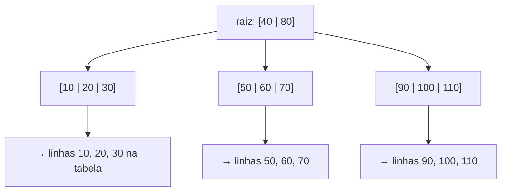

# 08. Constraints, índices e `EXPLAIN`

> ⏱️ ~1h30 · Módulo 3 · Pré-requisitos: [05](05-joins.md), [06](06-group-by-subqueries.md); Big-O da [aula 1.17](../01-python-logica/17-recursao-big-o.md)

## 🎯 Objetivos
Ao final desta aula você consegue:
- Usar `PRIMARY KEY`, `UNIQUE`, `NOT NULL`, `CHECK`, `FOREIGN KEY` (com `ON DELETE`) e `DEFAULT` para garantir integridade
- Explicar o que é um índice B-tree e por que acelera leituras e atrasa escritas
- Ler a saída de `EXPLAIN` e `EXPLAIN ANALYZE` (Seq Scan, Index Scan, custo, linhas, tempo)
- Criar índices simples, compostos, parciais e de expressão, e saber quando o banco **não** os usa
- Indexar chaves estrangeiras e colunas de busca do MiniShop

## 🤔 Por que isso importa
Duas verdades sobre sistemas reais: (1) **dados ruins entram** se o banco não os recusa; (2) **consultas ficam lentas** quando a tabela cresce e ninguém olhou o plano de execução. “A página está lenta” frequentemente se resolve com um índice de uma linha, mas só quem sabe ler um `EXPLAIN` sabe qual criar (e qual **não** criar).

## 💡 Intuição (explicação simples)
- **Constraints** são **as regras da casa aplicadas pelo porteiro**: ele não deixa entrar quem não tem convite (FK), nem duas pessoas com o mesmo crachá (UNIQUE), nem preço negativo (CHECK). Valem para todo mundo, inclusive para scripts e para o Admin, ao contrário de uma validação só no formulário.
- **Índice** é o **índice remissivo de um livro**: em vez de folhear as 500 páginas procurando “transação”, você olha o índice e vai direto às páginas 211 e 340. O custo: o índice ocupa espaço e precisa ser atualizado toda vez que o livro muda.

## 🔬 Como funciona por dentro
**Constraints**

| Constraint | Garante | Exemplo |
|---|---|---|
| `PRIMARY KEY` | única e não nula; cria índice | `id` |
| `UNIQUE` | sem repetição (aceita vários `NULL`); cria índice | `sku`, `email` |
| `NOT NULL` | obrigatório | `name` |
| `CHECK (expr)` | regra sobre a linha | `price >= 0`, `status IN (...)` |
| `FOREIGN KEY` | o valor existe na tabela referenciada | `orders.user_id → users.id` |
| `DEFAULT` | valor quando omitido | `now()`, `true` |

`ON DELETE` na chave estrangeira define o que fazer quando o pai é apagado: `RESTRICT`/`NO ACTION` (recusa, padrão), `CASCADE` (apaga os filhos: itens do pedido), `SET NULL`. Escolha conforme o significado: apagar um pedido leva seus itens; apagar um cliente com pedidos **não** deve ser permitido.

**Índice B-tree** (o padrão): uma árvore balanceada e ordenada. Cada nó guarda centenas de chaves; achar um valor em milhões de linhas custa **3 ou 4 leituras** de página (O(log n)), contra ler a tabela toda (O(n)).


**O que o planejador faz:** para cada consulta ele **estima o custo** de várias estratégias (varrer a tabela, usar um índice, juntar de formas diferentes) com base em **estatísticas** da tabela (`ANALYZE`) e escolhe a mais barata. `EXPLAIN` mostra o plano escolhido; `EXPLAIN ANALYZE` **executa** a consulta e mostra o que realmente aconteceu.

| Nó do plano | Significado |
|---|---|
| `Seq Scan` | lê a tabela inteira |
| `Index Scan` / `Index Only Scan` | usa o índice (e vai à tabela / não precisa ir) |
| `Bitmap Heap Scan` | usa o índice para listar páginas e as lê em lote |
| `Nested Loop` / `Hash Join` / `Merge Join` | estratégias de join (aula 05) |
| `cost=0.00..123.45` | custo estimado (início..total), em unidades arbitrárias |
| `rows=N` | linhas estimadas (`actual rows` = reais) |

**Quando o índice NÃO é usado:** tabela pequena (varrer é mais barato); consulta devolve boa parte da tabela (baixa seletividade); função aplicada na coluna (`WHERE lower(email) = ...` sem índice de expressão); `LIKE '%texto'` (curinga no início); tipos diferentes; estatísticas desatualizadas.

## 🛠️ Exemplo prático
Banco `loja` com `recursos/sql/loja.sql`. Saídas reais (tempos e custos variam por máquina).

**1. Constraints em ação**
```sql
INSERT INTO products (category_id, sku, slug, name, price) VALUES (1, 'PF-01', 'x', 'Duplicado', 10);
```
```text
ERROR:  duplicate key value violates unique constraint "products_sku_key"
DETAIL:  Key (sku)=(PF-01) already exists.
```
```sql
INSERT INTO products (category_id, sku, slug, name, price) VALUES (99, 'ZZ-01', 'zz-01', 'Categoria inexistente', 10);
```
```text
ERROR:  insert or update on table "products" violates foreign key constraint "products_category_id_fkey"
DETAIL:  Key (category_id)=(99) is not present in table "categories".
```
```sql
INSERT INTO products (category_id, sku, slug, name, price, stock) VALUES (1, 'ZZ-02', 'zz-02', 'Estoque negativo', 10, -1);
```
```text
ERROR:  new row for relation "products" violates check constraint "products_stock_check"
DETAIL:  Failing row contains (53, 1, ZZ-02, zz-02, Estoque negativo, , 10.00, -1, t, 2026-11-08 01:02:58.18055+00).
```
```sql
UPDATE orders SET status = 'enviado' WHERE id = 1;
```
```text
ERROR:  new row for relation "orders" violates check constraint "orders_status_check"
DETAIL:  Failing row contains (1, 1, enviado, 33.16, 2026-02-23 17:37:00+00).
```
Cada recusa mostra o **nome da constraint** violada e o valor: leia a mensagem inteira (`DETAIL`), ela diz o que corrigir.

**2. `ON DELETE`: o que acontece ao apagar**
```sql
BEGIN;
DELETE FROM orders WHERE id = 1;                      -- order_items tem ON DELETE CASCADE
SELECT count(*) AS itens_do_pedido_1 FROM order_items WHERE order_id = 1;
ROLLBACK;
```
```text
 itens_do_pedido_1 
-------------------
                 0
(1 row)
```
```sql
DELETE FROM categories WHERE id = 1;                   -- products referencia (sem CASCADE): recusado
```
```text
ERROR:  update or delete on table "categories" violates foreign key constraint "products_category_id_fkey" on table "products"
DETAIL:  Key (id)=(1) is still referenced from table "products".
```
**3. Adicionando uma constraint a uma tabela que já tem dados**
```sql
ALTER TABLE products ADD CONSTRAINT products_name_not_blank CHECK (length(trim(name)) > 0) NOT VALID;
ALTER TABLE products VALIDATE CONSTRAINT products_name_not_blank;
\d products
```
```text
                                   Table "public.products"
   Column    |           Type           | Collation | Nullable |           Default            
-------------+--------------------------+-----------+----------+------------------------------
 id          | integer                  |           | not null | generated always as identity
 category_id | integer                  |           | not null | 
 sku         | text                     |           | not null | 
 slug        | text                     |           | not null | 
 name        | text                     |           | not null | 
 description | text                     |           | not null | ''::text
 price       | numeric(10,2)            |           | not null | 
 stock       | integer                  |           | not null | 0
 is_active   | boolean                  |           | not null | true
 created_at  | timestamp with time zone |           | not null | now()
Indexes:
    "products_pkey" PRIMARY KEY, btree (id)
    "products_sku_key" UNIQUE CONSTRAINT, btree (sku)
    "products_slug_key" UNIQUE CONSTRAINT, btree (slug)
Check constraints:
    "products_name_not_blank" CHECK (length(TRIM(BOTH FROM name)) > 0)
    "products_price_check" CHECK (price >= 0::numeric)
    "products_stock_check" CHECK (stock >= 0)
Foreign-key constraints:
    "products_category_id_fkey" FOREIGN KEY (category_id) REFERENCES categories(id)
Referenced by:
    TABLE "cart_items" CONSTRAINT "cart_items_product_id_fkey" FOREIGN KEY (product_id) REFERENCES products(id)
    TABLE "order_items" CONSTRAINT "order_items_product_id_fkey" FOREIGN KEY (product_id) REFERENCES products(id)
```
`NOT VALID` aplica a regra só às linhas novas sem travar a tabela; `VALIDATE` confere as existentes depois. É a forma segura de endurecer uma tabela grande em produção.

**4. Uma tabela grande para medir (300 mil pedidos fictícios)**
```sql
CREATE TABLE big_orders AS
SELECT g AS id,
       (g::bigint * 7919) % 10000 + 1                                 AS user_id,
       (ARRAY['pending','paid','cancelled'])[g % 3 + 1]               AS status,
       ((g * 37) % 100000) / 100.0                                    AS total,
       timestamptz '2025-01-01' + ((g % 365) || ' days')::interval    AS created_at
FROM generate_series(1, 300000) AS g;
ALTER TABLE big_orders ADD PRIMARY KEY (id);
ANALYZE big_orders;
SELECT count(*) AS linhas, pg_size_pretty(pg_total_relation_size('big_orders')) AS tamanho FROM big_orders;
```
```text
 linhas | tamanho 
--------+---------
 300000 | 27 MB
(1 row)
```
**5. Sem índice: `Seq Scan`**
```sql
EXPLAIN (ANALYZE, BUFFERS) SELECT * FROM big_orders WHERE user_id = 1234;
```
```text
                                                         QUERY PLAN                                                         
----------------------------------------------------------------------------------------------------------------------------
 Gather  (cost=1000.00..5832.88 rows=30 width=33) (actual time=0.396..7.940 rows=30.00 loops=1)
   Workers Planned: 1
   Workers Launched: 1
   Buffers: shared hit=2624
   ->  Parallel Seq Scan on big_orders  (cost=0.00..4829.88 rows=18 width=33) (actual time=0.374..5.316 rows=15.00 loops=2)
         Filter: (user_id = 1234)
         Rows Removed by Filter: 149985
         Buffers: shared hit=2624
 Planning:
   Buffers: shared hit=72
 Planning Time: 0.163 ms
 Execution Time: 7.975 ms
(12 rows)
```
Como ler (de baixo para cima e de dentro para fora): `Seq Scan on big_orders` com `Filter: (user_id = 1234)`; `rows=...` (estimado) × `actual ... rows=...` (real); **`Rows Removed by Filter`** mostra quantas linhas foram lidas e descartadas (~150 mil por processo; o plano usou 2 processos em paralelo, `loops=2`) para devolver só 30; `Buffers: shared hit=...` são as páginas lidas; `Execution Time` é o tempo total.

**6. Criando o índice e comparando**
```sql
CREATE INDEX big_orders_user_id_idx ON big_orders (user_id);
ANALYZE big_orders;
EXPLAIN (ANALYZE, BUFFERS) SELECT * FROM big_orders WHERE user_id = 1234;
```
```text
                                                             QUERY PLAN                                                             
------------------------------------------------------------------------------------------------------------------------------------
 Bitmap Heap Scan on big_orders  (cost=4.53..115.28 rows=30 width=33) (actual time=0.019..0.040 rows=30.00 loops=1)
   Recheck Cond: (user_id = 1234)
   Heap Blocks: exact=30
   Buffers: shared hit=33 read=2
   ->  Bitmap Index Scan on big_orders_user_id_idx  (cost=0.00..4.52 rows=30 width=0) (actual time=0.014..0.014 rows=30.00 loops=1)
         Index Cond: (user_id = 1234)
         Index Searches: 1
         Buffers: shared hit=3 read=2
 Planning:
   Buffers: shared hit=25 read=1
 Planning Time: 0.118 ms
 Execution Time: 0.059 ms
(12 rows)
```
Agora o plano usa `Bitmap Index Scan` (ou `Index Scan`) e lê poucas páginas; o tempo cai de milissegundos para fração de milissegundo. Quanto maior a tabela, maior a diferença (O(n) × O(log n)).

**7. Índice composto: a ordem das colunas importa**
```sql
CREATE INDEX big_orders_user_created_idx ON big_orders (user_id, created_at);
ANALYZE big_orders;
-- igualdade na 1ª coluna + faixa na 2ª: o caso ideal
EXPLAIN SELECT id FROM big_orders WHERE user_id = 1234 AND created_at >= '2025-06-01';
-- só a 2ª coluna, com a 1ª tendo MUITOS valores distintos (10 mil usuários): o índice não ajuda
EXPLAIN SELECT id FROM big_orders WHERE created_at >= '2025-12-25';
```
```text
                                                  QUERY PLAN                                                   
---------------------------------------------------------------------------------------------------------------
 Bitmap Heap Scan on big_orders  (cost=4.61..72.40 rows=18 width=4)
   Recheck Cond: ((user_id = 1234) AND (created_at >= '2025-06-01 00:00:00+00'::timestamp with time zone))
   ->  Bitmap Index Scan on big_orders_user_created_idx  (cost=0.00..4.60 rows=18 width=0)
         Index Cond: ((user_id = 1234) AND (created_at >= '2025-06-01 00:00:00+00'::timestamp with time zone))
(4 rows)

                                  QUERY PLAN                                  
------------------------------------------------------------------------------
 Seq Scan on big_orders  (cost=0.00..6374.00 rows=6015 width=4)
   Filter: (created_at >= '2025-12-25 00:00:00+00'::timestamp with time zone)
(2 rows)
```
O índice `(a, b)` serve para filtros em `a` e em `a + b`, mas **não** (bem) só em `b`: ele está ordenado primeiro por `a`. Coloque primeiro as colunas comparadas por igualdade, depois as de faixa/ordenação.

> **Novidade do PostgreSQL 18:** o *skip scan* permite usar um índice `(a, b)` num filtro só em `b` **quando `a` tem poucos valores distintos**. Veja:
```sql
CREATE INDEX big_orders_status_created_idx ON big_orders (status, created_at);   -- status tem só 3 valores
ANALYZE big_orders;
EXPLAIN SELECT id FROM big_orders WHERE created_at >= '2025-12-25';
```
```text
                                           QUERY PLAN                                           
------------------------------------------------------------------------------------------------
 Bitmap Heap Scan on big_orders  (cost=85.24..2792.38 rows=6651 width=4)
   Recheck Cond: (created_at >= '2025-12-25 00:00:00+00'::timestamp with time zone)
   ->  Bitmap Index Scan on big_orders_status_created_idx  (cost=0.00..83.58 rows=6651 width=0)
         Index Cond: (created_at >= '2025-12-25 00:00:00+00'::timestamp with time zone)
(4 rows)
```
Agora o plano usa o índice `(status, created_at)` mesmo sem filtrar por `status`: o banco “pula” entre os 3 valores de `status` e faz uma busca em cada um. Em versões anteriores ao PostgreSQL 18, esse caso também seria `Seq Scan`.

**8. Índice parcial e de expressão**
```sql
-- parcial: só os pedidos pendentes (poucos), muito menor e mais rápido
CREATE INDEX big_orders_pending_idx ON big_orders (created_at) WHERE status = 'pending';
EXPLAIN SELECT id FROM big_orders WHERE status = 'pending' AND created_at < '2025-01-10';

-- de expressão: busca por e-mail sem diferenciar caixa
CREATE INDEX users_email_lower_idx ON users (lower(email));
SET enable_seqscan = off;      -- só para a demonstração (tabela users é minúscula)
EXPLAIN SELECT * FROM users WHERE lower(email) = 'ana@exemplo.test';
RESET enable_seqscan;
```
```text
                                                     QUERY PLAN                                                     
--------------------------------------------------------------------------------------------------------------------
 Bitmap Heap Scan on big_orders  (cost=30.22..2719.64 rows=2313 width=4)
   Recheck Cond: ((created_at < '2025-01-10 00:00:00+00'::timestamp with time zone) AND (status = 'pending'::text))
   ->  Bitmap Index Scan on big_orders_pending_idx  (cost=0.00..29.64 rows=2313 width=0)
         Index Cond: (created_at < '2025-01-10 00:00:00+00'::timestamp with time zone)
(4 rows)

                                     QUERY PLAN                                     
------------------------------------------------------------------------------------
 Index Scan using users_email_lower_idx on users  (cost=0.13..8.15 rows=1 width=77)
   Index Cond: (lower(email) = 'ana@exemplo.test'::text)
(2 rows)
```
**9. Quando o banco ignora o índice**
```sql
-- função na coluna: o índice de user_id não serve
EXPLAIN SELECT id FROM big_orders WHERE user_id + 0 = 1234;
-- curinga no início (a tabela é minúscula, então seria Seq Scan de qualquer jeito; em tabelas grandes o curinga impede o B-tree)
EXPLAIN SELECT id FROM products WHERE name LIKE '%mouse%';
-- baixíssima seletividade: devolve a tabela inteira
EXPLAIN SELECT id FROM big_orders WHERE status IN ('paid', 'pending', 'cancelled');
```
```text
                                  QUERY PLAN                                  
------------------------------------------------------------------------------
 Gather  (cost=1000.00..6421.06 rows=1500 width=4)
   Workers Planned: 1
   ->  Parallel Seq Scan on big_orders  (cost=0.00..5271.06 rows=882 width=4)
         Filter: ((user_id + 0) = 1234)
(4 rows)

                       QUERY PLAN                        
---------------------------------------------------------
 Seq Scan on products  (cost=0.00..15.25 rows=1 width=4)
   Filter: (name ~~ '%mouse%'::text)
(2 rows)

                            QUERY PLAN                            
------------------------------------------------------------------
 Seq Scan on big_orders  (cost=0.00..6749.00 rows=211113 width=4)
   Filter: (status = ANY ('{paid,pending,cancelled}'::text[]))
(2 rows)
```
O primeiro cai em `Seq Scan` por causa da **forma da condição** (a coluna está dentro de uma expressão: não é “sargável”, de *search ARGument ABLE*). No segundo, o curinga inicial (`'%mouse%'`) impede a busca ordenada na árvore; para busca por trecho de texto existe a extensão `pg_trgm`. No terceiro, se quase todas as linhas serão devolvidas, ler a tabela em sequência é mais barato do que passar pelo índice.

**10. O preço dos índices: escritas mais lentas e espaço**
```sql
SELECT indexrelname AS indice, pg_size_pretty(pg_relation_size(indexrelid)) AS tamanho
FROM pg_stat_user_indexes WHERE relname = 'big_orders' ORDER BY indexrelname;
\timing on
INSERT INTO big_orders SELECT g, g % 10000 + 1, 'paid', 10, now() FROM generate_series(300001, 350000) g;
DROP INDEX big_orders_user_id_idx, big_orders_user_created_idx, big_orders_status_created_idx, big_orders_pending_idx;
INSERT INTO big_orders SELECT g, g % 10000 + 1, 'paid', 10, now() FROM generate_series(350001, 400000) g;
```
```text
            indice             | tamanho 
-------------------------------+---------
 big_orders_pending_idx        | 752 kB
 big_orders_pkey               | 6600 kB
 big_orders_status_created_idx | 2224 kB
 big_orders_user_created_idx   | 9264 kB
 big_orders_user_id_idx        | 2240 kB
(5 rows)

Time: 215.900 ms
Time: 2.577 ms
Time: 47.662 ms
```
Os três `Time:` são, em ordem: o `INSERT` de 50 mil linhas **com** os índices extras, o `DROP INDEX`, e o `INSERT` de outras 50 mil **sem** eles. Compare o primeiro e o terceiro. Índices de leitura custam escrita e disco: **crie para consultas reais, não “por via das dúvidas”**.

**11. Índices que o MiniShop precisa**

A PK e o `UNIQUE` já criam índices. O PostgreSQL **não** indexa chaves estrangeiras sozinho:
```sql
-- quais FKs não têm índice? (consulta de diagnóstico)
SELECT c.conrelid::regclass AS tabela, a.attname AS coluna_fk
FROM pg_constraint c JOIN pg_attribute a ON a.attrelid = c.conrelid AND a.attnum = ANY (c.conkey)
WHERE c.contype = 'f'
  AND NOT EXISTS (SELECT 1 FROM pg_index i WHERE i.indrelid = c.conrelid AND i.indkey[0] = a.attnum)
ORDER BY 1, 2;
```
```text
   tabela    |  coluna_fk  
-------------+-------------
 products    | category_id
 cart_items  | product_id
 orders      | user_id
 order_items | product_id
(4 rows)
```
```sql
CREATE INDEX products_category_id_idx ON products (category_id);
CREATE INDEX orders_user_id_created_idx ON orders (user_id, created_at DESC);
CREATE INDEX order_items_product_id_idx ON order_items (product_id);
CREATE INDEX cart_items_product_id_idx ON cart_items (product_id);
CREATE INDEX products_active_price_idx ON products (price, id) WHERE is_active;   -- listagem por preço + keyset (aula 04)
SELECT tablename AS tabela, indexname AS indice FROM pg_indexes
WHERE schemaname = 'public' AND indexname LIKE '%\_idx' AND tablename <> 'big_orders' ORDER BY 1, 2;
```
```text
   tabela    |           indice           
-------------+----------------------------
 cart_items  | cart_items_product_id_idx
 order_items | order_items_product_id_idx
 orders      | orders_user_id_created_idx
 products    | products_active_price_idx
 products    | products_category_id_idx
 users       | users_email_lower_idx
(6 rows)
```
Repare que **`order_items.order_id` não apareceu** na lista de FKs sem índice: o `UNIQUE (order_id, product_id)` do banco já cria um índice cuja **primeira coluna** é `order_id`, e ele atende a busca pelos itens de um pedido. Criar outro seria redundância (desperdício de espaço e de escrita).

## ⚠️ Erros comuns e boas práticas
| Mensagem / sintoma | Causa | Solução |
|---|---|---|
| `ERROR: duplicate key value violates unique constraint "..."` | Valor repetido | Corrija o dado ou trate o conflito (`ON CONFLICT`) |
| `ERROR: new row for relation ... violates check constraint` | Regra `CHECK` | Corrija o dado; revise a regra |
| `ERROR: update or delete ... violates foreign key constraint` | Há filhos referenciando | Apague/atualize os filhos antes, ou desenhe `ON DELETE` adequado |
| Consulta lenta e `Seq Scan` numa tabela grande | Sem índice adequado | Crie o índice **na coluna do `WHERE`/`JOIN`/`ORDER BY`** |
| Criou o índice e nada mudou | Condição não “sargável” (função na coluna, `LIKE '%x'`), baixa seletividade ou estatísticas velhas | Reescreva a condição; `ANALYZE`; índice de expressão |
| Muitos índices e inserts lentos | Cada índice é atualizado em toda escrita | Remova índices sem uso (`pg_stat_user_indexes.idx_scan = 0`) |
| `CREATE INDEX` travando a tabela em produção | Bloqueia escritas | `CREATE INDEX CONCURRENTLY` |

- **Regra de ouro:** primeiro **meça** (`EXPLAIN ANALYZE` no volume real), depois indexe, depois meça de novo.
- Indexe: colunas de **FK**, de `WHERE` frequente, de `ORDER BY` com `LIMIT`, e expressões usadas em busca.
- Não crie índice em coluna de poucos valores distintos isolada (ex.: um booleano) sem um motivo (índice parcial resolve).
- Constraints no **banco**, além da validação no código: ele é a última linha de defesa e vale para todos os clientes.
- `EXPLAIN ANALYZE` **executa** a consulta: em `UPDATE`/`DELETE` use dentro de `BEGIN ... ROLLBACK`.

## 🧠 Pausa para lógica
**Problema (altura da árvore).** Um nó de B-tree cabe ~300 chaves. Quantos níveis são necessários para indexar 1 mil, 1 milhão e 1 bilhão de linhas? Compare com a busca linear e com a binária (`log2`). Confirme com um experimento: tempo de `x in lista` vs `bisect` para 1 milhão de itens.

<details><summary>Dica</summary>
Níveis ≈ <code>ceil(log(n) / log(300))</code>. A busca binária em memória usa <code>log2(n)</code> comparações; a B-tree reduz o número de leituras de <em>página</em>, que é o que custa em disco.
</details>

<details><summary>Solução comentada</summary>

```python
import math
import timeit
from bisect import bisect_left

for n in (1_000, 1_000_000, 1_000_000_000):
    print(f"n={n:>13,}  linear≈{n:>13,}  binária≈{math.ceil(math.log2(n)):>3}  B-tree(300)≈{math.ceil(math.log(n, 300))} níveis")

dados = list(range(1_000_000))
alvo = 999_999
t_lin = timeit.timeit(lambda: alvo in dados, number=20) / 20
t_bin = timeit.timeit(lambda: bisect_left(dados, alvo), number=20_000) / 20_000
print(f"x in lista: {t_lin*1e3:.2f} ms | bisect: {t_bin*1e6:.2f} µs | razão ≈ {t_lin/t_bin:,.0f}x")
```
```text
n=        1,000  linear≈        1,000  binária≈ 10  B-tree(300)≈2 níveis
n=    1,000,000  linear≈    1,000,000  binária≈ 20  B-tree(300)≈3 níveis
n=1,000,000,000  linear≈1,000,000,000  binária≈ 30  B-tree(300)≈4 níveis
x in lista: 4.27 ms | bisect: 0.10 µs | razão ≈ 43,445x
```
Um bilhão de linhas se resolve em **4 níveis**: é por isso que um índice mantém o tempo quase constante enquanto a tabela cresce. (Os tempos variam por máquina; a razão é o ponto.)
</details>

**Variação mais difícil:** por que um índice em `(a, b)` ordenado por `a, b` não ajuda `ORDER BY b`? E o que muda com `INCLUDE (coluna)` e *index only scan*?

## 🧩 Exercícios
**1. Fixação**
(a) Qual constraint impede dois produtos com o mesmo SKU? (b) Por que `WHERE lower(email) = 'x'` não usa o índice de `email`? (c) Como saber se uma consulta usa índice? (d) Diferença entre `EXPLAIN` e `EXPLAIN ANALYZE`?

<details><summary>Solução</summary>

(a) `UNIQUE (sku)` (cria índice único). (b) A função muda o valor comparado; o índice guarda `email` bruto. Solução: índice em `lower(email)`. (c) `EXPLAIN` e procurar `Index Scan`/`Bitmap Index Scan` em vez de `Seq Scan`. (d) `EXPLAIN` só estima o plano; `EXPLAIN ANALYZE` executa e mostra tempos e linhas reais (cuidado com `UPDATE`/`DELETE`).
</details>

**2. Aplicação no projeto MiniShop**
Escreva `projeto/sql/indices.sql` com as constraints extras e os índices do MiniShop, e `docs/desempenho-sql.md` com as medições.

Critérios de pronto:
- [ ] Índices nas FKs `products.category_id`, `orders.user_id`, `order_items.product_id` e `cart_items.product_id` (e a justificativa de **não** criar um para `order_items.order_id`)
- [ ] Índice de expressão `lower(users.email)` (login sem diferenciar caixa) e `UNIQUE` equivalente se desejar impedir e-mails que só diferem na caixa
- [ ] Índice parcial para produtos ativos por preço
- [ ] Constraint nova com `NOT VALID` + `VALIDATE` (por exemplo, e-mail com `@`)
- [ ] Em `docs/desempenho-sql.md`, para **3 consultas** (listagem por categoria, pedidos de um usuário, busca por e-mail): o `EXPLAIN ANALYZE` **antes** e **depois**, com uma frase de interpretação — gere dados suficientes com `generate_series` (≥ 100 mil linhas) para a diferença aparecer
- [ ] Rodou o script duas vezes sem erro (use `CREATE INDEX IF NOT EXISTS`)
- [ ] Commit `perf(sql): add indexes and constraints`

<details><summary>Solução de referência</summary>

```sql
CREATE INDEX IF NOT EXISTS users_email_lower_uniq ON users (lower(email));
ALTER TABLE users ADD CONSTRAINT users_email_has_at CHECK (position('@' IN email) > 1) NOT VALID;
ALTER TABLE users VALIDATE CONSTRAINT users_email_has_at;
CREATE INDEX IF NOT EXISTS carts_user_idx ON carts (user_id);
SELECT count(*) AS indices FROM pg_indexes WHERE schemaname = 'public' AND tablename IN ('users', 'carts');
```
```text
 indices 
---------
       7
(1 row)
```
Para “antes e depois”, rode o `EXPLAIN ANALYZE` da consulta, crie o índice, rode `ANALYZE` e repita.
</details>

**3. Desafio (opcional)**
Descubra, com `pg_stat_user_indexes`, quais índices do banco **nunca** foram usados (`idx_scan = 0`). Por que isso exige carga real e tempo de observação?

## 🎤 Na entrevista
- **O que é um índice e qual o custo?** Estrutura auxiliar (normalmente B-tree) que acelera buscas por valor/faixa/ordem, ao custo de espaço em disco e de escritas mais lentas (todo `INSERT/UPDATE/DELETE` atualiza os índices).
- **Como você investiga uma consulta lenta?** `EXPLAIN (ANALYZE, BUFFERS)`: procuro `Seq Scan` em tabela grande, grande diferença entre linhas estimadas e reais, filtros que descartam muitas linhas; então ajusto a consulta, crio/ajusto índices, atualizo estatísticas e meço de novo.
- **Em um índice composto `(a, b)`, a ordem importa?** Sim: serve para filtros em `a` e `a+b`, mas não (eficientemente) só em `b`. Colunas de igualdade primeiro, depois faixa/ordenação.
- **Por que indexar chaves estrangeiras?** Joins e `DELETE` no pai precisam achar os filhos; sem índice, o banco varre a tabela filha inteira. O PostgreSQL não cria esse índice automaticamente.

## 📚 Para ir além
- 📄 Documentação oficial: [Índices (PostgreSQL)](https://www.postgresql.org/docs/current/indexes.html). Tipos, índices compostos, parciais e de expressão.
- 📄 Documentação oficial: [Usando `EXPLAIN`](https://www.postgresql.org/docs/current/using-explain.html). Como ler planos de execução, com exemplos.
- 📄 Documentação oficial: [`CREATE INDEX`](https://www.postgresql.org/docs/current/sql-createindex.html). Opções (`CONCURRENTLY`, `INCLUDE`, `WHERE`).
- 📄 Documentação oficial: [Constraints](https://www.postgresql.org/docs/current/ddl-constraints.html). Todos os tipos, `ON DELETE`, `NOT VALID`.
- 🏋️ Prática extra: crie uma tabela com 1 milhão de linhas e meça `LIKE 'abc%'` com e sem índice `text_pattern_ops`.

## ✅ Checklist da aula
- [ ] Provoquei violações de `UNIQUE`, `FK`, `CHECK` e li as mensagens
- [ ] Li um `EXPLAIN ANALYZE` antes e depois de criar um índice
- [ ] Sei dizer quando o índice não é usado
- [ ] Indexei as FKs do MiniShop
