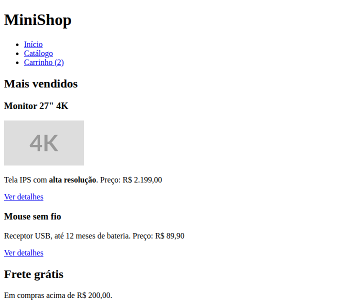
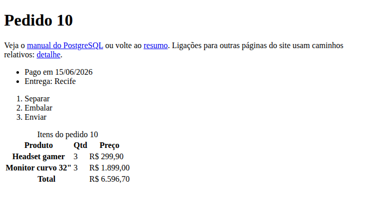
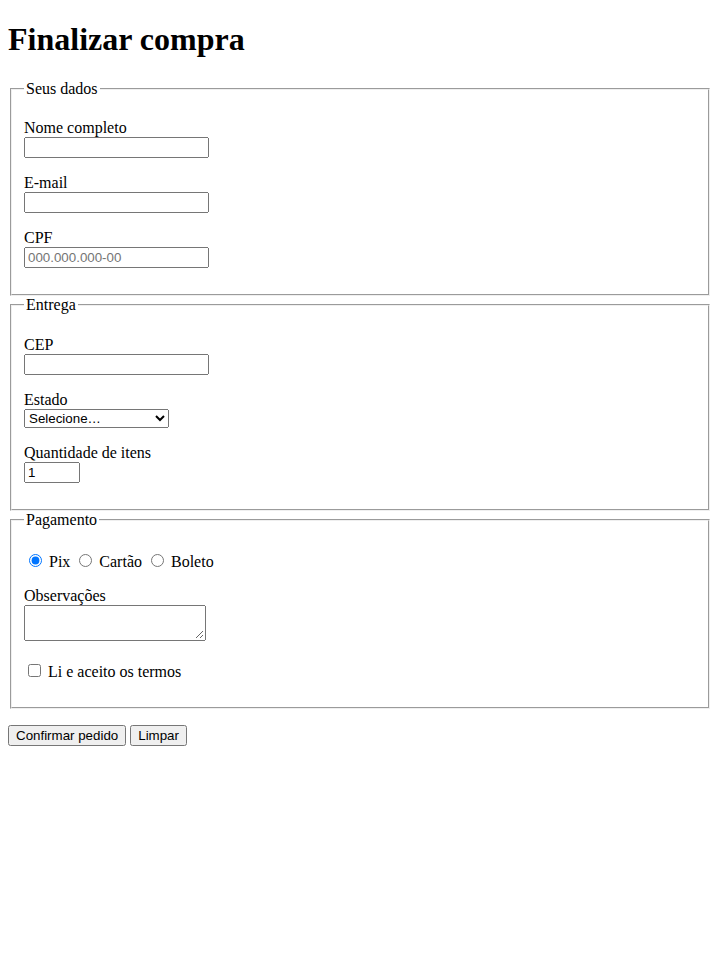

# 01. HTML semântico e formulários

> ⏱️ ~1h30 · Módulo 4 · Pré-requisitos: [Módulo 2](../02-como-a-web-funciona/README.md) (HTTP, formulários viram requisições), [aula 1.07](../01-python-logica/07-strings-comprehensions.md) (validação)

## 🎯 Objetivos
Ao final desta aula você consegue:
- Escrever a estrutura de uma página HTML5 válida (`doctype`, `lang`, `head`, `body`)
- Usar tags **semânticas** (`header`, `nav`, `main`, `section`, `article`, `footer`…) em vez de `div` para tudo
- Montar links, imagens (com `alt`), listas e tabelas corretamente
- Criar formulários com `label`, tipos de `input`, validação nativa e o atributo `name`
- Explicar como um formulário vira uma requisição HTTP (`GET` × `POST`) e por que o servidor **sempre** revalida

## 🤔 Por que isso importa
Um dev backend entrega HTML (templates do Django), formulários (login, checkout) e APIs que alguém consome por uma página. Quem entende o HTML evita bugs de formulário (`name` esquecido, `label` ausente), faz páginas acessíveis e conversa com o time de front-end. E o HTML correto é a base do SEO e da acessibilidade (aula 08).

## 💡 Intuição (explicação simples)
Uma página web é um prédio:
- **HTML** é a **planta e a estrutura**: o que existe e o que cada coisa *significa* (isto é a entrada, isto é a cozinha).
- **CSS** (aula 02) é a **pintura e a decoração**.
- **JavaScript** (aulas 04 a 06) é a **parte elétrica**: o que se move e reage.

“Semântico” quer dizer **usar o cômodo certo para cada função**: um `<nav>` diz “aqui está a navegação”, enquanto um `<div>` não diz nada. Leitores de tela, buscadores e outros programas entendem a planta pelos nomes dos cômodos.

## 🔬 Como funciona por dentro
1. O navegador recebe o texto HTML (resposta HTTP com `Content-Type: text/html`, aula 2.02) e o transforma, tolerando erros, na **árvore DOM**: um objeto por elemento, encaixados como pai e filhos.
2. Cada **elemento** tem tag de abertura e fechamento (`<p>texto</p>`), pode ter **atributos** (`<a href="/loja">`) e conteúdo. Alguns são vazios (``, `<input>`, `<br>`).
3. **Estrutura mínima:**

| Parte | Função |
|---|---|
| `<!doctype html>` | modo padrão HTML5 (sem ele, o navegador entra em “modo quirks”) |
| `<html lang="pt-BR">` | idioma: leitores de tela e tradutores dependem dele |
| `<meta charset="utf-8">` | codificação (acentos corretos) |
| `<meta name="viewport" content="width=device-width, initial-scale=1">` | layout correto em celular (aula 03) |
| `<title>` | título da aba, dos favoritos e do Google |

4. **Elementos semânticos** de estrutura: `header` (cabeçalho da página ou da seção), `nav` (navegação principal), `main` (conteúdo principal, **um** por página), `section` (seção temática com título), `article` (conteúdo independente, como um produto), `aside` (conteúdo lateral), `footer`. Títulos `h1`…`h6` formam um **índice** (um `h1` por página, sem pular níveis). `div` e `span` são genéricos: use quando nenhuma tag semântica servir.
5. **Formulário.** `<form action="/pedido" method="post">` agrupa campos. Quando o usuário envia, o navegador monta uma requisição HTTP:
   - `method="get"` → os campos viram **query string**: `GET /busca?q=mouse&ordem=preco`. Use para buscas e filtros (idempotente, pode ser favoritado).
   - `method="post"` → os campos vão no **corpo** (`application/x-www-form-urlencoded`, ou `multipart/form-data` com arquivos). Use para criar/alterar dados.
   - **O nome do campo enviado é o atributo `name`**, não o `id`. Campo sem `name` **não é enviado**.
6. **Validação nativa** (`required`, `type="email"`, `min`, `max`, `minlength`, `pattern`) é só **conforto para o usuário**. Qualquer pessoa pode burlá-la (DevTools, `curl`): o servidor **sempre** valida de novo (aula 2.05, Módulo 9).

## 🛠️ Exemplo prático
Os exemplos são arquivos reais renderizados em Chrome headless 156; as imagens são capturas dessas páginas. Crie uma pasta `frontend/` e salve os arquivos nela.

**1. A página mínima, com tags semânticas**
```html
<!doctype html>
<html lang="pt-BR">
<head>
  <meta charset="utf-8">
  <meta name="viewport" content="width=device-width, initial-scale=1">
  <title>MiniShop — Catálogo</title>
</head>
<body>
  <header>
    <h1>MiniShop</h1>
    <nav aria-label="Principal">
      <ul>
        <li><a href="/">Início</a></li>
        <li><a href="/catalogo">Catálogo</a></li>
        <li><a href="/carrinho">Carrinho (2)</a></li>
      </ul>
    </nav>
  </header>

  <main>
    <section>
      <h2>Mais vendidos</h2>
      <article>
        <h3>Monitor 27" 4K</h3>
        
        <p>Tela IPS com <strong>alta resolução</strong>. Preço: <data value="2199.00">R$ 2.199,00</data></p>
        <p><a href="/produtos/mn-04">Ver detalhes</a></p>
      </article>
      <article>
        <h3>Mouse sem fio</h3>
        <p>Receptor USB, até 12 meses de bateria. Preço: <data value="89.90">R$ 89,90</data></p>
        <p><a href="/produtos/pf-01">Ver detalhes</a></p>
      </article>
    </section>
    <aside>
      <h2>Frete grátis</h2>
      <p>Em compras acima de R$ 200,00.</p>
    </aside>
  </main>

  <footer><p>&copy; 2026 MiniShop. Projeto de estudo.</p></footer>
</body>
</html>
```
```bash
cd frontend && shot 01-pagina-sem-css.png 720x600 pagina.html 5000
```

O navegador aplica um estilo **padrão** feio, mas já entrega a estrutura e a hierarquia (títulos, lista de links, ênfase em `strong`). É exatamente isso que um leitor de tela e o Google leem.

**2. A estrutura “vista pelas máquinas”: marcos (*landmarks*) e títulos**
```html
<!doctype html><html lang="pt-BR"><head><meta charset="utf-8"><title>Outline</title></head>
<body><pre id="out">carregando…</pre>
<iframe id="alvo" src="pagina.html" style="display:none"></iframe>
<script>
  document.getElementById('alvo').addEventListener('load', e => {
    const doc = e.target.contentDocument;
    const marcos = [...doc.querySelectorAll('header, nav, main, section, article, aside, footer')].map(el => el.tagName.toLowerCase());
    const titulos = [...doc.querySelectorAll('h1,h2,h3,h4,h5,h6')].map(h => `${h.tagName.toLowerCase()}: ${h.textContent.trim()}`);
    document.getElementById('out').textContent = 'marcos: ' + marcos.join(', ') + '\ntítulos:\n  ' + titulos.join('\n  ') +
      '\nimagens sem alt: ' + doc.querySelectorAll('img:not([alt])').length;
  });
</script></body></html>
```
```python
import functools, http.server, threading, os
class Quiet(http.server.SimpleHTTPRequestHandler):
    def log_message(self, *a): pass
srv = http.server.ThreadingHTTPServer(("127.0.0.1", 8101), functools.partial(Quiet, directory=os.path.join(os.getcwd(), "frontend")))
threading.Thread(target=srv.serve_forever, daemon=True).start()
print("servindo frontend/ em http://127.0.0.1:8101")
```
```text
servindo frontend/ em http://127.0.0.1:8101
```
```bash
domout http://127.0.0.1:8101/outline.html
```
```text
marcos: header, nav, main, section, article, article, aside, footer
títulos:
  h1: MiniShop
  h2: Mais vendidos
  h3: Monitor 27" 4K
  h3: Mouse sem fio
  h2: Frete grátis
imagens sem alt: 0
```
Os `<iframe>` precisam de servidor HTTP (do `file://` o navegador bloqueia o acesso entre arquivos). A saída mostra a hierarquia `h1 → h2 → h3` sem pulos e **0 imagens sem `alt`**. Em uma versão com `<div>` para tudo, a lista de marcos ficaria vazia.

**3. Links, imagens, listas e tabela de dados**
```html
<!doctype html>
<html lang="pt-BR"><head><meta charset="utf-8"><title>Elementos</title></head>
<body>
<h1>Pedido 10</h1>
<p>Veja o <a href="https://www.postgresql.org/docs/current/" target="_blank" rel="noopener noreferrer">manual do PostgreSQL</a>
   ou volte ao <a href="#tabela">resumo</a>. Ligações para outras páginas do site usam caminhos relativos: <a href="/pedidos/10">detalhe</a>.</p>
<ul><li>Pago em 15/06/2026</li><li>Entrega: Recife</li></ul>
<ol><li>Separar</li><li>Embalar</li><li>Enviar</li></ol>
<table id="tabela">
  <caption>Itens do pedido 10</caption>
  <thead><tr><th scope="col">Produto</th><th scope="col">Qtd</th><th scope="col">Preço</th></tr></thead>
  <tbody>
    <tr><th scope="row">Headset gamer</th><td>3</td><td>R$ 299,90</td></tr>
    <tr><th scope="row">Monitor curvo 32"</th><td>3</td><td>R$ 1.899,00</td></tr>
  </tbody>
  <tfoot><tr><th scope="row" colspan="2">Total</th><td>R$ 6.596,70</td></tr></tfoot>
</table>
</body></html>
```
```bash
cd frontend && shot 01-elementos.png 720x420 elementos.html 3000
```

Regras: `target="_blank"` deve vir com `rel="noopener noreferrer"` (evita que a página aberta controle a sua); tabela é para **dados tabulares** (não para layout); `th` com `scope` e `caption` ajudam leitores de tela; `alt` descreve a imagem (vazio, `alt=""`, se for decorativa).

**4. Formulário de checkout**
```html
<!doctype html>
<html lang="pt-BR">
<head><meta charset="utf-8"><meta name="viewport" content="width=device-width, initial-scale=1"><title>Checkout</title></head>
<body>
<main>
<h1>Finalizar compra</h1>
<form id="checkout" action="/pedido" method="post" novalidate>
  <fieldset>
    <legend>Seus dados</legend>
    <p><label for="nome">Nome completo</label><br>
       <input id="nome" name="nome" type="text" autocomplete="name" required minlength="3"></p>
    <p><label for="email">E-mail</label><br>
       <input id="email" name="email" type="email" autocomplete="email" required></p>
    <p><label for="cpf">CPF</label><br>
       <input id="cpf" name="cpf" type="text" inputmode="numeric" pattern="\d{3}\.?\d{3}\.?\d{3}-?\d{2}" placeholder="000.000.000-00" required></p>
  </fieldset>
  <fieldset>
    <legend>Entrega</legend>
    <p><label for="cep">CEP</label><br>
       <input id="cep" name="cep" type="text" inputmode="numeric" pattern="\d{5}-?\d{3}" autocomplete="postal-code" required></p>
    <p><label for="uf">Estado</label><br>
       <select id="uf" name="uf" required>
         <option value="">Selecione…</option><option value="PE">Pernambuco</option><option value="SP">São Paulo</option><option value="RN">Rio Grande do Norte</option>
       </select></p>
    <p><label for="qtd">Quantidade de itens</label><br>
       <input id="qtd" name="qtd" type="number" min="1" max="10" value="1" required></p>
  </fieldset>
  <fieldset>
    <legend>Pagamento</legend>
    <p><label><input type="radio" name="pagamento" value="pix" checked> Pix</label>
       <label><input type="radio" name="pagamento" value="cartao"> Cartão</label>
       <label><input type="radio" name="pagamento" value="boleto"> Boleto</label></p>
    <p><label for="obs">Observações</label><br><textarea id="obs" name="obs" rows="2" maxlength="200"></textarea></p>
    <p><label><input type="checkbox" name="aceito" value="sim" required> Li e aceito os termos</label></p>
  </fieldset>
  <input type="hidden" name="origem" value="checkout-web">
  <p><button type="submit">Confirmar pedido</button> <button type="reset">Limpar</button></p>
</form>
<pre id="out"></pre>
</main>
</body>
</html>
```
```bash
cd frontend && shot 01-checkout-sem-css.png 720x980 checkout.html 3000
```

Observe: cada `input` tem um `<label for="...">` com o mesmo `id` (clicar no texto foca o campo; leitores de tela leem o rótulo); `fieldset`/`legend` agrupam; `autocomplete` ajuda o navegador a preencher; `type` escolhe o teclado do celular e a validação; `inputmode="numeric"` mostra teclado numérico; `name` é o que será enviado.

**5. Validação nativa, vista por dentro (Chrome real)**
```html
<!doctype html><html lang="pt-BR"><head><meta charset="utf-8"><title>validação</title></head><body>
<iframe id="f" src="checkout.html" style="width:700px;height:900px"></iframe>
<pre id="out">…</pre>
<script>
document.getElementById('f').addEventListener('load', e => {
  const d = e.target.contentDocument, f = d.getElementById('checkout');
  d.getElementById('email').value = 'abc';          // tipo inválido
  d.getElementById('cep').value = '123';            // não casa com o pattern
  d.getElementById('qtd').value = '50';             // acima do max
  const linhas = [...f.elements].filter(el => el.name && el.type !== 'hidden' && el.type !== 'radio').map(el => {
    const v = el.validity;
    const motivo = v.valid ? 'ok' : v.valueMissing ? 'obrigatório' : v.typeMismatch ? 'tipo inválido' :
                   v.patternMismatch ? 'fora do padrão' : v.rangeOverflow ? 'acima do máximo' : v.tooShort ? 'curto demais' : 'inválido';
    return `${el.name.padEnd(8)} → ${motivo}`;
  });
  document.getElementById('out').textContent = linhas.join('\n') + '\nformulário válido? ' + f.checkValidity();
});
</script></body></html>
```
```bash
domout http://127.0.0.1:8101/validacao.html
```
```text
nome     → obrigatório
email    → tipo inválido
cpf      → obrigatório
cep      → fora do padrão
uf       → obrigatório
qtd      → acima do máximo
obs      → ok
aceito   → obrigatório
formulário válido? false
```
O navegador bloqueia o envio e mostra balões de erro quando **não** usamos `novalidate`. Aqui o `novalidate` está no formulário só para a JavaScript consultar o estado (`validity`) sem balões. Em uma página real, remova-o.

**6. O que o formulário vira em HTTP (e a prova de que `name` é a chave)**
```python
import json, threading, urllib.parse
from http.server import BaseHTTPRequestHandler, HTTPServer

class Echo(BaseHTTPRequestHandler):
    def log_message(self, *a): pass
    def _resp(self, obj):
        dados = json.dumps(obj, ensure_ascii=False).encode()
        self.send_response(200); self.send_header("Content-Type", "application/json; charset=utf-8")
        self.send_header("Content-Length", str(len(dados))); self.send_header("Access-Control-Allow-Origin", "*")
        self.end_headers(); self.wfile.write(dados)
    def do_GET(self):
        u = urllib.parse.urlparse(self.path)
        self._resp({"metodo": "GET", "caminho": u.path, "query": urllib.parse.parse_qs(u.query)})
    def do_POST(self):
        corpo = self.rfile.read(int(self.headers.get("Content-Length", 0))).decode()
        self._resp({"metodo": "POST", "content_type": self.headers["Content-Type"], "corpo_bruto": corpo,
                    "campos": urllib.parse.parse_qs(corpo)})
eco = HTTPServer(("127.0.0.1", 8102), Echo)
threading.Thread(target=eco.serve_forever, daemon=True).start()
print("servidor de eco em http://127.0.0.1:8102")
```
```text
servidor de eco em http://127.0.0.1:8102
```
```html
<!doctype html><html lang="pt-BR"><head><meta charset="utf-8"><title>envio</title></head><body>
<form id="busca" action="http://127.0.0.1:8102/busca" method="get">
  <input name="q" value="cabo usb"> <select name="ordem"><option value="preco" selected>Preço</option></select>
  <input id="sem_nome_get" value="eu também não sou enviado"> <button>Buscar</button>
</form>
<form id="pedido" action="http://127.0.0.1:8102/pedido" method="post">
  <input name="nome" value="Ana Souza"> <input name="obs" value="Deixar com o porteiro & tocar duas vezes">
  <input type="checkbox" name="aceito" value="sim" checked> <input type="checkbox" name="newsletter" value="sim">
  <input id="sem_name2" value="eu não sou enviado">
</form>
<pre id="out">…</pre>
<script>
(async () => {
  const f1 = document.getElementById('busca'), f2 = document.getElementById('pedido');
  // o que o navegador envia: os campos COM name, na ordem do documento, codificados como na aula 2.03
  const qs = new URLSearchParams(new FormData(f1)).toString();
  const r1 = await (await fetch('http://127.0.0.1:8102/busca?' + qs)).json();
  const r2 = await (await fetch(f2.action, { method: 'POST', body: new URLSearchParams(new FormData(f2)) })).json();
  document.getElementById('out').textContent =
    'GET  → ' + qs + '\n      servidor leu: ' + JSON.stringify(r1.query) +
    '\nPOST → Content-Type: ' + r2.content_type + '\n      corpo: ' + r2.corpo_bruto + '\n      servidor leu: ' + JSON.stringify(r2.campos);
})();
</script></body></html>
```
```bash
domout http://127.0.0.1:8101/envio.html
```
```text
GET  → q=cabo+usb&ordem=preco
      servidor leu: {"q":["cabo usb"],"ordem":["preco"]}
POST → Content-Type: application/x-www-form-urlencoded;charset=UTF-8
      corpo: nome=Ana+Souza&obs=Deixar+com+o+porteiro+%26+tocar+duas+vezes&aceito=sim
      servidor leu: {"nome":["Ana Souza"],"obs":["Deixar com o porteiro & tocar duas vezes"],"aceito":["sim"]}
```
Conferindo a teoria da aula 2.03: o `GET` vira **query string**; o `POST`, um corpo `application/x-www-form-urlencoded`; espaço vira `+`, `&` vira `%26`; campos sem `name` (`sem_name2`) e checkbox desmarcado (`newsletter`) **não são enviados**. Por isso, no servidor, “campo ausente” significa “desmarcado”.

## ⚠️ Erros comuns e boas práticas
| Sintoma | Causa | Solução |
|---|---|---|
| O campo “não chega” ao servidor | Faltou o atributo `name` (ou o campo está `disabled`) | Todo campo a enviar precisa de `name` |
| Clicar no rótulo não foca o campo | `label for` não corresponde ao `id` | Use `for="id-do-input"` ou envolva o input com o `label` |
| Acentos viram `çã` | Falta `<meta charset="utf-8">` ou o servidor devolve outro charset | Declare UTF-8 nos dois lados |
| Página minúscula no celular | Falta `<meta name="viewport">` | Inclua o viewport |
| Busca por teclado “pula” partes da página | Estrutura sem `main`/`nav`/títulos | Use tags semânticas e a hierarquia `h1`→`h3` |
| Validação nativa “não funciona” | `novalidate` no `form`, ou botão `type="button"` | Use `type="submit"` e remova `novalidate` |
| Dados inválidos no banco | Confiou só na validação do navegador | Valide **também** no servidor (Módulos 5 e 9) |
| Enviar formulário duas vezes | Usuário clica duas vezes | Desabilitar o botão após o envio + idempotência no servidor (Módulo 7) |

- Um `<h1>` por página; níveis de título sem pular; **não** escolha título pelo tamanho (isso é papel do CSS).
- Botão que não envia formulário deve ser `type="button"`; dentro de `<form>` o padrão é `submit`.
- Nunca use `GET` para operações que alteram dados nem para dados sensíveis (vão para logs e histórico).
- Não use `<br>` e `&nbsp;` para espaçamento; use CSS.

## 🧠 Pausa para lógica
**Problema (o servidor não confia no navegador).** Escreva `validar_checkout(dados)` em Python que recebe o dicionário de campos (como o servidor leu) e devolve um dicionário `{campo: mensagem}` com os erros: nome (≥ 3 letras), e-mail com `@` e domínio com ponto, CPF válido (algoritmo da aula 1.07), CEP com 8 dígitos, UF permitida, quantidade inteira entre 1 e 10, termos aceitos. Teste com um envio que **burla** a validação do navegador.

<details><summary>Dica</summary>
Reaproveite <code>cpf_valido</code> da aula 1.07. Use <code>dados.get("campo", "")</code> (campos ausentes), <code>strip()</code> e converta a quantidade dentro de <code>try</code>. Uma função pequena por regra facilita o teste.
</details>

<details><summary>Solução comentada</summary>

```python
import re

def cpf_valido(cpf: str) -> bool:
    d = [int(c) for c in cpf if c.isdigit()]
    if len(d) != 11 or len(set(d)) == 1:
        return False
    def digito(base, peso):
        r = (sum(n * p for n, p in zip(base, range(peso, 1, -1))) * 10) % 11
        return 0 if r == 10 else r
    return d[9] == digito(d[:9], 10) and d[10] == digito(d[:10], 11)

UFS = {"PE", "SP", "RN"}

def validar_checkout(dados: dict) -> dict:
    erros = {}
    g = lambda k: str(dados.get(k, "")).strip()
    if len(g("nome")) < 3:
        erros["nome"] = "informe o nome completo"
    if not re.fullmatch(r"[^@\s]+@[^@\s]+\.[^@\s]+", g("email")):
        erros["email"] = "e-mail inválido"
    if not cpf_valido(g("cpf")):
        erros["cpf"] = "CPF inválido"
    if len(re.sub(r"\D", "", g("cep"))) != 8:
        erros["cep"] = "CEP deve ter 8 dígitos"
    if g("uf") not in UFS:
        erros["uf"] = "estado inválido"
    try:
        if not 1 <= int(g("qtd")) <= 10:
            raise ValueError
    except ValueError:
        erros["qtd"] = "quantidade deve ser um inteiro de 1 a 10"
    if g("aceito") != "sim":
        erros["aceito"] = "é preciso aceitar os termos"
    return erros

bom = {"nome": "Ana Souza", "email": "ana@exemplo.test", "cpf": "529.982.247-25", "cep": "50030-230", "uf": "PE", "qtd": "2", "aceito": "sim"}
print(validar_checkout(bom))
# alguém ignorou o navegador e mandou direto com curl:
print(validar_checkout({"nome": "A", "email": "x@y", "cpf": "111.111.111-11", "cep": "123", "uf": "XX", "qtd": "-5; DROP TABLE", "origem": "curl"}))
```
```text
{}
{'nome': 'informe o nome completo', 'email': 'e-mail inválido', 'cpf': 'CPF inválido', 'cep': 'CEP deve ter 8 dígitos', 'uf': 'estado inválido', 'qtd': 'quantidade deve ser um inteiro de 1 a 10', 'aceito': 'é preciso aceitar os termos'}
```
O CPF de exemplo é um número de teste (não pertence a ninguém). Nunca use CPFs reais em exemplos.
</details>

**Variação mais difícil:** devolva os erros no formato de uma resposta `422` JSON (aula 2.05) e acrescente a validação “data de entrega não pode ser no passado”.

## 🧩 Exercícios
**1. Fixação**
(a) Qual a diferença entre `id` e `name` num input? (b) Por que `<label for>` importa? (c) Quando usar `GET` e `POST` em formulários? (d) Reescreva `<div class="topo"><div class="menu">…</div></div>` com tags semânticas.

<details><summary>Solução</summary>

(a) `id` identifica o elemento no documento (CSS, JS, `label for`); `name` é a chave do campo na requisição. (b) Associa o texto ao campo: aumenta a área clicável e permite que leitores de tela o anunciem. (c) `GET` para consultas/filtros (idempotentes, URL compartilhável); `POST` para criar/alterar dados e enviar informações sensíveis. (d) `<header><nav>…</nav></header>`.
</details>

**2. Aplicação no projeto MiniShop**
Crie as páginas estáticas do MiniShop em `frontend/`: `index.html` (catálogo com 4 produtos fixos), `produto.html` (detalhe) e `checkout.html` (do exemplo, com seus ajustes).

Critérios de pronto:
- [ ] Todas as páginas têm `doctype`, `lang="pt-BR"`, `charset`, `viewport`, `title` único e descritivo
- [ ] Usam `header`, `nav`, `main` e `footer`; um `h1` por página e títulos em ordem
- [ ] Toda imagem tem `alt` (ou `alt=""` se decorativa); links entre as páginas funcionam
- [ ] O `checkout.html` tem `label` para todos os campos, `autocomplete`, tipos corretos e `name` em tudo que deve ser enviado
- [ ] Você validou o HTML em [validator.w3.org](https://validator.w3.org/) (ou no “Nu Html Checker”) e não restou nenhum erro
- [ ] Você escreveu `validar_checkout` no backend (Python) e provou, com `curl`, que dados ruins enviados **sem passar pelo navegador** são rejeitados
- [ ] Commit `feat(front): add static semantic pages`

<details><summary>Solução de referência</summary>

Use o `pagina.html` (catálogo) e o `checkout.html` desta aula como base, e `produto.html` com `article`, `h1`, imagem com `alt`, preço em `<data>` e um `<form method="post" action="/carrinho">` com `input type="hidden" name="sku"` e `input type="number" name="qtd"`. Para a validação no servidor, integre `validar_checkout` à rota `POST /pedido` do servidor da aula 2.05, devolvendo `422` com `{"erros": {...}}`.
</details>

**3. Desafio (opcional)**
Torne o formulário utilizável **sem** JavaScript e **só pelo teclado** (Tab, Espaço, Enter), e use a aba *Elements*/*Accessibility* do DevTools para ver a árvore de acessibilidade do seu formulário.

## 🎤 Na entrevista
- **O que é HTML semântico e por que importa?** Usar as tags pelo significado (`header`, `nav`, `main`, `article`, `button`) em vez de `div` para tudo; melhora acessibilidade (leitores de tela navegam por marcos), SEO e manutenção.
- **Como um formulário HTML vira uma requisição HTTP?** O navegador reúne os campos com `name`, codifica (query string no `GET`, corpo `x-www-form-urlencoded` ou `multipart` no `POST`) e envia para o `action`. Campos sem `name`, desabilitados ou checkboxes desmarcados não são enviados.
- **Basta validar no navegador?** Não. A validação do navegador é conforto de UX e pode ser burlada; o servidor deve validar tudo.
- **Qual a diferença entre `<button>` e `<input type="submit">`? E entre `id` e `class`?** `button` pode ter conteúdo interno (ícone, texto) e `type` (`submit`/`button`/`reset`); `id` é único no documento, `class` pode se repetir e é usada para estilo.

## 📚 Para ir além
- 📄 Documentação oficial: [Estruturando conteúdo com HTML (MDN)](https://developer.mozilla.org/pt-BR/docs/Learn_web_development/Core/Structuring_content). Curso completo, em PT-BR, do básico a formulários.
- 📄 Documentação oficial: [Elementos HTML (MDN)](https://developer.mozilla.org/pt-BR/docs/Web/HTML/Reference/Elements). Referência de todas as tags e atributos.
- 📑 Artigo/tutorial: [Learn HTML (web.dev)](https://web.dev/learn/html). Curso gratuito e prático, em inglês, do time do Chrome.
- 📑 Ferramenta: [W3C Markup Validator](https://validator.w3.org/). Valida seu HTML e aponta erros.
- 🏋️ Prática extra: reconstrua a página de login de um site que você usa, só com HTML (sem CSS), e valide com o W3C.

## ✅ Checklist da aula
- [ ] Criei páginas HTML5 válidas e semânticas
- [ ] Montei o formulário de checkout com `label`, tipos e validação nativa
- [ ] Vi o `GET`/`POST` de um formulário virar HTTP e entendi o papel do `name`
- [ ] Validei no servidor com `validar_checkout`
- [ ] Fiz o commit do exercício
