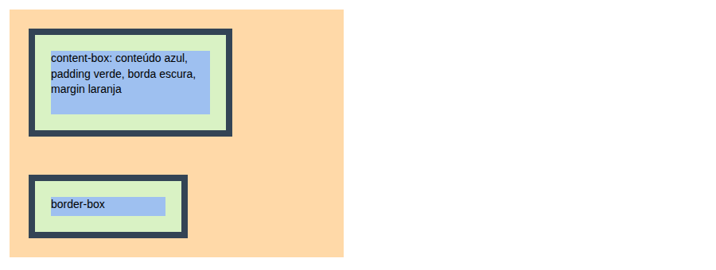
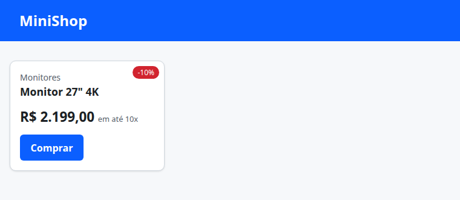

# 02. CSS básico e box model

> ⏱️ ~1h30 · Módulo 4 · Pré-requisitos: [01](01-html-semantico-formularios.md)

## 🎯 Objetivos
Ao final desta aula você consegue:
- Ligar CSS a uma página e escrever regras com seletores, propriedades e valores
- Explicar a **cascata**, a **especificidade** e a **herança**, e prever qual regra vence
- Descrever o **box model** (conteúdo, *padding*, borda, *margin*) e usar `box-sizing: border-box`
- Escolher unidades (`px`, `rem`, `em`, `%`, `vw`) e usar variáveis CSS (*custom properties*)
- Controlar `display`, `position`, cores e tipografia para estilizar um cartão de produto

## 🤔 Por que isso importa
Mesmo como dev backend você vai ajustar templates do Django, corrigir “o botão sumiu no celular” e dar manutenção em CSS que outras pessoas escreveram. Entender **por que uma regra não está sendo aplicada** (especificidade) e **por que a caixa tem 340 px em vez de 300 px** (box model) poupa horas. Esses são os dois pontos que mais confundem quem está começando.

## 💡 Intuição (explicação simples)
Cada elemento HTML é uma **caixa de presente**:
- o **conteúdo** é o presente;
- o **padding** é o papel de seda ao redor (espaço *dentro* da caixa);
- a **borda** é a caixa em si;
- a **margin** é a distância entre a sua caixa e as caixas vizinhas na prateleira.

E a **cascata** é um **conselho de moradores**: várias regras opinam sobre a cor de um parágrafo; vence a mais **específica** (a que aponta com mais precisão), e, em empate, a que veio **por último**.

## 🔬 Como funciona por dentro
**Sintaxe:** `seletor { propriedade: valor; }`. Três formas de ligar CSS: arquivo externo (`<link rel="stylesheet" href="style.css">`, o recomendado: cacheável e reutilizável), `<style>` na página e atributo `style="..."` (evite).

**Seletores mais usados**

| Seletor | Casa com | Exemplo |
|---|---|---|
| tipo | todas as tags | `p { }` |
| classe | `class="x"` | `.card { }` |
| id | `id="x"` (único) | `#topo { }` |
| descendente / filho | dentro de / filho direto | `nav a { }` · `ul > li { }` |
| atributo | por atributo | `input[type="email"] { }` |
| pseudo-classe | estado | `a:hover`, `button:focus-visible`, `li:first-child` |
| pseudo-elemento | parte do elemento | `p::first-line`, `.x::before` |

**Cascata e especificidade.** Quando duas regras mudam a mesma propriedade do mesmo elemento, o navegador decide por: (1) **importância** (`!important` vence), (2) **especificidade**, (3) **ordem** (a última vence). A especificidade é uma tupla **(ids, classes/atributos/pseudo-classes, tags)** comparada da esquerda para a direita; o atributo `style=""` vence todas (exceto `!important`).

| Seletor | Especificidade |
|---|---|
| `p` | (0,0,1) |
| `.card p` | (0,1,1) |
| `p.destaque` | (0,1,1) |
| `#topo p` | (1,0,1) |
| `a:hover` | (0,1,1) |

**Herança.** Algumas propriedades passam do pai para os filhos (`color`, `font-family`, `line-height`); outras não (`margin`, `border`, `padding`, `background`).

**Box model.** O tamanho total de uma caixa é *conteúdo + padding + borda* (a margem fica de fora). Por padrão, `width` mede **só o conteúdo** (`content-box`): `width: 300px` + `padding: 20px` + `border: 5px` resulta em 350 px na tela. Com **`box-sizing: border-box`**, `width` já inclui padding e borda: 300 px é 300 px. É a primeira regra de quase todo projeto:

```css
*, *::before, *::after { box-sizing: border-box; }
```
**Margens verticais** de blocos vizinhos **colapsam** (a maior vence, não somam). **Unidades:** `px` (fixa), `rem` (relativa ao tamanho da fonte da raiz, geralmente 16 px, respeita a preferência de leitura do usuário: **prefira**), `em` (relativa à fonte do próprio elemento), `%` (relativa ao pai), `vw`/`vh` (1% da largura/altura da janela).

**`display`:** `block` (ocupa a linha toda, aceita largura/altura), `inline` (flui no texto, ignora largura/altura e margens verticais), `inline-block` (flui como texto mas aceita dimensões), `none` (some; diferente de `visibility: hidden`, que mantém o espaço); `flex`/`grid` na aula 03. **`position`:** `static` (padrão), `relative` (desloca sem tirar do fluxo; vira referência), `absolute` (sai do fluxo, posiciona em relação ao ancestral posicionado), `fixed` (relativo à janela), `sticky` (gruda ao rolar).

## 🛠️ Exemplo prático
Crie `frontend/style.css` e ligue-o às páginas. Saídas e imagens vêm de um Chrome real.

**1. Especificidade e herança, medidas no navegador**
```html
<!doctype html><html lang="pt-BR"><head><meta charset="utf-8"><title>cascata</title>
<style>
  p            { color: gray; }                 /* (0,0,1) */
  .card p      { color: blue; }                 /* (0,1,1) */
  p.destaque   { color: green; }                /* (0,1,1) - empata com a anterior, vence por vir depois */
  #topo p      { color: purple; }               /* (1,0,1) */
  .card p.mudo { color: orange !important; }    /* !important */
  body { font-family: Georgia, serif; line-height: 1.5; }   /* herdadas pelos filhos */
</style></head>
<body>
<div class="card" id="topo">
  <p id="a">sem classe</p>
  <p id="b" class="destaque">com .destaque</p>
  <p id="c" class="mudo">com .mudo</p>
  <p id="d" style="color: red">com style=""</p>
</div>
<div class="card"><p id="e" class="destaque">fora do #topo</p></div>
<pre id="out"></pre>
<script>
  const cor = id => getComputedStyle(document.getElementById(id)).color;
  const linhas = ['a','b','c','d','e'].map(id => `#${id}: ${cor(id)}`);
  linhas.push('font-family herdada pelo <p>: ' + getComputedStyle(document.getElementById('a')).fontFamily);
  linhas.push('margin NÃO é herdada (o <p> usa a margem padrão do navegador): ' + getComputedStyle(document.getElementById('a')).marginTop);
  document.getElementById('out').textContent = linhas.join('\n');
</script></body></html>
```
```bash
cd frontend && domout cascata.html
```
```text
#a: rgb(128, 0, 128)
#b: rgb(128, 0, 128)
#c: rgb(255, 165, 0)
#d: rgb(255, 0, 0)
#e: rgb(0, 128, 0)
font-family herdada pelo <p>: Georgia, serif
margin NÃO é herdada (o <p> usa a margem padrão do navegador): 16px
```
Leitura: `#a` fica **roxo** `rgb(128, 0, 128)` (id `#topo` > classe > tag); `#b` também roxo (o `id` vence a classe); `#c` laranja (`!important`); `#d` vermelho (atributo `style`); `#e`, fora do `#topo`, empata em (0,1,1) entre `.card p` e `p.destaque` e vence o **último** declarado: verde.

**2. O box model com números**
```html
<!doctype html><html lang="pt-BR"><head><meta charset="utf-8"><title>caixa</title>
<style>
  body { font: 14px/1.4 sans-serif; margin: 12px; }
  .moldura { display: flow-root; background: #ffd9a8; width: 420px; }     /* a margem do filho aparece em laranja */
  .caixa { width: 200px; height: 80px; padding: 20px; border: 8px solid #345; margin: 24px;
           background: #bcd9ff; background-clip: content-box; background-color: #9ec0f0;
           box-shadow: inset 0 0 0 20px #d9f2c4; }                       /* o padding fica verde */
  .a { box-sizing: content-box; }
  .b { box-sizing: border-box; }
  #medidas { margin-top: 16px; }
</style></head>
<body>
<div class="moldura"><div class="caixa a" id="a">content-box: conteúdo azul, padding verde, borda escura, margin laranja</div></div>
<div class="moldura"><div class="caixa b" id="b">border-box</div></div>
<pre id="out"></pre>
<script>
  const m = id => { const e = document.getElementById(id), s = getComputedStyle(e);
    return `${id} (${s.boxSizing}): width CSS=${s.width} | ocupa na tela (offsetWidth)=${e.offsetWidth}px | conteúdo=${e.clientWidth - 40}px | altura total=${e.offsetHeight}px`; };
  document.getElementById('out').textContent = m('a') + '\n' + m('b');
</script></body></html>
```
```bash
cd frontend && domout caixa.html && shot 02-box-model.png 900x340 caixa.html 2000
```
```text
a (content-box): width CSS=200px | ocupa na tela (offsetWidth)=256px | conteúdo=200px | altura total=136px
b (border-box): width CSS=200px | ocupa na tela (offsetWidth)=200px | conteúdo=144px | altura total=80px
```

Com `content-box`, o `width: 200px` vira **256 px** na tela (200 + 2×20 de padding + 2×8 de borda); com `border-box`, **200 px** exatos. Em layouts com `width: 50%` e `padding`, o `content-box` estoura a linha: por isso `border-box` é universal.

**3. Margens verticais colapsam**
```html
<!doctype html><html><head><meta charset="utf-8"><style>
  body { margin: 0 } .x, .y { height: 40px; background: #cde } .x { margin-bottom: 30px } .y { margin-top: 50px }
  .flex { display: flex; flex-direction: column } .flex .x { margin-bottom: 30px } .flex .y { margin-top: 50px }
</style></head><body>
<div id="bloco"><div class="x" id="x1"></div><div class="y" id="y1"></div></div>
<div class="flex" id="flex"><div class="x" id="x2"></div><div class="y" id="y2"></div></div>
<pre id="out"></pre>
<script>
  const gap = (a, b) => document.getElementById(b).getBoundingClientRect().top - document.getElementById(a).getBoundingClientRect().bottom;
  document.getElementById('out').textContent = 'blocos normais: espaço entre eles = ' + gap('x1','y1') + 'px (30 + 50 colapsam para o maior)\nem flex (não colapsam): ' + gap('x2','y2') + 'px (30 + 50)';
</script></body></html>
```
```bash
cd frontend && domout colapso.html
```
```text
blocos normais: espaço entre eles = 50px (30 + 50 colapsam para o maior)
em flex (não colapsam): 80px (30 + 50)
```
**4. Unidades: `rem` acompanha a fonte da raiz**
```html
<!doctype html><html><head><meta charset="utf-8"><style>
  html { font-size: 20px }   /* o usuário (ou você) mudou o tamanho base */
  .t { font-size: 1.5rem; padding: 1rem; width: 50%; margin-left: 10vw; } .u { font-size: 2em }
</style></head><body><div class="t" id="t">texto</div><div class="t u" id="u">texto em em</div><pre id="out"></pre>
<script>
  const s = id => getComputedStyle(document.getElementById(id));
  document.getElementById('out').textContent =
    `1rem = ${parseFloat(getComputedStyle(document.documentElement).fontSize)}px | .t font-size=1.5rem → ${s('t').fontSize} | padding 1rem → ${s('t').paddingTop}\n` +
    `.u: font-size 2em (relativa à fonte do PAI, 20px) → ${s('u').fontSize} | width 50% da janela de ${innerWidth}px → ${s('t').width} | 10vw → ${s('t').marginLeft}`;
</script></body></html>
```
```bash
cd frontend && domout unidades.html
```
```text
1rem = 20px | .t font-size=1.5rem → 30px | padding 1rem → 20px
.u: font-size 2em (relativa à fonte do PAI, 20px) → 40px | width 50% da janela de 780px → 382px | 10vw → 78px
```
Se `html { font-size: 20px }`, **todos** os `rem` crescem juntos (acessibilidade: quem aumenta a fonte no navegador espera isso). Cuidado com `em` aninhado: o tamanho é relativo à fonte do elemento, então se acumula.

**5. Variáveis CSS e um cartão de produto**
```css
:root {                                   /* design tokens: mude aqui e o site inteiro muda */
  --cor-primaria: #0b5fff;
  --cor-primaria-escura: #0847c4;
  --cor-texto: #1b1f24;
  --cor-suave: #57606a;
  --cor-fundo: #f6f8fa;
  --cor-borda: #d0d7de;
  --raio: 10px;
  --espaco: 1rem;
  --sombra: 0 1px 3px rgb(0 0 0 / 12%);
}
*, *::before, *::after { box-sizing: border-box; }
body { margin: 0; font-family: system-ui, -apple-system, "Segoe UI", Roboto, sans-serif; line-height: 1.5;
       color: var(--cor-texto); background: var(--cor-fundo); }
.topo { background: var(--cor-primaria); color: #fff; padding: var(--espaco) calc(var(--espaco) * 2); }
.topo h1 { margin: 0; font-size: 1.5rem; }
main { max-width: 60rem; margin: 0 auto; padding: calc(var(--espaco) * 2) var(--espaco); }
.card { background: #fff; border: 1px solid var(--cor-borda); border-radius: var(--raio); padding: var(--espaco);
        box-shadow: var(--sombra); width: 16rem; }
.card h3 { margin: 0 0 .25rem; font-size: 1.1rem; }
.card .categoria { color: var(--cor-suave); font-size: .875rem; margin: 0; }
.card .preco { font-size: 1.4rem; font-weight: 700; margin: .75rem 0; }
.card .preco small { font-size: .8rem; font-weight: 400; color: var(--cor-suave); }
.botao { display: inline-block; background: var(--cor-primaria); color: #fff; padding: .6rem 1.1rem; border: 0;
         border-radius: calc(var(--raio) - 4px); font: inherit; font-weight: 600; cursor: pointer; text-decoration: none; }
.botao:hover { background: var(--cor-primaria-escura); }
.botao:focus-visible { outline: 3px solid #ffbf47; outline-offset: 2px; }     /* foco visível: acessibilidade */
.selo { position: absolute; top: .5rem; right: .5rem; background: #d1242f; color: #fff; font-size: .75rem;
        padding: .1rem .5rem; border-radius: 999px; }
.card { position: relative; }                                                  /* referência para o selo absoluto */
```
```html
<!doctype html>
<html lang="pt-BR">
<head><meta charset="utf-8"><meta name="viewport" content="width=device-width, initial-scale=1">
<title>Cartão</title><link rel="stylesheet" href="style.css"></head>
<body>
<header class="topo"><h1>MiniShop</h1></header>
<main>
  <article class="card">
    <span class="selo">-10%</span>
    <p class="categoria">Monitores</p>
    <h3>Monitor 27" 4K</h3>
    <p class="preco">R$ 2.199,00 <small>em até 10x</small></p>
    <a class="botao" href="/produtos/mn-04">Comprar</a>
  </article>
</main>
</body></html>
```
```bash
cd frontend && shot 02-card.png 760x330 card.html 2000
```

Observe o uso de **variáveis** (`var(--cor-primaria)`), **`rem`** para espaçamento e fonte, **`position: relative` + `absolute`** para o selo, e `:focus-visible` com contorno: quem navega pelo teclado precisa **ver** onde está o foco.

**6. DevTools: veja o box model do seu elemento** ⚠️ passo na interface gráfica, **não executado** pelo autor: clique com o botão direito no cartão → *Inspecionar* → aba *Styles* (regras que se aplicam e as riscadas = perderam na cascata) → *Computed* (valor final de cada propriedade e o diagrama do box model, com margens em laranja, borda, padding em verde e conteúdo em azul).

## ⚠️ Erros comuns e boas práticas
| Sintoma | Causa | Solução |
|---|---|---|
| “Minha regra não aplica” | Outra regra mais específica ou posterior vence | DevTools → *Styles*: regras riscadas; aumente a especificidade com uma classe, nunca com `!important` |
| Caixa maior do que o `width` | `content-box` | `*, *::before, *::after { box-sizing: border-box }` |
| Espaço “some” entre blocos | Margens verticais colapsam | Use `padding`, `gap` (flex/grid) ou `display: flow-root` no contêiner |
| `width`/`height` não funcionam | Elemento `inline` | `display: inline-block` ou `block` |
| Elemento `absolute` voa para o canto da página | Nenhum ancestral posicionado | `position: relative` no contêiner |
| CSS não carrega | Caminho do `<link>` errado (404 na aba *Network*) | Confira o caminho relativo e o status |
| Texto minúsculo ao dar zoom/aumentar a fonte do SO | Tamanhos em `px` | Use `rem` |
| Alterou o CSS e “nada mudou” | Cache do navegador | Recarregue sem cache (`Ctrl+Shift+R`) |

- **Evite `!important` e seletores por `id`** para estilo: aumentam a especificidade e travam a manutenção. Prefira classes pequenas e reutilizáveis.
- **Nunca remova o contorno de foco** (`outline: none`) sem oferecer outro indicador visível.
- Um arquivo CSS com **variáveis para cores e espaçamentos** evita “mágica” espalhada.
- Contraste de texto: pelo menos **4,5:1** (aula 08).

## 🧠 Pausa para lógica
**Problema (qual regra vence?).** Escreva em JavaScript `especificidade(seletor)` que devolve `[ids, classes, tags]` para seletores simples (`p`, `.a`, `#x`, `ul li.b:hover`, `a[href]`) e `vencedora(regras)` que escolhe a regra que vence (maior especificidade; em empate, a última). Em seguida, **confirme com o navegador** que a escolha bate com a cor calculada.

<details><summary>Dica</summary>
Conte: <code>#nome</code> → ids; <code>.classe</code>, <code>[atributo]</code> e <code>:pseudo-classe</code> → classes; <code>tag</code> e <code>::pseudo-elemento</code> → tags. Compare as tuplas elemento a elemento (a ordem é lexicográfica, não a soma!).
</details>

<details><summary>Solução comentada</summary>

```js
function especificidade(seletor) {
  const s = seletor.replace(/\[[^\]]*\]/g, ' [a] ');                 // atributos viram "classe"
  const ids = (s.match(/#[\w-]+/g) || []).length;
  const classes = (s.match(/\.[\w-]+|\[a\]|(?<!:):(?!:)[\w-]+/g) || []).length;       // .x, [attr], :hover
  const semDemais = s.replace(/#[\w-]+|\.[\w-]+|\[a\]|::?[\w-]+/g, ' ');
  const tags = (semDemais.match(/[a-zA-Z][\w-]*/g) || []).length + (s.match(/::[\w-]+/g) || []).length;
  return [ids, classes, tags];
}
const cmp = (x, y) => { for (let i = 0; i < 3; i++) if (x[i] !== y[i]) return x[i] - y[i]; return 0; };
function vencedora(regras) {              // regras: [{seletor, cor}] na ordem do arquivo
  return regras.reduce((melhor, r) => cmp(especificidade(r.seletor), especificidade(melhor.seletor)) >= 0 ? r : melhor);
}

for (const s of ["p", ".a", "#x", "ul li.b:hover", "a[href]", "#topo p", ".card p.destaque", "p::first-line"])
  console.log(s.padEnd(20), JSON.stringify(especificidade(s)));

const regras = [
  { seletor: "p", cor: "gray" }, { seletor: ".card p", cor: "blue" },
  { seletor: "p.destaque", cor: "green" }, { seletor: "#topo p", cor: "purple" },
];
console.log("vence:", vencedora(regras).cor, "| sem o #topo:", vencedora(regras.slice(0, 3)).cor,
            "| 11 classes × 1 id (0,11,0) < (1,0,0)?", cmp([0, 11, 0], [1, 0, 0]) < 0);
```
```text
p                    [0,0,1]
.a                   [0,1,0]
#x                   [1,0,0]
ul li.b:hover        [0,2,2]
a[href]              [0,1,1]
#topo p              [1,0,1]
.card p.destaque     [0,2,1]
p::first-line        [0,0,2]
vence: purple | sem o #topo: green | 11 classes × 1 id (0,11,0) < (1,0,0)? true
```
Resultado idêntico ao do navegador na seção 1 (`purple` e `green`). Repare no último teste: **11 classes não vencem 1 id**: não é soma, é comparação por faixas.
</details>

**Variação mais difícil:** trate `:not(.x)`, `:is(...)` e `*` (especificidade zero), e escreva um teste que compara o seu cálculo com o `getComputedStyle` de uma página gerada automaticamente.

## 🧩 Exercícios
**1. Fixação**
(a) Com `width: 300px; padding: 20px; border: 5px solid` em `content-box`, qual a largura total? E em `border-box`? (b) Qual a especificidade de `#menu .item a:hover`? (c) Qual vence entre `.a .b` e `div.b.c` (mesmo elemento)?

<details><summary>Solução</summary>

(a) 350 px; 300 px. (b) (1,2,1): um id, duas classes/pseudo-classes (`.item`, `:hover`) e uma tag. (c) `.a .b` = (0,2,0); `div.b.c` = (0,2,1): vence o segundo (tag a mais).
</details>

**2. Aplicação no projeto MiniShop**
Estilize as páginas da aula 01 com um `frontend/style.css` único.

Critérios de pronto:
- [ ] Variáveis CSS para cores, espaçamentos e raio; `box-sizing: border-box` global
- [ ] Cabeçalho, `nav`, cartão de produto, botão e formulário de checkout estilizados (use `rem`, nunca `px` para fontes)
- [ ] Estado `:hover` e `:focus-visible` em links, botões e campos (o foco **visível**)
- [ ] Nenhum `!important` e nenhum seletor por `id` no CSS
- [ ] Texto sobre fundo com contraste ≥ 4,5:1 (confira em uma calculadora de contraste ou com a função da aula 08)
- [ ] Você anexou um print da página (`img/`) e a aba *Computed* de um elemento com o box model explicado em 2 linhas no README
- [ ] Commit `feat(front): add base stylesheet`

<details><summary>Solução de referência</summary>

Use o `style.css` desta aula como base e acrescente regras para `form`, `label`, `input, select, textarea { width: 100%; padding: .6rem; border: 1px solid var(--cor-borda); border-radius: calc(var(--raio) - 4px); font: inherit }`, `input:focus-visible, select:focus-visible, textarea:focus-visible { outline: 3px solid #ffbf47; outline-offset: 1px }`, `fieldset { border: 1px solid var(--cor-borda); border-radius: var(--raio); margin-bottom: var(--espaco) }` e `label { display: block; font-weight: 600; margin-bottom: .25rem }`.
</details>

**3. Desafio (opcional)**
Implemente um **modo escuro** trocando apenas as variáveis dentro de `@media (prefers-color-scheme: dark) { :root { ... } }` e teste no DevTools (*Rendering → Emulate CSS media feature prefers-color-scheme*).

## 🎤 Na entrevista
- **O que é o box model?** Cada elemento é uma caixa composta por conteúdo, padding, borda e margem; o tamanho total depende de `box-sizing` (com `border-box`, `width` inclui padding e borda).
- **Como o navegador decide qual regra CSS aplicar?** Pela cascata: importância (`!important`), especificidade (ids, classes/atributos/pseudo-classes, tags) e, por fim, a ordem de declaração; algumas propriedades são herdadas.
- **Diferença entre `rem`, `em` e `px`?** `px` é absoluta; `rem` é relativa à fonte do elemento raiz (consistente e acessível); `em` é relativa à fonte do próprio elemento (acumula em aninhamentos).
- **Diferença entre `display: none` e `visibility: hidden`?** `none` remove o elemento do layout; `hidden` o esconde mas mantém o espaço.

## 📚 Para ir além
- 📄 Documentação oficial: [Fundamentos de estilização (MDN)](https://developer.mozilla.org/pt-BR/docs/Learn_web_development/Core/Styling_basics). Curso em PT-BR: seletores, cascata, box model.
- 📄 Documentação oficial: [O modelo de caixa (MDN)](https://developer.mozilla.org/pt-BR/docs/Web/CSS/CSS_box_model). Referência detalhada, margens colapsando.
- 📑 Artigo/tutorial: [Learn CSS (web.dev)](https://web.dev/learn/css). Curso gratuito e moderno em inglês.
- 🏋️ Prática extra: recrie, só com CSS, o cartão de produto de uma loja que você conheça e compare com o original no DevTools.

## ✅ Checklist da aula
- [ ] Previ qual regra vence em cada caso e confirmei no navegador
- [ ] Medi o box model com `content-box` e `border-box`
- [ ] Usei variáveis CSS, `rem` e `:focus-visible`
- [ ] Estilizei as páginas do MiniShop
- [ ] Fiz o commit do exercício
