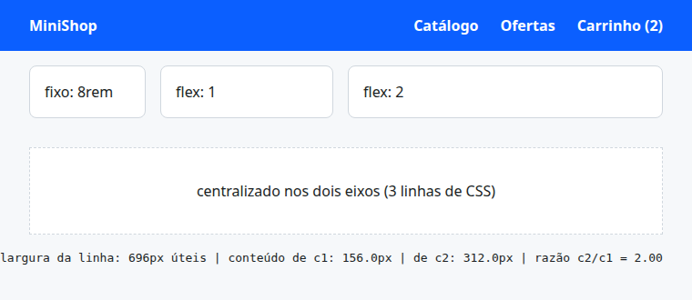
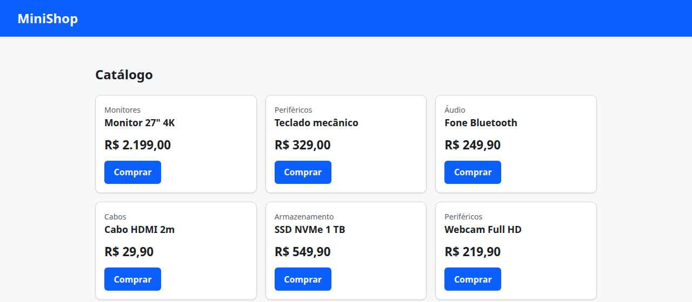
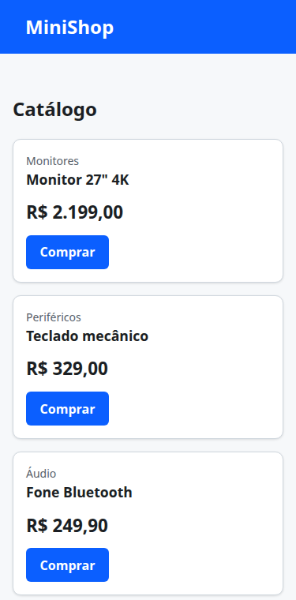
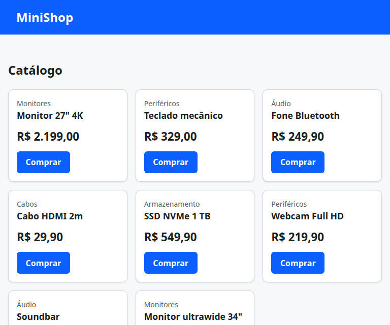
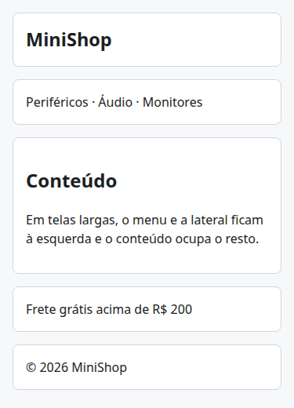
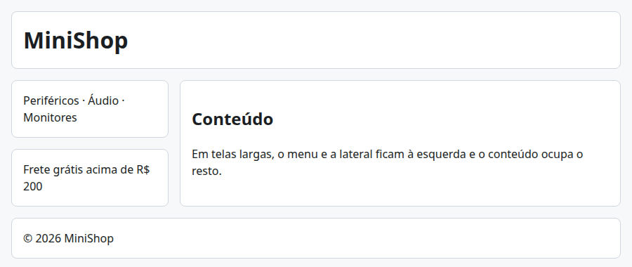

# 03. Flexbox, grid e responsividade

> ⏱️ ~1h30 · Módulo 4 · Pré-requisitos: [02](02-css-box-model.md)

## 🎯 Objetivos
Ao final desta aula você consegue:
- Alinhar e distribuir elementos em **uma dimensão** com Flexbox (eixos, `justify-content`, `align-items`, `gap`, `flex`)
- Montar layouts em **duas dimensões** com CSS Grid (`grid-template-columns`, `fr`, `repeat`, `minmax`, `auto-fill`, áreas)
- Escolher entre Flexbox e Grid
- Criar páginas **responsivas** (mobile-first, `@media`, unidades fluidas, `clamp()`, imagens flexíveis)
- Testar o layout em várias larguras e provar o número de colunas com uma fórmula

## 🤔 Por que isso importa
Mais da metade do tráfego web vem do celular. Um catálogo que só funciona em tela larga perde vendas e é reprovado em qualquer teste de acessibilidade ou de SEO (o Google indexa a versão móvel). Flexbox e Grid substituíram os antigos hacks (`float`, tabelas para layout) e são o que se espera que um dev saiba hoje.

## 💡 Intuição (explicação simples)
- **Flexbox** é uma **prateleira**: os itens ficam em uma linha (ou coluna), e você decide como a sobra de espaço é distribuída, como se alinham e se “quebram de linha”.
- **Grid** é uma **planilha**: você define linhas e colunas e posiciona os itens nas células.
- **Responsivo** é **água no copo**: o conteúdo toma a forma do recipiente (a tela), em vez de existir só num tamanho.

## 🔬 Como funciona por dentro
**Flexbox.** `display: flex` no **contêiner** cria um *flex container*; os filhos viram *flex items*. Há dois eixos: o **principal** (`flex-direction`: `row` por padrão) e o **transversal**.

| Propriedade (no contêiner) | Efeito |
|---|---|
| `flex-direction: row \| column` | define o eixo principal |
| `justify-content` | distribui no eixo **principal** (`flex-start`, `center`, `space-between`, `space-around`) |
| `align-items` | alinha no eixo **transversal** (`stretch`, `center`, `flex-start`) |
| `flex-wrap: wrap` | permite quebrar linha |
| `gap` | espaço entre os itens (sem hacks de margem) |

Nos itens: `flex: <grow> <shrink> <basis>`. `flex-grow` = quanto da sobra ele recebe; `flex-shrink` = quanto encolhe se faltar espaço; `flex-basis` = tamanho inicial. `flex: 1` = `1 1 0`: divide o espaço igualmente.

**Grid.** `display: grid` + `grid-template-columns`. Unidade `fr` = fração do espaço livre. `repeat(3, 1fr)` = três colunas iguais. O padrão mais útil para catálogos:
```css
grid-template-columns: repeat(auto-fill, minmax(14rem, 1fr));
```
“Quantas colunas de **no mínimo** 14 rem caibam; reparta a sobra igualmente entre elas.” Zero `@media` e o número de colunas se adapta sozinho. `grid-template-areas` nomeia regiões do layout (cabeçalho, menu, conteúdo, rodapé).

**Flex × Grid:** Flex para **componentes e alinhamentos em uma direção** (barra de navegação, linha de botões, centralizar algo); Grid para **layouts de página e grades** (catálogo, formulário em colunas). Os dois se combinam (um cartão em Grid cujo rodapé usa Flex).

**Responsividade**
1. `<meta name="viewport" content="width=device-width, initial-scale=1">` (aula 01): sem ele o celular finge ter 980 px de largura.
2. **Mobile-first:** escreva o CSS para tela pequena e **acrescente** regras com `@media (min-width: 48rem) { ... }` para telas maiores. Breakpoints típicos: ~40rem (640 px), 48rem (768 px), 64rem (1024 px).
3. **Fluido por padrão:** `%`, `fr`, `max-width`, `minmax`; `img { max-width: 100%; height: auto }`.
4. **`clamp(mín, ideal, máx)`:** tipografia e espaços fluidos: `font-size: clamp(1.25rem, 1rem + 2vw, 2rem)`.
5. Teste real: DevTools → modo dispositivo (`Ctrl+Shift+M`) e celular de verdade.

## 🛠️ Exemplo prático
Reaproveitamos o `style.css` da aula 02. As capturas são do Chrome headless em larguras diferentes.

**1. Flexbox: barra de navegação e linha de cartões**
```html
<!doctype html><html lang="pt-BR"><head><meta charset="utf-8"><meta name="viewport" content="width=device-width, initial-scale=1">
<title>Flex</title><link rel="stylesheet" href="style.css">
<style>
  .barra { display: flex; justify-content: space-between; align-items: center; gap: 1rem; background: var(--cor-primaria); color: #fff; padding: 1rem 2rem; }
  .barra ul { display: flex; gap: 1.5rem; list-style: none; margin: 0; padding: 0; }
  .barra a { color: #fff; text-decoration: none; font-weight: 600; }
  .linha { display: flex; gap: 1rem; flex-wrap: wrap; padding: 1rem 2rem; }
  .linha > div { background: #fff; border: 1px solid var(--cor-borda); border-radius: 8px; padding: 1rem; }
  .fixo { flex: 0 0 8rem; } .cresce { flex: 1 1 0; } .cresce2 { flex: 2 1 0; }
  .centro { display: flex; justify-content: center; align-items: center; height: 6rem; margin: 1rem 2rem; background: #fff; border: 1px dashed var(--cor-borda); }
</style></head>
<body>
<header class="barra"><strong>MiniShop</strong>
  <nav aria-label="Principal"><ul><li><a href="#">Catálogo</a></li><li><a href="#">Ofertas</a></li><li><a href="#">Carrinho (2)</a></li></ul></nav></header>
<div class="linha" id="linha">
  <div class="fixo">fixo: 8rem</div><div class="cresce" id="c1">flex: 1</div><div class="cresce2" id="c2">flex: 2</div>
</div>
<div class="centro">centralizado nos dois eixos (3 linhas de CSS)</div>
<pre id="out"></pre>
<script>
  const l = document.getElementById('linha');
  const conteudo = id => { const e = document.getElementById(id), s = getComputedStyle(e);          // largura só do conteúdo
    return e.getBoundingClientRect().width - parseFloat(s.paddingLeft) - parseFloat(s.paddingRight) - parseFloat(s.borderLeftWidth) - parseFloat(s.borderRightWidth); };
  document.getElementById('out').textContent = `largura da linha: ${l.clientWidth - 64}px úteis | conteúdo de c1: ${conteudo('c1').toFixed(1)}px | de c2: ${conteudo('c2').toFixed(1)}px | razão c2/c1 = ${(conteudo('c2') / conteudo('c1')).toFixed(2)}`;
</script></body></html>
```
```bash
cd frontend && domout flex.html && shot 03-flex.png 760x330 flex.html 2000
```
```text
largura da linha: 716px úteis | conteúdo de c1: 162.7px | de c2: 325.3px | razão c2/c1 = 2.00
```

`justify-content: space-between` empurra a marca para a esquerda e o menu para a direita; `align-items: center` centraliza verticalmente. O item `flex: 2` recebe **o dobro do espaço** do `flex: 1` (razão 2,00 entre as larguras do conteúdo: o padding e a borda de cada item são descontados antes de repartir a sobra), e o `fixo` não muda.

**2. Grid: catálogo que se adapta sozinho**
```html
<!doctype html><html lang="pt-BR"><head><meta charset="utf-8"><meta name="viewport" content="width=device-width, initial-scale=1">
<title>Catálogo</title><link rel="stylesheet" href="style.css">
<style>
  .grade { display: grid; grid-template-columns: repeat(auto-fill, minmax(14rem, 1fr)); gap: 1rem; margin: 0; padding: 0; list-style: none; }
  .grade .card { width: auto; }                    /* o cartão agora ocupa a célula inteira */
</style></head>
<body>
<header class="topo"><h1>MiniShop</h1></header>
<main>
  <h2>Catálogo</h2>
  <ul class="grade" id="grade"></ul>
</main>
<script>
  const produtos = [["Monitores", 'Monitor 27" 4K', "2.199,00"], ["Periféricos", "Teclado mecânico", "329,00"], ["Áudio", "Fone Bluetooth", "249,90"],
    ["Cabos", "Cabo HDMI 2m", "29,90"], ["Armazenamento", "SSD NVMe 1 TB", "549,90"], ["Periféricos", "Webcam Full HD", "219,90"],
    ["Áudio", "Soundbar", "449,90"], ["Monitores", "Monitor ultrawide 34\"", "2.899,00"]];
  document.getElementById('grade').innerHTML = produtos.map(([cat, nome, preco]) =>
    `<li><article class="card"><p class="categoria">${cat}</p><h3>${nome}</h3><p class="preco">R$ ${preco}</p><a class="botao" href="#">Comprar</a></article></li>`).join('');
</script></body></html>
```
```bash
cd frontend
shot 03-catalogo-375.png 375x760 catalogo.html 2000
shot 03-catalogo-768.png 768x640 catalogo.html 2000
shot 03-catalogo-1280.png 1280x560 catalogo.html 2000
```



O **mesmo HTML e CSS**, sem nenhuma `@media`: 1 coluna no celular (375 px), 3 no tablet (768 px) e 3 no desktop (1280 px: o `main` do `style.css` limita a 60 rem, então as colunas só esticam).

**3. Mobile-first com `@media` e `clamp()`**
```html
<!doctype html><html lang="pt-BR"><head><meta charset="utf-8"><meta name="viewport" content="width=device-width, initial-scale=1">
<title>Responsivo</title><link rel="stylesheet" href="style.css">
<style>
  /* celular: tudo em coluna */
  .pagina { display: grid; gap: 1rem; grid-template-areas: "topo" "menu" "conteudo" "lateral" "rodape"; padding: 1rem; }
  .pagina > header { grid-area: topo; } .pagina > nav { grid-area: menu; } .pagina > main { grid-area: conteudo; max-width: none; margin: 0; }
  .pagina > aside { grid-area: lateral; } .pagina > footer { grid-area: rodape; }
  .pagina > * { background: #fff; border: 1px solid var(--cor-borda); border-radius: 8px; padding: 1rem; }
  h1 { font-size: clamp(1.25rem, 1rem + 2vw, 2rem); margin: 0; }          /* tipografia fluida */
  /* a partir de 48rem (768px): vira layout de duas colunas */
  @media (min-width: 48rem) {
    .pagina { grid-template-columns: 14rem 1fr; grid-template-areas: "topo topo" "menu conteudo" "lateral conteudo" "rodape rodape"; }
  }
</style></head>
<body>
<div class="pagina">
  <header><h1>MiniShop</h1></header>
  <nav aria-label="Categorias">Periféricos · Áudio · Monitores</nav>
  <main><h2>Conteúdo</h2><p>Em telas largas, o menu e a lateral ficam à esquerda e o conteúdo ocupa o resto.</p></main>
  <aside>Frete grátis acima de R$ 200</aside>
  <footer>© 2026 MiniShop</footer>
</div>
</body></html>
```
```bash
cd frontend
shot 03-responsivo-375.png 375x520 responsivo.html 2000
shot 03-responsivo-900.png 900x380 responsivo.html 2000
```


Em `375` px a ordem é a do HTML (empilhada); em `900` px as **áreas** nomeadas reorganizam a página **sem mexer no HTML**. Note a ordem do HTML (topo, menu, conteúdo, lateral, rodapé) = ordem de leitura por teclado e leitor de tela: reordene visualmente com cuidado.

**4. Prova: quantas colunas o grid terá em cada largura?**

A regra do `auto-fill` é calculável: com largura útil `W`, colunas de **no mínimo** `m` e `gap` `g`, cabem `floor((W + g) / (m + g))` colunas. Vamos comparar a fórmula com o que o navegador realmente faz, em iframes de larguras diferentes:
```html
<!doctype html><html lang="pt-BR"><head><meta charset="utf-8"><title>medir</title></head><body>
<div id="frames"></div><pre id="out">…</pre>
<script>
  const larguras = [320, 480, 640, 768, 1024, 1280, 1600];
  const frames = larguras.map(w => { const f = document.createElement('iframe'); f.src = 'catalogo.html'; f.style.cssText = `width:${w}px;height:700px;border:0;display:block`;
    document.getElementById('frames').append(f); return new Promise(ok => f.addEventListener('load', () => ok([w, f.contentDocument]))); });
  Promise.all(frames).then(lista => {
    const rem = 16, m = 14 * rem, g = 1 * rem, linhas = ['largura | útil | colunas reais | fórmula'];
    for (const [w, doc] of lista) {
      const lefts = new Set([...doc.querySelectorAll('#grade > li')].map(li => Math.round(li.getBoundingClientRect().left)));
      const util = doc.querySelector('main').clientWidth - 2 * rem;                  // main tem padding de 1rem de cada lado
      const formula = Math.max(1, Math.floor((util + g) / (m + g)));
      linhas.push(`${String(w).padStart(7)} | ${String(util).padStart(4)} | ${String(lefts.size).padStart(11)} | ${formula}${lefts.size === formula ? ' ✓' : ' ✗'}`);
    }
    document.getElementById('out').textContent = linhas.join('\n');
  });
</script></body></html>
```
```python
import functools, http.server, os, threading
class Quiet(http.server.SimpleHTTPRequestHandler):
    def log_message(self, *a): pass
srv = http.server.ThreadingHTTPServer(("127.0.0.1", 8103), functools.partial(Quiet, directory=os.path.join(os.getcwd(), "frontend")))
threading.Thread(target=srv.serve_forever, daemon=True).start()
print("servindo frontend/ em http://127.0.0.1:8103")
```
```text
servindo frontend/ em http://127.0.0.1:8103
```
```bash
domout http://127.0.0.1:8103/medir-grade.html 5000
```
```text
largura | útil | colunas reais | fórmula
    320 |  288 |           1 | 1 ✓
    480 |  448 |           1 | 1 ✓
    640 |  608 |           2 | 2 ✓
    768 |  736 |           3 | 3 ✓
   1024 |  928 |           3 | 3 ✓
   1280 |  928 |           3 | 3 ✓
   1600 |  928 |           3 | 3 ✓
```
A fórmula acerta em **todas** as larguras. (No `main` há 1 rem de `padding` em cada lado, descontado em “útil”; o `max-width: 60rem` do `main`, definido no `style.css`, limita o crescimento: a partir de 960 px o número de colunas deixa de crescer.)

## ⚠️ Erros comuns e boas práticas
| Sintoma | Causa | Solução |
|---|---|---|
| Layout minúsculo no celular | Falta `<meta name="viewport">` | Inclua-o |
| Rolagem horizontal no celular | Algum elemento mais largo que a tela (imagem, tabela, `width` fixo em `px`) | `max-width: 100%`, `overflow-x: auto` em tabelas, evitar larguras fixas |
| Itens flex “estouram” e não quebram | Falta `flex-wrap: wrap` | `flex-wrap: wrap` ou `min-width: 0` no item com texto longo |
| `justify-content` “não centraliza” verticalmente | Esse eixo é o **principal**; para o outro, `align-items` | Troque a propriedade ou a `flex-direction` |
| `gap` sem efeito | Contêiner não é `flex`/`grid` | Defina `display: flex` ou `grid` |
| Cartões de alturas diferentes parecem desalinhados | `align-items` no flex ou conteúdo variável | `align-items: stretch` (padrão) ou `grid` |
| Texto ilegível em tela pequena | Fontes em `px` e sem `clamp` | `rem` + `clamp()` |
| `@media` não pega | Mistura de `min-width`/`max-width`; ordem do arquivo | Escolha mobile-first (`min-width`) e coloque as `@media` **depois** das regras base |

- **Mobile-first**: regras base para o menor; `min-width` para ampliar. Evite “desktop-first com `max-width` por toda parte”.
- Prefira **layout intrínseco** (`auto-fill`/`minmax`, `flex-wrap`) a dezenas de `@media`.
- Alvos de toque com **pelo menos 44×44 px** (botões, links) e espaço entre eles.
- Teste em larguras reais: 360, 768 e 1280 px, **e com o zoom em 200%**.
- Evite esconder conteúdo importante em telas pequenas (`display: none` em `@media`): o mobile é a versão que o Google indexa.

## 🧠 Pausa para lógica
**Problema (largura de colunas).** Dado o `W` da janela, `padding` lateral `p`, coluna mínima `m` e `gap` `g`, calcule em JavaScript: (a) o número de colunas do `auto-fill`; (b) a largura real de cada coluna (a sobra é repartida); (c) para `W` de 320 a 1600 em passos de 80, em que larguras o número de colunas **muda**.

<details><summary>Dica</summary>
<code>n = floor((U + g) / (m + g))</code>, com <code>U = W − 2p</code>, no mínimo 1. A largura de cada coluna é <code>(U − (n − 1) g) / n</code>. A mudança ocorre quando <code>U + g</code> cruza um múltiplo de <code>m + g</code>.
</details>

<details><summary>Solução comentada</summary>

```js
const colunas = (W, { p = 16, m = 224, g = 16 } = {}) => {
  const U = W - 2 * p;
  const n = Math.max(1, Math.floor((U + g) / (m + g)));
  return { n, largura: +((U - (n - 1) * g) / n).toFixed(1) };
};
let anterior = 0;
for (let W = 320; W <= 1600; W += 80) {
  const { n, largura } = colunas(W);
  if (n !== anterior) console.log(`W=${W}px → ${n} coluna(s) de ${largura}px`);
  anterior = n;
}
console.log("limiar exato para 2 colunas:", 2 * 224 + 16 + 2 * 16, "px → 1 px a menos ainda é 1 coluna:", colunas(2 * 224 + 16 + 2 * 16 - 1).n);
```
```text
W=320px → 1 coluna(s) de 288px
W=560px → 2 coluna(s) de 256px
W=800px → 3 coluna(s) de 245.3px
W=1040px → 4 coluna(s) de 240px
W=1280px → 5 coluna(s) de 236.8px
W=1520px → 6 coluna(s) de 234.7px
limiar exato para 2 colunas: 496 px → 1 px a menos ainda é 1 coluna: 1
```
O número de colunas muda em limiares (`n·m + (n−1)·g + 2p`): 2 colunas a partir de 496 px, 3 a partir de 736 px, e assim por diante. Entre os limiares, as colunas só **esticam**. (Na página real, o `max-width: 60rem` do `main` impede que passe de 3 colunas; a simulação acima considera a janela inteira.)
</details>

**Variação mais difícil:** troque `auto-fill` por `auto-fit` e explique, com um teste de 2 itens em tela larga, o que muda (colunas vazias colapsam e os itens esticam).

## 🧩 Exercícios
**1. Fixação**
(a) Como centralizar um elemento horizontal e verticalmente dentro de um contêiner? (b) O que `grid-template-columns: 1fr 2fr` faz? (c) Qual a diferença entre `auto-fill` e uma quantidade fixa de colunas em `repeat()`? (d) O que significa “mobile-first”?

<details><summary>Solução</summary>

(a) `display: flex; justify-content: center; align-items: center;` no contêiner (ou `display: grid; place-items: center`). (b) Duas colunas: a segunda com o dobro da largura da primeira. (c) `auto-fill` calcula quantas colunas do tamanho mínimo cabem; com número fixo o layout não se adapta. (d) Escrever o CSS base para telas pequenas e ampliar com `min-width`.
</details>

**2. Aplicação no projeto MiniShop**
Torne o catálogo e o checkout do MiniShop responsivos.

Critérios de pronto:
- [ ] `index.html`: cabeçalho em Flexbox (marca à esquerda, menu à direita; em telas < 40 rem o menu quebra em coluna/linha sem estourar)
- [ ] Catálogo em Grid com `repeat(auto-fill, minmax(14rem, 1fr))` e cartões com altura uniforme (botão sempre no rodapé do cartão, use flex em coluna no `.card`)
- [ ] Checkout em **uma coluna** no celular e em **duas** (dados | resumo do pedido) a partir de `48rem`, usando `grid-template-areas`
- [ ] `<meta name="viewport">` e **nenhuma** rolagem horizontal em 320 px (confira `document.documentElement.scrollWidth <= innerWidth`)
- [ ] 3 capturas (375, 768 e 1280 px) em `docs/img/` e o texto de uma linha sobre o que muda em cada uma
- [ ] Alvos de toque ≥ 44 px (botões e links do menu)
- [ ] Commit `feat(front): make catalog and checkout responsive`

<details><summary>Solução de referência</summary>

```css
.topo { display: flex; flex-wrap: wrap; justify-content: space-between; align-items: center; gap: .75rem 1.5rem; }
.card { display: flex; flex-direction: column; }
.card .botao { margin-top: auto; align-self: flex-start; }      /* empurra o botão para o rodapé do cartão */
.checkout { display: grid; gap: 1.5rem; grid-template-areas: "dados" "resumo"; }
@media (min-width: 48rem) { .checkout { grid-template-columns: 2fr 1fr; grid-template-areas: "dados resumo"; } }
.botao, nav a { min-height: 44px; display: inline-flex; align-items: center; }
```
Teste de rolagem horizontal: `domout` de uma página que imprime `document.documentElement.scrollWidth` dentro de um `iframe` de 320 px.
</details>

**3. Desafio (opcional)**
Use **container queries** (`container-type: inline-size; @container (min-width: 20rem) { ... }`) para que o cartão mude de layout conforme o espaço **do contêiner**, e não da janela.

## 🎤 Na entrevista
- **Quando usar Flexbox e quando Grid?** Flexbox para distribuir e alinhar em uma dimensão (componentes: barras, linhas de botões, centralização); Grid para layouts em duas dimensões (páginas, catálogos, formulários em colunas). Podem ser combinados.
- **O que é design responsivo e mobile-first?** Layout que se adapta a qualquer largura usando viewport, unidades fluidas e *media queries*; mobile-first escreve o estilo base para o celular e amplia com `min-width`.
- **Como funciona `repeat(auto-fill, minmax(14rem, 1fr))`?** O navegador calcula quantas colunas de pelo menos 14 rem cabem e reparte a sobra igualmente, sem `@media`.
- **Para que serve a meta tag viewport?** Faz a largura do layout igualar a da tela do dispositivo, em vez de uma largura virtual de ~980 px.

## 📚 Para ir além
- 📄 Documentação oficial: [Conceitos básicos de Flexbox (MDN)](https://developer.mozilla.org/pt-BR/docs/Web/CSS/CSS_flexible_box_layout/Basic_concepts_of_flexbox). Eixos, `flex` e alinhamento com diagramas.
- 📄 Documentação oficial: [CSS Grid (MDN)](https://developer.mozilla.org/pt-BR/docs/Web/CSS/CSS_grid_layout). Linhas, colunas, áreas e `minmax`.
- 📑 Artigo/tutorial: [Learn CSS (web.dev)](https://web.dev/learn/css). Módulos de Flexbox, Grid e design responsivo.
- 🎮 Prática: [Flexbox Froggy](https://flexboxfroggy.com/) e [Grid Garden](https://cssgridgarden.com/). Jogos para treinar as propriedades (EN).
- 🏋️ Prática extra: recrie o layout da página inicial de uma loja que você use, no celular e no desktop, com o mesmo HTML.

## ✅ Checklist da aula
- [ ] Usei Flexbox para a barra e Grid para o catálogo
- [ ] O catálogo mostra 1 coluna em 375 px e mais de uma em 768 px, sem nenhuma `@media`
- [ ] Calculei o número de colunas e comparei com o navegador
- [ ] Nenhuma rolagem horizontal em 320 px
- [ ] Fiz o commit do exercício
