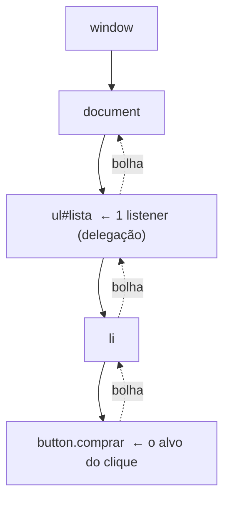
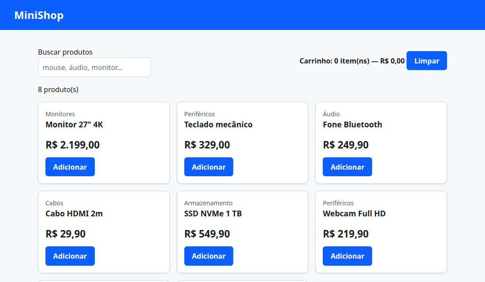

# 05. DOM e eventos

> ⏱️ ~1h30 · Módulo 4 · Pré-requisitos: [01](01-html-semantico-formularios.md), [04](04-js-essencial.md)

## 🎯 Objetivos
Ao final desta aula você consegue:
- Explicar o que é o **DOM** e selecionar, criar, alterar e remover elementos com JavaScript
- Escolher entre `textContent` e `innerHTML` e explicar o risco de **XSS**
- Registrar eventos com `addEventListener`, entender o objeto de evento, a **propagação** (*bubbling*) e usar **delegação de eventos**
- Interceptar o envio de um formulário (`preventDefault`) e aplicar *debounce* em buscas
- Persistir estado simples no navegador com `localStorage`

## 🤔 Por que isso importa
É assim que a página “ganha vida”: filtrar o catálogo enquanto o usuário digita, atualizar o contador do carrinho sem recarregar, validar antes de enviar. E é aqui que nasce a vulnerabilidade mais comum do front-end (XSS: Módulo 9), com uma única linha `innerHTML = dadoDoUsuario`.

## 💡 Intuição (explicação simples)
O navegador transforma o HTML numa **árvore de objetos** (o **DOM**): é como um **organograma** da página, em que cada elemento é uma “caixinha” que você pode localizar, ler e alterar com JavaScript, e a tela se redesenha sozinha. **Eventos** são **campainhas**: o navegador toca (clique, tecla, envio) e você deixa uma função de plantão (*listener*) para atender. E o **bubbling** é a campainha tocando também no andar de cima: o clique num botão “sobe” pelos ancestrais, então um único porteiro no prédio inteiro (delegação) atende todos os apartamentos.

## 🔬 Como funciona por dentro
- **DOM** (*Document Object Model*): API padronizada para ler e alterar o documento. `document` é a raiz; cada nó tem `parentElement`, `children`, `textContent`, `classList`, `dataset`, `attributes`.
- **Seleção:** `document.querySelector(css)` (primeiro que casa) e `querySelectorAll(css)` (lista estática). Use os mesmos seletores do CSS (aula 02). `getElementById` é a mais rápida para ids.
- **Alteração:** `el.textContent = "..."` (**texto puro**, seguro); `el.innerHTML = "<b>..</b>"` (**interpreta HTML**; perigoso com dados externos); `createElement` + `append`/`replaceChildren` (seguro e explícito); `el.classList.add/remove/toggle`; `el.dataset.sku` lê `data-sku`; `el.setAttribute`.
- **Eventos:** `el.addEventListener("click", função)`. A função recebe o **objeto de evento** (`event`): `event.target` (quem originou), `event.currentTarget` (onde o *listener* está), `event.preventDefault()` (cancela a ação padrão, como enviar o formulário) e `event.stopPropagation()`.
- **Propagação:** o evento percorre **captura** (do `window` até o alvo), **alvo** e **bolha** (*bubbling*, do alvo de volta até o `window`). Por padrão os *listeners* rodam na fase de bolha.


- **Delegação:** em vez de um *listener* por botão (e outro a cada novo botão criado), um único *listener* no contêiner usa `event.target.closest("button[data-sku]")` para descobrir qual item foi clicado. Funciona também para elementos criados depois.
- **Eventos úteis:** `click`, `input` (a cada tecla), `change` (ao confirmar), `submit` (formulário), `keydown`, `DOMContentLoaded`, `focus`/`blur`.
- **Segurança (XSS):** se você pôs **texto do usuário** em `innerHTML`, qualquer `` nele **executa JavaScript** na sua página, podendo roubar sessão e dados. A regra: dado externo vai em `textContent`; HTML só de fontes confiáveis ou sanitizado.
- **`localStorage`:** pares chave→**string** persistentes por origem (~5 MB), síncronos; nunca guarde segredos nele (qualquer script da página o lê).

## 🛠️ Exemplo prático
Todos os exemplos rodam em **Chrome real** (headless) e escrevem o resultado no `<pre id="out">` (veja a seção de execução). Um servidor local entrega a pasta `frontend/` (necessário para módulos ES e `localStorage`).

**0. Servidor da pasta `frontend/`**
```python
import functools, http.server, os, threading
class Quiet(http.server.SimpleHTTPRequestHandler):
    def log_message(self, *a): pass
    def end_headers(self):
        self.send_header("Cache-Control", "no-store")
        super().end_headers()
os.makedirs("frontend/js", exist_ok=True)
srv = http.server.ThreadingHTTPServer(("127.0.0.1", 8105), functools.partial(Quiet, directory=os.path.join(os.getcwd(), "frontend")))
threading.Thread(target=srv.serve_forever, daemon=True).start()
print("servindo frontend/ em http://127.0.0.1:8105")
```
```text
servindo frontend/ em http://127.0.0.1:8105
```
**1. Selecionar, ler e percorrer o DOM**
```html
<!doctype html><html lang="pt-BR"><head><meta charset="utf-8"><title>DOM</title></head>
<body>
<header id="topo"><h1 class="titulo">MiniShop</h1><nav><a href="/a" class="link ativo">Catálogo</a> <a href="/b" class="link">Carrinho</a></nav></header>
<ul id="lista"><li data-sku="PF-01" class="item">Mouse</li><li data-sku="MN-04" class="item destaque">Monitor</li><li data-sku="CB-03" class="item">Cabo</li></ul>
<pre id="out"></pre>
<script>
  const linhas = [];
  const lista = document.querySelector('#lista');
  linhas.push('querySelector("#lista") → ' + lista.tagName + ' com ' + lista.children.length + ' filhos');
  linhas.push('querySelectorAll(".item") → ' + document.querySelectorAll('.item').length + ' | ".item.destaque" → ' + document.querySelector('.item.destaque').textContent);
  linhas.push('dataset: ' + [...lista.children].map(li => li.dataset.sku).join(', '));
  linhas.push('pai de um li: ' + lista.children[0].parentElement.id + ' | irmão seguinte: ' + lista.children[0].nextElementSibling.textContent);
  linhas.push('closest("header") a partir de um link: ' + document.querySelector('.link').closest('header').id);
  linhas.push('NodeList é estática? ' + (document.querySelectorAll('.item') instanceof NodeList) + ' | HTMLCollection (children) é viva? ' + (lista.children instanceof HTMLCollection));
  const antes = lista.children.length; lista.append(document.createElement('li'));
  linhas.push('children (viva) antes/depois de append: ' + antes + ' → ' + lista.children.length);
  document.getElementById('out').textContent = linhas.join('\n');
</script></body></html>
```
```bash
domout http://127.0.0.1:8105/dom.html
```
```text
querySelector("#lista") → UL com 3 filhos
querySelectorAll(".item") → 3 | ".item.destaque" → Monitor
dataset: PF-01, MN-04, CB-03
pai de um li: lista | irmão seguinte: Monitor
closest("header") a partir de um link: topo
NodeList é estática? true | HTMLCollection (children) é viva? true
children (viva) antes/depois de append: 3 → 4
```
**2. Criar e alterar elementos (do jeito seguro)**
```html
<!doctype html><html lang="pt-BR"><head><meta charset="utf-8"><title>criar</title></head>
<body><ul id="lista"></ul><pre id="out"></pre>
<script>
  const produtos = [{ sku: 'PF-01', nome: 'Mouse sem fio', estoque: 4 }, { sku: 'AU-01', nome: 'Fone Bluetooth', estoque: 0 }];
  const lista = document.getElementById('lista');
  const itens = produtos.map(p => {
    const li = document.createElement('li');
    li.dataset.sku = p.sku;                                         // data-sku="PF-01"
    li.classList.toggle('esgotado', p.estoque === 0);              // adiciona/remove classe conforme a condição
    const nome = document.createElement('strong'); nome.textContent = p.nome;
    const btn = document.createElement('button'); btn.type = 'button'; btn.textContent = 'Comprar'; btn.disabled = p.estoque === 0;
    li.append(nome, ' — ', btn);
    return li;
  });
  lista.replaceChildren(...itens);                                  // troca todo o conteúdo de uma vez
  document.getElementById('out').textContent = lista.outerHTML;
</script></body></html>
```
```bash
domout http://127.0.0.1:8105/criar.html
```
```text
<ul id="lista"><li data-sku="PF-01"><strong>Mouse sem fio</strong> — <button type="button">Comprar</button></li><li data-sku="AU-01" class="esgotado"><strong>Fone Bluetooth</strong> — <button type="button" disabled="">Comprar</button></li></ul>
```
**3. `textContent` × `innerHTML`: a prova do XSS**
```html
<!doctype html><html lang="pt-BR"><head><meta charset="utf-8"><title>xss</title></head>
<body><div id="a"></div><div id="b"></div><pre id="out"></pre>
<script>
  window.invadido = [];                                              // se o ataque executar, ele escreve aqui
  const comentario = 'Ótimo produto! ';
  document.getElementById('a').innerHTML = comentario;              // VULNERÁVEL
  document.getElementById('b').textContent = comentario;            // seguro: tudo vira texto
  setTimeout(() => {
    document.getElementById('out').textContent =
      'innerHTML  →  criada? ' + !!document.querySelector('#a img') + ' | executou código do atacante? ' + (window.invadido.length > 0 ? 'SIM: ' + window.invadido[0] : 'não') +
      '\ntextContent →  criada? ' + !!document.querySelector('#b img') + ' | texto exibido: ' + document.getElementById('b').textContent.slice(0, 30) + '…';
  }, 500);
</script></body></html>
```
```bash
domout http://127.0.0.1:8105/xss.html
```
```text
innerHTML  →  criada? true | executou código do atacante? SIM: script do atacante rodou
textContent →  criada? false | texto exibido: Ótimo produto! <html lang="pt-BR"><head><meta charset="utf-8"><title>eventos</title></head>
<body>
<ul id="lista"><li><span>Mouse</span> <button data-sku="PF-01">+</button></li><li><span>Cabo</span> <button data-sku="CB-03">+</button></li></ul>
<form id="f" action="/enviar"><input name="q" value="cabo"><button>Enviar</button></form>
<pre id="out"></pre>
<script>
  const log = [];
  const lista = document.getElementById('lista');

  // delegação: UM listener atende todos os botões, inclusive os criados depois
  lista.addEventListener('click', e => {
    const btn = e.target.closest('button[data-sku]');
    if (!btn) return;
    log.push(`clique em ${btn.dataset.sku} | target=${e.target.tagName} currentTarget=${e.currentTarget.tagName}`);
  });
  // listener de CAPTURA no document: roda ANTES do alvo
  document.addEventListener('click', () => log.push('1) captura no document'), true);
  document.addEventListener('click', () => log.push('3) bolha chegou ao document'));
  lista.addEventListener('click', () => log.push('2) bolha passou pela lista'));

  document.querySelector('button[data-sku="PF-01"]').click();               // simula o clique
  const novo = document.createElement('li'); novo.innerHTML = '<span>Fone</span> <button data-sku="AU-01">+</button>';
  lista.append(novo);                                                       // elemento criado DEPOIS do listener
  novo.querySelector('button').click();
  log.push('--- stopPropagation');
  lista.addEventListener('click', e => { if (e.target.dataset.sku === 'CB-03') e.stopPropagation(); }, true);
  document.querySelector('button[data-sku="CB-03"]').click();               // a delegação principal NÃO é chamada

  // formulário: interceptar o envio
  document.getElementById('f').addEventListener('submit', e => { e.preventDefault(); log.push('submit interceptado; q=' + new FormData(e.target).get('q') + ' | defaultPrevented=' + e.defaultPrevented); });
  log.push('--- clique no botão do formulário');
  document.querySelector('#f button').click();
  document.getElementById('out').textContent = log.join('\n');
</script></body></html>
```
```bash
domout http://127.0.0.1:8105/eventos.html
```
```text
1) captura no document
clique em PF-01 | target=BUTTON currentTarget=UL
2) bolha passou pela lista
3) bolha chegou ao document
1) captura no document
clique em AU-01 | target=BUTTON currentTarget=UL
2) bolha passou pela lista
3) bolha chegou ao document
--- stopPropagation
1) captura no document
--- clique no botão do formulário
1) captura no document
3) bolha chegou ao document
submit interceptado; q=cabo | defaultPrevented=true
```
Ordem real (cada clique mostra as três fases): **captura** (do topo para o alvo), **alvo/bolha** (do alvo para o topo). O `closest()` resolve o caso em que o clique cai num filho do botão. Um elemento criado **depois** (o “Fone”) também funciona, porque o *listener* está no contêiner. `preventDefault` evita o envio padrão (o `submit` foi capturado em JS).

**5. *Debounce*: não buscar a cada tecla**
```js
export function debounce(fn, ms) {
  let timer;
  return (...args) => {
    clearTimeout(timer);                       // cada chamada nova cancela a anterior
    timer = setTimeout(() => fn(...args), ms);
  };
}
```
```html
<!doctype html><html lang="pt-BR"><head><meta charset="utf-8"><title>debounce</title></head><body><input id="q"><pre id="out"></pre>
<script type="module">
  import { debounce } from './js/debounce.mjs';
  const chamadas = [];
  const buscar = debounce(termo => chamadas.push(termo), 300);
  const q = document.getElementById('q');
  const digitar = async (texto, intervaloMs) => {                  // simula alguém digitando rápido
    for (const c of texto) { q.value += c; q.dispatchEvent(new Event('input')); buscar(q.value); await new Promise(r => setTimeout(r, intervaloMs)); }
  };
  (async () => {
    await digitar('mouse', 100);                                    // 5 teclas, 100 ms entre elas
    await new Promise(r => setTimeout(r, 400));
    q.value = ''; await digitar('ab', 500);                         // devagar: 500 ms entre teclas
    await new Promise(r => setTimeout(r, 400));
    document.getElementById('out').textContent = `buscas disparadas: ${chamadas.length} → ${JSON.stringify(chamadas)}  (sem debounce seriam 7)`;
  })();
</script></body></html>
```
```bash
domout http://127.0.0.1:8105/debounce.html 8000
```
```text
buscas disparadas: 3 → ["mouse","a","ab"]  (sem debounce seriam 7)
```
Sem *debounce*, a busca consultaria a API a **cada tecla** (7 chamadas); com ele, só quando o usuário **para** de digitar por 300 ms. O resultado depende do ritmo: digitando devagar (500 ms entre teclas), cada tecla vira uma busca.

**6. O app completo: busca ao vivo + carrinho persistente**
```js
export const normalizar = texto => texto.normalize("NFD").replace(/[̀-ͯ]/g, "").toLowerCase().trim();

/** Filtra por nome ou categoria, sem acentos nem caixa; quem COMEÇA com o termo vem antes. */
export function filtrar(produtos, termo) {
  const t = normalizar(termo);
  if (!t) return produtos;
  return produtos
    .map(p => ({ p, nome: normalizar(p.nome), cat: normalizar(p.categoria) }))
    .filter(({ nome, cat }) => nome.includes(t) || cat.includes(t))
    .sort((a, b) => Number(b.nome.startsWith(t)) - Number(a.nome.startsWith(t)))     // sort é estável: mantém a ordem original nos empates
    .map(({ p }) => p);
}
```
```js
import { formatarPreco } from "./utils.mjs";
import { filtrar } from "./busca.mjs";
import { debounce } from "./debounce.mjs";

const PRODUTOS = [
  { sku: "MN-04", nome: 'Monitor 27" 4K', categoria: "Monitores", centavos: 219900 },
  { sku: "PF-03", nome: "Teclado mecânico", categoria: "Periféricos", centavos: 32900 },
  { sku: "AU-01", nome: "Fone Bluetooth", categoria: "Áudio", centavos: 24990 },
  { sku: "CB-01", nome: "Cabo HDMI 2m", categoria: "Cabos", centavos: 2990 },
  { sku: "AR-04", nome: "SSD NVMe 1 TB", categoria: "Armazenamento", centavos: 54990 },
  { sku: "PF-05", nome: "Webcam Full HD", categoria: "Periféricos", centavos: 21990 },
  { sku: "AU-09", nome: "Soundbar", categoria: "Áudio", centavos: 44990 },
  { sku: "PF-01", nome: "Mouse sem fio", categoria: "Periféricos", centavos: 8990 },
];

const $ = seletor => document.querySelector(seletor);
const lerCarrinho = () => { try { return JSON.parse(localStorage.getItem("carrinho")) ?? {}; } catch { return {}; } };
const estado = { termo: "", carrinho: lerCarrinho() };

function cartao(p) {                                              // construção SEGURA do DOM (sem innerHTML)
  const li = document.createElement("li");
  const art = document.createElement("article"); art.className = "card";
  const cat = Object.assign(document.createElement("p"), { className: "categoria", textContent: p.categoria });
  const h3 = Object.assign(document.createElement("h3"), { textContent: p.nome });
  const preco = Object.assign(document.createElement("p"), { className: "preco", textContent: formatarPreco(p.centavos) });
  const btn = Object.assign(document.createElement("button"), { type: "button", className: "botao", textContent: "Adicionar" });
  btn.dataset.sku = p.sku;
  btn.setAttribute("aria-label", `Adicionar ${p.nome} ao carrinho`);
  art.append(cat, h3, preco, btn); li.append(art);
  return li;
}

function render() {
  const visiveis = filtrar(PRODUTOS, estado.termo);
  $("#lista").replaceChildren(...visiveis.map(cartao));
  $("#status").textContent = visiveis.length === 0 ? "Nenhum produto encontrado" : `${visiveis.length} produto(s)`;
  const itens = Object.values(estado.carrinho).reduce((s, n) => s + n, 0);
  const total = Object.entries(estado.carrinho).reduce((s, [sku, n]) => s + PRODUTOS.find(p => p.sku === sku).centavos * n, 0);
  $("#carrinho").textContent = `Carrinho: ${itens} item(ns) — ${formatarPreco(total)}`;
}

$("#lista").addEventListener("click", e => {                      // delegação
  const btn = e.target.closest("button[data-sku]");
  if (!btn) return;
  estado.carrinho[btn.dataset.sku] = (estado.carrinho[btn.dataset.sku] ?? 0) + 1;
  localStorage.setItem("carrinho", JSON.stringify(estado.carrinho));
  render();
});
$("#busca").addEventListener("input", debounce(e => { estado.termo = e.target.value; render(); }, 250));
$("#limpar").addEventListener("click", () => { estado.carrinho = {}; localStorage.removeItem("carrinho"); render(); });
$("#form-busca").addEventListener("submit", e => e.preventDefault());       // Enter não recarrega a página
render();
```
```html
<!doctype html>
<html lang="pt-BR">
<head><meta charset="utf-8"><meta name="viewport" content="width=device-width, initial-scale=1">
<title>MiniShop — Loja</title><link rel="stylesheet" href="style.css">
<style>
  .grade { display: grid; grid-template-columns: repeat(auto-fill, minmax(14rem, 1fr)); gap: 1rem; margin: 1rem 0; padding: 0; list-style: none; }
  .grade .card { width: auto; display: flex; flex-direction: column; height: 100%; } .grade .botao { margin-top: auto; align-self: flex-start; }
  .barra { display: flex; flex-wrap: wrap; gap: 1rem; align-items: end; justify-content: space-between; }
  input[type="search"] { padding: .6rem; border: 1px solid var(--cor-borda); border-radius: 6px; font: inherit; min-width: 16rem; }
</style></head>
<body>
<header class="topo"><h1>MiniShop</h1></header>
<main>
  <div class="barra">
    <form id="form-busca" role="search"><label for="busca">Buscar produtos</label><br><input id="busca" type="search" autocomplete="off" placeholder="mouse, áudio, monitor…"></form>
    <p><strong id="carrinho" aria-live="polite">Carrinho: 0 item(ns)</strong> <button id="limpar" type="button" class="botao">Limpar</button></p>
  </div>
  <p id="status" aria-live="polite"></p>
  <ul id="lista" class="grade"></ul>
</main>
<script type="module" src="js/loja.mjs"></script>
</body></html>
```
A **página de teste** controla a loja dentro de um `iframe`, digita, clica, recarrega e confere o estado:
```html
<!doctype html><html lang="pt-BR"><head><meta charset="utf-8"><title>teste</title></head><body>
<iframe id="f" src="loja.html" style="width:1100px;height:600px;border:0"></iframe><pre id="out">…</pre>
<script>
  const f = document.getElementById('f'), log = [], dormir = ms => new Promise(r => setTimeout(r, ms));
  const carregar = () => new Promise(ok => f.addEventListener('load', async () => { await dormir(200); ok(f.contentDocument); }, { once: true }));
  (async () => {
    let d = await carregar();
    d.defaultView.localStorage.clear(); d.defaultView.location.reload(); d = await carregar();
    const txt = s => d.querySelector(s).textContent;
    const nomes = () => [...d.querySelectorAll('#lista h3')].map(h => h.textContent);
    log.push('inicial: ' + txt('#status') + ' | ' + txt('#carrinho'));
    const busca = d.querySelector('#busca');
    busca.value = 'AUDIO'; busca.dispatchEvent(new Event('input')); await dormir(400);          // sem acento e em maiúsculas
    log.push('busca "AUDIO": ' + nomes().join(', '));
    busca.value = 'xyz'; busca.dispatchEvent(new Event('input')); await dormir(400);
    log.push('busca "xyz": ' + txt('#status'));
    busca.value = ''; busca.dispatchEvent(new Event('input')); await dormir(400);
    d.querySelector('button[data-sku="PF-01"]').click(); d.querySelector('button[data-sku="PF-01"]').click(); d.querySelector('button[data-sku="MN-04"]').click();
    log.push('após 3 cliques: ' + txt('#carrinho'));
    d.defaultView.location.reload(); d = await carregar();                                      // recarregar a página
    log.push('depois do reload (localStorage): ' + d.querySelector('#carrinho').textContent);
    d.querySelector('#limpar').click();
    log.push('após limpar: ' + d.querySelector('#carrinho').textContent);
    document.getElementById('out').textContent = log.join('\n');
  })();
</script></body></html>
```
```bash
cd frontend && domout http://127.0.0.1:8105/teste-loja.html 15000
shot 05-loja.png 1100x640 http://127.0.0.1:8105/loja.html 4000
```
```text
inicial: 8 produto(s) | Carrinho: 0 item(ns) — R$ 0,00
busca "AUDIO": Fone Bluetooth, Soundbar
busca "xyz": Nenhum produto encontrado
após 3 cliques: Carrinho: 3 item(ns) — R$ 2.378,80
depois do reload (localStorage): Carrinho: 3 item(ns) — R$ 2.378,80
após limpar: Carrinho: 0 item(ns) — R$ 0,00
```

Tudo foi exercitado num navegador real: a busca ignora acento e caixa (“AUDIO” acha os produtos de Áudio), o contador do carrinho acompanha os cliques, o `localStorage` mantém o carrinho depois do *reload*. Os `aria-live="polite"` fazem leitores de tela anunciarem o resultado da busca e do carrinho (aula 08).

## ⚠️ Erros comuns e boas práticas
| Sintoma / mensagem | Causa | Solução |
|---|---|---|
| `TypeError: Cannot read properties of null (reading 'addEventListener')` | `querySelector` não achou o elemento: seletor errado ou script rodou **antes** do HTML | Cheque o seletor; `<script type="module">`/`defer` ou final do `<body>` |
| Clique em elemento novo não faz nada | *Listener* registrado só nos elementos antigos | Delegação no contêiner |
| O formulário recarrega a página | Faltou `preventDefault` no `submit` | `e.preventDefault()` |
| `Uncaught SyntaxError: Cannot use import statement outside a module` | `import` sem `type="module"` | `<script type="module">` |
| `Access to script ... from origin 'null' has been blocked by CORS policy` | Módulo aberto por `file://` | Sirva por HTTP (`python -m http.server`) |
| Texto do usuário vira HTML/executa script | `innerHTML` com dado externo | `textContent` ou criar elementos |
| Busca dispara dezenas de requisições | Sem *debounce* | `debounce(fn, 250–300)` |
| `localStorage` guarda `[object Object]` | Gravou objeto sem serializar | `JSON.stringify`/`JSON.parse` |
| `this` indefinido em *callback* | `function` comum em *listener* | *Arrow function* ou `event.currentTarget` |
| Evento dispara **duas vezes** | *Listener* registrado em duplicidade (chamou `render` que adiciona de novo) | Registre uma vez, fora da função de renderização |

- **Nunca** monte HTML com texto de usuário. Se precisar renderizar HTML externo, sanitize (por exemplo, DOMPurify) ou prefira templates do servidor com *autoescape*.
- O DOM é **lento de mexer em excesso**: monte os elementos e insira de uma vez (`replaceChildren`) em vez de dezenas de `append` no DOM vivo.
- Use `classList` e CSS para estados visuais (`.ativo`, `.esgotado`), não `style` inline.
- Todo comportamento por JS deve ter equivalente por **teclado** (`button`/`a` nativos já têm).
- `localStorage` é por origem, **não é seguro** e não sincroniza entre dispositivos: use para preferências e rascunhos, não para o carrinho “oficial” (o servidor é a fonte da verdade).

## 🧠 Pausa para lógica
**Problema (busca de produtos).** A função `filtrar` percorre todos os produtos a cada busca: O(n·|termo|). Com 8 itens não importa; com 100 mil, trava a página. Proponha e implemente uma melhoria: um **índice** pré-calculado (`Map` de palavra → conjunto de SKUs) e compare o número de comparações com a busca linear. Por que o banco de dados (aula 3.08) faz algo parecido?

<details><summary>Dica</summary>
Pré-processe cada produto uma vez: <code>normalizar(nome).split(/\s+/)</code>. Para cada palavra, guarde o SKU num <code>Set</code>. A busca de um termo consulta o <code>Map</code> (O(1)) por prefixo exato; para prefixos, ordene as chaves e use busca binária.
</details>

<details><summary>Solução comentada</summary>

```js
import { normalizar } from "./frontend/js/busca.mjs";

const produtos = Array.from({ length: 50000 }, (_, i) => ({ sku: "P" + i, nome: `Produto ${["Mouse", "Cabo", "Fone", "Monitor"][i % 4]} modelo ${i}`, categoria: "x" }));

// busca linear (como a filtrar): percorre tudo
let comparacoes = 0;
const linear = termo => { const t = normalizar(termo); return produtos.filter(p => (comparacoes++, normalizar(p.nome).includes(t))); };

// índice invertido: palavra -> SKUs (montado UMA vez)
const indice = new Map();
for (const p of produtos) for (const palavra of new Set(normalizar(p.nome).split(/\s+/)))
  (indice.get(palavra) ?? indice.set(palavra, new Set()).get(palavra)).add(p.sku);
const porIndice = termo => [...(indice.get(normalizar(termo)) ?? [])];

console.time("linear"); const a = linear("monitor"); console.timeEnd("linear");
console.time("índice"); const b = porIndice("monitor"); console.timeEnd("índice");
console.log(a.length, b.length, "comparações lineares:", comparacoes, "| consultas ao índice: 1");
```
```text
linear: 6.422ms
índice: 0.043ms
12500 12500 comparações lineares: 50000 | consultas ao índice: 1
```
O índice troca **tempo por memória e preparo**: como o índice remissivo de um livro (aula 3.08). Para sites reais, a busca fica no servidor (PostgreSQL com índice, ou um motor de busca) e o front só envia o termo com *debounce*.
</details>

**Variação mais difícil:** suporte a busca por **prefixo** (“mon” → “monitor”) no índice usando as chaves ordenadas e busca binária (`bisect` em JS).

## 🧩 Exercícios
**1. Fixação**
(a) Diferença entre `event.target` e `event.currentTarget`? (b) Por que delegação é melhor que um *listener* por botão? (c) O que `e.preventDefault()` faz num `submit`? (d) Como evitar XSS ao exibir o nome de um produto vindo da API?

<details><summary>Solução</summary>

(a) `target` é o elemento onde o evento nasceu; `currentTarget` é aquele em que o *listener* está registrado. (b) Um só *listener*, menos memória, funciona com elementos criados depois. (c) Cancela o envio padrão (e a navegação), deixando o JS tratar. (d) Usar `textContent` (ou `createElement`), nunca `innerHTML` com texto externo.
</details>

**2. Aplicação no projeto MiniShop**
Evolua `frontend/` com a loja interativa desta aula.

Critérios de pronto:
- [ ] Catálogo renderizado por JS (`createElement`/`textContent`, **sem** `innerHTML` com dados) a partir de um array
- [ ] Busca ao vivo com *debounce*, insensível a acento e caixa; mensagem “Nenhum produto encontrado”
- [ ] Botão “Adicionar” com **delegação**; carrinho persistido em `localStorage` e exibido com `aria-live`
- [ ] Botão “Remover 1” e “Limpar”; o total em R$ via `formatarPreco` (centavos)
- [ ] Uma página de teste automatizado (como `teste-loja.html`) que prova busca, cliques e persistência
- [ ] Prova de XSS: um produto com nome `` aparece como **texto** (print em `docs/`)
- [ ] Commit `feat(front): interactive catalog with live search and persistent cart`

<details><summary>Solução de referência</summary>

Parta de `loja.html` e `js/loja.mjs`. Para “Remover 1”, acrescente um segundo botão com `data-acao="remover"` e trate no mesmo *listener* delegado (`const {sku, acao} = btn.dataset`), apagando a chave quando chegar a 0. No teste, adicione o produto malicioso ao array e verifique `d.querySelector('#lista img') === null`.
</details>

**3. Desafio (opcional)**
Implemente atalhos de teclado (`/` foca na busca, `Esc` limpa) sem quebrar a digitação nos campos (`e.target.matches('input, textarea')`) e adicione `aria-keyshortcuts`.

## 🎤 Na entrevista
- **O que é o DOM?** A representação em árvore de objetos do documento HTML, exposta por uma API para JavaScript ler e alterar; o navegador redesenha quando ela muda.
- **Explique *event bubbling* e delegação de eventos.** O evento sobe do alvo pelos ancestrais; a delegação registra um único *listener* no ancestral e identifica o alvo com `event.target.closest(...)`: eficiente e funciona para elementos criados dinamicamente.
- **`textContent` × `innerHTML`? O que é XSS?** `textContent` trata tudo como texto; `innerHTML` interpreta HTML (e executa *handlers* como `onerror`). XSS é injetar script em uma página via dado não escapado; evita-se escapando/sanitizando e com CSP.
- **O que é *debounce*?** Atrasar a execução até o usuário parar de acionar o evento por um intervalo, evitando trabalho/requisições a cada tecla.

## 📚 Para ir além
- 📄 Documentação oficial: [Introdução ao DOM (MDN)](https://developer.mozilla.org/pt-BR/docs/Web/API/Document_Object_Model). Nós, elementos, seleção e manipulação.
- 📄 Documentação oficial: [Eventos (MDN)](https://developer.mozilla.org/pt-BR/docs/Web/API/Event). Fases, propagação e tipos de evento.
- 📄 Documentação oficial: [OWASP: Cross-Site Scripting](https://owasp.org/www-community/attacks/xss/). O ataque e como prevenir.
- 📑 Artigo/tutorial: [The Modern JavaScript Tutorial: DOM](https://javascript.info/document). Parte “Document” completa.
- 🏋️ Prática extra: adicione ordenação (preço ↑↓) à loja e persista a escolha no `localStorage`.

## ✅ Checklist da aula
- [ ] Selecionei, criei e alterei elementos do DOM
- [ ] Reproduzi o XSS com `innerHTML` e o bloqueei com `textContent`
- [ ] Usei delegação, `preventDefault` e *debounce*
- [ ] Construí a loja com busca e carrinho persistente (e o teste automatizado)
- [ ] Fiz o commit do exercício
