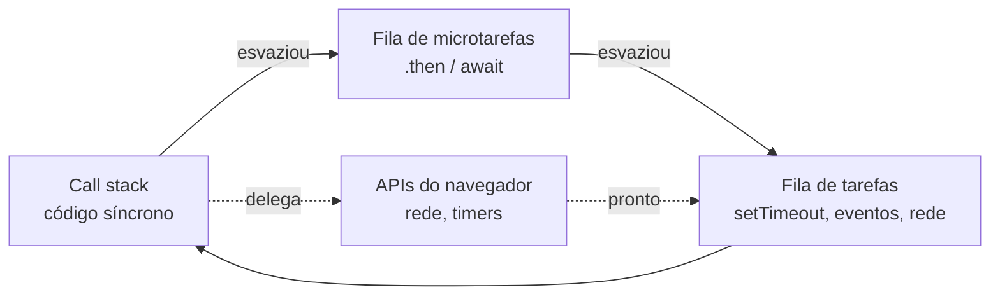

# 06. Promises, `async`/`await` e `fetch`

> ⏱️ ~1h30 · Módulo 4 · Pré-requisitos: [04](04-js-essencial.md), [05](05-js-dom-eventos.md); HTTP e CORS da [aula 2.02](../02-como-a-web-funciona/02-http-metodos-status-headers.md)

## 🎯 Objetivos
Ao final desta aula você consegue:
- Explicar o **event loop** e por que JavaScript não trava esperando a rede
- Usar **Promises** (`then`/`catch`/`finally`, `Promise.all`) e `async`/`await`
- Chamar APIs com `fetch`: GET e POST JSON, `response.ok`, erros de rede × erros HTTP, *timeout* com `AbortController`
- Explicar a **política de mesma origem** e o **CORS**, e diagnosticar o erro “blocked by CORS policy”
- Escrever um cliente de API pequeno e testável, com *retry* e tratamento de erros

## 🤔 Por que isso importa
Quase tudo que a página faz de útil depende de **esperar**: a API de produtos, o CEP, o pagamento. Código que não entende assincronia produz telas que travam, “carregando” infinito e erros engolidos. E o erro mais frustrante do front-end para quem faz backend, o **CORS**, só se resolve quando se entende quem bloqueia o quê (spoiler: o navegador, não o servidor).

## 💡 Intuição (explicação simples)
JavaScript tem **um só atendente** no balcão. Em vez de ficar parado olhando o forno (bloqueio), ele **pega uma senha**, atende o próximo cliente e é chamado quando o pedido fica pronto. É a **fila de padaria com senha**: o atendente (a *thread* única) nunca fica ocioso nem bloqueado. Uma **Promise** é a **senha**: “seu pedido vai ficar pronto; quando estiver, você recebe o resultado, ou o aviso de que deu errado”. `await` é “espere por esta senha sem travar a padaria”.

## 🔬 Como funciona por dentro
**Event loop.** O JavaScript executa **uma coisa de cada vez** na *call stack*. Operações demoradas (rede, *timers*, disco) são entregues ao navegador (ou ao Node), que as faz **em paralelo**; ao terminarem, o *callback* entra numa **fila**. O *event loop* só o executa quando a *stack* esvazia. Há duas filas: a de **microtarefas** (callbacks de Promises) tem prioridade sobre a de **tarefas** (`setTimeout`, eventos).


**Promise:** objeto com três estados: *pending* → *fulfilled* (resolvida com um valor) ou *rejected* (com um erro); uma vez resolvida, não muda. `.then(f)` registra o que fazer com o valor, `.catch(g)` com o erro, `.finally(h)` roda sempre; cada um devolve **outra Promise** (encadeamento). **`async function`** sempre devolve uma Promise; **`await`** pausa **aquela função** (não o programa) até a Promise resolver, e lança o erro se for rejeitada (use `try/catch`).

| Combinador | Resolve quando… |
|---|---|
| `Promise.all([...])` | todas resolvem (rejeita na 1ª falha) |
| `Promise.allSettled([...])` | todas terminam (com sucesso ou erro) |
| `Promise.race([...])` | a primeira termina |
| `Promise.any([...])` | a primeira **com sucesso** |

**`fetch(url, opções)`** devolve uma Promise de `Response`. Pontos que pegam todo mundo:
1. `fetch` **só rejeita em erro de rede** (servidor inalcançável, DNS, CORS bloqueado, abortado). Respostas `404`/`500` **resolvem normalmente**: confira `response.ok` (`status` 200–299) ou `response.status`.
2. O corpo é um fluxo lido **uma vez**: `await response.json()` (ou `.text()`).
3. Para enviar JSON: `method: "POST"`, `headers: {"Content-Type": "application/json"}`, `body: JSON.stringify(obj)`.
4. *Timeout* não existe por padrão: use `AbortController` (`signal`) ou `AbortSignal.timeout(ms)`.

**Mesma origem e CORS.** Origem = **esquema + host + porta** (`http://127.0.0.1:8107`). Por padrão, uma página só pode **ler respostas** de requisições à **mesma origem**. Para ler de outra origem, o servidor precisa autorizar com o cabeçalho `Access-Control-Allow-Origin`. Detalhes:
- **Quem bloqueia é o navegador.** O servidor **recebe** e responde; o navegador é que se recusa a entregar a resposta ao JavaScript. `curl` e o Postman não têm CORS.
- **Requisições “simples”** (GET/POST com tipos básicos): enviadas direto; a resposta só é lida se vier o cabeçalho.
- **Requisições com *preflight*:** `Content-Type: application/json`, `Authorization`, `PUT`/`DELETE`… fazem o navegador **antes** enviar um `OPTIONS` perguntando “posso?”; só se o servidor autorizar (`Access-Control-Allow-Methods`, `Access-Control-Allow-Headers`) vai a requisição real.
- Cookies entre origens exigem `credentials: "include"` **e** `Access-Control-Allow-Credentials: true` (nunca com `*`): Módulo 9.
- No Django, o pacote `django-cors-headers` configura isso (Módulo 6). CORS **não** é segurança do servidor: é proteção do **usuário** contra páginas maliciosas.

## 🛠️ Exemplo prático
**1. O event loop na prática (Node)**
```js
console.log("1 síncrono");
setTimeout(() => console.log("5 tarefa (setTimeout 0)"), 0);
Promise.resolve().then(() => console.log("3 microtarefa (then)"));
queueMicrotask(() => console.log("4 microtarefa (queueMicrotask)"));
(async () => { console.log("2 dentro da async, antes do await"); await null; console.log("4b depois do await (microtarefa)"); })();
console.log("2b síncrono, fim do script");
```
```text
1 síncrono
2 dentro da async, antes do await
2b síncrono, fim do script
3 microtarefa (then)
4 microtarefa (queueMicrotask)
4b depois do await (microtarefa)
5 tarefa (setTimeout 0)
```
A ordem prova a teoria: **todo o código síncrono** primeiro, depois as **microtarefas** (Promises), por último as **tarefas** (timers).

**2. Promises e `async`/`await`; paralelo × sequencial**
```js
const dormir = (ms, valor) => new Promise(resolve => setTimeout(() => resolve(valor), ms));
const falhar = (ms, msg) => new Promise((_, reject) => setTimeout(() => reject(new Error(msg)), ms));
const arredondar = ms => Math.round(ms / 100) * 100;

dormir(50, "ok").then(v => v.toUpperCase()).then(v => console.log("encadeamento:", v)).finally(() => console.log("finally roda sempre"));
await dormir(100);

let t0 = performance.now();
for (const id of [1, 2, 3]) await dormir(300);                        // um depois do outro: ~900 ms
console.log("sequencial ≈", arredondar(performance.now() - t0), "ms");

t0 = performance.now();
const resultados = await Promise.all([1, 2, 3].map(id => dormir(300, `r${id}`)));      // juntos: ~300 ms
console.log("em paralelo ≈", arredondar(performance.now() - t0), "ms", resultados);

try { await Promise.all([dormir(100, "a"), falhar(50, "caiu"), dormir(200, "c")]); }
catch (e) { console.log("Promise.all rejeita na 1ª falha:", e.message); }
console.log((await Promise.allSettled([dormir(10, "a"), falhar(10, "b")])).map(r => r.status + (r.reason ? ":" + r.reason.message : ":" + r.value)));
console.log("race:", await Promise.race([dormir(200, "lento"), dormir(50, "rápido")]), "| any:", await Promise.any([falhar(10, "x"), dormir(50, "sobrevivente")]));
```
```text
encadeamento: OK
finally roda sempre
sequencial ≈ 900 ms
em paralelo ≈ 300 ms [ 'r1', 'r2', 'r3' ]
Promise.all rejeita na 1ª falha: caiu
[ 'fulfilled:a', 'rejected:b' ]
race: rápido | any: sobrevivente
```
Os erros comuns: esquecer o `await` (você recebe uma `Promise` em vez do valor), usar `await` dentro de `forEach` (não espera), e fazer `await` em sequência quando as chamadas são **independentes** (use `Promise.all`).

**3. Um servidor de API para praticar (Python, só biblioteca padrão)**
```python
import json, threading, time, urllib.parse
from http.server import BaseHTTPRequestHandler, ThreadingHTTPServer

PRODUTOS = [
    {"sku": "MN-04", "nome": 'Monitor 27" 4K', "preco": "2199.00", "categoria": "Monitores"},
    {"sku": "PF-03", "nome": "Teclado mecânico", "preco": "329.00", "categoria": "Periféricos"},
    {"sku": "AU-01", "nome": "Fone Bluetooth", "preco": "249.90", "categoria": "Áudio"},
    {"sku": "CB-01", "nome": "Cabo HDMI 2m", "preco": "29.90", "categoria": "Cabos"},
    {"sku": "PF-01", "nome": "Mouse sem fio", "preco": "89.90", "categoria": "Periféricos"},
]
ESTADO = {"cors": None, "preflight": False, "log": [], "instavel": 0}

class API(BaseHTTPRequestHandler):
    protocol_version = "HTTP/1.1"
    def log_message(self, *a): pass
    def handle(self):                                               # o cliente pode desistir (timeout): não é erro do servidor
        try: super().handle()
        except (BrokenPipeError, ConnectionResetError): pass

    def responder(self, status, corpo=None, extra=None):
        dados = b"" if corpo is None else json.dumps(corpo, ensure_ascii=False).encode()
        self.send_response(status)
        self.send_header("Content-Type", "application/json; charset=utf-8"); self.send_header("Content-Length", str(len(dados)))
        if ESTADO["cors"]:
            self.send_header("Access-Control-Allow-Origin", ESTADO["cors"]); self.send_header("Vary", "Origin")
        for k, v in (extra or {}).items(): self.send_header(k, v)
        self.end_headers(); self.wfile.write(dados)

    def do_OPTIONS(self):                                           # preflight
        ESTADO["log"].append(f"OPTIONS {self.path}  (pergunta: posso {self.headers.get('Access-Control-Request-Method')} com {self.headers.get('Access-Control-Request-Headers')}?)")
        if ESTADO["cors"] and ESTADO["preflight"]:
            self.responder(204, None, {"Access-Control-Allow-Methods": "GET, POST, OPTIONS", "Access-Control-Allow-Headers": "Content-Type", "Access-Control-Max-Age": "60"})
        else:
            self.responder(405, {"erro": "preflight não suportado"})

    def do_GET(self):
        u = urllib.parse.urlparse(self.path); q = urllib.parse.parse_qs(u.query)
        ESTADO["log"].append(f"GET {u.path}")
        if u.path == "/api/_config":                                 # controle do laboratório (sem CORS: usado com no-cors)
            ESTADO["cors"] = q.get("cors", [""])[0] or None; ESTADO["preflight"] = q.get("preflight", ["0"])[0] == "1"
            return self.responder(200, {"ok": True})
        if u.path == "/api/produtos":
            termo = q.get("busca", [""])[0].lower()
            return self.responder(200, [p for p in PRODUTOS if termo in p["nome"].lower()])
        if u.path == "/api/lento":
            time.sleep(0.8); return self.responder(200, {"ok": True})
        if u.path == "/api/instavel":                                # falha nas 2 primeiras chamadas (para o retry)
            ESTADO["instavel"] += 1
            if ESTADO["instavel"] <= 2: return self.responder(503, {"erro": "indisponível, tente de novo"}, {"Retry-After": "1"})
            return self.responder(200, {"ok": True, "tentativa": ESTADO["instavel"]})
        if u.path == "/api/erro":
            return self.responder(500, {"erro": "falha interna"})
        self.responder(404, {"erro": "não encontrado"})

    def do_POST(self):
        corpo = self.rfile.read(int(self.headers.get("Content-Length", 0)))
        ESTADO["log"].append(f"POST {self.path}  Content-Type={self.headers.get('Content-Type')}")
        if self.path != "/api/pedidos": return self.responder(404, {"erro": "não encontrado"})
        try: dados = json.loads(corpo)
        except json.JSONDecodeError: return self.responder(400, {"erro": "JSON inválido"})
        if not dados.get("sku") or not isinstance(dados.get("qtd"), int) or dados["qtd"] < 1:
            return self.responder(422, {"erro": "dados inválidos", "detalhes": {"sku": "obrigatório", "qtd": "inteiro >= 1"}})
        self.responder(201, {"id": 101, "sku": dados["sku"], "qtd": dados["qtd"]}, {"Location": "/api/pedidos/101"})

api = ThreadingHTTPServer(("127.0.0.1", 8106), API)
threading.Thread(target=api.serve_forever, daemon=True).start()
print("API em http://127.0.0.1:8106 (GET /api/produtos, /api/lento, /api/instavel, /api/erro; POST /api/pedidos)")
```
```text
API em http://127.0.0.1:8106 (GET /api/produtos, /api/lento, /api/instavel, /api/erro; POST /api/pedidos)
```
**4. `fetch`: o que resolve e o que rejeita (Node 22 tem o mesmo `fetch` do navegador)**
```js
const base = "http://127.0.0.1:8106";

const r = await fetch(`${base}/api/produtos?busca=mouse`);
console.log(r.status, r.ok, r.headers.get("content-type"), await r.json());

const r404 = await fetch(`${base}/api/nao-existe`);
console.log("404 NÃO rejeita:", r404.status, r404.ok, await r404.json());
const r500 = await fetch(`${base}/api/erro`);
console.log("500 NÃO rejeita:", r500.status, r500.ok);

try { await fetch("http://127.0.0.1:59999/nada"); }
catch (e) { console.log("erro de REDE rejeita:", e.name, "-", e.message, "-", e.cause?.code); }

const post = await fetch(`${base}/api/pedidos`, {
  method: "POST", headers: { "Content-Type": "application/json" }, body: JSON.stringify({ sku: "MN-04", qtd: 2 }),
});
console.log(post.status, post.headers.get("location"), await post.json());
const ruim = await fetch(`${base}/api/pedidos`, { method: "POST", headers: { "Content-Type": "application/json" }, body: JSON.stringify({ sku: "", qtd: 0 }) });
console.log(ruim.status, await ruim.json());

try { await fetch(`${base}/api/lento`, { signal: AbortSignal.timeout(200) }); }
catch (e) { console.log("timeout:", e.name); }
```
```text
200 true application/json; charset=utf-8 [
  {
    sku: 'PF-01',
    nome: 'Mouse sem fio',
    preco: '89.90',
    categoria: 'Periféricos'
  }
]
404 NÃO rejeita: 404 false { erro: 'não encontrado' }
500 NÃO rejeita: 500 false
erro de REDE rejeita: TypeError - fetch failed - ECONNREFUSED
201 /api/pedidos/101 { id: 101, sku: 'MN-04', qtd: 2 }
422 {
  erro: 'dados inválidos',
  detalhes: { sku: 'obrigatório', qtd: 'inteiro >= 1' }
}
timeout: TimeoutError
```
Memorize: `fetch` **não rejeita para 4xx/5xx**. Quem não confere `response.ok` trata um `500` como sucesso e tenta ler `.json()` do que veio.

**5. Um cliente de API reutilizável (com erros tipados, *timeout* e *retry*)**
```js
export class ApiError extends Error {                 // o servidor respondeu, mas com erro HTTP (4xx/5xx)
  constructor(status, corpo, url) { super(`HTTP ${status} em ${url}`); this.name = "ApiError"; this.status = status; this.corpo = corpo; }
}
export class NetworkError extends Error {             // não houve resposta: rede, DNS, CORS, timeout
  constructor(motivo) { super(motivo); this.name = "NetworkError"; }
}

async function pedir(url, { method = "GET", corpo, timeoutMs = 5000, headers = {} } = {}) {
  const temCorpo = corpo !== undefined;
  try {
    const resp = await fetch(url, {
      method,
      headers: { Accept: "application/json", ...(temCorpo ? { "Content-Type": "application/json" } : {}), ...headers },
      body: temCorpo ? JSON.stringify(corpo) : undefined,
      signal: AbortSignal.timeout(timeoutMs),
    });
    const texto = await resp.text();
    let dados = null;
    try { dados = texto ? JSON.parse(texto) : null; } catch { dados = texto; }     // erro do proxy pode vir como HTML
    if (!resp.ok) throw new ApiError(resp.status, dados, url);
    return dados;
  } catch (e) {
    if (e instanceof ApiError) throw e;
    if (e.name === "TimeoutError" || e.name === "AbortError") throw new NetworkError(`timeout após ${timeoutMs} ms`);
    throw new NetworkError(e.cause?.code ?? e.cause?.message ?? e.message);    // ex.: ECONNREFUSED, ENOTFOUND
  }
}

const eTransitorio = e => e instanceof NetworkError || (e instanceof ApiError && e.status >= 500);   // 4xx NUNCA se repete

export async function comRetry(fn, { tentativas = 3, baseMs = 100, deveRepetir = eTransitorio, dormir = ms => new Promise(r => setTimeout(r, ms)) } = {}) {
  for (let i = 1; ; i++) {
    try { return await fn(i); }
    catch (e) {
      if (i >= tentativas || !deveRepetir(e)) throw e;
      await dormir(baseMs * 2 ** (i - 1) * (0.5 + Math.random() / 2));              // backoff exponencial com jitter
    }
  }
}

export const api = {
  get: (url, opcoes) => pedir(url, opcoes),
  post: (url, corpo, opcoes) => pedir(url, { ...opcoes, method: "POST", corpo }),
};
```
```js
import test from "node:test";
import assert from "node:assert/strict";
import { api, ApiError, NetworkError, comRetry } from "./api.mjs";

const base = "http://127.0.0.1:8106";

test("GET devolve o JSON", async () => {
  const lista = await api.get(`${base}/api/produtos?busca=cabo`);
  assert.equal(lista.length, 1);
  assert.equal(lista[0].sku, "CB-01");
});
test("404 vira ApiError com status e corpo", async () => {
  await assert.rejects(api.get(`${base}/api/nao-existe`), e => e instanceof ApiError && e.status === 404 && e.corpo.erro === "não encontrado");
});
test("422 traz os detalhes de validação", async () => {
  await assert.rejects(api.post(`${base}/api/pedidos`, { sku: "", qtd: 0 }), e => e.status === 422 && "qtd" in e.corpo.detalhes);
});
test("POST válido devolve 201 e o recurso", async () => {
  const pedido = await api.post(`${base}/api/pedidos`, { sku: "MN-04", qtd: 2 });
  assert.deepEqual(pedido, { id: 101, sku: "MN-04", qtd: 2 });
});
test("servidor inalcançável vira NetworkError", async () => {
  await assert.rejects(api.get("http://127.0.0.1:59999/x"), NetworkError);
});
test("timeout vira NetworkError", async () => {
  await assert.rejects(api.get(`${base}/api/lento`, { timeoutMs: 200 }), e => e instanceof NetworkError && /timeout/.test(e.message));
});
test("retry repete erros 5xx até dar certo", async () => {
  await fetch(`${base}/api/_config`);                                  // (zera nada: o contador /instavel é consumido aqui)
  let chamadas = 0;
  const resultado = await comRetry(() => { chamadas++; return api.get(`${base}/api/instavel`); }, { tentativas: 4, baseMs: 10 });
  assert.equal(resultado.ok, true);
  assert.equal(chamadas, 3);                                           // 2 falhas (503) + 1 sucesso
});
test("retry NÃO repete erro 4xx", async () => {
  let chamadas = 0;
  await assert.rejects(comRetry(() => { chamadas++; return api.get(`${base}/api/nao-existe`); }, { tentativas: 5, baseMs: 1 }), ApiError);
  assert.equal(chamadas, 1);
});
```
```bash
cd frontend && node --test 2>&1 | grep -E "^# (tests|pass|fail)|^not ok|✖" | head
```
```text
# tests 8
# pass 8
# fail 0
```
O que o cliente garante: **um tipo de erro para cada situação** (`ApiError` = “o servidor respondeu com erro”; `NetworkError` = “não consegui falar com ele”), *timeout* padrão, e *retry* só para falhas **transitórias** (5xx e rede), **nunca** para 4xx: repetir um `422` jamais o corrige, e repetir um `POST` não idempotente pode criar o pedido duas vezes (Módulo 7: chaves de idempotência).

**6. CORS no navegador real (e no log do servidor)**

A página roda em `http://127.0.0.1:8107` e a API em `:8106`: **origens diferentes**.
```python
import functools, http.server, os, threading
class Quiet(http.server.SimpleHTTPRequestHandler):
    def log_message(self, *a): pass
    def end_headers(self): self.send_header("Cache-Control", "no-store"); super().end_headers()
os.makedirs("frontend", exist_ok=True)
site = http.server.ThreadingHTTPServer(("127.0.0.1", 8107), functools.partial(Quiet, directory=os.path.join(os.getcwd(), "frontend")))
threading.Thread(target=site.serve_forever, daemon=True).start()
print("site em http://127.0.0.1:8107")
```
```text
site em http://127.0.0.1:8107
```
```html
<!doctype html><html lang="pt-BR"><head><meta charset="utf-8"><title>cors</title></head><body><pre id="out">…</pre>
<script>
  const API = 'http://127.0.0.1:8106', ORIGEM = location.origin, linhas = [];
  const registrar = l => { linhas.push(l); console.log('PÁGINA → ' + l); };
  const config = qs => fetch(`${API}/api/_config?${qs}`, { mode: 'no-cors' });          // "no-cors": dispara, mas NÃO lê a resposta
  const tentar = async (rotulo, fn) => { try { const r = await fn(); registrar(`${rotulo}: OK (${Array.isArray(r) ? r.length + ' itens' : JSON.stringify(r)})`); }
                                         catch (e) { registrar(`${rotulo}: ${e.name}: ${e.message}`); } };
  const lerGet = () => fetch(`${API}/api/produtos`).then(r => r.json());
  const postarJson = () => fetch(`${API}/api/pedidos`, { method: 'POST', headers: { 'Content-Type': 'application/json' }, body: JSON.stringify({ sku: 'MN-04', qtd: 1 }) }).then(r => r.json());
  (async () => {
    await config('cors=');                                                                // 1) servidor SEM cabeçalho CORS
    await tentar('1) GET sem CORS', lerGet);
    await config('cors=' + encodeURIComponent(ORIGEM));                                    // 2) com Access-Control-Allow-Origin
    await tentar('2) GET com Allow-Origin', lerGet);
    await tentar('3) POST JSON, sem suporte a preflight', postarJson);                    // 3) JSON exige preflight (OPTIONS)
    await config('cors=' + encodeURIComponent(ORIGEM) + '&preflight=1');                   // 4) servidor responde ao OPTIONS
    await tentar('4) POST JSON, com preflight', postarJson);
    document.getElementById('out').textContent = linhas.join('\n');
  })();
</script></body></html>
```
```python
ESTADO["log"].clear(); ESTADO["cors"] = None; ESTADO["preflight"] = False      # começa do zero: servidor sem CORS
```
```bash
echo "=== Console do navegador (as linhas 'PÁGINA →' vêm do nosso código; as demais, do próprio navegador):"
domlog http://127.0.0.1:8107/cors.html 8000 | cut -c1-330
```
```text
=== Console do navegador (as linhas 'PÁGINA →' vêm do nosso código; as demais, do próprio navegador):
[200548:200548:1107/223230.588397:INFO:CONSOLE:0] "Access to fetch at 'http://127.0.0.1:8106/api/produtos' from origin 'http://127.0.0.1:8107' has been blocked by CORS policy: No 'Access-Control-Allow-Origin' header is present on the requested resource.
[200548:200548:1107/223230.588930:INFO:CONSOLE:4] "PÁGINA → 1) GET sem CORS: TypeError: Failed to fetch
[200548:200548:1107/223230.629607:INFO:CONSOLE:4] "PÁGINA → 2) GET com Allow-Origin: OK (5 itens)
[200548:200548:1107/223230.632171:INFO:CONSOLE:0] "Access to fetch at 'http://127.0.0.1:8106/api/pedidos' from origin 'http://127.0.0.1:8107' has been blocked by CORS policy: Response to preflight request doesn't pass access control check: It does not have HTTP ok status.
[200548:200548:1107/223230.632302:INFO:CONSOLE:4] "PÁGINA → 3) POST JSON, sem suporte a preflight: TypeError: Failed to fetch
[200548:200548:1107/223230.674428:INFO:CONSOLE:4] "PÁGINA → 4) POST JSON, com preflight: OK ({"id":101,"sku":"MN-04","qtd":1})
```
```python
print("=== o que o SERVIDOR recebeu (note que o GET do passo 1 CHEGOU, mas o navegador não deixou a página ler a resposta):")
for linha in ESTADO["log"]:
    if "/api/_config" not in linha:
        print("  ", linha)
```
```text
=== o que o SERVIDOR recebeu (note que o GET do passo 1 CHEGOU, mas o navegador não deixou a página ler a resposta):
   GET /api/produtos
   GET /api/produtos
   OPTIONS /api/pedidos  (pergunta: posso POST com content-type?)
   OPTIONS /api/pedidos  (pergunta: posso POST com content-type?)
   POST /api/pedidos  Content-Type=application/json
```
Três lições: (1) **o servidor recebe o pedido** (o navegador só bloqueia a leitura da resposta), então CORS **não protege o servidor**; (2) o JavaScript só vê `TypeError: Failed to fetch`, sem detalhes, e a causa verdadeira está no **Console** do navegador (“blocked by CORS policy: No 'Access-Control-Allow-Origin' header”); (3) o POST com `application/json` gera **dois** requests: o `OPTIONS` (preflight) e depois o `POST`.

## ⚠️ Erros comuns e boas práticas
| Sintoma / mensagem | Causa | Solução |
|---|---|---|
| `Access to fetch at '...' from origin '...' has been blocked by CORS policy: No 'Access-Control-Allow-Origin' header` | O servidor não autorizou a origem da página | Configure o CORS **no servidor** (origens permitidas); `curl` funcionar não prova nada |
| Funciona no `curl`/Postman e falha no navegador | CORS só existe no navegador | Veja o Console e a aba *Network* (procure o `OPTIONS`) |
| `Response to preflight request doesn't pass access control check` | O servidor não respondeu ao `OPTIONS` com `Allow-Methods`/`Allow-Headers` | Trate `OPTIONS` e devolva os cabeçalhos |
| `TypeError: Failed to fetch` | Rede, DNS, CORS, certificado, servidor desligado | Console + *Network*; teste a URL no navegador/`curl` |
| A UI mostra “sucesso” com erro 500 | Não conferiu `response.ok` | `if (!r.ok) throw ...` (ou um cliente como o `api.mjs`) |
| `SyntaxError: Unexpected token '<', "<!DOCTYPE "... is not valid JSON` | A resposta era HTML (404/500 do servidor, login) e você chamou `.json()` | Confira o status e o `Content-Type` antes |
| `Uncaught (in promise) ...` | Promise rejeitada sem `catch` | `try/catch` com `await` ou `.catch()` |
| `Body is unusable` / `body used already` | Leu `response.json()` duas vezes | Guarde o resultado (ou `response.clone()`) |
| Requisições seguidas lentas | `await` em série sem necessidade | `Promise.all` quando forem independentes |
| `*` em `Access-Control-Allow-Origin` com cookies | Incompatível com credenciais | Liste a origem exata e `Allow-Credentials: true` |

- **Sempre** trate os três resultados: sucesso, erro HTTP e erro de rede. E mostre ao usuário o estado: carregando, vazio, erro (com “tentar de novo”).
- *Timeout* em toda chamada; *retry* só para falhas transitórias e operações **idempotentes** (GET, PUT, DELETE), **nunca** para `POST` sem chave de idempotência.
- **Não use `*` no CORS em produção** para APIs com cookies/autenticação; liste as origens (Módulos 6 e 9).
- Não coloque tokens em URLs; use cabeçalho `Authorization` (e atenção: um token no front-end é visível para qualquer usuário).
- Evite “pirâmides” de `then`: prefira `async`/`await` com funções pequenas.

## 🧠 Pausa para lógica
**Problema (concorrência limitada).** Você precisa buscar 20 produtos, mas o servidor só aguenta **3 requisições ao mesmo tempo**. Implemente `mapLimit(itens, limite, fn)` que executa `fn(item)` (assíncrona) com no máximo `limite` chamadas simultâneas e devolve os resultados **na ordem original**. Prove, com um contador, que o pico de concorrência nunca passa de 3.

<details><summary>Dica</summary>
Crie `limite` “trabalhadores”; cada um fica num laço pegando o **próximo índice livre** (um contador compartilhado) até acabarem os itens, guardando o resultado em `resultados[indice]`. `Promise.all` espera todos os trabalhadores.
</details>

<details><summary>Solução comentada</summary>

```js
async function mapLimit(itens, limite, fn) {
  const resultados = new Array(itens.length);
  let proximo = 0;
  async function trabalhador() {
    while (proximo < itens.length) {
      const i = proximo++;                       // síncrono: não há corrida (uma thread só)
      resultados[i] = await fn(itens[i], i);
    }
  }
  await Promise.all(Array.from({ length: Math.min(limite, itens.length) }, trabalhador));
  return resultados;
}

let ativas = 0, pico = 0;
const buscar = async id => {
  ativas++; pico = Math.max(pico, ativas);
  await new Promise(r => setTimeout(r, 50 + (id % 3) * 20));        // "rede" com latências diferentes
  ativas--;
  return `produto-${id}`;
};
const t0 = performance.now();
const r = await mapLimit(Array.from({ length: 20 }, (_, i) => i + 1), 3, buscar);
console.log(r.slice(0, 4), r.length, "| pico de simultâneas:", pico, "| ordem preservada:", r.every((v, i) => v === `produto-${i + 1}`));
console.log("tempo ≈", Math.round((performance.now() - t0) / 100) * 100, "ms (20 itens, 3 por vez; sem limite seriam ~100 ms; em série ~1400 ms)");
```
```text
[ 'produto-1', 'produto-2', 'produto-3', 'produto-4' ] 20 | pico de simultâneas: 3 | ordem preservada: true
tempo ≈ 500 ms (20 itens, 3 por vez; sem limite seriam ~100 ms; em série ~1400 ms)
```
É o mesmo problema que um *pool* de conexões (aula 3.10) ou um pool de *workers* do Celery (Módulo 7) resolvem: **limitar a concorrência** para não derrubar o recurso compartilhado. Em JS isso funciona sem travas porque há **uma única thread**: `proximo++` não é interrompido.
</details>

**Variação mais difícil:** acrescente tratamento de erro por item (um item que falha não derruba os outros) e o *retry* do `api.mjs`, preservando a ordem dos resultados.

## 🧩 Exercícios
**1. Fixação**
(a) O que `fetch` faz com um `404`? (b) Qual a diferença entre `Promise.all` e `Promise.allSettled`? (c) Preveja a ordem: `console.log("a"); setTimeout(()=>console.log("b")); Promise.resolve().then(()=>console.log("c")); console.log("d")`. (d) Por que o `curl` funciona e o navegador falha com CORS?

<details><summary>Solução</summary>

(a) Resolve normalmente: confira `response.ok`/`status`. (b) `all` rejeita na primeira falha; `allSettled` espera todas e devolve `{status, value|reason}`. (c) `a, d, c, b` (síncrono, microtarefa, tarefa). (d) O CORS é imposto **pelo navegador** na leitura da resposta; `curl` não implementa essa política.
</details>

**2. Aplicação no projeto MiniShop**
Entregue o cliente de API do front-end e a prova do CORS.

Critérios de pronto:
- [ ] `frontend/js/api.mjs` (com `ApiError`, `NetworkError`, *timeout*, *retry* só em 5xx/rede) e `api.test.mjs` com ≥ 8 testes passando contra o servidor da aula 2.05 (`minishop_http`) **ou** o servidor de laboratório desta aula
- [ ] `docs/cors.md` explicando em 10 linhas: o que é origem, quem bloqueia, o que é preflight e o que seu servidor devolve (com a saída de `domlog`)
- [ ] O servidor `minishop_http` (aula 2.05) recebe o cabeçalho `Access-Control-Allow-Origin` (origem **exata**, via variável de ambiente `CORS_ORIGIN`) e responde a `OPTIONS`
- [ ] Prova automática no navegador (como `cors.html`) com a falha **antes** e o sucesso **depois**
- [ ] Nenhum `fetch` direto nas páginas: todo acesso passa por `api.mjs`
- [ ] Commit `feat(front): api client with timeout, retry and typed errors`

<details><summary>Solução de referência</summary>

No `minishop_http/servidor.py`, dentro de `enviar`, acrescente: `origem = os.environ.get("CORS_ORIGIN"); if origem: self.send_header("Access-Control-Allow-Origin", origem); self.send_header("Vary", "Origin")` e um `do_OPTIONS = tratar_options` que devolve `204` com `Access-Control-Allow-Methods: GET, POST, OPTIONS` e `Allow-Headers: Content-Type`. Use `CORS_ORIGIN=http://127.0.0.1:8107`. No Django (Módulo 6) isso será `CORS_ALLOWED_ORIGINS` do `django-cors-headers`.
</details>

**3. Desafio (opcional)**
Implemente *cache* de respostas GET com `Map` e TTL (aula 3.11) dentro do `api.mjs` e invalide ao fazer `POST`/`DELETE` na mesma coleção.

## 🎤 Na entrevista
- **Como funciona o event loop do JavaScript?** Uma *thread* executa a *call stack*; operações assíncronas são delegadas ao ambiente e seus *callbacks* entram em filas; quando a *stack* esvazia, rodam primeiro as **microtarefas** (Promises) e depois as **tarefas** (timers, eventos).
- **O que acontece quando `fetch` recebe um 500?** A Promise **resolve** com `ok === false`; só erros de rede rejeitam. É preciso checar `response.ok`.
- **O que é CORS e quem o impõe?** Mecanismo pelo qual o servidor declara, por cabeçalhos, quais origens podem ler suas respostas; é **imposto pelo navegador** para proteger o usuário, não o servidor. Requisições não simples geram um *preflight* `OPTIONS`.
- **`Promise.all` × `allSettled` × `race` × `any`?** Todas (falha rápido); todas terminam; a primeira que termina; a primeira com sucesso.
- **Quando fazer *retry* de uma requisição?** Em falhas transitórias (rede, 5xx, 429) de operações idempotentes, com *backoff* exponencial e *jitter*; nunca em 4xx, e cuidado com `POST`.

## 📚 Para ir além
- 📄 Documentação oficial: [API Fetch (MDN)](https://developer.mozilla.org/pt-BR/docs/Web/API/Fetch_API). Referência de `fetch`, `Request`, `Response`, `Headers`.
- 📄 Documentação oficial: [CORS (MDN)](https://developer.mozilla.org/pt-BR/docs/Web/HTTP/Guides/CORS). Origem, preflight e cabeçalhos, com diagramas.
- 📄 Documentação oficial: [Usando Promises (MDN)](https://developer.mozilla.org/pt-BR/docs/Web/JavaScript/Guide/Using_promises). Encadeamento, erros e combinadores.
- 📑 Artigo/tutorial: [The Modern JavaScript Tutorial: Promises, async/await](https://javascript.info/async). Série completa (EN).
- 🏋️ Prática extra: escreva `mapLimit` com tratamento de erro por item e use-o para baixar 50 CEPs da ViaCEP com concorrência 5.

## ✅ Checklist da aula
- [ ] Previ a ordem de execução do event loop e confirmei
- [ ] Usei `fetch` e tratei 4xx/5xx e erros de rede de forma diferente
- [ ] Escrevi o cliente `api.mjs` com testes verdes
- [ ] Reproduzi o erro de CORS e vi o preflight no log do servidor
- [ ] Fiz o commit do exercício
