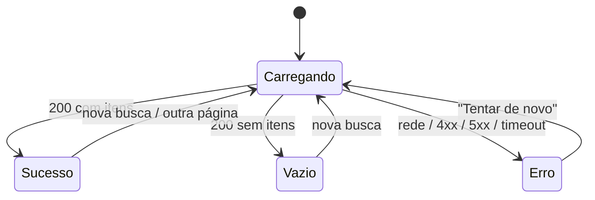
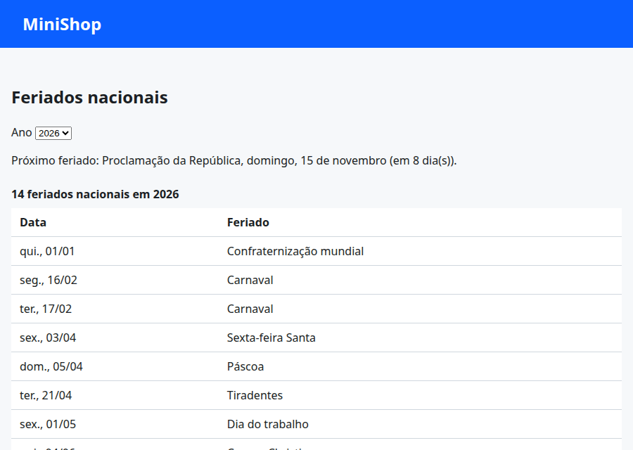
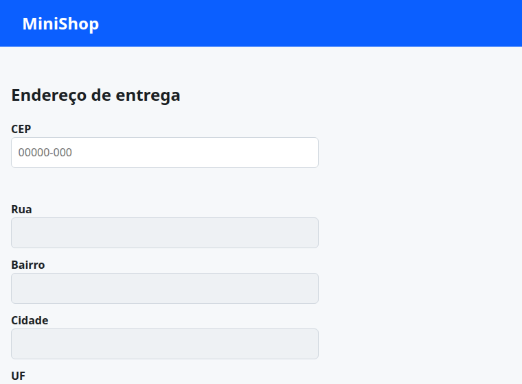
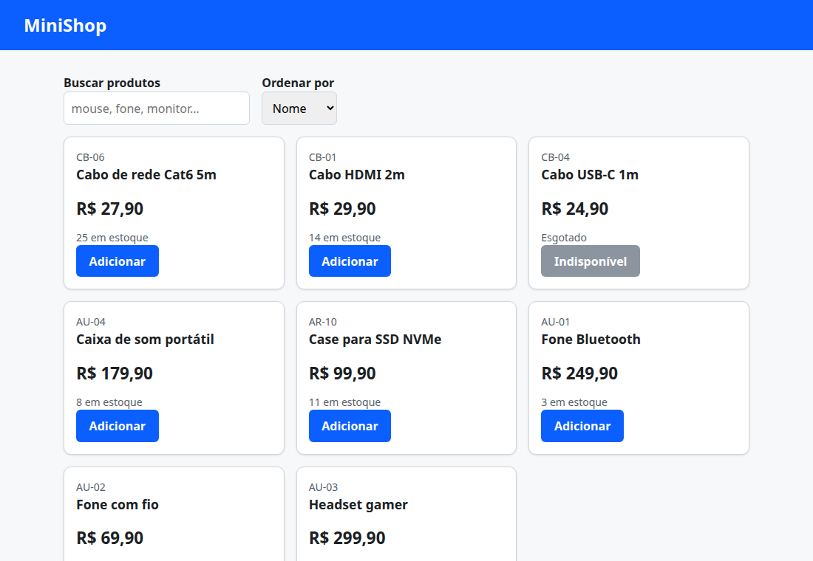
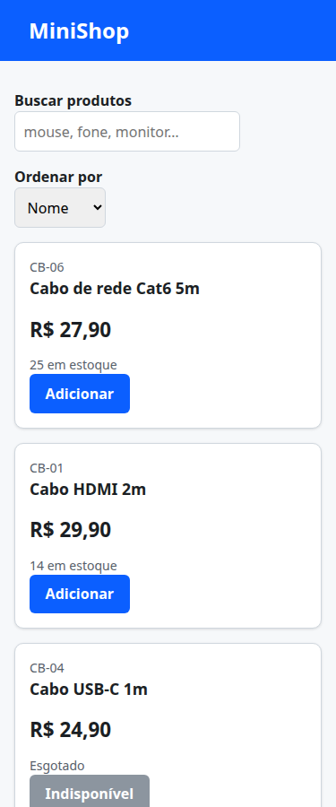

# 07. Mini-projeto: página estática consumindo uma API pública

> ⏱️ ~1h30 · Módulo 4 · Pré-requisitos: aulas [01](01-html-semantico-formularios.md) a [06](06-js-promises-fetch.md); servidor HTTP da [aula 2.05](../02-como-a-web-funciona/05-servidor-http-minimo.md)

## 🎯 Objetivos
Ao final desta aula você consegue:
- Construir páginas que consomem **APIs públicas** (BrasilAPI e ViaCEP) com estados de carregamento, vazio e erro
- Evitar a armadilha clássica de **datas e fuso horário** em JavaScript
- Autopreencher um endereço a partir do CEP, descartando respostas atrasadas (*race condition*)
- Ligar o catálogo do MiniShop à API do **seu** backend (busca, ordenação e paginação do servidor) e liberar o CORS no servidor
- Testar a interface automaticamente em um navegador real

## 🤔 Por que isso importa
Este é o primeiro **sistema de ponta a ponta** do curso: banco (Módulo 3) → API HTTP (Módulo 2) → página (Módulo 4). Consumir uma API pública é o exercício de entrevista mais comum de front-end (“faça uma página que lista X de uma API”), e o catálogo ligado ao seu backend vira a base do front-end do MiniShop nos próximos módulos.

## 💡 Intuição (explicação simples)
Uma página que consome uma API é um **garçom**: leva o pedido do cliente (busca, página) à cozinha (a API), espera (**estado de carregamento**), e traz o prato; se a cozinha estiver fechada ou errar o pedido, ele **explica o problema** com educação e oferece tentar de novo (**estado de erro**), e se o prato não existir, diz “não temos” (**estado vazio**). Um bom garçom também **descarta a resposta de um pedido antigo** quando o cliente já mudou de ideia (*race condition*).

## 🔬 Como funciona por dentro
**Os quatro estados de toda tela que busca dados:** *carregando*, *sucesso*, *vazio* e *erro*. Esquecer algum é a causa nº 1 de “a tela ficou em branco”.


**Arquitetura do projeto** (tudo em `frontend/`, JavaScript em módulos ES):
```text
frontend/
├── index.html        # catálogo do MiniShop (API própria)
├── checkout.html     # endereço com autopreenchimento por CEP (API pública ViaCEP)
├── feriados.html     # feriados nacionais (API pública BrasilAPI)
├── style.css
└── js/ utils.mjs · api.mjs · debounce.mjs · busca.mjs · feriados.mjs · cep.mjs · catalogo.mjs
```
**Race condition de respostas.** Se o usuário digita “mo”, depois “mouse”, a resposta de “mo” pode **chegar depois** da de “mouse” e sobrescrever a tela. Solução: numerar cada requisição e **ignorar** a que não for a mais recente (ou cancelar com `AbortController`).

**Datas e fuso:** `new Date("2026-12-25")` interpreta a string **ISO sem hora** como **meia-noite UTC**; em Brasília (UTC−3) isso é **24/12 às 21h**: a data “muda de dia” ao exibir. Para datas **de calendário** (aniversário, feriado), construa a data **local** com `new Date(ano, mês-1, dia)`.

**CORS no seu backend:** como a página (porta 8109) e a API (8108) têm **origens diferentes** (aula 06), o servidor precisa devolver `Access-Control-Allow-Origin` **inclusive nas respostas de erro**, senão o navegador esconde o corpo de um `404`/`422` e o front só vê “Failed to fetch”.

## 🛠️ Exemplo prático
Reaproveitamos `style.css`, `utils.mjs`, `api.mjs`, `debounce.mjs` das aulas anteriores. As imagens são de um Chrome real, com dados de verdade das APIs.

### Parte A: API pública sem autenticação, feriados (BrasilAPI)
Documentação: [brasilapi.com.br/docs](https://brasilapi.com.br/docs). Rota usada: `GET https://brasilapi.com.br/api/feriados/v1/{ano}`, que devolve `[{ "date": "2026-12-25", "name": "Natal", "type": "national" }, …]`.

**1. A armadilha do fuso horário (veja o bug antes de corrigir)**
```js
const iso = "2026-12-25";
const ingenua = new Date(iso);                       // UTC meia-noite
const [a, m, d] = iso.split("-").map(Number);
const local = new Date(a, m - 1, d);                 // meia-noite LOCAL
const mostrar = dt => dt.toLocaleDateString("pt-BR", { weekday: "long", day: "2-digit", month: "2-digit" });
console.log(process.env.TZ, "| new Date(iso):", ingenua.toISOString(), "→", mostrar(ingenua), "| local →", mostrar(local));
```
```bash
TZ=America/Recife node fuso.mjs
TZ=UTC node fuso.mjs
```
```text
America/Recife | new Date(iso): 2026-12-25T00:00:00.000Z → quinta-feira, 24/12 | local → sexta-feira, 25/12
UTC | new Date(iso): 2026-12-25T00:00:00.000Z → sexta-feira, 25/12 | local → sexta-feira, 25/12
```
Em Recife, o Natal “virou” **24/12** (sexta vira quinta); em UTC, ficou certo, então o bug **só aparece para quem está no Brasil** (e em produção o servidor costuma estar em UTC: o erro passa nos seus testes!). Guarde `date` como **texto** e converta com `new Date(a, m - 1, d)`.

**2. O módulo de feriados**
```js
import { api } from "./api.mjs";

export const paraData = iso => { const [a, m, d] = iso.split("-").map(Number); return new Date(a, m - 1, d); };   // data LOCAL
const meiaNoite = dt => new Date(dt.getFullYear(), dt.getMonth(), dt.getDate());

export function proximoFeriado(feriados, hoje = new Date()) {
  const h = meiaNoite(hoje);
  const f = feriados.map(f => ({ ...f, data: paraData(f.date) })).find(f => f.data >= h);       // a API já vem ordenada
  return f ? { ...f, dias: Math.round((f.data - h) / 86_400_000) } : null;
}
export const formatarData = (dt, opcoes = { weekday: "long", day: "2-digit", month: "long" }) => dt.toLocaleDateString("pt-BR", opcoes);
export const carregarFeriados = ano => api.get(`https://brasilapi.com.br/api/feriados/v1/${ano}`, { timeoutMs: 8000 });
```
**3. A página (com os quatro estados)**
```html
<!doctype html>
<html lang="pt-BR">
<head><meta charset="utf-8"><meta name="viewport" content="width=device-width, initial-scale=1">
<title>Feriados nacionais — MiniShop</title><link rel="stylesheet" href="style.css">
<style>
  table { border-collapse: collapse; width: 100%; background: #fff; } caption { text-align: left; font-weight: 700; padding: .5rem 0; }
  th, td { text-align: left; padding: .5rem .75rem; border-bottom: 1px solid var(--cor-borda); } .proximo { background: #fff8c5; }
  .msg { padding: 1rem; border-radius: 8px; background: #fff; border: 1px solid var(--cor-borda); } .erro { border-color: #d1242f; }
</style></head>
<body>
<header class="topo"><h1>MiniShop</h1></header>
<main>
  <h2>Feriados nacionais</h2>
  <p><label for="ano">Ano</label> <select id="ano"><option>2025</option><option selected>2026</option><option>2027</option></select></p>
  <p id="proximo" aria-live="polite"></p>
  <div id="conteudo" aria-live="polite" aria-busy="true"><p class="msg">Carregando…</p></div>
</main>
<script type="module">
  import { carregarFeriados, proximoFeriado, paraData, formatarData } from "./js/feriados.mjs";
  import { ApiError, NetworkError } from "./js/api.mjs";
  const $ = s => document.querySelector(s);
  const params = new URLSearchParams(location.search);
  const hoje = params.get("hoje") ? paraData(params.get("hoje")) : new Date();          // ?hoje=AAAA-MM-DD torna a página testável

  async function mostrar(ano) {
    $("#conteudo").setAttribute("aria-busy", "true");
    $("#conteudo").innerHTML = '<p class="msg">Carregando…</p>';                         // texto fixo: seguro
    $("#proximo").textContent = "";
    try {
      const feriados = await carregarFeriados(ano);
      if (feriados.length === 0) { $("#conteudo").innerHTML = '<p class="msg">Nenhum feriado encontrado.</p>'; return; }
      const prox = ano === hoje.getFullYear() ? proximoFeriado(feriados, hoje) : null;
      const tabela = document.createElement("table");
      tabela.createCaption().textContent = `${feriados.length} feriados nacionais em ${ano}`;
      tabela.createTHead().innerHTML = "<tr><th scope='col'>Data</th><th scope='col'>Feriado</th></tr>";
      const corpo = tabela.createTBody();
      for (const f of feriados) {
        const tr = corpo.insertRow();
        tr.classList.toggle("proximo", prox?.date === f.date);
        tr.insertCell().textContent = formatarData(paraData(f.date), { weekday: "short", day: "2-digit", month: "2-digit" });
        tr.insertCell().textContent = f.name;                                           // textContent: dado externo nunca vira HTML
      }
      $("#conteudo").replaceChildren(tabela);
      if (prox) $("#proximo").textContent = `Próximo feriado: ${prox.name}, ${formatarData(prox.data)} (${prox.dias === 0 ? "hoje" : `em ${prox.dias} dia(s)`}).`;
    } catch (e) {
      const texto = e instanceof NetworkError ? "Sem conexão com o serviço de feriados. Verifique sua internet." : e instanceof ApiError ? `O serviço respondeu com erro (${e.status}).` : "Erro inesperado.";
      const msg = Object.assign(document.createElement("div"), { className: "msg erro", role: "alert" });
      const botao = Object.assign(document.createElement("button"), { type: "button", className: "botao", textContent: "Tentar de novo" });
      botao.addEventListener("click", () => mostrar(ano));
      msg.append(texto, " ", botao);
      $("#conteudo").replaceChildren(msg);
    } finally {
      $("#conteudo").setAttribute("aria-busy", "false");
    }
  }
  $("#ano").addEventListener("change", e => mostrar(Number(e.target.value)));
  mostrar(Number($("#ano").value));
</script>
</body>
</html>
```
```python
import functools, http.server, os, threading
class Quiet(http.server.SimpleHTTPRequestHandler):
    def log_message(self, *a): pass
    def end_headers(self): self.send_header("Cache-Control", "no-store"); super().end_headers()
os.makedirs("frontend", exist_ok=True)
site = http.server.ThreadingHTTPServer(("127.0.0.1", 8109), functools.partial(Quiet, directory=os.path.join(os.getcwd(), "frontend")))
threading.Thread(target=site.serve_forever, daemon=True).start()
print("site em http://127.0.0.1:8109")
```
```text
site em http://127.0.0.1:8109
```
```html
<!doctype html><meta charset="utf-8"><iframe id="f" style="width:900px;height:600px" src="feriados.html?hoje=2026-11-07"></iframe><pre id="out">…</pre>
<script>
  const f = document.getElementById('f');
  f.addEventListener('load', () => setTimeout(() => {
    const d = f.contentDocument;
    document.getElementById('out').textContent = [d.querySelector('caption')?.textContent, d.querySelector('#proximo').textContent,
      'linha destacada: ' + d.querySelector('tr.proximo')?.textContent.replace(/\s+/g, ' ')].join('\n');
  }, 3000));
</script>
```
```bash
cd frontend
shot 07-feriados.png 900x640 "http://127.0.0.1:8109/feriados.html?hoje=2026-11-07" 6000
domout http://127.0.0.1:8109/_t_feriados.html 10000
```
```text
14 feriados nacionais em 2026
Próximo feriado: Proclamação da República, domingo, 15 de novembro (em 8 dia(s)).
linha destacada: dom., 15/11Proclamação da República
```

(Os dados vêm da internet de verdade; se a BrasilAPI estiver fora do ar, a própria página mostra o estado de erro, que é exatamente o ponto.)

### Parte B: CEP com autopreenchimento (ViaCEP)
Documentação: [viacep.com.br](https://viacep.com.br/). `GET https://viacep.com.br/ws/{cep}/json/` devolve o endereço; para um CEP **bem formado mas inexistente**, devolve `200` com `{"erro": "true"}`; para um **mal formado**, `400`.

**4. O módulo (com injeção de dependência para testar sem internet)**
```js
import { api } from "./api.mjs";

export const limparCep = texto => texto.replace(/\D/g, "");
export const formatarCep = texto => { const d = limparCep(texto).slice(0, 8); return d.length > 5 ? `${d.slice(0, 5)}-${d.slice(5)}` : d; };
export class CepNaoEncontrado extends Error { constructor(cep) { super(`CEP ${cep} não encontrado`); this.name = "CepNaoEncontrado"; } }

export async function buscarCep(texto, { fetcher = api.get } = {}) {          // "fetcher" injetável: nos testes, um falso
  const cep = limparCep(texto);
  if (cep.length !== 8) throw new RangeError("O CEP deve ter 8 dígitos");
  const r = await fetcher(`https://viacep.com.br/ws/${cep}/json/`, { timeoutMs: 6000 });
  if (r.erro) throw new CepNaoEncontrado(formatarCep(cep));
  return { cep: formatarCep(cep), logradouro: r.logradouro, bairro: r.bairro, cidade: r.localidade, uf: r.uf };
}
```
```js
import test from "node:test";
import assert from "node:assert/strict";
import { limparCep, formatarCep, buscarCep, CepNaoEncontrado } from "./cep.mjs";

test("máscara do CEP", () => {
  assert.equal(formatarCep("50030230"), "50030-230");
  assert.equal(formatarCep("5003"), "5003");
  assert.equal(formatarCep("50030-230999"), "50030-230");
  assert.equal(limparCep("50.030-230"), "50030230");
});
test("devolve o endereço normalizado", async () => {
  const falso = async url => { assert.match(url, /\/ws\/50030230\/json\/$/); return { logradouro: "Rua do Imperador Dom Pedro II", bairro: "Santo Antônio", localidade: "Recife", uf: "PE" }; };
  assert.deepEqual(await buscarCep("50030-230", { fetcher: falso }), { cep: "50030-230", logradouro: "Rua do Imperador Dom Pedro II", bairro: "Santo Antônio", cidade: "Recife", uf: "PE" });
});
test("CEP inexistente (200 com erro) vira CepNaoEncontrado", async () => {
  await assert.rejects(buscarCep("99999999", { fetcher: async () => ({ erro: "true" }) }), CepNaoEncontrado);
});
test("CEP malformado não chega a chamar a API", async () => {
  let chamou = false;
  await assert.rejects(buscarCep("123", { fetcher: async () => { chamou = true; } }), RangeError);
  assert.equal(chamou, false);
});
```
```bash
cd frontend && node --test cep.test.mjs 2>&1 | grep -E "^# (tests|pass|fail)|^not ok"
```
**5. O formulário de endereço**
```html
<!doctype html>
<html lang="pt-BR">
<head><meta charset="utf-8"><meta name="viewport" content="width=device-width, initial-scale=1"><title>Endereço de entrega — MiniShop</title><link rel="stylesheet" href="style.css">
<style> form { max-width: 28rem; } label { display: block; font-weight: 600; margin-top: .75rem; } input { width: 100%; padding: .6rem; border: 1px solid var(--cor-borda); border-radius: 6px; font: inherit; }
  input[readonly] { background: #eef1f4; } .ajuda { font-size: .875rem; color: var(--cor-suave); min-height: 1.4em; } .ajuda.erro { color: #b4232f; } </style></head>
<body>
<header class="topo"><h1>MiniShop</h1></header>
<main>
  <h2>Endereço de entrega</h2>
  <form id="end" novalidate autocomplete="on">
    <label for="cep">CEP</label>
    <input id="cep" name="cep" inputmode="numeric" autocomplete="postal-code" maxlength="9" placeholder="00000-000" aria-describedby="ajuda-cep">
    <p id="ajuda-cep" class="ajuda" aria-live="polite"></p>
    <label for="logradouro">Rua</label><input id="logradouro" name="logradouro" autocomplete="address-line1" readonly>
    <label for="bairro">Bairro</label><input id="bairro" name="bairro" readonly>
    <label for="cidade">Cidade</label><input id="cidade" name="cidade" autocomplete="address-level2" readonly>
    <label for="uf">UF</label><input id="uf" name="uf" maxlength="2" readonly>
    <label for="numero">Número</label><input id="numero" name="numero" inputmode="numeric">
  </form>
</main>
<script type="module">
  import { buscarCep, formatarCep, limparCep, CepNaoEncontrado } from "./js/cep.mjs";
  import { debounce } from "./js/debounce.mjs";
  const $ = s => document.querySelector(s);
  const campos = ["logradouro", "bairro", "cidade", "uf"];
  let ultimaRequisicao = 0;

  const ajuda = (texto, erro = false) => { $("#ajuda-cep").textContent = texto; $("#ajuda-cep").classList.toggle("erro", erro); };
  const limparEndereco = () => campos.forEach(c => { $("#" + c).value = ""; });

  const consultar = debounce(async () => {
    const minha = ++ultimaRequisicao;                              // só a resposta mais recente vale
    ajuda("Buscando endereço…"); $("#cep").setAttribute("aria-busy", "true");
    try {
      const e = await buscarCep($("#cep").value);
      if (minha !== ultimaRequisicao) return;                      // resposta atrasada: descarta
      campos.forEach(c => { $("#" + c).value = e[c]; });
      ajuda("Endereço encontrado. Informe o número."); $("#numero").focus();
    } catch (err) {
      if (minha !== ultimaRequisicao) return;
      limparEndereco();
      ajuda(err instanceof CepNaoEncontrado ? "CEP não encontrado. Confira os números." : "Não foi possível consultar o CEP agora. Preencha o endereço manualmente.", true);
      campos.forEach(c => { $("#" + c).readOnly = false; });       // plano B: o usuário digita (a API é só conforto)
    } finally { if (minha === ultimaRequisicao) $("#cep").setAttribute("aria-busy", "false"); }
  }, 300);

  $("#cep").addEventListener("input", e => {
    e.target.value = formatarCep(e.target.value);                  // máscara
    ultimaRequisicao++;                                            // invalida respostas em voo
    limparEndereco(); ajuda("");
    if (limparCep(e.target.value).length === 8) consultar();
  });
  $("#end").addEventListener("submit", e => e.preventDefault());
</script>
</body>
</html>
```
```html
<!doctype html><meta charset="utf-8"><iframe id="f" style="width:700px;height:700px" src="checkout.html"></iframe><pre id="out">…</pre>
<script>
  const f = document.getElementById('f'), log = [], dormir = ms => new Promise(r => setTimeout(r, ms));
  const digitar = async (d, texto) => { const c = d.querySelector('#cep'); c.value = texto; c.dispatchEvent(new Event('input')); await dormir(2500); };
  f.addEventListener('load', async () => {
    const d = f.contentDocument, v = id => d.getElementById(id).value;
    await digitar(d, '01001000');
    log.push(`CEP 01001000 → [${v('cep')}] ${v('logradouro')} | ${v('bairro')} | ${v('cidade')}-${v('uf')} | ajuda: ${d.getElementById('ajuda-cep').textContent}`);
    await digitar(d, '99999999');
    log.push(`CEP 99999999 → rua=[${v('logradouro')}] | ajuda: ${d.getElementById('ajuda-cep').textContent}`);
    await digitar(d, '5003');
    log.push(`CEP 5003 (incompleto) → máscara: [${v('cep')}] | ajuda: [${d.getElementById('ajuda-cep').textContent}]`);
    document.getElementById('out').textContent = log.join('\n');
  });
</script>
```
```bash
cd frontend
domout http://127.0.0.1:8109/_t_cep.html 20000
shot 07-checkout-cep.png 760x560 "http://127.0.0.1:8109/checkout.html" 2000
```
```text
CEP 01001000 → [01001-000] Praça da Sé | Sé | São Paulo-SP | ajuda: Endereço encontrado. Informe o número.
CEP 99999999 → rua=[] | ajuda: CEP não encontrado. Confira os números.
CEP 5003 (incompleto) → máscara: [5003] | ajuda: []
```

O autopreenchimento é **conforto**: se a API falhar, o formulário continua utilizável (plano B manual). Para o seu pedido de verdade, o servidor deve **validar o endereço** de novo (aula 01): nunca confie no que o front preencheu.

### Parte C: o catálogo do MiniShop, lendo da **sua** API
**6. Backend: servidor com CORS e dados de exemplo** (reaproveita o `minishop_http` da aula 2.05 e o `Estoque` do Módulo 1)
```python
"""Servidor de desenvolvimento com CORS para o front-end estático.
Uso: CORS_ORIGIN=http://127.0.0.1:8109 python -m minishop_http.dev --porta 8108"""
import argparse, os

from minishop_cli.repositorio import RepositorioJSON
from minishop_cli.servico import Estoque

from .app import criar_roteador
from .servidor import criar_servidor


def servidor_com_cors(estoque, origem, host="127.0.0.1", porta=8000, log=lambda m: None):
    srv = criar_servidor(criar_roteador(estoque), host, porta, log=log)
    Base = srv.RequestHandlerClass
    cabecalhos_cors = {"Access-Control-Allow-Origin": origem, "Vary": "Origin"}

    class ComCors(Base):
        def enviar(self, status, corpo=None, headers=None):            # TODAS as respostas, inclusive 404/422/500
            super().enviar(status, corpo, {**(headers or {}), **cabecalhos_cors})

        def do_OPTIONS(self):                                           # preflight
            self.send_response(204)
            for k, v in {**cabecalhos_cors, "Access-Control-Allow-Methods": "GET, POST, DELETE, OPTIONS",
                         "Access-Control-Allow-Headers": "Content-Type, Authorization", "Access-Control-Max-Age": "600",
                         "Content-Length": "0"}.items():
                self.send_header(k, v)
            self.end_headers()

    srv.RequestHandlerClass = ComCors
    return srv


if __name__ == "__main__":
    p = argparse.ArgumentParser()
    p.add_argument("--porta", type=int, default=8000)
    p.add_argument("--arquivo", default="estoque.json")
    a = p.parse_args()
    origem = os.environ.get("CORS_ORIGIN")
    if not origem:
        raise SystemExit("defina CORS_ORIGIN (ex.: http://127.0.0.1:8109): não use '*' com autenticação")
    srv = servidor_com_cors(Estoque(RepositorioJSON(a.arquivo)), origem, porta=a.porta, log=print)
    print(f"API em http://127.0.0.1:{a.porta} (CORS para {origem})")
    srv.serve_forever()
```
```python
import threading
from minishop_cli.repositorio import RepositorioJSON
from minishop_cli.servico import Estoque
from minishop_http.dev import servidor_com_cors

estoque = Estoque(RepositorioJSON("loja-front.json"))
for sku, nome, preco, qtd in [
    ("PF-01", "Mouse sem fio", "89.90", 12), ("PF-02", "Mouse gamer RGB", "159.90", 7), ("PF-03", "Teclado mecânico", "329.00", 5),
    ("PF-04", "Teclado compacto", "149.90", 9), ("PF-05", "Webcam Full HD", "219.90", 0), ("PF-06", "Mousepad grande", "59.90", 20),
    ("AU-01", "Fone Bluetooth", "249.90", 3), ("AU-02", "Fone com fio", "69.90", 15), ("AU-03", "Headset gamer", "299.90", 4),
    ("AU-04", "Caixa de som portátil", "179.90", 8), ("AU-05", "Soundbar", "449.90", 2), ("AU-06", "Microfone USB", "349.90", 6),
    ("MN-02", 'Monitor 24" Full HD', "849.00", 10), ("MN-03", 'Monitor 27" QHD', "1399.00", 4), ("MN-04", 'Monitor 27" 4K', "2199.00", 5),
    ("CB-01", "Cabo HDMI 2m", "29.90", 14), ("CB-04", "Cabo USB-C 1m", "24.90", 0), ("CB-06", "Cabo de rede Cat6 5m", "27.90", 25),
    ("AR-01", "SSD 240 GB", "169.90", 4), ("AR-04", "SSD NVMe 1 TB", "549.90", 6), ("AR-07", "Pen drive 64 GB", "39.90", 30),
    ("AR-10", "Case para SSD NVMe", "99.90", 11), ("PF-07", "Hub USB 4 portas", "79.90", 16), ("PF-08", "Suporte para notebook", "119.90", 13),
]:
    estoque.adicionar(sku, nome, preco, qtd)
api = servidor_com_cors(estoque, "http://127.0.0.1:8109", porta=8108)
threading.Thread(target=api.serve_forever, daemon=True).start()
print(len(estoque), "produtos; API com CORS em http://127.0.0.1:8108")
```
```text
24 produtos; API com CORS em http://127.0.0.1:8108
```
```bash
echo "# resposta de sucesso:"
curl -s -i "http://127.0.0.1:8108/produtos?tamanho=2&ordem=preco" | grep -iE "^HTTP|^access-control|^vary"
echo "# erro 400 TAMBÉM leva o cabeçalho (senão o navegador esconderia o corpo do erro):"
curl -s -i "http://127.0.0.1:8108/produtos?pagina=0" | grep -iE "^HTTP|^access-control-allow-origin|erro"
echo "# preflight:"; curl -s -i -X OPTIONS -H "Origin: http://127.0.0.1:8109" -H "Access-Control-Request-Method: POST" http://127.0.0.1:8108/produtos | grep -iE "^HTTP|^access-control"
```
```text
# resposta de sucesso:
HTTP/1.1 200 OK
Access-Control-Allow-Origin: http://127.0.0.1:8109
Vary: Origin
# erro 400 TAMBÉM leva o cabeçalho (senão o navegador esconderia o corpo do erro):
HTTP/1.1 400 Bad Request
Access-Control-Allow-Origin: http://127.0.0.1:8109
{"erro": "parâmetro 'pagina' fora do intervalo"}
# preflight:
HTTP/1.1 204 No Content
Access-Control-Allow-Origin: http://127.0.0.1:8109
Access-Control-Allow-Methods: GET, POST, DELETE, OPTIONS
Access-Control-Allow-Headers: Content-Type, Authorization
Access-Control-Max-Age: 600
```
**7. O catálogo no front-end (com os quatro estados e proteção contra respostas atrasadas)**
```js
import { api, comRetry, ApiError } from "./api.mjs";
import { formatarPreco, paraCentavos } from "./utils.mjs";
import { debounce } from "./debounce.mjs";

const API = new URLSearchParams(location.search).get("api") ?? "http://127.0.0.1:8000";
const TAMANHO = 8;
const estado = { busca: "", ordem: "nome", pagina: 1, requisicao: 0 };
const $ = s => document.querySelector(s);

function cartao(p) {
  const li = document.createElement("li");
  const art = Object.assign(document.createElement("article"), { className: "card" });
  const sku = Object.assign(document.createElement("p"), { className: "categoria", textContent: p.sku });
  const h3 = Object.assign(document.createElement("h3"), { textContent: p.nome });
  const preco = Object.assign(document.createElement("p"), { className: "preco", textContent: formatarPreco(paraCentavos(p.preco)) });   // "49.90" → 4990 → "R$ 49,90"
  const estoque = Object.assign(document.createElement("p"), { className: "categoria", textContent: p.qtd === 0 ? "Esgotado" : `${p.qtd} em estoque` });
  const botao = Object.assign(document.createElement("button"), { type: "button", className: "botao", textContent: p.qtd === 0 ? "Indisponível" : "Adicionar", disabled: p.qtd === 0 });
  botao.dataset.sku = p.sku;
  art.append(sku, h3, preco, estoque, botao); li.append(art);
  return li;
}

function mostrarErro(e) {
  const motivo = e instanceof ApiError
    ? (e.status === 400 || e.status === 422 ? `Pedido inválido: ${e.corpo?.erro ?? e.status}` : `O servidor respondeu com erro (${e.status}).`)
    : "Não foi possível falar com o servidor. Verifique sua conexão.";
  const caixa = Object.assign(document.createElement("div"), { className: "msg erro", role: "alert" });
  const botao = Object.assign(document.createElement("button"), { type: "button", className: "botao", id: "tentar-de-novo", textContent: "Tentar de novo" });
  botao.addEventListener("click", carregar);
  caixa.append(motivo, " ", botao);
  $("#lista").replaceChildren(); $("#estado").replaceChildren(caixa); $("#paginacao").hidden = true;
}

function renderizar(dados) {
  $("#estado").replaceChildren();
  $("#paginacao").hidden = false;
  if (dados.itens.length === 0) {
    $("#lista").replaceChildren();
    $("#estado").append(Object.assign(document.createElement("p"), { className: "msg", textContent: `Nenhum produto encontrado para “${estado.busca}”.` }));
    $("#paginacao").hidden = true;
    return;
  }
  $("#lista").replaceChildren(...dados.itens.map(cartao));
  $("#resumo").textContent = `${dados.total} produto(s) · página ${dados.pagina} de ${dados.total_paginas}`;
  $("#anterior").disabled = dados.pagina <= 1;
  $("#proxima").disabled = dados.pagina >= dados.total_paginas;
}

async function carregar() {
  const minha = ++estado.requisicao;
  $("#lista").setAttribute("aria-busy", "true");
  $("#resumo").textContent = "Carregando…";
  try {
    const url = `${API}/produtos?` + new URLSearchParams({ busca: estado.busca, ordem: estado.ordem, pagina: estado.pagina, tamanho: TAMANHO });
    const dados = await comRetry(() => api.get(url, { timeoutMs: 4000 }), { tentativas: 2, baseMs: 150 });
    if (minha !== estado.requisicao) return;                      // chegou atrasada: ignore
    renderizar(dados);
  } catch (e) {
    if (minha !== estado.requisicao) return;
    mostrarErro(e);
  } finally {
    if (minha === estado.requisicao) $("#lista").setAttribute("aria-busy", "false");
  }
}

$("#busca").addEventListener("input", debounce(e => { estado.busca = e.target.value.trim(); estado.pagina = 1; carregar(); }, 250));
$("#ordem").addEventListener("change", e => { estado.ordem = e.target.value; estado.pagina = 1; carregar(); });
$("#anterior").addEventListener("click", () => { estado.pagina--; carregar(); });
$("#proxima").addEventListener("click", () => { estado.pagina++; carregar(); });
$("#form-busca").addEventListener("submit", e => e.preventDefault());
carregar();
```
```html
<!doctype html>
<html lang="pt-BR">
<head><meta charset="utf-8"><meta name="viewport" content="width=device-width, initial-scale=1">
<title>MiniShop — Catálogo</title><link rel="stylesheet" href="style.css">
<style>
  .grade { display: grid; grid-template-columns: repeat(auto-fill, minmax(14rem, 1fr)); gap: 1rem; margin: 1rem 0; padding: 0; list-style: none; }
  .grade .card { width: auto; display: flex; flex-direction: column; height: 100%; } .grade .botao { margin-top: auto; align-self: flex-start; }
  .grade .botao:disabled { background: #8c959f; cursor: not-allowed; }
  .barra { display: flex; flex-wrap: wrap; gap: 1rem; align-items: end; } label { font-weight: 600; display: block; }
  input[type="search"], select { padding: .6rem; border: 1px solid var(--cor-borda); border-radius: 6px; font: inherit; }
  .msg { padding: 1rem; border-radius: 8px; background: #fff; border: 1px solid var(--cor-borda); } .erro { border-color: #d1242f; }
  .paginacao { display: flex; gap: 1rem; align-items: center; } .paginacao .botao:disabled { background: #8c959f; cursor: not-allowed; }
</style></head>
<body>
<header class="topo"><h1>MiniShop</h1></header>
<main>
  <form id="form-busca" class="barra" role="search">
    <div><label for="busca">Buscar produtos</label><input id="busca" type="search" autocomplete="off" placeholder="mouse, fone, monitor…"></div>
    <div><label for="ordem">Ordenar por</label>
      <select id="ordem"><option value="nome">Nome</option><option value="preco">Preço</option><option value="qtd">Estoque</option></select></div>
  </form>
  <div id="estado" aria-live="polite"></div>
  <ul id="lista" class="grade" aria-busy="true"></ul>
  <nav id="paginacao" class="paginacao" aria-label="Paginação" hidden>
    <button id="anterior" type="button" class="botao">Anterior</button>
    <span id="resumo" aria-live="polite"></span>
    <button id="proxima" type="button" class="botao">Próxima</button>
  </nav>
</main>
<script type="module" src="js/catalogo.mjs"></script>
</body>
</html>
```
**8. O teste de ponta a ponta (navegador real contra a API real)**
```html
<!doctype html><meta charset="utf-8"><iframe id="f" style="width:1100px;height:700px" src="index.html?api=http://127.0.0.1:8108"></iframe><pre id="out">…</pre>
<script>
  const f = document.getElementById('f'), log = [], dormir = ms => new Promise(r => setTimeout(r, ms));
  const recarregar = url => new Promise(ok => { f.addEventListener('load', async () => { await dormir(700); ok(f.contentDocument); }, { once: true }); f.src = url; });
  (async () => {
    let d = await recarregar('index.html?api=http://127.0.0.1:8108');
    const nomes = () => [...d.querySelectorAll('#lista h3')].map(h => h.textContent), q = s => d.querySelector(s);
    const digitar = async t => { q('#busca').value = t; q('#busca').dispatchEvent(new Event('input')); await dormir(900); };
    log.push(`1) inicial: ${nomes().length} cartões | ${q('#resumo').textContent} | anterior desabilitado: ${q('#anterior').disabled}`);
    q('#proxima').click(); await dormir(700);
    log.push(`2) próxima página: ${q('#resumo').textContent} | primeiro: ${nomes()[0]}`);
    await digitar('mouse');
    log.push(`3) busca "mouse": ${nomes().join(' | ')} | ${q('#resumo').textContent}`);
    q('#ordem').value = 'preco'; q('#ordem').dispatchEvent(new Event('change')); await dormir(700);
    log.push(`4) ordenado por preço: ${[...d.querySelectorAll('#lista .preco')].map(p => p.textContent.replace(/\s/g, ' ')).join(' ≤ ')}`);
    await digitar('xyzxyz');
    log.push(`5) busca sem resultado: "${q('#estado').textContent}" | paginação oculta: ${q('#paginacao').hidden}`);
    await digitar('');
    const esgotado = [...d.querySelectorAll('.card')].find(c => c.textContent.includes('Esgotado'));
    log.push(`6) produto esgotado: botão "${esgotado?.querySelector('button').textContent}" desabilitado=${esgotado?.querySelector('button').disabled}`);
    d = await recarregar('index.html?api=http://127.0.0.1:59999');                 // API fora do ar
    log.push(`7) API fora do ar: "${q('#estado').textContent}" | botão de nova tentativa: ${!!q('#tentar-de-novo')}`);
    document.getElementById('out').textContent = log.join('\n');
  })();
</script>
```
```bash
cd frontend
domout http://127.0.0.1:8109/_t_catalogo.html 30000
shot 07-catalogo-desktop.png 1100x760 "http://127.0.0.1:8109/index.html?api=http://127.0.0.1:8108" 4000
shot 07-catalogo-mobile.png 375x900 "http://127.0.0.1:8109/index.html?api=http://127.0.0.1:8108" 4000
```
```text
1) inicial: 8 cartões | 24 produto(s) · página 1 de 3 | anterior desabilitado: true
2) próxima página: 24 produto(s) · página 2 de 3 | primeiro: Hub USB 4 portas
3) busca "mouse": Mouse gamer RGB | Mouse sem fio | Mousepad grande | 3 produto(s) · página 1 de 1
4) ordenado por preço: R$ 59,90 ≤ R$ 89,90 ≤ R$ 159,90
5) busca sem resultado: "Nenhum produto encontrado para “xyzxyz”." | paginação oculta: true
6) produto esgotado: botão "Indisponível" desabilitado=true
7) API fora do ar: "Não foi possível falar com o servidor. Verifique sua conexão. Tentar de novo" | botão de nova tentativa: true
```


Em **7 verificações** o teste cobre os quatro estados (carregando/sucesso/vazio/erro), a busca, a ordenação, a paginação e o botão desabilitado de produto esgotado, tudo ligado à API Python real (porta 8108) por CORS.

## ⚠️ Erros comuns e boas práticas
| Sintoma / mensagem | Causa | Solução |
|---|---|---|
| Página em branco | Erro no módulo (caminho errado, `import` inexistente) | Console do navegador; confira a aba *Network* (404 no `.mjs`) |
| Funciona com `file://` e quebra no servidor, ou o contrário | Módulos ES e `fetch` exigem HTTP; `file://` tem regras de origem diferentes | Sirva a pasta por HTTP sempre (`python -m http.server`) |
| `blocked by CORS policy` só nos **erros** da sua API | CORS aplicado apenas às respostas de sucesso | Cabeçalho em **todas** as respostas (no `enviar`/middleware) |
| A busca “pisca” resultados antigos | Respostas fora de ordem | Número da requisição / `AbortController` |
| Data aparece um dia antes | `new Date("AAAA-MM-DD")` é UTC | `new Date(a, m - 1, d)` |
| Preço com muitas casas (`49.900000001`) | Converteu a string da API para `float` e somou | `paraCentavos` (inteiro) e formate com `Intl` |
| Teste “passa às vezes” | Depende de internet/ritmo | Injete o `fetcher`; use dados de teste; *timeouts* generosos só em testes de ponta a ponta |
| Chave de API/token no JavaScript | Qualquer usuário vê o código | Nunca ponha segredos no front; use o backend como intermediário |
| Botão de “tentar de novo” não faz nada | O *listener* foi perdido ao recriar o DOM | Crie o botão **com** o *listener* no mesmo lugar (como acima) |

- **Trate os quatro estados** em toda tela que busca dados, e comunique-os a leitores de tela (`aria-live`, `aria-busy`, `role="alert"`).
- A API de terceiros pode **falhar**: sempre ofereça um plano B (preencher manualmente) e tenha *timeout*.
- Não confie em dados externos: renderize com `textContent`, e o servidor valida o que o front enviar.
- Leia os **termos de uso** e os limites de requisições (*rate limit*) das APIs públicas; use *debounce* e cache.
- `?api=` e `?hoje=` na URL tornam a página **testável**; em produção, a URL base vem de configuração do *build*/ambiente.

## 🧠 Pausa para lógica
**Problema (cache de CEP e limite de requisições).** Cada digitação válida chama a ViaCEP. Implemente `criarBuscadorComCache(fetcher, ttlMs)` que (a) guarda o resultado por CEP com validade, (b) **junta chamadas simultâneas ao mesmo CEP** em uma só requisição (guarde a *Promise* em andamento) e (c) **não** guarda erros. Prove com um *fetcher* falso que 5 chamadas simultâneas geram **1** requisição.

<details><summary>Dica</summary>
Use um `Map` de CEP → `{ promessa, expiraEm }`. Se existe e não expirou, devolva a **mesma** promessa. Se a promessa rejeitar, apague a entrada (`.catch(() => map.delete(cep))`).
</details>

<details><summary>Solução comentada</summary>

```js
function criarBuscadorComCache(fetcher, ttlMs = 60_000, agora = () => Date.now()) {
  const cache = new Map();
  return async cep => {
    const existente = cache.get(cep);
    if (existente && existente.expiraEm > agora()) return existente.promessa;            // acerto: mesma Promise (também junta as simultâneas)
    const promessa = fetcher(cep);
    cache.set(cep, { promessa, expiraEm: agora() + ttlMs });
    promessa.catch(() => cache.delete(cep));                                            // erros não ficam em cache
    return promessa;
  };
}

let chamadas = 0, relogio = 0, falhar = true;
const falso = async cep => { chamadas++; await new Promise(r => setTimeout(r, 30)); if (falhar) throw new Error("fora do ar"); return { cep, cidade: "Recife" }; };
const buscar = criarBuscadorComCache(falso, 1000, () => relogio);

const cinco = await Promise.all(Array.from({ length: 5 }, () => buscar("50030230").catch(e => e.message)));
console.log("5 simultâneas (falhando):", cinco[0], "| chamadas ao serviço:", chamadas);
falhar = false;
console.log("depois da falha tenta de novo:", (await buscar("50030230")).cidade, "| chamadas:", chamadas);
console.log("repetida (cache):", (await buscar("50030230")).cidade, "| chamadas:", chamadas);
relogio = 2000;                                                                         // passou o TTL
await buscar("50030230");
console.log("depois de expirar:", "chamadas:", chamadas);
```
```text
5 simultâneas (falhando): fora do ar | chamadas ao serviço: 1
depois da falha tenta de novo: Recife | chamadas: 2
repetida (cache): Recife | chamadas: 2
depois de expirar: chamadas: 3
```
Esse padrão (**deduplicar requisições em andamento + TTL + não cachear erros**) aparece em *caches* de Redis (Módulo 14), em `react-query`/`SWR` e no *request coalescing* de servidores.
</details>

**Variação mais difícil:** adicione invalidação manual (`invalidar(cep)`) e um limite de **N** entradas com remoção da mais antiga (LRU, aula 3.11).

## 🧩 Exercícios
**1. Fixação**
(a) Quais são os quatro estados de uma tela que busca dados? (b) Por que `new Date("2026-12-25")` mostra 24/12 no Brasil? (c) Por que o `OPTIONS` do navegador chega ao seu servidor antes do `POST` com JSON? (d) Como evitar que uma resposta antiga sobrescreva uma nova?

<details><summary>Solução</summary>

(a) Carregando, sucesso, vazio e erro. (b) A string sem hora é lida como meia-noite UTC, que em UTC−3 é 21h do dia anterior; use `new Date(a, m-1, d)` para datas de calendário. (c) É o *preflight* do CORS, porque `Content-Type: application/json` não é uma requisição “simples”. (d) Numerar as requisições (ou usar `AbortController`) e ignorar as que não forem a última.
</details>

**2. Aplicação no projeto MiniShop (entrega do módulo)**
Finalize o `frontend/` do MiniShop e publique a versão `v0.4-front-estatico`.

Critérios de pronto:
- [ ] `index.html` lista os produtos da **sua** API (`minishop_http`), com busca (debounce), ordenação, paginação e os quatro estados
- [ ] `checkout.html` autopreenche o endereço pelo CEP (ViaCEP) com plano B manual; o servidor revalida o endereço (`validar_checkout` da aula 01)
- [ ] `feriados.html` (ou outra página de API pública à sua escolha) com testes de ponta a ponta
- [ ] CORS configurado por **variável de ambiente** (`CORS_ORIGIN`), com origem **exata** e cabeçalhos também nos erros; documentado em `docs/cors.md`
- [ ] Testes: `cd frontend && node --test` (utils, api, cep) **e** a página de teste de ponta a ponta, com a saída anexada ao `README`
- [ ] Todos os dados externos renderizados com `textContent` (prove com um produto de nome ``)
- [ ] Capturas de tela desktop e mobile em `docs/img/` e o `README` com “como rodar” (dois comandos: API e site)
- [ ] Tag: `git tag v0.4-front-estatico && git push --tags`

<details><summary>Solução de referência</summary>

Use os arquivos desta aula. Para rodar: `CORS_ORIGIN=http://127.0.0.1:8109 uv run python -m minishop_http.dev --porta 8108 --arquivo estoque.json` e, em outro terminal, `cd frontend && python -m http.server 8109 --bind 127.0.0.1`. Abra `http://127.0.0.1:8109/index.html?api=http://127.0.0.1:8108`. Importe os produtos de `seed/produtos.csv` com a CLI do Módulo 1 (`python -m minishop_cli importar seed/produtos.csv`).
</details>

**3. Desafio (opcional)**
Troque a paginação por **rolagem infinita** com `IntersectionObserver` e mantenha o botão “Carregar mais” como alternativa acessível por teclado.

## 🎤 Na entrevista
- **Como você consome uma API e trata erros na interface?** Chamo com `fetch`/cliente central, distingo erro de rede de erro HTTP (checando `response.ok`), uso *timeout*, e represento na UI os estados carregando, sucesso, vazio e erro, com opção de tentar de novo e mensagens acessíveis.
- **O que é uma *race condition* em requisições e como evitar?** Respostas que chegam fora de ordem e sobrescrevem a mais recente; evita-se numerando as requisições, cancelando com `AbortController` ou ignorando respostas obsoletas.
- **Por que `new Date("2026-12-25")` pode exibir o dia 24?** É interpretada como UTC; ao formatar no fuso local (UTC−3) vira o dia anterior. Para datas de calendário, construa a data local ou use bibliotecas/`Temporal`.
- **O CORS protege o servidor?** Não: o servidor recebe a requisição; o navegador impede o *site* de ler a resposta. Proteger o servidor exige autenticação, autorização e validação.

## 📚 Para ir além
- 📄 Documentação oficial: [BrasilAPI](https://brasilapi.com.br/docs) e [ViaCEP](https://viacep.com.br/). Documentação das APIs públicas usadas.
- 📄 Documentação oficial: [Usando Fetch (MDN)](https://developer.mozilla.org/pt-BR/docs/Web/API/Fetch_API/Using_Fetch). Guia passo a passo.
- 📄 Documentação oficial: [`AbortSignal` (MDN)](https://developer.mozilla.org/pt-BR/docs/Web/API/AbortSignal). Cancelar requisições e timeouts.
- 📑 Artigo/tutorial: [JavaScript.info: Fetch](https://javascript.info/fetch). Seção completa sobre `fetch` (EN).
- 🏋️ Prática extra: monte uma página de “previsão do tempo” com a API [Open-Meteo](https://open-meteo.com/en/docs) (sem chave), com os quatro estados e testes.

## ✅ Checklist da aula
- [ ] Páginas de API pública com os quatro estados e testes
- [ ] Datas locais corretas e CEP com plano B
- [ ] Catálogo ligado à minha API, com CORS por variável de ambiente
- [ ] Teste de ponta a ponta no navegador real
- [ ] Tag `v0.4-front-estatico` criada
