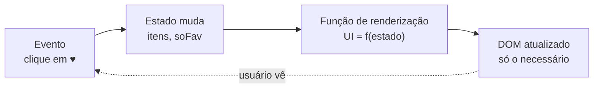
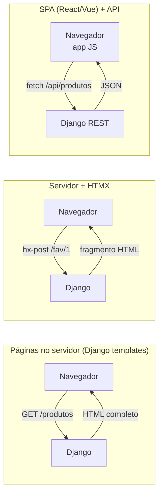

# 08. Visão geral de React/Vue/HTMX e acessibilidade básica

> ⏱️ ~1h30 · Módulo 4 · Pré-requisitos: [01](01-html-semantico-formularios.md) a [07](07-projeto-pagina-api-publica.md)

## 🎯 Objetivos
Ao final desta aula você consegue:
- Explicar que problema os frameworks de interface (React, Vue) resolvem e o que é “UI = f(estado)”
- Comparar SPA, páginas renderizadas no servidor e **HTMX**, e escolher uma abordagem para o MiniShop
- Reconhecer os conceitos centrais de React e Vue (componentes, estado, reatividade) e conversar sobre eles
- Aplicar os princípios de **acessibilidade** (WCAG): semântica, teclado, foco, rótulos, contraste e ARIA básico
- Auditar uma página com **axe-core**, corrigir as violações e calcular razões de contraste

## 🤔 Por que isso importa
Em entrevistas e no time você ouvirá “vocês usam React ou Vue?”, “por que não HTMX?”, “isso é acessível?”. Não se espera que um júnior de backend seja especialista em front-end, mas sim que **converse** sobre as opções, saiba o que o Django já entrega (templates, formulários) e **não construa telas inacessíveis**. Acessibilidade é também requisito legal em muitos contextos (no Brasil, a Lei Brasileira de Inclusão) e boa parte do tráfego depende dela: leitores de tela, teclado, zoom, baixa visão, daltonismo, mobilidade reduzida.

## 💡 Intuição (explicação simples)
- No JavaScript “puro” você é o **pedreiro**: diz exatamente quais tijolos mexer cada vez que algo muda (“troque este texto, esconda aquela caixa”). Com 30 pedaços de estado, é fácil esquecer um e a tela fica inconsistente.
- Frameworks como React e Vue trocam isso por **uma planta**: você descreve **como a tela deve ser para um dado estado** (“se há 2 favoritos, mostre ‘2 favoritos’ e estes itens”) e o framework descobre **o que** mudar. É a ideia de **UI = f(estado)**.
- **HTMX** segue o caminho oposto e mais simples: o **servidor** manda pedaços de **HTML pronto** e o navegador só os troca de lugar, sem escrever JavaScript.
- **Acessibilidade** é projetar a loja com **rampa além da escada, sinalização em Braille, balcão baixo e luz boa**: a mesma loja funciona para todos, inclusive para quem usa só o teclado ou um leitor de tela.

## 🔬 Como funciona por dentro
**1. O problema de sincronizar estado e tela.** Em JS puro, cada mudança de estado exige código **imperativo** para atualizar o DOM; em apps grandes, isso vira “espaguete”. Frameworks introduzem:
- **Componentes:** peças reutilizáveis (`<ProdutoCard>`) que juntam HTML, comportamento e estado.
- **Estado reativo:** ao mudar o estado, a interface é **re-renderizada** sozinha.
- **Virtual DOM** (React) ou **reatividade fina** (Vue, Svelte): estratégias para atualizar só o que mudou.


**2. Panorama (conceitos para conversar em entrevista)**

| Tecnologia | Ideia | Prós | Contras |
|---|---|---|---|
| **React** (Meta) | biblioteca de componentes; JSX (HTML dentro do JS); estado com *hooks* (`useState`) | maior mercado e ecossistema | precisa de *build*, muitas escolhas (roteamento, dados, estado) |
| **Vue** | *framework* progressivo; templates HTML com diretivas (`v-if`, `v-for`, `v-model`); reatividade | curva suave, boa documentação | ecossistema menor que o do React |
| **Svelte / Angular** | compila para JS puro / framework completo (TypeScript) | desempenho / estrutura | nichos de mercado |
| **HTMX** | atributos HTML (`hx-get`, `hx-post`, `hx-target`) trocam trechos da página com HTML devolvido pelo servidor | quase sem JS; combina com Django/templates | interações muito ricas e *offline* pedem JS |
| **Next.js / Nuxt** | React/Vue com renderização no servidor (SSR) e roteamento | SEO e carregamento inicial rápidos | complexidade de deploy |

**3. Três arquiteturas para uma loja**

Para **um time pequeno de backend**, o caminho mais produtivo costuma ser **templates do Django + HTMX** (Módulos 5 e 6). Uma **SPA** compensa quando há muita interação, aplicativo móvel compartilhando a mesma API ou equipe de front-end dedicada: é por isso que o Módulo 6 constrói uma **API REST**, que serve a qualquer cliente. **Ferramentas de build** (Node, npm, **Vite**, TypeScript) compilam JSX/TS e empacotam o código; frameworks vêm com um *toolchain*, mas você pode começar pela CDN, como nos exemplos abaixo.

**4. Acessibilidade (WCAG).** As diretrizes **WCAG** (nível **AA** é o alvo usual) organizam-se em quatro princípios, **POUR**: **P**erceptível (alternativas em texto, contraste, não depender só de cor), **O**perável (tudo acessível por **teclado**, tempo suficiente, sem armadilhas de foco), **C**ompreensível (idioma declarado, mensagens de erro claras, comportamento previsível) e **R**obusto (HTML válido e semântico, compatível com tecnologias assistivas).

Fundamentos práticos:
- **HTML semântico primeiro** (aula 01): `button`, `a`, `label`, `nav`, `main`, `h1…h6` já trazem teclado, foco e significado “de graça”. Um `<div onclick>` **não** é focável nem anunciado como botão.
- **Teclado:** `Tab`/`Shift+Tab` percorrem os elementos interativos na ordem do DOM; `Enter`/`Espaço` ativam botões; o **foco deve ser sempre visível** (`:focus-visible`).
- **Texto alternativo** (`alt`), **rótulos** (`label for`), **idioma** (`lang`), **títulos em ordem**, **links com texto significativo** (“Ver detalhes do monitor”, não “clique aqui”).
- **Contraste:** texto normal ≥ **4,5:1** com o fundo; texto grande (≥ 24 px, ou 18,66 px em negrito) e componentes de interface ≥ **3:1**. Nunca informe algo **só pela cor** (acrescente texto/ícone).
- **ARIA** (*Accessible Rich Internet Applications*) acrescenta significado quando o HTML nativo não basta: `aria-label`, `aria-describedby`, `aria-live`, `aria-expanded`, `aria-pressed`, `role`. **Primeira regra do ARIA: se existe elemento HTML nativo, use-o; ARIA ruim é pior que nenhum ARIA.**
- **Formulários:** `label` visível, erro **descrito em texto**, associado ao campo (`aria-describedby`, `aria-invalid="true"`), e anunciado (`role="alert"`/`aria-live`).
- **Movimento:** respeite `@media (prefers-reduced-motion: reduce)`; **zoom de 200%** e *reflow* a 320 px sem perder conteúdo.
- **Automação cobre só parte** (cerca de 30–50% dos problemas): ferramentas como o **axe-core** e o **Lighthouse** acham o mecânico; o resto exige teste manual com teclado e, idealmente, um leitor de tela (NVDA, VoiceOver).

## 🛠️ Exemplo prático
Tudo roda em Chrome real. Um servidor Python entrega a pasta `frontend/` **e** os fragmentos HTML do exemplo HTMX.

**0. Servidor (estáticos + endpoints HTMX)**
```python
import functools, html, http.server, os, threading, urllib.parse

PRODUTOS = {1: "Mouse sem fio", 2: "Teclado mecânico", 3: 'Monitor 27" 4K'}
FAVORITOS = set()

def fragmento(so_fav: bool) -> str:                    # o SERVIDOR devolve HTML pronto (e escapa o texto!)
    visiveis = [(i, n) for i, n in PRODUTOS.items() if not so_fav or i in FAVORITOS]
    itens = "".join(
        f'<li>{html.escape(n)} <button type="button" aria-pressed="{str(i in FAVORITOS).lower()}" '
        f'hx-post="/wl/fav/{i}" hx-target="#wl" hx-swap="outerHTML" hx-include="#so-fav">{"♥" if i in FAVORITOS else "♡"}</button></li>'
        for i, n in visiveis)
    marcado = " checked" if so_fav else ""
    return (f'<div id="wl"><p aria-live="polite">{len(FAVORITOS)} favoritos</p>'
            f'<label><input id="so-fav" type="checkbox" name="so_fav" value="1"{marcado} hx-get="/wl" hx-trigger="change" hx-target="#wl" hx-swap="outerHTML"> Só favoritos</label>'
            f'<ul>{itens}</ul></div>')

class Site(http.server.SimpleHTTPRequestHandler):
    def log_message(self, *a): pass
    def end_headers(self): self.send_header("Cache-Control", "no-store"); super().end_headers()
    def _html(self, texto):
        dados = texto.encode(); self.send_response(200); self.send_header("Content-Type", "text/html; charset=utf-8")
        self.send_header("Content-Length", str(len(dados))); self.end_headers(); self.wfile.write(dados)
    def do_GET(self):
        u = urllib.parse.urlparse(self.path)
        if u.path == "/wl":
            return self._html(fragmento("so_fav" in urllib.parse.parse_qs(u.query)))
        super().do_GET()
    def do_POST(self):
        corpo = urllib.parse.parse_qs(self.rfile.read(int(self.headers.get("Content-Length", 0))).decode())
        if self.path.startswith("/wl/fav/"):
            i = int(self.path.rsplit("/", 1)[1]); FAVORITOS.symmetric_difference_update({i})
            return self._html(fragmento("so_fav" in corpo))
        self.send_error(404)

os.makedirs("frontend", exist_ok=True)
srv = http.server.ThreadingHTTPServer(("127.0.0.1", 8110), functools.partial(Site, directory=os.path.join(os.getcwd(), "frontend")))
threading.Thread(target=srv.serve_forever, daemon=True).start()
print("servidor em http://127.0.0.1:8110")
```
```text
servidor em http://127.0.0.1:8110
```
### Parte A: o mesmo widget, quatro jeitos
**Requisito:** lista de 3 produtos, cada um com botão ♥ (favoritar); um contador “N favoritos”; um filtro “só favoritos”.

**1. JavaScript puro (imperativo: **você** atualiza cada pedaço)**
```html
<!doctype html><html lang="pt-BR"><head><meta charset="utf-8"><title>vanilla</title></head><body>
<div id="wl"><p id="contador" aria-live="polite">0 favoritos</p><label><input id="so-fav" type="checkbox"> Só favoritos</label><ul id="lista"></ul></div>
<script>
  const itens = [{ id: 1, nome: 'Mouse sem fio', fav: false }, { id: 2, nome: 'Teclado mecânico', fav: false }, { id: 3, nome: 'Monitor 27" 4K', fav: false }];
  const lista = document.getElementById('lista'), soFav = document.getElementById('so-fav'), contador = document.getElementById('contador');
  function render() {                                       // você precisa lembrar de atualizar TUDO que depende do estado
    const visiveis = soFav.checked ? itens.filter(i => i.fav) : itens;
    lista.replaceChildren(...visiveis.map(i => {
      const li = document.createElement('li'), b = document.createElement('button');
      b.type = 'button'; b.textContent = i.fav ? '♥' : '♡'; b.setAttribute('aria-pressed', i.fav);
      b.addEventListener('click', () => { i.fav = !i.fav; render(); });
      li.append(i.nome + ' ', b); return li;
    }));
    contador.textContent = `${itens.filter(i => i.fav).length} favoritos`;
  }
  soFav.addEventListener('change', render); render();
</script></body></html>
```
**2. Vue 3 (declarativo: o *template* descreve a tela; a reatividade cuida do resto)**
```html
<!doctype html><html lang="pt-BR"><head><meta charset="utf-8"><title>vue</title>
<script src="https://unpkg.com/vue@3.5.13/dist/vue.global.prod.js" integrity="sha384-W/1Fp/LgAYO/oTn9Gs+PbeWuMuq1eQCnUMPCeg8POmMYchhzxctjEqtbiCIxDOON" crossorigin="anonymous"></script></head><body>
<div id="app">
  <p aria-live="polite">{{ favoritos }} favoritos</p>
  <label><input type="checkbox" v-model="soFav"> Só favoritos</label>
  <ul><li v-for="i in visiveis" :key="i.id">{{ i.nome }}
    <button type="button" :aria-pressed="i.fav" @click="i.fav = !i.fav">{{ i.fav ? '♥' : '♡' }}</button></li></ul>
</div>
<script>
  Vue.createApp({
    data: () => ({ soFav: false, itens: [{ id: 1, nome: 'Mouse sem fio', fav: false }, { id: 2, nome: 'Teclado mecânico', fav: false }, { id: 3, nome: 'Monitor 27" 4K', fav: false }] }),
    computed: { visiveis() { return this.soFav ? this.itens.filter(i => i.fav) : this.itens; }, favoritos() { return this.itens.filter(i => i.fav).length; } },
  }).mount('#app');
</script></body></html>
```
Repare que **não há** `render()` nem `addEventListener`: o estado (`itens`, `soFav`) e valores derivados (`computed`) bastam; `v-model` liga o *checkbox* ao estado, `@click` atualiza o item, e o `{{ }}` se atualiza sozinho.

**3. React 18 (componente + *hooks*; aqui sem JSX para dispensar o *build*)**
```html
<!doctype html><html lang="pt-BR"><head><meta charset="utf-8"><title>react</title>
<script src="https://unpkg.com/react@18.3.1/umd/react.production.min.js" integrity="sha384-DGyLxAyjq0f9SPpVevD6IgztCFlnMF6oW/XQGmfe+IsZ8TqEiDrcHkMLKI6fiB/Z" crossorigin="anonymous"></script>
<script src="https://unpkg.com/react-dom@18.3.1/umd/react-dom.production.min.js" integrity="sha384-gTGxhz21lVGYNMcdJOyq01Edg0jhn/c22nsx0kyqP0TxaV5WVdsSH1fSDUf5YJj1" crossorigin="anonymous"></script></head><body>
<div id="root"></div>
<script>
  const { useState, createElement: h } = React;
  const INICIAL = [{ id: 1, nome: 'Mouse sem fio', fav: false }, { id: 2, nome: 'Teclado mecânico', fav: false }, { id: 3, nome: 'Monitor 27" 4K', fav: false }];

  function ListaDesejos() {
    const [itens, setItens] = useState(INICIAL);               // estado
    const [soFav, setSoFav] = useState(false);
    const alternar = id => setItens(itens.map(i => i.id === id ? { ...i, fav: !i.fav } : i));     // nunca muta: cria um novo array
    const visiveis = soFav ? itens.filter(i => i.fav) : itens;
    return h('div', null,                                      // UI = f(estado): a função devolve a descrição da tela
      h('p', { 'aria-live': 'polite' }, `${itens.filter(i => i.fav).length} favoritos`),
      h('label', null, h('input', { type: 'checkbox', checked: soFav, onChange: e => setSoFav(e.target.checked) }), ' Só favoritos'),
      h('ul', null, visiveis.map(i => h('li', { key: i.id }, i.nome + ' ',
        h('button', { type: 'button', 'aria-pressed': i.fav, onClick: () => alternar(i.id) }, i.fav ? '♥' : '♡')))));
  }
  ReactDOM.createRoot(document.getElementById('root')).render(h(ListaDesejos));
</script></body></html>
```
Com **JSX** (o que se usa de verdade, compilado pelo Vite) o `return` fica quase igual a HTML: `<ul>{visiveis.map(i => <li key={i.id}>{i.nome} <button onClick={() => alternar(i.id)}>…</button></li>)}</ul>`. O ponto-chave do React: o estado é **imutável** (cria-se um novo array em vez de alterar o antigo) e a função do componente roda de novo a cada mudança.

**4. HTMX (o servidor manda o HTML; zero JavaScript escrito por você)**
```html
<!doctype html><html lang="pt-BR"><head><meta charset="utf-8"><title>htmx</title>
<script src="https://unpkg.com/htmx.org@2.0.4/dist/htmx.min.js" integrity="sha384-HGfztofotfshcF7+8n44JQL2oJmowVChPTg48S+jvZoztPfvwD79OC/LTtG6dMp+" crossorigin="anonymous"></script></head><body>
<div id="wl" hx-get="/wl" hx-trigger="load" hx-swap="outerHTML">Carregando…</div>
</body></html>
```
O front-end não conhece produtos nem a lógica: cada clique faz `POST /wl/fav/1` e o **servidor** (acima, `fragmento()`) devolve o `<div id="wl">` já pronto; o atributo `hx-swap="outerHTML"` o troca no lugar. Com Django, o `fragmento` seria um *template parcial*.

**5. A prova: o mesmo comportamento nos quatro**
```html
<!doctype html><html><head><meta charset="utf-8"></head><body><iframe id="f" style="width:600px;height:300px"></iframe><pre id="out">…</pre>
<script>
  const f = document.getElementById('f'), log = [], dormir = ms => new Promise(r => setTimeout(r, ms));
  const abrir = url => new Promise(ok => { f.addEventListener('load', async () => { await dormir(1200); ok(f.contentDocument); }, { once: true }); f.src = url; });
  const estado = d => `${d.querySelector('[aria-live="polite"]').textContent.trim()} | itens: ${[...d.querySelectorAll('li')].map(li => li.firstChild.textContent.trim().split(' ')[0] + (li.querySelector('button').getAttribute('aria-pressed') === 'true' ? '♥' : '')).join(',')}`;
  (async () => {
    for (const nome of ['vanilla', 'vue', 'react', 'htmx']) {
      const d = await abrir(`wl-${nome}.html`);
      const botoes = () => d.querySelectorAll('li button');
      botoes()[0].click(); await dormir(500);                         // favorita o 1º
      botoes()[2].click(); await dormir(500);                         // favorita o 3º
      const apos = estado(d);
      const filtro = d.querySelector('input[type=checkbox]'); filtro.click(); await dormir(600);       // marca "só favoritos"
      log.push(`${nome.padEnd(8)} → ${apos}   ||   só favoritos: ${d.querySelectorAll('li').length} itens`);
    }
    document.getElementById('out').textContent = log.join('\n');
  })();
</script></body></html>
```
```bash
cd frontend && domout http://127.0.0.1:8110/teste-widgets.html 40000
```
```text
vanilla  → 2 favoritos | itens: Mouse♥,Teclado,Monitor♥   ||   só favoritos: 2 itens
vue      → 2 favoritos | itens: Mouse♥,Teclado,Monitor♥   ||   só favoritos: 2 itens
react    → 2 favoritos | itens: Mouse♥,Teclado,Monitor♥   ||   só favoritos: 2 itens
htmx     → 2 favoritos | itens: Mouse♥,Teclado,Monitor♥   ||   só favoritos: 2 itens
```
Quatro implementações, **mesmo resultado observável**. Compare o tamanho do código de atualização da tela: no JS puro, você escreve `render()` e liga os eventos; em Vue e React, só descreve o resultado; em HTMX, nem isso, pois o servidor decide.

> **Segurança das CDNs:** o atributo `integrity` (SRI, *Subresource Integrity*) é o hash do arquivo; se alguém alterar o script na CDN, o navegador **recusa** executá-lo. Fixe a **versão exata** (`@3.5.13`) e use SRI sempre. Em projetos reais, prefira instalar via `npm` e empacotar com Vite, ou servir o arquivo você mesmo.

### Parte B: acessibilidade na prática com o axe-core
**6. Uma página com problemas típicos (e a mesma, corrigida)**
```html
<!doctype html>
<html>
<head><meta charset="utf-8"><title>Loja</title>
<style> body { font-family: sans-serif } .suave { color: #aaa } .comprar { background: #6cc0ff; color: #fff; border: 0; padding: .6rem 1rem } :focus { outline: none } </style></head>
<body>
<div class="topo"><h3>MiniShop</h3></div>

<p class="suave">Mouse sem fio: R$ 89,90 (frete grátis)</p>
<div class="comprar" onclick="alert('ok')">Comprar</div>
<a href="/produtos/1">clique aqui</a>
<form>
  <input type="text" placeholder="Seu e-mail">
  <select><option>Escolha</option><option>PE</option></select>
  <button class="comprar">Enviar</button>
</form>
</body>
</html>
```
```html
<!doctype html>
<html lang="pt-BR">
<head><meta charset="utf-8"><meta name="viewport" content="width=device-width, initial-scale=1"><title>Loja — MiniShop</title>
<style> body { font-family: sans-serif; color: #1b1f24 } .suave { color: #57606a } .comprar { background: #0b5fff; color: #fff; border: 0; padding: .6rem 1rem; border-radius: 6px; font: inherit }
  :focus-visible { outline: 3px solid #b35900; outline-offset: 2px } .sr-only { position: absolute; width: 1px; height: 1px; overflow: hidden; clip: rect(0 0 0 0); white-space: nowrap } </style></head>
<body>
<a class="sr-only" href="#conteudo">Ir para o conteúdo</a>
<header><h1>MiniShop</h1></header>
<main id="conteudo">
  <h2>Produtos</h2>
  
  <p class="suave">Mouse sem fio: R$ 89,90 (frete grátis)</p>
  <button type="button" class="comprar" onclick="alert('ok')">Comprar Mouse sem fio</button>
  <a href="/produtos/1">Ver detalhes do Mouse sem fio</a>
  <form>
    <p><label for="email">Seu e-mail</label><br><input id="email" name="email" type="email" autocomplete="email" required aria-describedby="ajuda-email"></p>
    <p id="ajuda-email" class="suave">Enviaremos o recibo para este endereço.</p>
    <p><label for="uf">Estado</label><br><select id="uf" name="uf"><option value="">Escolha</option><option value="PE">Pernambuco</option></select></p>
    <button type="submit" class="comprar">Enviar</button>
  </form>
</main>
</body>
</html>
```
```html
<!doctype html><html lang="pt-BR"><head><meta charset="utf-8"><title>axe</title></head><body>
<iframe id="alvo" style="width:900px;height:700px"></iframe><pre id="out">…</pre>
<script>
  const alvo = document.getElementById('alvo'), pagina = new URLSearchParams(location.search).get('pagina');
  alvo.addEventListener('load', () => {
    const doc = alvo.contentDocument, s = doc.createElement('script');
    s.src = 'https://cdnjs.cloudflare.com/ajax/libs/axe-core/4.10.2/axe.min.js';
    s.integrity = 'sha384-3NYxCdpLKVHfNs2FHPtg3qqaYuhq85m4mMnlHBlN0JzSpKYKct2PMGYfsKGaKIj4'; s.crossOrigin = 'anonymous';
    s.onload = async () => {
      const r = await alvo.contentWindow.axe.run(doc, { runOnly: { type: 'tag', values: ['wcag2a', 'wcag2aa', 'wcag21a', 'wcag21aa', 'best-practice'] } });
      const linhas = r.violations.map(v => `✗ ${v.id.padEnd(22)} [${v.impact}] ×${v.nodes.length}  ${v.help}`);
      document.getElementById('out').textContent = `${pagina}: ${r.violations.length} violação(ões), ${r.passes.length} regras OK\n` + (linhas.join('\n') || '(nenhuma violação automática)');
    };
    doc.head.append(s);
  });
  alvo.src = pagina;
</script></body></html>
```
```bash
cd frontend
echo "=============== PÁGINA COM PROBLEMAS"; domout "http://127.0.0.1:8110/axe-run.html?pagina=a11y-ruim.html" 15000
echo; echo "=============== PÁGINA CORRIGIDA";  domout "http://127.0.0.1:8110/axe-run.html?pagina=a11y-bom.html" 15000
```
```text
=============== PÁGINA COM PROBLEMAS
a11y-ruim.html: 7 violação(ões), 15 regras OK
✗ color-contrast         [serious] ×3  Elements must meet minimum color contrast ratio thresholds
✗ html-has-lang          [serious] ×1  <html> element must have a lang attribute
✗ image-alt              [critical] ×1  Images must have alternative text
✗ landmark-one-main      [moderate] ×1  Document should have one main landmark
✗ page-has-heading-one   [moderate] ×1  Page should contain a level-one heading
✗ region                 [moderate] ×7  All page content should be contained by landmarks
✗ select-name            [critical] ×1  Select element must have an accessible name

=============== PÁGINA CORRIGIDA
a11y-bom.html: 0 violação(ões), 35 regras OK
(nenhuma violação automática)
```
O axe nomeia cada problema com um `id` (veja a regra no site da Deque). Repare que ele **aceitou** o `<input placeholder>` sem `label` (considera o `placeholder` um nome acessível), mas isso continua sendo má prática: o texto some ao digitar. Ferramenta automática é o piso, não o teto. Os corretivos aplicados em `a11y-bom.html`: `lang` no `<html>`; `<h1>` e títulos em ordem; `alt` na imagem; **contraste** do texto e do botão; `<div onclick>` virou `<button>`; “clique aqui” virou um texto que faz sentido sozinho; `label` para cada campo; marcos (`header`, `main`); *skip link*; foco visível.

**7. O que o axe NÃO acha: teste de teclado**
```html
<!doctype html><html lang="pt-BR"><head><meta charset="utf-8"><title>teclado</title></head><body>
<iframe id="a" src="a11y-ruim.html" style="width:600px;height:300px"></iframe><iframe id="b" src="a11y-bom.html" style="width:600px;height:300px"></iframe><pre id="out">…</pre>
<script>
  const esperar = id => new Promise(ok => document.getElementById(id).addEventListener('load', ok));
  Promise.all([esperar('a'), esperar('b')]).then(() => {
    const focaveis = d => [...d.querySelectorAll('a[href], button, input, select, textarea, [tabindex]')].filter(e => e.tabIndex >= 0 && !e.disabled);
    const botaoFalso = d => [...d.querySelectorAll('[onclick]')].map(e => `<${e.tagName.toLowerCase()}> focável por Tab? ${e.tabIndex >= 0}`);
    document.getElementById('out').textContent =
      'ruim → elementos acessíveis por Tab: ' + focaveis(a.contentDocument).length + ' | ' + botaoFalso(a.contentDocument).join(', ') +
      '\nbom  → elementos acessíveis por Tab: ' + focaveis(b.contentDocument).length + ' | ' + botaoFalso(b.contentDocument).join(', ');
  });
</script></body></html>
```
```bash
cd frontend && domout http://127.0.0.1:8110/teclado.html 8000
```
```text
ruim → elementos acessíveis por Tab: 4 | <div> focável por Tab? false
bom  → elementos acessíveis por Tab: 6 | <button> focável por Tab? true
```
O `<div onclick>` **não recebe foco** pelo `Tab` e **não responde a Enter/Espaço**: quem usa teclado ou leitor de tela **não consegue comprar**. Nenhuma análise automática cobre tudo: faça o teste manual, **navegando só pelo teclado**.

**8. Contraste: a conta por trás do 4,5:1**
```js
const canal = c => { c /= 255; return c <= 0.03928 ? c / 12.92 : ((c + 0.055) / 1.055) ** 2.4; };   // sRGB → luz linear
const luminancia = hex => { const [r, g, b] = hex.replace("#", "").match(/../g).map(h => parseInt(h, 16)); return 0.2126 * canal(r) + 0.7152 * canal(g) + 0.0722 * canal(b); };
const contraste = (a, b) => { const [x, y] = [luminancia(a), luminancia(b)].sort((p, q) => q - p); return (x + 0.05) / (y + 0.05); };
const nota = r => (r >= 7 ? "AAA" : r >= 4.5 ? "AA" : r >= 3 ? "só texto grande/UI" : "REPROVADO");

const pares = [
  ["texto #1b1f24 sobre #f6f8fa", "#1b1f24", "#f6f8fa"], ["texto suave #57606a sobre branco", "#57606a", "#ffffff"],
  ["botão branco sobre #0b5fff", "#ffffff", "#0b5fff"], ["selo branco sobre #d1242f", "#ffffff", "#d1242f"],
  ["ruim: #aaa sobre branco", "#aaaaaa", "#ffffff"], ["ruim: branco sobre #6cc0ff", "#ffffff", "#6cc0ff"],
];
for (const [rotulo, fg, bg] of pares) { const r = contraste(fg, bg); console.log(rotulo.padEnd(36), r.toFixed(2) + ":1", nota(r)); }

// "qual o cinza mais claro que ainda passa em AA sobre branco?" (busca binária no valor do canal)
let baixo = 0, alto = 255;
while (baixo < alto) { const meio = (baixo + alto) >> 1; const h = meio.toString(16).padStart(2, "0"); contraste("#" + h + h + h, "#ffffff") >= 4.5 ? (baixo = meio + 1) : (alto = meio); }
const h = (baixo - 1).toString(16).padStart(2, "0");
console.log("cinza mais claro AA sobre branco: #" + h + h + h, contraste("#" + h + h + h, "#ffffff").toFixed(2) + ":1");
```
```text
texto #1b1f24 sobre #f6f8fa          15.56:1 AAA
texto suave #57606a sobre branco     6.39:1 AA
botão branco sobre #0b5fff           5.13:1 AA
selo branco sobre #d1242f            5.24:1 AA
ruim: #aaa sobre branco              2.32:1 REPROVADO
ruim: branco sobre #6cc0ff           1.98:1 REPROVADO
cinza mais claro AA sobre branco: #767676 4.54:1
```
A fórmula (WCAG): `razão = (L1 + 0,05) / (L2 + 0,05)`, com `L` a **luminância relativa** (o olho percebe o verde muito mais que o azul, daí os pesos 0,7152/0,2126/0,0722). O `#aaa` sobre branco dá ~2,3:1, **reprovado**; o menor cinza aprovado em AA é por volta de `#767676`: o famoso “cinza mínimo”.

**9. Estados de formulário acessíveis (erros que o leitor de tela anuncia)**
```html
<!doctype html><html lang="pt-BR"><head><meta charset="utf-8"><title>erro acessível</title></head><body>
<form id="f" novalidate>
  <label for="email">E-mail</label>
  <input id="email" name="email" type="email" aria-describedby="erro-email" aria-invalid="false">
  <p id="erro-email" role="alert"></p>
  <button type="submit">Enviar</button>
</form>
<pre id="out"></pre>
<script>
  const f = document.getElementById('f'), email = document.getElementById('email'), erro = document.getElementById('erro-email');
  f.addEventListener('submit', e => {
    e.preventDefault();
    const ok = email.validity.valid && email.value !== '';
    email.setAttribute('aria-invalid', String(!ok));
    erro.textContent = ok ? '' : 'Informe um e-mail válido, por exemplo ana@exemplo.com.';       // texto, não só cor vermelha
    if (!ok) email.focus();                                                                      // leva o foco ao campo com erro
  });
  email.value = 'abc'; f.requestSubmit();
  document.getElementById('out').textContent = `aria-invalid=${email.getAttribute('aria-invalid')} | mensagem: "${erro.textContent}" | foco no campo: ${document.activeElement === email}`;
</script></body></html>
```
```bash
cd frontend && domout http://127.0.0.1:8110/a11y-erro.html 5000
```
```text
aria-invalid=true | mensagem: "Informe um e-mail válido, por exemplo ana@exemplo.com." | foco no campo: true
```
## ⚠️ Erros comuns e boas práticas
| Problema | Por que prejudica | Correção |
|---|---|---|
| `<div onclick>` / `<span>` como botão ou link | Sem foco, sem papel e sem teclado | `<button>` / `<a href>` |
| `outline: none` sem substituto | Quem usa teclado se perde | `:focus-visible` com contorno visível |
| Imagem sem `alt` (ou `alt="imagem"`) | Leitor de tela lê o nome do arquivo ou nada | `alt` descritivo; `alt=""` se decorativa |
| Campo só com `placeholder` | Some ao digitar; não é um rótulo | `<label for>` visível |
| Texto cinza claro sobre branco | Contraste baixo | ≥ 4,5:1; teste com calculadora |
| Informação só por cor (erro em vermelho) | Daltônicos não percebem | Texto/ícone além da cor |
| “Clique aqui”, “saiba mais” | Em uma lista de links, não faz sentido | Texto que descreve o destino |
| Títulos escolhidos pelo tamanho, pulando níveis | Estrutura quebrada para leitores de tela | `h1…h6` em ordem; tamanho com CSS |
| `aria-*` usado para “consertar” `div`s | ARIA não dá comportamento (teclado) | Elemento nativo primeiro |
| Modal que prende o foco ou não o devolve | Usuário de teclado fica preso | Gerencie o foco (ou use `<dialog>`) |
| Conteúdo que só aparece no *hover* | Inacessível por teclado e toque | Gatilho também por foco/clique |
| Escolher framework “porque está na moda” | Complexidade sem necessidade | Comece pelo mais simples que atende; meça |

- **Acessibilidade se desenha desde o início** (semântica + foco + contraste); “consertar depois” custa 10 vezes mais.
- Rode o **axe/Lighthouse** em toda página nova **e** teste com o teclado; para o resto, teste com um leitor de tela real em algum momento (NVDA no Windows, VoiceOver no macOS/iOS, TalkBack no Android).
- Frameworks não tornam nada acessível sozinhos: o HTML que eles geram continua sendo sua responsabilidade.
- Se usar CDN, **SRI e versão fixa**; se usar `npm`, `npm audit` e *lockfile* (Módulo 9).

## 🧠 Pausa para lógica
**Problema (paleta acessível).** Dada uma cor de texto `#0b5fff` (azul da marca) e um fundo qualquer, escreva `ajustarParaAA(fg, bg)` que **escurece** (ou clareia) a cor de texto, em passos pequenos, até atingir **4,5:1**, devolvendo a cor mais próxima da original que passa. Teste com fundos branco e `#f6f8fa`, e com um fundo azul-escuro (onde o certo é clarear).

<details><summary>Dica</summary>
Decida a direção: se o fundo é claro (luminância &gt; 0,18), escureça o texto; senão, clareie. Converta a cor para HSL (ou interpole para preto/branco) e vá mudando a luminosidade em passos pequenos até <code>contraste(fg, bg) &gt;= 4.5</code>.
</details>

<details><summary>Solução comentada</summary>

```js
const canal = c => { c /= 255; return c <= 0.03928 ? c / 12.92 : ((c + 0.055) / 1.055) ** 2.4; };
const rgb = hex => hex.replace("#", "").match(/../g).map(h => parseInt(h, 16));
const luminancia = hex => { const [r, g, b] = rgb(hex); return 0.2126 * canal(r) + 0.7152 * canal(g) + 0.0722 * canal(b); };
const contraste = (a, b) => { const [x, y] = [luminancia(a), luminancia(b)].sort((p, q) => q - p); return (x + 0.05) / (y + 0.05); };
const paraHex = ([r, g, b]) => "#" + [r, g, b].map(v => Math.round(v).toString(16).padStart(2, "0")).join("");

function ajustarParaAA(fg, bg, alvo = 4.5) {
  if (contraste(fg, bg) >= alvo) return fg;
  const destino = luminancia(bg) > 0.18 ? [0, 0, 0] : [255, 255, 255];           // fundo claro → escurece; escuro → clareia
  const origem = rgb(fg);
  let baixo = 0, alto = 1;                                                       // fração do caminho até o destino (busca binária)
  for (let i = 0; i < 20; i++) {
    const t = (baixo + alto) / 2, c = paraHex(origem.map((v, k) => v + (destino[k] - v) * t));
    contraste(c, bg) >= alvo ? (alto = t) : (baixo = t);
  }
  return paraHex(origem.map((v, k) => v + (destino[k] - v) * alto));
}

for (const bg of ["#ffffff", "#f6f8fa", "#0a2a66"]) {
  const novo = ajustarParaAA("#0b5fff", bg);
  console.log(`fundo ${bg}: #0b5fff = ${contraste("#0b5fff", bg).toFixed(2)}:1 → ${novo} = ${contraste(novo, bg).toFixed(2)}:1`);
}
```
```text
fundo #ffffff: #0b5fff = 5.13:1 → #0b5fff = 5.13:1
fundo #f6f8fa: #0b5fff = 4.82:1 → #0b5fff = 4.82:1
fundo #0a2a66: #0b5fff = 2.67:1 → #5892ff = 4.54:1
```
Duas lições: o azul da marca **já passa** sobre branco (≈ 5,1:1) e sobre o cinza-claro, mas **não** sobre um fundo azul-escuro, onde a solução é **clarear** o texto; e a busca binária mostra de novo a utilidade do raciocínio das aulas 1.05/3.08 (monotonicidade: quanto mais perto do destino, maior o contraste).
</details>

**Variação mais difícil:** gere uma paleta de 6 tons para o azul da marca em que **cada par texto/fundo recomendado** passe em AA, e valide o resultado com o axe em uma página de amostra.

## 🧩 Exercícios
**1. Fixação**
(a) O que significa “UI = f(estado)”? (b) Quando HTMX é uma boa escolha e quando uma SPA é? (c) Cite três coisas que `<button>` dá que `<div onclick>` não dá. (d) Qual a razão mínima de contraste para texto normal em AA?

<details><summary>Solução</summary>

(a) A interface é uma função do estado: descreve-se como a tela deve ficar para cada estado e o framework atualiza o DOM. (b) HTMX: aplicações guiadas pelo servidor (Django/templates), equipe pequena de backend, interações moderadas. SPA: muita interatividade, estado complexo no cliente, app móvel/outros clientes sobre a mesma API, equipe de front-end. (c) Foco por teclado (`Tab`), ativação por `Enter`/`Espaço` e papel “botão” para leitores de tela (também estilos de estado e envio de formulários). (d) 4,5:1 (3:1 para texto grande).
</details>

**2. Aplicação no projeto MiniShop**
Faça a **auditoria de acessibilidade** do front-end do MiniShop e corrija o que achar.

Critérios de pronto:
- [ ] `axe-run.html` aplicado a `index.html`, `checkout.html`, `feriados.html` e `loja.html`: relatório **antes** e **depois** em `docs/acessibilidade.md`, com **0 violações** automáticas ao final
- [ ] *Skip link* (“Ir para o conteúdo”), `lang="pt-BR"`, um `h1` por página, marcos `header`/`nav`/`main`/`footer`
- [ ] Todos os campos com `label`; erros do `checkout` em texto, com `aria-describedby`/`aria-invalid` e `role="alert"`
- [ ] Navegação **somente por teclado** testada em todas as telas: ordem lógica, foco sempre visível, nenhuma armadilha de foco (anote o que testou)
- [ ] Pares de cores do `style.css` verificados com a função de contraste (tabela no relatório); nenhum texto abaixo de 4,5:1
- [ ] Zoom de 200% e largura de 320 px sem rolagem horizontal nem perda de conteúdo
- [ ] Uma decisão registrada em `docs/decisoes.md`: “React/Vue × templates Django + HTMX para o MiniShop” (3 parágrafos, com prós, contras e a escolha)
- [ ] Commit `fix(front): accessibility audit and fixes`

<details><summary>Solução de referência</summary>

Reaproveite `axe-run.html`: ele aceita `?pagina=`. Resultado real do axe nas páginas do curso (nov/2026): `checkout.html` e `feriados.html` passam; `loja.html` e `card.html` têm `heading-order` (um `h3` logo abaixo do `h1`, pulando o `h2`), corrigido com um `<h2>` “Produtos” (visível ou `sr-only`). Outros problemas comuns que podem surgir ao evoluir as páginas: `label`, `region` (conteúdo fora de marcos), `landmark-unique` (dois `nav` sem `aria-label`) e contraste do texto cinza sobre fundos coloridos. Para a decisão arquitetural, uma resposta razoável: **templates Django + HTMX** nas telas de loja (SEO, simplicidade) e a **API REST** (Módulo 6) disponível para um futuro app/SPA.
</details>

**3. Desafio (opcional)**
Implemente um **modal acessível** com o elemento nativo `<dialog>` (`showModal()`): foco preso dentro, `Esc` fecha, o foco volta ao botão que o abriu, e `aria-labelledby` no título. Teste com o teclado e com o axe.

## 🎤 Na entrevista
- **Por que usar React ou Vue em vez de JavaScript puro?** Para gerenciar a complexidade de manter a tela sincronizada com um estado grande: componentes reutilizáveis, estado reativo e renderização declarativa (UI = f(estado)), em vez de atualizar o DOM manualmente a cada mudança.
- **O que é HTMX e quando usá-lo?** Biblioteca que usa atributos HTML para fazer requisições e trocar trechos da página por HTML devolvido pelo servidor; boa para aplicações renderizadas no servidor (como Django), com pouca necessidade de lógica no cliente.
- **SPA × SSR × MPA?** SPA carrega um app JS e conversa com uma API (interatividade, mas SEO/primeiro carregamento mais difíceis); SSR renderiza no servidor e hidrata no cliente; MPA/templates entrega HTML completo por página (simples, ótimo SEO).
- **O que é acessibilidade web e como você a garante?** Permitir que todos usem o site (leitores de tela, teclado, baixa visão). Uso HTML semântico, rótulos, `alt`, contraste ≥ 4,5:1, foco visível, ARIA só quando necessário, e valido com axe/Lighthouse **e** teste manual com teclado.
- **Qual a primeira regra do ARIA?** Se um elemento HTML nativo já faz o que você precisa, use-o em vez de adicionar `role`/`aria-*` a um elemento genérico.

## 📚 Para ir além
- 📄 Documentação oficial: [React: Learn](https://react.dev/learn) e [Vue: Introdução](https://vuejs.org/guide/introduction.html). Os tutoriais oficiais de cada um.
- 📄 Documentação oficial: [HTMX: documentação](https://htmx.org/docs/) e [ensaios](https://htmx.org/essays/). Atributos e a filosofia “hypermedia”.
- 📄 Documentação oficial: [Vite: guia](https://vite.dev/guide/) e [Next.js](https://nextjs.org/docs). Ferramenta de *build* e *framework* com SSR.
- 📄 Documentação oficial: [Acessibilidade (MDN)](https://developer.mozilla.org/pt-BR/docs/Learn_web_development/Core/Accessibility) e [WCAG 2.2: referência rápida](https://www.w3.org/WAI/WCAG22/quickref/). Em PT-BR, e os critérios de sucesso.
- 📑 Artigo/tutorial: [Learn Accessibility (web.dev)](https://web.dev/learn/accessibility) e [WAI-ARIA Authoring Practices](https://www.w3.org/WAI/ARIA/apg/). Curso e padrões de componentes acessíveis (EN).
- 🛠️ Ferramentas: [axe-core](https://github.com/dequelabs/axe-core), [Lighthouse](https://developer.chrome.com/docs/lighthouse/overview) e [WebAIM Contrast Checker](https://webaim.org/resources/contrastchecker/). Auditoria automática e calculadora de contraste.
- 🏋️ Prática extra: use só o teclado para completar uma compra em três lojas online e liste o que impede ou atrapalha.

## ✅ Checklist da aula
- [ ] Rodei o mesmo widget em JS puro, Vue, React e HTMX
- [ ] Auditei páginas com o axe-core e corrigi as violações
- [ ] Testei com o teclado e calculei razões de contraste
- [ ] Registrei a decisão de arquitetura de front-end do MiniShop
- [ ] Fiz o commit do exercício
