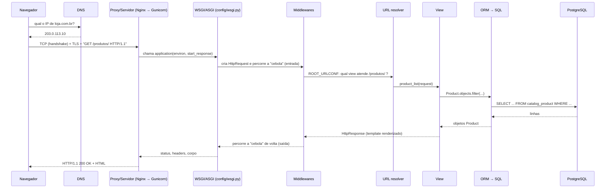
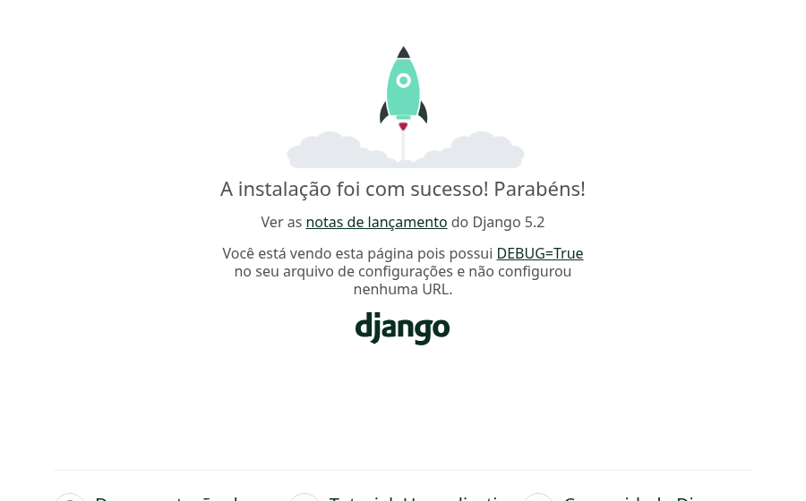

# 01. Estrutura de projeto e apps, MVT e ciclo da requisição

> ⏱️ ~1h30 · Módulo 5 · Pré-requisitos: [Módulo 2](../02-como-a-web-funciona/README.md) (HTTP), [Módulo 3](../03-banco-de-dados/README.md) (PostgreSQL em Docker), [aula 1.16](../01-python-logica/16-decorators-context-managers.md) (decorators/closures)

## 🎯 Objetivos
Ao final desta aula você consegue:
- Criar um projeto Django 5.2 com `uv`, ligado ao PostgreSQL, e explicar cada arquivo gerado
- Diferenciar **projeto** de **app** e organizar o MiniShop em apps (`catalog`, `accounts`, `cart`, `orders`)
- Explicar o padrão **MVC** e a variação **MVT** do Django
- Descrever o **ciclo de vida completo** de uma requisição (DNS → TCP → TLS → HTTP → servidor WSGI/ASGI → *middleware* → URL → view → ORM → SQL → resposta)
- Escrever um *middleware* e provar a ordem “cebola” de execução

## 🤔 Por que isso importa
Django é o framework Python web mais pedido nas vagas do Brasil (nossa amostra do LinkedIn: 45% das vagas de backend Python). Ele traz “tudo incluso” (ORM, Admin, autenticação, formulários, migrações, segurança), então o primeiro passo é saber **onde cada coisa mora** e **por onde a requisição passa**. Quem entende o ciclo da requisição depura em minutos o que, sem esse mapa, demora horas.

## 💡 Intuição (explicação simples)
Django é um **restaurante com a operação toda montada**:
- a **recepção** (URLs) lê o pedido e decide quem atende;
- o **garçom** (*view*) entende o pedido, busca o que precisa e monta a resposta;
- a **cozinha e a despensa** (*models* + banco) guardam e preparam os ingredientes (dados);
- o **cardápio e o prato apresentado** (*templates*) definem como o resultado aparece para o cliente;
- os **seguranças e a portaria** (*middleware*) inspecionam **todo** cliente que entra e sai (sessão, CSRF, segurança).

Um **projeto** é o restaurante inteiro; um **app** é uma **seção** com responsabilidade própria (cardápio, caixa, delivery) que poderia ser reaproveitada em outro restaurante.

## 🔬 Como funciona por dentro
**MVC e MVT.** O padrão clássico **MVC** separa **Model** (dados e regras), **View** (apresentação) e **Controller** (recebe a entrada e coordena). O Django usa nomes diferentes:

| MVC clássico | Django (**MVT**) | No MiniShop |
|---|---|---|
| Model | **Model** (`models.py`, ORM) | `Product`, `Order` |
| View (apresentação) | **Template** (`.html`) | `product_list.html` |
| Controller | **View** (função/classe Python) **+** o *dispatcher* de URLs do próprio framework | `product_list(request)` + `urls.py` |

Ou seja, a “view” do Django é o *controller* do MVC; o “template” é a view do MVC; e o **framework** (roteador de URLs) faz o papel de controlador de entrada.

**O ciclo de vida completo de uma requisição** (juntando os Módulos 2 e 3):


1. **DNS → TCP → TLS → HTTP** (aulas 2.01 a 2.03): o navegador resolve o nome, conecta e envia a requisição cifrada.
2. **Servidor web e interface WSGI/ASGI.** Em produção, um servidor de aplicação (Gunicorn/Uvicorn) recebe a requisição e chama a sua aplicação por uma interface padrão: **WSGI** (síncrona, PEP 3333) ou **ASGI** (assíncrona; Módulo 7). `config/wsgi.py` expõe o objeto `application`. O `runserver` do Django faz esse papel **só no desenvolvimento**.
3. **Middlewares** (`MIDDLEWARE` em `settings.py`): funções em camadas que veem **toda** requisição na ida e toda resposta na volta (sessões, autenticação, CSRF, segurança). Ordem importa: é uma **cebola**.
4. **URL resolver** (`ROOT_URLCONF`): casa o caminho com um `path(...)` e escolhe a **view**.
5. **View:** recebe um `HttpRequest`, usa o **ORM** (que gera SQL e fala com o PostgreSQL), renderiza um **template** e devolve um `HttpResponse`.
6. A resposta volta pelos mesmos *middlewares* (ao contrário), e sai como HTTP.

**Projeto × app.** O **projeto** (`config/`) contém configuração e ligação: `settings.py`, `urls.py` raiz, `wsgi.py`/`asgi.py`. Um **app** é um pacote Python com `models.py`, `views.py`, `urls.py`, `admin.py`, `apps.py`, `tests/`, `migrations/`: uma funcionalidade coesa. Apps se registram em `INSTALLED_APPS`. Regra de ouro: **um app = uma responsabilidade** e dependências em um só sentido.

**Estrutura que usaremos no curso:**
```text
minishop/                      ← raiz do repositório
├── manage.py                  ← comando de gerenciamento (runserver, migrate, shell, test…)
├── pyproject.toml  uv.lock    ← dependências (uv)
├── config/                    ← o PROJETO: settings, urls raiz, wsgi/asgi, middleware
├── apps/
│   ├── catalog/               ← categorias e produtos
│   ├── accounts/              ← usuários (aula 11)
│   ├── cart/                  ← carrinho (aula 16)
│   └── orders/                ← pedidos e estoque (aula 17)
├── templates/  static/        ← globais (aulas 03 e 13)
└── tests/ ou apps/*/tests/
```
## 🛠️ Exemplo prático
Tudo abaixo foi executado de verdade com **Django 5.2.19**, **Python 3.13**, **PostgreSQL 18** (container `minishop-pg` da aula 3.03) e `uv`. Este projeto cresce nas 18 aulas do módulo.

**1. Criar o projeto, o ambiente e o banco**
```bash
docker exec minishop-pg psql -U postgres -X -q -c "DROP DATABASE IF EXISTS minishop WITH (FORCE)" -c "CREATE DATABASE minishop"
uv init --bare --name minishop --python 3.13
uv add --quiet "django==5.2.*" "psycopg[binary]"
uv add --quiet --dev pytest pytest-django
uv run django-admin --version
cat pyproject.toml
```
```text
5.2.19
[project]
name = "minishop"
version = "0.1.0"
requires-python = ">=3.13"
dependencies = [
    "django==5.2.*",
    "psycopg[binary]>=3.3.8",
]

[dependency-groups]
dev = [
    "pytest>=9.2.0",
    "pytest-django>=4.14.0",
]
Initialized project `minishop`
```
`uv init --bare` cria só o `pyproject.toml`; `uv add` instala e **fixa** versões no `uv.lock` (aula 0.02). O Django usa **um banco por projeto**: o `minishop` é separado do `loja` das aulas anteriores.

**2. `startproject` e `startapp`**
```bash
uv run django-admin startproject config .
mkdir -p apps && touch apps/__init__.py
for app in catalog accounts cart orders; do mkdir -p apps/$app && uv run python manage.py startapp $app apps/$app; done
find . -path ./.venv -prune -o -type f \( -name "*.py" -o -name "*.toml" \) -print | grep -v "__pycache__" | sort | head -n 40
```
```text
./apps/accounts/admin.py
./apps/accounts/apps.py
./apps/accounts/__init__.py
./apps/accounts/migrations/__init__.py
./apps/accounts/models.py
./apps/accounts/tests.py
./apps/accounts/views.py
./apps/cart/admin.py
./apps/cart/apps.py
./apps/cart/__init__.py
./apps/cart/migrations/__init__.py
./apps/cart/models.py
./apps/cart/tests.py
./apps/cart/views.py
./apps/catalog/admin.py
./apps/catalog/apps.py
./apps/catalog/__init__.py
./apps/catalog/migrations/__init__.py
./apps/catalog/models.py
./apps/catalog/tests.py
./apps/catalog/views.py
./apps/__init__.py
./apps/orders/admin.py
./apps/orders/apps.py
./apps/orders/__init__.py
./apps/orders/migrations/__init__.py
./apps/orders/models.py
./apps/orders/tests.py
./apps/orders/views.py
./config/asgi.py
./config/__init__.py
./config/settings.py
./config/urls.py
./config/wsgi.py
./manage.py
./pyproject.toml
```
O ponto final em `startproject config .` cria o projeto **na pasta atual** (sem uma pasta extra). Cada `startapp` gera `models.py`, `views.py`, `admin.py`, `apps.py`, `tests.py` e `migrations/`.

**3. Os arquivos-chave**
```python
#!/usr/bin/env python
"""Utilitário de linha de comando do Django (runserver, migrate, shell, test...)."""
import os
import sys


def main():
    os.environ.setdefault("DJANGO_SETTINGS_MODULE", "config.settings")
    from django.core.management import execute_from_command_line
    execute_from_command_line(sys.argv)


if __name__ == "__main__":
    main()
```
```python
"""WSGI: a "tomada" padrão entre o servidor (Gunicorn) e o Django. O objeto `application` é chamado a cada requisição."""
import os

from django.core.wsgi import get_wsgi_application

os.environ.setdefault("DJANGO_SETTINGS_MODULE", "config.settings")
application = get_wsgi_application()
```
**4. As configurações do projeto** (o `startproject` gera um `settings.py` comentado; esta é a versão enxuta que usaremos, com o que importa explicado):
```python
"""Configurações do MiniShop (versão de desenvolvimento). Na aula 14 elas passam a vir de variáveis de ambiente."""
import os
from pathlib import Path

BASE_DIR = Path(__file__).resolve().parent.parent

SECRET_KEY = "dev-nao-usar-em-producao"      # assina sessões e tokens. Em produção: VARIÁVEL DE AMBIENTE (aula 14)
DEBUG = True                                  # NUNCA True em produção: mostra código e variáveis na tela de erro
ALLOWED_HOSTS = ["127.0.0.1", "localhost"]    # Hosts aceitos (proteção contra "Host header attack")

INSTALLED_APPS = [
    "django.contrib.admin",                   # painel administrativo (aula 8)
    "django.contrib.auth",                    # usuários, grupos, permissões (aulas 11 e 12)
    "django.contrib.contenttypes",
    "django.contrib.sessions",                # sessões em banco
    "django.contrib.messages",                # mensagens "flash"
    "django.contrib.staticfiles",             # CSS/JS/imagens (aula 13)
    "apps.catalog",
    "apps.accounts",
    "apps.cart",
    "apps.orders",
]

MIDDLEWARE = [                                # a "cebola": de cima para baixo na entrada, de baixo para cima na saída
    "django.middleware.security.SecurityMiddleware",
    "django.contrib.sessions.middleware.SessionMiddleware",
    "django.middleware.common.CommonMiddleware",
    "django.middleware.csrf.CsrfViewMiddleware",
    "django.contrib.auth.middleware.AuthenticationMiddleware",
    "django.contrib.messages.middleware.MessageMiddleware",
    "django.middleware.clickjacking.XFrameOptionsMiddleware",
]
if DEBUG:
    MIDDLEWARE.insert(0, "config.middleware.MetricasMiddleware")      # tempo e nº de consultas SQL de cada requisição

AUTH_USER_MODEL = "accounts.User"             # usuário PRÓPRIO desde o 1º dia (explicado abaixo e na aula 11)

ROOT_URLCONF = "config.urls"                  # onde está a tabela de URLs

TEMPLATES = [{
    "BACKEND": "django.template.backends.django.DjangoTemplates",
    "DIRS": [BASE_DIR / "templates"],
    "APP_DIRS": True,
    "OPTIONS": {"context_processors": [
        "django.template.context_processors.request",
        "django.contrib.auth.context_processors.auth",
        "django.contrib.messages.context_processors.messages",
    ]},
}]

WSGI_APPLICATION = "config.wsgi.application"

DATABASES = {
    "default": {
        "ENGINE": "django.db.backends.postgresql",
        "NAME": os.environ.get("POSTGRES_DB", "minishop"),
        "USER": os.environ.get("POSTGRES_USER", "postgres"),
        "PASSWORD": os.environ.get("POSTGRES_PASSWORD", "dev"),
        "HOST": os.environ.get("POSTGRES_HOST", "localhost"),
        "PORT": os.environ.get("POSTGRES_PORT", "5432"),
    }
}

AUTH_PASSWORD_VALIDATORS = [
    {"NAME": "django.contrib.auth.password_validation.UserAttributeSimilarityValidator"},
    {"NAME": "django.contrib.auth.password_validation.MinimumLengthValidator"},
    {"NAME": "django.contrib.auth.password_validation.CommonPasswordValidator"},
    {"NAME": "django.contrib.auth.password_validation.NumericPasswordValidator"},
]

LANGUAGE_CODE = "pt-br"
TIME_ZONE = "America/Recife"                  # fuso de EXIBIÇÃO; o banco guarda em UTC
USE_I18N = True
USE_TZ = True                                 # datas "aware" (com fuso): obrigatório em sistemas sérios (aula 4.07)

STATIC_URL = "static/"
DEFAULT_AUTO_FIELD = "django.db.models.BigAutoField"     # tipo da chave primária automática
```
**5. Um *middleware* de métricas (e a “cebola”)**
```python
import time

from django.db import connection
from django.test.utils import CaptureQueriesContext


class MetricasMiddleware:
    """Mede o tempo e o número de consultas SQL de cada requisição (só em DEBUG).
    Padrão de middleware: __init__ recebe `get_response` (a próxima camada); __call__ roda a cada requisição."""

    def __init__(self, get_response):
        self.get_response = get_response

    def __call__(self, request):
        inicio = time.perf_counter()
        with CaptureQueriesContext(connection) as consultas:          # ----- ida -----
            resposta = self.get_response(request)                     # as camadas de baixo, a URL, a view...
        resposta["X-Tempo-Ms"] = f"{(time.perf_counter() - inicio) * 1000:.1f}"      # ----- volta -----
        resposta["X-Consultas-SQL"] = str(len(consultas))
        return resposta
```
```python
"""Tabela de URLs raiz. Cada app terá o seu `urls.py` incluído aqui (aula 2)."""
from django.contrib import admin
from django.urls import path

urlpatterns = [
    path("admin/", admin.site.urls),
]
```
**6. Ajustar os apps para o pacote `apps.*`**
```python
from django.apps import AppConfig


class CatalogConfig(AppConfig):
    default_auto_field = "django.db.models.BigAutoField"
    name = "apps.catalog"                     # caminho Python completo do app
    verbose_name = "Catálogo"
```
**6b. O usuário customizado, antes da primeira migração**

A documentação do Django dá um conselho que quase todo projeto real aprende da pior forma: **defina um modelo de usuário próprio no começo do projeto, antes do primeiro `migrate`**. Trocar o `User` padrão depois que existem tabelas e chaves estrangeiras apontando para `auth_user` é uma das migrações mais dolorosas do Django. Criar uma subclasse vazia de `AbstractUser` custa 5 linhas hoje e deixa a porta aberta (login por e-mail, campos extras: aula 11).
```python
from django.contrib.auth.models import AbstractUser


class User(AbstractUser):
    """Usuário do MiniShop. Hoje é igual ao padrão; na aula 11 ganha login por e-mail."""

    class Meta:
        verbose_name = "usuário"
        verbose_name_plural = "usuários"
```
```python
from django.contrib import admin
from django.contrib.auth.admin import UserAdmin

from .models import User

admin.site.register(User, UserAdmin)
```
```bash
for app in accounts cart orders; do
  sed -i "s/name = '$app'/name = 'apps.$app'/" apps/$app/apps.py
done
grep -h "name = " apps/*/apps.py
uv run python manage.py check
uv run python manage.py makemigrations accounts
uv run python manage.py migrate --verbosity 1 2>&1 | tail -n 12
```
```text
    name = 'apps.accounts'
    name = 'apps.cart'
    name = "apps.catalog"                     # caminho Python completo do app
    verbose_name = "Catálogo"
    name = 'apps.orders'
System check identified no issues (0 silenced).
Migrations for 'accounts':
  apps/accounts/migrations/0001_initial.py
    + Create model User
  Applying auth.0006_require_contenttypes_0002... OK
  Applying auth.0007_alter_validators_add_error_messages... OK
  Applying auth.0008_alter_user_username_max_length... OK
  Applying auth.0009_alter_user_last_name_max_length... OK
  Applying auth.0010_alter_group_name_max_length... OK
  Applying auth.0011_update_proxy_permissions... OK
  Applying auth.0012_alter_user_first_name_max_length... OK
  Applying accounts.0001_initial... OK
  Applying admin.0001_initial... OK
  Applying admin.0002_logentry_remove_auto_add... OK
  Applying admin.0003_logentry_add_action_flag_choices... OK
  Applying sessions.0001_initial... OK
```
O `check` valida a configuração (modelos, URLs, *templates*). O `makemigrations accounts` gera a migração do nosso `User`; o `migrate` cria no PostgreSQL as tabelas dos apps nativos (grupos, permissões, sessões, admin…) e a de usuários, já com o nosso modelo (`accounts_user`, e **não** `auth_user`). Veja-as:
```bash
docker exec minishop-pg psql -U postgres -d minishop -X -c '\dt'
uv run python manage.py showmigrations | head -n 12
```
```text
                       List of tables
 Schema |              Name              | Type  |  Owner   
--------+--------------------------------+-------+----------
 public | accounts_user                  | table | postgres
 public | accounts_user_groups           | table | postgres
 public | accounts_user_user_permissions | table | postgres
 public | auth_group                     | table | postgres
 public | auth_group_permissions         | table | postgres
 public | auth_permission                | table | postgres
 public | django_admin_log               | table | postgres
 public | django_content_type            | table | postgres
 public | django_migrations              | table | postgres
 public | django_session                 | table | postgres
(10 rows)

accounts
 [X] 0001_initial
admin
 [X] 0001_initial
 [X] 0002_logentry_remove_auto_add
 [X] 0003_logentry_add_action_flag_choices
auth
 [X] 0001_initial
 [X] 0002_alter_permission_name_max_length
 [X] 0003_alter_user_email_max_length
 [X] 0004_alter_user_username_opts
 [X] 0005_alter_user_last_login_null
```
**7. O servidor de desenvolvimento e a página inicial**
```python
import subprocess, time, urllib.request
servidor = subprocess.Popen(["uv", "run", "python", "manage.py", "runserver", "8120", "--noreload"],
                            stdout=open("servidor.log", "w"), stderr=subprocess.STDOUT)
for _ in range(60):
    try:
        urllib.request.urlopen("http://127.0.0.1:8120/", timeout=1); break
    except urllib.error.HTTPError:
        break
    except Exception:
        time.sleep(0.5)
print("servidor no ar (pid %d)" % servidor.pid)
```
```text
servidor no ar (pid 229381)
```
```bash
curl -s -i http://127.0.0.1:8120/ | head -n 12
echo ...; curl -s http://127.0.0.1:8120/ | grep -o "<title>[^<]*</title>"
shot 01-boas-vindas.png 900x560 http://127.0.0.1:8120/ 3000
```
```text
HTTP/1.1 200 OK
Date: Sun, 08 Nov 2026 02:49:00 GMT
Server: WSGIServer/0.2 CPython/3.13.18
Content-Type: text/html; charset=utf-8
X-Frame-Options: DENY
Content-Length: 12099
X-Content-Type-Options: nosniff
Referrer-Policy: same-origin
Cross-Origin-Opener-Policy: same-origin
X-Tempo-Ms: 8.1
X-Consultas-SQL: 0

...
<title>A instalação foi com sucesso! Parabéns!</title>
```

Sem nenhuma rota definida e com `DEBUG = True`, o Django mostra a página de boas-vindas (status `200`, a “página do foguete”). Repare nos cabeçalhos `X-Tempo-Ms` e `X-Consultas-SQL`: é o nosso *middleware* funcionando.
```bash
curl -s -o /dev/null -D - http://127.0.0.1:8120/admin/login/ | grep -iE "^HTTP|x-tempo|x-consultas|set-cookie|vary|x-frame|content-type"
echo "--- log do servidor:"; cat servidor.log | tail -n 6
```
```text
HTTP/1.1 200 OK
Content-Type: text/html; charset=utf-8
Vary: Cookie
X-Frame-Options: DENY
X-Content-Type-Options: nosniff
X-Tempo-Ms: 26.0
X-Consultas-SQL: 0
Set-Cookie:  csrftoken=3xEzriVUFSMkUqfeonQvgMGqDSpcZ85M; expires=Sun, 07 Nov 2027 02:49:00 GMT; Max-Age=31449600; Path=/; SameSite=Lax
--- log do servidor:
[07/Nov/2026 23:49:00] "GET / HTTP/1.1" 200 12099
[07/Nov/2026 23:49:00] "GET / HTTP/1.1" 200 12099
[07/Nov/2026 23:49:00] "GET / HTTP/1.1" 200 12099
Not Found: /favicon.ico
[07/Nov/2026 23:49:00] "GET /favicon.ico HTTP/1.1" 404 2208
[07/Nov/2026 23:49:00] "GET /admin/login/ HTTP/1.1" 200 4196
```
O `/admin/login/` já mostra o trabalho dos *middlewares*: `Set-Cookie: csrftoken` (CSRF), `X-Frame-Options` (clickjacking), `Vary: Cookie` (sessão).

**8. A “cebola” provada: dois middlewares e a ordem de execução**
```python
import os
os.environ["DJANGO_SETTINGS_MODULE"] = "config.settings"
import sys; sys.path.insert(0, ".")
import django; django.setup()
from django.http import HttpResponse
from django.test import RequestFactory

ordem = []
def fabrica(nome):
    def middleware(get_response):
        def chamar(request):
            ordem.append(f"{nome}: entrada")
            resposta = get_response(request)
            ordem.append(f"{nome}: saída")
            return resposta
        return chamar
    return middleware

def view(request):
    ordem.append("   >>> view executada")
    return HttpResponse("ok")

# o Django monta a cadeia de dentro para fora, na ordem INVERSA da lista MIDDLEWARE
cadeia = view
for nome in reversed(["A (segurança)", "B (sessão)", "C (autenticação)"]):
    cadeia = fabrica(nome)(cadeia)
resposta = cadeia(RequestFactory().get("/produtos/"))
print("\n".join(ordem)); print("resposta:", resposta.status_code)
```
```bash
uv run python cebola.py
```
```text
A (segurança): entrada
B (sessão): entrada
C (autenticação): entrada
   >>> view executada
C (autenticação): saída
B (sessão): saída
A (segurança): saída
resposta: 200
```
A primeira da lista é a **mais externa**: vê a requisição primeiro e a resposta por último. Por isso `SecurityMiddleware` fica no topo e `MetricasMiddleware` (que quer medir **tudo**) é inserido na posição 0. Um *middleware* pode **interromper** a cadeia devolvendo uma resposta sem chamar `get_response` (é assim que o CSRF rejeita requisições inválidas).

**9. O primeiro teste do projeto (pytest-django)**
```bash
# adiciona a configuração do pytest ao pyproject.toml
cat >> pyproject.toml <<'TOML'

[tool.pytest.ini_options]
DJANGO_SETTINGS_MODULE = "config.settings"
python_files = ["test_*.py"]
addopts = "-q -p no:cacheprovider"
testpaths = ["apps", "tests"]
TOML
tail -n 6 pyproject.toml
```
```text

[tool.pytest.ini_options]
DJANGO_SETTINGS_MODULE = "config.settings"
python_files = ["test_*.py"]
addopts = "-q -p no:cacheprovider"
testpaths = ["apps", "tests"]
```
```python
import pytest
from django.apps import apps
from django.conf import settings
from django.core.management import call_command


def test_check_do_projeto_passa():
    call_command("check")                              # levanta exceção se houver erro de configuração


def test_apps_do_minishop_estao_instalados():
    nomes = {c.name for c in apps.get_app_configs()}
    assert {"apps.catalog", "apps.accounts", "apps.cart", "apps.orders"} <= nomes


def test_localizacao_e_fuso():
    assert settings.LANGUAGE_CODE == "pt-br"
    assert settings.TIME_ZONE == "America/Recife"
    assert settings.USE_TZ is True


@pytest.mark.django_db       # o middleware de métricas abre a conexão com o banco; sem a marca o pytest-django bloqueia o acesso
def test_middleware_de_metricas_esta_ativo_em_debug(client):
    resposta = client.get("/admin/login/")
    assert resposta.status_code == 200
    assert "X-Tempo-Ms" in resposta and int(resposta["X-Consultas-SQL"]) >= 0
```
```bash
touch tests/__init__.py
uv run pytest tests/test_projeto.py
```
```text
....                                                                     [100%]
4 passed in 0.25s
```
> **O que aconteceu na primeira tentativa (e é um erro clássico):** sem a marca `@pytest.mark.django_db`, o último teste falha com `RuntimeError: Database access not allowed, use the "django_db" mark`. O pytest-django **bloqueia o banco por padrão** para que testes que não precisam dele fiquem rápidos e honestos; o nosso *middleware* de métricas abre uma conexão, então o teste precisa pedir acesso.

Observação: durante o teste o Django cria um banco **`test_minishop`**, roda as migrações, executa e apaga. O seu banco `minishop` fica intacto.
```python
servidor.terminate(); servidor.wait()
print("servidor encerrado")
```
```text
servidor encerrado
```
## ⚠️ Erros comuns e boas práticas
| Mensagem / sintoma | Causa | Solução |
|---|---|---|
| `ModuleNotFoundError: No module named 'django'` | Rodou fora do ambiente do `uv` | `uv run python manage.py …` (ou ative a `.venv`) |
| `django.db.utils.OperationalError: connection to server at "localhost" ... Connection refused` | Container do PostgreSQL parado | `docker start minishop-pg` |
| `FATAL: database "minishop" does not exist` | Esqueceu o `CREATE DATABASE` | Crie o banco (passo 1) |
| `ImproperlyConfigured: Cannot import 'catalog'. Check that 'apps.catalog.apps.CatalogConfig.name' is correct.` | `name` do `AppConfig` não bate com o caminho do pacote | `name = "apps.catalog"` |
| `RuntimeError: Model class ... doesn't declare an explicit app_label and isn't in an application in INSTALLED_APPS` | App fora de `INSTALLED_APPS` | Registre o app |
| `CommandError: 'config' conflicts with the name of an existing Python module` | Nome do projeto igual a um módulo | Outro nome |
| `DisallowedHost: Invalid HTTP_HOST header: 'x'. You may need to add 'x' to ALLOWED_HOSTS.` | Acessou por um host não listado | Inclua o host em `ALLOWED_HOSTS` (em produção, sempre explícito) |
| `Error: That port is already in use.` | Outro processo na 8000 | `runserver 8001` |
| Mudou o código e nada acontece | `--noreload` ou cache do navegador | Sem `--noreload` o servidor reinicia sozinho |
| `Error: That IP address can't be assigned to` | `runserver` em endereço inválido | `runserver 0.0.0.0:8000` só se precisar abrir para a rede (cuidado) |

- **Nunca** versione uma `SECRET_KEY` de produção e **nunca** rode com `DEBUG = True` em produção. Na aula 14 isso vai para variáveis de ambiente; o `check --deploy` lista o que falta.
- `runserver` é para **desenvolvimento**: em produção usa-se Gunicorn/Uvicorn atrás de Nginx (Módulo 11).
- Um app por responsabilidade, nomeado no **plural/substantivo** do domínio (`catalog`, `orders`); evite o “app gigante” `core` com tudo dentro.
- `manage.py` é o seu canivete: `runserver`, `makemigrations`, `migrate`, `shell`, `createsuperuser`, `test`, `check`, `showmigrations`, `dbshell`.

## 🧠 Pausa para lógica
**Problema (o que o framework faz por baixo).** Escreva uma mini-aplicação **WSGI** e uma função `aplicar_middlewares(app, [m1, m2])` (o mesmo padrão do Django), e teste-a **sem servidor**, chamando `app(environ, start_response)` com um `environ` falso. Faça um *middleware* que mede o tempo e acrescenta o cabeçalho `X-Tempo-Ms`.

<details><summary>Dica</summary>
Uma aplicação WSGI é uma função <code>app(environ, start_response)</code> que chama <code>start_response("200 OK", [(cabeçalho, valor), …])</code> e devolve um iterável de <em>bytes</em>. Um middleware é uma função que recebe a app e devolve outra app “embrulhada”, como um <em>decorator</em> (aula 1.16).
</details>

<details><summary>Solução comentada</summary>

```python
import time
from wsgiref.util import setup_testing_defaults

def app(environ, start_response):                               # a "view" bruta, sem framework
    caminho = environ["PATH_INFO"]
    if caminho == "/produtos/":
        corpo, status = b"lista de produtos", "200 OK"
    else:
        corpo, status = b"nao encontrado", "404 Not Found"
    start_response(status, [("Content-Type", "text/plain; charset=utf-8"), ("Content-Length", str(len(corpo)))])
    return [corpo]

def metricas(app):                                              # middleware = função que embrulha a app
    def embrulhada(environ, start_response):
        inicio = time.perf_counter()
        def start_response_com_tempo(status, headers, exc_info=None):
            headers = headers + [("X-Tempo-Ms", f"{(time.perf_counter() - inicio) * 1000:.2f}")]
            return start_response(status, headers, exc_info)
        return app(environ, start_response_com_tempo)
    return embrulhada

def proibir_admin(app):                                         # outro middleware que PODE interromper a cadeia
    def embrulhada(environ, start_response):
        if environ["PATH_INFO"].startswith("/admin"):
            start_response("403 Forbidden", [("Content-Type", "text/plain")])
            return [b"proibido"]
        return app(environ, start_response)
    return embrulhada

def aplicar_middlewares(app, lista):
    for m in reversed(lista):                                   # o primeiro da lista fica por fora
        app = m(app)
    return app

def chamar(aplicacao, caminho):
    environ = {}; setup_testing_defaults(environ); environ["PATH_INFO"] = caminho
    resposta = {}
    def start_response(status, headers, exc_info=None): resposta["status"], resposta["headers"] = status, dict(headers)
    corpo = b"".join(aplicacao(environ, start_response))
    return resposta["status"], resposta["headers"].get("X-Tempo-Ms") is not None, corpo.decode()

producao = aplicar_middlewares(app, [proibir_admin, metricas])
for caminho in ("/produtos/", "/nada/", "/admin/x"):
    print(caminho, "→", chamar(producao, caminho))
```
```text
/produtos/ → ('200 OK', True, 'lista de produtos')
/nada/ → ('404 Not Found', True, 'nao encontrado')
/admin/x → ('403 Forbidden', False, 'proibido')
```
Isto é, em miniatura, o que `config/wsgi.py`, o `MIDDLEWARE` e o resolvedor de URLs fazem: o Django é uma **aplicação WSGI** com uma cadeia de *middlewares* ao redor de um roteador. Note que `/admin/x` **nem chega** a `metricas`, porque `proibir_admin` (mais externo) o interrompeu.
</details>

**Variação mais difícil:** acrescente um *middleware* que lê o corpo de um `POST` (`environ["wsgi.input"]`) e rejeita com `413` se passar de 1 KB, como fizemos no servidor da aula 2.05.

## 🧩 Exercícios
**1. Fixação**
(a) Em que o “M-V-T” do Django difere do MVC clássico? (b) Qual a diferença entre projeto e app? (c) Em `MIDDLEWARE = [A, B, C]`, em que ordem as camadas veem a requisição e a resposta? (d) Para que serve `ALLOWED_HOSTS`?

<details><summary>Solução</summary>

(a) A “view” do Django é o *controller* do MVC; o *template* é a *view* do MVC; o roteador de URLs do framework completa o controle. (b) O projeto (`config/`) é a configuração e a ligação; um app é um pacote reutilizável com uma responsabilidade (modelos, views, URLs). (c) Requisição: A → B → C → view; resposta: view → C → B → A. (d) Lista os nomes de host que a aplicação aceita; protege contra ataques de cabeçalho `Host` forjado (obrigatório com `DEBUG = False`).
</details>

**2. Aplicação no projeto MiniShop**
Crie o esqueleto do MiniShop (esta é a base de **todas** as próximas aulas) e a primeira versão do repositório do projeto Django.

Critérios de pronto:
- [ ] Projeto `config/` + apps `catalog`, `accounts`, `cart`, `orders` em `apps/`, registrados com `name = "apps.<nome>"`
- [ ] Banco `minishop` no PostgreSQL e `uv run python manage.py migrate` sem erros
- [ ] `config/settings.py` como o da aula, com `LANGUAGE_CODE="pt-br"`, `TIME_ZONE="America/Recife"` e `USE_TZ=True`
- [ ] `MetricasMiddleware` ativo em `DEBUG` e `uv run pytest` verde (4 testes)
- [ ] `.gitignore` com `.venv/`, `__pycache__/`, `.env`, `*.log` e `db.sqlite3`; **nenhum** segredo real no repositório
- [ ] `README.md` com “como rodar” (`uv sync`, `docker start minishop-pg`, `migrate`, `runserver`)
- [ ] Você explicou, em `docs/ciclo-da-requisicao.md`, com o diagrama desta aula, o caminho de `GET /admin/login/` no **seu** projeto (cite cada *middleware* da lista)
- [ ] Commit `chore: bootstrap django project and apps`

<details><summary>Solução de referência</summary>

Siga os passos 1 a 9. O `.gitignore` mínimo: `.venv/`, `__pycache__/`, `*.pyc`, `.env`, `*.log`, `db.sqlite3`, `staticfiles/`. Para o documento, percorra `MIDDLEWARE` de cima para baixo: segurança (cabeçalhos HSTS/redirecionamentos), sessão (carrega a sessão do cookie), comum (barra final/`APPEND_SLASH`), CSRF (valida token em POST), autenticação (preenche `request.user`), mensagens (*flash*), *clickjacking* (`X-Frame-Options`).
</details>

**3. Desafio (opcional)**
Faça o mesmo projeto rodar com **ASGI** (`uv add uvicorn` e `uv run uvicorn config.asgi:application --port 8130`) e compare os cabeçalhos de resposta com o `runserver`. O que muda? (O Módulo 7 explica por que isso importa.)

## 🎤 Na entrevista
- **Explique o padrão MVT do Django.** Model (dados e regras, ORM), Template (apresentação em HTML) e View (função/classe que recebe o `HttpRequest`, usa o modelo e devolve a resposta); o roteador de URLs do framework faz o papel de controlador. É o MVC com nomes diferentes.
- **Descreva o caminho de uma requisição no Django.** O servidor (Gunicorn/Uvicorn) chama a aplicação WSGI/ASGI → *middlewares* (ida) → resolvedor de URLs → view → ORM/SQL → template → resposta volta pelos *middlewares* (volta) → servidor → cliente.
- **Qual a diferença entre projeto e app?** Projeto é a configuração e a ligação (settings, URLs raiz, WSGI); app é um módulo coeso e reutilizável (modelos, views, URLs) registrado em `INSTALLED_APPS`.
- **Para que serve o middleware? Dê exemplos.** Processar todas as requisições/respostas de forma transversal: sessões, autenticação, CSRF, segurança, compressão, métricas; a ordem na lista importa.
- **Por que não usar `runserver` em produção?** Foi feito para desenvolvimento (um processo, sem foco em segurança/desempenho); usa-se um servidor WSGI/ASGI (Gunicorn/Uvicorn) atrás de um proxy reverso.

## 📚 Para ir além
- 📄 Documentação oficial: [Tutorial do Django (parte 1)](https://docs.djangoproject.com/en/5.2/intro/tutorial01/). O passo a passo oficial de projeto, app e primeira view.
- 📄 Documentação oficial: [Referência de settings](https://docs.djangoproject.com/en/5.2/ref/settings/) e [Checklist de deploy](https://docs.djangoproject.com/en/5.2/howto/deployment/checklist/). Cada configuração e o que mudar em produção.
- 📄 Documentação oficial: [Middleware](https://docs.djangoproject.com/en/5.2/topics/http/middleware/) e [Aplicações (`AppConfig`)](https://docs.djangoproject.com/en/5.2/ref/applications/). Como funcionam e como escrever os seus.
- 📄 Documentação oficial: [pytest-django](https://pytest-django.readthedocs.io/en/latest/). Testes Django com pytest (fixture `client`, banco de testes, `django_db`).
- 🏋️ Prática extra: acrescente ao `MetricasMiddleware` um registro (log) das requisições lentas (> 200 ms) com o caminho e o nº de consultas.

## ✅ Checklist da aula
- [ ] Projeto criado com `uv`, ligado ao PostgreSQL, com `migrate` rodando
- [ ] Apps `catalog`, `accounts`, `cart`, `orders` registrados
- [ ] Escrevi e testei um *middleware* e provei a ordem “cebola”
- [ ] Sei descrever o ciclo completo de uma requisição
- [ ] Fiz o commit do exercício
