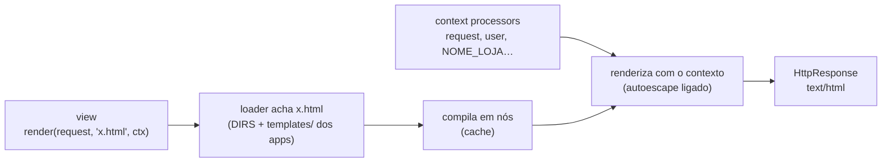
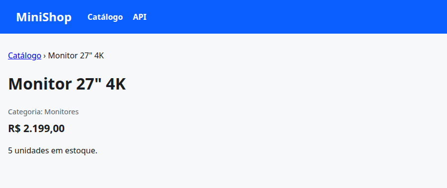
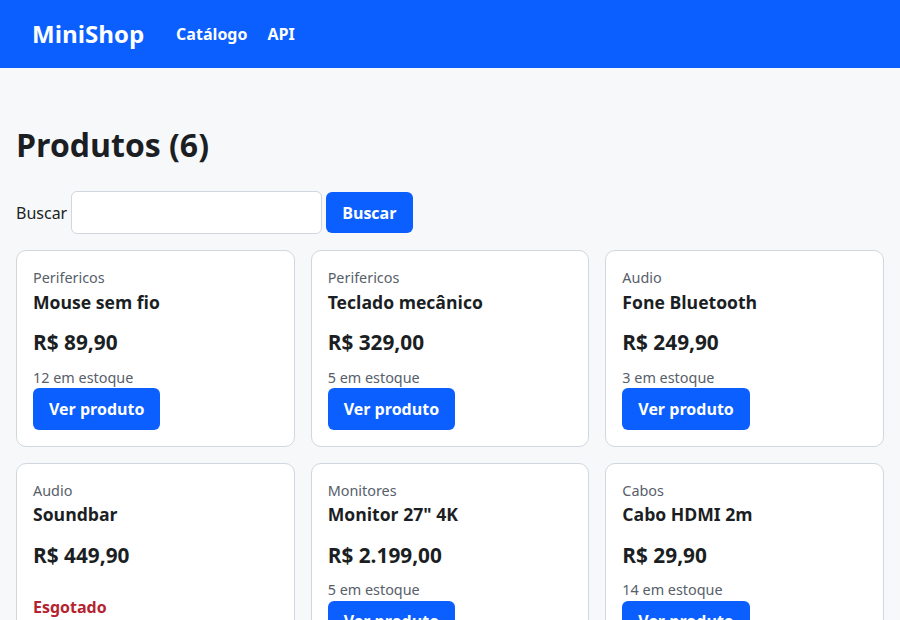

# 03. Templates

> ⏱️ ~1h30 · Módulo 5 · Pré-requisitos: [02](02-urls-views-funcao.md); HTML/CSS ([Módulo 4](../04-front-end-essencial/README.md)); XSS ([aula 4.05](../04-front-end-essencial/05-js-dom-eventos.md))

## 🎯 Objetivos
Ao final desta aula você consegue:
- Escrever *templates* com variáveis `{{ }}`, filtros e tags (`if`, `for`, `url`, `include`)
- Montar um layout reutilizável com **herança** (`extends` e `block`)
- Explicar o ***autoescape*** e por que ele protege contra XSS, e quando (não) usar `|safe`
- Criar **filtros** e **context processors** próprios
- Configurar onde o Django procura *templates* e testar a renderização

## 🤔 Por que isso importa
Na aula 02 montamos HTML com `f"<h1>…"`: é frágil, repetitivo e **inseguro** (esquecer um `escape()` abre XSS). Os *templates* separam a **apresentação** da lógica, reaproveitam layout (cabeçalho, rodapé) e escapam o texto **por padrão**. É o “T” do MVT, e a forma mais direta de entregar páginas com o Django (Módulos 5 e 6 combinam isso com HTMX/APIs).

## 💡 Intuição (explicação simples)
Um *template* é uma **carta de mala direta**: o texto fixo está pronto e há **lacunas** (`Prezado {{ nome }}`) que o sistema preenche com os dados de cada destinatário. A **herança** é o **papel timbrado**: o cabeçalho e o rodapé da empresa já estão impressos; cada carta só escreve o miolo (`block conteudo`). E o ***autoescape*** é o **carimbo “conteúdo seguro”**: tudo que entra nas lacunas é tratado como **texto**, nunca como instrução, mesmo que alguém escreva `<script>` no campo “nome”.

## 🔬 Como funciona por dentro
**A linguagem de templates do Django (DTL).** Três construções:

| Sintaxe | Para quê | Exemplo |
|---|---|---|
| `{{ variável }}` | imprimir um valor (com **autoescape**) | `{{ produto.nome }}` |
| `{{ valor\|filtro:arg }}` | transformar o valor | `{{ nome\|upper }}` · `{{ lista\|length }}` · `{{ x\|default:"—" }}` |
| `` | lógica e estrutura | `` · `…` · `` · `` |
| `{# comentário #}` | comentário (não vai ao HTML) | |

- **Busca de variáveis:** `produto.nome` tenta, nesta ordem: chave de dicionário, atributo, índice de lista (e chama métodos sem argumentos). Se não existe, imprime vazio (a configuração `string_if_invalid`), sem erro: cuidado com erros de digitação.
- **Tags principais:** `………` (`and`, `or`, `not`, `in`), `` (com `forloop.counter`, `forloop.first`, `forloop.last` e `` quando a lista é vazia), `` (usa o `reverse` da aula 02), ``, `` (aula 02), ``/`` (aula 13).
- **Herança de templates:** um *template* “pai” (`base.html`) define `…`; o filho começa com `` e **sobrescreve só os blocos** que quiser. `{{ block.super }}` inclui o conteúdo do bloco do pai.
- **Como o Django renderiza:** (1) o *loader* acha o arquivo (nas pastas de `TEMPLATES["DIRS"]` e na pasta `templates/` de cada app em `INSTALLED_APPS`, se `APP_DIRS=True`); (2) o texto é **compilado** em uma árvore de nós (*nodelist*) e **guardado em cache**; (3) `render(contexto)` percorre os nós, produzindo a string. O **contexto** é um dicionário em camadas: o que a *view* passou + o que os ***context processors*** acrescentam a **toda** página (`request`, `user`, `messages`…).
- **Convenção contra colisões:** `apps/catalog/templates/catalog/product_list.html`, com o nome do app **repetido** na pasta, pois todas as pastas `templates/` dos apps são “somadas” em um único espaço de nomes.
- ***Autoescape*:** ao imprimir `{{ x }}`, o Django troca `<`, `>`, `&`, `"`, `'` por entidades (`&lt;`…). Texto do usuário **não vira HTML**. O filtro `|safe` e a função `mark_safe()` **desligam** a proteção para aquele valor: só use com HTML **gerado por você**, nunca com dado vindo de fora.
- **Filtros e tags próprios:** um módulo `templatetags/xxx.py` com `register = template.Library()` e `@register.filter`. **Context processor:** função `f(request) -> dict` registrada em `TEMPLATES[…]["OPTIONS"]["context_processors"]`.


## 🛠️ Exemplo prático
Continuamos o projeto. Mudanças de configuração (que o Django exige para achar o CSS global e o nosso *context processor*):
```bash
python3 - <<'PY'
import re, pathlib
p = pathlib.Path("config/settings.py"); s = p.read_text()
s = s.replace('"django.contrib.messages.context_processors.messages",\n    ]},',
              '"django.contrib.messages.context_processors.messages",\n        "config.context_processors.site",          # variáveis disponíveis em TODA página\n    ]},')
s = s.replace('STATIC_URL = "static/"', 'STATIC_URL = "static/"\nSTATICFILES_DIRS = [BASE_DIR / "static"]      # CSS/JS globais (aula 13)')
p.write_text(s)
PY
grep -n "context_processors.site\|STATICFILES_DIRS" config/settings.py
```
```text
48:        "config.context_processors.site",          # variáveis disponíveis em TODA página
78:STATICFILES_DIRS = [BASE_DIR / "static"]      # CSS/JS globais (aula 13)
```
**1. Um *context processor* e um filtro próprio**
```python
from datetime import date


def site(request):
    """Entra no contexto de TODOS os templates."""
    return {"NOME_LOJA": "MiniShop", "ano": date.today().year}
```
```python
```
```python
from decimal import ROUND_HALF_UP, Decimal, InvalidOperation

from django import template

register = template.Library()


@register.filter
def real(valor):
    """Decimal/str → 'R$ 2.199,00' (sem float: aula 1.01). Valor inválido volta como veio."""
    try:
        v = Decimal(str(valor)).quantize(Decimal("0.01"), rounding=ROUND_HALF_UP)
    except (InvalidOperation, ValueError):
        return valor
    inteiro, centavos = f"{abs(v):.2f}".split(".")
    grupos = []
    while inteiro:
        grupos.insert(0, inteiro[-3:])
        inteiro = inteiro[:-3]
    return f"{'-' if v < 0 else ''}R$ {'.'.join(grupos)},{centavos}"
```
**2. O layout base (herança) e o CSS**
```css
:root { --cor-primaria: #0b5fff; --cor-texto: #1b1f24; --cor-suave: #57606a; --cor-fundo: #f6f8fa; --cor-borda: #d0d7de; --raio: 10px; }
*, *::before, *::after { box-sizing: border-box; }
body { margin: 0; font-family: system-ui, "Segoe UI", Roboto, sans-serif; line-height: 1.5; color: var(--cor-texto); background: var(--cor-fundo); }
.topo { background: var(--cor-primaria); color: #fff; padding: 1rem 2rem; display: flex; flex-wrap: wrap; gap: 1rem 2rem; align-items: center; }
.topo a { color: #fff; text-decoration: none; font-weight: 600; } .topo h1 { margin: 0; font-size: 1.5rem; } .topo nav { display: flex; gap: 1.25rem; }
main { max-width: 60rem; margin: 0 auto; padding: 2rem 1rem; } footer { text-align: center; color: var(--cor-suave); padding: 2rem 1rem; }
.grade { display: grid; grid-template-columns: repeat(auto-fill, minmax(14rem, 1fr)); gap: 1rem; padding: 0; list-style: none; }
.card { background: #fff; border: 1px solid var(--cor-borda); border-radius: var(--raio); padding: 1rem; height: 100%; display: flex; flex-direction: column; }
.card h3 { margin: 0 0 .25rem; font-size: 1.1rem; } .card h3 a { color: inherit; text-decoration: none; } .suave { color: var(--cor-suave); margin: 0; font-size: .9rem; }
.preco { font-size: 1.3rem; font-weight: 700; margin: .5rem 0; } .botao { display: inline-block; background: var(--cor-primaria); color: #fff; padding: .55rem 1rem; border: 0; border-radius: 6px; font: inherit; font-weight: 600; text-decoration: none; cursor: pointer; margin-top: auto; align-self: flex-start; }
.botao:focus-visible, a:focus-visible, input:focus-visible { outline: 3px solid #b35900; outline-offset: 2px; }
.esgotado { color: #b4232f; font-weight: 600; } .msg { background: #fff; border: 1px solid var(--cor-borda); border-radius: 8px; padding: 1rem; }
.sr-only { position: absolute; width: 1px; height: 1px; overflow: hidden; clip: rect(0 0 0 0); white-space: nowrap; } .sr-only:focus { position: static; width: auto; height: auto; }
input[type=search], input[type=text] { padding: .55rem; border: 1px solid var(--cor-borda); border-radius: 6px; font: inherit; }
```
```html
<!doctype html>
<html lang="pt-br">
<head>
  <meta charset="utf-8">
  <meta name="viewport" content="width=device-width, initial-scale=1">
  <title>{{ NOME_LOJA }}</title>
  <link rel="stylesheet" href="">
</head>
<body>
  <a class="sr-only" href="#conteudo">Ir para o conteúdo</a>
  <header class="topo">
    <h1><a href="">{{ NOME_LOJA }}</a></h1>
    <nav aria-label="Principal">
      <a href="">Catálogo</a>
      <a href="">API</a>
    </nav>
  </header>
  <main id="conteudo">
    
  </main>
  <footer><p>© {{ ano }} {{ NOME_LOJA }} · projeto de estudo</p></footer>
</body>
</html>
```
**3. Templates do catálogo (com `include` e `empty`)**
```html

<li>
  <article class="card">
    <p class="suave">{{ produto.categoria|title }}</p>
    <h3><a href="">{{ produto.nome }}</a></h3>
    <p class="preco">{{ produto.preco|real }}</p>
    
      <p class="suave">{{ produto.estoque }} em estoque</p>
      <a class="botao" href="">Ver produto</a>
    
      <p class="esgotado">Esgotado</p>
    
  </article>
</li>
```
```html

Produtos — {{ NOME_LOJA }}

  <h1>Produtos ({{ itens|length }})</h1>
  <form method="get" role="search">
    <label for="busca">Buscar</label>
    <input id="busca" name="busca" type="search" value="{{ busca }}">
    <button class="botao" type="submit">Buscar</button>
  </form>
  <ul class="grade">
    
      
    
      <li class="msg">Nenhum produto encontrado para “{{ busca }}”.</li>
    
  </ul>

```
```html


{{ produto.nome }} — {{ NOME_LOJA }}

  <nav aria-label="Você está em"><a href="">Catálogo</a> › {{ produto.nome }}</nav>
  <h1>{{ produto.nome }}</h1>
  <p class="suave">Categoria: {{ produto.categoria|title }}</p>
  <p class="preco">{{ produto.preco|real }}</p>
  
    <p>{{ produto.estoque }} unidade{{ produto.estoque|pluralize }} em estoque.</p>
  
    <p class="esgotado">Produto esgotado.</p>
  

```
```html

Página não encontrada

  <h1>Ops, essa página não existe</h1>
  <p class="msg">Não encontramos <code>{{ request_path }}</code>. <a href="">Voltar ao catálogo</a>.</p>

```
**4. As *views* passam a usar `render`**
```python
import json

from django.http import Http404, HttpResponseBadRequest, JsonResponse
from django.middleware.csrf import get_token
from django.shortcuts import redirect, render
from django.views.decorators.csrf import ensure_csrf_cookie
from django.views.decorators.http import require_GET, require_http_methods

from . import dados


@require_GET
def lista(request):
    busca = request.GET.get("busca", "")
    return render(request, "catalog/product_list.html", {"itens": dados.buscar(busca), "busca": busca})


@require_GET
def detalhe(request, slug):
    produto = dados.por_slug(slug)
    if produto is None:
        raise Http404(f"Produto '{slug}' não existe")
    return render(request, "catalog/product_detail.html", {"produto": produto})


@require_GET
def api_lista(request):
    itens = dados.buscar(request.GET.get("busca", ""))
    return JsonResponse({"total": len(itens), "itens": itens}, json_dumps_params={"ensure_ascii": False})


@require_http_methods(["GET", "POST"])
@ensure_csrf_cookie
def contato(request):
    if request.method == "GET":
        return JsonResponse({"csrf": get_token(request), "dica": "envie o token no cabeçalho X-CSRFToken"})
    try:
        dados_post = json.loads(request.body) if request.content_type == "application/json" else request.POST.dict()
    except json.JSONDecodeError:
        return HttpResponseBadRequest("JSON inválido")
    nome, mensagem = dados_post.get("nome", "").strip(), dados_post.get("mensagem", "").strip()
    if not nome or not mensagem:
        return JsonResponse({"erro": "nome e mensagem são obrigatórios"}, status=422)
    return JsonResponse({"recebido": {"nome": nome, "mensagem": mensagem}}, status=201)


def antiga(request):
    return redirect("catalog:list", permanent=True)
```
```bash
uv run python manage.py check
uv run python manage.py shell -v 0 -c "
from django.template.loader import get_template
t = get_template('catalog/product_list.html')
import os; print('template encontrado em:', os.path.relpath(t.origin.name))
"
```
```text
System check identified no issues (0 silenced).
template encontrado em: apps/catalog/templates/catalog/product_list.html
```
**5. Servindo e vendo**
```python
import subprocess, time, urllib.request
servidor = subprocess.Popen(["uv", "run", "python", "manage.py", "runserver", "8122", "--noreload"],
                            stdout=open("servidor.log", "w"), stderr=subprocess.STDOUT)
for _ in range(60):
    try:
        urllib.request.urlopen("http://127.0.0.1:8122/saude/", timeout=1); break
    except Exception:
        time.sleep(0.5)
print("servidor no ar")
```
```text
servidor no ar
```
```bash
B=http://127.0.0.1:8122
curl -s "$B/produtos/?busca=mouse" | sed -n '/<main/,/<\/main>/p' | sed 's/^ *//' | grep -v '^$' | head -n 30
shot 03-lista.png 900x620 "$B/produtos/" 3000
shot 03-detalhe.png 900x380 "$B/produtos/monitor-27-4k/" 3000
echo "--- CSS entregue pelo staticfiles em DEBUG:"; curl -s -o /dev/null -w "%{http_code} %{content_type}\n" $B/static/css/style.css
```
```text
<main id="conteudo">
<h1>Produtos (1)</h1>
<form method="get" role="search">
<label for="busca">Buscar</label>
<input id="busca" name="busca" type="search" value="mouse">
<button class="botao" type="submit">Buscar</button>
</form>
<ul class="grade">
<li>
<article class="card">
<p class="suave">Perifericos</p>
<h3><a href="/produtos/mouse-sem-fio/">Mouse sem fio</a></h3>
<p class="preco">R$ 89,90</p>
<p class="suave">12 em estoque</p>
<a class="botao" href="/produtos/mouse-sem-fio/">Ver produto</a>
</article>
</li>
</ul>
</main>
--- CSS entregue pelo staticfiles em DEBUG:
200 text/css
```


`include` reaproveita o cartão, `|real` formata com a nossa regra, `|title` e `|pluralize` são filtros nativos, e `` cobre a lista vazia. Os dados continuam provisórios; no próximo passo eles viram o banco.

**6. O *autoescape* na prática (e o perigo do `|safe`)**
```python
import os
import django

os.environ["DJANGO_SETTINGS_MODULE"] = "config.settings"
django.setup()
from django.template import Context, Template

ataque = '<script>alert("roubei sua sessão")</script>'
seguro = Template("<p>Comentário: {{ texto }}</p>").render(Context({"texto": ataque}))
perigoso = Template("<p>Comentário: {{ texto|safe }}</p>").render(Context({"texto": ataque}))
print("autoescape ligado :", seguro)
print("com |safe (NUNCA!):", perigoso)
print(Template("{{ t }}").render(Context({"t": "<b>x</b>"})))
print(Template("{{ nome|default:'visitante'|upper }}|{{ lista|length }}|{{ n|pluralize }}").render(Context({"nome": "", "lista": [1, 2, 3], "n": 2})))
print(Template("{{ forloop.counter }}:{{ x }}, vazio").render(Context({"xs": ["a", "b", "c"]})))
print(repr(Template("[{{ nao_existe }}]").render(Context({}))))
```
```bash
uv run python explorar_templates.py
```
```text
autoescape ligado : <p>Comentário: &lt;script&gt;alert(&quot;roubei sua sessão&quot;)&lt;/script&gt;</p>
com |safe (NUNCA!): <p>Comentário: <script>alert("roubei sua sessão")</script></p>
<b>x</b>
VISITANTE|3|s
1:a, 2:b, 3:c
'[]'
```
A primeira linha vira `&lt;script&gt;…`: o navegador **mostra** o texto, não o executa. A segunda é um **XSS armazenado** pronto (aula 4.05). A variável inexistente vira texto vazio, sem erro: erros de digitação em *templates* passam em silêncio, então teste.
```python
servidor.terminate(); servidor.wait(); print("servidor encerrado")
```
```text
servidor encerrado
```
**7. Testes de renderização**
```python
import pytest
from django.template import Context, Template
from django.test import override_settings
from django.urls import reverse

pytestmark = pytest.mark.django_db


def renderizar(texto, **contexto):
    return Template(texto).render(Context(contexto))


@pytest.mark.parametrize("valor, esperado", [
    ("89.90", "R$ 89,90"), ("2199", "R$ 2.199,00"), ("1234567.5", "R$ 1.234.567,50"),
    ("0", "R$ 0,00"), ("-15.5", "-R$ 15,50"), ("0.005", "R$ 0,01"), ("abc", "abc"),
])
def test_filtro_real(valor, esperado):
    assert renderizar("{{ v|real }}", v=valor) == esperado


def test_autoescape_neutraliza_script():
    html = renderizar("{{ t }}", t="<script>alert(1)</script>")
    assert "<script>" not in html and "&lt;script&gt;" in html


def test_lista_usa_heranca_e_include(client):
    resposta = client.get(reverse("catalog:list"))
    nomes = [t.name for t in resposta.templates]
    assert "catalog/product_list.html" in nomes and "base.html" in nomes and "catalog/_card.html" in nomes
    corpo = resposta.content.decode()
    assert "MiniShop" in corpo and "R$ 2.199,00" in corpo and "Esgotado" in corpo


def test_lista_vazia_mostra_mensagem(client):
    corpo = client.get(reverse("catalog:list"), {"busca": "xyz<b>"}).content.decode()
    assert "Nenhum produto encontrado para “xyz&lt;b&gt;”" in corpo


def test_detalhe_pluraliza_e_mostra_esgotado(client):
    assert "5 unidades em estoque" in client.get(reverse("catalog:detail", kwargs={"slug": "monitor-27-4k"})).content.decode()
    assert "Produto esgotado" in client.get(reverse("catalog:detail", kwargs={"slug": "soundbar"})).content.decode()


@override_settings(DEBUG=False)
def test_pagina_404_personalizada(client):
    resposta = client.get("/produtos/nao-existe/")
    assert resposta.status_code == 404
    assert "Ops, essa página não existe" in resposta.content.decode()
```
```bash
uv run pytest
```
```text
.........................                                                [100%]
25 passed in 0.31s
```
## ⚠️ Erros comuns e boas práticas
| Mensagem / sintoma | Causa | Solução |
|---|---|---|
| `TemplateDoesNotExist: catalog/product_list.html` | Caminho/pasta errados, app fora de `INSTALLED_APPS`, ou `APP_DIRS=False` | Estrutura `apps/catalog/templates/catalog/…`; confira `TEMPLATES` |
| `TemplateSyntaxError: Invalid block tag on line 3: 'endif'` / `Unclosed tag` | `if`/`for`/`block` sem fechar, ou `` faltando | Feche todas as tags; use um editor com destaque de DTL |
| `TemplateSyntaxError: 'formatacao' is not a registered tag library` | Falta `templatetags/__init__.py`, app não instalado, ou servidor não reiniciado | Crie o `__init__.py`; reinicie o `runserver` |
| `NoReverseMatch` dentro do template | `` com nome/argumentos errados | Confira `app_name:nome` e os argumentos |
| Variável “some” sem erro | Nome inexistente vira texto vazio | Teste com `{{ var|default:"FALTA" }}`; testes que checam o HTML |
| Texto aparece com `&lt;b&gt;` | Autoescape (correto!) | Se for HTML seu e seguro, `|safe` ou `mark_safe` **com cuidado** |
| `Forbidden (403) CSRF verification failed` em formulário | Esqueceu `` | Inclua dentro de todo `<form method="post">` |
| CSS não carrega (404 em `/static/…`) | `STATICFILES_DIRS`/`` ausentes | Configure e use `` (aula 13) |
| Página `500.html` “quebrada” em produção | A *view* de erro 500 renderiza o template **sem contexto** (sem `request`, sem *context processors*; no 404 o contexto existe, como mostramos) | Mantenha o `500.html` simples e independente (sem `extends` de um layout que dependa do contexto) |
| Lógica de negócio “vazando” para o template | Cálculos e consultas dentro do `` | Prepare os dados na *view*/modelo; o template só **mostra** |

- **Nunca** use `|safe` ou `` em dados que o usuário (ou uma API) possa influenciar.
- Prefira `` a URLs fixas, e ``/herança a copiar e colar blocos de HTML.
- *Templates* **não** devem executar regras de negócio nem consultas pesadas: cada acesso `p.categoria.nome` dentro de um laço pode virar uma consulta SQL (N+1, aula 07).
- Nomes de *templates* com o prefixo do app (`catalog/…`) evitam colisão entre apps.
- Em produção, o carregador com **cache** (ativado automaticamente com `DEBUG=False`) acelera a renderização.

## 🧠 Pausa para lógica
**Problema (um mini motor de templates).** Implemente `renderizar(template, contexto)` que suporte `{{ variavel }}` (com busca pontilhada `produto.nome` e **escape HTML por padrão**), o filtro `|upper`/`|default:"x"`, e `…`. Prove que `<script>` no contexto é escapado.

<details><summary>Dica</summary>
Faça em duas passadas: primeiro resolva os blocos `…` (para cada item, renderize o miolo recursivamente com um contexto estendido), depois as variáveis `{{ … }}` com <code>re.sub</code> e uma função que faz a busca pontilhada (<code>dict</code> → chave, objeto → atributo). Escape com <code>html.escape</code> antes de inserir.
</details>

<details><summary>Solução comentada</summary>

```python
import html
import re

FOR = re.compile(r"\{%\s*for\s+(\w+)\s+in\s+([\w.]+)\s*%\}(.*?)\{%\s*endfor\s*%\}", re.S)
VAR = re.compile(r"\{\{\s*([\w.]+)((?:\s*\|\s*\w+(?::\"[^\"]*\")?)*)\s*\}\}")


def buscar(contexto, caminho):
    valor = contexto
    for parte in caminho.split("."):
        if isinstance(valor, dict) and parte in valor:
            valor = valor[parte]
        elif hasattr(valor, parte):
            valor = getattr(valor, parte)
        else:
            return ""                                          # como o Django: variável inexistente vira vazio
    return valor


FILTROS = {"upper": lambda v, a=None: str(v).upper(), "default": lambda v, a=None: v if v else a, "length": lambda v, a=None: len(v)}


def renderizar(template, contexto):
    def laco(m):
        nome, origem, miolo = m.groups()
        return "".join(renderizar(miolo, {**contexto, nome: item}) for item in buscar(contexto, origem))

    def variavel(m):
        valor = buscar(contexto, m.group(1))
        for filtro in re.findall(r"\|\s*(\w+)(?::\"([^\"]*)\")?", m.group(2)):
            valor = FILTROS[filtro[0]](valor, filtro[1] or None)
        return html.escape(str(valor))                         # AUTOESCAPE: sempre, por padrão

    return VAR.sub(variavel, FOR.sub(laco, template))


modelo = "<h1>{{ loja|upper }}</h1><ul><li>{{ p.nome }} — {{ p.preco|default:\"sem preço\" }}</li></ul><p>{{ aviso }}|{{ faltando }}|</p>"
ctx = {"loja": "minishop", "aviso": "<script>alert(1)</script>",
       "produtos": [{"nome": "Mouse", "preco": "89.90"}, {"nome": 'Monitor 27"', "preco": ""}]}
print(renderizar(modelo, ctx))
```
```bash
uv run python mini_template.py
```
```text
<h1>MINISHOP</h1><ul><li>Mouse — 89.90</li><li>Monitor 27&quot; — sem preço</li></ul><p>&lt;script&gt;alert(1)&lt;/script&gt;||</p>
```
Um motor de *templates* real faz exatamente isto, com um **analisador (*parser*)** de verdade em vez de regex, uma árvore de nós em cache, mais tags e filtros e *escape* sensível ao contexto. O ponto importante é o **escape por padrão** no último passo.
</details>

**Variação mais difícil:** acrescente `…` e a herança (`extends`/`block`) com substituição de blocos.

## 🧩 Exercícios
**1. Fixação**
(a) Qual a diferença entre `{{ x }}` e ``? (b) Para que serve ``? (c) O que `|safe` faz e quando é perigoso? (d) Onde o Django procura *templates*?

<details><summary>Solução</summary>

(a) `{{ }}` imprime um valor (com *autoescape*); `` executa uma tag (lógica/estrutura). (b) Define o conteúdo mostrado quando a lista do `` é vazia. (c) Marca o valor como seguro, desligando o *autoescape*; é perigoso com qualquer dado de origem externa (XSS). (d) Nas pastas de `TEMPLATES["DIRS"]` e, com `APP_DIRS=True`, na pasta `templates/` de cada app instalado.
</details>

**2. Aplicação no projeto MiniShop**
Entregue a camada de apresentação do catálogo.

Critérios de pronto:
- [ ] `templates/base.html` (herança, `block title`/`conteudo`, *skip link*, `lang="pt-br"`) e `static/css/style.css`
- [ ] `catalog/product_list.html` (busca, `…`, `include` do cartão) e `product_detail.html` com *breadcrumb*
- [ ] Filtro `real` com testes (`parametrize`, incluindo valores negativos, arredondamento e entrada inválida) e `context processor` para o nome da loja
- [ ] `404.html` próprio, testado com `DEBUG=False`; nenhum `|safe` no projeto (`grep -rn "|safe" templates apps` vazio)
- [ ] Teste que injeta `<script>` no nome de um produto e comprova que sai escapado
- [ ] Capturas de tela da lista e do detalhe em `docs/img/` e o validador HTML do W3C sem erros em uma das páginas
- [ ] `uv run pytest` verde
- [ ] Commit `feat(catalog): templates with inheritance and custom filter`

<details><summary>Solução de referência</summary>

Use os arquivos desta aula. Para o teste do `<script>`, acrescente à lista provisória um produto com `nome='<script>alert(1)</script>'` (via `monkeypatch.setattr(dados, "PRODUTOS", [...])`) e verifique `"&lt;script&gt;" in corpo` e `"<script>alert" not in corpo`. Para validar o HTML: salve `curl -s http://127.0.0.1:8122/produtos/ > lista.html` e envie ao validador do W3C.
</details>

**3. Desafio (opcional)**
Crie uma *template tag* `` (`@register.inclusion_tag`) que renderize o botão (ou “Esgotado”) com seu próprio mini-template, e use-a no cartão e no detalhe.

## 🎤 Na entrevista
- **O que é o *autoescape* do Django e por que importa?** Escapa por padrão `< > & " '` em tudo que é impresso com `{{ }}`, evitando XSS; só deixa passar HTML marcado como seguro (`|safe`/`mark_safe`), que nunca deve ser aplicado a dados de usuário.
- **Como funciona a herança de templates?** O *template* filho usa `` e preenche os `` definidos pelo pai; o que não sobrescreve vem do pai; `{{ block.super }}` reaproveita o conteúdo do bloco do pai.
- **Quando criar um filtro ou *template tag* próprio?** Para formatação/apresentação reutilizável (moeda, datas, botões); regras de negócio ficam fora do template.
- **O que é um *context processor*?** Função que recebe a requisição e devolve um dicionário injetado no contexto de todos os templates renderizados com `RequestContext` (por exemplo, usuário, mensagens, nome do site).
- **Por que não colocar consultas ao banco no template?** O template é só apresentação; acessar relações dentro de laços gera consultas extras (N+1) e esconde custo; prepare os dados na *view*/modelo com `select_related`/`prefetch_related`.

## 📚 Para ir além
- 📄 Documentação oficial: [Templates no Django](https://docs.djangoproject.com/en/5.2/topics/templates/) e a [linguagem de templates](https://docs.djangoproject.com/en/5.2/ref/templates/language/). Variáveis, filtros, tags e herança.
- 📄 Documentação oficial: [Tags e filtros embutidos](https://docs.djangoproject.com/en/5.2/ref/templates/builtins/) e [tags/filtros personalizados](https://docs.djangoproject.com/en/5.2/howto/custom-template-tags/). Lista completa e como criar os seus.
- 📄 Documentação oficial: [Segurança no Django: XSS](https://docs.djangoproject.com/en/5.2/topics/security/#cross-site-scripting-xss-protection). O que o *autoescape* cobre e o que não cobre.
- 📄 Documentação oficial: [`render()`](https://docs.djangoproject.com/en/5.2/topics/http/shortcuts/). O atalho usado em todas as *views*.
- 🏋️ Prática extra: use `django-debug-toolbar` (ou o nosso `MetricasMiddleware`) para ver quais *templates* foram renderizados e quanto tempo levou cada um.

## ✅ Checklist da aula
- [ ] Layout com herança, `include` e ``
- [ ] Filtro `real` e *context processor* funcionando
- [ ] Provei que o *autoescape* barra o `<script>`
- [ ] `404.html` próprio e testes passando
- [ ] Fiz o commit do exercício
