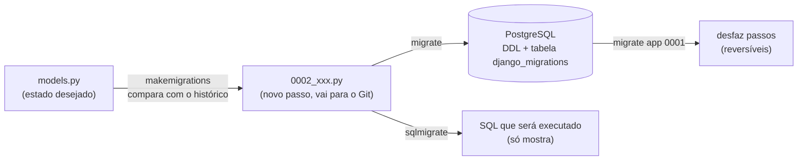

# 04. Models e migrações

> ⏱️ ~1h30 · Módulo 5 · Pré-requisitos: [01](01-projeto-apps-mvt.md); modelagem e SQL ([Módulo 3](../03-banco-de-dados/README.md)); migrações em miniatura ([aula 3.11](../03-banco-de-dados/11-orm-migracoes-nosql.md))

## 🎯 Objetivos
Ao final desta aula você consegue:
- Modelar `Category` e `Product` como classes `models.Model` com os tipos de campo certos (`DecimalField` para dinheiro)
- Explicar `null` × `blank`, `default`, `unique`, `choices` e `on_delete`
- Gerar, ler, aplicar e **desfazer** migrações (`makemigrations`, `sqlmigrate`, `migrate`, `showmigrations`)
- Escrever uma **migração de dados** reversível com `RunPython`
- Declarar restrições e índices no modelo (`CheckConstraint`, `Index`) e popular o banco com um comando de *seed* idempotente

## 🤔 Por que isso importa
O *model* é o **coração** do app: define as tabelas, as regras de integridade e a linguagem do domínio (`Product.objects.filter(...)`). E as **migrações** são o que permite ao time inteiro (e ao servidor de produção) ter **o mesmo banco**, evoluindo com segurança. Erros aqui custam caro: uma migração mal escrita pode apagar dados ou travar uma tabela de milhões de linhas.

## 💡 Intuição (explicação simples)
- O *model* é a **planta da tabela escrita em Python**: cada atributo da classe é uma coluna, cada instância é uma linha. Você descreve **o que** quer (“preço é decimal com 2 casas, nunca negativo”) e o Django traduz para SQL.
- A **migração** é o **diário de obras** (aula 3.11): cada mudança no *model* vira um passo numerado (“acrescentar coluna X”), registrado numa tabela de controle. Qualquer pessoa reconstrói o banco do zero aplicando o diário na ordem, e **desfaz** passos recentes quando preciso.

## 🔬 Como funciona por dentro
**Model → tabela.** Para `class Product(models.Model)` em `apps/catalog`, o Django cria a tabela **`catalog_product`** (`<app>_<modelo>`), com uma coluna `id` (chave primária automática, `BigAutoField`) e uma coluna por campo.

| Campo | Para quê | Coluna PostgreSQL |
|---|---|---|
| `CharField(max_length=n)` | texto curto | `varchar(n)` |
| `TextField` | texto longo | `text` |
| `SlugField` | texto para URLs (`mouse-sem-fio`) | `varchar(50)` + índice |
| `DecimalField(max_digits, decimal_places)` | **dinheiro** (nunca `FloatField`) | `numeric(p,s)` |
| `IntegerField` / `PositiveIntegerField` | inteiros (o 2º impõe `>= 0` com `CHECK`) | `integer` |
| `BooleanField` | verdadeiro/falso | `boolean` |
| `DateTimeField` | data e hora (`auto_now_add`, `auto_now`) | `timestamptz` |
| `ForeignKey` / `OneToOneField` / `ManyToManyField` | relacionamentos 1:N, 1:1, N:N | coluna `<campo>_id` + FK / tabela de junção |
| `JSONField`, `UUIDField`, `EmailField`… | outros | `jsonb`, `uuid`, `varchar` |

**Opções de campo mais importantes**
- **`null=True`** → a **coluna aceita `NULL`** (banco). **`blank=True`** → o campo pode ficar **vazio na validação** (formulários/`full_clean`). São coisas distintas: para texto, o padrão do Django é **vazio = `""`** (`blank=True` **sem** `null`), evitando dois “vazios” (`NULL` e `""`). Use `null=True` para tipos não textuais opcionais (datas, números, FKs).
- `default=` (valor ou função), `unique=True`, `db_index=True`, `verbose_name`/`help_text` (aparecem no Admin e nos formulários), `validators=[...]`, `choices` (com `models.TextChoices`).
- **`on_delete`** (obrigatório em FK): `PROTECT` (recusa apagar o pai se há filhos; **nosso padrão**, como o `RESTRICT` da aula 3.08), `CASCADE` (apaga os filhos), `SET_NULL` (precisa de `null=True`), `SET_DEFAULT`, `DO_NOTHING`.
- **`related_name`**: o nome da relação reversa (`categoria.products.all()`).
- **`class Meta`**: `ordering`, `constraints` (`CheckConstraint`, `UniqueConstraint`), `indexes`, `verbose_name(_plural)`, `db_table`.

**Validação vs. banco.** `produto.save()` **não valida** (só envia ao banco). A validação em Python acontece em `full_clean()` (chamada por *ModelForms* e pelo Admin). A **regra que nunca pode ser violada** deve estar **também no banco** (`CheckConstraint`), porque scripts, o *shell* e outros clientes não passam por formulários (aula 3.08).

**Migrações.** O Django mantém, em `apps/<app>/migrations/`, uma sequência de arquivos Python (`0001_initial.py`, `0002_…`), cada um com `dependencies` e uma lista de `operations` (`CreateModel`, `AddField`, `AlterField`, `AddConstraint`, `RunPython`…). Fluxo:


- `makemigrations` **não toca no banco**: só gera arquivos comparando os *models* com o estado reconstruído das migrações anteriores.
- `migrate` aplica as pendentes **em ordem de dependência** e registra cada uma em `django_migrations`.
- `sqlmigrate app 0001` mostra o **SQL exato**: **leia antes de aplicar em produção**.
- **Regras de ouro:** (1) **versione** as migrações no Git; (2) **nunca edite uma já aplicada** (crie outra); (3) revise o arquivo gerado (o Django pode escolher `RemoveField`+`AddField` em vez de renomear, o que **apaga dados**); (4) em produção, mudanças destrutivas em duas etapas.
- **Migração de dados** (`RunPython(forward, reverse)`): altera linhas, não a estrutura. Use modelos **históricos** (`apps.get_model(...)`), nunca importe o *model* real (ele pode já ter mudado).

## 🛠️ Exemplo prático
Continuamos o projeto (aulas 01 a 03). Tudo foi executado com Django 5.2 e PostgreSQL 18.

**1. A primeira versão dos modelos**
```python
from django.core.validators import MinValueValidator
from django.db import models
from django.urls import reverse
from django.utils.text import slugify


class Category(models.Model):
    name = models.CharField("nome", max_length=80, unique=True)
    slug = models.SlugField(unique=True, blank=True)

    class Meta:
        verbose_name = "categoria"
        verbose_name_plural = "categorias"
        ordering = ["name"]

    def __str__(self):
        return self.name

    def save(self, *args, **kwargs):
        if not self.slug:
            self.slug = slugify(self.name)
        super().save(*args, **kwargs)


class Product(models.Model):
    category = models.ForeignKey(Category, verbose_name="categoria", on_delete=models.PROTECT, related_name="products")
    sku = models.CharField("SKU", max_length=20, unique=True)
    name = models.CharField("nome", max_length=120)
    slug = models.SlugField(unique=True, blank=True, max_length=140)
    description = models.TextField("descrição", blank=True)
    price = models.DecimalField("preço", max_digits=10, decimal_places=2, validators=[MinValueValidator(0)])
    stock = models.PositiveIntegerField("estoque", default=0)
    is_active = models.BooleanField("ativo", default=True)
    created_at = models.DateTimeField("criado em", auto_now_add=True)

    class Meta:
        verbose_name = "produto"
        verbose_name_plural = "produtos"
        ordering = ["name"]

    def __str__(self):
        return f"{self.sku} — {self.name}"

    def save(self, *args, **kwargs):
        if not self.slug:
            self.slug = slugify(self.name)
        super().save(*args, **kwargs)

    def get_absolute_url(self):
        return reverse("catalog:detail", kwargs={"slug": self.slug})
```
**2. `makemigrations`, o arquivo gerado e o SQL**
```bash
uv run python manage.py makemigrations catalog
echo "--- arquivo gerado:"; cat apps/catalog/migrations/0001_initial.py
```
```text
Migrations for 'catalog':
  apps/catalog/migrations/0001_initial.py
    + Create model Category
    + Create model Product
--- arquivo gerado:
# Generated by Django 5.2.19 on 2026-11-08 02:49

import django.core.validators
import django.db.models.deletion
from django.db import migrations, models


class Migration(migrations.Migration):

    initial = True

    dependencies = [
    ]

    operations = [
        migrations.CreateModel(
            name='Category',
            fields=[
                ('id', models.BigAutoField(auto_created=True, primary_key=True, serialize=False, verbose_name='ID')),
                ('name', models.CharField(max_length=80, unique=True, verbose_name='nome')),
                ('slug', models.SlugField(blank=True, unique=True)),
            ],
            options={
                'verbose_name': 'categoria',
                'verbose_name_plural': 'categorias',
                'ordering': ['name'],
            },
        ),
        migrations.CreateModel(
            name='Product',
            fields=[
                ('id', models.BigAutoField(auto_created=True, primary_key=True, serialize=False, verbose_name='ID')),
                ('sku', models.CharField(max_length=20, unique=True, verbose_name='SKU')),
                ('name', models.CharField(max_length=120, verbose_name='nome')),
                ('slug', models.SlugField(blank=True, max_length=140, unique=True)),
                ('description', models.TextField(blank=True, verbose_name='descrição')),
                ('price', models.DecimalField(decimal_places=2, max_digits=10, validators=[django.core.validators.MinValueValidator(0)], verbose_name='preço')),
                ('stock', models.PositiveIntegerField(default=0, verbose_name='estoque')),
                ('is_active', models.BooleanField(default=True, verbose_name='ativo')),
                ('created_at', models.DateTimeField(auto_now_add=True, verbose_name='criado em')),
                ('category', models.ForeignKey(on_delete=django.db.models.deletion.PROTECT, related_name='products', to='catalog.category', verbose_name='categoria')),
            ],
            options={
                'verbose_name': 'produto',
                'verbose_name_plural': 'produtos',
                'ordering': ['name'],
            },
        ),
    ]
```
```bash
uv run python manage.py sqlmigrate catalog 0001
```
```text
BEGIN;
--
-- Create model Category
--
CREATE TABLE "catalog_category" ("id" bigint NOT NULL PRIMARY KEY GENERATED BY DEFAULT AS IDENTITY, "name" varchar(80) NOT NULL UNIQUE, "slug" varchar(50) NOT NULL UNIQUE);
--
-- Create model Product
--
CREATE TABLE "catalog_product" ("id" bigint NOT NULL PRIMARY KEY GENERATED BY DEFAULT AS IDENTITY, "sku" varchar(20) NOT NULL UNIQUE, "name" varchar(120) NOT NULL, "slug" varchar(140) NOT NULL UNIQUE, "description" text NOT NULL, "price" numeric(10, 2) NOT NULL, "stock" integer NOT NULL CHECK ("stock" >= 0), "is_active" boolean NOT NULL, "created_at" timestamp with time zone NOT NULL, "category_id" bigint NOT NULL);
CREATE INDEX "catalog_category_name_fdc3466c_like" ON "catalog_category" ("name" varchar_pattern_ops);
CREATE INDEX "catalog_category_slug_dbf63ad0_like" ON "catalog_category" ("slug" varchar_pattern_ops);
ALTER TABLE "catalog_product" ADD CONSTRAINT "catalog_product_category_id_35bf920b_fk_catalog_category_id" FOREIGN KEY ("category_id") REFERENCES "catalog_category" ("id") DEFERRABLE INITIALLY DEFERRED;
CREATE INDEX "catalog_product_sku_5c54c070_like" ON "catalog_product" ("sku" varchar_pattern_ops);
CREATE INDEX "catalog_product_slug_f37848b0_like" ON "catalog_product" ("slug" varchar_pattern_ops);
CREATE INDEX "catalog_product_category_id_35bf920b" ON "catalog_product" ("category_id");
COMMIT;
```
O `sqlmigrate` mostra o que o Django vai executar: `CREATE TABLE "catalog_product"` com `numeric(10,2)`, `bigint GENERATED BY DEFAULT AS IDENTITY`, `CHECK ("stock" >= 0)` (do `PositiveIntegerField`), a FK com `DEFERRABLE INITIALLY DEFERRED` e os índices (a FK e o `slug` ganham índice automaticamente).
```bash
uv run python manage.py migrate catalog
docker exec minishop-pg psql -U postgres -d minishop -X -c '\d catalog_product'
uv run python manage.py showmigrations catalog
```
```text
Operations to perform:
  Apply all migrations: catalog
Running migrations:
  Applying catalog.0001_initial... OK
                                  Table "public.catalog_product"
   Column    |           Type           | Collation | Nullable |             Default              
-------------+--------------------------+-----------+----------+----------------------------------
 id          | bigint                   |           | not null | generated by default as identity
 sku         | character varying(20)    |           | not null | 
 name        | character varying(120)   |           | not null | 
 slug        | character varying(140)   |           | not null | 
 description | text                     |           | not null | 
 price       | numeric(10,2)            |           | not null | 
 stock       | integer                  |           | not null | 
 is_active   | boolean                  |           | not null | 
 created_at  | timestamp with time zone |           | not null | 
 category_id | bigint                   |           | not null | 
Indexes:
    "catalog_product_pkey" PRIMARY KEY, btree (id)
    "catalog_product_category_id_35bf920b" btree (category_id)
    "catalog_product_sku_5c54c070_like" btree (sku varchar_pattern_ops)
    "catalog_product_sku_key" UNIQUE CONSTRAINT, btree (sku)
    "catalog_product_slug_f37848b0_like" btree (slug varchar_pattern_ops)
    "catalog_product_slug_key" UNIQUE CONSTRAINT, btree (slug)
Check constraints:
    "catalog_product_stock_check" CHECK (stock >= 0)
Foreign-key constraints:
    "catalog_product_category_id_35bf920b_fk_catalog_category_id" FOREIGN KEY (category_id) REFERENCES catalog_category(id) DEFERRABLE INITIALLY DEFERRED

catalog
 [X] 0001_initial
```
**3. Usando o modelo no *shell* (um preview do ORM: a aula 05 detalha)**
```bash
uv run python manage.py shell -v 0 -c "
from apps.catalog.models import Category, Product
c = Category.objects.create(name='Periféricos')
print(c, c.slug, c.pk)
p = Product.objects.create(category=c, sku='x-01', name='Teclado Mecânico RGB', price='329.00', stock=5)
print(p, '|', p.slug, '|', type(p.price).__name__, p.price, '|', p.get_absolute_url())
p2 = Product.objects.create(category=c, sku='x-02', name='Mouse Gamer', price='159.90', stock=0)
print(Product.objects.count(), list(c.products.values_list('sku', flat=True)))
"
```
```text
Periféricos perifericos 1
x-01 — Teclado Mecânico RGB | teclado-mecanico-rgb | str 329.00 | /produtos/teclado-mecanico-rgb/
2 ['x-02', 'x-01']
```
O `price` volta como `Decimal`; a `slug` foi gerada no `save()`; e `c.products` é a **relação reversa** (`related_name`). Repare que gravamos os SKUs em minúsculas, de propósito: vamos corrigir isso com uma **migração de dados**.

**4. Evoluindo o modelo: nova coluna, restrição e índice**
```python
from django.core.validators import MinValueValidator
from django.db import models
from django.db.models import Q
from django.urls import reverse
from django.utils.text import slugify


class Category(models.Model):
    name = models.CharField("nome", max_length=80, unique=True)
    slug = models.SlugField(unique=True, blank=True)

    class Meta:
        verbose_name = "categoria"
        verbose_name_plural = "categorias"
        ordering = ["name"]

    def __str__(self):
        return self.name

    def save(self, *args, **kwargs):
        if not self.slug:
            self.slug = slugify(self.name)
        super().save(*args, **kwargs)


class Product(models.Model):
    category = models.ForeignKey(Category, verbose_name="categoria", on_delete=models.PROTECT, related_name="products")
    sku = models.CharField("SKU", max_length=20, unique=True)
    name = models.CharField("nome", max_length=120)
    slug = models.SlugField(unique=True, blank=True, max_length=140)
    description = models.TextField("descrição", blank=True)
    price = models.DecimalField("preço", max_digits=10, decimal_places=2, validators=[MinValueValidator(0)])
    stock = models.PositiveIntegerField("estoque", default=0)
    is_active = models.BooleanField("ativo", default=True)
    created_at = models.DateTimeField("criado em", auto_now_add=True)
    updated_at = models.DateTimeField("atualizado em", auto_now=True)            # NOVO

    class Meta:
        verbose_name = "produto"
        verbose_name_plural = "produtos"
        ordering = ["name"]
        constraints = [                                                           # NOVO: regra no BANCO (aula 3.08)
            models.CheckConstraint(condition=Q(price__gte=0), name="product_price_gte_0"),
        ]
        indexes = [                                                               # NOVO: índice parcial para a listagem por preço
            models.Index(fields=["price", "id"], condition=Q(is_active=True), name="product_active_price_idx"),
        ]

    def __str__(self):
        return f"{self.sku} — {self.name}"

    def save(self, *args, **kwargs):
        self.sku = self.sku.strip().upper()
        if not self.slug:
            self.slug = slugify(self.name)
        super().save(*args, **kwargs)

    def get_absolute_url(self):
        return reverse("catalog:detail", kwargs={"slug": self.slug})
```
```bash
uv run python manage.py makemigrations catalog --name produto_updated_at_regras
cat apps/catalog/migrations/0002_produto_updated_at_regras.py
uv run python manage.py sqlmigrate catalog 0002
```
```text
Migrations for 'catalog':
  apps/catalog/migrations/0002_produto_updated_at_regras.py
    + Add field updated_at to product
    + Create index product_active_price_idx on field(s) price, id of model product
    + Create constraint product_price_gte_0 on model product
# Generated by Django 5.2.19 on 2026-11-08 02:49

from django.db import migrations, models


class Migration(migrations.Migration):

    dependencies = [
        ('catalog', '0001_initial'),
    ]

    operations = [
        migrations.AddField(
            model_name='product',
            name='updated_at',
            field=models.DateTimeField(auto_now=True, verbose_name='atualizado em'),
        ),
        migrations.AddIndex(
            model_name='product',
            index=models.Index(condition=models.Q(('is_active', True)), fields=['price', 'id'], name='product_active_price_idx'),
        ),
        migrations.AddConstraint(
            model_name='product',
            constraint=models.CheckConstraint(condition=models.Q(('price__gte', 0)), name='product_price_gte_0'),
        ),
    ]
BEGIN;
--
-- Add field updated_at to product
--
ALTER TABLE "catalog_product" ADD COLUMN "updated_at" timestamp with time zone DEFAULT '2026-11-08 02:49:09.214649+00:00'::timestamptz NOT NULL;
ALTER TABLE "catalog_product" ALTER COLUMN "updated_at" DROP DEFAULT;
--
-- Create index product_active_price_idx on field(s) price, id of model product
--
CREATE INDEX "product_active_price_idx" ON "catalog_product" ("price", "id") WHERE "is_active";
--
-- Create constraint product_price_gte_0 on model product
--
ALTER TABLE "catalog_product" ADD CONSTRAINT "product_price_gte_0" CHECK ("price" >= 0);
COMMIT;
```
Dois pontos: (1) a coluna nova `updated_at` é `NOT NULL`; como o campo usa `auto_now`, o Django preenche as linhas existentes com o instante da migração (para outros campos obrigatórios o `makemigrations` **pergunta um valor padrão**); (2) o SQL mostra `ADD CONSTRAINT product_price_gte_0 CHECK (price >= 0)` e `CREATE INDEX ... WHERE is_active`: exatamente o que escreveríamos à mão na aula 3.08.

**5. Migração de dados (reversível)**
```bash
uv run python manage.py makemigrations catalog --empty --name normaliza_sku
```
```text
Migrations for 'catalog':
  apps/catalog/migrations/0003_normaliza_sku.py
```
```python
from django.db import migrations


def sku_em_maiusculas(apps, schema_editor):
    Product = apps.get_model("catalog", "Product")            # modelo HISTÓRICO (o estado nesta migração), não o import real
    for produto in Product.objects.exclude(sku__regex=r"^[A-Z0-9-]+$"):
        produto.sku = produto.sku.strip().upper()
        produto.save(update_fields=["sku"])


class Migration(migrations.Migration):
    dependencies = [("catalog", "0002_produto_updated_at_regras")]

    operations = [
        # o 2º argumento torna a migração REVERSÍVEL (aqui: não há o que desfazer, então noop)
        migrations.RunPython(sku_em_maiusculas, migrations.RunPython.noop),
    ]
```
```bash
uv run python manage.py migrate catalog
uv run python manage.py shell -v 0 -c "
from apps.catalog.models import Product
print(list(Product.objects.values_list('sku', flat=True)))
"
uv run python manage.py showmigrations catalog
```
```text
Operations to perform:
  Apply all migrations: catalog
Running migrations:
  Applying catalog.0002_produto_updated_at_regras... OK
  Applying catalog.0003_normaliza_sku... OK
['X-02', 'X-01']
catalog
 [X] 0001_initial
 [X] 0002_produto_updated_at_regras
 [X] 0003_normaliza_sku
```
Os SKUs `x-01`/`x-02` viraram `X-01`/`X-02`. Em dados de produção, uma migração assim roda **uma vez** em cada ambiente.

**6. Desfazer e refazer (migrações reversíveis)**
```bash
echo "# voltar o catálogo ao estado da migração 0001 (desfaz 0003 e 0002):"
uv run python manage.py migrate catalog 0001
docker exec minishop-pg psql -U postgres -d minishop -X -t -A -c "select column_name from information_schema.columns where table_name='catalog_product' and column_name='updated_at'" | sed 's/^$/(coluna updated_at não existe mais)/'
uv run python manage.py showmigrations catalog
echo "# aplicar tudo de novo:"; uv run python manage.py migrate catalog
echo "# o Django avisa se os modelos e as migrações divergem:"; uv run python manage.py makemigrations --check --dry-run
```
```text
# voltar o catálogo ao estado da migração 0001 (desfaz 0003 e 0002):
Operations to perform:
  Target specific migration: 0001_initial, from catalog
Running migrations:
  Rendering model states... DONE
  Unapplying catalog.0003_normaliza_sku... OK
  Unapplying catalog.0002_produto_updated_at_regras... OK
catalog
 [X] 0001_initial
 [ ] 0002_produto_updated_at_regras
 [ ] 0003_normaliza_sku
# aplicar tudo de novo:
Operations to perform:
  Apply all migrations: catalog
Running migrations:
  Applying catalog.0002_produto_updated_at_regras... OK
  Applying catalog.0003_normaliza_sku... OK
# o Django avisa se os modelos e as migrações divergem:
No changes detected
```
`migrate <app> <número>` leva o banco a **qualquer** ponto da história (as operações precisam ser reversíveis; um `RunPython` sem `reverse` bloqueia isso). O `makemigrations --check` devolve código de saída ≠ 0 se faltar migração: use-o no CI (Módulo 12).

**7. Comandos de *seed*: dados de exemplo idempotentes**
```python
"""Catálogo de exemplo do MiniShop (os mesmos 50 produtos do banco da aula 3.03)."""
CATEGORIAS = {
    "PF": ("Periféricos", [("Mouse sem fio", "89.90"), ("Mouse gamer RGB", "159.90"), ("Teclado mecânico", "329.00"), ("Teclado compacto", "149.90"), ("Webcam Full HD", "219.90"), ("Mousepad grande", "59.90"), ("Hub USB 4 portas", "79.90"), ("Suporte para notebook", "119.90"), ("Leitor de cartão SD", "39.90"), ("Apresentador laser", "129.90")]),
    "AU": ("Áudio", [("Fone Bluetooth", "249.90"), ("Fone com fio", "69.90"), ("Headset gamer", "299.90"), ("Caixa de som portátil", "179.90"), ("Caixa de som 2.1", "199.90"), ("Microfone USB", "349.90"), ("Microfone de lapela", "99.90"), ("Adaptador de áudio USB", "29.90"), ("Soundbar", "449.90"), ("Fone intra-auricular", "49.90")]),
    "MN": ("Monitores", [("Monitor 21 polegadas Full HD", "699.00"), ("Monitor 24 polegadas Full HD", "849.00"), ("Monitor 27 polegadas QHD", "1399.00"), ("Monitor 27 polegadas 4K", "2199.00"), ("Monitor curvo 32 polegadas", "1899.00"), ("Monitor portátil 15 polegadas", "999.00"), ("Suporte articulado para monitor", "189.90"), ("Película antirreflexo 24 polegadas", "79.90"), ("Barra de luz para monitor", "159.90"), ("Monitor ultrawide 34 polegadas", "2899.00")]),
    "CB": ("Cabos e adaptadores", [("Cabo HDMI 2m", "29.90"), ("Cabo HDMI 5m", "49.90"), ("Cabo DisplayPort 1,8m", "44.90"), ("Cabo USB-C 1m", "24.90"), ("Cabo USB-C 2m", "34.90"), ("Cabo de rede Cat6 5m", "27.90"), ("Adaptador HDMI para VGA", "39.90"), ("Adaptador USB-C para HDMI", "89.90"), ("Extensão USB 3.0", "34.90"), ("Régua de tomadas 6 saídas", "69.90")]),
    "AR": ("Armazenamento", [("SSD 240 GB", "169.90"), ("SSD 480 GB", "249.90"), ("SSD 1 TB", "449.90"), ("SSD NVMe 1 TB", "549.90"), ("HD externo 1 TB", "379.90"), ("HD externo 2 TB", "549.90"), ("Pen drive 64 GB", "39.90"), ("Pen drive 128 GB", "59.90"), ("Cartão microSD 128 GB", "69.90"), ("Case para SSD NVMe", "99.90")]),
}
ESGOTADOS = {4, 17, 33}          # posições (0..49) sem estoque
INATIVOS = {9, 29, 44}           # posições desativadas


def produtos():
    """Gera (prefixo, nome_categoria, sku, nome, preco, estoque, ativo) para os 50 produtos, de forma determinística."""
    i = 0
    for prefixo, (categoria, itens) in CATEGORIAS.items():
        for n, (nome, preco) in enumerate(itens, start=1):
            estoque = 0 if i in ESGOTADOS else (i * 7 + 3) % 40 + 1
            yield prefixo, categoria, f"{prefixo}-{n:02d}", nome, preco, estoque, i not in INATIVOS
            i += 1
```
```python
```
```python
```
```python
from django.core.management.base import BaseCommand
from django.db import transaction

from apps.catalog.models import Category, Product
from apps.catalog.seed_data import produtos


class Command(BaseCommand):
    help = "Cria (ou atualiza) categorias e produtos de exemplo. É idempotente: pode rodar várias vezes."

    @transaction.atomic
    def handle(self, *args, **opcoes):
        categorias, criados, atualizados = {}, 0, 0
        for prefixo, nome_categoria, sku, nome, preco, estoque, ativo in produtos():
            if prefixo not in categorias:
                categorias[prefixo], _ = Category.objects.get_or_create(name=nome_categoria)
            _, criado = Product.objects.update_or_create(
                sku=sku,
                defaults={"category": categorias[prefixo], "name": nome, "price": preco, "stock": estoque, "is_active": ativo},
            )
            criados += criado
            atualizados += not criado
        self.stdout.write(self.style.SUCCESS(f"Catálogo pronto: {criados} criados, {atualizados} atualizados."))
```
```bash
uv run python manage.py shell -v 0 -c "
from apps.catalog.models import Product
Product.objects.filter(sku__in=['X-01', 'X-02']).delete()      # remove os produtos de teste do passo 3
"
uv run python manage.py seed_catalogo
uv run python manage.py seed_catalogo        # de novo: idempotente
uv run python manage.py shell -v 0 -c "
from apps.catalog.models import Category, Product
print(Category.objects.count(), 'categorias;', Product.objects.count(), 'produtos;', Product.objects.filter(is_active=False).count(), 'inativos;', Product.objects.filter(stock=0).count(), 'sem estoque')
print(Product.objects.get(sku='MN-04'))
"
```
```text
Catálogo pronto: 50 criados, 0 atualizados.
Catálogo pronto: 0 criados, 50 atualizados.
5 categorias; 50 produtos; 3 inativos; 3 sem estoque
MN-04 — Monitor 27 polegadas 4K
```
`update_or_create` e o `@transaction.atomic` tornam o comando **seguro de repetir**: o mesmo princípio de idempotência do `ON CONFLICT` (aula 3.03) e da retentativa de *webhooks* (Módulo 7).

**8. O que o banco impõe e o que a validação do Django impõe**
```python
import os
import django

os.environ["DJANGO_SETTINGS_MODULE"] = "config.settings"
django.setup()
from django.core.exceptions import ValidationError
from django.db import IntegrityError, transaction

from apps.catalog.models import Category, Product

cat = Category.objects.get(slug="perifericos")

# 1) full_clean() valida em Python (é o que formulários e o Admin chamam)
p = Product(category=cat, sku="Z-1", name="Teste", price="-5")
try:
    p.full_clean()
except ValidationError as e:
    print("full_clean:", e.message_dict)

# 2) save() NÃO valida: quem para o preço negativo é o CHECK do banco
try:
    with transaction.atomic():
        Product.objects.create(category=cat, sku="Z-1", name="Teste", price="-5")
except IntegrityError as e:
    print("banco recusou:", str(e).split("\n")[0][:110])

# 3) UNIQUE: SKU repetido
try:
    with transaction.atomic():
        Product.objects.create(category=cat, sku="mn-04", name="Duplicado", price="1")      # save() põe em maiúsculas → colide com MN-04
except IntegrityError as e:
    print("banco recusou:", str(e).split("\n")[0][:100])

# 4) PROTECT: não dá para apagar categoria que tem produtos
from django.db.models import ProtectedError
try:
    cat.delete()
except ProtectedError as e:
    print("PROTECT:", str(e)[:90], "...")
```
```bash
uv run python explorar_modelos.py
```
```text
full_clean: {'price': ['Certifique-se que este valor seja maior ou igual a 0.']}
banco recusou: new row for relation "catalog_product" violates check constraint "product_price_gte_0"
banco recusou: duplicate key value violates unique constraint "catalog_product_sku_key"
PROTECT: ("Cannot delete some instances of model 'Category' because they are referenced through pro ...
```
**9. Testes dos modelos**
```python
from decimal import Decimal

import pytest
from django.core.exceptions import ValidationError
from django.db import IntegrityError, transaction

from apps.catalog.models import Category, Product

pytestmark = pytest.mark.django_db


@pytest.fixture
def categoria():
    return Category.objects.create(name="Periféricos")


def test_slug_e_str_da_categoria(categoria):
    assert categoria.slug == "perifericos" and str(categoria) == "Periféricos"


def test_produto_normaliza_sku_e_gera_slug(categoria):
    p = Product.objects.create(category=categoria, sku=" pf-01 ", name="Teclado Mecânico RGB", price="329.00")
    assert p.sku == "PF-01" and p.slug == "teclado-mecanico-rgb"
    assert p.get_absolute_url() == "/produtos/teclado-mecanico-rgb/"


def test_preco_e_decimal_exato(categoria):
    p = Product.objects.create(category=categoria, sku="A-1", name="A", price="19.99")
    p.refresh_from_db()
    assert p.price == Decimal("19.99") and isinstance(p.price, Decimal)
    assert p.price * 3 == Decimal("59.97")                                  # sem o erro do float (aula 1.01)


def test_full_clean_rejeita_preco_negativo(categoria):
    with pytest.raises(ValidationError) as erro:
        Product(category=categoria, sku="A-2", name="B", price="-1").full_clean()
    assert "price" in erro.value.message_dict


def test_check_constraint_do_banco_barra_preco_negativo(categoria):
    with pytest.raises(IntegrityError), transaction.atomic():
        Product.objects.create(category=categoria, sku="A-3", name="C", price="-1")        # save() não valida


def test_sku_unico_mesmo_com_caixa_diferente(categoria):
    Product.objects.create(category=categoria, sku="A-4", name="D", price="1")
    with pytest.raises(IntegrityError), transaction.atomic():
        Product.objects.create(category=categoria, sku="a-4", name="E", price="1")


def test_estoque_nao_pode_ser_negativo(categoria):
    with pytest.raises(IntegrityError), transaction.atomic():
        Product.objects.create(category=categoria, sku="A-5", name="F", price="1", stock=-1)    # PositiveIntegerField → CHECK


def test_nao_apaga_categoria_com_produtos(categoria):
    from django.db.models import ProtectedError
    Product.objects.create(category=categoria, sku="A-6", name="G", price="1")
    with pytest.raises(ProtectedError):
        categoria.delete()


def test_seed_e_idempotente(django_db_blocker):
    from django.core.management import call_command
    call_command("seed_catalogo"); call_command("seed_catalogo")
    assert Product.objects.count() == 50 and Category.objects.count() == 5
    assert Product.objects.filter(is_active=False).count() == 3 and Product.objects.filter(stock=0).count() == 3
```
```bash
uv run pytest
uv run python manage.py makemigrations --check --dry-run
```
```text
..................................                                       [100%]
34 passed in 0.45s
No changes detected
```
## ⚠️ Erros comuns e boas práticas
| Mensagem / sintoma | Causa | Solução |
|---|---|---|
| `django.db.utils.ProgrammingError: relation "catalog_product" does not exist` | Esqueceu `migrate` | `uv run python manage.py migrate` |
| `You are trying to add a non-nullable field 'x' to product without a default` | Campo obrigatório novo em tabela que já tem linhas | Informe um `default` (ou `null=True` primeiro, preencha e endureça depois) |
| `django.db.utils.IntegrityError: duplicate key value violates unique constraint ...` | `UNIQUE` violado | Trate o conflito (`get_or_create`, `update_or_create`) ou valide antes |
| `ValueError: Cannot assign "'x'": "Product.category" must be a "Category" instance` | Passou um id/texto onde se espera o objeto | Passe o objeto (`category=cat`) ou `category_id=1` |
| `django.db.models.deletion.ProtectedError: Cannot delete some instances of model 'Category' ...` | `on_delete=PROTECT` | Apague/mude os produtos antes (é o comportamento desejado) |
| `InconsistentMigrationHistory: Migration x is applied before its dependency y` | Banco e arquivos de migração fora de sincronia (ex.: apagou/renomeou migração aplicada) | Não edite/apague migrações aplicadas; em dev, recrie o banco |
| `CommandError: Conflicting migrations detected; multiple leaf nodes in the migration graph` | Duas pessoas criaram `0003_*` em branches diferentes | `makemigrations --merge` e revise |
| Migração gera `RemoveField` + `AddField` ao renomear | O autodetector não adivinhou o `rename` (ele pergunta no modo interativo) | Responda `y` à pergunta de renomeação ou escreva `RenameField` à mão: **não perca dados** |
| Mudou o `models.py` e “nada acontece” no banco | Faltou `makemigrations` **e** `migrate` | Os dois passos |
| `TypeError: DecimalField 'price' expected a decimal.Decimal` ou preço com erro de arredondamento | Atribuiu `float` | Use `Decimal("19.99")` ou string |

- **Migrações vão para o Git**; **nunca edite uma já aplicada**; revise o arquivo e o `sqlmigrate` antes de aplicar em produção.
- **Dinheiro:** `DecimalField`, nunca `FloatField`.
- Regras inegociáveis → **restrição no banco** (`CheckConstraint`, `UniqueConstraint`, `null=False`), **além** da validação do formulário.
- `on_delete=PROTECT` por padrão em relações de negócio (pedidos, produtos): apagar por acidente é pior que ser impedido.
- Em tabelas grandes, `AddField` com `default` ou `CreateIndex` podem **travar escritas**: use campo nulo primeiro, `AddIndexConcurrently` e `RunPython` em lotes (Módulo 14).
- Não importe o *model* real dentro de uma migração de dados: use `apps.get_model(...)`.

## 🧠 Pausa para lógica
**Problema (o grafo de migrações).** O Django guarda as migrações como um **grafo** de dependências. Leia-o (`MigrationLoader`) e reproduza com `graphlib.TopologicalSorter` a **ordem de aplicação**; depois detecte “duas folhas” (conflito) em um grafo com duas migrações `0003` partindo da mesma `0002`.

<details><summary>Dica</summary>
O <code>MigrationLoader(None).graph.nodes</code> tem as migrações; cada nó tem <code>.dependencies</code>. Monte <code>{nó: {dependências}}</code> e use <code>TopologicalSorter(...).static_order()</code>. Uma <strong>folha</strong> é um nó que ninguém usa como dependência; mais de uma folha <em>no mesmo app</em> é conflito.
</details>

<details><summary>Solução comentada</summary>

```python
import os
import django

os.environ["DJANGO_SETTINGS_MODULE"] = "config.settings"
django.setup()
from graphlib import TopologicalSorter
from django.db.migrations.loader import MigrationLoader


def ordem_de_aplicacao(deps):
    return list(TopologicalSorter(deps).static_order())


def folhas(deps, app):
    usados = {d for ds in deps.values() for d in ds}
    return sorted(no for no in deps if no[0] == app and no not in usados)


loader = MigrationLoader(None)
deps = {no: {d for d in migracao.dependencies if d[0] != "__first__"} & set(loader.graph.nodes) for no, migracao in loader.graph.nodes.items()}
ordem = [n for n in ordem_de_aplicacao(deps) if n[0] in ("catalog", "contenttypes", "auth")]
print(" → ".join(f"{a}.{n[:4]}" for a, n in ordem))
print("folhas do catalog:", folhas(deps, "catalog"))

# um grafo com CONFLITO (duas pessoas criaram a 0003 a partir da 0002)
ficticio = {("catalog", "0001"): set(), ("catalog", "0002"): {("catalog", "0001")},
            ("catalog", "0003_ana"): {("catalog", "0002")}, ("catalog", "0003_bia"): {("catalog", "0002")}}
print("folhas (conflito!):", folhas(ficticio, "catalog"), "→ makemigrations --merge cria 0004 dependendo das duas")
```
```bash
uv run python grafo_migracoes.py
```
```text
auth.0001 → contenttypes.0001 → catalog.0001 → auth.0002 → contenttypes.0002 → catalog.0002 → auth.0003 → catalog.0003 → auth.0004 → auth.0005 → auth.0006 → auth.0007 → auth.0008 → auth.0009 → auth.0010 → auth.0011 → auth.0012
folhas do catalog: [('catalog', '0003_normaliza_sku')]
folhas (conflito!): [('catalog', '0003_ana'), ('catalog', '0003_bia')] → makemigrations --merge cria 0004 dependendo das duas
```
O Django faz exatamente isto: ordena o grafo para saber **a ordem de aplicação** e recusa trabalhar com mais de uma folha por app. O `--merge` cria uma migração `0004` que depende das duas `0003`, resolvendo o conflito.
</details>

**Variação mais difícil:** desenhe (com Mermaid) o grafo de todas as migrações do projeto, incluindo as dependências entre apps (por exemplo, `admin` depende de `auth`), a partir do `loader.graph`.

## 🧩 Exercícios
**1. Fixação**
(a) Qual a diferença entre `null=True` e `blank=True`? (b) Por que `makemigrations` não altera o banco? (c) O que `on_delete=PROTECT` faz? (d) Por que `save()` não impede preço negativo e como garantir a regra?

<details><summary>Solução</summary>

(a) `null` controla o banco (coluna aceita `NULL`); `blank` controla a validação (campo pode ficar vazio em formulários/`full_clean`). (b) Ele só **gera arquivos** comparando os *models* com o histórico; quem altera o banco é o `migrate`. (c) Recusa (com `ProtectedError`) apagar o objeto pai enquanto houver filhos referenciando-o. (d) `save()` não valida; a regra vale com `validators` (formulários/`full_clean`) e, definitivamente, com `CheckConstraint` no banco.
</details>

**2. Aplicação no projeto MiniShop**
Consolide o app `catalog`.

Critérios de pronto:
- [ ] Modelos `Category` e `Product` como na aula, com `CheckConstraint`, índice parcial, `__str__`, `get_absolute_url` e `verbose_name`
- [ ] Migrações `0001`, `0002` e `0003` (dados) no Git; `migrate` do zero em um banco vazio (`CREATE DATABASE minishop_teste`) funciona; `makemigrations --check` passa
- [ ] Comando `seed_catalogo` idempotente (50 produtos); testes verdes (≥ 9 no módulo `test_models`)
- [ ] `docs/modelo-dados.md` com o diagrama Mermaid ER das duas tabelas, o `sqlmigrate` da `0001` e uma explicação, em 5 linhas, de `null` × `blank` e de `PROTECT`
- [ ] Prova: `uv run python manage.py migrate catalog 0001` e `migrate catalog` de volta, sem erro
- [ ] Crie `Product.price_com_desconto(pct)` (devolve `Decimal` com 2 casas, arredondando `ROUND_HALF_UP`) com testes parametrizados
- [ ] Commit `feat(catalog): models, migrations and idempotent seed`

<details><summary>Solução de referência</summary>

```python
# em Product
from decimal import ROUND_HALF_UP, Decimal
def price_com_desconto(self, pct):
    if not 0 <= pct <= 100:
        raise ValueError("pct deve estar entre 0 e 100")
    return (self.price * (Decimal(100) - Decimal(str(pct))) / 100).quantize(Decimal("0.01"), rounding=ROUND_HALF_UP)
```
Teste: `@pytest.mark.parametrize("preco, pct, esperado", [("100.00", 10, "90.00"), ("19.99", 15, "16.99"), ("0.01", 50, "0.01")])`.
</details>

**3. Desafio (opcional)**
Escreva uma migração em **duas etapas seguras** para transformar `description` (hoje `blank=True`) em `NOT NULL` com `default=""`, simulando uma tabela grande: (1) `AddField` nulo; (2) `RunPython` em lotes de 1.000 linhas; (3) `AlterField` para `NOT NULL`. Meça o tempo de cada passo.

## 🎤 Na entrevista
- **O que é uma migração e por que usar?** Um arquivo versionado que descreve uma mudança no schema (e/ou nos dados), aplicado de forma ordenada e registrado em uma tabela de controle; garante que todos os ambientes tenham o mesmo banco e permite desfazer passos.
- **Qual a diferença entre `makemigrations` e `migrate`?** `makemigrations` gera os arquivos comparando os modelos com o histórico; `migrate` executa as migrações pendentes no banco.
- **`null=True` × `blank=True`?** `null` é do banco (aceita `NULL`); `blank` é da validação (pode ficar vazio). Para texto, prefira `blank=True` sem `null`.
- **Por que `DecimalField` para dinheiro?** Evita o erro de ponto flutuante: `numeric` no banco e `Decimal` no Python armazenam e calculam valores decimais exatos.
- **Como você altera uma tabela grande sem derrubar a produção?** Com mudanças compatíveis e em etapas (campo nulo → preencher em lotes → endurecer), índices criados de forma concorrente e deploy em duas fases (código compatível com o schema antigo e o novo).

## 📚 Para ir além
- 📄 Documentação oficial: [Models](https://docs.djangoproject.com/en/5.2/topics/db/models/) e [Referência de campos](https://docs.djangoproject.com/en/5.2/ref/models/fields/). Tipos e opções de campo.
- 📄 Documentação oficial: [Migrações](https://docs.djangoproject.com/en/5.2/topics/migrations/) e [operações de migração](https://docs.djangoproject.com/en/5.2/ref/migration-operations/). `RunPython`, reversibilidade, mesclagem.
- 📄 Documentação oficial: [Restrições e índices do modelo](https://docs.djangoproject.com/en/5.2/ref/models/constraints/). `CheckConstraint`, `UniqueConstraint`, `Index`.
- 📄 Documentação oficial: [Comandos de gerenciamento próprios](https://docs.djangoproject.com/en/5.2/howto/custom-management-commands/). Como escrever `seed_catalogo`.
- 🏋️ Prática extra: rode `sqlmigrate` para as três migrações e compare com o `loja.sql` da aula 3.03: o que o Django gerou de diferente do que você escreveu à mão?

## ✅ Checklist da aula
- [ ] Modelos com tipos corretos e restrições no banco
- [ ] Gerei, li (`sqlmigrate`), apliquei e desfiz migrações
- [ ] Escrevi uma migração de dados reversível
- [ ] Seed idempotente com 50 produtos; testes verdes
- [ ] Fiz o commit do exercício
