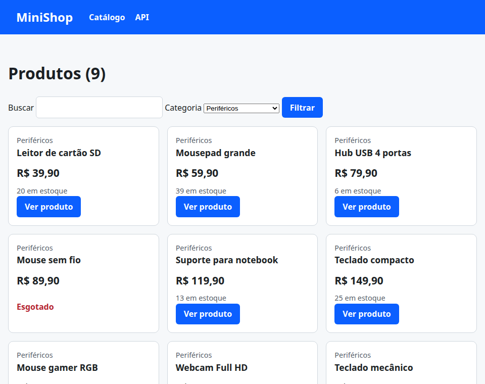

# 05. ORM: consultas

> ⏱️ ~1h30 · Módulo 5 · Pré-requisitos: [04](04-models-migracoes.md); SQL ([aulas 3.04 a 3.06](../03-banco-de-dados/04-select-where-order-limit.md)); `Q`/dunders ([aula 1.14](../01-python-logica/14-metodos-especiais-type-hints.md))

## 🎯 Objetivos
Ao final desta aula você consegue:
- Explicar que um **QuerySet é preguiçoso** (*lazy*), encadeável e cacheado, e quando ele realmente consulta o banco
- Filtrar, ordenar, fatiar e projetar dados com `filter`, `exclude`, `get`, `order_by`, `values`, `only`, lookups (`__icontains`, `__gte`, `__in`…) e `Q`
- Usar `F()` para comparar campos e fazer **atualizações atômicas** (`stock = stock - n`)
- Criar, atualizar e apagar em lote (`bulk_create`, `update`, `delete`) e entender o que **não** dispara `save()`
- Ler o SQL gerado (`.query`, `.explain()`) e ligar o catálogo às *views*

## 🤔 Por que isso importa
Em quase toda tela e API do MiniShop há uma consulta ao banco. O ORM faz isso com Python, mas o **desempenho e a correção** dependem de entender o que ele gera: um `len(queryset)` em vez de `.count()`, um `if queryset:` que carrega tudo, ou um `produto.stock -= 1; produto.save()` que **perde vendas** sob concorrência (a *lost update* da aula 3.01). Esta aula transforma o SQL que você já domina em Python idiomático, e o catálogo passa a ler do PostgreSQL.

## 💡 Intuição (explicação simples)
Um **QuerySet** é um **pedido de compras anotado, mas ainda não enviado**: você vai acrescentando condições (“só os ativos”, “do mais barato ao mais caro”, “os 10 primeiros”) e nada acontece no mercado (o banco) enquanto você **não olha o resultado**. Só quando você percorre a lista, conta, ou pede o primeiro item o pedido é enviado, **uma única vez**, e a resposta fica guardada para as próximas olhadas.

## 🔬 Como funciona por dentro
**1. Lazy e cache.** `Product.objects.filter(is_active=True)` **não executa SQL**; devolve um `QuerySet` que descreve a consulta. Ele só é **avaliado** quando você: itera (`for`), converte (`list(qs)`), pega `len()`, usa em `bool` (`if qs:`), pega `qs[0]`/fatia com passo, ou imprime (`repr`). Depois de avaliado, o resultado fica em **cache** no objeto: iterar de novo **não** consulta de novo. Cada método de encadeamento (`.filter().order_by()[:10]`) devolve um **novo** QuerySet.

| Quero saber… | Use | SQL |
|---|---|---|
| quantos | `qs.count()` | `SELECT COUNT(*)` |
| se existe algum | `qs.exists()` | `SELECT 1 … LIMIT 1` |
| os objetos | `list(qs)` / `for` | `SELECT …` |
| **não use** para contar | `len(qs)` | carrega **tudo** para contar |
| **não use** para “tem algo?” | `if qs:` | carrega tudo |

**2. Como o QuerySet vira SQL.** `.filter(price__gte=100, is_active=True)` → `WHERE price >= 100 AND is_active`. O sufixo após `__` é o **lookup**:

| Lookup | SQL | Exemplo |
|---|---|---|
| `exact` (padrão) · `iexact` | `=` · `ILIKE` sem curinga | `sku__iexact="mn-04"` |
| `contains` · `icontains` | `LIKE '%x%'` · `ILIKE` | `name__icontains="mouse"` |
| `startswith` · `endswith` | `LIKE 'x%'` | `name__istartswith="cabo"` |
| `gt` `gte` `lt` `lte` | `>` `>=` `<` `<=` | `price__lte=100` |
| `in` · `range` | `IN (…)` · `BETWEEN` | `sku__in=[…]` · `price__range=(10, 50)` |
| `isnull` | `IS NULL` | `description__isnull=False` |
| `date`, `year`, `month` | extrai parte da data | `created_at__year=2026` |
| **atravessar relação** | `JOIN` automático | `category__slug="audio"` |

- **Vários `filter()` encadeados** com atributos de relações *multivaloradas* têm semânticas sutis (aula 06). `exclude()` é `NOT (…)`.
- **`Q`**: combina condições com `|` (OR), `&` (AND) e `~` (NOT): `Q(name__icontains=t) | Q(sku__iexact=t)`.
- **`F`**: referencia **uma coluna** dentro da consulta: `filter(stock__lt=F("min_stock"))`, `update(stock=F("stock") - 1)` (a conta é feita **pelo banco**, atomicamente).
- **`get()`** devolve exatamente **um** objeto; levanta `Product.DoesNotExist` (0 resultados) ou `Product.MultipleObjectsReturned` (> 1). `first()`/`last()` devolvem `None` se vazio.
- **Fatiar** (`qs[10:20]`) vira `LIMIT/OFFSET` (ordene antes, aula 3.04!).
- **Projeções:** `values("sku", "price")` (dicionários), `values_list("sku", flat=True)` (valores), `only("name")`/`defer("description")` (objetos com poucas colunas).
- **Escrita:** `create()`, `save()`, `bulk_create([...])` (1 `INSERT` para N objetos), `bulk_update(objs, fields)`, `qs.update(campo=valor)` e `qs.delete()` (**em lote**, em **uma** instrução SQL). Os métodos em lote **não chamam `save()`** nem os sinais; `auto_now` não é atualizado em `update()`.
- **`get_or_create`/`update_or_create`**: *upsert* em Python, com transação (mas sob concorrência dependa de uma restrição `UNIQUE`).

**3. Atualização atômica.** `produto.stock -= 1; produto.save()` lê, calcula em Python e grava: **duas pessoas ao mesmo tempo perdem uma venda** (aula 3.09). A forma correta empurra a conta para o banco e confere o resultado:

```python
linhas = Product.objects.filter(pk=pk, stock__gte=n).update(stock=F("stock") - n)    # UPDATE ... WHERE stock >= n
if linhas == 0: raise EstoqueInsuficiente
```
É o mesmo `UPDATE ... WHERE stock >= n` da aula 3.09, e será o núcleo do pedido (aula 17).

## 🛠️ Exemplo prático
Continuamos com o banco `minishop` e os 50 produtos do `seed_catalogo` (aula 04).

**1. Preguiça e cache, medidas em consultas reais**
```python
import os
import django

os.environ["DJANGO_SETTINGS_MODULE"] = "config.settings"
django.setup()
from django.db import connection
from django.db.models import F, Q
from django.test.utils import CaptureQueriesContext

from apps.catalog.models import Category, Product


def n_sql(c):
    """Conta só as consultas reais (o Django também registra BEGIN/COMMIT/SAVEPOINT)."""
    return len([q for q in c.captured_queries if not q["sql"].startswith(("BEGIN", "COMMIT", "SAVEPOINT", "RELEASE"))])


def consultas(rotulo, fn):
    with CaptureQueriesContext(connection) as c:
        resultado = fn()
    print(f"{n_sql(c):>2} consulta(s) | {rotulo:<48} | {resultado}")


def novo():
    return Product.objects.filter(is_active=True).order_by("price")        # cada chamada é um QuerySet NOVO (sem cache)


consultas("montar o QuerySet (lazy), sem usá-lo", lambda: type(novo()).__name__)
consultas("count()", lambda: novo().count())
consultas("exists()", lambda: novo().exists())
consultas("qs[0]  (LIMIT 1)", lambda: novo()[0].sku)
consultas("qs.first()", lambda: novo().first().sku)
consultas("len(qs)  [carrega TUDO]", lambda: len(novo()))
qs = novo()
consultas("1ª passada: for sobre 47 itens", lambda: sum(1 for _ in qs))
consultas("2ª passada: o mesmo QuerySet (cache)", lambda: sum(1 for _ in qs))
consultas("len(qs) depois de avaliado (cache)", lambda: len(qs))
```
```bash
uv run python explorar_orm.py
```
```text
 0 consulta(s) | montar o QuerySet (lazy), sem usá-lo             | QuerySet
 1 consulta(s) | count()                                          | 47
 1 consulta(s) | exists()                                         | True
 1 consulta(s) | qs[0]  (LIMIT 1)                                 | CB-04
 1 consulta(s) | qs.first()                                       | CB-04
 1 consulta(s) | len(qs)  [carrega TUDO]                          | 47
 1 consulta(s) | 1ª passada: for sobre 47 itens                   | 47
 0 consulta(s) | 2ª passada: o mesmo QuerySet (cache)             | 47
 0 consulta(s) | len(qs) depois de avaliado (cache)               | 47
```
`count()` e `exists()` fazem uma consulta **leve**; `len(qs)` carrega as 47 linhas só para contar (mas depois a lista fica em cache); `qs[0]` e `first()` usam `LIMIT 1`. Em uma tabela de 1 milhão de linhas, a diferença é a de milissegundos contra segundos de memória.

**2. Do Python ao SQL: filtros, `Q`, `F` e ordenação**
```python
import os
import django

os.environ["DJANGO_SETTINGS_MODULE"] = "config.settings"
django.setup()
from django.db.models import F, Q

from apps.catalog.models import Product

casos = {
    "ativos de R$ 100 a 200, do mais barato": Product.objects.filter(is_active=True, price__range=(100, 200)).order_by("price", "id"),
    "busca: nome contém 'mouse' OU sku = pf-01": Product.objects.filter(Q(name__icontains="mouse") | Q(sku__iexact="pf-01")),
    "atravessando a FK: categoria 'audio' sem estoque": Product.objects.filter(category__slug="audio", stock=0),
    "NOT: fora de 'cabos-e-adaptadores' e custa < 50": Product.objects.filter(~Q(category__slug="cabos-e-adaptadores"), price__lt=50),
    "F: estoque menor que 10 mas ativo (campo × valor)": Product.objects.filter(stock__lt=10, is_active=True).only("sku", "stock"),
    "página 3 de 10 (OFFSET 20 LIMIT 10)": Product.objects.order_by("id")[20:30],
}
for titulo, qs in casos.items():
    sql = str(qs.query)
    print(f"## {titulo}\n   …{sql[sql.index(' FROM '):][:330]}\n   → {qs.count()} linha(s)\n")
```
```bash
uv run python explorar_sql.py
```
```text
## ativos de R$ 100 a 200, do mais barato
   … FROM "catalog_product" WHERE ("catalog_product"."is_active" AND "catalog_product"."price" BETWEEN 100 AND 200) ORDER BY "catalog_product"."price" ASC, "catalog_product"."id" ASC
   → 8 linha(s)

## busca: nome contém 'mouse' OU sku = pf-01
   … FROM "catalog_product" WHERE (UPPER("catalog_product"."name"::text) LIKE UPPER(%mouse%) OR UPPER("catalog_product"."sku"::text) = UPPER(pf-01)) ORDER BY "catalog_product"."name" ASC
   → 3 linha(s)

## atravessando a FK: categoria 'audio' sem estoque
   … FROM "catalog_product" INNER JOIN "catalog_category" ON ("catalog_product"."category_id" = "catalog_category"."id") WHERE ("catalog_category"."slug" = audio AND "catalog_product"."stock" = 0) ORDER BY "catalog_product"."name" ASC
   → 1 linha(s)

## NOT: fora de 'cabos-e-adaptadores' e custa < 50
   … FROM "catalog_product" INNER JOIN "catalog_category" ON ("catalog_product"."category_id" = "catalog_category"."id") WHERE (NOT ("catalog_category"."slug" = cabos-e-adaptadores) AND "catalog_product"."price" < 50) ORDER BY "catalog_product"."name" ASC
   → 4 linha(s)

## F: estoque menor que 10 mas ativo (campo × valor)
   … FROM "catalog_product" WHERE ("catalog_product"."is_active" AND "catalog_product"."stock" < 10) ORDER BY "catalog_product"."name" ASC
   → 12 linha(s)

## página 3 de 10 (OFFSET 20 LIMIT 10)
   … FROM "catalog_product" ORDER BY "catalog_product"."id" ASC LIMIT 10 OFFSET 20
   → 10 linha(s)
```
Compare com os SQLs que você escreveu nas aulas 3.04 a 3.06: o ORM gera os mesmos `WHERE`, `JOIN` (a FK atravessada vira `INNER JOIN`) e `LIMIT/OFFSET`. **Sempre que uma consulta parecer lenta, olhe o `.query`** e rode o `EXPLAIN` (aula 3.08):
```bash
uv run python manage.py shell -v 0 -c "
from apps.catalog.models import Product
print(Product.objects.filter(is_active=True, price__lte=100).order_by('price').explain())
"
```
```text
Sort  (cost=2.06..2.06 rows=1 width=699)
  Sort Key: price
  ->  Seq Scan on catalog_product  (cost=0.00..2.05 rows=1 width=699)
        Filter: (is_active AND (price <= '100'::numeric))
```
**3. Projeções, `get` e criação em lote**
```python
import os
import django

os.environ["DJANGO_SETTINGS_MODULE"] = "config.settings"
django.setup()
from django.db import connection
from django.db.models import F
from django.test.utils import CaptureQueriesContext

from apps.catalog.models import Category, Product


def n_sql(c):
    return len([q for q in c.captured_queries if not q["sql"].startswith(("BEGIN", "COMMIT", "SAVEPOINT", "RELEASE"))])


print(Product.objects.values("sku", "price")[:2])
print(list(Product.objects.values_list("sku", flat=True)[:3]), "| só os nomes:", Product.objects.values_list("name", flat=True).first())
print(Product.objects.filter(sku="MN-04").only("sku", "price").get().__dict__.keys() - {"_state"})

for rotulo, fn in [("get() de 1", lambda: Product.objects.get(sku="MN-04")),
                   ("get() de 0", lambda: Product.objects.get(sku="NAO-EXISTE")),
                   ("get() de vários", lambda: Product.objects.get(category__slug="audio"))]:
    try:
        fn()
    except (Product.DoesNotExist, Product.MultipleObjectsReturned) as e:
        print(f"{rotulo}: {type(e).__name__}")
print("first() quando vazio:", Product.objects.filter(sku="NAO-EXISTE").first())

cat = Category.objects.get(slug="perifericos")
novos = [Product(category=cat, sku=f"T-{i:02d}", name=f"Produto de teste {i}", slug=f"teste-{i}", price="9.90", stock=5) for i in range(1, 101)]
with CaptureQueriesContext(connection) as c:
    Product.objects.bulk_create(novos)
print(f"bulk_create de 100 objetos → {n_sql(c)} consulta(s)")
with CaptureQueriesContext(connection) as c:
    for p in Product.objects.filter(sku__startswith="T-"):      # 1 SELECT + 100 UPDATEs (um save() por objeto)
        p.price = "19.90"; p.save()
print(f"loop com save() → {n_sql(c)} consulta(s)")
with CaptureQueriesContext(connection) as c:
    linhas = Product.objects.filter(sku__startswith="T-").update(price="29.90")
print(f"update() em lote → {n_sql(c)} consulta(s), {linhas} linhas afetadas")
with CaptureQueriesContext(connection) as c:
    apagados, por_tabela = Product.objects.filter(sku__startswith="T-").delete()
print(f"delete() em lote → {n_sql(c)} consulta(s), {apagados} apagados {por_tabela}")
```
```bash
uv run python explorar_orm2.py
```
```text
<QuerySet [{'sku': 'AU-08', 'price': Decimal('29.90')}, {'sku': 'CB-07', 'price': Decimal('39.90')}]>
['AU-08', 'CB-07', 'CB-08'] | só os nomes: Adaptador de áudio USB
{'id', 'sku', 'price'}
get() de 0: DoesNotExist
get() de vários: MultipleObjectsReturned
first() quando vazio: None
bulk_create de 100 objetos → 1 consulta(s)
loop com save() → 101 consulta(s)
update() em lote → 1 consulta(s), 100 linhas afetadas
delete() em lote → 1 consulta(s), 100 apagados {'catalog.Product': 100}
```
O `bulk_create` (1 `INSERT` com 100 linhas) e o `update()` em lote (1 `UPDATE`) são ordens de grandeza mais baratos que um laço com `save()` (1 consulta por objeto). O preço: eles **não chamam `save()`** (o nosso `save()` que normaliza o SKU e gera o `slug` não rodou, por isso passamos `slug` à mão) nem atualizam `auto_now`.

**4. Atualização atômica com `F` sob concorrência real**
```python
import os, threading
import django

os.environ["DJANGO_SETTINGS_MODULE"] = "config.settings"
django.setup()
from django.db import connection
from django.db.models import F

from apps.catalog.models import Product

alvo = Product.objects.get(sku="PF-01")
Product.objects.filter(pk=alvo.pk).update(stock=10)


def vender_ingenuo(resultados):                  # ERRADO: lê, calcula em Python, grava
    p = Product.objects.get(pk=alvo.pk)
    if p.stock >= 1:
        p.stock -= 1
        p.save(update_fields=["stock"])
        resultados.append(1)
    connection.close()


def vender_atomico(resultados):                  # CERTO: o banco decide E altera na mesma instrução
    linhas = Product.objects.filter(pk=alvo.pk, stock__gte=1).update(stock=F("stock") - 1)
    resultados.append(linhas)
    connection.close()


def rodar(estrategia, tentativas=40):
    Product.objects.filter(pk=alvo.pk).update(stock=10)
    resultados = []
    ts = [threading.Thread(target=estrategia, args=(resultados,)) for _ in range(tentativas)]
    [t.start() for t in ts]; [t.join() for t in ts]
    final = Product.objects.get(pk=alvo.pk).stock
    return sum(resultados), final


vendidas, restante = rodar(vender_ingenuo)
print(f"ingênuo: 40 tentativas, estoque 10 → vendas confirmadas={vendidas}, estoque final={restante}  (vendeu {vendidas}, mas o estoque só baixou {10 - restante}; o nº exato varia a cada execução)")
vendidas, restante = rodar(vender_atomico)
print(f"atômico: 40 tentativas, estoque 10 → vendas confirmadas={vendidas}, estoque final={restante}")
Product.objects.filter(pk=alvo.pk).update(stock=Product.objects.filter(pk=alvo.pk).values_list("stock", flat=True)[0] or 0)
```
```bash
uv run python explorar_estoque.py
```
```text
ingênuo: 40 tentativas, estoque 10 → vendas confirmadas=27, estoque final=0  (vendeu 27, mas o estoque só baixou 10; o nº exato varia a cada execução)
atômico: 40 tentativas, estoque 10 → vendas confirmadas=10, estoque final=0
```
A versão ingênua (lê, subtrai em Python e grava) **confirma mais vendas do que o estoque comporta** e o saldo final fica inconsistente (a *lost update* da aula 3.01, agora no Django). A atômica vende **exatamente 10** e o estoque chega a 0. Retorno do `update()` = **número de linhas alteradas**: é assim que você sabe se a venda “passou”.

**5. O catálogo agora lê do banco**
```python
import json
from decimal import Decimal, InvalidOperation

from django.db.models import Q
from django.http import HttpResponseBadRequest, JsonResponse
from django.middleware.csrf import get_token
from django.shortcuts import get_object_or_404, redirect, render
from django.views.decorators.csrf import ensure_csrf_cookie
from django.views.decorators.http import require_GET, require_http_methods

from .models import Category, Product

ORDENACOES = {"nome": "name", "preco": "price", "-preco": "-price", "novos": "-created_at"}     # lista de permissão (aula 3.10)


def _decimal(texto):
    try:
        return Decimal(texto)
    except (InvalidOperation, TypeError):
        return None


def filtrar(params):
    """Monta o QuerySet do catálogo a partir da query string (compartilhado entre a página e a API)."""
    qs = Product.objects.filter(is_active=True)
    busca = params.get("busca", "").strip()
    if busca:
        qs = qs.filter(Q(name__icontains=busca) | Q(sku__iexact=busca))
    if params.get("categoria"):
        qs = qs.filter(category__slug=params["categoria"])
    if (minimo := _decimal(params.get("preco_min"))) is not None:
        qs = qs.filter(price__gte=minimo)
    if (maximo := _decimal(params.get("preco_max"))) is not None:
        qs = qs.filter(price__lte=maximo)
    return qs.order_by(ORDENACOES.get(params.get("ordem"), "name"), "id")           # desempate por id (aula 3.04)


@require_GET
def lista(request):
    itens = filtrar(request.GET)
    return render(request, "catalog/product_list.html",
                  {"itens": itens, "busca": request.GET.get("busca", ""), "categorias": Category.objects.all()})


@require_GET
def detalhe(request, slug):
    produto = get_object_or_404(Product, slug=slug, is_active=True)          # 404 automático, em 1 linha
    return render(request, "catalog/product_detail.html", {"produto": produto})


@require_GET
def api_lista(request):
    itens = list(filtrar(request.GET).values("sku", "name", "slug", "price", "stock", "category__slug"))
    return JsonResponse({"total": len(itens), "itens": itens}, json_dumps_params={"ensure_ascii": False})


@require_http_methods(["GET", "POST"])
@ensure_csrf_cookie
def contato(request):
    if request.method == "GET":
        return JsonResponse({"csrf": get_token(request), "dica": "envie o token no cabeçalho X-CSRFToken"})
    try:
        dados_post = json.loads(request.body) if request.content_type == "application/json" else request.POST.dict()
    except json.JSONDecodeError:
        return HttpResponseBadRequest("JSON inválido")
    nome, mensagem = dados_post.get("nome", "").strip(), dados_post.get("mensagem", "").strip()
    if not nome or not mensagem:
        return JsonResponse({"erro": "nome e mensagem são obrigatórios"}, status=422)
    return JsonResponse({"recebido": {"nome": nome, "mensagem": mensagem}}, status=201)


def antiga(request):
    return redirect("catalog:list", permanent=True)
```
```html

<li>
  <article class="card">
    <p class="suave">{{ produto.category.name }}</p>
    <h3><a href="{{ produto.get_absolute_url }}">{{ produto.name }}</a></h3>
    <p class="preco">{{ produto.price|real }}</p>
    
      <p class="suave">{{ produto.stock }} em estoque</p>
      <a class="botao" href="{{ produto.get_absolute_url }}">Ver produto</a>
    
      <p class="esgotado">Esgotado</p>
    
  </article>
</li>
```
```html

Produtos — {{ NOME_LOJA }}

  <h1>Produtos ({{ itens|length }})</h1>
  <form method="get" role="search">
    <label for="busca">Buscar</label>
    <input id="busca" name="busca" type="search" value="{{ busca }}">
    <label for="categoria">Categoria</label>
    <select id="categoria" name="categoria">
      <option value="">Todas</option>
      <option value="{{ c.slug }}" selected>{{ c.name }}</option>
    </select>
    <button class="botao" type="submit">Filtrar</button>
  </form>
  <ul class="grade">
    
      
    
      <li class="msg">Nenhum produto encontrado para “{{ busca }}”.</li>
    
  </ul>

```
```html


{{ produto.name }} — {{ NOME_LOJA }}

  <nav aria-label="Você está em"><a href="">Catálogo</a> › {{ produto.category.name }} › {{ produto.name }}</nav>
  <h1>{{ produto.name }}</h1>
  <p class="suave">SKU {{ produto.sku }} · {{ produto.category.name }}</p>
  <p class="preco">{{ produto.price|real }}</p>
  
    <p>{{ produto.stock }} unidade{{ produto.stock|pluralize }} em estoque.</p>
  
    <p class="esgotado">Produto esgotado.</p>
  

```
```bash
rm -f apps/catalog/dados.py
touch apps/__init__.py
uv run python manage.py check
```
```text
System check identified no issues (0 silenced).
```
O módulo provisório `dados.py` foi removido: a fonte da verdade passou a ser o PostgreSQL. **Repare** em `produto.category.name` no cartão: cada acesso à categoria **dentro de um laço** pode gerar uma consulta extra. Vamos medir isso na aula 07; por enquanto, o *middleware* da aula 01 já avisa:
```python
import subprocess, time, urllib.request
servidor = subprocess.Popen(["uv", "run", "python", "manage.py", "runserver", "8123", "--noreload"],
                            stdout=open("servidor.log", "w"), stderr=subprocess.STDOUT)
for _ in range(60):
    try:
        urllib.request.urlopen("http://127.0.0.1:8123/saude/", timeout=1); break
    except Exception:
        time.sleep(0.5)
print("servidor no ar")
```
```text
servidor no ar
```
```bash
B=http://127.0.0.1:8123
for url in "/produtos/" "/produtos/?busca=mouse" "/produtos/?categoria=audio&ordem=preco" "/api/produtos/?preco_min=1000&ordem=-preco" "/produtos/monitor-27-polegadas-4k/"; do
  curl -s -o /dev/null -D - "$B$url" | tr -d '\r' | awk -v u="$url" 'BEGIN{IGNORECASE=1} /^HTTP/{s=$2} /^x-consultas-sql/{q=$2} /^x-tempo-ms/{t=$2} END{printf "%-44s status=%s  consultas SQL=%s  tempo=%s ms\n", u, s, q, t}'
done
curl -s "$B/api/produtos/?preco_min=2000&ordem=-preco" | python3 -c "import sys,json; d=json.load(sys.stdin); print(d['total'], [i['sku']+' '+i['price'] for i in d['itens']])"
shot 05-catalogo.png 960x760 "$B/produtos/?categoria=perifericos&ordem=preco" 3000
```
```text
/produtos/                                   status=200  consultas SQL=49  tempo=43.1 ms
/produtos/?busca=mouse                       status=200  consultas SQL=5  tempo=12.4 ms
/produtos/?categoria=audio&ordem=preco       status=200  consultas SQL=12  tempo=14.6 ms
/api/produtos/?preco_min=1000&ordem=-preco   status=200  consultas SQL=1  tempo=7.6 ms
/produtos/monitor-27-polegadas-4k/           status=200  consultas SQL=2  tempo=9.6 ms
1 ['MN-04 2199.00']
```

Repare em `consultas SQL=`: a lista de produtos com 47 itens faz **bem mais de 2 consultas** (1 para os produtos + 1 por categoria acessada no cartão + a lista de categorias do filtro): é o problema N+1 da aula 07, que o `X-Consultas-SQL` nos mostra de graça.
```python
servidor.terminate(); servidor.wait(); print("servidor encerrado")
```
```text
servidor encerrado
```
**6. Testes (com o *seed* como fixture)**
```python
import pytest
from django.core.management import call_command


@pytest.fixture
def catalogo(db):
    """50 produtos em 5 categorias, via o comando de seed (idempotente)."""
    call_command("seed_catalogo")
```
```python
import pytest
from django.test import Client
from django.urls import reverse

from apps.catalog.models import Product

pytestmark = pytest.mark.django_db


def test_lista_mostra_apenas_ativos(client, catalogo):
    corpo = client.get(reverse("catalog:list")).content.decode()
    assert "Produtos (47)" in corpo                                  # 50 - 3 inativos


def test_busca_por_nome_e_por_sku_exato(client, catalogo):
    assert "Produtos (3)" in client.get(reverse("catalog:list"), {"busca": "mouse"}).content.decode()     # Mouse sem fio, Mouse gamer, Mousepad
    corpo = client.get(reverse("catalog:list"), {"busca": "mn-04"}).content.decode()
    assert "Produtos (1)" in corpo and "Monitor 27 polegadas 4K" in corpo


def test_filtro_por_categoria_e_preco(client, catalogo):
    dados = client.get(reverse("catalog:api_list"), {"categoria": "monitores", "preco_min": "1000", "ordem": "-preco"}).json()
    assert [i["sku"] for i in dados["itens"]] == ["MN-04", "MN-05", "MN-03"]            # MN-10 (R$ 2.899) está inativo no seed


def test_entrada_invalida_nao_quebra(client, catalogo):
    resposta = client.get(reverse("catalog:api_list"), {"preco_min": "abc'; DROP TABLE x;--", "ordem": "campo_inexistente"})
    assert resposta.status_code == 200 and resposta.json()["total"] == 47          # ignora o inválido; ordenação só por lista de permissão


def test_detalhe_e_404(client, catalogo):
    assert client.get("/produtos/monitor-27-polegadas-4k/").status_code == 200
    assert client.get("/produtos/nao-existe/").status_code == 404
    inativo = Product.objects.filter(is_active=False).first()
    assert client.get(inativo.get_absolute_url()).status_code == 404            # produto desativado não é público


def test_metodo_nao_permitido_e_redirecionamento(client, catalogo):
    assert client.post(reverse("catalog:list")).status_code == 405
    assert client.get("/loja/").status_code == 301


def test_csrf_e_contato(catalogo):
    assert Client(enforce_csrf_checks=True).post(reverse("catalog:contact"), {"nome": "A", "mensagem": "B"}).status_code == 403
    c = Client()
    assert c.post(reverse("catalog:contact"), {"nome": "Ana", "mensagem": "Oi"}).status_code == 201
    assert c.post(reverse("catalog:contact"), {"nome": ""}).status_code == 422


def test_health_check(client):
    assert client.get(reverse("health")).json() == {"status": "ok", "banco": "ok"}
```
```python
import pytest
from django.template import Context, Template
from django.test import override_settings
from django.urls import reverse

pytestmark = pytest.mark.django_db


def renderizar(texto, **contexto):
    return Template(texto).render(Context(contexto))


@pytest.mark.parametrize("valor, esperado", [
    ("89.90", "R$ 89,90"), ("2199", "R$ 2.199,00"), ("1234567.5", "R$ 1.234.567,50"),
    ("0", "R$ 0,00"), ("-15.5", "-R$ 15,50"), ("0.005", "R$ 0,01"), ("abc", "abc"),
])
def test_filtro_real(valor, esperado):
    assert renderizar("{{ v|real }}", v=valor) == esperado


def test_autoescape_neutraliza_script():
    html = renderizar("{{ t }}", t="<script>alert(1)</script>")
    assert "<script>" not in html and "&lt;script&gt;" in html


def test_lista_usa_heranca_e_include(client, catalogo):
    resposta = client.get(reverse("catalog:list"))
    nomes = [t.name for t in resposta.templates]
    assert {"catalog/product_list.html", "base.html", "catalog/_card.html"} <= set(nomes)
    assert "R$ 2.199,00" in resposta.content.decode() and "Esgotado" in resposta.content.decode()


def test_lista_vazia_escapa_a_busca(client, catalogo):
    corpo = client.get(reverse("catalog:list"), {"busca": "xyz<b>"}).content.decode()
    assert "Nenhum produto encontrado para “xyz&lt;b&gt;”" in corpo


@override_settings(DEBUG=False)
def test_pagina_404_personalizada(client, catalogo):
    resposta = client.get("/produtos/nao-existe/")
    assert resposta.status_code == 404 and "Ops, essa página não existe" in resposta.content.decode()
```
```python
import threading

import pytest
from django.db import connection
from django.db.models import F, Q
from django.test.utils import CaptureQueriesContext

from apps.catalog.models import Product


@pytest.mark.django_db
def test_queryset_e_preguicoso_e_cacheia(catalogo):
    with CaptureQueriesContext(connection) as c:
        qs = Product.objects.filter(is_active=True)
        assert len(c) == 0                                           # montar não consulta
        list(qs); list(qs)
    assert len(c) == 1                                               # 2 iterações, 1 consulta (cache)


@pytest.mark.django_db
def test_count_exists_e_first_sao_leves(catalogo):
    with CaptureQueriesContext(connection) as c:
        Product.objects.count(); Product.objects.exists(); Product.objects.order_by("id").first()
    assert len(c) == 3 and all("COUNT" in q["sql"] or "LIMIT" in q["sql"] for q in c.captured_queries)


@pytest.mark.django_db
def test_q_combina_com_ou_e_nao(catalogo):
    ou = Product.objects.filter(Q(name__icontains="mouse") | Q(sku__iexact="MN-04")).count()
    nao = Product.objects.filter(~Q(category__slug="cabos-e-adaptadores")).count()
    assert ou == 4 and nao == 40


@pytest.mark.django_db
def test_update_em_lote_nao_roda_save(catalogo):
    Product.objects.filter(sku__startswith="PF-").update(price="1.00")
    assert set(Product.objects.filter(sku__startswith="PF-").values_list("price", flat=True)) == {1}


@pytest.mark.django_db(transaction=True)
def test_baixa_de_estoque_atomica_com_concorrencia(catalogo):
    alvo = Product.objects.get(sku="PF-01")
    Product.objects.filter(pk=alvo.pk).update(stock=10)
    resultados = []

    def comprar():
        try:
            resultados.append(Product.objects.filter(pk=alvo.pk, stock__gte=1).update(stock=F("stock") - 1))
        finally:
            connection.close()

    ts = [threading.Thread(target=comprar) for _ in range(30)]
    [t.start() for t in ts]; [t.join() for t in ts]
    assert sum(resultados) == 10 and Product.objects.get(pk=alvo.pk).stock == 0         # exatamente 10 vendas
```
```bash
uv run pytest
```
```text
.....................................                                    [100%]
37 passed in 1.41s
```
(O último teste usa `transaction=True` porque as *threads* precisam enxergar os dados **confirmados**, em conexões diferentes; os testes comuns rodam dentro de uma transação desfeita ao final.)

## ⚠️ Erros comuns e boas práticas
| Mensagem / sintoma | Causa | Solução |
|---|---|---|
| `Product.DoesNotExist: Product matching query does not exist.` | `get()` sem resultado | `filter(...).first()`, `get_object_or_404`, ou `try/except` |
| `MultipleObjectsReturned: get() returned more than one Product` | `get()` com critério não único | Critério único (PK/`unique`) ou `filter()` |
| `FieldError: Cannot resolve keyword 'preco' into field. Choices are: ...` | Nome de campo/lookup errado | A mensagem lista os campos válidos |
| `TypeError: Field 'id' expected a number but got 'abc'` / `ValidationError` ao filtrar | Valor do tipo errado vindo da URL | Converta e valide (`_decimal`) antes de filtrar |
| Lista “vazia” depois de iterar duas vezes com `iterator()` | `iterator()` não cacheia | Use apenas uma passada, ou a lista normal |
| `AssertionError: Cannot filter a query once a slice has been taken.` | `.filter()` depois de `[:10]` | Filtre **antes** de fatiar |
| `django.db.utils.IntegrityError` em `bulk_create` | Duplicata/`NOT NULL` | `ignore_conflicts=True` com consciência, ou valide antes |
| `bulk_create`/`update()` “não normalizou o SKU/slug” | Não chamam `save()` nem sinais | Normalize antes, ou use laço com `save()` quando a regra importa |
| Estoque inconsistente em concorrência | `p.stock -= 1; p.save()` | `update(stock=F("stock") - 1)` com `filter(stock__gte=n)` e confira o nº de linhas |
| Página lenta com “poucos” produtos | N+1 (acessar a FK no laço) | `select_related`/`prefetch_related` (aula 07) |
| `if produtos:` e `len(produtos)` lentos em tabelas grandes | Carregam tudo | `exists()` e `count()` |

- **Nunca** use `len(qs)`/`if qs:` só para contar/testar existência.
- Use **`F()`** para contas no banco; **`Q()`** para `OR`/`NOT`; **lista de permissão** para `order_by` vindo do usuário (aula 3.10); **valide** parâmetros da URL.
- `values()`/`only()` quando só precisa de poucas colunas (APIs, relatórios).
- Em dúvida, **imprima `.query`** e rode `.explain()`.
- Operações em lote são rápidas, mas **pulam `save()`, sinais e `auto_now`**: conheça o custo.

## 🧠 Pausa para lógica
**Problema (um `Q` de brinquedo).** Implemente a classe `Q` em Python puro, com `&`, `|` e `~` (métodos especiais da aula 1.14), capaz de **avaliar** uma linha (dicionário) com lookups `exact`, `icontains`, `gte`, `lte` e `in`. Confira que `Q(price__gte=100) & ~Q(cat="cabos-e-adaptadores") | Q(sku__in=[…])` dá o **mesmo número de linhas** que o ORM no seu banco.

<details><summary>Dica</summary>
Cada <code>Q</code> guarda uma <em>árvore</em>: ou uma condição (<code>campo__lookup=valor</code>), ou um operador com filhos. <code>__and__</code>/<code>__or__</code> devolvem um novo <code>Q</code> com os dois lados; <code>__invert__</code> marca a negação. <code>avaliar(linha)</code> percorre a árvore recursivamente.
</details>

<details><summary>Solução comentada</summary>

```python
import os
import django

os.environ["DJANGO_SETTINGS_MODULE"] = "config.settings"
django.setup()
from django.db.models import Q as QDjango

from apps.catalog.models import Product

LOOKUPS = {
    "exact": lambda a, b: a == b,
    "icontains": lambda a, b: b.lower() in str(a).lower(),
    "gte": lambda a, b: a >= b,
    "lte": lambda a, b: a <= b,
    "in": lambda a, b: a in b,
}


class Q:
    def __init__(self, **condicoes):
        self.op, self.filhos, self.negado = "AND", [("cond", k, v) for k, v in condicoes.items()], False

    @classmethod
    def _combinar(cls, op, a, b):
        novo = cls(); novo.op, novo.filhos = op, [("q", a), ("q", b)]
        return novo

    def __and__(self, outro): return Q._combinar("AND", self, outro)
    def __or__(self, outro): return Q._combinar("OR", self, outro)
    def __invert__(self):
        copia = Q(); copia.op, copia.filhos, copia.negado = self.op, self.filhos, not self.negado
        return copia

    def avaliar(self, linha):
        resultados = []
        for filho in self.filhos:
            if filho[0] == "cond":
                campo, _, lookup = filho[1].partition("__")
                lookup = lookup if lookup in LOOKUPS else "exact"
                campo = filho[1] if filho[1].partition("__")[2] not in LOOKUPS else campo
                resultados.append(LOOKUPS[lookup](linha[campo], filho[2]))
            else:
                resultados.append(filho[1].avaliar(linha))
        ok = all(resultados) if self.op == "AND" else any(resultados)
        return not ok if self.negado else ok


from django.db.models import F
linhas = list(Product.objects.values("sku", "name", "price", cat=F("category__slug")))
condicao = (Q(price__gte=100) & ~Q(cat="cabos-e-adaptadores")) | Q(sku__in=["CB-01", "CB-02"])
meu = sum(condicao.avaliar(l) for l in linhas)
orm = Product.objects.filter((QDjango(price__gte=100) & ~QDjango(category__slug="cabos-e-adaptadores")) | QDjango(sku__in=["CB-01", "CB-02"])).count()
print("mini-Q:", meu, "| ORM:", orm, "| iguais?", meu == orm)
print(str(Product.objects.filter((QDjango(price__gte=100) & ~QDjango(category__slug="cabos-e-adaptadores")) | QDjango(sku__in=["CB-01", "CB-02"])).query).split("WHERE")[1][:200])
```
```bash
uv run python mini_q.py
```
```text
mini-Q: 29 | ORM: 29 | iguais? True
 (("catalog_product"."price" >= 100 AND NOT ("catalog_category"."slug" = cabos-e-adaptadores)) OR "catalog_product"."sku" IN (CB-01, CB-02)) ORDER BY "catalog_product"."name" ASC
```
O ORM faz o mesmo em duas etapas: **representa** a condição como uma árvore de `Q` (com os operadores sobrecarregados, exatamente como você fez) e, em vez de avaliar linha a linha em Python, **compila** a árvore em SQL (`WHERE (… AND NOT …) OR …`), deixando o banco avaliá-la com índices.
</details>

**Variação mais difícil:** faça `Q` **compilar** para SQL parametrizado (`("(price >= %s AND NOT (category = %s))", [100, "cabos"])`) e compare com `str(qs.query)`.

## 🧩 Exercícios
**1. Fixação**
(a) Quantas consultas faz `qs = Product.objects.all(); a = list(qs); b = list(qs)`? (b) O que `update(stock=F("stock") - 1)` tem de melhor que `p.stock -= 1; p.save()`? (c) Como escrever “nome contém X **ou** SKU igual a Y”? (d) Por que `.filter()` depois de fatiar dá erro?

<details><summary>Solução</summary>

(a) **Uma**: o resultado fica em cache no QuerySet. (b) A conta é feita pelo banco, em uma instrução atômica (sem *lost update*), e retorna o nº de linhas alteradas. (c) `filter(Q(name__icontains=X) | Q(sku__iexact=Y))`. (d) Depois do `LIMIT/OFFSET` não se pode acrescentar `WHERE`: filtre antes de fatiar.
</details>

**2. Aplicação no projeto MiniShop**
Evolua a busca do catálogo e valide com testes.

Critérios de pronto:
- [ ] O filtro por `busca`, `categoria`, `preco_min`/`preco_max` e `ordem` (com **lista de permissão**) funciona na página e na API, e a entrada inválida é ignorada sem erro 500
- [ ] Nova rota `GET /api/produtos/<slug>/` com `JsonResponse` (404 em JSON quando não existe) e `GET /api/categorias/` com a **contagem de produtos ativos** por categoria usando `annotate` (**você descobre a sintaxe agora e a aula 06 aprofunda**)
- [ ] Método `Product.baixar_estoque(n)` (classmethod ou *manager method*) que usa `filter(stock__gte=n).update(stock=F("stock") - n)` e devolve `True/False`, com teste de concorrência (30 *threads*, estoque 10)
- [ ] Nenhum `len(qs)`/`if qs:` no código (confira com `grep`); o `X-Consultas-SQL` da lista impresso em `docs/consultas.md` **antes** da aula 07
- [ ] `uv run pytest` verde (≥ 30 testes no projeto)
- [ ] Commit `feat(catalog): orm queries, filters and atomic stock update`

<details><summary>Solução de referência</summary>

```python
# em models.py
class Product(models.Model):
    ...
    @classmethod
    def baixar_estoque(cls, pk, n):
        """Devolve True se baixou, False se não havia estoque suficiente (atômico)."""
        return cls.objects.filter(pk=pk, stock__gte=n).update(stock=models.F("stock") - n) == 1
# API de categorias:
from django.db.models import Count, Q
Category.objects.annotate(ativos=Count("products", filter=Q(products__is_active=True))).values("slug", "name", "ativos")
```
</details>

**3. Desafio (opcional)**
Implemente **paginação por cursor (*keyset*)** na API (`?depois=<preco>_<id>`) usando `Q(price__gt=p) | Q(price=p, id__gt=i)` e compare o `.explain()` com o do `OFFSET` em uma tabela de 100 mil produtos (gere-os com `bulk_create`).

## 🎤 Na entrevista
- **O que significa um QuerySet ser *lazy*?** Montar o QuerySet não executa SQL; a consulta só roda quando o resultado é necessário (iteração, `len`, `bool`, índice, `list`), e fica em cache no objeto.
- **Diferença entre `count()`, `len()` e `exists()`?** `count()` faz `COUNT(*)` no banco; `len()` carrega todos os objetos e conta em Python; `exists()` faz um `SELECT 1 … LIMIT 1`, mais barato para saber se há resultados.
- **O que são `Q` e `F`?** `Q` compõe condições com `AND/OR/NOT`; `F` referencia uma coluna dentro da consulta (comparações entre campos e atualizações calculadas no banco, como `stock = stock - 1`).
- **Como evitar *lost update* ao baixar estoque?** Com `update(stock=F("stock") - n)` filtrando `stock__gte=n` (uma instrução atômica) e conferindo o nº de linhas afetadas, ou `select_for_update()` dentro de uma transação.
- **O que `bulk_create`/`update()`/`delete()` não fazem?** Não chamam `save()`/`delete()` dos modelos nem emitem sinais, e `update()` não atualiza `auto_now`; em troca, executam em uma ou poucas instruções SQL.

## 📚 Para ir além
- 📄 Documentação oficial: [Fazendo consultas (QuerySets)](https://docs.djangoproject.com/en/5.2/topics/db/queries/). O guia central do ORM.
- 📄 Documentação oficial: [Referência de QuerySet](https://docs.djangoproject.com/en/5.2/ref/models/querysets/) e [Lookups](https://docs.djangoproject.com/en/5.2/ref/models/lookups/). Todos os métodos e *lookups*.
- 📄 Documentação oficial: [Expressões de consulta (`F`, `Q`, `Case`…)](https://docs.djangoproject.com/en/5.2/ref/models/expressions/). Cálculos no banco.
- 📄 Documentação oficial: [Otimização de acesso ao banco](https://docs.djangoproject.com/en/5.2/topics/db/optimization/). `count`/`exists`, `iterator`, `defer`/`only`, operações em lote.
- 🏋️ Prática extra: reescreva em ORM as 5 consultas do bloco A da aula 3.07 e compare cada `.query` com o SQL que você escreveu.

## ✅ Checklist da aula
- [ ] Mostrei que o QuerySet é preguiçoso e cacheado, contando consultas
- [ ] Li o `.query` de seis filtros e relacionei com o SQL da aula 3.04
- [ ] Baixa de estoque atômica com `F()` e teste de concorrência
- [ ] Catálogo lendo do banco, sem `dados.py`; `X-Consultas-SQL` anotado
- [ ] Fiz o commit do exercício
