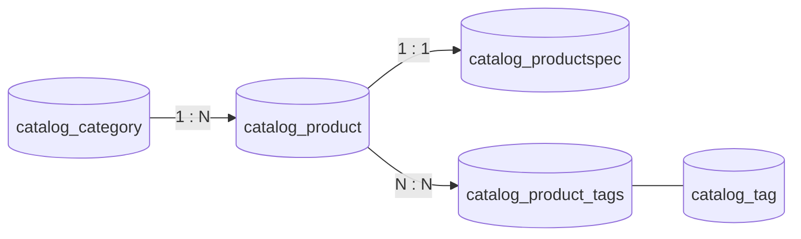
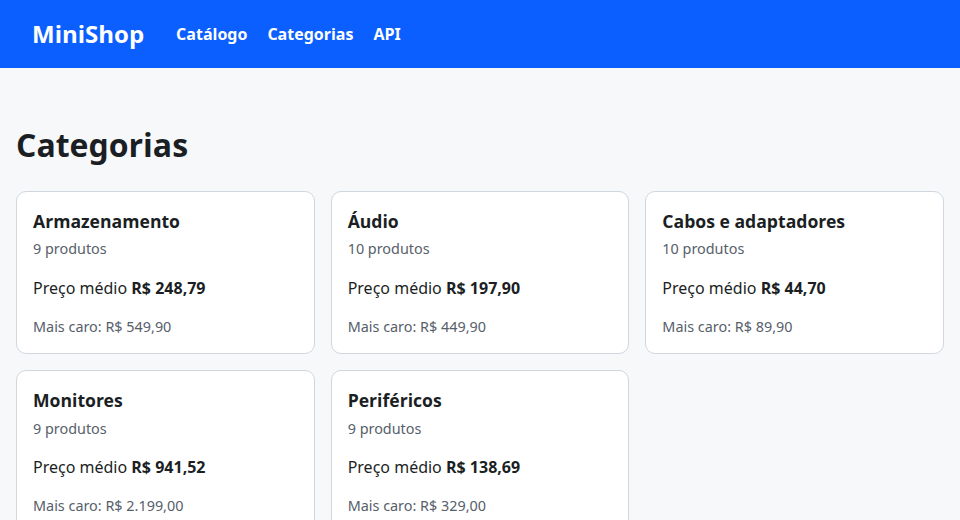

# 06. ORM: relacionamentos e agregações

> ⏱️ ~1h30 · Módulo 5 · Pré-requisitos: [05](05-orm-consultas.md); `JOIN`, `GROUP BY` e subqueries ([aulas 3.05 e 3.06](../03-banco-de-dados/06-group-by-subqueries.md))

## 🎯 Objetivos
Ao final desta aula você consegue:
- Modelar relacionamentos **1:N** (`ForeignKey`), **1:1** (`OneToOneField`) e **N:N** (`ManyToManyField`) e navegar por eles nos dois sentidos
- Filtrar **através** de relações (`category__name`, `products__price__gt`) e entender o `JOIN` gerado
- Calcular totais com `aggregate()` e **agrupar** com `values().annotate()` (`Count`, `Sum`, `Avg`, `Min`, `Max`, `filter=`)
- Evitar duas armadilhas clássicas: `filter()` encadeado em relações múltiplas e **contagem inflada** por dois `JOIN`s
- Usar `Subquery`/`OuterRef`/`Exists` e transformar um relatório em uma consulta só

## 🤔 Por que isso importa
O valor do MiniShop está nas **relações**: categoria → produtos, pedido → itens → produtos, produto ↔ etiquetas. E relatórios do painel (“estoque em R$ por categoria”, “categorias sem produto”, “mais caros de cada categoria”) são agregações. Fazê-las no **banco** (uma consulta) em vez de em Python (milhares de consultas ou de linhas trazidas à memória) é a diferença entre uma página de 20 ms e uma que derruba o servidor.

## 💡 Intuição (explicação simples)
- Relações são **fios ligando fichas**: a ficha do produto tem o código da ficha da categoria (**FK**); a categoria consegue “puxar o fio de volta” e achar todos os produtos (**relação reversa**). No N:N, existe uma **terceira ficha de ligação** (tabela de junção) que diz “este produto tem esta etiqueta”.
- Uma **agregação** é **resumir a pilha de fichas**: `aggregate` dá **um** resumo da pilha toda (“o preço médio de tudo”); `annotate` escreve **um resumo em cada ficha** (“esta categoria tem 10 produtos”); e `values().annotate()` **separa em pilhas** (por categoria) e resume cada pilha: o `GROUP BY`.

## 🔬 Como funciona por dentro
**Relacionamentos**

| Relação | Campo (no lado “dono”) | Acessor direto | Acessor reverso (padrão) |
|---|---|---|---|
| 1:N | `ForeignKey(Category, related_name="products")` em `Product` | `produto.category` | `categoria.products` (um *manager*) |
| 1:1 | `OneToOneField(Product, related_name="spec")` em `ProductSpec` | `spec.product` | `produto.spec` (**um objeto**, não uma lista) |
| N:N | `ManyToManyField(Tag, related_name="products")` em `Product` | `produto.tags` (*manager*) | `tag.products` |

- A FK vira a coluna `category_id`; o N:N vira uma **tabela de junção** `catalog_product_tags(product_id, tag_id)` criada pelo Django. Se a relação tem **atributos próprios** (quantidade, preço pago…), declare a tabela de junção você mesmo com `through=` (é o caso de `OrderItem`, aula 17).
- No N:N: `produto.tags.add(t1, t2)`, `.remove()`, `.set([...])`, `.clear()`; as mudanças vão direto ao banco (não precisam de `save()`).
- **`related_name`** nomeia o lado reverso. Sem ele o Django usa `<modelo>_set` (`category.product_set`).

**Atravessando relações em filtros.** `Product.objects.filter(category__slug="audio")` gera um `INNER JOIN`; o inverso também funciona: `Category.objects.filter(products__price__gt=1000)` (categorias que **têm** algum produto caro; pode **repetir** a categoria se houver vários → `distinct()`).

**Agregações**
- `qs.aggregate(Avg("price"), Max("price"))` → **um dicionário** (a pilha inteira). SQL: `SELECT AVG(...), MAX(...) FROM ...`.
- `qs.annotate(n=Count("products"))` → **cada objeto** ganha o atributo `n`. Como o `JOIN` multiplica linhas, o Django acrescenta o `GROUP BY` do objeto automaticamente.
- `qs.values("category__name").annotate(total=Sum("stock"))` → `GROUP BY category.name`: **uma linha por grupo**.
- `filter=Q(...)` dentro do agregado: `Count("products", filter=Q(products__is_active=True))` (o `FILTER (WHERE …)` da aula 3.06). `distinct=True` para contar sem repetição.
- **`annotate().filter(n__gt=1)`** vira o **`HAVING`** (filtrar **depois** de agrupar); `filter().annotate()` filtra **antes** (o `WHERE`). A **ordem importa**.
- Cálculos entre campos: `Sum(F("price") * F("stock"))` (com `output_field=DecimalField()` quando mistura tipos), `Coalesce(Sum(...), 0)` para `NULL`, `Case(When(...))` para condicionais (o `CASE` do SQL).
- **Subconsultas:** `Subquery(qs_interna.filter(category=OuterRef("pk")).values("price")[:1])` e `Exists(...)` (anti-join: `~Exists(...)`).

**Duas armadilhas famosas (você as verá com números)**
1. **`filter()` encadeado em relação múltipla.** `Category.filter(products__price__gt=100, products__stock=0)` exige **o mesmo produto** com preço > 100 **e** estoque 0. Já `.filter(products__price__gt=100).filter(products__stock=0)` aceita **produtos diferentes** (um caro e outro sem estoque). São consultas diferentes e dão **resultados diferentes**.
2. **Contagem inflada por dois `JOIN`s.** `annotate(Count("products"), Count("products__tags"))` multiplica as linhas (produtos × etiquetas) e infla ambas. Soluções: `distinct=True`, agregar em consultas separadas, ou `Subquery`.


## 🛠️ Exemplo prático
**1. Mais dois modelos: `Tag` (N:N) e `ProductSpec` (1:1)**
```python
from django.core.validators import MinValueValidator
from django.db import models
from django.db.models import Q
from django.urls import reverse
from django.utils.text import slugify


class Category(models.Model):
    name = models.CharField("nome", max_length=80, unique=True)
    slug = models.SlugField(unique=True, blank=True)

    class Meta:
        verbose_name = "categoria"
        verbose_name_plural = "categorias"
        ordering = ["name"]

    def __str__(self):
        return self.name

    def save(self, *args, **kwargs):
        if not self.slug:
            self.slug = slugify(self.name)
        super().save(*args, **kwargs)


class Tag(models.Model):
    name = models.CharField("nome", max_length=40, unique=True)
    slug = models.SlugField(unique=True, blank=True)

    class Meta:
        ordering = ["name"]

    def __str__(self):
        return self.name

    def save(self, *args, **kwargs):
        if not self.slug:
            self.slug = slugify(self.name)
        super().save(*args, **kwargs)


class Product(models.Model):
    category = models.ForeignKey(Category, verbose_name="categoria", on_delete=models.PROTECT, related_name="products")
    tags = models.ManyToManyField(Tag, verbose_name="etiquetas", related_name="products", blank=True)       # N:N
    sku = models.CharField("SKU", max_length=20, unique=True)
    name = models.CharField("nome", max_length=120)
    slug = models.SlugField(unique=True, blank=True, max_length=140)
    description = models.TextField("descrição", blank=True)
    price = models.DecimalField("preço", max_digits=10, decimal_places=2, validators=[MinValueValidator(0)])
    stock = models.PositiveIntegerField("estoque", default=0)
    is_active = models.BooleanField("ativo", default=True)
    created_at = models.DateTimeField("criado em", auto_now_add=True)
    updated_at = models.DateTimeField("atualizado em", auto_now=True)

    class Meta:
        verbose_name = "produto"
        verbose_name_plural = "produtos"
        ordering = ["name"]
        constraints = [models.CheckConstraint(condition=Q(price__gte=0), name="product_price_gte_0")]
        indexes = [models.Index(fields=["price", "id"], condition=Q(is_active=True), name="product_active_price_idx")]

    def __str__(self):
        return f"{self.sku} — {self.name}"

    def save(self, *args, **kwargs):
        self.sku = self.sku.strip().upper()
        if not self.slug:
            self.slug = slugify(self.name)
        super().save(*args, **kwargs)

    def get_absolute_url(self):
        return reverse("catalog:detail", kwargs={"slug": self.slug})


class ProductSpec(models.Model):
    """Ficha técnica opcional: relação 1:1 com Product."""
    product = models.OneToOneField(Product, on_delete=models.CASCADE, related_name="spec")
    warranty_months = models.PositiveSmallIntegerField("garantia (meses)", default=12)
    weight_grams = models.PositiveIntegerField("peso (g)", null=True, blank=True)

    def __str__(self):
        return f"Ficha de {self.product.sku}"
```
```python
from django.core.management.base import BaseCommand
from django.db import transaction

from apps.catalog.models import Category, Product, ProductSpec, Tag
from apps.catalog.seed_data import produtos


def etiquetas_de(nome, preco):
    """Regras simples e determinísticas para etiquetar o catálogo de exemplo."""
    e = []
    if "gamer" in nome.lower():
        e.append("gamer")
    if "usb" in nome.lower():
        e.append("usb")
    if float(preco) < 50:
        e.append("promoção")
    if float(preco) >= 1000:
        e.append("premium")
    return e


class Command(BaseCommand):
    help = "Cria (ou atualiza) categorias, produtos, etiquetas e fichas de exemplo. Idempotente."

    @transaction.atomic
    def handle(self, *args, **opcoes):
        categorias, criados, atualizados = {}, 0, 0
        for prefixo, nome_categoria, sku, nome, preco, estoque, ativo in produtos():
            if prefixo not in categorias:
                categorias[prefixo], _ = Category.objects.get_or_create(name=nome_categoria)
            produto, criado = Product.objects.update_or_create(
                sku=sku,
                defaults={"category": categorias[prefixo], "name": nome, "price": preco, "stock": estoque, "is_active": ativo},
            )
            produto.tags.set([Tag.objects.get_or_create(name=t)[0] for t in etiquetas_de(nome, preco)])      # N:N: set() troca o conjunto
            if prefixo == "MN":
                ProductSpec.objects.update_or_create(product=produto, defaults={"warranty_months": 24, "weight_grams": 3500})
            criados += criado
            atualizados += not criado
        self.stdout.write(self.style.SUCCESS(f"Catálogo pronto: {criados} criados, {atualizados} atualizados."))
```
```bash
uv run python manage.py makemigrations catalog --name tags_e_ficha
uv run python manage.py sqlmigrate catalog 0004 | grep -E "CREATE TABLE|ADD CONSTRAINT.*UNIQUE|UNIQUE \(" | cut -c1-200
uv run python manage.py migrate catalog
uv run python manage.py seed_catalogo
docker exec minishop-pg psql -U postgres -d minishop -X -c '\d catalog_product_tags'
```
```text
Migrations for 'catalog':
  apps/catalog/migrations/0004_tags_e_ficha.py
    + Create model Tag
    + Create model ProductSpec
    + Add field tags to product
CREATE TABLE "catalog_tag" ("id" bigint NOT NULL PRIMARY KEY GENERATED BY DEFAULT AS IDENTITY, "name" varchar(40) NOT NULL UNIQUE, "slug" varchar(50) NOT NULL UNIQUE);
CREATE TABLE "catalog_productspec" ("id" bigint NOT NULL PRIMARY KEY GENERATED BY DEFAULT AS IDENTITY, "warranty_months" smallint NOT NULL CHECK ("warranty_months" >= 0), "weight_grams" integer NULL C
CREATE TABLE "catalog_product_tags" ("id" bigint NOT NULL PRIMARY KEY GENERATED BY DEFAULT AS IDENTITY, "product_id" bigint NOT NULL, "tag_id" bigint NOT NULL);
ALTER TABLE "catalog_product_tags" ADD CONSTRAINT "catalog_product_tags_product_id_tag_id_daa0ee1f_uniq" UNIQUE ("product_id", "tag_id");
Operations to perform:
  Apply all migrations: catalog
Running migrations:
  Applying catalog.0004_tags_e_ficha... OK
Catálogo pronto: 0 criados, 50 atualizados.
                      Table "public.catalog_product_tags"
   Column   |  Type  | Collation | Nullable |             Default              
------------+--------+-----------+----------+----------------------------------
 id         | bigint |           | not null | generated by default as identity
 product_id | bigint |           | not null | 
 tag_id     | bigint |           | not null | 
Indexes:
    "catalog_product_tags_pkey" PRIMARY KEY, btree (id)
    "catalog_product_tags_product_id_293d7e82" btree (product_id)
    "catalog_product_tags_product_id_tag_id_daa0ee1f_uniq" UNIQUE CONSTRAINT, btree (product_id, tag_id)
    "catalog_product_tags_tag_id_fb8826f6" btree (tag_id)
Foreign-key constraints:
    "catalog_product_tags_product_id_293d7e82_fk_catalog_product_id" FOREIGN KEY (product_id) REFERENCES catalog_product(id) DEFERRABLE INITIALLY DEFERRED
    "catalog_product_tags_tag_id_fb8826f6_fk_catalog_tag_id" FOREIGN KEY (tag_id) REFERENCES catalog_tag(id) DEFERRABLE INITIALLY DEFERRED
```
O Django criou a **tabela de junção** `catalog_product_tags` com duas FKs e um `UNIQUE (product_id, tag_id)`, a mesma que você desenharia à mão (aula 3.01).

**2. Navegando nos dois sentidos**
```python
import os
import django

os.environ["DJANGO_SETTINGS_MODULE"] = "config.settings"
django.setup()
from apps.catalog.models import Category, Product, ProductSpec, Tag

monitor = Product.objects.get(sku="MN-04")
print("FK direta   :", monitor.category, "| id =", monitor.category_id)
print("FK reversa  :", Category.objects.get(slug="audio").products.filter(stock=0).values_list("sku", flat=True))
print("1:1 direta  :", monitor.spec.warranty_months, "meses |", monitor.spec)
print("1:1 reversa :", ProductSpec.objects.select_related("product").first().product.sku)
try:
    Product.objects.get(sku="PF-01").spec
except Product.spec.RelatedObjectDoesNotExist:
    print("sem ficha   : RelatedObjectDoesNotExist (1:1 opcional)")
print("N:N direta  :", list(Product.objects.get(sku="AU-08").tags.values_list("name", flat=True)))
print("N:N reversa :", Tag.objects.get(name="premium").products.values_list("sku", flat=True).order_by("sku"))
print("Tag × Tag   :", list(Tag.objects.values_list("name", flat=True)))

novo = Product.objects.get(sku="PF-01")
novo.tags.add(Tag.objects.get(name="gamer"))                  # N:N: add() grava na hora, sem save()
print("depois do add:", list(novo.tags.values_list("name", flat=True)))
novo.tags.remove(Tag.objects.get(name="gamer"))
print("depois do remove:", list(novo.tags.values_list("name", flat=True)))
```
```bash
uv run python explorar_relacoes.py
```
```text
FK direta   : Monitores | id = 3
FK reversa  : <QuerySet ['AU-08']>
1:1 direta  : 24 meses | Ficha de MN-04
1:1 reversa : MN-01
sem ficha   : RelatedObjectDoesNotExist (1:1 opcional)
N:N direta  : ['promoção', 'usb']
N:N reversa : <QuerySet ['MN-03', 'MN-04', 'MN-05', 'MN-10']>
Tag × Tag   : ['gamer', 'premium', 'promoção', 'usb']
depois do add: ['gamer']
depois do remove: []
```
**3. Filtros que atravessam relações (o `JOIN` automático)**
```python
import os
import django

os.environ["DJANGO_SETTINGS_MODULE"] = "config.settings"
django.setup()
from apps.catalog.models import Category, Product

casos = {
    "produtos da categoria 'Áudio' (FK, join)": Product.objects.filter(category__name="Áudio"),
    "categorias que TÊM algum produto > R$ 1.000 (reverso)": Category.objects.filter(products__price__gt=1000),
    "o mesmo, sem repetir (distinct)": Category.objects.filter(products__price__gt=1000).distinct(),
    "produtos com a etiqueta 'gamer' (N:N)": Product.objects.filter(tags__name="gamer"),
    "produtos SEM etiqueta nenhuma": Product.objects.filter(tags__isnull=True),
    "categorias SEM produto algum": Category.objects.filter(products__isnull=True),
}
for titulo, qs in casos.items():
    sql = str(qs.query)
    print(f"## {titulo}\n   …{sql[sql.index(' FROM '):][:230]}\n   → {qs.count()} linha(s)\n")

# armadilha 1: UM filter() com duas condições × dois filter() encadeados (relação múltipla!)
um = Category.objects.filter(products__price__gt=100, products__stock=0).distinct().count()
dois = Category.objects.filter(products__price__gt=100).filter(products__stock=0).distinct().count()
print(f"UM filter  (o MESMO produto: caro E sem estoque)        → {um} categoria(s)")
print(f"DOIS filter (um produto caro E OUTRO sem estoque)       → {dois} categoria(s)")
```
```bash
uv run python explorar_joins.py
```
```text
## produtos da categoria 'Áudio' (FK, join)
   … FROM "catalog_product" INNER JOIN "catalog_category" ON ("catalog_product"."category_id" = "catalog_category"."id") WHERE "catalog_category"."name" = Áudio ORDER BY "catalog_product"."name" ASC
   → 10 linha(s)

## categorias que TÊM algum produto > R$ 1.000 (reverso)
   … FROM "catalog_category" INNER JOIN "catalog_product" ON ("catalog_category"."id" = "catalog_product"."category_id") WHERE "catalog_product"."price" > 1000 ORDER BY "catalog_category"."name" ASC
   → 4 linha(s)

## o mesmo, sem repetir (distinct)
   … FROM "catalog_category" INNER JOIN "catalog_product" ON ("catalog_category"."id" = "catalog_product"."category_id") WHERE "catalog_product"."price" > 1000 ORDER BY "catalog_category"."name" ASC
   → 1 linha(s)

## produtos com a etiqueta 'gamer' (N:N)
   … FROM "catalog_product" INNER JOIN "catalog_product_tags" ON ("catalog_product"."id" = "catalog_product_tags"."product_id") INNER JOIN "catalog_tag" ON ("catalog_product_tags"."tag_id" = "catalog_tag"."id") WHERE "catalog_tag"."na
   → 2 linha(s)

## produtos SEM etiqueta nenhuma
   … FROM "catalog_product" LEFT OUTER JOIN "catalog_product_tags" ON ("catalog_product"."id" = "catalog_product_tags"."product_id") WHERE "catalog_product_tags"."tag_id" IS NULL ORDER BY "catalog_product"."name" ASC
   → 29 linha(s)

## categorias SEM produto algum
   … FROM "catalog_category" LEFT OUTER JOIN "catalog_product" ON ("catalog_category"."id" = "catalog_product"."category_id") WHERE "catalog_product"."id" IS NULL ORDER BY "catalog_category"."name" ASC
   → 0 linha(s)

UM filter  (o MESMO produto: caro E sem estoque)        → 1 categoria(s)
DOIS filter (um produto caro E OUTRO sem estoque)       → 2 categoria(s)
```
Atenção ao último par: a diferença entre **`filter(a, b)`** e **`filter(a).filter(b)`** só existe em relações **múltiplas** (reversa de FK e N:N). Se a regra é “o mesmo item”, use **um** `filter`.

**4. Agregações: `aggregate`, `annotate`, `values().annotate()`**
```python
import os
import django

os.environ["DJANGO_SETTINGS_MODULE"] = "config.settings"
django.setup()
from django.db import connection
from django.db.models import Avg, Case, Count, DecimalField, Exists, F, Max, Min, OuterRef, Q, Subquery, Sum, Value, When
from django.db.models.functions import Coalesce
from django.test.utils import CaptureQueriesContext

from apps.catalog.models import Category, Product, Tag

ativos = Product.objects.filter(is_active=True)

print("## aggregate(): UM resumo da pilha inteira")
print(ativos.aggregate(qtd=Count("id"), medio=Avg("price"), minimo=Min("price"), maximo=Max("price"), unidades=Sum("stock")))
valor_em_estoque = Sum(F("price") * F("stock"), output_field=DecimalField())
print("valor total em estoque:", ativos.aggregate(v=Coalesce(valor_em_estoque, Value(0), output_field=DecimalField()))["v"])

print("\n## annotate(): um resumo EM CADA categoria")
for c in Category.objects.annotate(n=Count("products"), ativos=Count("products", filter=Q(products__is_active=True))).order_by("-ativos", "name"):
    print(f"  {c.name:<22} total={c.n:>2} ativos={c.ativos:>2}")

print("\n## values().annotate(): GROUP BY (uma linha por grupo)")
grupos = (Product.objects.filter(is_active=True).values("category__name")
          .annotate(produtos=Count("id"), medio=Avg("price"), valor=valor_em_estoque, sem_estoque=Count("id", filter=Q(stock=0)))
          .order_by("-valor"))
for g in grupos:
    print(f"  {g['category__name']:<22} produtos={g['produtos']:>2}  médio=R$ {g['medio']:>8.2f}  valor em estoque=R$ {g['valor']:>10.2f}  sem estoque={g['sem_estoque']}")
sql = str(grupos.query)
print("  SQL:", sql[sql.index("GROUP BY") - 60:][:150])

print("\n## filter() DEPOIS do annotate() = HAVING")
print(list(Category.objects.annotate(n=Count("products", filter=Q(products__is_active=True))).filter(n__gte=10).values_list("name", "n")))
print("## CASE/WHEN: faixa de preço em cada produto")
faixas = Product.objects.annotate(faixa=Case(When(price__lt=50, then=Value("barato")), When(price__lt=500, then=Value("médio")), default=Value("caro"))) \
                        .values("faixa").annotate(n=Count("id")).order_by("n")
print(list(faixas))

print("\n## Subquery/OuterRef: o produto mais caro de CADA categoria, em UMA consulta")
mais_caro = Product.objects.filter(category=OuterRef("pk"), is_active=True).order_by("-price")
with CaptureQueriesContext(connection) as c:
    resultado = list(Category.objects.annotate(topo=Subquery(mais_caro.values("name")[:1]), preco=Subquery(mais_caro.values("price")[:1])).values_list("name", "topo", "preco"))
print(f"  {len(c)} consulta(s):")
for r in resultado:
    print("  ", r)

print("\n## Exists: categorias com algum produto SEM estoque")
sem_estoque = Product.objects.filter(category=OuterRef("pk"), stock=0)
print(list(Category.objects.filter(Exists(sem_estoque)).values_list("name", flat=True)), "| sem nenhum:", list(Category.objects.filter(~Exists(sem_estoque)).values_list("name", flat=True)))

print("\n## ARMADILHA: dois JOINs multiplicam as linhas")
errado = Product.objects.filter(sku="AU-08").annotate(n_tags=Count("tags"), n_cat_irmas=Count("category__products")).values("n_tags", "n_cat_irmas")
certo = Product.objects.filter(sku="AU-08").annotate(n_tags=Count("tags", distinct=True), n_cat_irmas=Count("category__products", distinct=True)).values("n_tags", "n_cat_irmas")
print("  sem distinct:", list(errado), "| com distinct:", list(certo))
```
```bash
uv run python explorar_agregacoes.py
```
```text
## aggregate(): UM resumo da pilha inteira
{'qtd': 47, 'medio': Decimal('306.1063829787234043'), 'minimo': Decimal('24.90'), 'maximo': Decimal('2199.00'), 'unidades': 879}
valor total em estoque: 278321.80

## annotate(): um resumo EM CADA categoria
  Áudio                  total=10 ativos=10
  Cabos e adaptadores    total=10 ativos=10
  Armazenamento          total=10 ativos= 9
  Monitores              total=10 ativos= 9
  Periféricos            total=10 ativos= 9

## values().annotate(): GROUP BY (uma linha por grupo)
  Monitores              produtos= 9  médio=R$   941.52  valor em estoque=R$  162991.10  sem estoque=0
  Armazenamento          produtos= 9  médio=R$   248.79  valor em estoque=R$   51833.70  sem estoque=0
  Áudio                  produtos=10  médio=R$   197.90  valor em estoque=R$   37152.80  sem estoque=1
  Periféricos            produtos= 9  médio=R$   138.69  valor em estoque=R$   16960.20  sem estoque=1
  Cabos e adaptadores    produtos=10  médio=R$    44.70  valor em estoque=R$    9384.00  sem estoque=1
  SQL: catalog_category"."id") WHERE "catalog_product"."is_active" GROUP BY 1 ORDER BY 4 DESC

## filter() DEPOIS do annotate() = HAVING
[('Cabos e adaptadores', 10), ('Áudio', 10)]
## CASE/WHEN: faixa de preço em cada produto
[{'faixa': 'caro', 'n': 9}, {'faixa': 'barato', 'n': 12}, {'faixa': 'médio', 'n': 29}]

## Subquery/OuterRef: o produto mais caro de CADA categoria, em UMA consulta
  1 consulta(s):
   ('Armazenamento', 'SSD NVMe 1 TB', Decimal('549.90'))
   ('Áudio', 'Soundbar', Decimal('449.90'))
   ('Cabos e adaptadores', 'Adaptador USB-C para HDMI', Decimal('89.90'))
   ('Monitores', 'Monitor 27 polegadas 4K', Decimal('2199.00'))
   ('Periféricos', 'Teclado mecânico', Decimal('329.00'))

## Exists: categorias com algum produto SEM estoque
['Áudio', 'Cabos e adaptadores', 'Periféricos'] | sem nenhum: ['Armazenamento', 'Monitores']

## ARMADILHA: dois JOINs multiplicam as linhas
  sem distinct: [{'n_tags': 20, 'n_cat_irmas': 20}] | com distinct: [{'n_tags': 2, 'n_cat_irmas': 10}]
```
Compare cada bloco com o SQL da aula 3.06: `aggregate` → agregação sem `GROUP BY`; `values().annotate()` → `GROUP BY`; `filter` depois de `annotate` → `HAVING`; `Subquery` → subconsulta escalar correlacionada; `Exists` → `EXISTS`. E a armadilha: o produto `AU-08` tem 2 etiquetas (`usb` e `promoção`) e a categoria tem 10 produtos, então **sem `distinct`** o `JOIN` triplo devolve 20 linhas e as duas contagens saem **infladas** (20 e 20).

**5. Uma página de categorias com tudo calculado em UMA consulta**
```python
from django.db.models import Avg, Count, Max, Q
from django.http import JsonResponse
from django.shortcuts import render
from django.views.decorators.http import require_GET

from .models import Category


def categorias_resumo():
    return (Category.objects
            .annotate(ativos=Count("products", filter=Q(products__is_active=True)),
                      preco_medio=Avg("products__price", filter=Q(products__is_active=True)),
                      mais_caro=Max("products__price", filter=Q(products__is_active=True)))
            .order_by("name"))


@require_GET
def categorias(request):
    return render(request, "catalog/category_list.html", {"categorias": categorias_resumo()})


@require_GET
def api_categorias(request):
    dados = list(categorias_resumo().values("slug", "name", "ativos", "preco_medio", "mais_caro"))
    return JsonResponse({"itens": dados}, json_dumps_params={"ensure_ascii": False})
```
```html


Categorias — {{ NOME_LOJA }}

  <h1>Categorias</h1>
  <ul class="grade">
    
      <li><article class="card">
        <h3><a href="?categoria={{ c.slug }}">{{ c.name }}</a></h3>
        <p class="suave">{{ c.ativos }} produto{{ c.ativos|pluralize }}</p>
        <p>Preço médio <strong>{{ c.preco_medio|default_if_none:0|real }}</strong></p>
        <p class="suave">Mais caro: {{ c.mais_caro|default_if_none:0|real }}</p>
      </article></li>
    
      <li class="msg">Nenhuma categoria cadastrada.</li>
    
  </ul>

```
```bash
python3 - <<'PY'
import pathlib
p = pathlib.Path("apps/catalog/urls.py"); s = p.read_text()
s = s.replace("from . import views\n", "from . import views, views_categorias\n")
s = s.replace('    path("loja/", views.antiga, name="old"),\n', '    path("loja/", views.antiga, name="old"),\n    path("categorias/", views_categorias.categorias, name="categories"),\n    path("api/categorias/", views_categorias.api_categorias, name="api_categories"),\n')
p.write_text(s)
t = pathlib.Path("templates/base.html"); h = t.read_text()
h = h.replace("""      <a href="">Catálogo</a>\n""", """      <a href="">Catálogo</a>\n      <a href="">Categorias</a>\n""")
t.write_text(h)
PY
grep -n "categor" apps/catalog/urls.py templates/base.html
```
```text
apps/catalog/urls.py:3:from . import views, views_categorias
apps/catalog/urls.py:13:    path("categorias/", views_categorias.categorias, name="categories"),
apps/catalog/urls.py:14:    path("api/categorias/", views_categorias.api_categorias, name="api_categories"),
templates/base.html:15:      <a href="">Categorias</a>
```
```python
import subprocess, time, urllib.request
servidor = subprocess.Popen(["uv", "run", "python", "manage.py", "runserver", "8124", "--noreload"],
                            stdout=open("servidor.log", "w"), stderr=subprocess.STDOUT)
for _ in range(60):
    try:
        urllib.request.urlopen("http://127.0.0.1:8124/saude/", timeout=1); break
    except Exception:
        time.sleep(0.5)
print("servidor no ar")
```
```text
servidor no ar
```
```bash
B=http://127.0.0.1:8124
curl -s -o /dev/null -D - "$B/categorias/" | tr -d '\r' | grep -iE "^HTTP|x-consultas"
curl -s "$B/api/categorias/" | python3 -c "import sys,json; [print(i['name'], i['ativos'], i['preco_medio'], i['mais_caro']) for i in json.load(sys.stdin)['itens']]"
shot 06-categorias.png 960x520 "$B/categorias/" 3000
```
```text
HTTP/1.1 200 OK
X-Consultas-SQL: 1
Armazenamento 9 248.7888888888888889 549.90
Áudio 10 197.9000000000000000 449.90
Cabos e adaptadores 10 44.7000000000000000 89.90
Monitores 9 941.5222222222222222 2199.00
Periféricos 9 138.6888888888888889 329.00
```

A página inteira (contagem, média e máximo por categoria) custa **1 consulta** (`X-Consultas-SQL: 1`): o banco agrupa; o Python só mostra. Compare com um laço `for c in Category.objects.all(): c.products.count()` (N+1, aula 07).
```python
servidor.terminate(); servidor.wait(); print("servidor encerrado")
```
```text
servidor encerrado
```
**6. Testes: o ORM confere com o cálculo em Python**
```python
from decimal import Decimal

import pytest
from django.db import connection
from django.db.models import Avg, Count, F, Q, Sum
from django.test.utils import CaptureQueriesContext
from django.urls import reverse

from apps.catalog.models import Category, Product, ProductSpec, Tag

pytestmark = pytest.mark.django_db


def test_relacao_reversa_e_related_name(catalogo):
    audio = Category.objects.get(slug="audio")
    assert audio.products.count() == 10 and audio.products.first().category == audio


def test_one_to_one_opcional(catalogo):
    assert Product.objects.get(sku="MN-04").spec.warranty_months == 24
    with pytest.raises(Product.spec.RelatedObjectDoesNotExist):
        Product.objects.get(sku="PF-01").spec
    assert ProductSpec.objects.count() == 10                                    # só os 10 monitores têm ficha


def test_many_to_many_add_remove_set(catalogo):
    p = Product.objects.get(sku="PF-01")
    gamer = Tag.objects.get(name="gamer")
    p.tags.add(gamer); assert gamer in p.tags.all()
    p.tags.remove(gamer); assert gamer not in p.tags.all()
    p.tags.set([gamer]); assert list(p.tags.all()) == [gamer]
    assert gamer.products.filter(sku="PF-01").exists()                         # lado reverso


def test_aggregate_confere_com_python(catalogo):
    ativos = list(Product.objects.filter(is_active=True))
    resultado = Product.objects.filter(is_active=True).aggregate(qtd=Count("id"), media=Avg("price"), valor=Sum(F("price") * F("stock")))
    assert resultado["qtd"] == len(ativos)
    assert resultado["valor"] == sum(p.price * p.stock for p in ativos)
    assert abs(resultado["media"] - sum(p.price for p in ativos) / len(ativos)) < Decimal("0.0001")


def test_group_by_confere_com_python(catalogo):
    por_banco = {r["category__name"]: r["n"] for r in Product.objects.values("category__name").annotate(n=Count("id"))}
    por_python = {}
    for p in Product.objects.select_related("category"):
        por_python[p.category.name] = por_python.get(p.category.name, 0) + 1
    assert por_banco == por_python and set(por_banco.values()) == {10}


def test_filter_unico_x_encadeado_em_relacao_multipla(catalogo):
    um = Category.objects.filter(products__price__gt=100, products__stock=0).distinct().count()
    dois = Category.objects.filter(products__price__gt=100).filter(products__stock=0).distinct().count()
    assert dois >= um and (um, dois) == (1, 2)                                  # semânticas diferentes, números diferentes


def test_contagem_inflada_por_dois_joins(catalogo):
    p = Product.objects.filter(sku="AU-08").annotate(a=Count("tags"), b=Count("category__products")).get()
    q = Product.objects.filter(sku="AU-08").annotate(a=Count("tags", distinct=True), b=Count("category__products", distinct=True)).get()
    assert (p.a, p.b) == (20, 20) and (q.a, q.b) == (2, 10)


def test_pagina_de_categorias_faz_uma_unica_consulta(client, catalogo):
    with CaptureQueriesContext(connection) as c:
        resposta = client.get(reverse("catalog:categories"))
    assert resposta.status_code == 200 and len(c) == 1 and "Armazenamento" in resposta.content.decode()


def test_api_de_categorias(client, catalogo):
    itens = client.get(reverse("catalog:api_categories")).json()["itens"]
    assert len(itens) == 5 and {i["ativos"] for i in itens} <= {10, 9, 8, 7}
```
```bash
uv run pytest
```
```text
..............................................                           [100%]
46 passed in 3.37s
```
## ⚠️ Erros comuns e boas práticas
| Mensagem / sintoma | Causa | Solução |
|---|---|---|
| `FieldError: Cannot resolve keyword 'product' into field` / `Choices are: ...` | Nome do acessor reverso errado (com `related_name` o padrão `product_set` não existe) | Use o `related_name` (`products`) |
| `RelatedObjectDoesNotExist: Product has no spec.` | Acessou um 1:1 reverso que não existe | `hasattr(p, "spec")`, `try/except`, ou `select_related("spec")` + `getattr` |
| `ValueError: "<Product>" needs to have a value for field "id" before this many-to-many relationship can be used.` | `tags.add()` antes de salvar o produto | `save()` primeiro |
| Contagens/somas estranhamente grandes após `annotate` | Dois `JOIN`s de relações múltiplas | `distinct=True`, ou consultas separadas/`Subquery` |
| Categoria aparece repetida | `filter()` por relação reversa sem `distinct()` | `.distinct()` |
| `filter(a).filter(b)` ≠ `filter(a, b)` | Semântica diferente em relações múltiplas | Escolha conscientemente |
| `TypeError: Cannot mix Decimal and Float` / `FieldError: Expression contains mixed types` | Conta de `DecimalField` com número de outro tipo | `output_field=DecimalField()`; use `Decimal`/`Value(Decimal(...))` |
| `annotate()` + `values()` na ordem errada dá agrupamento diferente | `values().annotate()` agrupa pelo `values`; `annotate().values()` não | Para `GROUP BY`, `values(...)` **antes** do `annotate(...)` |
| `Sum` devolve `None` | Nenhuma linha | `Coalesce(Sum(...), 0)` |
| `ProtectedError` ao apagar categoria | `on_delete=PROTECT` | É a proteção funcionando; reclassifique os produtos antes |

- **Agregue no banco** (`aggregate`/`annotate`), não em laços Python.
- Cheque **sempre** o resultado com um caso pequeno calculado à mão, e compare o `.query` com o SQL esperado.
- Para N:N com atributos próprios, use `through=` (pedido ↔ produto).
- Prefira `exists()`/`Exists()` a `count() > 0`.

## 🧠 Pausa para lógica
**Problema (o `GROUP BY` “à mão”).** Reimplemente, em Python e em **uma passada** sobre `Product.objects.values(...)`, o resultado de `values("category__name").annotate(produtos=Count, medio=Avg, maximo=Max)`, sem usar `groupby`, usando só dicionários e acumuladores. Prove que confere com o ORM e explique por que **não** vale a pena trazer 1 milhão de linhas ao Python.

<details><summary>Dica</summary>
Um dicionário <code>categoria → {n, soma, maximo}</code>; para cada linha, atualize os acumuladores; a média é <code>soma / n</code> no final (com <code>Decimal</code>). O banco faz o mesmo, mas perto dos dados e com índices.
</details>

<details><summary>Solução comentada</summary>

```python
import os
import time
import django

os.environ["DJANGO_SETTINGS_MODULE"] = "config.settings"
django.setup()
from decimal import Decimal
from django.db.models import Avg, Count, Max

from apps.catalog.models import Product

linhas = Product.objects.filter(is_active=True).values("category__name", "price")      # 47 linhas trazidas ao Python
acum = {}
for l in linhas:                                                                       # UMA passada, O(n)
    a = acum.setdefault(l["category__name"], {"n": 0, "soma": Decimal(0), "max": Decimal(0)})
    a["n"] += 1; a["soma"] += l["price"]; a["max"] = max(a["max"], l["price"])
a_mao = {k: (v["n"], (v["soma"] / v["n"]).quantize(Decimal("0.01")), v["max"]) for k, v in acum.items()}

banco = {r["category__name"]: (r["n"], r["m"].quantize(Decimal("0.01")), r["mx"])
         for r in Product.objects.filter(is_active=True).values("category__name").annotate(n=Count("id"), m=Avg("price"), mx=Max("price"))}
print("iguais?", a_mao == banco)
for k in sorted(banco):
    print(f"  {k:<22} n={banco[k][0]:>2}  médio={banco[k][1]:>8}  máximo={banco[k][2]:>8}")

# custo: trazer N linhas ao Python × deixar o banco agrupar (com muitas linhas a diferença explode)
for _ in range(2000 // 47):
    pass
t0 = time.perf_counter(); list(Product.objects.filter(is_active=True).values("category__name", "price")); t_py = time.perf_counter() - t0
t0 = time.perf_counter(); list(Product.objects.filter(is_active=True).values("category__name").annotate(n=Count("id"))); t_db = time.perf_counter() - t0
print(f"tempo: trazer linhas = {t_py*1000:.1f} ms | agrupar no banco = {t_db*1000:.1f} ms (com 47 linhas é irrelevante; com 1 milhão, o 1º trafega ~100 MB)")
```
```bash
uv run python group_by_a_mao.py
```
```text
iguais? True
  Armazenamento          n= 9  médio=  248.79  máximo=  549.90
  Cabos e adaptadores    n=10  médio=   44.70  máximo=   89.90
  Monitores              n= 9  médio=  941.52  máximo= 2199.00
  Periféricos            n= 9  médio=  138.69  máximo=  329.00
  Áudio                  n=10  médio=  197.90  máximo=  449.90
tempo: trazer linhas = 1.0 ms | agrupar no banco = 1.0 ms (com 47 linhas é irrelevante; com 1 milhão, o 1º trafega ~100 MB)
```
Iguais. A diferença está em **onde** a conta acontece: no banco, só **5 linhas** trafegam pela rede; em Python, **todas** as linhas viajam e ocupam memória. Regra: agregue onde os dados moram.
</details>

**Variação mais difícil:** faça o mesmo para “o produto mais caro de cada categoria” (sem `Subquery`) e compare com a versão com `Subquery` e com `Window(RowNumber(), partition_by=F("category"), order_by=F("price").desc())`.

## 🧩 Exercícios
**1. Fixação**
(a) Qual a diferença entre `aggregate()` e `annotate()`? (b) O que é `related_name` e o que acontece sem ele? (c) Em que situação `filter(a, b)` difere de `filter(a).filter(b)`? (d) Como contar produtos ativos **por categoria** em uma só consulta?

<details><summary>Solução</summary>

(a) `aggregate` devolve **um** dicionário com o resumo da consulta inteira; `annotate` acrescenta o valor calculado **a cada objeto** (agrupando por ele). (b) É o nome do acessor **reverso** (`categoria.products`); sem ele o padrão é `<modelo>_set` (`product_set`). (c) Em relações **múltiplas** (reversa de FK e N:N): `filter(a, b)` exige que o **mesmo** relacionado satisfaça as duas; encadeado, relacionados diferentes podem satisfazer cada uma. (d) `Category.objects.annotate(n=Count("products", filter=Q(products__is_active=True)))` ou `Product.objects.filter(is_active=True).values("category__name").annotate(n=Count("id"))`.
</details>

**2. Aplicação no projeto MiniShop**
Crie os relatórios do painel de estoque (a base do painel da aula 08 e da consolidação da aula 18).

Critérios de pronto:
- [ ] Rota `GET /api/relatorios/estoque/` (JSON) com, **por categoria**: nº de produtos ativos, unidades, **valor em estoque** (`Sum(F("price") * F("stock"))` com `Decimal` exato), nº de produtos sem estoque e o produto mais caro (nome via `Subquery`), em **uma consulta**
- [ ] Rota `GET /api/relatorios/etiquetas/` com a contagem de produtos por etiqueta (sem inflar a contagem) e as etiquetas **sem** nenhum produto (anti-join com `Exists`)
- [ ] Ambas protegidas por `@require_GET` e testadas: o teste compara cada número com o cálculo em **Python puro**, e o teste de “uma consulta” usa `CaptureQueriesContext`
- [ ] Um teste que **demonstra** a contagem inflada (sem `distinct`) e a correção
- [ ] `docs/relatorios.md` com o SQL de cada relatório (`str(qs.query)`) comentado
- [ ] `uv run pytest` verde (≥ 45 testes no projeto)
- [ ] Commit `feat(catalog): relations and aggregate reports`

<details><summary>Solução de referência</summary>

```python
# views_relatorios.py
from django.db.models import Count, DecimalField, F, OuterRef, Q, Subquery, Sum
from django.db.models.functions import Coalesce
from django.http import JsonResponse
from django.views.decorators.http import require_GET
from .models import Category, Product, Tag

@require_GET
def estoque(request):
    mais_caro = Product.objects.filter(category=OuterRef("pk"), is_active=True).order_by("-price", "id")
    qs = Category.objects.annotate(
        ativos=Count("products", filter=Q(products__is_active=True)),
        unidades=Coalesce(Sum("products__stock", filter=Q(products__is_active=True)), 0),
        valor=Coalesce(Sum(F("products__price") * F("products__stock"), filter=Q(products__is_active=True), output_field=DecimalField()), 0, output_field=DecimalField()),
        sem_estoque=Count("products", filter=Q(products__is_active=True, products__stock=0)),
        mais_caro=Subquery(mais_caro.values("name")[:1]),
    ).values("slug", "name", "ativos", "unidades", "valor", "sem_estoque", "mais_caro")
    return JsonResponse({"itens": list(qs)}, json_dumps_params={"ensure_ascii": False})
```
</details>

**3. Desafio (opcional)**
Reescreva o relatório “mais caro de cada categoria” com **`Window` + `RowNumber`** (e `qs.filter(row=1)` sobre uma subconsulta, já que o Django 5.2 permite filtrar funções de janela) e compare o `EXPLAIN` com o da versão `Subquery`.

## 🎤 Na entrevista
- **Como modelar e usar um relacionamento muitos-para-muitos no Django?** Com `ManyToManyField` (o Django cria a tabela de junção); acesso por `produto.tags` e, no reverso, `tag.products`; com atributos na relação usa-se `through=` com um modelo próprio (por exemplo, `OrderItem`).
- **Qual a diferença entre `aggregate` e `annotate`?** `aggregate` calcula resumos sobre a consulta inteira e devolve um dicionário; `annotate` calcula por objeto/grupo e adiciona atributos aos resultados; com `values()` antes, vira `GROUP BY`.
- **O que é `related_name`?** O nome do acessor da relação **reversa**; deixa o código legível (`categoria.products`) e define o prefixo nos filtros reversos.
- **Por que `Count` com dois relacionamentos pode dar resultado errado?** Os `JOIN`s multiplicam as linhas (produtos × etiquetas) e a contagem infla; corrige-se com `distinct=True`, consultas separadas ou `Subquery`.
- **Como filtrar depois de agregar?** `annotate(...).filter(campo__gte=…)` gera `HAVING`; já `filter()` antes do `annotate()` gera `WHERE`.

## 📚 Para ir além
- 📄 Documentação oficial: [Agregação](https://docs.djangoproject.com/en/5.2/topics/db/aggregation/). `aggregate`, `annotate`, `GROUP BY`, ordem de `filter`/`annotate` e armadilhas.
- 📄 Documentação oficial: [Relacionamentos](https://docs.djangoproject.com/en/5.2/topics/db/examples/) e [`ManyToManyField`](https://docs.djangoproject.com/en/5.2/ref/models/fields/#manytomanyfield). Exemplos de 1:N, 1:1 e N:N.
- 📄 Documentação oficial: [Expressões de consulta](https://docs.djangoproject.com/en/5.2/ref/models/expressions/). `Subquery`, `OuterRef`, `Exists`, `Window`, `Case/When`.
- 📄 Documentação oficial: [Funções de banco](https://docs.djangoproject.com/en/5.2/ref/models/database-functions/). `Coalesce`, `Lower`, `TruncMonth`…
- 🏋️ Prática extra: reescreva em ORM os relatórios C1 a C4 e D1 a D4 da aula 3.07 e compare os SQLs.

## ✅ Checklist da aula
- [ ] Tags (N:N) e ficha técnica (1:1) modeladas e migradas
- [ ] Naveguei por relações nos dois sentidos e filtrei através delas
- [ ] Agrupei com `values().annotate()` e comprovei contra Python puro
- [ ] Reproduzi as duas armadilhas (`filter` encadeado e contagem inflada)
- [ ] Fiz o commit do exercício
