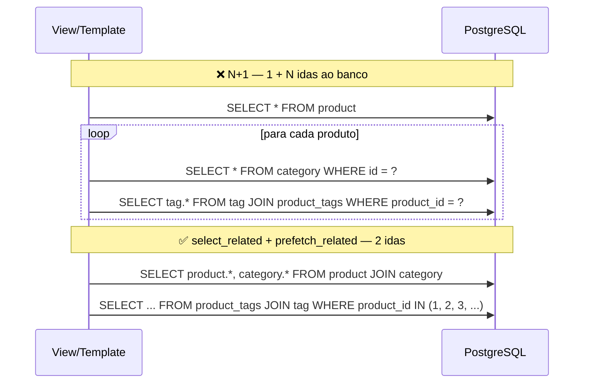

# 07. O problema N+1

> ⏱️ ~1h30 · Módulo 5 · Pré-requisitos: [05](05-orm-consultas.md), [06](06-orm-relacionamentos-agregacoes.md); Big-O e latência ([aula 1.17](../01-python-logica/17-recursao-big-o.md), [aula 2.04](../02-como-a-web-funciona/04-devtools-curl-bruno.md))

## 🎯 Objetivos
Ao final desta aula você consegue:
- Explicar o que é o problema **N+1** e **onde ele se esconde** (templates, `__str__`, serializers, Admin)
- **Detectá-lo** com o cabeçalho `X-Consultas-SQL`, `CaptureQueriesContext` e `django_assert_num_queries`
- Corrigi-lo com `select_related` (FK/1:1, via `JOIN`), `prefetch_related` (N:N/reverso, via `IN`) e `Prefetch(..., to_attr=)`
- Escolher entre `select_related`, `prefetch_related` e `annotate`, e saber o custo de cada um
- Escrever **testes de regressão** que impedem o N+1 de voltar

## 🤔 Por que isso importa
É o **problema de desempenho nº 1** de aplicações Django, e é invisível em desenvolvimento: com 10 produtos, 11 consultas parecem rápidas; em produção, com 5 mil e o banco a 2 ms de distância, a página passa de 20 ms para 10 segundos. Perguntas sobre N+1 caem em quase toda entrevista de Django, e saber medir e corrigir é uma das habilidades que mais distingue um júnior.

## 💡 Intuição (explicação simples)
Você está no mercado com a lista de compras de 50 itens. O jeito **N+1** é ir ao balcão, pegar a lista dos 50 itens (1 viagem) e, **para cada item**, voltar ao balcão para perguntar “em qual corredor fica?” (50 viagens). O jeito certo: na **primeira** viagem você já pede a lista **com** os corredores (`select_related`), ou faz uma **segunda e única** viagem para trazer **todos** os corredores de uma vez (`prefetch_related`). O custo de uma viagem (a **latência** de rede até o banco) é o que mata: 51 viagens × 2 ms = 100 ms; 2 viagens = 4 ms.

## 🔬 Como funciona por dentro
**Por que acontece.** Relações do Django são **preguiçosas** (*lazy*): `produto.category` só consulta o banco **quando você o acessa**. Em um laço sobre 47 produtos que acessa `produto.category.name`, cada acesso dispara um `SELECT … FROM catalog_category WHERE id = …`: **1** consulta da lista + **N** das relações = **N+1**.


**Onde ele se esconde**
- **Templates:** `{{ produto.category.name }}` ou `` dentro de um ``.
- **`__str__`** de um modelo que usa uma relação (`return f"{self.category} / {self.name}"`): uma página do Admin que lista objetos chama `__str__` N vezes.
- **Serializers/JSON** que aninham relações (Módulo 6) e `list_display` do Admin (aula 08).
- **Contagens em laço:** `for c in categorias: c.products.count()` (N consultas: use `annotate(Count)`).

**As ferramentas**

| Ferramenta | Relação | O que faz | Consultas |
|---|---|---|---|
| `select_related("category")` | **FK / 1:1** (lado “um”) | `JOIN` e traz tudo na mesma linha | 1 (consulta maior) |
| `prefetch_related("tags")` | **N:N / reverso de FK** (lado “muitos”) | 2ª consulta com `WHERE id IN (…)` e junta **em Python** | 1 + 1 por relação |
| `Prefetch("products", queryset=…, to_attr="disp")` | idem, **com filtro/ordem** nos relacionados | controla **quais** relacionados e onde guardar | 1 + 1 |
| `annotate(n=Count(...))` | contagens/somas por objeto | calcula no banco | 1 |
| `only()/defer()/values()` | colunas | reduz dados trafegados (cuidado: `defer` + acesso volta ao N+1) | — |

- **Quando usar cada um:** `select_related` para relações “para um” (porque o `JOIN` não multiplica linhas); `prefetch_related` para “para muitos” (um `JOIN` duplicaria cada produto por etiqueta); `annotate` quando você só precisa de **número**.
- **Custo:** `select_related` traz colunas extras em **toda** linha; `prefetch_related` com milhares de ids gera uma lista `IN` enorme (use *paginação* antes: prefetch só da página!). Nada é grátis: **meça**.
- **Armadilha:** `prefetch_related("tags")` e depois `produto.tags.filter(...)` **ignora o prefetch** (uma consulta nova por produto); filtre com `Prefetch(queryset=…)` ou em Python sobre `.all()`.

**Detecção.** (1) O cabeçalho **`X-Consultas-SQL`** (aula 01) mostra o número por requisição; (2) `CaptureQueriesContext` conta em scripts e testes; (3) `pytest-django` oferece `django_assert_num_queries(n)` e `django_assert_max_num_queries(n)`: **teste de regressão**; (4) em produção, ferramentas de APM (Sentry, Datadog) e `django-debug-toolbar` em desenvolvimento.

## 🛠️ Exemplo prático
**1. O N+1 acontece sem você ver: mostrando as etiquetas nos cartões**
```html

<li>
  <article class="card">
    <p class="suave">{{ produto.category.name }}</p>
    <h3><a href="{{ produto.get_absolute_url }}">{{ produto.name }}</a></h3>
    <p class="preco">{{ produto.price|real }}</p>
    <p class="suave">#{{ tag.name }} </p>
    
      <p class="suave">{{ produto.stock }} em estoque</p>
      <a class="botao" href="{{ produto.get_absolute_url }}">Ver produto</a>
    
      <p class="esgotado">Esgotado</p>
    
  </article>
</li>
```
```python
import subprocess, time, urllib.request
servidor = subprocess.Popen(["uv", "run", "python", "manage.py", "runserver", "8125", "--noreload"],
                            stdout=open("servidor.log", "w"), stderr=subprocess.STDOUT)
for _ in range(60):
    try:
        urllib.request.urlopen("http://127.0.0.1:8125/saude/", timeout=1); break
    except Exception:
        time.sleep(0.5)
print("servidor no ar")
```
```text
servidor no ar
```
```bash
B=http://127.0.0.1:8125
medir() { curl -s -o /dev/null -D - "$B$1" | tr -d '\r' | awk -v u="$1" 'BEGIN{IGNORECASE=1} /^x-consultas-sql/{q=$2} /^x-tempo-ms/{t=$2} END{printf "%-30s consultas SQL=%-4s tempo=%s ms\n", u, q, t}'; }
echo "# ANTES (cada cartão consulta a categoria E as etiquetas):"
medir "/produtos/"; medir "/produtos/?categoria=audio"; medir "/produtos/?busca=mouse"
```
```text
# ANTES (cada cartão consulta a categoria E as etiquetas):
/produtos/                     consultas SQL=96   tempo=93.8 ms
/produtos/?categoria=audio     consultas SQL=22   tempo=29.4 ms
/produtos/?busca=mouse         consultas SQL=8    tempo=15.6 ms
```
Veja o `X-Consultas-SQL` da lista completa: **mais de 90 consultas** para renderizar 47 cartões: 1 (produtos) + 47 (categoria de cada um) + 47 (etiquetas de cada um) + 1 (as categorias do filtro). Nenhuma linha do código “parece” ter consulta: o acesso preguiçoso está dentro do *template*.

**2. Medindo com latência realista**

Em desenvolvimento o banco está a 0,1 ms; em produção (RDS, outra máquina) costuma estar a **1 a 3 ms**. Vamos **simular** 2 ms por consulta para sentir o efeito:
```python
import os
import time
import django

os.environ["DJANGO_SETTINGS_MODULE"] = "config.settings"
django.setup()
from django.db import connection
from django.db.models import Count, Prefetch
from django.test.utils import CaptureQueriesContext

from apps.catalog.models import Category, Product


def com_latencia(execute, sql, params, many, context):          # simula 2 ms de rede entre app e banco
    time.sleep(0.002)
    return execute(sql, params, many, context)


def medir(rotulo, fn):
    with connection.execute_wrapper(com_latencia), CaptureQueriesContext(connection) as c:
        t0 = time.perf_counter()
        resultado = fn()
        ms = (time.perf_counter() - t0) * 1000
    print(f"{len(c.captured_queries):>3} consultas | {ms:7.1f} ms | {rotulo:<52} {resultado}")
    return c


def cartoes(qs):
    return sum(len(p.category.name) + len(list(p.tags.all())) for p in qs)        # o que o template faz


ativos = lambda: Product.objects.filter(is_active=True)
print("## Lista de produtos (47 cartões: categoria + etiquetas)")
medir("N+1 (sem otimizar)", lambda: cartoes(ativos()))
medir("select_related('category')", lambda: cartoes(ativos().select_related("category")))
medir("prefetch_related('tags')", lambda: cartoes(ativos().prefetch_related("tags")))
c = medir("select_related + prefetch_related", lambda: cartoes(ativos().select_related("category").prefetch_related("tags")))
print("\nas 2 consultas da versão otimizada:")
for q in c.captured_queries:
    print("  •", q["sql"][:150].replace("\n", " ") + "…")

print("\n## Contagem de produtos por categoria (5 categorias)")
medir("N+1: c.products.count() em laço", lambda: [(c.name, c.products.count()) for c in Category.objects.all()][:2])
medir("annotate(Count) — 1 consulta", lambda: list(Category.objects.annotate(n=Count("products")).values_list("name", "n"))[:2])
medir("prefetch + len() em Python", lambda: [(c.name, len(c.products.all())) for c in Category.objects.prefetch_related("products")][:2])

print("\n## Prefetch com FILTRO (só os disponíveis, do mais caro ao mais barato)")
disponiveis = Prefetch("products", queryset=Product.objects.filter(is_active=True, stock__gt=0).order_by("-price"), to_attr="disponiveis")
medir("Prefetch(queryset=…, to_attr='disponiveis')", lambda: [(c.name, [p.sku for p in c.disponiveis][:2]) for c in Category.objects.prefetch_related(disponiveis)][:2])
medir("ARMADILHA: prefetch + .filter() ignora o prefetch", lambda: [c.products.filter(stock__gt=0).count() for c in Category.objects.prefetch_related("products")][:2])
```
```bash
uv run python medir_n_mais_1.py
```
```text
## Lista de produtos (47 cartões: categoria + etiquetas)
 95 consultas |   293.1 ms | N+1 (sem otimizar)                                   561
 48 consultas |   146.4 ms | select_related('category')                           561
 49 consultas |   140.5 ms | prefetch_related('tags')                             561
  2 consultas |     8.0 ms | select_related + prefetch_related                    561

as 2 consultas da versão otimizada:
  • SELECT "catalog_product"."id", "catalog_product"."category_id", "catalog_product"."sku", "catalog_product"."name", "catalog_product"."slug", "catalog_…
  • SELECT ("catalog_product_tags"."product_id") AS "_prefetch_related_val_product_id", "catalog_tag"."id", "catalog_tag"."name", "catalog_tag"."slug" FRO…

## Contagem de produtos por categoria (5 categorias)
  6 consultas |    17.9 ms | N+1: c.products.count() em laço                      [('Armazenamento', 10), ('Áudio', 10)]
  1 consultas |     3.6 ms | annotate(Count) — 1 consulta                         [('Armazenamento', 10), ('Cabos e adaptadores', 10)]
  2 consultas |     6.8 ms | prefetch + len() em Python                           [('Armazenamento', 10), ('Áudio', 10)]

## Prefetch com FILTRO (só os disponíveis, do mais caro ao mais barato)
  2 consultas |     7.1 ms | Prefetch(queryset=…, to_attr='disponiveis')          [('Armazenamento', ['AR-06', 'AR-04']), ('Áudio', ['AU-09', 'AU-06'])]
  7 consultas |    23.5 ms | ARMADILHA: prefetch + .filter() ignora o prefetch    [10, 9]
```
Leia a tabela: **N+1 = 95 consultas** (≈ 280 ms, a maior parte só de latência; a página real faz 96 porque ainda carrega as categorias do filtro); `select_related` resolve as categorias, `prefetch_related` as etiquetas; **os dois juntos: 2 consultas**. Na contagem por categoria, `annotate` resolve em **1**. A última linha mostra a armadilha: chamar `.filter()` num *manager* já “prefetchado” **descarta o prefetch** e volta ao N+1.

**3. A correção nas views**
```bash
python3 - <<'PY'
import pathlib
p = pathlib.Path("apps/catalog/views.py"); s = p.read_text()
s = s.replace('''    itens = filtrar(request.GET)
    return render(request, "catalog/product_list.html",''','''    itens = filtrar(request.GET).select_related("category").prefetch_related("tags")      # as DUAS consultas extras, em lote
    return render(request, "catalog/product_list.html",''')
s = s.replace('''    produto = get_object_or_404(Product, slug=slug, is_active=True)          # 404 automático, em 1 linha''','''    produto = get_object_or_404(Product.objects.select_related("category").prefetch_related("tags"), slug=slug, is_active=True)''')
p.write_text(s)
PY
grep -n "select_related" apps/catalog/views.py
```
```text
40:    itens = filtrar(request.GET).select_related("category").prefetch_related("tags")      # as DUAS consultas extras, em lote
47:    produto = get_object_or_404(Product.objects.select_related("category").prefetch_related("tags"), slug=slug, is_active=True)
```
Reinicie o servidor (sem `--noreload` o `runserver` faz isso sozinho) e meça de novo:
```python
servidor.terminate(); servidor.wait()
servidor = subprocess.Popen(["uv", "run", "python", "manage.py", "runserver", "8125", "--noreload"],
                            stdout=open("servidor.log", "w"), stderr=subprocess.STDOUT)
for _ in range(60):
    try:
        urllib.request.urlopen("http://127.0.0.1:8125/saude/", timeout=1); break
    except Exception:
        time.sleep(0.5)
print("servidor reiniciado")
```
```text
servidor reiniciado
```
```bash
B=http://127.0.0.1:8125
medir() { curl -s -o /dev/null -D - "$B$1" | tr -d '\r' | awk -v u="$1" 'BEGIN{IGNORECASE=1} /^x-consultas-sql/{q=$2} /^x-tempo-ms/{t=$2} END{printf "%-30s consultas SQL=%-4s tempo=%s ms\n", u, q, t}'; }
echo "# DEPOIS (select_related + prefetch_related):"
medir "/produtos/"; medir "/produtos/?categoria=audio"; medir "/produtos/?busca=mouse"; medir "/produtos/monitor-27-polegadas-4k/"; medir "/categorias/"
```
```text
# DEPOIS (select_related + prefetch_related):
/produtos/                     consultas SQL=3    tempo=22.8 ms
/produtos/?categoria=audio     consultas SQL=3    tempo=13.7 ms
/produtos/?busca=mouse         consultas SQL=3    tempo=12.2 ms
/produtos/monitor-27-polegadas-4k/ consultas SQL=2    tempo=12.4 ms
/categorias/                   consultas SQL=1    tempo=10.5 ms
```
**De mais de 90 para 3 consultas, em qualquer filtro**: o número **deixou de depender** da quantidade de produtos exibidos (1 de produtos + categorias via `JOIN`, 1 das etiquetas, 1 das categorias do `<select>`). Essa independência é o objetivo.
```python
servidor.terminate(); servidor.wait(); print("servidor encerrado")
```
```text
servidor encerrado
```
**4. Testes de regressão: o N+1 não pode voltar**
```python
import pytest
from django.urls import reverse

from apps.catalog.models import Product

pytestmark = pytest.mark.django_db


def test_lista_tem_numero_fixo_de_consultas(client, catalogo, django_assert_num_queries):
    with django_assert_num_queries(3):                                    # produtos+categoria (JOIN), etiquetas (prefetch), categorias do filtro
        resposta = client.get(reverse("catalog:list"))
    assert resposta.status_code == 200 and "Produtos (47)" in resposta.content.decode()


def test_numero_de_consultas_nao_cresce_com_o_catalogo(client, catalogo, django_assert_max_num_queries):
    categoria = Product.objects.first().category
    Product.objects.bulk_create([Product(category=categoria, sku=f"X-{i:03d}", name=f"Extra {i}", slug=f"extra-{i}", price="9.90", stock=1) for i in range(200)])
    with django_assert_max_num_queries(3):                                # 247 produtos e continua em 3
        client.get(reverse("catalog:list"))


def test_detalhe_tem_numero_fixo_de_consultas(client, catalogo, django_assert_max_num_queries):
    with django_assert_max_num_queries(3):
        assert client.get("/produtos/monitor-27-polegadas-4k/").status_code == 200


def test_pagina_de_categorias_continua_em_uma_consulta(client, catalogo, django_assert_num_queries):
    with django_assert_num_queries(1):
        client.get(reverse("catalog:categories"))


def test_sem_otimizacao_o_numero_cresce_com_o_catalogo(catalogo, django_assert_num_queries):
    """Documenta o PROBLEMA: sem select_related/prefetch, são 1 + 2N consultas."""
    with django_assert_num_queries(1 + 47 + 47):
        for p in Product.objects.filter(is_active=True):
            p.category.name
            list(p.tags.all())
```
```bash
uv run pytest
```
```text
...................................................                      [100%]
51 passed in 4.05s
```
O `django_assert_num_queries(3)` falha **com o número real** quando alguém, daqui a seis meses, acrescenta `{{ produto.spec.warranty_months }}` ao cartão e reintroduz um N+1 (o teste imprime as consultas e o diff). É a **rede de segurança** que revisão de código não consegue ser.

## ⚠️ Erros comuns e boas práticas
| Mensagem / sintoma | Causa | Solução |
|---|---|---|
| `FieldError: Invalid field name(s) given in select_related: 'tags'. Choices are: category` | `select_related` só funciona para FK/1:1 | Para N:N e reverso, `prefetch_related` |
| `AttributeError: Cannot find 'tags' on Product object, 'tags' is an invalid parameter to prefetch_related()` | Nome errado da relação | Use o nome do campo/`related_name` |
| Número de consultas continua alto depois do prefetch | `.filter()/.order_by()/.exclude()` no manager prefetchado (nova consulta) | `Prefetch(queryset=…)` ou filtre em Python sobre `.all()` |
| `defer("category")` + acesso à categoria → N+1 de novo | `defer`/`only` desfazem parte do `select_related` | Mantenha o que será usado |
| Consulta de prefetch com `IN` de 100 mil ids | Prefetch sobre milhares de objetos | **Pagine primeiro**, prefetch só da página |
| `select_related` deixa a consulta lenta | `JOIN` de muitas tabelas largas | `only()` nas colunas usadas, ou `prefetch_related` |
| Admin lento na lista | `__str__` com relação, `list_display` com FK | `list_select_related` (aula 08) |
| O teste de contagem de consultas quebra “do nada” | Algo novo acessa o banco (sessão, usuário, middleware) | Veja as consultas impressas; é para isso que o teste serve |
| `django_assert_num_queries` falha só no CI | Consultas de *savepoint*/`BEGIN` contadas diferente | Compare o resultado impresso e ajuste conscientemente |

- **Meça antes de otimizar** (`X-Consultas-SQL`, `CaptureQueriesContext`) e **teste depois** (`django_assert_num_queries`).
- Regra prática: ao iterar sobre objetos e acessar uma relação, pergunte “**isto gera 1 consulta por objeto?**”.
- Prefira `annotate` para números; `select_related` para “um”; `prefetch_related` para “muitos”; `Prefetch(queryset=…)` para filtrar.
- **Pagine** antes de pré-carregar; nunca `prefetch_related` sobre a tabela inteira.
- Não otimize no escuro: em listas de 5 itens, o N+1 é inofensivo; o problema é a **escala** e a **latência** de rede.

## 🧠 Pausa para lógica
**Problema (um modelo de custo).** Modele o tempo de uma página como `T = consultas × (latência + t_banco)`. Calcule, para N = 10, 100, 1.000 e 10.000 produtos e latências de 0,1 ms (local), 2 ms (nuvem, mesma região) e 20 ms (outro continente), o tempo do N+1 (`1 + 2N` consultas) e o do lote (3 consultas). A partir de qual N o N+1 passa de 1 segundo com latência de 2 ms?

<details><summary>Dica</summary>
N+1: <code>(1 + 2N)</code> consultas; lote: <code>3</code>. Considere <code>t_banco ≈ 0,3 ms</code> por consulta simples. O limiar de 1 s com 2 ms: resolva <code>(1 + 2N) × 2,3 ms = 1000 ms</code>.
</details>

<details><summary>Solução comentada</summary>

```python
T_BANCO = 0.3                                       # ms por consulta simples (índice, poucas linhas)
def tempo(consultas, latencia): return consultas * (latencia + T_BANCO)

print(f"{'N':>7} | " + " | ".join(f"lat {l:>4} ms: N+1 / lote" for l in (0.1, 2, 20)))
for n in (10, 100, 1000, 10000):
    celulas = [f"{tempo(1 + 2 * n, l):>8,.0f} / {tempo(3, l):>5.1f}" for l in (0.1, 2, 20)]
    print(f"{n:>7} | " + " | ".join(f"{c:>20}" for c in celulas))

limiar = 1000 / (2 + T_BANCO) / 2 - 0.5             # resolve (1 + 2N) * (2 + 0,3) = 1000
print(f"\nCom 2 ms de latência o N+1 passa de 1 segundo a partir de N ≈ {limiar:.0f} produtos por página")
print("Em produção você pagina (ex.: 24 por página): o N+1 'aguenta', mas você ainda paga 49 idas ao banco por requisição, em TODAS as requisições.")
```
```text
      N | lat  0.1 ms: N+1 / lote | lat    2 ms: N+1 / lote | lat   20 ms: N+1 / lote
     10 |            8 /   1.2 |           48 /   6.9 |          426 /  60.9
    100 |           80 /   1.2 |          462 /   6.9 |        4,080 /  60.9
   1000 |          800 /   1.2 |        4,602 /   6.9 |       40,620 /  60.9
  10000 |        8,000 /   1.2 |       46,002 /   6.9 |      406,020 /  60.9

Com 2 ms de latência o N+1 passa de 1 segundo a partir de N ≈ 217 produtos por página
Em produção você pagina (ex.: 24 por página): o N+1 'aguenta', mas você ainda paga 49 idas ao banco por requisição, em TODAS as requisições.
```
A conta mostra duas coisas: o N+1 cresce **linearmente** com N e é **multiplicado pela latência**, enquanto o lote é praticamente **constante**; e que o problema aparece só na **escala** e na **nuvem**: em desenvolvimento (0,1 ms) tudo “funciona”.
</details>

**Variação mais difícil:** incorpore a **paginação** (24 itens por página) e mostre que o N+1 “escondido” ainda custa 49 consultas por requisição; depois modele o ganho de capacidade (requisições/s) de um servidor com 4 *workers* quando cada requisição faz 3 em vez de 49 consultas.

## 🧩 Exercícios
**1. Fixação**
(a) Por que `produto.category` dentro de um laço gera N consultas? (b) Quando `select_related` e quando `prefetch_related`? (c) Como contar produtos por categoria sem N+1? (d) O que o `django_assert_num_queries` testa?

<details><summary>Solução</summary>

(a) Relações são preguiçosas: cada acesso à FK sem dado já carregado executa um `SELECT` para aquele objeto. (b) `select_related` para FK/1:1 (um `JOIN`); `prefetch_related` para N:N e reverso de FK (consulta extra com `IN`, junção em Python). (c) `annotate(n=Count("products"))`. (d) Que um bloco de código executa **exatamente** (ou no máximo) N consultas, funcionando como teste de regressão de desempenho.
</details>

**2. Aplicação no projeto MiniShop**
Elimine os N+1 existentes e proteja-os com testes.

Critérios de pronto:
- [ ] Lista, detalhe e página de categorias com **número fixo** de consultas (independente do nº de produtos), medido com `X-Consultas-SQL` e com `django_assert_num_queries`/`max`
- [ ] Um **teste de regressão** por tela e um teste com 250 produtos extras provando que o número não cresce
- [ ] `Prefetch` com `to_attr` para listar, em cada categoria, os 3 produtos mais caros **disponíveis** (página `/categorias/destaques/`) em **2 consultas**
- [ ] `docs/n-mais-1.md` com a tabela antes/depois (consultas e tempo com latência simulada de 2 ms) e as consultas da versão otimizada
- [ ] Uma seção “Como detectar N+1 neste projeto” (cabeçalho, testes, logs `django.db.backends`)
- [ ] `uv run pytest` verde
- [ ] Commit `perf(catalog): remove n+1 with select_related and prefetch_related`

<details><summary>Solução de referência</summary>

```python
# destaques: 2 consultas (categorias + produtos prefetchados) e o corte dos 3 primeiros em Python/template
from django.db.models import Prefetch
destaque = Prefetch("products", queryset=Product.objects.filter(is_active=True, stock__gt=0).order_by("-price"), to_attr="disponiveis")
categorias = Category.objects.prefetch_related(destaque)
# no template: 
```
Para ver as consultas no log: `LOGGING = {"loggers": {"django.db.backends": {"level": "DEBUG", "handlers": ["console"]}}}` (aula 14).
</details>

**3. Desafio (opcional)**
Escreva um *middleware* que **loga um aviso** quando uma requisição faz mais de 20 consultas, ou mais de 3 consultas **idênticas** (a assinatura típica do N+1: mesma SQL com parâmetros diferentes). Dica: normalize a SQL trocando valores por `?` e conte repetições.

## 🎤 Na entrevista
- **O que é o problema N+1 e como resolver no Django?** Uma consulta para listar objetos e uma consulta adicional por objeto para acessar uma relação; resolve-se com `select_related` (FK/1:1, `JOIN`), `prefetch_related` (N:N/reverso, consulta com `IN`) ou `annotate` quando só se precisa de agregados.
- **Diferença entre `select_related` e `prefetch_related`?** O primeiro faz um `JOIN` e traz tudo em **uma** consulta (relações “para um”); o segundo faz uma **consulta extra por relação** e junta em Python (relações “para muitos”), evitando multiplicar linhas.
- **Como você detecta N+1 em um projeto?** Contando consultas por requisição (cabeçalho/`django-debug-toolbar`/APM/logs), `CaptureQueriesContext` e testes com `assertNumQueries`/`django_assert_num_queries`.
- **O que é `Prefetch` com `to_attr`?** Um objeto que personaliza o `prefetch_related`: define o `queryset` dos relacionados (filtro/ordem) e o atributo onde guardá-los, evitando novas consultas.
- **Por que o N+1 só aparece em produção?** Porque depende da escala (muitos objetos) e da latência de rede até o banco; em desenvolvimento, com poucos dados e banco local, parece rápido.

## 📚 Para ir além
- 📄 Documentação oficial: [Otimização do acesso ao banco](https://docs.djangoproject.com/en/5.2/topics/db/optimization/). Relações, `select_related`, `prefetch_related`, `exists`/`count`.
- 📄 Documentação oficial: [`select_related` e `prefetch_related`](https://docs.djangoproject.com/en/5.2/ref/models/querysets/#select-related) e [`Prefetch`](https://docs.djangoproject.com/en/5.2/ref/models/querysets/#prefetch-objects). Referência completa.
- 📄 Documentação oficial: [pytest-django: `django_assert_num_queries`](https://pytest-django.readthedocs.io/en/latest/helpers.html). Testes de contagem de consultas.
- 📑 Artigo/tutorial: [django-debug-toolbar](https://django-debug-toolbar.readthedocs.io/en/latest/). Mostra consultas duplicadas e similares em cada página (em desenvolvimento).
- 🏋️ Prática extra: ative o `django.db.backends` em `DEBUG` e cace as consultas duplicadas na página inicial do Admin.

## ✅ Checklist da aula
- [ ] Vi e medi o N+1 (mais de 90 consultas) no cabeçalho `X-Consultas-SQL`
- [ ] Corrigi com `select_related` + `prefetch_related` (3 consultas)
- [ ] Usei `annotate` e `Prefetch(to_attr=)` onde cabem
- [ ] Testes de regressão com `django_assert_num_queries`
- [ ] Fiz o commit do exercício
