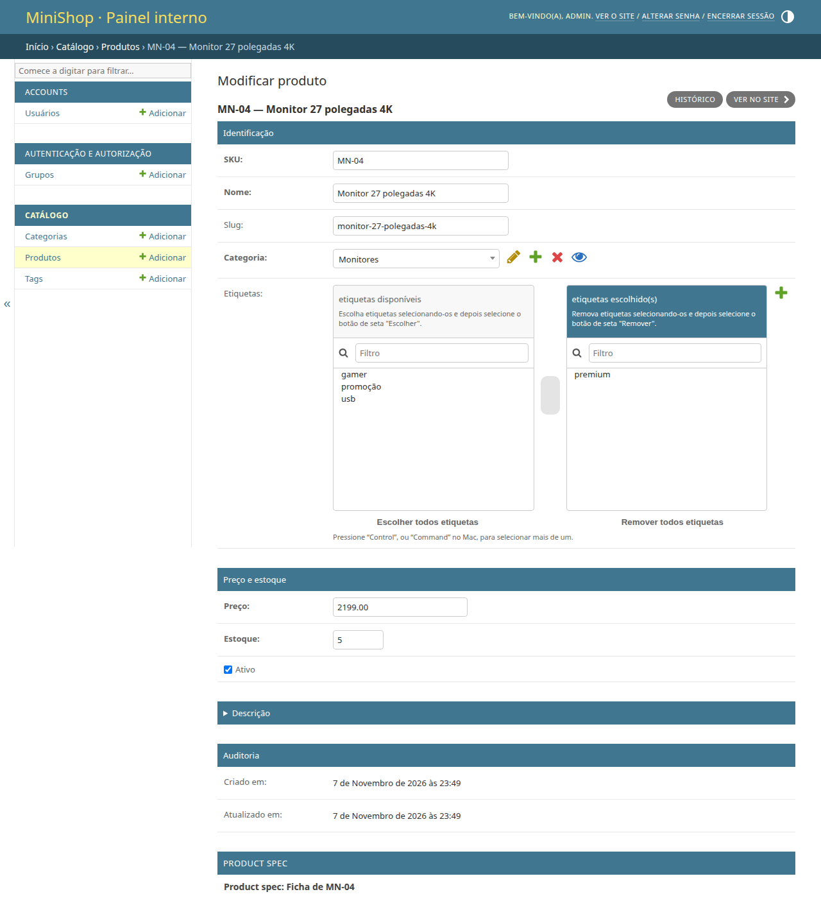
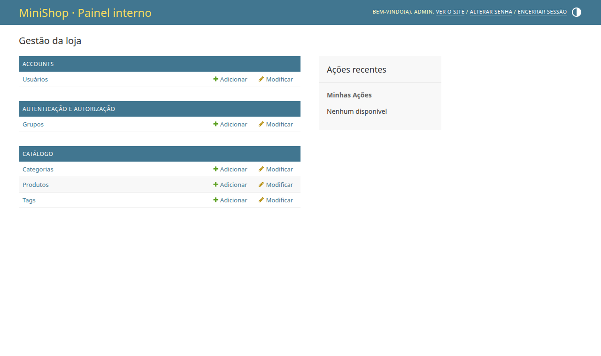
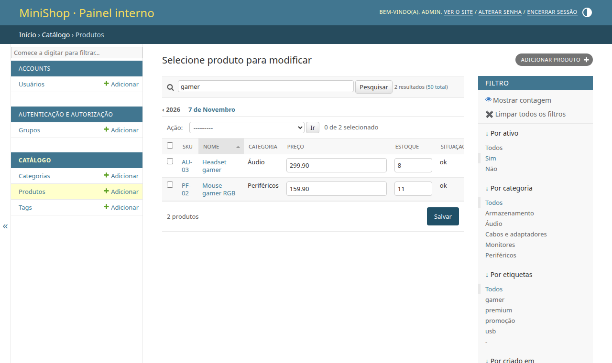

# 08. Django Admin

> ⏱️ ~1h30 · Módulo 5 · Pré-requisitos: [04](04-models-migracoes.md), [06](06-orm-relacionamentos-agregacoes.md), [07](07-n-mais-1.md)

## 🎯 Objetivos
Ao final desta aula você consegue:
- Criar um superusuário e registrar *models* no **Admin** para ter um painel de gestão pronto
- Personalizar listagens (`list_display`, `list_filter`, `search_fields`, `list_editable`, `date_hierarchy`) e formulários (`fieldsets`, `readonly_fields`, `prepopulated_fields`, *inlines*)
- Escrever **ações em lote** e colunas calculadas, sem criar N+1
- Explicar como o Admin funciona por dentro e **por que ele não é a interface do cliente**
- Aplicar medidas básicas de segurança ao Admin e testá-lo com `pytest`

## 🤔 Por que isso importa
O Admin é um dos motivos de o Django ser tão produtivo: de graça você ganha um **CRUD completo, com autenticação, permissões, busca, filtros, histórico de alterações e validação**, a partir dos *models*. Em empresas é o *back-office* de muitos produtos (cadastro de produtos, atendimento, moderação). Saber configurá-lo bem economiza semanas, e saber seus limites e riscos evita incidentes.

## 💡 Intuição (explicação simples)
O Admin é o **painel de controle da casa de máquinas**: você não constrói botões um a um; o Django **lê as plantas** dos seus *models* (campos, tipos, relações) e monta sozinho as telas de listar, criar, editar e apagar, para **a equipe interna**. O cliente da loja nunca entra ali: ele usa a vitrine (as páginas e a API que você faz).

## 🔬 Como funciona por dentro
- **Introspecção.** O Admin lê `Model._meta` (campos, tipos, `verbose_name`, relações) e **gera automaticamente** um `ModelForm`, uma lista paginada, filtros e a validação. Cada *model* registrado vira um `ModelAdmin`, cujo `get_urls()` expõe rotas sob `/admin/<app>/<model>/` (`changelist`, `add`, `change`, `delete`, `history`).
- **Autenticação e permissões.** O Admin exige `is_staff=True` e usa as **permissões** do modelo (`add_product`, `change_product`, `delete_product`, `view_product`; aula 12). Um *superuser* tem todas.
- **Histórico:** cada criação/edição/remoção pelo Admin grava um `LogEntry` (`django_admin_log`): quem, quando, o quê.
- **Peças mais usadas do `ModelAdmin`:**

| Opção | Efeito |
|---|---|
| `list_display` | colunas da lista (campos, métodos do admin, métodos do modelo) |
| `list_filter` | filtros laterais (campos, relações, intervalos de data) |
| `search_fields` | caixa de busca (`name`, `^sku` começa com, `=sku` exato, `category__name`) |
| `list_editable` | edita direto na lista (um *form* por linha) |
| `ordering`, `list_per_page`, `date_hierarchy` | ordem, paginação, navegação por ano/mês |
| `fieldsets`, `readonly_fields`, `prepopulated_fields` | organização do formulário, campos só de leitura, `slug` preenchido a partir do nome |
| `autocomplete_fields`, `filter_horizontal`, `raw_id_fields` | widgets de FK/N:N escaláveis (busca assíncrona em vez de `<select>` com milhares) |
| `inlines` | edita modelos relacionados na mesma página (`StackedInline`/`TabularInline`) |
| `actions` | operações em lote sobre as linhas selecionadas |
| `list_select_related`, `get_queryset()` | **desempenho:** evitar N+1 nas colunas e anotar agregados |
| `save_model()`, `has_*_permission()` | ganchos de regra de negócio e de permissão |

- **N+1 também mora aqui.** O Admin aplica `select_related` automaticamente para **FKs em `list_display`**, mas **métodos próprios** que acessam relações (por exemplo, listar as etiquetas de cada produto) geram **uma consulta por linha**: resolve-se em `get_queryset()` com `prefetch_related`/`annotate` (aula 07).
- **Limites e riscos.** O Admin é um **atalho interno**, não um *front-end* de produto: UX genérica, regras de negócio escapam (ações em lote com `update()` **não** disparam `save()`/sinais), e dá **poder total** sobre os dados. Proteja-o: senha forte e **2FA**, URL não óbvia, restrição de rede/VPN em produção, permissões mínimas por grupo, e **nunca** o entregue a clientes finais.

## 🛠️ Exemplo prático
**1. Criar o superusuário (comando não interativo, só para desenvolvimento)**
```bash
DJANGO_SUPERUSER_PASSWORD="admin-dev-123" uv run python manage.py createsuperuser --noinput --username admin --email admin@minishop.test
uv run python manage.py shell -v 0 -c "
from django.contrib.auth import get_user_model
u = get_user_model().objects.get(username='admin')
print(u, '| staff:', u.is_staff, '| superuser:', u.is_superuser, '| senha começa com:', u.password.split('\$')[0])
"
```
```text
Superuser created successfully.
admin | staff: True | superuser: True | senha começa com: pbkdf2_sha256
```
A senha **não** é guardada em texto: o campo `password` mostra o **algoritmo e o *hash*** (`pbkdf2_sha256$…`, Módulo 9). A senha `admin-dev-123` é **só de laboratório**; em ambientes reais, senhas únicas e fortes, e nunca no repositório.

**2. Registrando os modelos (e já personalizando)**
```python
from django.contrib import admin, messages
from django.db.models import Count, F, Sum

from .models import Category, Product, ProductSpec, Tag

admin.site.site_header = "MiniShop · Painel interno"
admin.site.site_title = "MiniShop Admin"
admin.site.index_title = "Gestão da loja"


@admin.register(Category)
class CategoryAdmin(admin.ModelAdmin):
    list_display = ("name", "slug", "total_de_produtos")
    search_fields = ("name",)                         # necessário para autocomplete_fields em ProductAdmin
    prepopulated_fields = {"slug": ("name",)}

    def get_queryset(self, request):                  # 1 consulta: o COUNT vem do banco (sem N+1)
        return super().get_queryset(request).annotate(_total=Count("products"))

    @admin.display(description="produtos", ordering="_total")
    def total_de_produtos(self, obj):
        return obj._total


@admin.register(Tag)
class TagAdmin(admin.ModelAdmin):
    list_display = ("name", "slug")
    search_fields = ("name",)
    prepopulated_fields = {"slug": ("name",)}


class ProductSpecInline(admin.StackedInline):         # a ficha técnica editada NA PÁGINA do produto (1:1)
    model = ProductSpec
    extra = 0
    can_delete = False


@admin.register(Product)
class ProductAdmin(admin.ModelAdmin):
    list_display = ("sku", "name", "category", "price", "stock", "situacao", "etiquetas", "is_active")
    list_display_links = ("sku", "name")
    list_editable = ("price", "stock", "is_active")                  # edição rápida direto na lista
    list_filter = ("is_active", "category", "tags", ("created_at", admin.DateFieldListFilter))
    search_fields = ("sku", "name", "category__name")
    date_hierarchy = "created_at"
    list_per_page = 20
    ordering = ("category__name", "name")
    prepopulated_fields = {"slug": ("name",)}
    readonly_fields = ("created_at", "updated_at")
    autocomplete_fields = ("category",)
    filter_horizontal = ("tags",)
    inlines = [ProductSpecInline]
    actions = ["desativar", "reativar", "zerar_estoque"]
    fieldsets = (
        ("Identificação", {"fields": ("sku", "name", "slug", "category", "tags")}),
        ("Preço e estoque", {"fields": ("price", "stock", "is_active")}),
        ("Descrição", {"fields": ("description",), "classes": ("collapse",)}),
        ("Auditoria", {"fields": ("created_at", "updated_at")}),
    )

    def get_queryset(self, request):
        return super().get_queryset(request).select_related("category").prefetch_related("tags")      # a coluna "etiquetas" usa as tags

    @admin.display(description="situação", ordering="stock")
    def situacao(self, obj):
        return "esgotado" if obj.stock == 0 else "baixo" if obj.stock < 5 else "ok"

    @admin.display(description="etiquetas")
    def etiquetas(self, obj):
        return ", ".join(t.name for t in obj.tags.all())               # .all() usa o prefetch: SEM consulta por linha

    @admin.action(description="Desativar produtos selecionados")
    def desativar(self, request, queryset):
        n = queryset.update(is_active=False)                           # em lote: não chama save() nem sinais
        self.message_user(request, f"{n} produto(s) desativado(s).", messages.SUCCESS)

    @admin.action(description="Reativar produtos selecionados")
    def reativar(self, request, queryset):
        n = queryset.update(is_active=True)
        self.message_user(request, f"{n} produto(s) reativado(s).", messages.SUCCESS)

    @admin.action(description="Zerar o estoque (ação perigosa)")
    def zerar_estoque(self, request, queryset):
        if not request.user.has_perm("catalog.change_product"):
            self.message_user(request, "Sem permissão.", messages.ERROR)
            return
        n = queryset.update(stock=0)
        self.message_user(request, f"Estoque zerado em {n} produto(s).", messages.WARNING)
```
```bash
uv run python manage.py check
```
```text
System check identified no issues (0 silenced).
```
**3. Subindo e navegando (com um navegador de verdade controlado por script)**
```python
import subprocess, time, urllib.request
servidor = subprocess.Popen(["uv", "run", "python", "manage.py", "runserver", "8126", "--noreload"],
                            stdout=open("servidor.log", "w"), stderr=subprocess.STDOUT)
for _ in range(60):
    try:
        urllib.request.urlopen("http://127.0.0.1:8126/saude/", timeout=1); break
    except Exception:
        time.sleep(0.5)
print("servidor no ar")
```
```text
servidor no ar
```
```python
import os
from pathlib import Path

from playwright.sync_api import sync_playwright

BASE, SHOTS = "http://127.0.0.1:8126", Path(os.environ["SHOTS_DIR"])
with sync_playwright() as p:
    navegador = p.chromium.launch(channel="chrome", args=["--no-sandbox"])
    pg = navegador.new_page(viewport={"width": 1280, "height": 760})
    pg.goto(BASE + "/admin/login/")
    pg.fill("#id_username", "admin"); pg.fill("#id_password", "admin-dev-123"); pg.click("input[type=submit]")
    print("depois do login:", pg.title())
    pg.screenshot(path=SHOTS / "08-admin-inicio.png")
    pg.goto(BASE + "/admin/catalog/product/?is_active__exact=1&q=gamer")
    print("lista filtrada:", pg.inner_text("#changelist-form .paginator").strip().split("\n")[0], "|", len(pg.query_selector_all("#result_list tbody tr")), "linhas")
    pg.screenshot(path=SHOTS / "08-admin-lista.png")
    pg.goto(BASE + "/admin/catalog/product/?q=MN-04")
    pg.click("#result_list tbody tr:first-child th a")
    print("edição:", pg.title())
    pg.screenshot(path=SHOTS / "08-admin-edicao.png", full_page=True)
    navegador.close()
```
```bash
uv run --with playwright python pw_admin.py
```
```text
depois do login: Gestão da loja | MiniShop Admin
lista filtrada: 2 produtos | 2 linhas
edição: MN-04 — Monitor 27 polegadas 4K | Modificar produto | MiniShop Admin
```



O `ModelAdmin` gerou, sem nenhuma linha de HTML nossa: login, listagem com filtros e busca, edição em linha, e a página do produto com a **ficha técnica** (*inline* 1:1). As capturas acima são desse navegador real.

**4. Ações em lote e o histórico do Admin**
```bash
echo "# a ação 'desativar' via POST do formulário de ações (com sessão e CSRF reais):"
uv run python - <<'PY'
import os, re
import django
os.environ["DJANGO_SETTINGS_MODULE"] = "config.settings"
django.setup()
from django.contrib.admin.models import LogEntry
from django.test import Client
from apps.catalog.models import Product

c = Client(HTTP_HOST="127.0.0.1"); c.login(username="admin", password="admin-dev-123")      # fora do pytest, o host de teste precisa estar em ALLOWED_HOSTS
ids = list(Product.objects.filter(sku__startswith="CB-").values_list("pk", flat=True)[:3])
r = c.post("/admin/catalog/product/", {"action": "desativar", "_selected_action": ids}, follow=True)
msg = re.findall(r'class="success">\s*(.*?)\s*</li>', r.content.decode(), re.S)
print("mensagem do admin:", msg)
print("ativos entre os 3:", Product.objects.filter(pk__in=ids, is_active=True).count())
print("LogEntry gravado pela ação em lote:", LogEntry.objects.count(), "(update() em lote NÃO gera histórico por objeto)")
Product.objects.filter(pk__in=ids).update(is_active=True)
PY
```
```text
# a ação 'desativar' via POST do formulário de ações (com sessão e CSRF reais):
mensagem do admin: ['3 produto(s) desativado(s).']
ativos entre os 3: 0
LogEntry gravado pela ação em lote: 0 (update() em lote NÃO gera histórico por objeto)
```
Note o detalhe de produto: **`queryset.update()` não registra o histórico** (`LogEntry`) por objeto nem dispara `save()`/sinais: para auditoria detalhada, faça um laço com `save()` ou grave `LogEntry` manualmente.

**5. N+1 no Admin: a coluna que consulta uma relação por linha**
```bash
cat > _admin_n1.py <<'PY'
import os
import django
os.environ["DJANGO_SETTINGS_MODULE"] = "config.settings"
django.setup()
from django.contrib.admin.sites import site
from django.db import connection
from django.test import Client
from django.test.utils import CaptureQueriesContext
from apps.catalog.admin import ProductAdmin
from apps.catalog.models import Product

c = Client(HTTP_HOST="127.0.0.1"); c.login(username="admin", password="admin-dev-123")
with CaptureQueriesContext(connection) as com_prefetch:
    c.get("/admin/catalog/product/?is_active__exact=1")
print("lista de 20 linhas COM prefetch_related em get_queryset:", len(com_prefetch), "consultas")

original = ProductAdmin.get_queryset
ProductAdmin.get_queryset = lambda self, request: admin_base(self, request)         # versão SEM prefetch
from django.contrib.admin import ModelAdmin
admin_base = lambda self, request: ModelAdmin.get_queryset(self, request).select_related("category")
with CaptureQueriesContext(connection) as sem_prefetch:
    c.get("/admin/catalog/product/?is_active__exact=1")
print("lista de 20 linhas SEM prefetch (coluna 'etiquetas' faz obj.tags.all() por linha):", len(sem_prefetch), "consultas")
ProductAdmin.get_queryset = original
PY
uv run python _admin_n1.py
```
```text
lista de 20 linhas COM prefetch_related em get_queryset: 10 consultas
lista de 20 linhas SEM prefetch (coluna 'etiquetas' faz obj.tags.all() por linha): 29 consultas
```
O Admin já fazia o `JOIN` da categoria sozinho; foi a **nossa coluna `etiquetas`** que introduziu um N+1 (1 consulta por linha, +20) até acrescentarmos `prefetch_related("tags")` ao `get_queryset`. A regra da aula 07 vale **dentro do Admin**.
```python
servidor.terminate(); servidor.wait(); print("servidor encerrado")
```
```text
servidor encerrado
```
**6. Testes do Admin**
```python
import pytest
from django.contrib.admin.models import LogEntry
from django.urls import reverse

from apps.catalog.models import Product

pytestmark = pytest.mark.django_db


def test_visitante_anonimo_e_mandado_para_o_login(client):
    resposta = client.get(reverse("admin:catalog_product_changelist"))
    assert resposta.status_code == 302 and "/admin/login/" in resposta["Location"]


def test_usuario_comum_nao_entra_no_admin(client, django_user_model):
    django_user_model.objects.create_user("ana", password="x-segura-123")             # is_staff=False
    client.login(username="ana", password="x-segura-123")
    assert client.get(reverse("admin:index")).status_code == 302


def test_superusuario_ve_lista_busca_e_filtro(admin_client, catalogo):
    url = reverse("admin:catalog_product_changelist")
    assert admin_client.get(url).status_code == 200
    resposta = admin_client.get(url, {"q": "gamer", "is_active__exact": "1"})
    corpo = resposta.content.decode()
    assert resposta.status_code == 200 and "Mouse gamer RGB" in corpo and "Monitor 27 polegadas" not in corpo


def test_lista_do_admin_nao_tem_n_mais_1(admin_client, catalogo, django_assert_max_num_queries):
    with django_assert_max_num_queries(12):                         # sessão, usuário, contagens, filtros, produtos, categorias, tags
        assert admin_client.get(reverse("admin:catalog_product_changelist")).status_code == 200


def test_acao_em_lote_desativa_e_informa(admin_client, catalogo):
    ids = list(Product.objects.filter(sku__startswith="CB-").values_list("pk", flat=True))
    resposta = admin_client.post(reverse("admin:catalog_product_changelist"), {"action": "desativar", "_selected_action": ids}, follow=True)
    assert "10 produto(s) desativado(s)" in resposta.content.decode()
    assert Product.objects.filter(pk__in=ids, is_active=True).count() == 0


def test_edicao_pelo_admin_gera_historico_e_slug_e_readonly(admin_client, catalogo):
    p = Product.objects.get(sku="PF-01")
    url = reverse("admin:catalog_product_change", args=[p.pk])
    pagina = admin_client.get(url).content.decode()
    assert "created_at" not in pagina.split("<form")[1].split('name="stock"')[0] or 'readonly' in pagina      # campos de auditoria só leitura
    dados = {"sku": p.sku, "name": p.name, "slug": p.slug, "category": p.category_id, "tags": [], "price": "99.90", "stock": 7, "is_active": "on",
             "description": "", "spec-TOTAL_FORMS": "0", "spec-INITIAL_FORMS": "0", "spec-MIN_NUM_FORMS": "0", "spec-MAX_NUM_FORMS": "1"}
    resposta = admin_client.post(url, dados)
    assert resposta.status_code == 302
    p.refresh_from_db()
    assert str(p.price) == "99.90" and p.stock == 7
    assert LogEntry.objects.filter(object_id=str(p.pk), action_flag=2).exists()                    # 2 = CHANGE


def test_validacao_do_modelo_aparece_no_formulario(admin_client, catalogo):
    p = Product.objects.get(sku="PF-01")
    dados = {"sku": p.sku, "name": p.name, "slug": p.slug, "category": p.category_id, "price": "-5", "stock": 1, "is_active": "on", "description": "",
             "spec-TOTAL_FORMS": "0", "spec-INITIAL_FORMS": "0", "spec-MIN_NUM_FORMS": "0", "spec-MAX_NUM_FORMS": "1"}
    resposta = admin_client.post(reverse("admin:catalog_product_change", args=[p.pk]), dados)
    assert resposta.status_code == 200 and "maior ou igual a 0" in resposta.content.decode()      # volta ao formulário com o erro
```
```bash
uv run pytest
```
```text
..........................................................               [100%]
58 passed in 5.56s
```
## ⚠️ Erros comuns e boas práticas
| Mensagem / sintoma | Causa | Solução |
|---|---|---|
| `admin.E108: The value of 'list_display[0]' refers to 'x', which is not a callable, an attribute of 'ProductAdmin', or an attribute or method on 'catalog.Product'` | Nome errado em `list_display` | O `manage.py check` aponta o erro; corrija o nome |
| `admin.E039: An admin for model "Category" has to be registered to be referenced by ProductAdmin.autocomplete_fields.` ou `E040 ... must define "search_fields"` | `autocomplete_fields` exige o admin do relacionado **com** `search_fields` | Registre `CategoryAdmin` com `search_fields` |
| Lista lenta, centenas de consultas | Coluna do admin que acessa relação (N+1) ou `__str__` com FK | `get_queryset()` com `select_related`/`prefetch_related`/`annotate`; `list_select_related` |
| `list_editable` não aparece / erro `E124` | O campo está em `list_display_links` ou não está em `list_display` | Campos editáveis ≠ links e presentes em `list_display` |
| Ação “não registrou histórico” | `queryset.update()` não grava `LogEntry` nem chama `save()` | Laço com `save()` ou `LogEntry` manual |
| `CSRF verification failed` ao postar para o admin em teste | Fez `POST` sem sessão/token | Use `client.login()`/`admin_client` (o `Client` ignora CSRF) |
| `ManagementForm data is missing or has been tampered with` (no teste) | Faltam os campos do *inline* (`spec-TOTAL_FORMS`…) | Envie o *management form* do *inline* |
| Cliente comum acessa dados internos | Admin exposto com permissões demais | Só `is_staff`; **permissões mínimas** por grupo (aula 12); 2FA; VPN |
| Admin acessível em `/admin/` na internet aberta | Alvo conhecido de ataques de força bruta | URL própria, limite de tentativas, 2FA, rede restrita |
| Esqueceu de registrar o `UserAdmin` ao customizar o usuário | O Admin mostra um formulário sem *hash* de senha | `admin.site.register(User, UserAdmin)` (já feito na aula 01) |

- O Admin é **ferramenta interna**: não o personalize a ponto de virar o produto; se a tela é para o cliente, faça uma *view* própria (aulas 09 a 16).
- **Medidas mínimas de segurança:** senha forte e única; **2FA** (por exemplo, `django-otp`); URL não óbvia; permissões por **grupo** (não *superuser* para todo mundo); logs/alertas de login; atrás de VPN/IP fixo em produção.
- Para dados sensíveis, use `readonly_fields` e não exponha `password`/segredos.
- Teste o Admin: acesso anônimo → login; staff comum sem permissão → 403/redireciona; ações em lote; N+1.

## 🧠 Pausa para lógica
**Problema (o Admin é introspecção).** Escreva `tabela_texto(Modelo, busca="", colunas=None)` que, **sem conhecer o modelo de antemão**, lê `Modelo._meta` (campos concretos e `verbose_name`) e imprime uma tabela de texto alinhada com os primeiros 5 registros, filtrando por `busca` em todos os campos de texto. Teste com `Product` e `Category`. É, em miniatura, o que o `ModelAdmin` faz.

<details><summary>Dica</summary>
<code>Modelo._meta.concrete_fields</code> lista os campos; cada um tem <code>.name</code>, <code>.verbose_name</code> e <code>.get_internal_type()</code> (<code>"CharField"</code>, <code>"TextField"</code>…). Para a busca, monte um <code>Q</code> com <code>__icontains</code> em cada campo de texto (<code>functools.reduce</code> com <code>|</code>).
</details>

<details><summary>Solução comentada</summary>

```python
import os
from functools import reduce
from operator import or_

import django

os.environ["DJANGO_SETTINGS_MODULE"] = "config.settings"
django.setup()
from django.db.models import Q

from apps.catalog.models import Category, Product


def tabela_texto(Modelo, busca="", colunas=None, limite=5):
    campos = [f for f in Modelo._meta.concrete_fields if not f.name.endswith("_at") and f.get_internal_type() != "TextField"]
    if colunas:
        campos = [f for f in campos if f.name in colunas]
    qs = Modelo.objects.all()
    if busca:                                                                    # busca em todos os campos de TEXTO, como o search_fields
        textuais = [f.name for f in campos if f.get_internal_type() in ("CharField", "SlugField")]
        qs = qs.filter(reduce(or_, (Q(**{f"{n}__icontains": busca}) for n in textuais)))
    linhas = [[str(getattr(obj, f.name)) for f in campos] for obj in qs[:limite]]
    titulos = [str(f.verbose_name) for f in campos]
    larguras = [max(len(t), *(len(l[i]) for l in linhas), 3) for i, t in enumerate(titulos)]
    fmt = " | ".join(f"{{:<{w}}}" for w in larguras)
    saida = [fmt.format(*titulos), "-+-".join("-" * w for w in larguras)] + [fmt.format(*l) for l in linhas]
    return f"{Modelo._meta.verbose_name_plural.upper()} ({qs.count()} no total)\n" + "\n".join(saida)


print(tabela_texto(Category))
print()
print(tabela_texto(Product, busca="gamer", colunas={"sku", "name", "price", "stock"}))
```
```bash
uv run python mini_admin.py
```
```text
CATEGORIAS (5 no total)
ID  | nome                | slug               
----+---------------------+--------------------
5   | Armazenamento       | armazenamento      
2   | Áudio               | audio              
4   | Cabos e adaptadores | cabos-e-adaptadores
3   | Monitores           | monitores          
1   | Periféricos         | perifericos        

PRODUTOS (2 no total)
SKU   | nome            | preço  | estoque
------+-----------------+--------+--------
AU-03 | Headset gamer   | 299.90 | 8      
PF-02 | Mouse gamer RGB | 159.90 | 11
```
O Admin real vai muito além (formulários, filtros, permissões, *inlines*, ações), mas o princípio é o mesmo: **um único código genérico** que lê a descrição do modelo (`_meta`) e produz telas para **qualquer** modelo, e é por isso que cada novo *model* ganha um CRUD “de graça”.
</details>

**Variação mais difícil:** acrescente à `tabela_texto` filtros por campo booleano (`is_active=True`) e ordenação por qualquer coluna (como `list_filter` e o clique no cabeçalho do Admin).

## 🧩 Exercícios
**1. Fixação**
(a) Para que serve `readonly_fields`? (b) Por que o Admin não deve ser a interface dos clientes? (c) O que uma ação em lote com `queryset.update()` **não** faz? (d) Como evitar N+1 em uma coluna calculada que acessa uma relação?

<details><summary>Solução</summary>

(a) Mostra campos que o usuário não pode editar (auditoria, campos calculados). (b) É uma ferramenta interna e genérica: UX limitada, poder total sobre os dados, e exposição de alto risco; o cliente deve usar telas/API com regras e permissões próprias. (c) Não chama `save()` nem sinais, não atualiza `auto_now` e não grava `LogEntry` por objeto. (d) Pré-carregar em `get_queryset()` com `select_related`/`prefetch_related` (ou anotar o valor com `annotate`).
</details>

**2. Aplicação no projeto MiniShop**
Construa o painel de gestão do catálogo.

Critérios de pronto:
- [ ] `CategoryAdmin`, `TagAdmin` e `ProductAdmin` como na aula, com ficha técnica em *inline*, filtros, busca, edição rápida, `date_hierarchy`, `fieldsets` e `readonly_fields`
- [ ] Coluna **“valor em estoque”** (`price × stock`) ordenável, calculada com `annotate` no `get_queryset` (sem N+1) e total no rodapé (pesquise `ModelAdmin.changelist_view` com `extra_context` ou use o `Sum` na lista)
- [ ] Duas ações: **“aplicar desconto de 10%”** (laço com `save()` e `LogEntry` para auditar quem fez) e **“exportar CSV”** (resposta `text/csv`)
- [ ] Grupo **“Estoquista”** que só pode **ver e alterar** produtos (sem apagar nem criar), testado (`has_perm`, e `403` ao tentar apagar)
- [ ] ≥ 8 testes do Admin passando (anônimo, staff sem permissão, estoquista, busca, filtro, ação, N+1, validação)
- [ ] Capturas de tela (lista e edição) em `docs/img/` e `docs/admin.md` com **as medidas de segurança** que você aplicaria em produção
- [ ] Commit `feat(admin): catalog back-office with inlines, actions and permissions`

<details><summary>Solução de referência</summary>

```python
# valor em estoque ordenável
def get_queryset(self, request):
    return super().get_queryset(request).select_related("category").prefetch_related("tags").annotate(_valor=F("price") * F("stock"))
@admin.display(description="valor em estoque", ordering="_valor")
def valor_estoque(self, obj): return obj._valor
# exportar CSV
@admin.action(description="Exportar selecionados (CSV)")
def exportar_csv(self, request, queryset):
    import csv
    from django.http import HttpResponse
    resposta = HttpResponse(content_type="text/csv; charset=utf-8"); resposta["Content-Disposition"] = 'attachment; filename="produtos.csv"'
    w = csv.writer(resposta); w.writerow(["sku", "nome", "preco", "estoque"])
    for p in queryset: w.writerow([p.sku, p.name, p.price, p.stock])
    return resposta
```
O grupo: crie-o em uma migração de dados (ou comando) com `Permission.objects.filter(codename__in=["view_product", "change_product"])` (aula 12 aprofunda).
</details>

**3. Desafio (opcional)**
Troque o nome da URL do Admin para `/gestao/` usando uma variável de ambiente (`ADMIN_URL`), e adicione um limite de tentativas de login (por exemplo, com `django-axes`) ou um *middleware* simples de *rate limiting* por IP. Documente os trade-offs.

## 🎤 Na entrevista
- **O que é o Django Admin e como funciona?** Interface de gestão gerada automaticamente a partir dos modelos registrados (via introspecção de `_meta`), com CRUD, autenticação (`is_staff`), permissões por modelo, busca, filtros e histórico; é personalizada pela classe `ModelAdmin`.
- **Como personalizar a listagem e o formulário?** Com `list_display`, `list_filter`, `search_fields`, `list_editable`, `fieldsets`, `readonly_fields`, `prepopulated_fields`, *inlines* e `actions`.
- **O Admin deve ser usado pelos clientes finais?** Não: é uma ferramenta interna para a equipe, com UX genérica e acesso amplo; interfaces de cliente usam *views*/APIs próprias com as regras de negócio e permissões adequadas.
- **Como proteger o Admin em produção?** Senhas fortes e 2FA, URL não óbvia, restrição de rede (VPN/IP), permissões mínimas por grupo (staff sem superuser), limite de tentativas, HTTPS e auditoria dos acessos.
- **O que `queryset.update()` em uma ação do Admin deixa de fazer?** Não chama `save()` nem sinais, não atualiza `auto_now` e não gera `LogEntry`; para auditoria por objeto é preciso iterar com `save()` ou registrar manualmente.

## 📚 Para ir além
- 📄 Documentação oficial: [O site de administração do Django](https://docs.djangoproject.com/en/5.2/ref/contrib/admin/). Todas as opções de `ModelAdmin`, *inlines*, ações e `LogEntry`.
- 📄 Documentação oficial: [Ações do Admin](https://docs.djangoproject.com/en/5.2/ref/contrib/admin/actions/). Como escrever ações em lote.
- 📄 Documentação oficial: [Tutorial parte 7: personalizando o Admin](https://docs.djangoproject.com/en/5.2/intro/tutorial07/). Passo a passo oficial.
- 📄 Documentação oficial: [Checklist de deploy](https://docs.djangoproject.com/en/5.2/howto/deployment/checklist/). Itens de segurança para produção.
- 🏋️ Prática extra: abra o Admin do seu projeto com `django.db.backends` em `DEBUG` e conte as consultas de cada tela.

## ✅ Checklist da aula
- [ ] Superusuário criado e modelos registrados com `ModelAdmin` personalizado
- [ ] Ficha técnica como *inline*, ações em lote e colunas calculadas sem N+1
- [ ] Testes do Admin (anônimo, staff, ação, N+1, validação) passando
- [ ] Sei dizer por que o Admin não é a interface do cliente e como protegê-lo
- [ ] Fiz o commit do exercício
