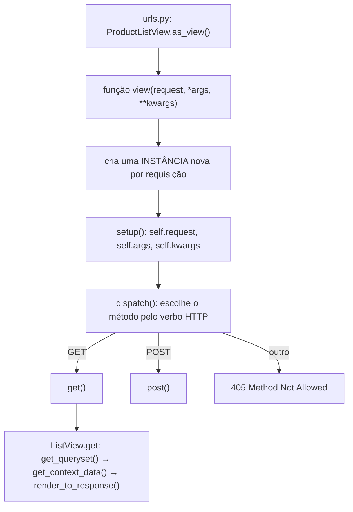
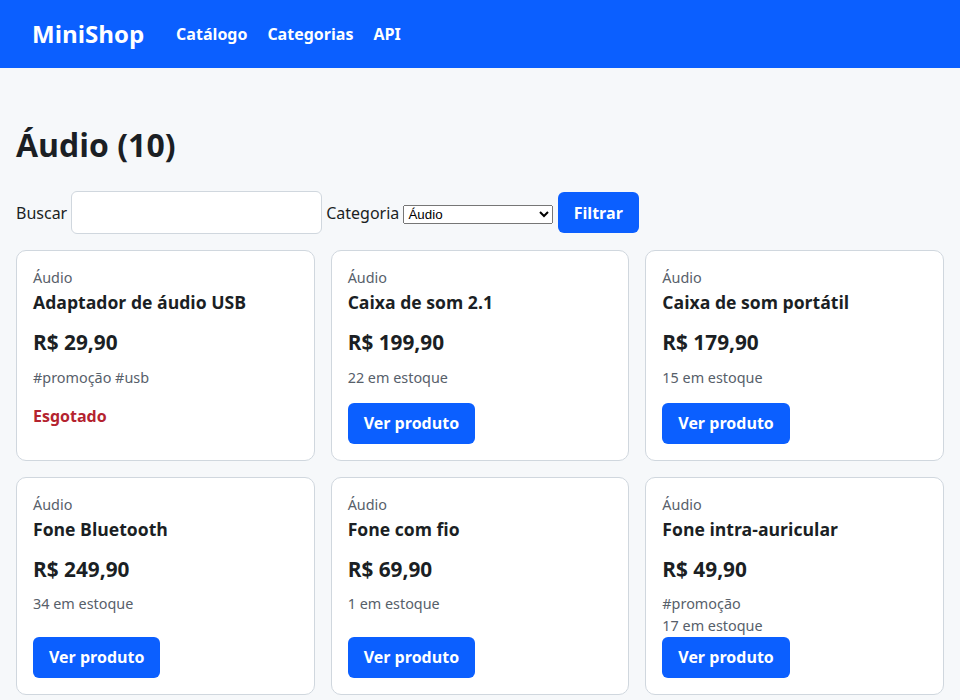

# 09. Views baseadas em classe

> ⏱️ ~1h30 · Módulo 5 · Pré-requisitos: [02](02-urls-views-funcao.md), [03](03-templates.md), [07](07-n-mais-1.md); POO e herança ([aulas 1.12 e 1.13](../01-python-logica/13-poo-heranca-dataclasses.md))

## 🎯 Objetivos
Ao final desta aula você consegue:
- Explicar como uma *class-based view* (CBV) funciona por dentro: `as_view()` → `dispatch()` → `get()`/`post()`
- Usar `TemplateView`, `ListView`, `DetailView` e `RedirectView` e personalizar `get_queryset()` e `get_context_data()`
- Reaproveitar comportamento com **herança** e ***mixins***, e ler a **MRO** (ordem de resolução de métodos)
- Decidir **quando usar CBV e quando uma função** é melhor
- Converter as *views* do catálogo preservando URLs, número de consultas e testes

## 🤔 Por que isso importa
Quase todo projeto Django real usa CBVs: o Admin, o DRF (`APIView`, `ViewSet`; Módulo 6) e as telas de CRUD são classes. Entender `dispatch`, `get_queryset` e a MRO permite **ler o código do framework** (e dos colegas) sem decorar. E saber quando **não** usar CBV (muita herança vira um labirinto) é sinal de maturidade.

## 💡 Intuição (explicação simples)
Uma *view* de função é **cozinhar um prato do zero**: você faz todos os passos. Uma CBV é **uma receita pronta com ganchos** (“*monte a lista*”, “*escolha o template*”, “*acrescente informação extra*”): o framework executa a receita e **você só troca os passos que quer mudar** (padrão ***Template Method***). Os ***mixins*** são **temperos avulsos** que você mistura em várias receitas (um menu de categorias, um controle de acesso).

## 🔬 Como funciona por dentro
**Do `as_view()` à resposta.** Em `urls.py` você escreve `ProductListView.as_view()`. Isso devolve **uma função** (que o roteador chama como qualquer view) e, **a cada requisição**, cria **uma nova instância** da classe, chama `setup()` (guarda `request`, `args`, `kwargs`) e `dispatch()`:


- Em `ListView.get()`: `self.object_list = self.get_queryset()` → `context = self.get_context_data()` → `self.render_to_response(context)` (renderiza o template). Cada passo é um **gancho** que você sobrescreve.
- **Atributos de configuração** (o jeito mais simples): `model`/`queryset`, `template_name`, `context_object_name`, `paginate_by`, `slug_field`/`slug_url_kwarg`.
- **Ganchos principais:** `get_queryset()` (o que listar), `get_context_data(**kwargs)` (o que mais mandar ao template), `get_object()` (qual objeto no `DetailView`), `get_template_names()`, `dispatch()` (código antes de qualquer verbo: autenticação).
- **Uma instância por requisição:** é seguro guardar estado em `self` durante **aquela** requisição; **nunca** em atributos de classe (compartilhados entre requisições e *threads*).

| View genérica | Para quê | Gancho típico |
|---|---|---|
| `TemplateView` | página estática com contexto | `get_context_data` |
| `RedirectView` | redirecionamento (`pattern_name`, `permanent`) | `get_redirect_url` |
| `ListView` | lista de objetos (com paginação) | `get_queryset` |
| `DetailView` | um objeto por `pk`/`slug` (404 automático) | `get_queryset`, `get_context_data` |
| `CreateView` / `UpdateView` / `DeleteView` / `FormView` | formulários (aula 10) | `form_valid`, `get_success_url` |

**Mixins e MRO.** Um *mixin* é uma classe pequena e **sem vida própria** que acrescenta um comportamento (`get_context_data` com o menu, um `dispatch` que exige login) e é combinada por **herança múltipla**: `class ProductListView(CategoriasMenuMixin, ListView)`. A ordem de busca de métodos é a **MRO** (*Method Resolution Order*, algoritmo **C3**): da esquerda para a direita, **a própria classe → mixins → classes-base**, sem repetir ninguém. Por isso mixins vêm **antes** da view base, e `super()` encadeia cada um (aula 1.13): um mixin que sobrescreve `get_context_data` **precisa** chamar `super().get_context_data(**kwargs)`.

**CBV × função: como escolher.**

| Prefira **função** quando… | Prefira **classe** quando… |
|---|---|
| a lógica é única e linear (webhook, health check, upload) | o padrão se repete (listar, detalhar, CRUD) |
| você quer a leitura mais simples possível | você quer **reaproveitar** (mixins, herança de uma view base) |
| há pouca configuração | o framework (Admin, DRF) já oferece a view base certa |
| — | você precisa **sobrescrever partes** do fluxo (gancho) |

Regra de bolso: **hierarquias rasas** (a sua view + 1 ou 2 mixins + a genérica). Quando precisar abrir 5 arquivos para entender uma view, volte a uma função ou **extraia** a lógica para um *service* (Módulo 8). O site [ccbv.co.uk](https://ccbv.co.uk/) mostra, para cada CBV, **todos** os métodos herdados na ordem da MRO.

## 🛠️ Exemplo prático
**1. Vendo a receita funcionar: a ordem real de chamadas**
```python
import os
import django

os.environ["DJANGO_SETTINGS_MODULE"] = "config.settings"
django.setup()
from django.test import RequestFactory
from django.views.generic import ListView

from apps.catalog.models import Product

chamadas = []


def registrar(nome):
    def decorador(func):
        def embrulhado(self, *a, **k):
            chamadas.append(nome)
            return func(self, *a, **k)
        return embrulhado
    return decorador


class VisivelListView(ListView):
    model = Product
    template_name = "catalog/product_list.html"
    context_object_name = "itens"

    setup = registrar("setup")(ListView.setup)
    dispatch = registrar("dispatch")(ListView.dispatch)
    get = registrar("get")(ListView.get)
    get_queryset = registrar("get_queryset")(ListView.get_queryset)
    get_context_data = registrar("get_context_data")(ListView.get_context_data)
    get_template_names = registrar("get_template_names")(ListView.get_template_names)
    render_to_response = registrar("render_to_response")(ListView.render_to_response)


view = VisivelListView.as_view()                                  # as_view() devolve uma FUNÇÃO
print("as_view() devolve:", type(view).__name__, "| a classe fica em view.view_class =", view.view_class.__name__)
requisicao = RequestFactory().get("/produtos/", HTTP_HOST="127.0.0.1")
requisicao.user = type("Anonimo", (), {"is_authenticated": False})()
resposta = view(requisicao)
print("ordem das chamadas:", " → ".join(chamadas))
print("status:", resposta.status_code, "| renderizada?", resposta.is_rendered, "(TemplateResponse: renderiza no fim)")

print("\nMRO da ListView do Django (a ordem em que os métodos são procurados):")
for classe in ListView.__mro__[:-1]:
    print("  ", classe.__module__.replace("django.views.generic.", "") + "." + classe.__name__)

# 405: o dispatch escolhe o método pelo verbo; sem post() definido a resposta é 405
from django.http import HttpResponseNotAllowed
post = RequestFactory().post("/produtos/", HTTP_HOST="127.0.0.1")
print("\nPOST em uma ListView →", ListView.as_view(model=Product)(post).status_code)
```
```bash
uv run python explorar_cbv.py
```
```text
as_view() devolve: function | a classe fica em view.view_class = VisivelListView
ordem das chamadas: setup → dispatch → get → get_queryset → get_context_data → render_to_response → get_template_names
status: 200 | renderizada? False (TemplateResponse: renderiza no fim)

MRO da ListView do Django (a ordem em que os métodos são procurados):
   list.ListView
   list.MultipleObjectTemplateResponseMixin
   base.TemplateResponseMixin
   list.BaseListView
   list.MultipleObjectMixin
   base.ContextMixin
   base.View

POST em uma ListView → 405
Method Not Allowed (POST): /produtos/
```
O `as_view()` devolve uma **função** (é o que o roteador chama); cada requisição passa por `setup → dispatch → get → get_queryset → get_context_data → render_to_response`. **Cada um é um gancho** que você pode sobrescrever. A MRO mostra `ListView` herdando de `MultipleObjectTemplateResponseMixin`, `BaseListView`, `MultipleObjectMixin`…: os *mixins* do próprio Django.

**2. O catálogo em classes (mesmas URLs, menos código repetido)**
```python
import json
from decimal import Decimal, InvalidOperation

from django.db.models import Q
from django.http import HttpResponseBadRequest, JsonResponse
from django.middleware.csrf import get_token
from django.shortcuts import get_object_or_404
from django.views.decorators.csrf import ensure_csrf_cookie
from django.views.decorators.http import require_GET, require_http_methods
from django.views.generic import DetailView, ListView

from .models import Category, Product

ORDENACOES = {"nome": "name", "preco": "price", "-preco": "-price", "novos": "-created_at"}     # lista de permissão (aula 3.10)


def _decimal(texto):
    try:
        return Decimal(texto)
    except (InvalidOperation, TypeError):
        return None


def filtrar(params):
    """QuerySet do catálogo a partir da query string (usado pela página e pela API)."""
    qs = Product.objects.filter(is_active=True)
    busca = params.get("busca", "").strip()
    if busca:
        qs = qs.filter(Q(name__icontains=busca) | Q(sku__iexact=busca))
    if params.get("categoria"):
        qs = qs.filter(category__slug=params["categoria"])
    if (minimo := _decimal(params.get("preco_min"))) is not None:
        qs = qs.filter(price__gte=minimo)
    if (maximo := _decimal(params.get("preco_max"))) is not None:
        qs = qs.filter(price__lte=maximo)
    return qs.order_by(ORDENACOES.get(params.get("ordem"), "name"), "id")


class CategoriasMenuMixin:
    """Mixin: acrescenta as categorias ao contexto (para o filtro). Reaproveitável em qualquer view com template."""

    def get_context_data(self, **kwargs):
        contexto = super().get_context_data(**kwargs)             # SEMPRE encadeie com super() (MRO)
        contexto["categorias"] = Category.objects.all()
        return contexto


class ProductListView(CategoriasMenuMixin, ListView):
    template_name = "catalog/product_list.html"
    context_object_name = "itens"

    def get_queryset(self):
        return filtrar(self.request.GET).select_related("category").prefetch_related("tags")

    def get_context_data(self, **kwargs):
        contexto = super().get_context_data(**kwargs)
        contexto["busca"] = self.request.GET.get("busca", "")
        return contexto


class ProductByCategoryView(ProductListView):
    """Herança: a mesma lista, restrita a uma categoria que vem da URL (/categorias/<slug>/)."""

    def get_queryset(self):
        self.categoria = get_object_or_404(Category, slug=self.kwargs["slug"])          # 404 se a categoria não existe
        return super().get_queryset().filter(category=self.categoria)

    def get_context_data(self, **kwargs):
        contexto = super().get_context_data(**kwargs)
        contexto["categoria_atual"] = self.categoria
        return contexto


class ProductDetailView(DetailView):
    queryset = Product.objects.filter(is_active=True).select_related("category").prefetch_related("tags")      # inativo → 404
    template_name = "catalog/product_detail.html"
    context_object_name = "produto"                              # slug_field="slug" e a URL <slug:slug> são o padrão

    def get_context_data(self, **kwargs):
        contexto = super().get_context_data(**kwargs)
        contexto["outros"] = (Product.objects.filter(is_active=True, category=self.object.category)
                              .exclude(pk=self.object.pk).order_by("-created_at", "id")[:4])
        return contexto


@require_GET
def api_lista(request):                                          # uma função continua sendo a melhor escolha para algo simples
    itens = list(filtrar(request.GET).values("sku", "name", "slug", "price", "stock", "category__slug"))
    return JsonResponse({"total": len(itens), "itens": itens}, json_dumps_params={"ensure_ascii": False})


@require_http_methods(["GET", "POST"])
@ensure_csrf_cookie
def contato(request):
    if request.method == "GET":
        return JsonResponse({"csrf": get_token(request), "dica": "envie o token no cabeçalho X-CSRFToken"})
    try:
        dados_post = json.loads(request.body) if request.content_type == "application/json" else request.POST.dict()
    except json.JSONDecodeError:
        return HttpResponseBadRequest("JSON inválido")
    nome, mensagem = dados_post.get("nome", "").strip(), dados_post.get("mensagem", "").strip()
    if not nome or not mensagem:
        return JsonResponse({"erro": "nome e mensagem são obrigatórios"}, status=422)
    return JsonResponse({"recebido": {"nome": nome, "mensagem": mensagem}}, status=201)
```
```python
from django.urls import path
from django.views.generic import RedirectView, TemplateView

from . import views, views_categorias

app_name = "catalog"

urlpatterns = [
    path("produtos/", views.ProductListView.as_view(), name="list"),
    path("produtos/<slug:slug>/", views.ProductDetailView.as_view(), name="detail"),
    path("api/produtos/", views.api_lista, name="api_list"),
    path("contato/", views.contato, name="contact"),
    path("loja/", RedirectView.as_view(pattern_name="catalog:list", permanent=True), name="old"),            # CBV de uma linha
    path("sobre/", TemplateView.as_view(template_name="catalog/about.html", extra_context={"desde": 2026}), name="about"),
    path("categorias/", views_categorias.categorias, name="categories"),
    path("categorias/<slug:slug>/", views.ProductByCategoryView.as_view(), name="category"),
    path("api/categorias/", views_categorias.api_categorias, name="api_categories"),
]
```
```html

Sobre — {{ NOME_LOJA }}

  <h1>Sobre o {{ NOME_LOJA }}</h1>
  <p class="msg">Projeto de estudo, no ar desde {{ desde }}. Feito com Django, PostgreSQL e muita curiosidade.</p>

```
```html

{{ categoria_atual.name }}Produtos — {{ NOME_LOJA }}

  <h1>{{ categoria_atual.name }}Produtos ({{ itens|length }})</h1>
  <form method="get" role="search">
    <label for="busca">Buscar</label>
    <input id="busca" name="busca" type="search" value="{{ busca }}">
    <label for="categoria">Categoria</label>
    <select id="categoria" name="categoria">
      <option value="">Todas</option>
      <option value="{{ c.slug }}" selected>{{ c.name }}</option>
    </select>
    <button class="botao" type="submit">Filtrar</button>
  </form>
  <ul class="grade">
    
      
    
      <li class="msg">Nenhum produto encontrado para “{{ busca }}”.</li>
    
  </ul>

```
```html


{{ produto.name }} — {{ NOME_LOJA }}

  <nav aria-label="Você está em"><a href="">Catálogo</a> › <a href="">{{ produto.category.name }}</a> › {{ produto.name }}</nav>
  <h1>{{ produto.name }}</h1>
  <p class="suave">SKU {{ produto.sku }} · {{ produto.category.name }} · #{{ tag.name }}</p>
  <p class="preco">{{ produto.price|real }}</p>
  
    <p>{{ produto.stock }} unidade{{ produto.stock|pluralize }} em estoque.</p>
  
    <p class="esgotado">Produto esgotado.</p>
  
  
    <h2>Mais em {{ produto.category.name }}</h2>
    <ul><li><a href="{{ o.get_absolute_url }}">{{ o.name }}</a> — {{ o.price|real }}</li></ul>
  

```
```bash
uv run python manage.py check
uv run pytest
```
```text
System check identified no issues (0 silenced).
................................................................         [100%]
64 passed in 6.08s
```
Todos os **testes das aulas 02, 05 e 07 continuam passando** sem alteração: as URLs, os nomes e o número de consultas foram preservados. É a recompensa de ter testes antes de refatorar (aula 08 do Módulo 8).

**3. Servindo e conferindo**
```python
import subprocess, time, urllib.request
servidor = subprocess.Popen(["uv", "run", "python", "manage.py", "runserver", "8127", "--noreload"],
                            stdout=open("servidor.log", "w"), stderr=subprocess.STDOUT)
for _ in range(60):
    try:
        urllib.request.urlopen("http://127.0.0.1:8127/saude/", timeout=1); break
    except Exception:
        time.sleep(0.5)
print("servidor no ar")
```
```text
servidor no ar
```
```bash
B=http://127.0.0.1:8127
for u in "/produtos/" "/categorias/audio/" "/categorias/nao-existe/" "/produtos/monitor-27-polegadas-4k/" "/sobre/" "/loja/"; do
  curl -s -o /dev/null -D - "$B$u" | tr -d '\r' | awk -v u="$u" 'BEGIN{IGNORECASE=1} /^HTTP/{s=$2} /^location/{l=" → "$2} /^x-consultas-sql/{q=$2} END{printf "%-38s status=%s consultas=%s%s\n", u, s, q, l}'
done
curl -s "$B/produtos/monitor-27-polegadas-4k/" | sed -n '/<h2>/,/<\/ul>/p' | sed 's/^ *//' | head -n 8
shot 09-categoria.png 960x700 "$B/categorias/audio/" 3000
```
```text
/produtos/                             status=200 consultas=3
/categorias/audio/                     status=200 consultas=4
/categorias/nao-existe/                status=404 consultas=1
/produtos/monitor-27-polegadas-4k/     status=200 consultas=3
/sobre/                                status=200 consultas=0
/loja/                                 status=301 consultas=0 → /produtos/
<h2>Mais em Monitores</h2>
<ul><li><a href="/produtos/barra-de-luz-para-monitor/">Barra de luz para monitor</a> — R$ 159,90</li><li><a href="/produtos/pelicula-antirreflexo-24-polegadas/">Película antirreflexo 24 polegadas</a> — R$ 79,90</li><li><a href="/produtos/suporte-articulado-para-monitor/">Suporte articulado para monitor</a> — R$ 189,90</li><li><a href="/produtos/monitor-portatil-15-polegadas/">Monitor portátil 15 polegadas</a> — R$ 999,00</li></ul>
```

```python
servidor.terminate(); servidor.wait(); print("servidor encerrado")
```
```text
servidor encerrado
```
**4. Testes dos novos comportamentos**
```python
import pytest
from django.urls import resolve, reverse
from django.views.generic import ListView

from apps.catalog import views

pytestmark = pytest.mark.django_db


def test_as_view_devolve_funcao_e_guarda_a_classe():
    funcao = views.ProductListView.as_view()
    assert callable(funcao) and funcao.view_class is views.ProductListView
    assert resolve("/produtos/").func.view_class is views.ProductListView


def test_mro_coloca_o_mixin_antes_da_view_base():
    mro = views.ProductListView.__mro__
    assert mro.index(views.CategoriasMenuMixin) < mro.index(ListView)
    assert views.ProductByCategoryView.__mro__[1] is views.ProductListView


def test_lista_por_categoria_filtra_e_mostra_o_nome(client, catalogo):
    resposta = client.get(reverse("catalog:category", kwargs={"slug": "audio"}))
    corpo = resposta.content.decode()
    assert resposta.status_code == 200 and "Áudio (10)" in corpo
    assert resposta.context["categoria_atual"].slug == "audio"
    assert all(p.category.slug == "audio" for p in resposta.context["itens"])


def test_categoria_inexistente_e_404(client, catalogo):
    assert client.get("/categorias/nao-existe/").status_code == 404


def test_detalhe_traz_produtos_relacionados_da_mesma_categoria(client, catalogo):
    resposta = client.get("/produtos/monitor-27-polegadas-4k/")
    outros = resposta.context["outros"]
    assert 0 < len(outros) <= 4 and all(o.category.slug == "monitores" and o.pk != resposta.context["produto"].pk for o in outros)


def test_numero_de_consultas_das_views_de_classe(client, catalogo, django_assert_num_queries):
    with django_assert_num_queries(4):
        client.get(reverse("catalog:category", kwargs={"slug": "audio"}))             # 1 categoria + 1 produtos (JOIN) + 1 etiquetas (prefetch) + 1 menu
```
```bash
uv run pytest
```
```text
................................................................         [100%]
64 passed in 6.18s
```
> Se o `django_assert_num_queries(4)` do último teste falhar com **outro número**, **leia a mensagem**: ela lista as consultas reais (a lista por categoria faz 1 para a categoria, 1 para os produtos com `JOIN`, 1 para as etiquetas e 1 para o menu de categorias). Ajustar o número com consciência é parte de manter esses testes.

## ⚠️ Erros comuns e boas práticas
| Mensagem / sintoma | Causa | Solução |
|---|---|---|
| `TypeError: ProductListView() received an invalid keyword 'x'` | Atributo passado a `as_view(x=…)` que não existe na classe | Só atributos já existentes na classe |
| `ImproperlyConfigured: ProductListView is missing a QuerySet. Define ProductListView.model, ProductListView.queryset, or override ProductListView.get_queryset().` | Faltou `model`/`queryset`/`get_queryset` | Defina um deles |
| `TemplateDoesNotExist: catalog/product_list.html`… ou o padrão `catalog/product_list.html` | Sem `template_name`, a `ListView` procura `<app>/<modelo>_list.html` | Defina `template_name` ou siga a convenção |
| `AttributeError: 'ProductListView' object has no attribute 'categoria'` | Usou um atributo definido em outro método **antes** de ele rodar | Ordem dos ganchos: `get_queryset` roda **antes** de `get_context_data` |
| O mixin “não funciona” | Mixin **depois** da view base na herança, ou sem `super()` | `class V(MeuMixin, ListView)` e chame `super()` |
| `Generic detail view ProductDetailView must be called with either an object pk or a slug in the URLconf.` | URL sem `<pk>` nem `<slug>` | Use `<slug:slug>` / `<int:pk>` (ou `slug_url_kwarg`) |
| Estado “vazando” entre requisições | Guardou dados em **atributo de classe** | Use `self.x` (a instância é por requisição) |
| `405 Method Not Allowed` em um formulário | A view só define `get()` | Defina `post()` (ou use `FormView`/`CreateView`) |
| CBV com `get_queryset()` sem `select_related` | N+1 volta (aula 07) | Mantenha as otimizações no `get_queryset` |
| Hierarquia de 6 classes impossível de entender | Herança em excesso | Prefira composição, *services* (Módulo 8) ou uma função |

- Em CBVs, configure por **atributos** quando bastar, e sobrescreva **ganchos** quando precisar de lógica.
- **Mixins:** pequenos, com uma responsabilidade, **antes** da view base, e sempre com `super()`.
- **Nunca** guarde estado de requisição em atributos de classe.
- Use o [ccbv.co.uk](https://ccbv.co.uk/) para ver a ordem exata dos métodos de cada CBV.
- A API (função `api_lista`) continua função: simples e clara. **Não converta por converter.**

## 🧠 Pausa para lógica
**Problema (MRO na mão).** O Python resolve a herança múltipla com o algoritmo **C3**. Implemente `c3(classe)` que calcula a MRO **sem** usar `__mro__` e confira com ele em três hierarquias: o “diamante” (`D(B, C)`, `B(A)`, `C(A)`), uma com *mixins* (`ProductListView`) e uma **impossível** (que levanta `TypeError: Cannot create a consistent method resolution order`).

<details><summary>Dica</summary>
<code>L[C] = C + merge(L[B1], …, L[Bn], [B1, …, Bn])</code>. O <code>merge</code> pega, repetidamente, a <strong>cabeça</strong> da primeira lista que <strong>não aparece na cauda</strong> de nenhuma outra; se nenhuma serve, a hierarquia é inconsistente.
</details>

<details><summary>Solução comentada</summary>

```python
def c3(classe):
    bases = list(classe.__bases__)
    if not bases:
        return [classe]
    listas = [c3(b) for b in bases] + [bases]
    resultado = [classe]
    while True:
        listas = [l for l in listas if l]
        if not listas:
            return resultado
        for l in listas:
            cabeca = l[0]
            if not any(cabeca in outra[1:] for outra in listas):         # cabeça que não está na cauda de ninguém
                break
        else:
            raise TypeError("hierarquia inconsistente (sem MRO possível)")
        resultado.append(cabeca)
        listas = [[x for x in l if x is not cabeca] for l in listas]


class A: pass
class B(A): pass
class C(A): pass
class D(B, C): pass
print("diamante :", [k.__name__ for k in c3(D)], "| igual ao __mro__?", c3(D) == list(D.__mro__))

class Mixin: pass
class BaseLista: pass
class MinhaLista(Mixin, BaseLista): pass
class Especializada(MinhaLista): pass
print("com mixin:", [k.__name__ for k in c3(Especializada)], "|", c3(Especializada) == list(Especializada.__mro__))

# a do Django, de verdade
import os
import django
os.environ["DJANGO_SETTINGS_MODULE"] = "config.settings"
django.setup()
from apps.catalog.views import ProductByCategoryView
print("django   :", [k.__name__ for k in c3(ProductByCategoryView)][:6], "…", c3(ProductByCategoryView) == list(ProductByCategoryView.__mro__))

class X: pass
class Y: pass
class P(X, Y): pass
class Q(Y, X): pass
try:
    type("R", (P, Q), {})          # o próprio Python recusa a hierarquia contraditória
except TypeError as e:
    print("impossível:", e)
```
```bash
uv run python c3.py
```
```text
diamante : ['D', 'B', 'C', 'A', 'object'] | igual ao __mro__? True
com mixin: ['Especializada', 'MinhaLista', 'Mixin', 'BaseLista', 'object'] | True
django   : ['ProductByCategoryView', 'ProductListView', 'CategoriasMenuMixin', 'ListView', 'MultipleObjectTemplateResponseMixin', 'TemplateResponseMixin'] … True
impossível: Cannot create a consistent method resolution order (MRO) for bases X, Y
```
Entender a MRO explica **por que** os *mixins* vão à esquerda da view base e por que um `super()` esquecido “corta” a cadeia. A hierarquia impossível mostra que a herança múltipla tem **regras**, e que o Python recusa ordens contraditórias.
</details>

**Variação mais difícil:** escreva um `LogRequestMixin` com `dispatch()` que registra método, caminho e tempo, e prove (com `__mro__`) em qual posição ele precisa ficar para envolver **todas** as outras camadas.

## 🧩 Exercícios
**1. Fixação**
(a) O que `as_view()` devolve? (b) Em que ordem o `dispatch` e o `get` são chamados e por que cada requisição tem uma instância nova? (c) Para que serve `get_context_data` e por que chamar `super()` nele? (d) Cite um caso em que você preferiria uma função a uma CBV.

<details><summary>Solução</summary>

(a) Uma **função** de view que, a cada requisição, instancia a classe, chama `setup()` e `dispatch()`. (b) `dispatch` escolhe o método pelo verbo HTTP e chama `get()`/`post()`; a instância nova por requisição evita compartilhar estado entre requisições/*threads*. (c) Acrescenta variáveis ao contexto do template; o `super()` preserva o contexto montado pelas classes-base e pelos outros *mixins* (MRO). (d) Uma lógica única e linear, como um *webhook* de pagamento ou um *health check*, em que a classe só acrescentaria cerimônia.
</details>

**2. Aplicação no projeto MiniShop**
Converta o restante do catálogo e a página de categorias.

Critérios de pronto:
- [ ] `CategoryListView(ListView)` (substitui a função `categorias`) com o queryset anotado (contagem, média, máximo), **1 consulta** (teste com `django_assert_num_queries(1)`)
- [ ] `ProductListView`, `ProductByCategoryView`, `ProductDetailView` como na aula, com `select_related`/`prefetch_related` e **testes de número de consultas** (lista e detalhe)
- [ ] `CategoriasMenuMixin` reaproveitado em **três** views; um segundo mixin (`TituloMixin`, por exemplo) que define `titulo` no contexto
- [ ] Páginas `sobre/` (`TemplateView`) e redirecionamento `loja/` (`RedirectView`, 301) funcionando
- [ ] Todos os testes das aulas anteriores continuam verdes **sem alteração** (prova da refatoração segura)
- [ ] `docs/views.md` com a tabela “FBV × CBV” do projeto (qual view é função, qual é classe e **por quê**) e a MRO de `ProductByCategoryView`
- [ ] Commit `refactor(catalog): class-based views with mixins`

<details><summary>Solução de referência</summary>

```python
class CategoryListView(ListView):
    template_name = "catalog/category_list.html"; context_object_name = "categorias"
    def get_queryset(self):
        from .views_categorias import categorias_resumo
        return categorias_resumo()
class TituloMixin:
    titulo = ""
    def get_context_data(self, **kwargs):
        ctx = super().get_context_data(**kwargs); ctx["titulo"] = self.titulo; return ctx
```
No `urls.py`: `path("categorias/", views.CategoryListView.as_view(), name="categories")`.
</details>

**3. Desafio (opcional)**
Escreva um *mixin* `HtmxMixin` que, quando a requisição traz o cabeçalho `HX-Request`, devolve só o fragmento (`_lista.html`) em vez da página inteira (sobrescrevendo `get_template_names`). Prepare o terreno para a busca “ao vivo” com HTMX (aula 15).

## 🎤 Na entrevista
- **Como uma CBV processa uma requisição?** `as_view()` devolve uma função que cria uma instância da classe, chama `setup()` e `dispatch()`, que escolhe `get()`/`post()` conforme o verbo; nas views genéricas esses métodos chamam ganchos como `get_queryset()` e `get_context_data()` e renderizam o template.
- **Quando usar CBV e quando função?** CBV quando há padrão repetido (CRUD/listagens) ou necessidade de herança/*mixins*; função quando a lógica é simples e única; evitar hierarquias profundas.
- **O que é um *mixin* e por que a ordem na herança importa?** Classe pequena que adiciona comportamento a outras; a ordem define a MRO, e os *mixins* devem vir **antes** da view base para que seus métodos (que chamam `super()`) sejam encontrados primeiro.
- **O que é a MRO?** A ordem em que o Python procura métodos em herança múltipla (algoritmo C3): a própria classe, depois as bases da esquerda para a direita, sem repetições, respeitando as hierarquias.
- **Por que não guardar estado em atributos de classe de uma view?** Eles são compartilhados entre todas as requisições e *threads*; o estado de uma requisição deve ficar na instância (`self`), que é criada por requisição.

## 📚 Para ir além
- 📄 Documentação oficial: [Views baseadas em classe](https://docs.djangoproject.com/en/5.2/topics/class-based-views/) e [views genéricas](https://docs.djangoproject.com/en/5.2/ref/class-based-views/). `ListView`, `DetailView` e demais.
- 📄 Documentação oficial: [Usando mixins com CBVs](https://docs.djangoproject.com/en/5.2/topics/class-based-views/mixins/). Como compor comportamento.
- 📑 Artigo/tutorial: [Classy Class-Based Views (ccbv.co.uk)](https://ccbv.co.uk/). Todos os métodos e atributos de cada CBV, na ordem da MRO.
- 📄 Documentação oficial: [A MRO do Python (C3)](https://docs.python.org/3/howto/mro.html). Como a ordem de resolução é calculada.
- 🏋️ Prática extra: reescreva a view `contato` como `FormView` na aula 10 e compare o tamanho do código.

## ✅ Checklist da aula
- [ ] Vi a ordem de chamadas `setup → dispatch → get → get_queryset → get_context_data → render`
- [ ] Catálogo em CBVs com *mixin*, herança e consultas controladas
- [ ] `TemplateView` e `RedirectView` no lugar de funções triviais
- [ ] Calculei a MRO (C3) e entendi a ordem dos *mixins*
- [ ] Todos os testes anteriores continuam verdes
