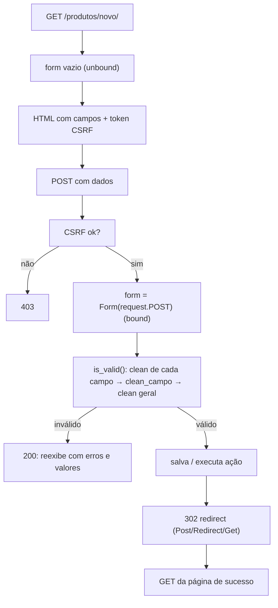
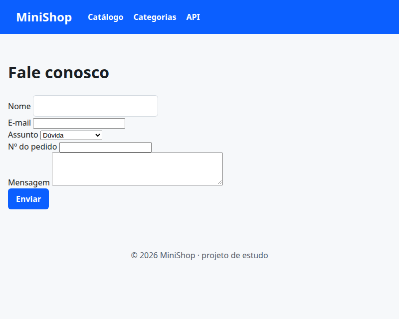
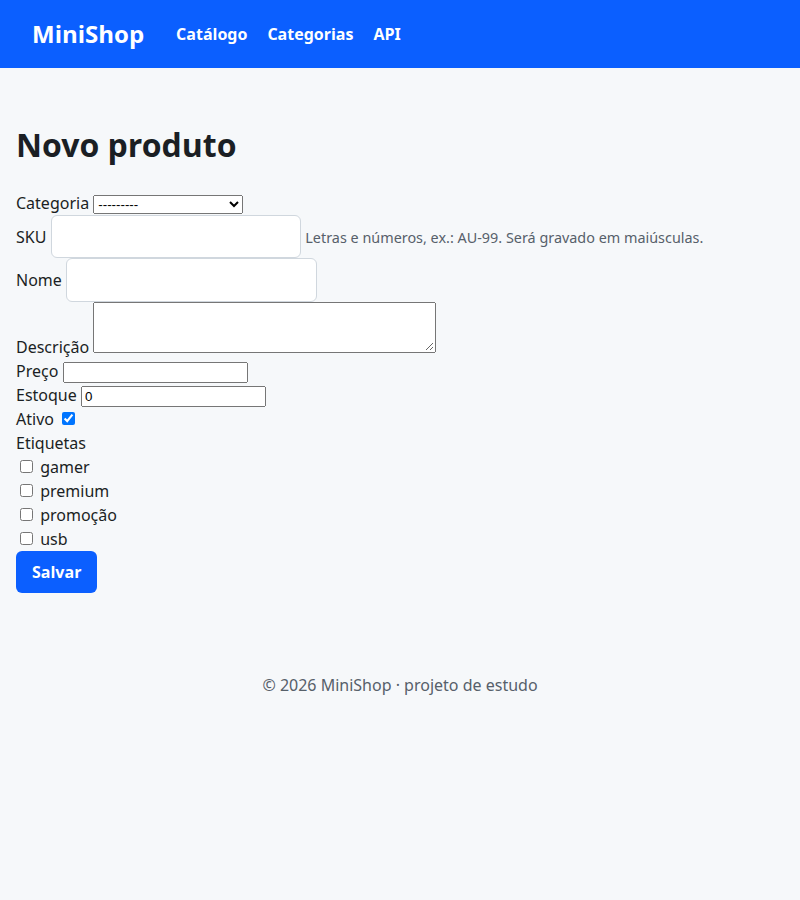

# 10. Formulários e validação

> ⏱️ ~1h30 · Módulo 5 · Pré-requisitos: [02](02-urls-views-funcao.md) (CSRF), [03](03-templates.md), [04](04-models-migracoes.md), [09](09-class-based-views.md)

## 🎯 Objetivos
Ao final desta aula você consegue:
- Explicar o ciclo de um formulário: **GET** (mostra) → **POST** (valida) → erro (reexibe) ou **sucesso (redireciona)**
- Criar um `Form` e um `ModelForm`, com validação por campo (`clean_<campo>`) e entre campos (`clean`)
- Renderizar erros e manter o que o usuário digitou
- Usar `FormView` e `CreateView` e aplicar o padrão **Post/Redirect/Get**
- Entender por que **validar no servidor é obrigatório** e o que o CSRF protege

## 🤔 Por que isso importa
Todo cadastro, login, checkout e painel é um formulário. A entrada do usuário é **não confiável**: um formulário bem feito evita dados inválidos, erros 500 e vulnerabilidades, e economiza dezenas de linhas de `if` manuais. É também uma das perguntas mais comuns de entrevista.

## 💡 Intuição (explicação simples)
O formulário Django é um **porteiro com prancheta**: recebe o que veio do navegador (texto cru), confere cada item (“isso é um número? é maior que zero? já existe?”), **converte** para tipos Python e, se tudo bate, entrega os dados limpos (`cleaned_data`). Se algo falha, devolve a prancheta com as observações em vermelho, **sem perder** o que a pessoa preencheu.

## 🔬 Como funciona por dentro

- **Unbound × bound.** `Form()` não tem dados (mostra vazio); `Form(request.POST)` tem dados e pode ser validado. `form.is_valid()` roda a validação e preenche `form.errors` e `form.cleaned_data`.
- **Ordem da validação:** para cada campo, converte (`to_python`), roda os *validators* e depois o método `clean_<campo>()`; por fim `clean()` (regras que envolvem **vários** campos). Erros ligados ao formulário todo ficam em `non_field_errors`.
- **`ModelForm`:** gera os campos a partir do modelo (tipos, `max_length`, `unique`…) e acrescenta `save()`. Além das regras do formulário, valida o modelo (`full_clean`), incluindo **unicidade**.
- **Post/Redirect/Get (PRG):** depois de um POST bem-sucedido, **redirecione** (302). Assim, atualizar a página (F5) não reenvia o POST e duplica o pedido.
- **CSRF:** o `` coloca um token no formulário; o middleware rejeita POST sem ele (403). Evita que **outro site** faça o navegador do usuário logado enviar formulários sem ele saber (aula 02).
- **Validação no cliente (`required`, `type="number"`) é só conforto.** Qualquer um pode enviar um POST com `curl`; **o servidor sempre valida**.
- **Mensagens ao usuário:** `django.contrib.messages` guarda um aviso (“Produto criado!”) na sessão para ser mostrado na próxima página.

## 🛠️ Exemplo prático
**1. Explorando um formulário no shell (sem servidor)**
```python
import os
import django

os.environ["DJANGO_SETTINGS_MODULE"] = "config.settings"
django.setup()
from django import forms


class ContatoForm(forms.Form):
    nome = forms.CharField(max_length=60)
    email = forms.EmailField()
    idade = forms.IntegerField(min_value=18, required=False)
    mensagem = forms.CharField(widget=forms.Textarea, min_length=10)


print("unbound:", ContatoForm().is_bound, "| bound:", ContatoForm({}).is_bound)

ruim = ContatoForm({"nome": "  ", "email": "isso-nao-e-email", "idade": "dezesseis", "mensagem": "oi"})
print("válido?", ruim.is_valid())
for campo, erros in ruim.errors.items():
    print(f"  {campo}: {list(erros)}")

bom = ContatoForm({"nome": " Ana ", "email": "ana@exemplo.com", "idade": "30", "mensagem": "Quero saber do prazo."})
print("válido?", bom.is_valid())
print("cleaned_data:", bom.cleaned_data)
print("tipos:", {k: type(v).__name__ for k, v in bom.cleaned_data.items()})
print("\nHTML de um campo:")
print(ContatoForm()["email"])
```
```bash
uv run python explorar_form.py
```
```text
unbound: False | bound: True
válido? False
  nome: ['Este campo é obrigatório.']
  email: ['Informe um endereço de email válido.']
  idade: ['Informe um número inteiro.']
  mensagem: ['Certifique-se de que o valor tenha no mínimo 10 caracteres (ele possui 2).']
válido? True
cleaned_data: {'nome': 'Ana', 'email': 'ana@exemplo.com', 'idade': 30, 'mensagem': 'Quero saber do prazo.'}
tipos: {'nome': 'str', 'email': 'str', 'idade': 'int', 'mensagem': 'str'}

HTML de um campo:
<input type="email" name="email" maxlength="320" required id="id_email">
```
Repare: `"30"` virou `int`, os espaços de `" Ana "` foram removidos, e cada campo inválido tem sua lista de erros. **Os dados vêm como texto; o formulário converte e valida.**

**2. Formulários do catálogo: um `Form` de contato e um `ModelForm` de produto**
```python
from decimal import Decimal

from django import forms
from django.core.exceptions import ValidationError

from .models import Category, Product


class ContatoForm(forms.Form):
    nome = forms.CharField(label="Nome", max_length=60)
    email = forms.EmailField(label="E-mail")
    assunto = forms.ChoiceField(label="Assunto", choices=[("duvida", "Dúvida"), ("pedido", "Sobre um pedido"), ("outro", "Outro")])
    pedido = forms.IntegerField(label="Nº do pedido", min_value=1, required=False)
    mensagem = forms.CharField(label="Mensagem", min_length=10, widget=forms.Textarea(attrs={"rows": 4}))

    def clean(self):
        dados = super().clean()
        if dados.get("assunto") == "pedido" and not dados.get("pedido"):
            self.add_error("pedido", "Informe o número do pedido.")       # erro ligado a UM campo, vindo da regra entre campos
        return dados


class ProductForm(forms.ModelForm):
    class Meta:
        model = Product
        fields = ["category", "sku", "name", "description", "price", "stock", "is_active", "tags"]       # lista explícita: nunca "__all__"
        widgets = {"description": forms.Textarea(attrs={"rows": 3}), "tags": forms.CheckboxSelectMultiple}
        help_texts = {"sku": "Letras e números, ex.: AU-99. Será gravado em maiúsculas."}

    def clean_sku(self):
        sku = self.cleaned_data["sku"].strip().upper()
        if not sku.replace("-", "").isalnum():
            raise ValidationError("Use apenas letras, números e hífen.")
        if Product.objects.filter(sku=sku).exclude(pk=self.instance.pk).exists():          # excluir a si mesmo na edição
            raise ValidationError("Já existe um produto com este SKU.")
        return sku

    def clean_price(self):
        preco = self.cleaned_data["price"]
        if preco > Decimal("100000"):
            raise ValidationError("Preço acima do limite permitido (R$ 100.000).")
        return preco

    def clean(self):
        dados = super().clean()
        if dados.get("is_active") and dados.get("stock") == 0 and dados.get("price") is not None:
            self.add_error("stock", "Um produto ativo precisa de estoque; desmarque “ativo” ou informe o estoque.")
        return dados
```
```python
from django.contrib import messages
from django.urls import reverse_lazy
from django.views.generic import CreateView, FormView, UpdateView

from .forms import ContatoForm, ProductForm
from .models import Product


class ContatoFormView(FormView):
    template_name = "catalog/contact_form.html"
    form_class = ContatoForm
    success_url = reverse_lazy("catalog:contact_form")        # Post/Redirect/Get: volta para a própria página (GET)

    def form_valid(self, form):
        # aqui entraria o envio de e-mail / gravação (Módulo 8); por ora, só registramos
        self.request.session["ultimo_contato"] = form.cleaned_data["nome"]
        messages.success(self.request, f"Obrigado, {form.cleaned_data['nome']}! Recebemos sua mensagem.")
        return super().form_valid(form)                       # devolve o redirect para success_url


class ProductCreateView(CreateView):
    model = Product
    form_class = ProductForm
    template_name = "catalog/product_form.html"

    def form_valid(self, form):
        resposta = super().form_valid(form)                   # salva (form.save()) e redireciona para get_success_url()
        messages.success(self.request, f"Produto {self.object.sku} criado.")
        return resposta                                       # sem success_url: usa self.object.get_absolute_url()


class ProductUpdateView(UpdateView):
    model = Product
    form_class = ProductForm
    template_name = "catalog/product_form.html"
    slug_field = "slug"

    def form_valid(self, form):
        resposta = super().form_valid(form)
        messages.success(self.request, f"Produto {self.object.sku} atualizado.")
        return resposta
```
```python
from django.urls import path
from django.views.generic import RedirectView, TemplateView

from . import views, views_categorias, views_forms

app_name = "catalog"

urlpatterns = [
    path("produtos/", views.ProductListView.as_view(), name="list"),
    path("produtos/novo/", views_forms.ProductCreateView.as_view(), name="create"),            # ANTES de <slug>, ou "novo" viraria um slug
    path("produtos/<slug:slug>/", views.ProductDetailView.as_view(), name="detail"),
    path("produtos/<slug:slug>/editar/", views_forms.ProductUpdateView.as_view(), name="update"),
    path("api/produtos/", views.api_lista, name="api_list"),
    path("contato/", views.contato, name="contact"),
    path("fale-conosco/", views_forms.ContatoFormView.as_view(), name="contact_form"),
    path("loja/", RedirectView.as_view(pattern_name="catalog:list", permanent=True), name="old"),
    path("sobre/", TemplateView.as_view(template_name="catalog/about.html", extra_context={"desde": 2026}), name="about"),
    path("categorias/", views_categorias.categorias, name="categories"),
    path("categorias/<slug:slug>/", views.ProductByCategoryView.as_view(), name="category"),
    path("api/categorias/", views_categorias.api_categorias, name="api_categories"),
]
```
```html
<div class="erro" role="alert">{{ form.non_field_errors }}</div>

  <div class="campo">
    <label for="{{ campo.id_for_label }}">{{ campo.label }}</label>
    {{ campo }}
    <small class="suave">{{ campo.help_text }}</small>
    <div class="erro" role="alert">{{ erro }}</div>
  </div>

```
```html

Fale conosco — {{ NOME_LOJA }}

  <h1>Fale conosco</h1>
  <p class="msg" role="status">{{ m }}</p>
  <form method="post" novalidate>
    
    
    <button class="botao" type="submit">Enviar</button>
  </form>

```
```html

Editar {{ object.sku }}Novo produto — {{ NOME_LOJA }}

  <h1>Editar {{ object.name }}Novo produto</h1>
  <form method="post" novalidate>
    
    
    <button class="botao" type="submit">Salvar</button>
  </form>

```
```html


{{ produto.name }} — {{ NOME_LOJA }}

  <p class="msg" role="status">{{ m }}</p>
  <nav aria-label="Você está em"><a href="">Catálogo</a> › <a href="">{{ produto.category.name }}</a> › {{ produto.name }}</nav>
  <h1>{{ produto.name }}</h1>
  <p class="suave">SKU {{ produto.sku }} · {{ produto.category.name }} · #{{ tag.name }} · <a href="">editar</a></p>
  <p class="preco">{{ produto.price|real }}</p>
  
    <p>{{ produto.stock }} unidade{{ produto.stock|pluralize }} em estoque.</p>
  
    <p class="esgotado">Produto esgotado.</p>
  
  
    <h2>Mais em {{ produto.category.name }}</h2>
    <ul><li><a href="{{ o.get_absolute_url }}">{{ o.name }}</a> — {{ o.price|real }}</li></ul>
  

```
> Atenção: **qualquer pessoa** consegue abrir `/produtos/novo/` por enquanto. Isso é de propósito e é **temporário**: nas aulas 11 e 12 vamos exigir login e permissão. Nunca publique uma tela administrativa sem proteção.

**3. Testes: o ciclo completo, erros, PRG e CSRF**
```python
import pytest
from django.test import Client
from django.urls import reverse

from apps.catalog.forms import ContatoForm, ProductForm
from apps.catalog.models import Category, Product

pytestmark = pytest.mark.django_db


def dados_produto(catalogo, **extra):
    base = {"category": Category.objects.first().pk, "sku": "zz-01", "name": "Cabo Teste", "description": "",
            "price": "19.90", "stock": "5", "is_active": "on"}
    base.update(extra)
    return base


def test_formulario_de_contato_regra_entre_campos():
    f = ContatoForm({"nome": "Ana", "email": "a@b.co", "assunto": "pedido", "mensagem": "Onde está meu pedido?"})
    assert not f.is_valid() and "pedido" in f.errors            # assunto "pedido" exige o número
    f = ContatoForm({"nome": "Ana", "email": "a@b.co", "assunto": "pedido", "pedido": "7", "mensagem": "Onde está meu pedido?"})
    assert f.is_valid() and f.cleaned_data["pedido"] == 7


def test_contato_get_post_invalido_e_prg(client):
    assert client.get(reverse("catalog:contact_form")).status_code == 200
    ruim = client.post(reverse("catalog:contact_form"), {"nome": "Ana", "email": "x"})
    assert ruim.status_code == 200 and ruim.context["form"].errors              # reexibe com erros (sem redirect)
    assert 'value="Ana"' in ruim.content.decode()                               # e mantém o que foi digitado
    ok = client.post(reverse("catalog:contact_form"), {"nome": "Ana", "email": "a@b.co", "assunto": "duvida", "mensagem": "Qual o prazo de entrega?"})
    assert ok.status_code == 302 and ok.url == reverse("catalog:contact_form")   # Post/Redirect/Get
    seguinte = client.get(ok.url)
    assert "Obrigado, Ana" in seguinte.content.decode()
    assert "Obrigado" not in client.get(ok.url).content.decode()               # a mensagem aparece uma única vez


def test_csrf_e_exigido_no_post():
    c = Client(enforce_csrf_checks=True)
    assert c.post(reverse("catalog:contact_form"), {"nome": "Ana"}).status_code == 403


def test_criar_produto_normaliza_sku_e_redireciona(client, catalogo):
    resposta = client.post(reverse("catalog:create"), dados_produto(catalogo))
    produto = Product.objects.get(sku="ZZ-01")
    assert resposta.status_code == 302 and resposta.url == produto.get_absolute_url()
    assert produto.slug == "cabo-teste"


@pytest.mark.parametrize("campo,valor,trecho", [
    ("sku", "ZZ 01!", "apenas letras"),
    ("price", "-1", "maior ou igual"),
    ("price", "200000", "limite"),
    ("price", "abc", "número"),
    ("stock", "0", "precisa de estoque"),
])
def test_produto_invalido_mostra_erro_e_nao_grava(client, catalogo, campo, valor, trecho):
    antes = Product.objects.count()
    resposta = client.post(reverse("catalog:create"), dados_produto(catalogo, **{campo: valor}))
    assert resposta.status_code == 200 and trecho in resposta.content.decode()
    assert Product.objects.count() == antes


def test_sku_duplicado_so_na_criacao_nao_na_edicao(client, catalogo):
    existente = Product.objects.get(sku="AU-01")
    f = ProductForm(dados_produto(catalogo, sku="au-01"))
    assert not f.is_valid() and "Já existe" in f.errors["sku"][0]
    edicao = ProductForm(dados_produto(catalogo, sku="au-01"), instance=existente)       # editar a si mesmo é permitido
    assert edicao.is_valid(), edicao.errors


def test_editar_produto(client, catalogo):
    p = Product.objects.get(sku="AU-01")
    dados = dados_produto(catalogo, sku="AU-01", name=p.name, price="99.00", category=p.category_id)
    resposta = client.post(reverse("catalog:update", kwargs={"slug": p.slug}), dados)
    p.refresh_from_db()
    assert resposta.status_code == 302 and str(p.price) == "99.00"


def test_campos_fora_da_lista_sao_ignorados(client, catalogo):
    dados = dados_produto(catalogo, slug="slug-forcado", created_at="2000-01-01")           # campo que não está em Meta.fields
    client.post(reverse("catalog:create"), dados)
    assert Product.objects.get(sku="ZZ-01").slug == "cabo-teste"                              # o slug enviado foi ignorado
```
```bash
uv run pytest
```
```text
........................................................................ [ 94%]
....                                                                     [100%]
76 passed in 6.76s
```
Os testes provam o ciclo inteiro: formulário vazio, erro com os valores preservados, sucesso com **redirect** (PRG), mensagem exibida **uma vez**, CSRF (403) e o ponto de segurança do `Meta.fields`: **campos não listados são ignorados**, mesmo que o atacante os envie (*mass assignment*).

**4. Vendo no navegador**
```python
import subprocess, time, urllib.request
servidor = subprocess.Popen(["uv", "run", "python", "manage.py", "runserver", "8128", "--noreload"],
                            stdout=open("servidor.log", "w"), stderr=subprocess.STDOUT)
for _ in range(60):
    try:
        urllib.request.urlopen("http://127.0.0.1:8128/saude/", timeout=1); break
    except Exception:
        time.sleep(0.5)
print("servidor no ar")
```
```text
servidor no ar
```
```bash
B=http://127.0.0.1:8128
curl -s "$B/fale-conosco/" | grep -E 'csrfmiddlewaretoken|<input|<select|<textarea' | sed 's/^ *//' | cut -c1-110 | sed 's/value="[A-Za-z0-9]\{20,\}"/value="…token…"/'
echo "--- POST sem token (curl) ---"
curl -s -o /dev/null -w "status=%{http_code}\n" -X POST -d "nome=Ana" "$B/fale-conosco/"
shot 10-contato-vazio.png 800x640 "$B/fale-conosco/" 2000
shot 10-produto-novo.png 800x900 "$B/produtos/novo/" 2000
```
```text
<input type="hidden" name="csrfmiddlewaretoken" value="D7gtdDAsyODDOdDfPSBnltu5e37dsOEiGnXOutzcTAmzOPM9o7EnQ4n
<input type="text" name="nome" maxlength="60" required id="id_nome">
<input type="email" name="email" maxlength="320" required id="id_email">
<select name="assunto" id="id_assunto">
<input type="number" name="pedido" min="1" id="id_pedido">
<textarea name="mensagem" cols="40" rows="4" minlength="10" required id="id_mensagem">
--- POST sem token (curl) ---
status=403
```


```python
servidor.terminate(); servidor.wait(); print("servidor encerrado")
```
```text
servidor encerrado
```
O `curl` sem o token recebe **403**: é o CSRF em ação. (Navegadores enviam o token porque ele vem dentro do HTML do formulário.)

## ⚠️ Erros comuns e boas práticas
| Mensagem / sintoma | Causa | Solução |
|---|---|---|
| `403 Forbidden — CSRF verification failed` | Faltou `` no `<form method="post">` | Adicione o token (nunca desligue o CSRF) |
| `ImproperlyConfigured: Creating a ModelForm without either the 'fields' attribute or the 'exclude' attribute is prohibited` | `Meta` sem `fields` | Liste os campos explicitamente |
| `fields = "__all__"` “funciona”, mas… | Expõe campos novos do modelo automaticamente (*mass assignment*) | Lista explícita, sempre |
| Formulário válido, mas o objeto não foi gravado | Em `Form` comum, não há `save()`; ou esqueceu `form.save()` na view de função | Use `ModelForm`/`CreateView` ou grave você mesmo |
| Reenvio ao atualizar a página (pedido duplicado) | Respondeu `200` após o POST | **Redirecione** (PRG) |
| O erro some, mas o dado errado foi aceito | Validou só no HTML (`required`, `min`) | Valide no servidor (`clean_*`) |
| `clean_x` retorna `None` | Esqueceu o `return` | Sempre devolva o valor limpo |
| Unicidade falha na edição (“já existe”) | Não excluiu o próprio objeto da checagem | `.exclude(pk=self.instance.pk)` |
| Campos aparecem sem estilo/rótulo | Renderizou `{{ form }}` sem controle | Use um *include* (como `_form_campos.html`) |

- **Nunca confie** no cliente: valide tipos, tamanhos, intervalos e regras de negócio no servidor.
- Após um POST válido, **sempre** redirecione.
- Mensagens de erro claras, em português, perto do campo.
- `novalidate` no `<form>` durante o aprendizado deixa a validação do servidor visível; em produção, mantenha a validação do navegador **além** da do servidor.

## 🧠 Pausa para lógica
**Problema (validador de CPF).** Em formulários brasileiros é comum validar o **CPF**: 11 dígitos, não todos iguais, e dois **dígitos verificadores** calculados. Implemente `cpf_valido(texto)` que aceite `"529.982.247-25"` ou só números, e use-o como *validator* de um campo.

<details><summary>Dica</summary>
Para o 1º dígito: multiplique os 9 primeiros dígitos por 10, 9, …, 2, some, calcule <code>(soma * 10) % 11</code> e use <code>0</code> se der 10. O 2º dígito usa os 10 primeiros com pesos 11…2.
</details>

<details><summary>Solução comentada</summary>

```python
import os
import re
import django

os.environ["DJANGO_SETTINGS_MODULE"] = "config.settings"
django.setup()
from django import forms
from django.core.exceptions import ValidationError


def _digito(numeros):
    pesos = range(len(numeros) + 1, 1, -1)
    resto = (sum(n * p for n, p in zip(numeros, pesos)) * 10) % 11
    return 0 if resto == 10 else resto


def cpf_valido(texto):
    numeros = [int(c) for c in re.sub(r"\D", "", texto)]
    if len(numeros) != 11 or len(set(numeros)) == 1:          # tamanho e "111.111.111-11"
        return False
    return numeros[9] == _digito(numeros[:9]) and numeros[10] == _digito(numeros[:10])


def validar_cpf(valor):
    if not cpf_valido(valor):
        raise ValidationError("CPF inválido.", code="cpf_invalido")


class ClienteForm(forms.Form):
    cpf = forms.CharField(validators=[validar_cpf])


for cpf in ["529.982.247-25", "52998224725", "529.982.247-24", "111.111.111-11", "123"]:
    print(f"{cpf:16} → {cpf_valido(cpf)}")
f = ClienteForm({"cpf": "529.982.247-24"})
print("no formulário:", f.is_valid(), dict(f.errors))
```
```bash
uv run python cpf.py
```
```text
529.982.247-25   → True
52998224725      → True
529.982.247-24   → False
111.111.111-11   → False
123              → False
no formulário: False {'cpf': ['CPF inválido.']}
```
O validador é uma função reutilizável (serve em formulários, modelos e na API do Módulo 6). **Validação de formato não prova que a pessoa existe**, só que o número é possível.
</details>

**Variação mais difícil:** valide um **CNPJ** (14 dígitos, pesos `5,4,3,2,9,8,7,6,5,4,3,2` e `6,5,4,3,2,9,…`) e escreva testes parametrizados com CNPJs válidos e inválidos.

## 🧩 Exercícios
**1. Fixação**
(a) Diferença entre formulário *unbound* e *bound*? (b) Por que redirecionar após um POST válido? (c) Para que serve `clean()` em vez de `clean_<campo>()`? (d) O que o `` impede?

<details><summary>Solução</summary>

(a) *Unbound* não tem dados (exibição inicial); *bound* recebeu dados e pode ser validado. (b) Evita o reenvio do formulário ao atualizar a página (padrão Post/Redirect/Get). (c) `clean()` valida regras que dependem de **mais de um campo**. (d) Que outro site faça o navegador do usuário enviar um POST sem a intenção dele (CSRF).
</details>

**2. Aplicação no projeto MiniShop**
Complete os formulários do catálogo.

Critérios de pronto:
- [ ] `ContatoForm` e `ProductForm` com os testes da aula verdes
- [ ] `CategoryForm` (`ModelForm`) com `clean_name` que rejeita nomes que gerem o **mesmo slug** de outra categoria (ex.: “Áudio” e “Audio”)
- [ ] Páginas de criar categoria (`CreateView`) e **excluir produto** (`DeleteView` com confirmação por POST; `on_delete=PROTECT` tratado: mostre mensagem amigável se o produto estiver em pedidos futuros, simulando com `ProtectedError`)
- [ ] Mensagens (`messages`) em todas as ações; **nenhuma** ação altera dados via GET
- [ ] Teste de *mass assignment*: enviar `slug`/`created_at` não altera o objeto
- [ ] `docs/formularios.md` com o fluxo GET/POST/PRG do MiniShop (diagrama)
- [ ] Commit `feat(catalog): forms with validation and PRG`

<details><summary>Solução de referência</summary>

```python
class CategoryForm(forms.ModelForm):
    class Meta:
        model = Category
        fields = ["name"]
    def clean_name(self):
        nome = self.cleaned_data["name"].strip()
        if Category.objects.filter(slug=slugify(nome)).exclude(pk=self.instance.pk).exists():
            raise ValidationError("Já existe uma categoria com nome equivalente.")
        return nome
```
`DeleteView`: sobrescreva `form_valid` e capture `ProtectedError` (de `django.db.models`) para exibir `messages.error` e redirecionar.
</details>

**3. Desafio (opcional)**
Crie um `ProductFilterForm` (`forms.Form`) para a **busca por GET** (busca, categoria, faixa de preço, ordenação), validando `preco_min <= preco_max`, e use-o na `ProductListView` no lugar do parsing manual em `filtrar()`.

## 🎤 Na entrevista
- **Como funciona a validação de um formulário Django?** Os dados chegam como texto; cada campo converte e valida, depois rodam `clean_<campo>()` e `clean()`; `is_valid()` preenche `cleaned_data` e `errors`.
- **Form × ModelForm?** `Form` define campos manualmente; `ModelForm` os deriva do modelo, valida unicidade e tem `save()`.
- **O que é Post/Redirect/Get e por quê?** Responder a um POST bem-sucedido com redirect para um GET, evitando duplicidade ao recarregar.
- **O que é CSRF e como o Django protege?** Ataque em que um site malicioso faz o navegador logado enviar uma requisição; o Django exige um token secreto por formulário/sessão em métodos não seguros.
- **Por que não usar `fields = "__all__"`?** Expõe automaticamente campos novos e abre brecha para *mass assignment*; liste os campos permitidos.

## 📚 Para ir além
- 📄 Documentação oficial: [Trabalhando com formulários](https://docs.djangoproject.com/en/5.2/topics/forms/). O ciclo completo.
- 📄 Documentação oficial: [Criando formulários a partir de modelos](https://docs.djangoproject.com/en/5.2/topics/forms/modelforms/). `ModelForm` em detalhe.
- 📄 Documentação oficial: [Validação de formulários](https://docs.djangoproject.com/en/5.2/ref/forms/validation/). Ordem de `clean`, `add_error`.
- 📄 Documentação oficial: [Proteção contra CSRF](https://docs.djangoproject.com/en/5.2/ref/csrf/). Como o token funciona.
- 📄 Documentação oficial: [O framework de mensagens](https://docs.djangoproject.com/en/5.2/ref/contrib/messages/).
- 🏋️ Prática extra: implemente o CNPJ da variação e use-o em um campo do `ModelForm`.

## ✅ Checklist da aula
- [ ] Sei descrever o ciclo GET → POST → erro/sucesso → redirect
- [ ] Criei `Form` e `ModelForm` com `clean_<campo>` e `clean`
- [ ] Usei `FormView`, `CreateView` e `UpdateView` com mensagens
- [ ] Entendo CSRF e `Meta.fields` explícito
- [ ] Todos os testes (anteriores + formulários) estão verdes
