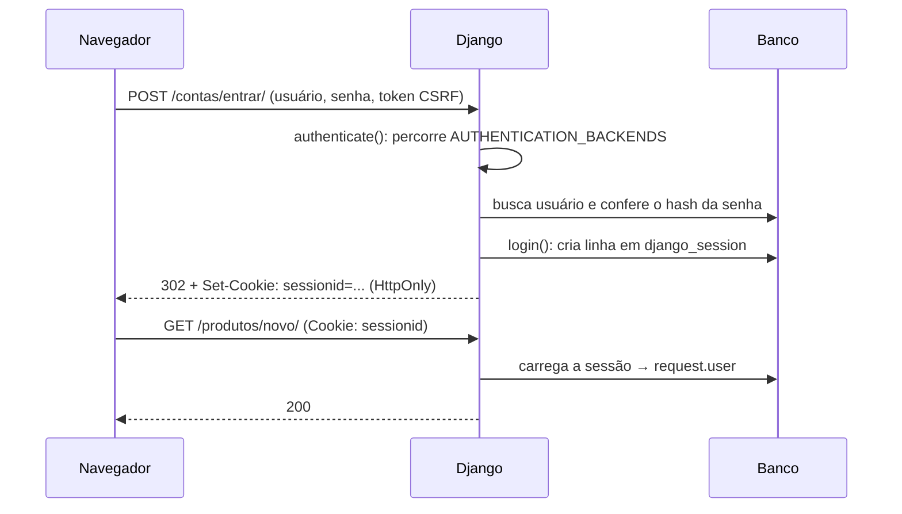
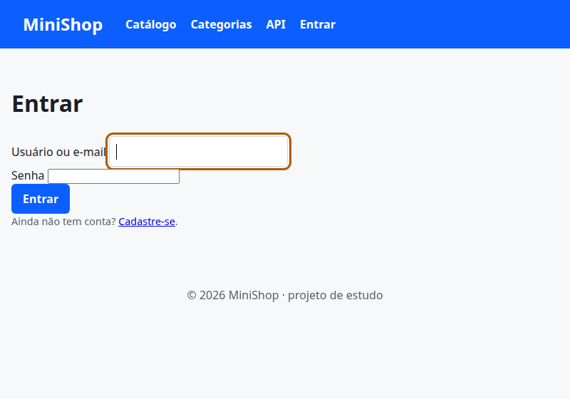

# 11. Autenticação: cadastro, login e logout

> ⏱️ ~1h30 · Módulo 5 · Pré-requisitos: [01](01-projeto-apps-mvt.md) (usuário próprio), [04](04-models-migracoes.md), [10](10-formularios.md); cookies e sessões ([aula 2.3](../02-como-a-web-funciona/03-tls-cookies-sessoes-json-urls.md))

## 🎯 Objetivos
Ao final desta aula você consegue:
- Diferenciar **autenticação** (quem é você?) de **autorização** (o que pode fazer?)
- Explicar como o Django guarda **senhas** (hash com sal) e **sessões** (cookie + tabela)
- Entregar cadastro, login (por usuário **ou e-mail**) e logout com as views prontas do `django.contrib.auth`
- Proteger views com `LoginRequiredMixin` / `@login_required` e tratar o parâmetro `next` com segurança
- Reconhecer riscos: senha em texto puro, *open redirect*, logout por GET, enumeração de usuários

## 🤔 Por que isso importa
Quase todo sistema real tem contas. Autenticação mal feita é a falha mais cara (vazamento de senhas, contas sequestradas). Django já resolve o difícil: **use o que o framework oferece** e nunca invente criptografia própria. Em entrevista, “como as senhas são armazenadas?” é pergunta clássica.

## 💡 Intuição (explicação simples)
Pense em um **show com pulseira**. Na portaria (login) você prova quem é com documento e senha; recebe uma **pulseira** (cookie de sessão) com um número aleatório. Dentro, ninguém pede o documento de novo: só olham a pulseira, e o produtor consulta numa lista (tabela de sessões) a quem aquele número pertence. A senha nunca fica anotada: guarda-se só uma **impressão digital irreversível** dela (hash); para conferir, faz-se a impressão da senha digitada e compara-se.

## 🔬 Como funciona por dentro

- **Hash de senha.** `set_password()` aplica um algoritmo **lento e com sal** (padrão do Django 5.2: **PBKDF2-SHA256** com 1 milhão de iterações). O valor gravado tem o formato `algoritmo$iterações$sal$hash`. O **sal** (aleatório por senha) faz a mesma senha gerar hashes diferentes e inutiliza tabelas prontas (*rainbow tables*); a lentidão torna caro o ataque de força bruta. Nunca use MD5/SHA1 puros para senha.
- **Backends.** `authenticate()` pergunta a cada backend de `AUTHENTICATION_BACKENDS`, na ordem, até um devolver o usuário. Vamos acrescentar um backend para entrar com **e-mail**.
- **Sessão.** `login()` grava `_auth_user_id` na sessão (tabela `django_session`), **troca a chave da sessão** (evita *session fixation*) e envia o cookie `sessionid` (`HttpOnly`: o JavaScript não lê; `SameSite=Lax`). `request.user` vem do `AuthenticationMiddleware`.
- **Views prontas** (`django.contrib.auth.views`): `LoginView`, `LogoutView`, `PasswordChangeView`, `PasswordResetView`… Desde o Django 5.0 o **logout exige POST** (um GET poderia ser disparado por uma imagem em outro site).
- **`next` e *open redirect*.** Depois do login o usuário volta para onde estava (`?next=/produtos/novo/`). O Django só aceita `next` para o **mesmo host**; do contrário, um link `?next=https://site-malicioso` serviria de golpe de phishing.
- **Mensagens de erro genéricas.** “Usuário ou senha inválidos”, sem dizer qual: não revela se o e-mail existe (enumeração de usuários).

## 🛠️ Exemplo prático
**1. Senhas e sessões na prática**
```python
import os
import django

os.environ["DJANGO_SETTINGS_MODULE"] = "config.settings"
django.setup()
from django.contrib.auth.hashers import check_password, make_password, identify_hasher

h1 = make_password("minha-senha-forte")
h2 = make_password("minha-senha-forte")
print("hash 1:", h1[:48] + "…")
print("hash 2:", h2[:48] + "…")
print("mesma senha, hashes diferentes (sal)?", h1 != h2)
algoritmo, iteracoes, sal, resto = h1.split("$")
print(f"partes → algoritmo={algoritmo} | iterações={int(iteracoes):,} | sal={sal} | hash={len(resto)} caracteres")
print("hasher:", identify_hasher(h1).algorithm)
print("confere a certa?", check_password("minha-senha-forte", h1), "| a errada?", check_password("outra", h1))

import time
t = time.perf_counter()
check_password("minha-senha-forte", h1)
print(f"uma verificação leva ~{(time.perf_counter() - t) * 1000:.0f} ms de propósito (força bruta fica cara)")

from django.conf import settings
print("\nhashers aceitos (o 1º grava; os outros só leem e atualizam):")
for h in settings.PASSWORD_HASHERS[:3]:
    print("  ", h.rsplit(".", 1)[-1])
```
```bash
uv run python explorar_senha.py
```
```text
hash 1: pbkdf2_sha256$1000000$hvjEWIAHtNtChm6x1oYmQU$lGy…
hash 2: pbkdf2_sha256$1000000$GSdJ7sN8Fk0Pw8IjR8hhXh$VNN…
mesma senha, hashes diferentes (sal)? True
partes → algoritmo=pbkdf2_sha256 | iterações=1,000,000 | sal=hvjEWIAHtNtChm6x1oYmQU | hash=44 caracteres
hasher: pbkdf2_sha256
confere a certa? True | a errada? False
uma verificação leva ~110 ms de propósito (força bruta fica cara)

hashers aceitos (o 1º grava; os outros só leem e atualizam):
   PBKDF2PasswordHasher
   PBKDF2SHA1PasswordHasher
   Argon2PasswordHasher
```
Mesmo texto, hashes diferentes: o **sal** vai dentro do próprio valor. A verificação é lenta de propósito (cerca de 0,1 s para você; milhões de tentativas, cada uma lenta, para um atacante).

**2. E-mail único (sem diferenciar maiúsculas) e login por e-mail**
```python
from django.contrib.auth.models import AbstractUser
from django.db import models
from django.db.models import Q
from django.db.models.functions import Lower


class User(AbstractUser):
    """Usuário do MiniShop: igual ao padrão, mas com e-mail único (sem diferenciar maiúsculas)."""

    class Meta:
        verbose_name = "usuário"
        verbose_name_plural = "usuários"
        constraints = [
            models.UniqueConstraint(Lower("email"), condition=~Q(email=""), name="user_email_unique_ci"),
        ]
```
```bash
uv run python manage.py makemigrations accounts -n email_unico
uv run python manage.py migrate
```
```text
No changes detected in app 'accounts'
Operations to perform:
  Apply all migrations: accounts, admin, auth, catalog, contenttypes, sessions
Running migrations:
  No migrations to apply.
```
O índice único é sobre `LOWER(email)` e ignora e-mails vazios (o superusuário do laboratório não tem e-mail). Assim `Ana@x.com` e `ana@x.com` são o **mesmo** e-mail.

```python
from django.contrib.auth import get_user_model
from django.contrib.auth.backends import ModelBackend


class EmailBackend(ModelBackend):
    """Permite entrar com o e-mail no campo "usuário". Nomes de usuário continuam com o ModelBackend."""

    def authenticate(self, request, username=None, password=None, **kwargs):
        if not username or "@" not in username or password is None:
            return None                                              # deixa o próximo backend tentar
        User = get_user_model()
        try:
            usuario = User.objects.get(email__iexact=username)
        except (User.DoesNotExist, User.MultipleObjectsReturned):
            User().set_password(password)                            # gasta o mesmo tempo: não revela se o e-mail existe
            return None
        if usuario.check_password(password) and self.user_can_authenticate(usuario):
            return usuario
        return None
```
```python
from django import forms
from django.contrib.auth.forms import AuthenticationForm, UserCreationForm
from django.core.exceptions import ValidationError

from .models import User


class LoginForm(AuthenticationForm):
    def __init__(self, *args, **kwargs):
        super().__init__(*args, **kwargs)
        self.fields["username"].label = "Usuário ou e-mail"


class SignupForm(UserCreationForm):
    email = forms.EmailField(label="E-mail")

    class Meta(UserCreationForm.Meta):
        model = User
        fields = ("username", "email")

    def clean_email(self):
        email = self.cleaned_data["email"].strip().lower()
        if User.objects.filter(email__iexact=email).exists():
            raise ValidationError("Este e-mail já está cadastrado.")
        return email
```
```python
from django.contrib import messages
from django.contrib.auth import login
from django.urls import reverse_lazy
from django.views.generic import CreateView

from .forms import SignupForm


class SignupView(CreateView):
    form_class = SignupForm
    template_name = "registration/signup.html"
    success_url = reverse_lazy("catalog:list")

    def form_valid(self, form):
        resposta = super().form_valid(form)                          # cria o usuário (senha já com hash)
        login(self.request, self.object, backend="django.contrib.auth.backends.ModelBackend")   # entra direto; com 2 backends é preciso dizer qual
        messages.success(self.request, f"Bem-vindo(a), {self.object.username}!")
        return resposta
```
```python
from django.contrib.auth import views as auth_views
from django.urls import path

from . import views
from .forms import LoginForm

app_name = "accounts"

urlpatterns = [
    path("entrar/", auth_views.LoginView.as_view(authentication_form=LoginForm, redirect_authenticated_user=True), name="login"),
    path("sair/", auth_views.LogoutView.as_view(), name="logout"),              # só aceita POST
    path("cadastro/", views.SignupView.as_view(), name="signup"),
]
```
```python
# Configuração: backends, rotas de login/logout e as URLs de contas (acrescentadas ao que já existe)
from pathlib import Path

cfg = Path("config/settings.py")
if "AUTHENTICATION_BACKENDS" not in cfg.read_text():
    cfg.write_text(cfg.read_text() + '''

# --- Autenticação (aula 11) ---
AUTHENTICATION_BACKENDS = [
    "django.contrib.auth.backends.ModelBackend",     # usuário + senha
    "apps.accounts.backends.EmailBackend",           # e-mail + senha
]
LOGIN_URL = "accounts:login"                         # para onde mandar quem não está logado
LOGIN_REDIRECT_URL = "catalog:list"                  # depois de entrar (sem ?next=)
LOGOUT_REDIRECT_URL = "catalog:list"                 # depois de sair
''')

urls = Path("config/urls.py")
if "apps.accounts.urls" not in urls.read_text():
    urls.write_text(urls.read_text().replace(
        '    path("", include("apps.catalog.urls")),',
        '    path("contas/", include("apps.accounts.urls")),\n    path("", include("apps.catalog.urls")),'))
print(urls.read_text())
```
```text
from django.contrib import admin
from django.urls import include, path

from . import views

urlpatterns = [
    path("admin/", admin.site.urls),
    path("saude/", views.saude, name="health"),
    path("contas/", include("apps.accounts.urls")),
    path("", include("apps.catalog.urls")),            # as rotas do catálogo na raiz
]
```
**3. Templates e navegação**
```html

Entrar — {{ NOME_LOJA }}

  <h1>Entrar</h1>
  <form method="post" novalidate>
    
    
    <input type="hidden" name="next" value="{{ next }}">
    <button class="botao" type="submit">Entrar</button>
  </form>
  <p class="suave">Ainda não tem conta? <a href="">Cadastre-se</a>.</p>

```
```html

Cadastro — {{ NOME_LOJA }}

  <h1>Criar conta</h1>
  <form method="post" novalidate>
    
    
    <button class="botao" type="submit">Cadastrar</button>
  </form>

```
```html
<!doctype html>
<html lang="pt-br">
<head>
  <meta charset="utf-8">
  <meta name="viewport" content="width=device-width, initial-scale=1">
  <title>{{ NOME_LOJA }}</title>
  <link rel="stylesheet" href="">
</head>
<body>
  <a class="sr-only" href="#conteudo">Ir para o conteúdo</a>
  <header class="topo">
    <h1><a href="">{{ NOME_LOJA }}</a></h1>
    <nav aria-label="Principal">
      <a href="">Catálogo</a>
      <a href="">Categorias</a>
      <a href="">API</a>
      
        <span class="suave">Olá, {{ user.username }}</span>
        <form method="post" action="" style="display:inline"><button class="botao" type="submit">Sair</button></form>
      
        <a href="">Entrar</a>
      
    </nav>
  </header>
  <main id="conteudo">
    <p class="msg" role="status">{{ m }}</p>
    
  </main>
  <footer><p>© {{ ano }} {{ NOME_LOJA }} · projeto de estudo</p></footer>
</body>
</html>
```
> O botão “Sair” é um **formulário POST**, não um link. Os templates `product_detail.html`, `contact_form.html` e `product_form.html` da aula 10 também listam `messages`: agora o `base.html` faz isso para todos, então vamos remover a repetição abaixo.

**4. Protegendo as telas de produto**
```python
from pathlib import Path

p = Path("apps/catalog/views_forms.py")
t = p.read_text()
if "LoginRequiredMixin" not in t:
    t = t.replace("from django.contrib import messages\n", "from django.contrib import messages\nfrom django.contrib.auth.mixins import LoginRequiredMixin\n")
    t = t.replace("class ProductCreateView(CreateView):", "class ProductCreateView(LoginRequiredMixin, CreateView):")
    t = t.replace("class ProductUpdateView(UpdateView):", "class ProductUpdateView(LoginRequiredMixin, UpdateView):")
    p.write_text(t)
print([l for l in p.read_text().splitlines() if "LoginRequired" in l or l.startswith("class ")])

# o base.html agora mostra as mensagens: tira a repetição dos templates da aula 10
for nome in ["contact_form.html", "product_detail.html"]:
    arq = Path("apps/catalog/templates/catalog") / nome
    texto = arq.read_text()
    linha = "  <p class=\"msg\" role=\"status\">{{ m }}</p>\n"
    arq.write_text(texto.replace(linha, ""))
print("mensagens duplicadas removidas?", all("for m in messages" not in (Path("apps/catalog/templates/catalog") / n).read_text() for n in ["contact_form.html", "product_detail.html"]))

# os testes da aula 10 criam/editam produtos: agora precisam de um usuário logado
tf = Path("apps/catalog/tests/test_formularios.py")
s = tf.read_text()
if "def client(" not in s:
    s = s.replace("pytestmark = pytest.mark.django_db\n", '''pytestmark = pytest.mark.django_db


@pytest.fixture
def client(client, django_user_model):
    """Sobrescreve o `client` padrão deste arquivo: agora com um usuário logado (as telas exigem login)."""
    client.force_login(django_user_model.objects.create_user("editor", "editor@exemplo.com", "senha-forte-123"))
    return client
''', 1)
    tf.write_text(s)
print("fixture client logado adicionada")
```
```text
['from django.contrib.auth.mixins import LoginRequiredMixin', 'class ContatoFormView(FormView):', 'class ProductCreateView(LoginRequiredMixin, CreateView):', 'class ProductUpdateView(LoginRequiredMixin, UpdateView):']
mensagens duplicadas removidas? True
fixture client logado adicionada
```
`LoginRequiredMixin` deve vir **antes** da view na herança (é um *mixin* de `dispatch()`, aula 09). Se o usuário não estiver logado, é enviado para `LOGIN_URL?next=…`.

**5. Testes**
```python
```
```python
import pytest
from django.contrib.auth import get_user_model
from django.contrib.sessions.models import Session
from django.db import IntegrityError, transaction
from django.test import Client
from django.urls import reverse

pytestmark = pytest.mark.django_db
User = get_user_model()
SENHA = "uma-senha-bem-forte-42"


@pytest.fixture
def ana():
    return User.objects.create_user("ana", "Ana@Exemplo.com", SENHA)


def test_senha_e_gravada_com_hash(ana):
    assert ana.password != SENHA and ana.password.startswith("pbkdf2_sha256$")
    assert ana.check_password(SENHA) and not ana.check_password("errada")


def test_cadastro_cria_usuario_e_ja_loga(client):
    r = client.post(reverse("accounts:signup"), {"username": "bia", "email": "Bia@Exemplo.com", "password1": SENHA, "password2": SENHA})
    assert r.status_code == 302
    bia = User.objects.get(username="bia")
    assert bia.email == "bia@exemplo.com"                                  # normalizado em minúsculas
    assert client.get(reverse("catalog:list")).context["user"].is_authenticated


def test_cadastro_rejeita_senha_fraca_e_email_repetido(client, ana):
    fraca = client.post(reverse("accounts:signup"), {"username": "c", "email": "c@x.com", "password1": "12345678", "password2": "12345678"})
    assert fraca.status_code == 200 and not User.objects.filter(username="c").exists()
    repetido = client.post(reverse("accounts:signup"), {"username": "d", "email": "ANA@exemplo.com", "password1": SENHA, "password2": SENHA})
    assert "já está cadastrado" in repetido.content.decode()


def test_banco_tambem_garante_email_unico(ana):
    with pytest.raises(IntegrityError), transaction.atomic():
        User.objects.create_user("outra", "ana@exemplo.com", SENHA)


@pytest.mark.parametrize("identificador", ["ana", "ana@exemplo.com", "ANA@EXEMPLO.COM"])
def test_login_por_usuario_ou_email(client, ana, identificador):
    r = client.post(reverse("accounts:login"), {"username": identificador, "password": SENHA})
    assert r.status_code == 302 and r.url == reverse("catalog:list")


def test_login_com_senha_errada_nao_revela_qual_campo(client, ana):
    erradas = [client.post(reverse("accounts:login"), {"username": u, "password": "errada"}) for u in ("ana", "naoexiste@x.com")]
    assert all(r.status_code == 200 for r in erradas)
    mensagens = {r.context["form"].non_field_errors()[0] for r in erradas}
    assert len(mensagens) == 1                                              # a mesma mensagem nos dois casos


def test_login_troca_a_chave_da_sessao(client, ana):
    client.get(reverse("catalog:list"))
    client.post(reverse("accounts:login"), {"username": "ana", "password": SENHA})
    assert Session.objects.count() == 1 and "_auth_user_id" in client.session


def test_logout_exige_post(client, ana):
    client.force_login(ana)
    assert client.get(reverse("accounts:logout")).status_code == 405
    assert client.post(reverse("accounts:logout")).status_code == 302
    assert "_auth_user_id" not in client.session


def test_tela_protegida_redireciona_com_next(client):
    r = client.get(reverse("catalog:create"))
    assert r.status_code == 302 and r.url == f"{reverse('accounts:login')}?next=/produtos/novo/"


def test_depois_do_login_volta_para_onde_estava(client, ana):
    r = client.post(reverse("accounts:login") + "?next=/produtos/novo/", {"username": "ana", "password": SENHA, "next": "/produtos/novo/"})
    assert r.url == "/produtos/novo/"


@pytest.mark.parametrize("destino", ["https://site-malicioso.example/", "//site-malicioso.example/", "javascript:alert(1)"])
def test_open_redirect_e_ignorado(client, ana, destino):
    r = client.post(reverse("accounts:login"), {"username": "ana", "password": SENHA, "next": destino})
    assert r.status_code == 302 and r.url == reverse("catalog:list")        # cai no LOGIN_REDIRECT_URL


def test_usuario_inativo_nao_entra(client, ana):
    ana.is_active = False
    ana.save()
    for ident in ("ana", "ana@exemplo.com"):
        r = client.post(reverse("accounts:login"), {"username": ident, "password": SENHA})
        assert r.status_code == 200


def test_login_exige_csrf():
    assert Client(enforce_csrf_checks=True).post(reverse("accounts:login"), {"username": "a", "password": "b"}).status_code == 403
```
```bash
uv run python manage.py check
uv run pytest
```
```text
System check identified no issues (0 silenced).
........................................................................ [ 77%]
.....................                                                    [100%]
93 passed in 12.06s
```
Os testes cobrem hash, cadastro, **e-mail único na aplicação e no banco**, login por usuário e e-mail, erro genérico, logout só por POST, proteção com `next` e *open redirect*.

**6. No navegador**
```python
import subprocess, time, urllib.request
servidor = subprocess.Popen(["uv", "run", "python", "manage.py", "runserver", "8129", "--noreload"],
                            stdout=open("servidor.log", "w"), stderr=subprocess.STDOUT)
for _ in range(60):
    try:
        urllib.request.urlopen("http://127.0.0.1:8129/saude/", timeout=1); break
    except Exception:
        time.sleep(0.5)
print("servidor no ar")
```
```text
servidor no ar
```
```bash
B=http://127.0.0.1:8129
echo "--- anônimo tenta criar produto ---"
curl -s -o /dev/null -D - "$B/produtos/novo/" | tr -d '\r' | grep -iE '^(HTTP|location)'
echo "--- cookie de sessão ---"
curl -s -c /tmp/jar.txt -o /dev/null "$B/contas/entrar/"
TOKEN=$(grep csrftoken /tmp/jar.txt | awk '{print $7}')
curl -s -b /tmp/jar.txt -c /tmp/jar.txt -o /dev/null -D - -d "username=admin&password=admin-dev-123&csrfmiddlewaretoken=$TOKEN" "$B/contas/entrar/" | tr -d '\r' | grep -iE '^(HTTP|location|set-cookie)' | sed -E 's/sessionid=[A-Za-z0-9]+/sessionid=…/; s/csrftoken=[A-Za-z0-9]+/csrftoken=…/'
rm -f /tmp/jar.txt
shot 11-login.png 800x560 "$B/contas/entrar/" 2000
```
```text
--- anônimo tenta criar produto ---
HTTP/1.1 302 Found
Location: /contas/entrar/?next=/produtos/novo/
--- cookie de sessão ---
HTTP/1.1 302 Found
Location: /produtos/
Set-Cookie:  csrftoken=…; expires=Sun, 07 Nov 2027 13:53:06 GMT; Max-Age=31449600; Path=/; SameSite=Lax
Set-Cookie:  sessionid=…; expires=Sun, 22 Nov 2026 13:53:06 GMT; HttpOnly; Max-Age=1209600; Path=/; SameSite=Lax
```

```python
servidor.terminate(); servidor.wait(); print("servidor encerrado")
```
```text
servidor encerrado
```
Repare no `Set-Cookie: sessionid=…; HttpOnly; SameSite=Lax`: o JavaScript da página **não** consegue ler esse cookie, o que limita o estrago de um ataque XSS.

## ⚠️ Erros comuns e boas práticas
| Mensagem / sintoma | Causa | Solução |
|---|---|---|
| `ValueError: You have multiple authentication backends configured and therefore must provide the backend argument…` | `login()` com 2+ backends, sem `backend=` | Passe `backend="django.contrib.auth.backends.ModelBackend"` |
| Logout por link dá `405` | Desde o Django 5.0 o logout só aceita POST | Use um `<form method="post">` |
| `ValueError: The SECRET_KEY setting must not be empty` / sessões que “somem” | `SECRET_KEY` mudando entre execuções | Chave estável por variável de ambiente (aula 14) |
| Todo mundo é redirecionado para `/accounts/login/` (404) | Não definiu `LOGIN_URL` | `LOGIN_URL = "accounts:login"` |
| Senha em texto puro no banco | Gravou com `User.objects.create(password="…")` | `create_user()` ou `set_password()` |
| Mixin não protege | `LoginRequiredMixin` depois da view base | Sempre à **esquerda** |
| Usuários duplicados por maiúsculas | E-mail sem restrição case-insensitive | `UniqueConstraint(Lower("email"))` + `clean_email` |
| Mensagem diferente para “usuário não existe” | Enumeração de usuários | Mensagem única e genérica (como a do Django) |
| `next` vindo da URL usado em `redirect(next)` à mão | *Open redirect* | Use `url_has_allowed_host_and_scheme` (as views do Django já usam) |
| `AUTH_USER_MODEL` mudado depois das migrações | Quebra chaves estrangeiras | Defina **antes** da 1ª migração (por isso desde a aula 01) |

- **Nunca** armazene, registre em *log* ou envie senhas em texto puro.
- Valide a força da senha (`AUTH_PASSWORD_VALIDATORS`) e **não** imponha regras absurdas; tamanho importa mais que símbolos.
- Cookies de sessão em produção: `SESSION_COOKIE_SECURE = True` e HTTPS (aula 14).
- Em produção, adicione limite de tentativas de login (ex.: `django-axes`) e recuperação de senha por e-mail (`PasswordResetView`).
- Senhas de laboratório (`admin-dev-123`) são **só para este ambiente local**.

## 🧠 Pausa para lógica
**Problema (um mini “hasher”).** Sem usar `django.contrib.auth`, implemente com a biblioteca padrão: `hash_senha(senha)` → `"pbkdf2$<iterações>$<sal em hex>$<hash em hex>"` e `confere(senha, guardado)`. Exigências: sal aleatório de 16 bytes, comparação em **tempo constante** e **detecção de que o hash está desatualizado** (iterações menores que a atual → deve ser re-hasheado no próximo login).

<details><summary>Dica</summary>
<code>hashlib.pbkdf2_hmac("sha256", senha.encode(), sal, iteracoes)</code>, <code>secrets.token_bytes(16)</code> e <code>hmac.compare_digest(a, b)</code> (comparar com <code>==</code> pode vazar informação pelo tempo de resposta).
</details>

<details><summary>Solução comentada</summary>

```python
import hashlib
import hmac
import secrets

ITERACOES = 1_000_000


def hash_senha(senha, iteracoes=ITERACOES):
    sal = secrets.token_bytes(16)
    derivado = hashlib.pbkdf2_hmac("sha256", senha.encode(), sal, iteracoes)
    return f"pbkdf2${iteracoes}${sal.hex()}${derivado.hex()}"


def confere(senha, guardado):
    """Devolve (ok, precisa_atualizar)."""
    _, iteracoes, sal, esperado = guardado.split("$")
    derivado = hashlib.pbkdf2_hmac("sha256", senha.encode(), bytes.fromhex(sal), int(iteracoes))
    ok = hmac.compare_digest(derivado.hex(), esperado)           # tempo constante
    return ok, ok and int(iteracoes) < ITERACOES


a, b = hash_senha("segredo"), hash_senha("segredo")
print("hashes diferentes (sal)?", a != b)
print("certa :", confere("segredo", a))
print("errada:", confere("outra", a))
antigo = hash_senha("segredo", iteracoes=100_000)
print("antigo:", confere("segredo", antigo), "→ re-hashear no login e gravar de novo")
```
```bash
python3 mini_hasher.py
```
```text
hashes diferentes (sal)? True
certa : (True, False)
errada: (False, False)
antigo: (True, True) → re-hashear no login e gravar de novo
```
É exatamente a ideia por trás do `check_password` do Django, inclusive a **atualização automática** de hashes antigos (`must_update`). Em produção, use sempre a implementação do framework.
</details>

**Variação mais difícil:** conte quantas senhas por segundo seu hasher consegue testar com 1.000, 100.000 e 1.000.000 de iterações, e estime em quanto tempo um atacante testaria 1 milhão de senhas de um dicionário.

## 🧩 Exercícios
**1. Fixação**
(a) Diferença entre autenticação e autorização? (b) Por que guardamos hash e não a senha? E por que há um sal? (c) O que guarda o cookie `sessionid`? (d) Por que o logout agora é POST?

<details><summary>Solução</summary>

(a) Autenticação confirma **quem** é; autorização decide **o que** pode fazer. (b) Se o banco vazar, as senhas originais não ficam expostas; o sal evita hashes iguais para senhas iguais e tabelas pré-calculadas. (c) Apenas um identificador aleatório; os dados ficam no servidor (tabela `django_session`). (d) Para impedir que uma página/imagem de outro site deslogue o usuário com um simples GET.
</details>

**2. Aplicação no projeto MiniShop**
Complete a autenticação.

Critérios de pronto:
- [ ] Cadastro, login (usuário ou e-mail) e logout funcionando, com os testes da aula verdes
- [ ] Rotas de **alterar senha** (`PasswordChangeView` + `PasswordChangeDoneView`) com templates em português
- [ ] Recuperação de senha (`PasswordResetView`...) usando `EMAIL_BACKEND = "django.core.mail.backends.console.EmailBackend"` em desenvolvimento; teste que o e-mail aparece em `mail.outbox`
- [ ] Teste de que um usuário logado em `/contas/entrar/` é redirecionado (`redirect_authenticated_user`)
- [ ] Página `/contas/perfil/` (`LoginRequiredMixin`) que mostra nome, e-mail e data de cadastro
- [ ] `docs/autenticacao.md` com o diagrama de login e uma lista dos riscos tratados
- [ ] Commit `feat(accounts): signup, login by email and password reset`

<details><summary>Solução de referência</summary>

```python
# accounts/urls.py (acrescentar)
path("senha/alterar/", auth_views.PasswordChangeView.as_view(success_url=reverse_lazy("accounts:password_change_done")), name="password_change"),
path("senha/alterada/", auth_views.PasswordChangeDoneView.as_view(), name="password_change_done"),
path("senha/recuperar/", auth_views.PasswordResetView.as_view(success_url=reverse_lazy("accounts:password_reset_done")), name="password_reset"),
```
Os templates ficam em `templates/registration/` (`password_change_form.html`, `password_reset_form.html`, `password_reset_email.html`…). No teste, `from django.core import mail` e `assert len(mail.outbox) == 1`.
</details>

**3. Desafio (opcional)**
Limite as tentativas de login: bloqueie por 5 minutos após 5 falhas seguidas do mesmo usuário/IP, usando o *cache* do Django (sem bibliotecas). Escreva testes com `freezegun` ou controlando o relógio.

## 🎤 Na entrevista
- **Como o Django armazena senhas?** Hash lento e com sal (PBKDF2-SHA256 por padrão), no formato `algoritmo$iterações$sal$hash`; `check_password` recalcula e compara em tempo constante, e atualiza hashes antigos.
- **Como funciona a sessão?** O login grava o id do usuário numa sessão no servidor e envia ao navegador um cookie `sessionid` aleatório (`HttpOnly`); o middleware carrega a sessão e preenche `request.user`.
- **Autenticação × autorização?** Quem é × o que pode.
- **O que é *open redirect* e como o Django evita?** Redirecionar o usuário a um site arbitrário via parâmetro `next`; o Django só aceita destinos do mesmo host (`url_has_allowed_host_and_scheme`).
- **Por que um modelo de usuário customizado desde o início?** Trocar `AUTH_USER_MODEL` depois das migrações é muito difícil; começar com `AbstractUser` custa nada e dá liberdade.

## 📚 Para ir além
- 📄 Documentação oficial: [Autenticação no Django](https://docs.djangoproject.com/en/5.2/topics/auth/). Visão geral.
- 📄 Documentação oficial: [Customizando a autenticação](https://docs.djangoproject.com/en/5.2/topics/auth/customizing/). Backends e usuário próprio.
- 📄 Documentação oficial: [Gerenciamento de senhas](https://docs.djangoproject.com/en/5.2/topics/auth/passwords/). Hashers e validadores.
- 📄 Documentação oficial: [Sessões](https://docs.djangoproject.com/en/5.2/topics/http/sessions/).
- 📑 Artigo/tutorial: [OWASP — Password Storage Cheat Sheet](https://cheatsheetseries.owasp.org/cheatsheets/Password_Storage_Cheat_Sheet.html). Boas práticas atuais.
- 🏋️ Prática extra: ative o admin com o seu `EmailBackend` e entre por e-mail.

## ✅ Checklist da aula
- [ ] Vi o hash com sal e a verificação lenta
- [ ] E-mail único (case-insensitive) com restrição no banco
- [ ] Cadastro, login por usuário/e-mail e logout por POST
- [ ] Telas de produto protegidas com `LoginRequiredMixin` e `next` seguro
- [ ] Testes de *open redirect*, CSRF e mensagem genérica
