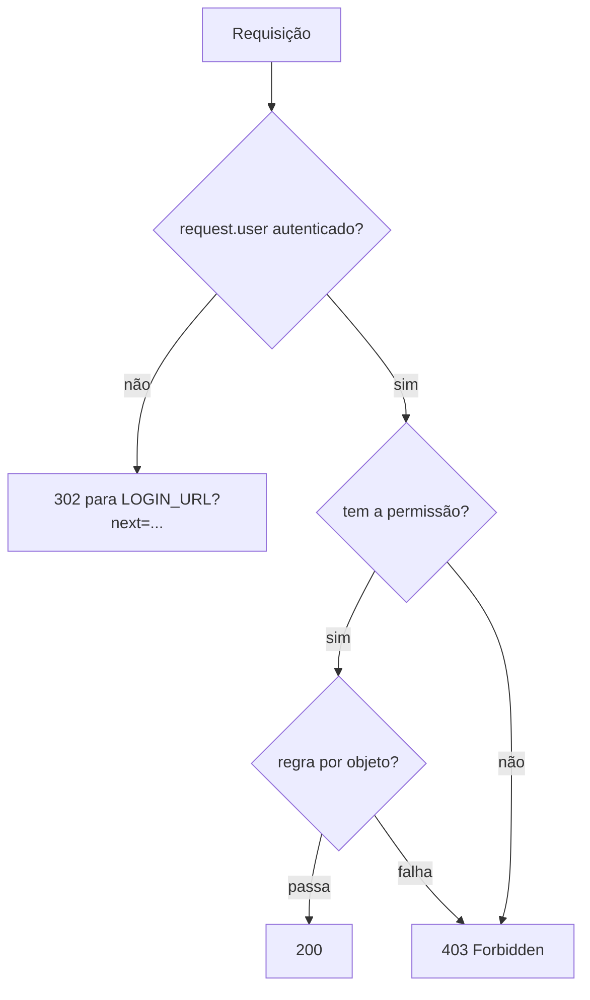

# 12. Permissões: grupos, papéis e autorização por objeto

> ⏱️ ~1h30 · Módulo 5 · Pré-requisitos: [08](08-django-admin.md), [09](09-class-based-views.md), [11](11-autenticacao.md)

> ⚠️ **Nota de verificação.** O ambiente de laboratório das aulas anteriores não estava disponível ao escrever esta aula, então os blocos de código **não foram executados** aqui. As saídas em `text` são as esperadas, calculadas a partir do comportamento documentado do Django 5.2. Rode tudo no seu projeto; se algo divergir, **confie na sua saída** e revise o trecho.

## 🎯 Objetivos
Ao final desta aula você consegue:
- Explicar o modelo de permissões do Django: **permissão por modelo** (`add`, `change`, `delete`, `view`), **grupos** e `is_superuser`
- Proteger views com `PermissionRequiredMixin` / `@permission_required` e distinguir **401/403/redirect para login**
- Criar **grupos** (papéis) de forma reproduzível, por *data migration*, e não só pelo Admin
- Aplicar **autorização por objeto** (só o dono edita) e filtrar listagens por usuário
- Testar permissões e evitar o erro clássico: esconder o botão no template **sem** proteger a view

## 🤔 Por que isso importa
Na aula 11 você respondeu “quem é você?”. Agora: “**o que você pode fazer?**”. No MiniShop, qualquer pessoa logada hoje cria e edita produtos, o que é um problema. Falhas de autorização (acessar o que não devia) estão no topo da lista da OWASP (*Broken Access Control*). Como júnior, você vai receber tarefas do tipo “só o gerente pode alterar preço” e precisa saber onde isso se implementa e como se testa.

## 💡 Intuição (explicação simples)
Pense num **prédio com crachás**. O crachá (login) prova quem você é. Cada **porta** tem uma regra: “só Estoque”, “só Gerência”. Em vez de dar uma chave para cada pessoa, você cria **cargos** (grupos) e dá as chaves ao cargo; quem entra para o cargo herda as chaves. Há ainda a regra mais fina: mesmo com a chave da sala de pedidos, você só abre **a gaveta que é sua** (permissão por objeto). E o diretor (*superuser*) tem a chave-mestra.

## 🔬 Como funciona por dentro

- **Permissões por modelo.** Para cada model, o Django cria 4 linhas na tabela `auth_permission` (no `migrate`): `add_product`, `change_product`, `delete_product`, `view_product`. O nome completo inclui o app: **`catalog.change_product`**.
- **Grupos.** `Group` é um conjunto de permissões. Um usuário pode estar em vários grupos e também ter permissões diretas. `user.has_perm("catalog.change_product")` considera **diretas + de grupos**.
- **Superusuário.** `is_superuser=True` → `has_perm()` devolve `True` para tudo (e `is_active` precisa ser `True`).
- **Cache de permissões.** O `ModelBackend` guarda as permissões no objeto `user` na primeira consulta (`_perm_cache`). Se você alterar permissões e testar com o **mesmo objeto** `user`, verá o valor antigo: busque o usuário de novo (`User.objects.get(pk=...)`).
- **`PermissionRequiredMixin`.** Verifica `has_perms(permission_required)` em `dispatch()`. Sem login → redireciona para o login; **logado sem permissão → 403** (`raise_exception` é automático para quem já está autenticado). Antes do Django 5.x muita gente caía no *loop* de redirecionamento; hoje o comportamento é este.
- **Por objeto.** O Django **não** traz regra por objeto pronta (“só o dono”): você a escreve em `get_queryset()` (filtrando, o que devolve 404 para o que não é seu) ou num mixin com `UserPassesTestMixin`. Bibliotecas como `django-guardian` existem para casos complexos.
- **Escopo dos papéis do MiniShop:**

| Papel (grupo) | Permissões |
|---|---|
| Cliente (sem grupo) | só ver catálogo |
| `Estoquista` | `view_product`, `change_product` |
| `Gerente` | `view/add/change/delete_product`, `view/add/change_category` |

## 🛠️ Exemplo prático
**1. Explorando as permissões no shell**
```python
from django.contrib.auth.models import Permission
from django.contrib.contenttypes.models import ContentType

from apps.catalog.models import Product

ct = ContentType.objects.get_for_model(Product)
for p in Permission.objects.filter(content_type=ct).order_by("codename"):
    print(f"{ct.app_label}.{p.codename:<16} → {p.name}")
```
```bash
uv run python manage.py shell < explorar_permissoes.py
```
```text
catalog.add_product     → Can add produto
catalog.change_product  → Can change produto
catalog.delete_product  → Can delete produto
catalog.view_product    → Can view produto
```

**2. Criando os grupos por *data migration*** (reproduzível em qualquer ambiente, em vez de clicar no Admin)
```bash
uv run python manage.py makemigrations accounts --empty -n grupos_e_papeis
```
```python
# apps/accounts/migrations/0002_grupos_e_papeis.py
from django.db import migrations
from django.contrib.auth.management import create_permissions

PAPEIS = {
    "Estoquista": ["catalog.view_product", "catalog.change_product"],
    "Gerente": [
        "catalog.view_product", "catalog.add_product", "catalog.change_product", "catalog.delete_product",
        "catalog.view_category", "catalog.add_category", "catalog.change_category",
    ],
}


def criar_grupos(apps, schema_editor):
    # Em banco novo, as permissões só são criadas DEPOIS das migrações (sinal post_migrate).
    # Por isso as criamos aqui, antes de usá-las.
    for app_config in apps.get_app_configs():
        app_config.models_module = True
        create_permissions(app_config, apps=apps, verbosity=0)
        app_config.models_module = None

    Group = apps.get_model("auth", "Group")
    Permission = apps.get_model("auth", "Permission")
    for nome, codigos in PAPEIS.items():
        grupo, _ = Group.objects.get_or_create(name=nome)
        perms = [Permission.objects.get(content_type__app_label=c.split(".")[0], codename=c.split(".")[1]) for c in codigos]
        grupo.permissions.set(perms)


def remover_grupos(apps, schema_editor):
    apps.get_model("auth", "Group").objects.filter(name__in=PAPEIS).delete()


class Migration(migrations.Migration):
    dependencies = [
        ("accounts", "0001_initial"),
        ("catalog", "0002_produto_updated_at_regras"),
        ("auth", "0012_alter_user_first_name_max_length"),
    ]
    operations = [migrations.RunPython(criar_grupos, remover_grupos)]
```
```bash
uv run python manage.py migrate
```
```text
Operations to perform:
  Apply all migrations: accounts, admin, auth, catalog, contenttypes, sessions
Running migrations:
  Applying accounts.0002_grupos_e_papeis... OK
```
> Ajuste o nome da migração `catalog` e de `accounts` conforme as suas (`ls apps/*/migrations`). O `create_permissions` dentro da migração é o truque que faz o código funcionar tanto no banco do laboratório quanto num banco **novo** (CI, produção).

**3. Protegendo as views com permissão**
```python
from django.contrib.auth.mixins import LoginRequiredMixin, PermissionRequiredMixin


class ProductCreateView(PermissionRequiredMixin, CreateView):       # PermissionRequiredMixin já exige login
    permission_required = "catalog.add_product"
    ...


class ProductUpdateView(PermissionRequiredMixin, UpdateView):
    permission_required = "catalog.change_product"
    ...
```
Troque o `LoginRequiredMixin` da aula 11 por `PermissionRequiredMixin` (ele inclui a checagem de login). Para views de função:
```python
from django.contrib.auth.decorators import permission_required

@permission_required("catalog.view_product", raise_exception=True)   # 403 em vez de redirecionar
def relatorio_estoque(request): ...
```

**4. O template reflete as permissões** (conveniência, **não** segurança)
```html

  <a class="botao" href="">Editar</a>


  <a class="botao" href="">Novo produto</a>

```
`perms` está disponível em todo template (context processor de autenticação). Esconder o botão melhora a experiência; **quem protege é a view**: o usuário ainda pode digitar a URL.

**5. Autorização por objeto: “só o dono edita”**
Exemplo no MiniShop: o futuro módulo de pedidos. Cada pedido pertence a um cliente e ele só vê os próprios. Como o model de pedidos vem na aula 17, aqui usamos um modelo mínimo que serve de molde:
```python
from django.contrib.auth.mixins import LoginRequiredMixin
from django.views.generic import ListView, DetailView


class MeusPedidosView(LoginRequiredMixin, ListView):
    template_name = "orders/order_list.html"

    def get_queryset(self):
        return Order.objects.filter(customer=self.request.user)   # nunca confie em um id vindo da URL


class PedidoDetalheView(LoginRequiredMixin, DetailView):
    def get_queryset(self):
        # Pedido de OUTRA pessoa → 404 (não revela sequer que o id existe)
        return Order.objects.filter(customer=self.request.user)
```
Para regras que não cabem num filtro, use `UserPassesTestMixin`:
```python
from django.contrib.auth.mixins import UserPassesTestMixin

class SomenteDonoOuGerenteMixin(UserPassesTestMixin):
    def test_func(self):
        obj = self.get_object()
        return obj.customer_id == self.request.user.id or self.request.user.has_perm("orders.change_order")
```
Filtrar em `get_queryset()` é o padrão mais seguro: o objeto alheio **nem é carregado**.

**6. Testes**
```python
import pytest
from django.contrib.auth import get_user_model
from django.contrib.auth.models import Group
from django.urls import reverse

pytestmark = pytest.mark.django_db
User = get_user_model()
SENHA = "uma-senha-bem-forte-42"


def usuario_no_grupo(nome_grupo, username):
    u = User.objects.create_user(username, f"{username}@exemplo.com", SENHA)
    u.groups.add(Group.objects.get(name=nome_grupo))
    return User.objects.get(pk=u.pk)                    # objeto novo: sem cache de permissões


def test_grupos_existem_com_as_permissoes_certas():
    gerente = Group.objects.get(name="Gerente")
    estoquista = Group.objects.get(name="Estoquista")
    assert gerente.permissions.filter(codename="delete_product").exists()
    assert not estoquista.permissions.filter(codename="delete_product").exists()
    assert not estoquista.permissions.filter(codename="add_product").exists()


def test_anonimo_vai_para_o_login(client):
    r = client.get(reverse("catalog:create"))
    assert r.status_code == 302 and r.url.startswith(reverse("accounts:login"))


def test_logado_sem_permissao_recebe_403(client):
    client.force_login(User.objects.create_user("cliente", "c@exemplo.com", SENHA))
    assert client.get(reverse("catalog:create")).status_code == 403


def test_estoquista_edita_mas_nao_cria(client, produto):          # `produto` vem de uma fixture da aula 5
    client.force_login(usuario_no_grupo("Estoquista", "est"))
    assert client.get(reverse("catalog:update", args=[produto.slug])).status_code == 200
    assert client.get(reverse("catalog:create")).status_code == 403


def test_gerente_cria(client):
    client.force_login(usuario_no_grupo("Gerente", "ger"))
    assert client.get(reverse("catalog:create")).status_code == 200


def test_superuser_pode_tudo(client):
    client.force_login(User.objects.create_superuser("root", "r@exemplo.com", SENHA))
    assert client.get(reverse("catalog:create")).status_code == 200


def test_botao_editar_so_aparece_com_permissao(client, produto):
    r = client.get(produto.get_absolute_url())
    assert "Editar" not in r.content.decode()
    client.force_login(usuario_no_grupo("Estoquista", "est"))
    assert "Editar" in client.get(produto.get_absolute_url()).content.decode()


def test_permissao_removida_vale_na_proxima_requisicao(client):
    u = usuario_no_grupo("Gerente", "ger")
    client.force_login(u)
    assert client.get(reverse("catalog:create")).status_code == 200
    u.groups.clear()                                     # tirou o cargo
    assert client.get(reverse("catalog:create")).status_code == 403
```
```bash
uv run python manage.py check
uv run pytest apps/accounts apps/catalog -q
```
```text
System check identified no issues (0 silenced).
.......................................................................... [100%]
```
Os testes cobrem os **três** resultados possíveis (302 para login, 403, 200) e o caso de a permissão ser retirada com o usuário ainda logado: o `request.user` é recarregado a cada requisição, então a mudança vale na hora.

> A fixture `produto` pode ser a que você criou nos testes da aula 5; se o nome for outro, ajuste. Os testes das aulas 10 e 11 que criam/editam produtos agora precisam de um usuário **do grupo Gerente**, não mais de qualquer usuário logado: atualize a fixture `client` para usar `usuario_no_grupo("Gerente", "editor")`.

## 🧠 Pausa para lógica
**Problema (resolver permissões efetivas).** Cada usuário tem permissões diretas e grupos; cada grupo pode **herdar** de outro grupo (ex.: `Gerente` herda de `Estoquista`). Escreva `permissoes_efetivas(usuario, grupos)` que devolve o conjunto final, tratando **ciclos** (A herda de B e B herda de A) sem entrar em laço infinito.

<details><summary>Dica</summary>
É uma busca em grafo (DFS/BFS). Guarde os grupos já <em>visitados</em> num <code>set</code>: se voltar a um grupo visitado, ignore.
</details>

<details><summary>Solução comentada</summary>

```python
def permissoes_efetivas(usuario, grupos):
    """usuario = {"perms": {...}, "grupos": [...]}; grupos = {nome: {"perms": {...}, "herda": [...]}}"""
    efetivas = set(usuario["perms"])
    visitados = set()
    pilha = list(usuario["grupos"])
    while pilha:
        nome = pilha.pop()
        if nome in visitados:                    # evita o laço infinito em ciclos
            continue
        visitados.add(nome)
        efetivas |= grupos[nome]["perms"]
        pilha.extend(grupos[nome]["herda"])
    return efetivas


grupos = {
    "Estoquista": {"perms": {"view_product", "change_product"}, "herda": []},
    "Gerente": {"perms": {"add_product", "delete_product"}, "herda": ["Estoquista"]},
    "A": {"perms": {"x"}, "herda": ["B"]},
    "B": {"perms": {"y"}, "herda": ["A"]},          # ciclo
}
print(sorted(permissoes_efetivas({"perms": {"view_category"}, "grupos": ["Gerente"]}, grupos)))
print(sorted(permissoes_efetivas({"perms": set(), "grupos": ["A"]}, grupos)))
```
```text
['add_product', 'change_product', 'delete_product', 'view_category', 'view_product']
['x', 'y']
```
O Django **não** tem herança entre grupos; o ganho do exercício é reconhecer o padrão “alcançabilidade em grafo com conjunto de visitados”.
</details>

## ⚠️ Erros comuns e boas práticas
| Mensagem / sintoma | Causa | Solução |
|---|---|---|
| `Permission matching query does not exist` na *data migration* | Permissões ainda não criadas em banco novo | Chame `create_permissions` dentro da migração (exemplo 2) |
| Botão escondido, mas a URL digitada ainda funciona | Só o template foi protegido | `PermissionRequiredMixin` / `@permission_required` na **view** |
| `has_perm` devolve o valor antigo no teste | Cache de permissões no objeto `user` | Recarregue: `User.objects.get(pk=u.pk)` |
| Usuário no grupo certo continua com 403 | Nome da permissão errado (`change_product` sem o app) | Use `"catalog.change_product"` |
| `403` para quem nem está logado | `raise_exception=True` globalmente | Deixe o padrão: anônimo → login, logado sem permissão → 403 |
| Um usuário vê o pedido de outro mudando o id na URL (**IDOR**) | Consulta por `pk` sem filtrar pelo dono | `get_queryset()` filtrado por `request.user` |
| Todo mundo virou `is_superuser` “para destravar” | Atalho que ignora toda a modelagem | Crie um grupo com as permissões mínimas |
| `is_staff` tratado como “administrador” | `is_staff` só libera **entrar no Admin** | Autorize pela permissão, não por `is_staff` |

- Dê **o mínimo necessário** (menor privilégio) e use **grupos**, não permissões avulsas por usuário.
- Autorização é **no servidor**, em toda rota (inclusive a de API da aula 06 do módulo 6).
- Quando a regra for de negócio (“só se o pedido estiver pendente”), coloque-a numa função/serviço testável, não espalhada nas views.

## 🧩 Exercícios
**1. Fixação**
(a) Quais são as 4 permissões que o Django cria por model? (b) Qual a diferença entre 302 para o login e 403? (c) Por que `` no template não basta? (d) O que é IDOR?

<details><summary>Solução</summary>

(a) `add`, `change`, `delete`, `view`. (b) 302: o usuário **não está autenticado** e pode resolver entrando; 403: está autenticado mas **não tem autorização**; entrar de novo não adianta. (c) Só oculta o link; a URL continua acessível, então a view precisa verificar. (d) *Insecure Direct Object Reference*: acessar um objeto de outra pessoa trocando o id, por falta de checagem de dono.
</details>

**2. Aplicação no projeto MiniShop**
Implemente os papéis no catálogo.

Critérios de pronto:
- [ ] Grupos `Estoquista` e `Gerente` criados por *data migration* (funciona em banco novo)
- [ ] Criar produto exige `catalog.add_product`; editar exige `catalog.change_product`
- [ ] Tela de **excluir produto** (`DeleteView`) exigindo `catalog.delete_product`, com confirmação por POST
- [ ] Botões “Novo”, “Editar” e “Excluir” só aparecem com a permissão correspondente
- [ ] Testes para anônimo (302), cliente (403), estoquista, gerente e superusuário
- [ ] No Admin, um usuário `is_staff` do grupo `Estoquista` só vê e altera produtos (sem excluir)
- [ ] Commit `feat(accounts): roles by group and permission-protected views`

<details><summary>Solução de referência</summary>

```python
class ProductDeleteView(PermissionRequiredMixin, DeleteView):
    model = Product
    slug_field = "slug"
    permission_required = "catalog.delete_product"
    template_name = "catalog/product_confirm_delete.html"
    success_url = reverse_lazy("catalog:list")

    def form_valid(self, form):
        messages.success(self.request, f"Produto {self.object.sku} excluído.")
        return super().form_valid(form)
```
```python
path("produtos/<slug:slug>/excluir/", views_forms.ProductDeleteView.as_view(), name="delete"),
```
```html


  <h1>Excluir {{ object.name }}?</h1>
  <form method="post">
    <button class="botao" type="submit">Sim, excluir</button>
    <a href="{{ object.get_absolute_url }}">Cancelar</a>
  </form>

```
Lembre: `Product` usa `on_delete=PROTECT` em outras relações (ex.: itens de pedido, na aula 17); excluir um produto já vendido levantará `ProtectedError`. Prefira **desativar** (`is_active=False`).
</details>

**3. Desafio (opcional)**
Crie a permissão personalizada `catalog.change_price` (em `Meta.permissions`) e exija-a para alterar o campo `price`: o `Estoquista` edita estoque, mas o campo de preço aparece só para quem tem `change_price`. Teste os dois casos.

## 🎤 Na entrevista
- **Como funcionam permissões no Django?** Cada model ganha `add/change/delete/view`; atribuímos a usuários ou, melhor, a **grupos**. `user.has_perm("app.codename")` considera diretas e de grupo; superusuário tem todas. Nas views, `PermissionRequiredMixin`.
- **Diferença entre 401, 403 e 404 nesse contexto?** 401: não autenticado; 403: autenticado sem permissão; 404 pode ser usado de propósito para **não revelar** a existência de um recurso alheio.
- **O que é IDOR e como evitar?** Acesso a objetos de outros trocando o identificador; evita-se filtrando sempre a consulta pelo usuário/dono ou checando a regra por objeto.

## 📚 Para ir além
- 📄 Documentação oficial: [Usando o sistema de autenticação — Permissões e autorização](https://docs.djangoproject.com/en/5.2/topics/auth/default/#permissions-and-authorization). Referência de `has_perm`, grupos e permissões.
- 📄 Documentação oficial: [Mixins e decoradores de permissão](https://docs.djangoproject.com/en/5.2/topics/auth/default/#the-permissionrequiredmixin-mixin). `PermissionRequiredMixin` e `UserPassesTestMixin`.
- 📑 Artigo/tutorial: [OWASP — Broken Access Control (A01:2021)](https://owasp.org/Top10/A01_2021-Broken_Access_Control/). Por que autorização falha tanto.
- 🏋️ Prática extra: instale o `django-guardian` num projeto à parte e compare com o `get_queryset()` filtrado.

> Links verificados em 2026-11-08 (HTTP 200).

## ✅ Checklist da aula
- [ ] Listei as permissões de um model e entendi `app.codename`
- [ ] Grupos `Estoquista` e `Gerente` criados por *data migration*
- [ ] Views protegidas com `PermissionRequiredMixin` (302 / 403 / 200 testados)
- [ ] Template usa `perms`, mas a segurança está na view
- [ ] Entendi IDOR e o filtro por dono em `get_queryset()`
