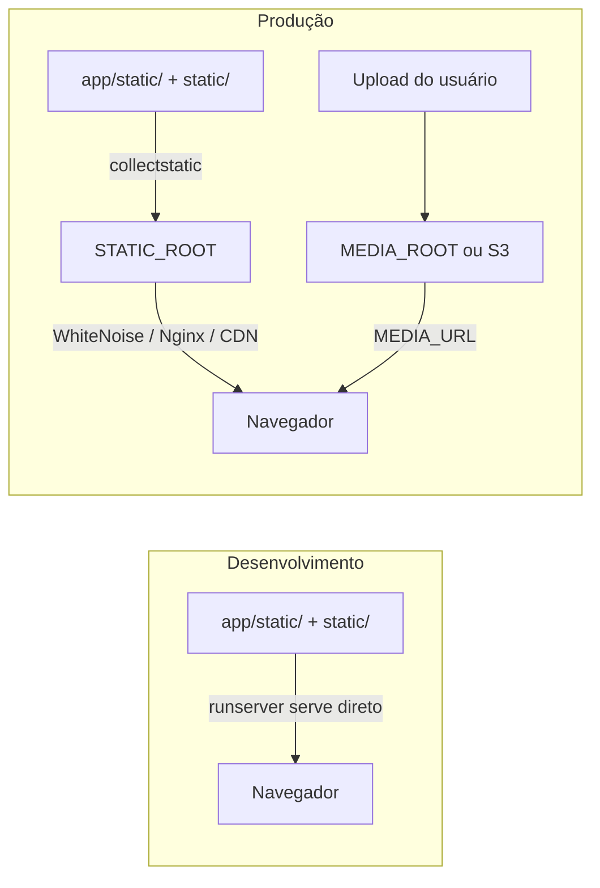

# 13. Arquivos estáticos e de mídia

> ⏱️ ~1h30 · Módulo 5 · Pré-requisitos: [03](03-templates.md), [04](04-models-migracoes.md), [10](10-formularios.md), [12](12-permissoes.md)

> ⚠️ **Nota de verificação.** Como na aula 12, o laboratório não estava disponível: os blocos **não foram executados** e as saídas em `text` são as esperadas. Rode no seu projeto e confie na sua saída se divergir.

## 🎯 Objetivos
Ao final desta aula você consegue:
- Diferenciar **estáticos** (CSS, JS, logo: do desenvolvedor) de **mídia** (uploads: dos usuários)
- Configurar `STATIC_URL`, `STATICFILES_DIRS`, `STATIC_ROOT`, `MEDIA_URL` e `MEDIA_ROOT` e explicar o que cada um faz
- Usar `collectstatic` e servir estáticos em produção com **WhiteNoise**
- Receber upload com `ImageField`, `enctype="multipart/form-data"` e `request.FILES`
- Validar uploads (tamanho, tipo) e reconhecer os riscos de aceitar arquivos

## 🤔 Por que isso importa
Todo sistema tem CSS e imagens, e quase todo tem uploads (foto do produto, anexos). “Funciona no `runserver`, mas o CSS some em produção” é um dos erros mais comuns de quem faz o primeiro deploy. E upload é uma das superfícies de ataque mais perigosas: arquivo malicioso, tamanho absurdo, nome com `../`.

## 💡 Intuição (explicação simples)
Pense numa **loja física**. Os **estáticos** são a decoração e a placa: o dono monta uma vez e são iguais para todos. A **mídia** é o que os clientes deixam no balcão (encomendas, fotos): chega o tempo todo, vem de fora e **não se confia** no conteúdo. Em produção, quem entrega a placa e as encomendas é o “porteiro” (servidor web/CDN/S3), não o gerente (Django): o gerente é caro demais para carregar caixas.

## 🔬 Como funciona por dentro

| Configuração | O que é |
|---|---|
| `STATIC_URL` | prefixo público dos estáticos (`/static/`) |
| `STATICFILES_DIRS` | pastas extras de estáticos do projeto (além de `app/static/`) |
| `STATIC_ROOT` | pasta **de saída** do `collectstatic`; é o que o servidor entrega em produção |
| `MEDIA_URL` | prefixo público dos uploads (`/media/`) |
| `MEDIA_ROOT` | pasta no disco onde os uploads são gravados |

- **``** monta a URL certa a partir de `STATIC_URL` (e, com *hash* no nome, do arquivo versionado).
- **`collectstatic`** copia os estáticos de todos os apps e do Admin para `STATIC_ROOT`. Sem isso, em produção (`DEBUG=False`) o Admin fica sem CSS.
- **`runserver` só serve estáticos com `DEBUG=True`.** Em produção, outro componente os entrega. O **WhiteNoise** é um middleware simples que faz isso dentro do próprio Django e dispensa Nginx para projetos pequenos.
- **`ManifestStaticFilesStorage`** (ou a variante do WhiteNoise) grava `style.3f9a1c.css` com *hash* do conteúdo: o navegador pode guardar o arquivo **para sempre** em cache, e ao mudar o CSS o nome muda (*cache busting*).
- **Mídia não é servida pelo Django em produção.** O Django serve `MEDIA_URL` só em desenvolvimento, por uma linha em `urls.py`. Em produção vai para Nginx ou **S3** (módulo 13).
- **Upload:** o formulário precisa de `enctype="multipart/form-data"`; o arquivo chega em `request.FILES` e o `ImageField` o grava em `MEDIA_ROOT/<upload_to>`. Se o nome já existe, o Django acrescenta um sufixo aleatório em vez de sobrescrever.
- **Segurança de upload:** nunca confie no nome nem no `Content-Type` enviados; limite o tamanho; valide a imagem (o `ImageField` abre o arquivo com a Pillow); **jamais** execute o que foi enviado; sirva mídia de um domínio/caminho sem permissão de execução.

## 🛠️ Exemplo prático
**1. Configuração**
```bash
uv add pillow whitenoise
```
```python
# config/settings.py (acrescentar)
from pathlib import Path   # já importado no topo

# --- Estáticos e mídia (aula 13) ---
STATIC_URL = "static/"
STATICFILES_DIRS = [BASE_DIR / "static"]               # pasta do projeto (logo, favicon, css global)
STATIC_ROOT = BASE_DIR / "staticfiles"                 # saída do collectstatic (fora do Git)

MEDIA_URL = "media/"
MEDIA_ROOT = BASE_DIR / "media"                        # uploads (fora do Git)

STORAGES = {
    "default": {"BACKEND": "django.core.files.storage.FileSystemStorage"},
    "staticfiles": {"BACKEND": "whitenoise.storage.CompressedManifestStaticFilesStorage"},
}

# O WhiteNoise vem logo depois do SecurityMiddleware
MIDDLEWARE.insert(
    MIDDLEWARE.index("django.middleware.security.SecurityMiddleware") + 1,
    "whitenoise.middleware.WhiteNoiseMiddleware",
)
```
```bash
printf "staticfiles/\nmedia/\n" >> .gitignore
mkdir -p static/img
```
> Com o `STORAGES` do WhiteNoise, o `` exige que o `collectstatic` tenha rodado **quando `DEBUG=False`**. Em desenvolvimento (`DEBUG=True`) continua funcionando sem ele. Nos **testes**, defina o armazenamento simples (abaixo, no `conftest.py`), senão `` falha por falta do manifesto.

**2. Coletando os estáticos**
```bash
uv run python manage.py collectstatic --noinput
ls staticfiles | head
ls staticfiles/css
```
```text
130 static files copied to '/…/minishop/staticfiles', 396 post-processed.
admin
css
img
css:
style.css
style.5d41402abc4b.css
style.5d41402abc4b.css.gz
style.css.gz
```
O `admin/` veio junto. Cada arquivo ganhou uma cópia com *hash* e outra comprimida (`.gz`).

**3. Foto no produto (`ImageField`)**
```python
from pathlib import Path
from uuid import uuid4

from django.core.exceptions import ValidationError
from django.core.validators import FileExtensionValidator


def caminho_imagem(instance, filename):
    """Nome novo e imprevisível; só a extensão original é aproveitada. Evita colisões e nomes maliciosos."""
    extensao = Path(filename).suffix.lower()
    return f"produtos/{instance.sku.lower()}/{uuid4().hex}{extensao}"


def validar_tamanho(arquivo):
    limite = 2 * 1024 * 1024                                   # 2 MB
    if arquivo.size > limite:
        raise ValidationError(f"Arquivo muito grande ({arquivo.size / 1024 / 1024:.1f} MB). Máximo: 2 MB.")


class Product(models.Model):
    ...
    image = models.ImageField(
        "imagem", upload_to=caminho_imagem, blank=True,
        validators=[FileExtensionValidator(["jpg", "jpeg", "png", "webp"]), validar_tamanho],
    )
```
```bash
uv run python manage.py makemigrations catalog -n produto_imagem
uv run python manage.py migrate
```
```text
Migrations for 'catalog':
  apps/catalog/migrations/0003_produto_imagem.py
    + Add field image to product
Operations to perform:
  Apply all migrations: accounts, admin, auth, catalog, contenttypes, sessions
Running migrations:
  Applying catalog.0003_produto_imagem... OK
```
Se a sua numeração já passou de `0003`, o nome muda: o importante é o `+ Add field image to product`. O banco guarda só o **caminho** (`produtos/mnt-001/ab12….png`), não o arquivo.

**4. Formulário e template**
```python
# ProductForm: acrescente "image" a Meta.fields
fields = ["category", "sku", "name", "description", "price", "stock", "is_active", "image"]
```
```html
{# product_form.html: enctype é obrigatório para upload #}
<form method="post" enctype="multipart/form-data" novalidate>
```
```html
{# product_detail.html #}

  

  

```
`CreateView`/`UpdateView` já passam `request.FILES` ao formulário; em views de função você precisa escrever `ProductForm(request.POST, request.FILES)`.

**5. Servindo mídia só em desenvolvimento**
```python
# config/urls.py (no final)
from django.conf import settings
from django.conf.urls.static import static

if settings.DEBUG:
    urlpatterns += static(settings.MEDIA_URL, document_root=settings.MEDIA_ROOT)
```
Com `DEBUG=False` a função `static()` devolve lista vazia: é de propósito.

**6. Testes**
```python
# conftest.py (raiz): testes sem manifesto e com mídia em pasta temporária
import pytest


@pytest.fixture(autouse=True)
def _armazenamento_de_teste(settings, tmp_path):
    settings.STORAGES = {
        "default": {"BACKEND": "django.core.files.storage.FileSystemStorage"},
        "staticfiles": {"BACKEND": "django.contrib.staticfiles.storage.StaticFilesStorage"},
    }
    settings.MEDIA_ROOT = tmp_path / "media"          # nenhum upload de teste suja o projeto
```
```python
import io

import pytest
from django.contrib.auth import get_user_model
from django.contrib.auth.models import Group
from django.core.files.uploadedfile import SimpleUploadedFile
from django.urls import reverse
from PIL import Image

pytestmark = pytest.mark.django_db


def png_bytes(tamanho=(10, 10)):
    buf = io.BytesIO()
    Image.new("RGB", tamanho, "red").save(buf, "PNG")
    return buf.getvalue()


@pytest.fixture
def gerente(client):
    User = get_user_model()
    u = User.objects.create_user("ger", "ger@exemplo.com", "uma-senha-bem-forte-42")
    u.groups.add(Group.objects.get(name="Gerente"))
    client.force_login(User.objects.get(pk=u.pk))
    return u


def dados(categoria, **extra):
    base = {"category": categoria.pk, "sku": "IMG-001", "name": "Com foto", "price": "10.00", "stock": 1, "is_active": "on"}
    return base | extra


def test_upload_valido_grava_arquivo_com_nome_novo(client, gerente, categoria, settings):
    foto = SimpleUploadedFile("minha foto (1).PNG", png_bytes(), content_type="image/png")
    r = client.post(reverse("catalog:create"), dados(categoria, image=foto))
    assert r.status_code == 302
    from apps.catalog.models import Product
    p = Product.objects.get(sku="IMG-001")
    assert p.image.name.startswith("produtos/img-001/") and p.image.name.endswith(".png")
    assert "minha foto" not in p.image.name                        # nome do usuário não é usado
    assert (settings.MEDIA_ROOT / p.image.name).exists()


def test_rejeita_arquivo_que_nao_e_imagem(client, gerente, categoria):
    falso = SimpleUploadedFile("virus.png", b"isto nao e uma imagem", content_type="image/png")
    r = client.post(reverse("catalog:create"), dados(categoria, image=falso))
    assert r.status_code == 200 and "image" in r.context["form"].errors


def test_rejeita_extensao_nao_permitida(client, gerente, categoria):
    svg = SimpleUploadedFile("x.svg", b"<svg/>", content_type="image/svg+xml")
    r = client.post(reverse("catalog:create"), dados(categoria, image=svg))
    assert "image" in r.context["form"].errors


def test_rejeita_arquivo_grande(client, gerente, categoria):
    grande = SimpleUploadedFile("g.png", png_bytes() + b"0" * (3 * 1024 * 1024), content_type="image/png")
    r = client.post(reverse("catalog:create"), dados(categoria, image=grande))
    assert "muito grande" in str(r.context["form"].errors["image"])
```
```bash
uv run pytest -q
```
```text
.......................................................................... [100%]
```
(Reaproveite a fixture `categoria` das aulas anteriores; ajuste o nome se necessário.) O teste do arquivo “virus.png” prova que a validação não confia na extensão: a Pillow tenta abrir o conteúdo e falha.

**7. Verificando em produção simulada**
```bash
DJANGO_DEBUG=0 uv run gunicorn config.wsgi --bind 127.0.0.1:8130 &   # exige `uv add gunicorn` e DEBUG vindo do ambiente (aula 14)
curl -sI http://127.0.0.1:8130/static/css/style.css | head -3
kill %1
```
```text
HTTP/1.1 200 OK
Content-Type: text/css; charset="utf-8"
Cache-Control: max-age=60, public
```
Para o arquivo **com hash** (`style.5d41….css`) o WhiteNoise envia `max-age=31536000, public, immutable`. Se a variável `DJANGO_DEBUG` ainda não existir no seu `settings.py`, deixe este passo para depois da aula 14.

## 🧠 Pausa para lógica
**Problema (nome de arquivo seguro).** Escreva `nome_seguro(original)` que: remove qualquer caminho (`../../etc/passwd` → `passwd`), mantém só letras/números/`-`/`_`/`.`, limita o tamanho a 50 caracteres e **rejeita** extensões fora de `{jpg, png}`.

<details><summary>Dica</summary>
<code>PurePath(original).name</code> tira diretórios (cuidado com <code>\</code> do Windows); <code>re.sub(r"[^\w.-]", "_", ...)</code> limpa o resto; use <code>suffix.lower()</code> para a extensão.
</details>

<details><summary>Solução comentada</summary>

```python
import re
from pathlib import PurePosixPath

PERMITIDAS = {".jpg", ".png"}


def nome_seguro(original, maximo=50):
    nome = PurePosixPath(original.replace("\\", "/")).name        # tira diretórios (/ e \)
    base, ponto, ext = nome.rpartition(".")
    ext = f".{ext.lower()}" if ponto else ""
    if ext not in PERMITIDAS:
        raise ValueError(f"extensão não permitida: {ext or '(nenhuma)'}")
    base = re.sub(r"[^\w-]", "_", base)[: maximo - len(ext)] or "arquivo"
    return base + ext


for n in ["foto.JPG", "../../etc/passwd.png", "C:\\fotos\\meu carro (1).png", "x.exe", "a" * 80 + ".jpg"]:
    try:
        print(repr(n[:30]), "→", nome_seguro(n))
    except ValueError as e:
        print(repr(n[:30]), "→ rejeitado:", e)
```
```text
'foto.JPG' → foto.jpg
'../../etc/passwd.png' → passwd.png
'C:\\fotos\\meu carro (1).png' → meu_carro__1_.png
'x.exe' → rejeitado: extensão não permitida: .exe
'aaaaaaaaaaaaaaaaaaaaaaaaaaaaaa' → aaaaaaaaaaaaaaaaaaaaaaaaaaaaaaaaaaaaaaaaaaaaaaaaaa.jpg
```
No MiniShop fomos além: descartamos o nome do usuário e usamos `uuid4()`. É a opção mais segura.
</details>

## ⚠️ Erros comuns e boas práticas
| Mensagem / sintoma | Causa | Solução |
|---|---|---|
| Admin e site sem CSS em produção | Faltou `collectstatic` ou servidor de estáticos | `collectstatic` + WhiteNoise |
| `ValueError: Missing staticfiles manifest entry for 'css/style.css'` | Storage com manifesto, mas sem `collectstatic` (ou arquivo inexistente) | Rode `collectstatic`; confira o caminho; nos testes use storage simples |
| `ImproperlyConfigured: You're using the staticfiles app without having set the STATIC_ROOT` | Faltou `STATIC_ROOT` | Defina-o |
| `ModuleNotFoundError: No module named 'PIL'` / `Cannot use ImageField because Pillow is not installed` | Pillow não instalada | `uv add pillow` |
| Arquivo enviado não chega (`request.FILES` vazio) | Faltou `enctype="multipart/form-data"` | Acrescente ao `<form>` |
| Imagem dá 404 em desenvolvimento | Faltou `static(MEDIA_URL, ...)` em `urls.py` | Acrescente com `if settings.DEBUG` |
| CSS antigo aparece após deploy | Cache sem versionamento | Storage com manifesto (nome com *hash*) |
| Uploads somem a cada deploy | Disco do contêiner é efêmero | Volume persistente ou S3 (módulos 11 e 13) |
| Mesma pasta em `STATICFILES_DIRS` e `STATIC_ROOT` | O Django proíbe | Pastas diferentes |

- **Nunca** versione `media/` nem `staticfiles/`.
- Não confie em `Content-Type` nem no nome; **gere** o nome do arquivo.
- Limite o tamanho também no servidor (`DATA_UPLOAD_MAX_MEMORY_SIZE`, `client_max_body_size` do Nginx).
- Não permita SVG/HTML de usuários sem sanitizar (podem conter JavaScript → XSS).
- Imagens grandes: gere miniaturas (Pillow ou `django-imagekit`) em vez de servir o original.

## 🧩 Exercícios
**1. Fixação**
(a) Estático × mídia? (b) Para que serve `STATIC_ROOT`? (c) Por que o nome do arquivo ganha um *hash*? (d) Por que não usar o nome enviado pelo usuário?

<details><summary>Solução</summary>

(a) Estático: arquivos do projeto, iguais para todos; mídia: enviados pelos usuários em execução. (b) Destino do `collectstatic`; é o que se serve em produção. (c) Para o navegador manter o arquivo em cache por muito tempo e ainda receber a versão nova quando muda (*cache busting*). (d) Pode conter caminhos (`../`), caracteres perigosos, colidir com outro arquivo ou revelar informação.
</details>

**2. Aplicação no projeto MiniShop**
Adicione imagens ao catálogo.

Critérios de pronto:
- [ ] `Product.image` com migração, validação de extensão e de tamanho
- [ ] Imagem exibida em detalhe e lista, com `alt` e imagem padrão (`sem-foto.svg`) quando não há foto
- [ ] Admin mostra miniatura da foto (`readonly_fields` + `format_html`)
- [ ] `collectstatic` roda sem erro e `style.css` é servido com `DEBUG=False`
- [ ] Testes de upload válido, falso, extensão proibida e arquivo grande
- [ ] `media/` e `staticfiles/` no `.gitignore`
- [ ] Commit `feat(catalog): product image upload and static files setup`

<details><summary>Solução de referência (miniatura no Admin)</summary>

```python
from django.utils.html import format_html


@admin.register(Product)
class ProductAdmin(admin.ModelAdmin):
    readonly_fields = ["miniatura"]

    @admin.display(description="foto")
    def miniatura(self, obj):
        if not obj.image:
            return "—"
        return format_html('', obj.image.url)
```
`format_html` escapa os valores; concatenar strings com `+` e marcar como seguro abriria um XSS.
</details>

**3. Desafio (opcional)**
Gere automaticamente uma miniatura 300×300 no `save()` (Pillow `ImageOps.fit`) e guarde-a em `thumbnail`. Cuide para não reprocessar a imagem se ela não mudou e para apagar arquivos antigos ao trocar a foto.

## 🎤 Na entrevista
- **Qual a diferença entre `STATIC_ROOT`, `STATICFILES_DIRS` e `MEDIA_ROOT`?** `STATICFILES_DIRS`: onde estão seus estáticos extras; `STATIC_ROOT`: para onde o `collectstatic` os reúne para produção; `MEDIA_ROOT`: onde ficam os uploads.
- **Por que o CSS some quando `DEBUG=False`?** O `runserver` só serve estáticos em modo debug; em produção é preciso `collectstatic` e um servidor (WhiteNoise, Nginx, CDN).
- **Quais cuidados em uploads?** Limitar tamanho e tipos, validar o conteúdo, gerar o nome do arquivo, não executar nem servir com permissão de execução, e guardar fora do disco efêmero (S3).

## 📚 Para ir além
- 📄 Documentação oficial: [Gerenciando arquivos estáticos](https://docs.djangoproject.com/en/5.2/howto/static-files/). Configuração e `collectstatic`.
- 📄 Documentação oficial: [Implantando arquivos estáticos](https://docs.djangoproject.com/en/5.2/howto/static-files/deployment/). O caminho para produção.
- 📄 Documentação oficial: [Gerenciando arquivos (uploads)](https://docs.djangoproject.com/en/5.2/topics/files/). `FileField`, `ImageField`, storages.
- 📄 Documentação do WhiteNoise: [whitenoise.readthedocs.io](https://whitenoise.readthedocs.io/). Configuração do middleware e do storage.
- 📑 Artigo/tutorial: [OWASP — File Upload Cheat Sheet](https://cheatsheetseries.owasp.org/cheatsheets/File_Upload_Cheat_Sheet.html). Lista de defesas.
- 🏋️ Prática extra: troque o `FileSystemStorage` por S3 com `django-storages` quando chegar ao módulo 13.

> Links verificados em 2026-11-08 (HTTP 200).

## ✅ Checklist da aula
- [ ] Sei dizer o papel de cada uma das cinco configurações
- [ ] `collectstatic` rodou e WhiteNoise entrega o CSS com `DEBUG=False`
- [ ] Upload com `ImageField`, `enctype` correto e nome gerado
- [ ] Validação de extensão, tamanho e conteúdo, com testes
- [ ] `media/` e `staticfiles/` fora do Git
