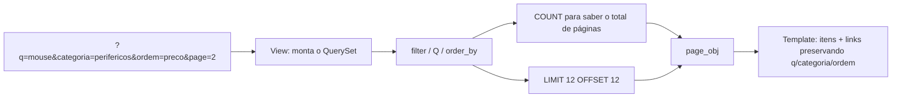

# 15. Paginação e busca de produtos

> ⏱️ ~1h30 · Módulo 5 · Pré-requisitos: [05](05-orm-consultas.md), [07](07-n-mais-1.md), [09](09-class-based-views.md), [10](10-formularios.md); índices ([aula 3.08](../03-banco-de-dados/08-constraints-indices-explain.md))

> ⚠️ **Nota de verificação.** Como nas aulas 12 a 14, o laboratório não estava disponível: os blocos **não foram executados** e as saídas em `text` são as esperadas. Além disso, não reli a `ProductListView` original: o exemplo 2 traz a versão completa; **substitua** a sua por ela, preservando o que a aula 09 tinha de útil (template, `select_related`).

## 🎯 Objetivos
Ao final desta aula você consegue:
- Paginar com `Paginator` e `paginate_by`, e explicar por que **nunca** se devolve a tabela inteira
- Implementar **busca** (`icontains` com `Q`), **filtros** (categoria, faixa de preço) e **ordenação** com lista permitida
- Manter os parâmetros da busca nos links de página (*querystring*)
- Evitar os problemas clássicos: ordenação instável, N+1 e `COUNT` caro
- Comparar paginação por **deslocamento** (`OFFSET`) e por **cursor** (*keyset*)

## 🤔 Por que isso importa
Com 20 produtos tudo cabe numa tela. Com 200 mil, uma página sem paginação trava o servidor, o banco e o navegador. Listagem com busca, filtro e paginação é a tela mais comum de qualquer sistema interno e e-commerce, e é onde aparecem os bugs de desempenho e de segurança que mais caem em entrevista.

## 💡 Intuição (explicação simples)
Pense numa **biblioteca**. Ninguém leva todas as estantes para a mesa: o bibliotecário traz **uma bandeja** (página) por vez. A **busca** é o fichário: você diz “mouse” e ele separa só as fichas que servem. Para a bandeja 3 fazer sentido, o bibliotecário precisa de uma **ordem fixa** das fichas; se a ordem mudar a cada vez, o mesmo livro aparece em duas bandejas e outro some.

## 🔬 Como funciona por dentro

- **`Paginator(queryset, 12)`** faz duas consultas: um `COUNT(*)` (total) e um `SELECT … LIMIT 12 OFFSET 12×(n−1)`. `ListView` com `paginate_by = 12` usa isso e entrega `page_obj`, `paginator` e `is_paginated` ao template.
- **Ordem estável.** Sem `ORDER BY` determinístico o banco pode devolver linhas em ordem diferente entre as páginas. O Django avisa (`UnorderedObjectListWarning`). Ao ordenar por um campo que repete (preço), acrescente um **desempate único** (`id`).
- **`page` inválida.** `?page=abc` ou `?page=999` dá 404 na `ListView`. No `Paginator` manual, use `get_page()`, que se corrige sozinho.
- **Busca com `Q`.** `Q(name__icontains=q) | Q(sku__icontains=q)` vira `WHERE name ILIKE '%q%' OR sku ILIKE '%q%'`. O Django **escapa** `%` e `_` digitados pelo usuário. Não há risco de SQL *injection* (parâmetros vão separados), mas `%termo%` **não usa índice comum**: em tabelas grandes use busca de texto do PostgreSQL (`SearchVector`, `pg_trgm`).
- **Ordenação segura.** Nunca faça `order_by(request.GET["ordem"])`: o usuário escolheria qualquer campo (inclusive relações que vazam dados ou quebram a consulta). Use uma **lista permitida** (dicionário).
- **Querystring nos links.** O link “próxima” precisa carregar `q`, `categoria` e `ordem`, trocando só o `page`.
- **Deslocamento × cursor.**

| | `OFFSET` (o do Django) | Cursor / *keyset* |
|---|---|---|
| Como | `LIMIT n OFFSET k` | `WHERE (preco, id) > (último)` `LIMIT n` |
| Pular para a página 50 | fácil | não dá |
| Custo na página funda | cresce (o banco lê e descarta `k` linhas) | constante (usa índice) |
| Linhas inseridas durante a navegação | podem duplicar/pular | estável |
| Uso típico | telas de back-office | *feeds*, rolagem infinita, APIs grandes |

## 🛠️ Exemplo prático
**1. Entendendo o `Paginator` no shell**
```python
from django.core.paginator import Paginator

from apps.catalog.models import Product

qs = Product.objects.filter(is_active=True).order_by("name", "id")
pag = Paginator(qs, 5)
print("total:", pag.count, "| páginas:", pag.num_pages)
p2 = pag.page(2)
print("página 2 →", [x.sku for x in p2], "| tem anterior?", p2.has_previous(), "| tem próxima?", p2.has_next())
print("faixa:", p2.start_index(), "a", p2.end_index())
print("get_page('abc') →", pag.get_page("abc").number, "| get_page(999) →", pag.get_page(999).number)
```
```bash
uv run python manage.py shell < explorar_paginator.py
```
```text
total: 24 | páginas: 5
página 2 → ['CAB-001', 'CAD-001', 'FNT-001', 'HDM-001', 'HUB-001'] | tem anterior? True | tem próxima? True
faixa: 6 a 10
get_page('abc') → 1 | get_page(999) → 5
```
Os SKUs e totais dependem do seu seed; o importante é o comportamento de `get_page`.

**2. A view completa (busca + filtros + ordem + paginação)**
```python
from django.db.models import Q
from django.views.generic import ListView

from .models import Category, Product

ORDENACOES = {                                           # lista permitida: chave pública → ordenação real
    "nome": ("name", "id"),
    "menor-preco": ("price", "id"),                      # "id" desempata: ordem estável
    "maior-preco": ("-price", "id"),
    "novos": ("-created_at", "-id"),
}


class ProductListView(ListView):
    template_name = "catalog/product_list.html"
    context_object_name = "products"
    paginate_by = 12

    def get_queryset(self):
        qs = Product.objects.filter(is_active=True).select_related("category")     # evita N+1 (aula 07)
        g = self.request.GET

        q = g.get("q", "").strip()
        if q:
            qs = qs.filter(Q(name__icontains=q) | Q(sku__icontains=q) | Q(description__icontains=q))

        categoria = g.get("categoria", "")
        if categoria:
            qs = qs.filter(category__slug=categoria)

        for campo, lookup in (("preco_min", "price__gte"), ("preco_max", "price__lte")):
            try:
                qs = qs.filter(**{lookup: Decimal(g[campo])})
            except (KeyError, InvalidOperation, ValueError):
                pass                                     # valor ausente ou inválido: ignora o filtro

        return qs.order_by(*ORDENACOES.get(g.get("ordem"), ORDENACOES["nome"]))

    def get_context_data(self, **kwargs):
        ctx = super().get_context_data(**kwargs)
        g = self.request.GET.copy()
        g.pop("page", None)
        ctx["querystring"] = g.urlencode()               # "q=mouse&ordem=menor-preco" (sem o page)
        ctx["categorias"] = Category.objects.order_by("name")
        ctx["ordenacoes"] = list(ORDENACOES)
        ctx["janela"] = janela_de_paginas(ctx["page_obj"].number, ctx["paginator"].num_pages) if ctx["is_paginated"] else []
        return ctx
```
```python
# no topo do arquivo
from decimal import Decimal, InvalidOperation


def janela_de_paginas(atual, total, vizinhas=2):
    """[1, None, 4, 5, 6, None, 20]: o `None` vira "…" no template."""
    quero = {1, total} | set(range(atual - vizinhas, atual + vizinhas + 1))
    paginas, anterior = [], 0
    for n in sorted(x for x in quero if 1 <= x <= total):
        if n - anterior > 1:
            paginas.append(None)
        paginas.append(n)
        anterior = n
    return paginas
```
`Decimal("abc")` levanta `InvalidOperation`; um `preco_min=1e999999` também seria rejeitado pela validação numérica do banco/Django, mas valores absurdos podem estourar: se quiser rigor, valide o intervalo com um `Form` (aula 10) em vez de `try/except`. É a versão mais robusta e o exercício 3 pede isso.

**3. Template: formulário GET, resultados e paginador**
```html
<form method="get" class="busca" role="search">
  <input type="search" name="q" value="{{ request.GET.q }}" placeholder="Buscar produto ou SKU" aria-label="Buscar">
  <select name="categoria" aria-label="Categoria">
    <option value="">Todas</option>
    
      <option value="{{ c.slug }}" selected>{{ c.name }}</option>
    
  </select>
  <input type="number" name="preco_min" step="0.01" min="0" value="{{ request.GET.preco_min }}" placeholder="Preço mín." aria-label="Preço mínimo">
  <input type="number" name="preco_max" step="0.01" min="0" value="{{ request.GET.preco_max }}" placeholder="Preço máx." aria-label="Preço máximo">
  <select name="ordem" aria-label="Ordenar por">
    <option value="{{ o }}" selected>{{ o }}</option>
  </select>
  <button class="botao" type="submit">Filtrar</button>
</form>


  <p class="suave" role="status">{{ paginator.count }} produto{{ paginator.count|pluralize }} · página {{ page_obj.number }} de {{ paginator.num_pages }}</p>


<ul class="grade">
  
    <li><a href="{{ p.get_absolute_url }}">{{ p.name }}</a> <span class="suave">{{ p.category.name }} · R$ {{ p.price }}</span></li>
  
    <li>Nenhum produto encontrado. <a href="">Limpar filtros</a></li>
  
</ul>


<nav class="paginas" aria-label="Paginação">
  <a href="?{{ querystring }}&page={{ page_obj.previous_page_number }}" rel="prev">« Anterior</a>
  
    <span>…</span>
    <strong aria-current="page">{{ n }}</strong>
    <a href="?{{ querystring }}&page={{ n }}">{{ n }}</a>
  
  <a href="?{{ querystring }}&page={{ page_obj.next_page_number }}" rel="next">Próxima »</a>
</nav>

```
Dois detalhes: o formulário usa **GET** (a busca é uma leitura, pode ser favoritada e compartilhada); e `querystring.urlencode()` já escapa os valores, o que evita injetar HTML/parâmetros pela URL.

**4. Cuidado com o N+1 e a contagem**
```python
from django.db import connection
from django.test.utils import CaptureQueriesContext

with CaptureQueriesContext(connection) as ctx:
    resp = client.get("/produtos/?q=mouse&ordem=menor-preco")
print(len(ctx), "consultas")
for q in ctx.captured_queries:
    print("-", q["sql"][:90])
```
```text
3 consultas
- SELECT COUNT(*) AS "__count" FROM "catalog_product" INNER JOIN "catalog_category" ON …
- SELECT "catalog_product"."id", … FROM "catalog_product" INNER JOIN "catalog_category" ON … ORDER BY "catalog_product"."price" ASC, "catalog_product"."id" ASC LIMIT 12
- SELECT "catalog_category"."id", … FROM "catalog_category" ORDER BY "catalog_category"."name" ASC
```
Três consultas **fixas**, tenha a página 12 ou 12 000 itens: contagem, itens (com a categoria já juntada pelo `select_related`) e a lista do filtro. Se aparecesse uma consulta por produto, seria N+1.

**5. Testes**
```python
import pytest
from decimal import Decimal
from django.urls import reverse

from apps.catalog.models import Category, Product
from apps.catalog.views import janela_de_paginas

pytestmark = pytest.mark.django_db


@pytest.fixture
def catalogo():
    info = Category.objects.create(name="Informática", slug="informatica")
    audio = Category.objects.create(name="Áudio", slug="audio")
    for i in range(30):
        Product.objects.create(category=info if i % 2 == 0 else audio, sku=f"P-{i:03}", name=f"Item {i:03}", price=Decimal(10 + i), stock=1)
    Product.objects.create(category=info, sku="MOU-1", name="Mouse sem fio", price=Decimal("59.90"), stock=3)
    Product.objects.create(category=info, sku="OFF-1", name="Mouse antigo", price=Decimal("5.00"), stock=0, is_active=False)


def itens(resp):
    return [p.sku for p in resp.context["products"]]


def test_pagina_tem_no_maximo_12_itens(client, catalogo):
    r = client.get(reverse("catalog:list"))
    assert len(itens(r)) == 12 and r.context["paginator"].num_pages == 3 and r.context["paginator"].count == 31


def test_paginas_nao_repetem_itens(client, catalogo):
    vistos = []
    for n in (1, 2, 3):
        vistos += itens(client.get(reverse("catalog:list"), {"page": n}))
    assert len(vistos) == len(set(vistos)) == 31


def test_pagina_invalida_da_404(client, catalogo):
    assert client.get(reverse("catalog:list"), {"page": 99}).status_code == 404
    assert client.get(reverse("catalog:list"), {"page": "abc"}).status_code == 404


def test_busca_por_nome_e_sku_ignora_maiusculas_e_inativos(client, catalogo):
    assert itens(client.get(reverse("catalog:list"), {"q": "MOUSE"})) == ["MOU-1"]       # o inativo não aparece
    assert itens(client.get(reverse("catalog:list"), {"q": "p-007"})) == ["P-007"]


def test_busca_trata_curingas_como_texto(client, catalogo):
    assert itens(client.get(reverse("catalog:list"), {"q": "%"})) == []                   # % literal, não "tudo"


def test_filtro_por_categoria_e_preco(client, catalogo):
    r = client.get(reverse("catalog:list"), {"categoria": "informatica", "preco_min": "50", "preco_max": "60"})
    assert itens(r) == ["MOU-1"]


def test_preco_invalido_e_ignorado(client, catalogo):
    assert client.get(reverse("catalog:list"), {"preco_min": "abc"}).status_code == 200


def test_ordenacao_por_preco_e_estavel(client, catalogo):
    r = client.get(reverse("catalog:list"), {"ordem": "menor-preco"})
    precos = [p.price for p in r.context["products"]]
    assert precos == sorted(precos)


def test_ordenacao_fora_da_lista_cai_no_padrao(client, catalogo):
    assert client.get(reverse("catalog:list"), {"ordem": "password"}).status_code == 200
    assert client.get(reverse("catalog:list"), {"ordem": "category__owner__password"}).status_code == 200


def test_links_de_pagina_preservam_filtros(client, catalogo):
    html = client.get(reverse("catalog:list"), {"categoria": "informatica", "ordem": "novos"}).content.decode()
    assert "categoria=informatica&amp;ordem=novos&amp;page=2" in html or "categoria=informatica&ordem=novos&page=2" in html


def test_numero_de_consultas_nao_cresce_com_a_pagina(client, catalogo, django_assert_max_num_queries):
    with django_assert_max_num_queries(4):
        client.get(reverse("catalog:list"))


@pytest.mark.parametrize("atual,total,esperado", [
    (1, 1, [1]),
    (1, 5, [1, 2, 3, None, 5]),
    (10, 20, [1, None, 8, 9, 10, 11, 12, None, 20]),
    (20, 20, [1, None, 18, 19, 20]),
])
def test_janela_de_paginas(atual, total, esperado):
    assert janela_de_paginas(atual, total) == esperado
```
```bash
uv run pytest -q
```
```text
.......................................................................... [100%]
```
Quando as categorias do filtro não têm nenhum produto, o `get_context_data` ainda funciona. Se o seu teste de links falhar, veja se o Django escapou o `&` como `&amp;` (por isso as duas variantes na asserção).

## 🧠 Pausa para lógica
**Problema (paginação por cursor).** Dada uma lista ordenada por `(preco, id)`, implemente `proxima_pagina(itens, tamanho, cursor=None)` que devolve `(pagina, novo_cursor)`, onde o cursor é o par `(preco, id)` do último item entregue. **Não** use índices/fatias por posição: use só o cursor, como um `WHERE (preco, id) > cursor`.

<details><summary>Dica</summary>
Python compara tuplas na ordem: <code>(10, 5) &gt; (10, 3)</code> é <code>True</code>. Filtre os itens com <code>(i.preco, i.id) &gt; cursor</code> e pegue os <code>tamanho</code> primeiros.
</details>

<details><summary>Solução comentada</summary>

```python
def proxima_pagina(itens, tamanho, cursor=None):
    """`itens` já ordenados por (preco, id). Devolve (pagina, novo_cursor | None)."""
    restantes = [i for i in itens if cursor is None or (i["preco"], i["id"]) > cursor]
    pagina = restantes[:tamanho]
    if not pagina:
        return [], None
    ultimo = pagina[-1]
    return pagina, (ultimo["preco"], ultimo["id"])


itens = sorted(
    [{"id": n, "preco": p} for n, p in enumerate([30, 10, 10, 20, 20, 20, 40], start=1)],
    key=lambda i: (i["preco"], i["id"]),
)
cursor, vistas = None, []
while True:
    pagina, cursor = proxima_pagina(itens, 3, cursor)
    if not pagina:
        break
    print([i["id"] for i in pagina], "→ cursor", cursor)
    vistas += [i["id"] for i in pagina]
print("sem repetir nem perder:", sorted(vistas) == list(range(1, 8)))
```
```text
[2, 3, 4] → cursor (20, 4)
[5, 6, 1] → cursor (30, 1)
[7] → cursor (40, 7)
sem repetir nem perder: True
```
Os preços repetidos (10, 10, 20, 20, 20) não confundem o cursor porque o `id` desempata. No SQL: `WHERE (price, id) > (20, 4) ORDER BY price, id LIMIT 3`, usando um índice em `(price, id)`.
</details>

## ⚠️ Erros comuns e boas práticas
| Mensagem / sintoma | Causa | Solução |
|---|---|---|
| `UnorderedObjectListWarning: Pagination may yield inconsistent results with an unordered object_list` | QuerySet sem `order_by` | Ordene sempre, com desempate por `id` |
| Produto aparece em duas páginas (ou some) | Ordem não determinística ou dados mudando | Desempate único; para dados que mudam muito, cursor |
| `Http404: Invalid page (999)` | `page` fora do intervalo | Esperado na `ListView`; mostre link de volta; ou `get_page()` no uso manual |
| Ao ir para a página 2 a busca “some” | Link sem a querystring | Reaproveite `querystring` sem o `page` |
| Página lenta com milhares de itens | `icontains` sem índice, `COUNT` grande, N+1 | `select_related`, índice/trigram ou busca de texto; limite de páginas; cursor |
| `FieldError: Cannot resolve keyword 'x'` | Ordenação vinda direto do usuário | Lista permitida (`ORDENACOES`) |
| `?page=1&page=2` ou `?q=` vazio nos links | Querystring montada à mão | `QueryDict.copy()`, `pop("page")`, `urlencode()` |
| Total de páginas errado após filtrar | Contou antes de filtrar | Pagine o QuerySet **já filtrado** |

- Pagine **no banco** (`LIMIT/OFFSET`), nunca fatiando uma lista Python depois de `list(qs)`.
- Mostre ao usuário o total, a página e uma forma de limpar os filtros.
- Para busca séria no PostgreSQL: `django.contrib.postgres.search` (`SearchVector`, `SearchQuery`, `SearchRank`) e `pg_trgm` com índice GIN.
- Limite o tamanho da página se aceitar `?por_pagina=`, ou o usuário pedirá 1.000.000.

## 🧩 Exercícios
**1. Fixação**
(a) Quantas consultas o `Paginator` faz? (b) Por que acrescentar `id` em `order_by("price", "id")`? (c) Por que não usar `order_by(request.GET["ordem"])`? (d) Quando preferir cursor a `OFFSET`?

<details><summary>Solução</summary>

(a) Duas: `COUNT(*)` e o `SELECT … LIMIT/OFFSET`. (b) Como o preço repete, o `id` torna a ordem total e estável entre páginas. (c) Deixaria o usuário ordenar por qualquer campo ou relação, causando erro ou vazamento de informação; use uma lista permitida. (d) Listas enormes, páginas profundas, *feeds* e APIs em que os dados mudam durante a navegação.
</details>

**2. Aplicação no projeto MiniShop**
Entregue o catálogo completo.

Critérios de pronto:
- [ ] Busca por nome, SKU e descrição; filtro por categoria e faixa de preço; ordenação por lista permitida
- [ ] Paginação de 12 itens, com janela de páginas (`1 … 4 5 6 … 20`) e `aria-current`
- [ ] Links de página preservam todos os filtros
- [ ] Número fixo de consultas (teste com `django_assert_max_num_queries`)
- [ ] Mensagem útil quando não há resultados, com link para limpar filtros
- [ ] Testes da aula verdes, incluindo `%` literal e `ordem` inválida
- [ ] Seed com pelo menos 50 produtos para ver a paginação (aula 18 terá o definitivo)
- [ ] Commit `feat(catalog): search, filters, sorting and pagination`

<details><summary>Solução de referência (seed rápido)</summary>

```python
# apps/catalog/management/commands/seed_demo.py (rascunho; a versão final está na aula 18)
from decimal import Decimal
import random

from django.core.management.base import BaseCommand

from apps.catalog.models import Category, Product


class Command(BaseCommand):
    help = "Cria produtos de demonstração (idempotente)."

    def handle(self, *args, **opts):
        random.seed(42)
        cats = [Category.objects.get_or_create(slug=s, defaults={"name": n})[0]
                for s, n in [("informatica", "Informática"), ("audio", "Áudio"), ("casa", "Casa")]]
        criados = 0
        for i in range(1, 61):
            _, novo = Product.objects.get_or_create(
                sku=f"DEMO-{i:03}",
                defaults={"category": random.choice(cats), "name": f"Produto demo {i:03}",
                          "price": Decimal(random.randint(1000, 90000)) / 100, "stock": random.randint(0, 50)},
            )
            criados += novo
        self.stdout.write(f"{criados} produtos criados")
```
```bash
uv run python manage.py seed_demo
```
```text
60 produtos criados
```
</details>

**3. Desafio (opcional)**
(i) Troque o `try/except` dos preços por um `forms.Form` (`q`, `categoria`, `preco_min`, `preco_max`, `ordem` com `ChoiceField`) e use `form.is_valid()` na view. (ii) Para a busca de texto, adicione `pg_trgm` com um índice GIN em `name` e compare o `EXPLAIN ANALYZE` com `icontains` simples numa tabela de 100 mil linhas.

## 🎤 Na entrevista
- **Como paginar uma listagem grande?** No banco, com `LIMIT/OFFSET` (`Paginator`/`paginate_by`), sempre com ordem estável; para dados enormes ou *feeds*, paginação por cursor, que mantém custo constante.
- **Por que `OFFSET` fica lento nas páginas finais?** O banco precisa ler e descartar todas as linhas anteriores; o cursor usa um índice e vai direto à posição.
- **Como evitar que a busca vire um problema de segurança ou desempenho?** Parâmetros sempre pelo ORM (sem concatenar SQL), ordenação por lista permitida, validação dos filtros, `select_related` para evitar N+1 e índices/busca de texto quando `LIKE '%x%'` não escalar.

## 📚 Para ir além
- 📄 Documentação oficial: [Paginação](https://docs.djangoproject.com/en/5.2/topics/pagination/). `Paginator`, `Page` e `get_page`.
- 📄 Documentação oficial: [Consultas com `Q`](https://docs.djangoproject.com/en/5.2/topics/db/queries/#complex-lookups-with-q-objects). Combinando condições com `|` e `&`.
- 📄 Documentação oficial: [Busca de texto no PostgreSQL](https://docs.djangoproject.com/en/5.2/ref/contrib/postgres/search/). `SearchVector`, `SearchRank`, trigram.
- 📑 Artigo/tutorial: [Use The Index, Luke — paginação sem OFFSET](https://use-the-index-luke.com/no-offset). Explica o *keyset* com SQL.
- 🏋️ Prática extra: adicione `?por_pagina=` com valores permitidos (12, 24, 48).

> Links verificados em 2026-11-08 (HTTP 200).

## ✅ Checklist da aula
- [ ] Sei o que o `Paginator` consulta no banco e por que a ordem precisa ser estável
- [ ] Busca com `Q`, filtros e ordenação por lista permitida
- [ ] Links de página preservam a querystring
- [ ] Consultas constantes por página (sem N+1)
- [ ] Sei comparar `OFFSET` e cursor
