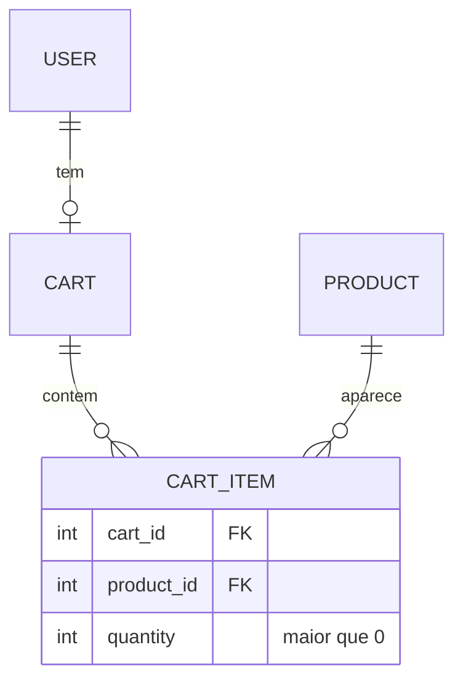

# 16. Carrinho de compras

> ⏱️ ~1h30 · Módulo 5 · Pré-requisitos: [06](06-orm-relacionamentos-agregacoes.md), [07](07-n-mais-1.md), [10](10-formularios.md), [12](12-permissoes.md), [15](15-paginacao-busca.md); modelo do projeto em [projeto-central](../00-guia/projeto-central.md)

> ⚠️ **Nota de verificação.** Como nas aulas 12 a 15, o laboratório não estava disponível: os blocos **não foram executados** e as saídas em `text` são as esperadas. Os nomes `Cart` e `CartItem` seguem o `projeto-central.md`; ajuste os caminhos se o seu app `cart` ainda não existir (`uv run python manage.py startapp cart apps/cart`, com `name = "apps.cart"` no `apps.py`).

## 🎯 Objetivos
Ao final desta aula você consegue:
- Modelar o carrinho (`Cart` 1:1 com o usuário, `CartItem` com `quantity`) com **restrições no banco**
- Isolar as regras em uma **camada de serviço** (`add_item`, `set_quantity`, `remove_item`) fácil de testar
- Calcular totais **no banco** (`Sum(F * F)`) com `Decimal`, sem confiar em preço vindo do navegador
- Alterar o carrinho só por **POST** (com CSRF) e exigir login, validando o estoque
- Usar `F()` e `get_or_create`/`update_or_create` para evitar *race conditions* simples

## 🤔 Por que isso importa
O carrinho é o coração de qualquer e-commerce e reúne o que um júnior precisa dominar: relacionamentos, regras de negócio, dinheiro, validação e segurança. O erro clássico é **confiar no que o navegador manda** (preço, quantidade, id) e o outro é **calcular dinheiro com `float`**. Estes dois bugs viram prejuízo real.

## 💡 Intuição (explicação simples)
O carrinho é um **cesto no supermercado**. Você coloca, tira e troca a quantidade à vontade, mas o **preço quem diz é a etiqueta da prateleira** (o banco), nunca você. Só quando chega ao caixa (aula 17) o que está no cesto vira uma compra, com o preço **congelado** naquele momento. Se alguém tentar levar 10 itens de uma prateleira com 3, o repositor avisa.

## 🔬 Como funciona por dentro

- **`UniqueConstraint(cart, product)`.** Um produto aparece **uma vez** por carrinho; adicionar de novo soma a quantidade. É regra do **banco**, não só do código.
- **`CheckConstraint(quantity > 0)`.** Quantidade zero ou negativa é impossível nos dados.
- **Sem preço no `CartItem`.** O preço é lido de `Product.price` na hora de exibir/calcular: assim o carrinho sempre mostra o preço atual. O preço só é congelado no `OrderItem` (aula 17).
- **Camada de serviço (`services.py`).** As views só traduzem HTTP ↔ serviço. As regras (estoque, quantidade máxima) ficam em funções puras de negócio, testáveis sem navegador. Isso prepara a aula 8 (arquitetura).
- **Total no banco.** `Sum(F("quantity") * F("product__price"))` calcula tudo numa consulta, em vez de um laço Python com N+1. Com `DecimalField`, o resultado é `Decimal` exato.
- **Mutação só por POST.** Adicionar ao carrinho **muda estado**; por GET, uma imagem em outro site poderia fazê-lo (CSRF, como no logout da aula 11). Use `@require_POST` + ``.
- **Concorrência.** Duas abas adicionando o mesmo produto ao mesmo tempo: `F("quantity") + n` faz o incremento **no banco** (`UPDATE … SET quantity = quantity + 1`), sem ler-e-escrever em Python (que perderia um dos incrementos).
- **Estoque no carrinho é só um aviso.** Reservar de verdade é papel do pedido, dentro de uma transação (aula 17). Aqui impedimos pedir **mais do que existe** na hora, mas entre adicionar e comprar o estoque pode acabar.

## 🛠️ Exemplo prático
**1. Models**
```python
# apps/cart/models.py
from django.conf import settings
from django.db import models
from django.db.models import F, Q, Sum

from apps.catalog.models import Product


class Cart(models.Model):
    user = models.OneToOneField(settings.AUTH_USER_MODEL, on_delete=models.CASCADE, related_name="cart")
    updated_at = models.DateTimeField(auto_now=True)

    def __str__(self):
        return f"Carrinho de {self.user}"

    def total(self):
        """Total calculado no banco; Decimal exato."""
        return self.items.aggregate(t=Sum(F("quantity") * F("product__price")))["t"] or 0

    def count(self):
        """Quantidade total de unidades."""
        return self.items.aggregate(q=Sum("quantity"))["q"] or 0


class CartItem(models.Model):
    cart = models.ForeignKey(Cart, on_delete=models.CASCADE, related_name="items")
    product = models.ForeignKey(Product, on_delete=models.CASCADE, related_name="+")
    quantity = models.PositiveIntegerField(default=1)

    class Meta:
        constraints = [
            models.UniqueConstraint(fields=["cart", "product"], name="cartitem_unique_product"),
            models.CheckConstraint(condition=Q(quantity__gt=0), name="cartitem_quantity_gt_0"),
        ]

    @property
    def subtotal(self):
        return self.quantity * self.product.price
```
```bash
uv run python manage.py makemigrations cart -n inicial
uv run python manage.py migrate
```
```text
Migrations for 'cart':
  apps/cart/migrations/0001_inicial.py
    + Create model Cart
    + Create model CartItem
    + Create constraint cartitem_unique_product on model cartitem
    + Create constraint cartitem_quantity_gt_0 on model cartitem
Operations to perform:
  Apply all migrations: accounts, admin, auth, cart, catalog, contenttypes, sessions
Running migrations:
  Applying cart.0001_inicial... OK
```
`related_name="+"` em `product` diz que não queremos o caminho inverso `product.cartitem_set`. Lembre de acrescentar `"apps.cart"` em `INSTALLED_APPS`.

**2. Serviço com as regras**
```python
# apps/cart/services.py
from django.db import transaction
from django.db.models import F

from apps.catalog.models import Product

from .models import Cart, CartItem

QUANTIDADE_MAXIMA = 20                                   # por produto


class CartError(Exception):
    """Regra de negócio do carrinho violada; a mensagem é apresentável ao usuário."""


def get_cart(user):
    cart, _ = Cart.objects.get_or_create(user=user)
    return cart


@transaction.atomic
def add_item(user, product_id, quantity=1):
    if quantity < 1:
        raise CartError("A quantidade deve ser pelo menos 1.")
    try:
        product = Product.objects.get(pk=product_id, is_active=True)      # produto inativo/inexistente: não entra
    except Product.DoesNotExist:
        raise CartError("Produto indisponível.") from None

    cart = get_cart(user)
    item = CartItem.objects.filter(cart=cart, product=product).first()
    atual = item.quantity if item else 0
    novo = atual + quantity
    if novo > product.stock:
        raise CartError(f"Estoque insuficiente: restam {product.stock} unidade(s) de {product.name}.")
    if novo > QUANTIDADE_MAXIMA:
        raise CartError(f"Máximo de {QUANTIDADE_MAXIMA} unidades por produto.")

    if item:
        CartItem.objects.filter(pk=item.pk).update(quantity=F("quantity") + quantity)   # incremento no banco
    else:
        CartItem.objects.create(cart=cart, product=product, quantity=quantity)
    cart.save(update_fields=["updated_at"])
    return cart


@transaction.atomic
def set_quantity(user, product_id, quantity):
    """quantity == 0 remove o item."""
    cart = get_cart(user)
    if quantity == 0:
        CartItem.objects.filter(cart=cart, product_id=product_id).delete()
        return cart
    if quantity < 0:
        raise CartError("Quantidade inválida.")
    item = CartItem.objects.select_related("product").filter(cart=cart, product_id=product_id).first()
    if item is None:
        raise CartError("Este produto não está no carrinho.")
    if quantity > item.product.stock:
        raise CartError(f"Estoque insuficiente: restam {item.product.stock} unidade(s).")
    if quantity > QUANTIDADE_MAXIMA:
        raise CartError(f"Máximo de {QUANTIDADE_MAXIMA} unidades por produto.")
    item.quantity = quantity
    item.save(update_fields=["quantity"])
    return cart


def remove_item(user, product_id):
    return set_quantity(user, product_id, 0)


def clear(user):
    CartItem.objects.filter(cart__user=user).delete()
```
Há uma pequena **janela de corrida** entre ler o item e atualizar (duas requisições simultâneas podem somar além do estoque). Para um carrinho isso é aceitável, porque o pedido (aula 17) trava as linhas com `select_for_update()` e revalida. A restrição `unique` do banco impede a duplicata mesmo se duas requisições criarem juntas: uma falharia com `IntegrityError`.

**3. Views, URLs e contexto global**
```python
# apps/cart/views.py
from django.contrib import messages
from django.contrib.auth.decorators import login_required
from django.shortcuts import redirect, render
from django.urls import reverse
from django.utils.http import url_has_allowed_host_and_scheme
from django.views.decorators.http import require_POST

from . import services


def _voltar(request, padrao="cart:detail"):
    destino = request.POST.get("next", "")
    if destino and url_has_allowed_host_and_scheme(destino, allowed_hosts={request.get_host()}, require_https=request.is_secure()):
        return redirect(destino)                          # evita open redirect (aula 11)
    return redirect(padrao)


@login_required
def detail(request):
    cart = services.get_cart(request.user)
    items = cart.items.select_related("product", "product__category").order_by("product__name")
    return render(request, "cart/detail.html", {"cart": cart, "items": items, "total": cart.total()})


def _inteiro(texto, padrao):
    try:
        return int(texto)
    except (TypeError, ValueError):
        return padrao


@login_required
@require_POST
def add(request, product_id):
    try:
        services.add_item(request.user, product_id, _inteiro(request.POST.get("quantity"), 1))
        messages.success(request, "Produto adicionado ao carrinho.")
    except services.CartError as e:
        messages.error(request, str(e))
    return _voltar(request)


@login_required
@require_POST
def update(request, product_id):
    try:
        services.set_quantity(request.user, product_id, _inteiro(request.POST.get("quantity"), -1))
    except services.CartError as e:
        messages.error(request, str(e))
    return _voltar(request)


@login_required
@require_POST
def remove(request, product_id):
    services.remove_item(request.user, product_id)
    messages.success(request, "Item removido.")
    return _voltar(request)
```
```python
# apps/cart/urls.py
from django.urls import path

from . import views

app_name = "cart"

urlpatterns = [
    path("", views.detail, name="detail"),
    path("adicionar/<int:product_id>/", views.add, name="add"),
    path("atualizar/<int:product_id>/", views.update, name="update"),
    path("remover/<int:product_id>/", views.remove, name="remove"),
]
```
```python
# apps/cart/context_processors.py: o contador aparece em todas as páginas
def cart_summary(request):
    if not request.user.is_authenticated:
        return {}
    return {"cart_count": request.user.cart.count() if hasattr(request.user, "cart") else 0}
```
```python
# config/settings.py: TEMPLATES[0]["OPTIONS"]["context_processors"].append("apps.cart.context_processors.cart_summary")
# config/urls.py: path("carrinho/", include("apps.cart.urls")),   (antes da rota "" do catálogo)
```
`hasattr(request.user, "cart")` evita criar um carrinho vazio só para olhar a página; ele custa **uma consulta** por página. Se isso incomodar, guarde o contador na sessão. Atenção: esse *context processor* é um bom lugar para o N+1 invisível, por isso o teste de consultas abaixo.

**4. Templates**
```html
{# catalog/product_detail.html: formulário de adicionar #}

  <form method="post" action="">
    
    <input type="hidden" name="next" value="{{ request.get_full_path }}">
    <label>Qtd <input type="number" name="quantity" value="1" min="1" max="{{ product.stock }}"></label>
    <button class="botao" type="submit">Adicionar ao carrinho</button>
  </form>

  <p class="suave">Sem estoque.</p>

```
```html
{# cart/detail.html #}

Carrinho — {{ NOME_LOJA }}

  <h1>Seu carrinho</h1>
  
    <table>
      <thead><tr><th>Produto</th><th>Preço</th><th>Qtd</th><th>Subtotal</th><th></th></tr></thead>
      <tbody>
      
        <tr>
          <td><a href="{{ item.product.get_absolute_url }}">{{ item.product.name }}</a></td>
          <td>R$ {{ item.product.price }}</td>
          <td>
            <form method="post" action="">
              <input type="number" name="quantity" value="{{ item.quantity }}" min="0" max="{{ item.product.stock }}" aria-label="Quantidade de {{ item.product.name }}">
              <button type="submit">Atualizar</button>
            </form>
          </td>
          <td>R$ {{ item.subtotal }}</td>
          <td><form method="post" action=""><button type="submit">Remover</button></form></td>
        </tr>
      
      </tbody>
      <tfoot><tr><th colspan="3">Total</th><th>R$ {{ total }}</th><td></td></tr></tfoot>
    </table>
    <p><a href="">Continuar comprando</a></p>
  
    <p>Seu carrinho está vazio. <a href="">Ver produtos</a>.</p>
  

```
No `base.html`, mostre `Carrinho ({{ cart_count|default:0 }})` ao lado do “Olá”. Para exibir valores em reais com vírgula, a aula 03 mostrou ``/`floatformat`; aqui o `Decimal` é impresso como está, para o foco ficar na regra.

**5. Testes**
```python
import pytest
from decimal import Decimal
from django.db import IntegrityError, transaction
from django.urls import reverse

from apps.cart import services
from apps.cart.models import CartItem
from apps.catalog.models import Category, Product

pytestmark = pytest.mark.django_db
SENHA = "uma-senha-bem-forte-42"


@pytest.fixture
def usuario(django_user_model):
    return django_user_model.objects.create_user("ana", "ana@exemplo.com", SENHA)


@pytest.fixture
def mouse():
    cat = Category.objects.create(name="Periféricos", slug="perifericos")
    return Product.objects.create(category=cat, sku="MOU-1", name="Mouse", price=Decimal("59.90"), stock=5)


@pytest.fixture
def teclado(mouse):
    return Product.objects.create(category=mouse.category, sku="TEC-1", name="Teclado", price=Decimal("120.50"), stock=2)


def test_adicionar_soma_quantidade_no_mesmo_item(usuario, mouse):
    services.add_item(usuario, mouse.pk, 2)
    services.add_item(usuario, mouse.pk, 1)
    assert CartItem.objects.filter(cart__user=usuario).count() == 1
    assert CartItem.objects.get().quantity == 3


def test_total_e_exato_em_decimal(usuario, mouse, teclado):
    services.add_item(usuario, mouse.pk, 3)             # 3 x 59.90 = 179.70
    services.add_item(usuario, teclado.pk, 1)           # 120.50
    assert services.get_cart(usuario).total() == Decimal("300.20")


def test_nao_passa_do_estoque(usuario, teclado):
    with pytest.raises(services.CartError, match="Estoque insuficiente"):
        services.add_item(usuario, teclado.pk, 3)
    services.add_item(usuario, teclado.pk, 2)
    with pytest.raises(services.CartError):
        services.add_item(usuario, teclado.pk, 1)


def test_produto_inativo_nao_entra(usuario, mouse):
    mouse.is_active = False
    mouse.save()
    with pytest.raises(services.CartError, match="indisponível"):
        services.add_item(usuario, mouse.pk)


@pytest.mark.parametrize("qtd", [0, -1])
def test_quantidade_invalida_ao_adicionar(usuario, mouse, qtd):
    with pytest.raises(services.CartError):
        services.add_item(usuario, mouse.pk, qtd)


def test_quantidade_zero_remove(usuario, mouse):
    services.add_item(usuario, mouse.pk, 2)
    services.set_quantity(usuario, mouse.pk, 0)
    assert not CartItem.objects.exists()


def test_banco_impede_duplicata_e_quantidade_zero(usuario, mouse):
    cart = services.add_item(usuario, mouse.pk)
    with pytest.raises(IntegrityError), transaction.atomic():
        CartItem.objects.create(cart=cart, product=mouse, quantity=1)
    with pytest.raises(IntegrityError), transaction.atomic():
        CartItem.objects.filter(cart=cart).update(quantity=0)


def test_carrinho_exige_login(client):
    r = client.get(reverse("cart:detail"))
    assert r.status_code == 302 and r.url.startswith(reverse("accounts:login"))


def test_adicionar_por_get_e_rejeitado(client, usuario, mouse):
    client.force_login(usuario)
    assert client.get(reverse("cart:add", args=[mouse.pk])).status_code == 405


def test_adicionar_por_post_e_mostra_no_carrinho(client, usuario, mouse):
    client.force_login(usuario)
    r = client.post(reverse("cart:add", args=[mouse.pk]), {"quantity": "2"})
    assert r.status_code == 302
    html = client.get(reverse("cart:detail")).content.decode()
    assert "Mouse" in html and "119.80" in html


def test_preco_enviado_pelo_cliente_e_ignorado(client, usuario, mouse):
    client.force_login(usuario)
    client.post(reverse("cart:add", args=[mouse.pk]), {"quantity": "1", "price": "0.01"})
    assert services.get_cart(usuario).total() == Decimal("59.90")


def test_quantidade_nao_numerica_nao_quebra(client, usuario, mouse):
    client.force_login(usuario)
    assert client.post(reverse("cart:add", args=[mouse.pk]), {"quantity": "abc"}).status_code == 302


def test_cada_usuario_ve_so_o_proprio_carrinho(client, django_user_model, usuario, mouse):
    outra = django_user_model.objects.create_user("bia", "bia@exemplo.com", SENHA)
    services.add_item(usuario, mouse.pk, 2)
    client.force_login(outra)
    assert "Mouse" not in client.get(reverse("cart:detail")).content.decode()
    client.post(reverse("cart:remove", args=[mouse.pk]))                # tentar remover o item "da Ana"
    assert CartItem.objects.filter(cart__user=usuario).count() == 1


def test_redirect_next_externo_e_ignorado(client, usuario, mouse):
    client.force_login(usuario)
    r = client.post(reverse("cart:add", args=[mouse.pk]), {"next": "https://site-malicioso.example/"})
    assert r.url == reverse("cart:detail")


def test_consultas_da_tela_nao_crescem_com_os_itens(client, usuario, mouse, teclado, django_assert_max_num_queries):
    services.add_item(usuario, mouse.pk)
    services.add_item(usuario, teclado.pk)
    client.force_login(usuario)
    with django_assert_max_num_queries(10):
        client.get(reverse("cart:detail"))
```
```bash
uv run python manage.py check
uv run pytest -q
```
```text
System check identified no issues (0 silenced).
.......................................................................... [100%]
```
O teste do “carrinho alheio” mostra o que torna este desenho seguro: **não existe `cart_id` na URL**. O carrinho é sempre `request.user.cart`, então não há como tentar o id de outra pessoa (IDOR, aula 12).

## 🧠 Pausa para lógica
**Problema (cupom em centavos).** Dado o carrinho como lista de `(preco_em_centavos, quantidade)` e um cupom de **10% a partir de R$ 200,00** que nunca pode deixar o total abaixo de R$ 0, calcule o total final **só com inteiros**, arredondando o desconto **para baixo** (o centavo quebrado fica com o cliente). Explique por que `0.1 + 0.2 != 0.3`.

<details><summary>Dica</summary>
Trabalhe em centavos (inteiros) e use divisão inteira: <code>subtotal * 10 // 100</code>. Float não representa 0,1 exatamente.
</details>

<details><summary>Solução comentada</summary>

```python
def total_com_cupom(itens, minimo=20_000, percentual=10):
    subtotal = sum(preco * qtd for preco, qtd in itens)
    desconto = subtotal * percentual // 100 if subtotal >= minimo else 0     # // arredonda para baixo
    return max(subtotal - desconto, 0), desconto


print(0.1 + 0.2, 0.1 + 0.2 == 0.3)
print(total_com_cupom([(5990, 3), (12050, 1)]))     # 300,20 → desconto 30,02
print(total_com_cupom([(5990, 2)]))                  # 119,80 → abaixo do mínimo
print(total_com_cupom([(19999, 1)]))                 # 199,99 → ainda abaixo
print(total_com_cupom([(20001, 1)]))                 # 200,01 → desconto de 20,00 (20,001 → 20,00)
```
```text
0.30000000000000004 False
(27018, 3002)
(11980, 0)
(19999, 0)
(18001, 2000)
```
Floats são binários e não representam 0,1 com exatidão. Para dinheiro, use inteiros (centavos) ou `Decimal`, como o `DecimalField` do Django.
</details>

## ⚠️ Erros comuns e boas práticas
| Mensagem / sintoma | Causa | Solução |
|---|---|---|
| `405 Method Not Allowed` ao clicar “Adicionar” | Link (GET) para uma rota `@require_POST` | Use `<form method="post">` |
| `403 CSRF verification failed` | Faltou `` | Inclua no formulário |
| `IntegrityError: UNIQUE constraint failed … cartitem_unique_product` | Criou item duplicado em vez de somar | Use o serviço `add_item` |
| `IntegrityError … cartitem_quantity_gt_0` | Gravou quantidade 0 | Quantidade 0 = remover (`set_quantity`) |
| Total com centavos estranhos (`179.70000000000002`) | `float` em algum ponto | Só `Decimal`/`DecimalField`; nunca `float(price)` |
| `RelatedObjectDoesNotExist: User has no cart` | Acessou `user.cart` sem criar | `get_cart()` (`get_or_create`) ou `hasattr` |
| Tela do carrinho com dezenas de consultas | `item.product` carregado item a item | `select_related("product")` |
| Preço “zerado” vindo do formulário | Servidor confiou no preço do cliente | Ignore; leia o preço do banco |
| Carrinho some ao sair da conta | Carrinho em sessão apagada no logout | Aqui ele é salvo no banco, por usuário |

- A **view traduz HTTP**; a **regra mora no serviço**. Se um dia houver API (módulo 6), ela reaproveita o mesmo serviço.
- Todo `POST` que muda estado: CSRF, login, validação de entrada e redirecionamento (*Post/Redirect/Get*).
- Para visitantes sem login, o padrão é um carrinho em **sessão** que é mesclado ao do usuário depois do login. Aqui exigimos login para manter a aula focada; o desafio pede a mesclagem.
- Mostre ao usuário **por que** algo falhou (estoque, máximo): `messages.error`.

## 🧩 Exercícios
**1. Fixação**
(a) Por que o `CartItem` não guarda o preço? (b) Por que `F("quantity") + 1` é melhor que `item.quantity += 1; item.save()`? (c) Por que adicionar ao carrinho é POST? (d) Por que não há `cart_id` na URL?

<details><summary>Solução</summary>

(a) O carrinho mostra sempre o preço atual; o preço só é congelado no pedido. (b) O incremento acontece no banco, de forma atômica; ler, somar em Python e gravar pode perder uma atualização concorrente. (c) Muda estado; um GET poderia ser disparado por outro site (CSRF) ou por *prefetch*. (d) O carrinho é sempre o do `request.user`: sem id para adivinhar, sem IDOR.
</details>

**2. Aplicação no projeto MiniShop**
Entregue o carrinho.

Critérios de pronto:
- [ ] App `cart` com `Cart`, `CartItem`, restrições no banco e migração
- [ ] Serviço com `add_item`, `set_quantity`, `remove_item`, `clear` e `CartError`
- [ ] Views só POST (exceto a de leitura), com login e `next` seguro
- [ ] Botão “Adicionar ao carrinho” no detalhe do produto (só com estoque) e contador no cabeçalho
- [ ] Tela do carrinho com subtotais, total e “carrinho vazio”
- [ ] Testes da aula verdes, incluindo carrinho de outro usuário e preço do cliente ignorado
- [ ] Carrinho registrado no Admin (com `CartItem` em *inline* e somente leitura)
- [ ] Commit `feat(cart): per-user cart with stock and quantity rules`

<details><summary>Solução de referência (Admin)</summary>

```python
# apps/cart/admin.py
from django.contrib import admin

from .models import Cart, CartItem


class CartItemInline(admin.TabularInline):
    model = CartItem
    extra = 0
    autocomplete_fields = ["product"]                    # exige search_fields no ProductAdmin


@admin.register(Cart)
class CartAdmin(admin.ModelAdmin):
    list_display = ["user", "updated_at"]
    list_select_related = ["user"]
    inlines = [CartItemInline]
```
</details>

**3. Desafio (opcional)**
Permita carrinho para **visitantes** guardado na sessão (`{product_id: quantity}`) e **mescle-o** ao carrinho do banco quando a pessoa entrar (sinal `user_logged_in`), respeitando estoque e o máximo por produto. Escreva testes para a mesclagem com produto repetido.

## 🎤 Na entrevista
- **Como você modelaria um carrinho?** `Cart` ligado ao usuário (ou à sessão) e `CartItem` com produto e quantidade, único por (carrinho, produto) e com quantidade > 0 como restrição do banco. Preço lido do produto; congelado só no pedido.
- **Por que nunca confiar no preço enviado pelo cliente?** Tudo que vem do navegador pode ser alterado; o servidor decide o preço e valida estoque e quantidade.
- **Como evitar erros de arredondamento com dinheiro?** `Decimal`/`DecimalField` ou inteiros em centavos; jamais `float`. Calcular totais no banco com `Sum`.

## 📚 Para ir além
- 📄 Documentação oficial: [Expressões `F()`](https://docs.djangoproject.com/en/5.2/ref/models/expressions/#f-expressions). Atualizações atômicas no banco.
- 📄 Documentação oficial: [Restrições de model](https://docs.djangoproject.com/en/5.2/ref/models/constraints/). `UniqueConstraint` e `CheckConstraint`.
- 📄 Documentação oficial: [Decimal (Python)](https://docs.python.org/3/library/decimal.html). Aritmética exata para dinheiro.
- 📑 Artigo/tutorial: [Django — sessões](https://docs.djangoproject.com/en/5.2/topics/http/sessions/). Base do carrinho de visitante (desafio).
- 🏋️ Prática extra: mostre no carrinho um aviso quando o preço de um item mudou desde que foi adicionado.

> Links verificados em 2026-11-08 (HTTP 200).

## ✅ Checklist da aula
- [ ] `Cart`/`CartItem` com restrições no banco
- [ ] Regras (estoque, máximo) no serviço, não na view
- [ ] Total calculado no banco com `Decimal`
- [ ] Mudanças só por POST, com CSRF e login; carrinho sempre do `request.user`
- [ ] Testes de estoque, duplicata, preço forjado e carrinho alheio
