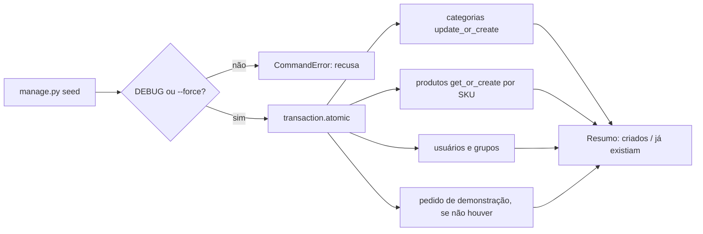
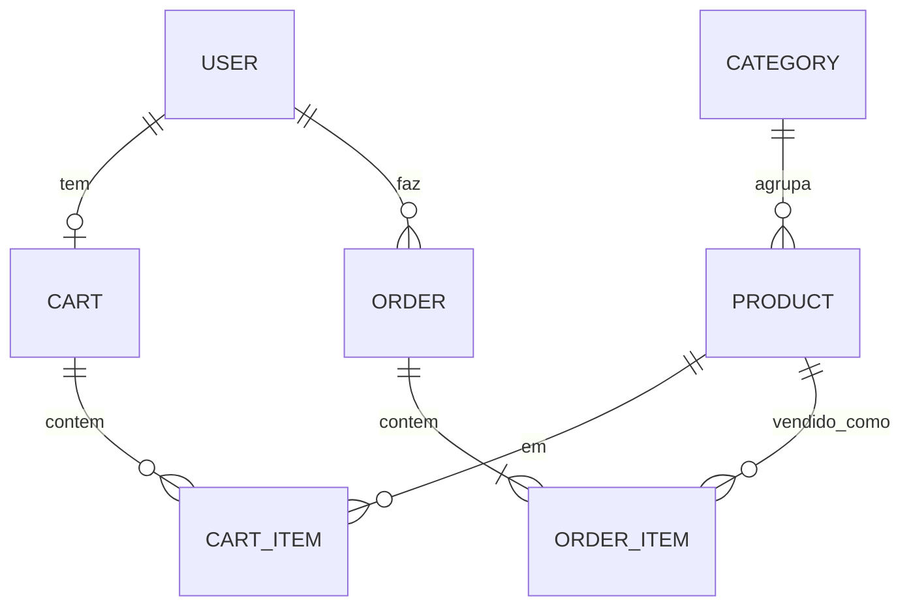

# 18. Consolidação do MiniShop e dados de seed

> ⏱️ ~1h30 · Módulo 5 · Pré-requisitos: [04](04-models-migracoes.md), [07](07-n-mais-1.md), [11](11-autenticacao.md) a [17](17-pedidos-estoque-transacao.md)

> ⚠️ **Nota de verificação.** Como nas aulas 12 a 17, o laboratório não estava disponível: os blocos **não foram executados** e as saídas em `text` são as esperadas. Os totais (64 produtos, 3 usuários etc.) vêm dos próprios parâmetros do comando de seed.

## 🎯 Objetivos
Ao final desta aula você consegue:
- Escrever um comando de gerenciamento de **seed idempotente** (pode rodar várias vezes sem duplicar) e seguro contra uso em produção
- Escolher entre **seed**, *fixtures* e *factories* conforme o caso
- Cobrir o fluxo completo (cadastro → compra → cancelamento) com um **teste de ponta a ponta**
- Auditar o projeto: migrações em dia, `check`, consultas por tela e cobertura mínima
- Documentar e publicar o marco `v1.0-minishop-django`

## 🤔 Por que isso importa
Um projeto que só roda “na máquina de quem escreveu” não serve a ninguém. Quem entra no time (ou o recrutador que abre seu repositório) precisa subir o sistema com **dois comandos** e já ver dados. Um bom seed economiza horas, serve de base para demonstrações e testes manuais, e a revisão final (migrações pendentes, N+1, testes verdes) é o que separa “funciona” de “está pronto”.

## 💡 Intuição (explicação simples)
É a **arrumação da casa antes de receber visita**: guardar a bagunça (migrações pendentes, rascunhos), deixar a mesa posta (dados de exemplo) e colocar um **cartaz na porta** com o caminho (README). Se a visita chega duas vezes, a mesa não pode ficar com dois pratos em cada lugar: por isso o seed é **idempotente**.

## 🔬 Como funciona por dentro

- **Comando de gerenciamento.** Uma classe `Command(BaseCommand)` em `apps/<app>/management/commands/<nome>.py` vira `manage.py <nome>`. Recebe argumentos com `argparse` (`add_arguments`) e escreve com `self.stdout`.
- **Idempotência.** Rodar duas vezes deixa o banco no mesmo estado. Ferramentas: `get_or_create` (cria só se não existir), `update_or_create` (cria ou atualiza), chave natural estável (SKU, `slug`, `username`). Sem isso, cada execução duplica ou quebra com `IntegrityError`.
- **Preservar ou redefinir?** Para produtos usamos `get_or_create`: se o estoque mudou por causa de vendas de teste, rodar o seed de novo **não** o desfaz. Para categorias, `update_or_create` mantém os nomes padronizados.
- **Determinismo.** Nada de `random` sem semente: dois alunos devem ver os mesmos dados (e os testes ficam estáveis). Aqui os preços saem de uma fórmula.
- **Segurança.** O seed cria usuários com senha conhecida; por isso **recusa** rodar com `DEBUG=False` a menos que se passe `--force`. A senha vem de `SEED_PASSWORD` (padrão só de laboratório).
- **Seed × *fixtures* × *factories*.**

| | Seed (comando) | Fixture (`dumpdata`/`loaddata`) | Factory (Factory Boy) |
|---|---|---|---|
| Para quê | Dados de demonstração/dev | Dados fixos pequenos, às vezes em testes | Objetos nos testes |
| Lógica | Python livre (usa serviços, regras) | JSON/YAML estático | Python, com valores *fake* aleatórios ou sequenciais |
| Pontos fracos | Precisa cuidar da idempotência | Frágil quando o schema muda; não passa por `save()` | Não é dado de demo |

- **Teste de ponta a ponta.** Percorre o fluxo como o usuário (via `Client`): garante que as peças, testadas isoladamente nas aulas anteriores, funcionam **juntas**.
- **Marco.** `git tag v1.0-minishop-django` registra o estado entregue do módulo. Tags não se movem: bugs corrigidos depois ganham nova tag.

## 🛠️ Exemplo prático
**1. O comando de seed**
```python
# apps/catalog/management/commands/seed.py  (crie também __init__.py em management/ e em commands/)
import os
from decimal import Decimal

from django.conf import settings
from django.contrib.auth import get_user_model
from django.contrib.auth.models import Group
from django.core.management.base import BaseCommand, CommandError
from django.db import transaction

from apps.cart import services as carrinho
from apps.catalog.models import Category, Product
from apps.orders import services as pedidos
from apps.orders.models import Order

CATEGORIAS = {
    "informatica": ("Informática", ["Notebook", "Mouse", "Teclado", "Monitor", "Webcam", "Hub USB"]),
    "audio": ("Áudio", ["Fone de ouvido", "Caixa de som", "Microfone", "Headset", "Interface de áudio"]),
    "casa": ("Casa", ["Luminária", "Cadeira", "Mesa", "Suporte de monitor", "Organizador de cabos"]),
}
VARIANTES = ["Básico", "Plus", "Pro", "Max"]
USUARIOS = [                                              # (username, grupo, is_staff)
    ("gerente", "Gerente", True),
    ("estoquista", "Estoquista", True),
    ("cliente", None, False),
]


class Command(BaseCommand):
    help = "Cria dados de demonstração do MiniShop (idempotente; só em DEBUG)."

    def add_arguments(self, parser):
        parser.add_argument("--force", action="store_true", help="permite rodar com DEBUG=False")
        parser.add_argument("--no-order", action="store_true", help="não cria o pedido de demonstração")

    @transaction.atomic
    def handle(self, *args, **opts):
        if not settings.DEBUG and not opts["force"]:
            raise CommandError("O seed cria usuários com senha conhecida: recusado com DEBUG=False (use --force se tiver certeza).")

        resumo = {"categorias": 0, "produtos": 0, "usuarios": 0}

        cats = {}
        for slug, (nome, _) in CATEGORIAS.items():
            cats[slug], novo = Category.objects.update_or_create(slug=slug, defaults={"name": nome})
            resumo["categorias"] += novo

        n = 0
        for slug, (_, bases) in CATEGORIAS.items():
            for base in bases:
                for variante in VARIANTES:
                    n += 1
                    sku = f"{slug[:3].upper()}-{n:03}"
                    _, novo = Product.objects.get_or_create(                 # não sobrescreve estoque alterado depois
                        sku=sku,
                        defaults={
                            "category": cats[slug],
                            "name": f"{base} {variante}",
                            "description": f"{base}, versão {variante}. Produto de demonstração.",
                            "price": Decimal(2990 + (n * 1370) % 150000) / 100,       # determinístico
                            "stock": 5 + (n * 7) % 40,
                            "is_active": n % 17 != 0,                                  # alguns inativos, para testar filtros
                        },
                    )
                    resumo["produtos"] += novo

        senha = os.environ.get("SEED_PASSWORD", "dev-somente-local-123")
        User = get_user_model()
        for username, grupo, staff in USUARIOS:
            usuario, novo = User.objects.get_or_create(username=username, defaults={"email": f"{username}@minishop.local", "is_staff": staff})
            if novo:
                usuario.set_password(senha)                                            # nunca grave senha em texto puro
                usuario.save()
                resumo["usuarios"] += 1
            if grupo:
                usuario.groups.add(Group.objects.get(name=grupo))                      # add é idempotente

        if not opts["no_order"]:
            cliente = User.objects.get(username="cliente")
            if not Order.objects.filter(user=cliente).exists():
                for sku in ("INF-001", "AUD-025"):
                    produto = Product.objects.get(sku=sku)
                    carrinho.add_item(cliente, produto.pk, 1)
                pedidos.create_order(cliente)
                self.stdout.write("pedido de demonstração criado para 'cliente'")

        self.stdout.write(self.style.SUCCESS(
            f"Seed ok: {resumo['categorias']} categorias, {resumo['produtos']} produtos e {resumo['usuarios']} usuários novos "
            f"({Product.objects.count()} produtos no total)."))
```
```bash
uv run python manage.py seed
uv run python manage.py seed
```
```text
pedido de demonstração criado para 'cliente'
Seed ok: 3 categorias, 64 produtos e 3 usuários novos (64 produtos no total).
Seed ok: 0 categorias, 0 produtos e 0 usuários novos (64 produtos no total).
```
Na segunda execução **nada novo** é criado: isso é idempotência. Os 64 produtos vêm de 16 bases (6 + 5 + 5) × 4 variantes; entre eles, alguns inativos de propósito (o 17º, o 34º e o 51º).

```bash
SEED_PASSWORD=outra-senha uv run python manage.py seed --no-order
DJANGO_DEBUG=False uv run python manage.py seed 2>&1 | tail -1
```
```text
Seed ok: 0 categorias, 0 produtos e 0 usuários novos (64 produtos no total).
CommandError: O seed cria usuários com senha conhecida: recusado com DEBUG=False (use --force se tiver certeza).
```

**2. Teste do seed**
```python
# apps/catalog/tests/test_seed.py
import pytest
from django.contrib.auth import get_user_model
from django.core.management import call_command
from django.core.management.base import CommandError

from apps.catalog.models import Product
from apps.orders.models import Order

pytestmark = pytest.mark.django_db


def test_seed_e_idempotente():
    call_command("seed")
    antes = (Product.objects.count(), get_user_model().objects.count(), Order.objects.count())
    call_command("seed")
    assert (Product.objects.count(), get_user_model().objects.count(), Order.objects.count()) == antes


def test_seed_cria_papeis_e_pedido_de_demo():
    call_command("seed")
    User = get_user_model()
    assert User.objects.get(username="gerente").groups.filter(name="Gerente").exists()
    assert User.objects.get(username="cliente").check_password("dev-somente-local-123")
    assert Order.objects.filter(user__username="cliente").count() == 1


def test_seed_nao_desfaz_estoque_alterado():
    call_command("seed")
    Product.objects.filter(sku="INF-002").update(stock=1)
    call_command("seed")
    assert Product.objects.get(sku="INF-002").stock == 1


def test_seed_recusa_producao(settings):
    settings.DEBUG = False
    with pytest.raises(CommandError):
        call_command("seed")
    call_command("seed", force=True)                       # explícito, funciona
```
**3. Teste de ponta a ponta do fluxo de compra**
```python
# tests/test_fluxo_completo.py (na raiz do projeto)
import pytest
from django.core.management import call_command
from django.urls import reverse

from apps.catalog.models import Product
from apps.orders.models import Order

pytestmark = pytest.mark.django_db
SENHA = "uma-senha-bem-forte-42"


def test_cadastro_compra_e_cancelamento(client):
    call_command("seed", no_order=True)
    produto = Product.objects.filter(is_active=True, stock__gte=3).order_by("sku").first()
    estoque_inicial = produto.stock

    # 1) cadastro (entra já logada)
    r = client.post(reverse("accounts:signup"), {"username": "nova", "email": "nova@exemplo.com", "password1": SENHA, "password2": SENHA})
    assert r.status_code == 302

    # 2) catálogo e busca encontram o produto
    lista = client.get(reverse("catalog:list"), {"q": produto.sku})
    assert produto.sku in [p.sku for p in lista.context["products"]]

    # 3) adiciona ao carrinho e confere o total
    client.post(reverse("cart:add", args=[produto.pk]), {"quantity": "2"})
    assert client.get(reverse("cart:detail")).context["total"] == 2 * produto.price

    # 4) finaliza: estoque cai, carrinho esvazia, pedido pendente
    r = client.post(reverse("orders:place"))
    pedido = Order.objects.get(user__username="nova")
    assert r.url == reverse("orders:detail", args=[pedido.pk]) and pedido.status == "pending"
    produto.refresh_from_db()
    assert produto.stock == estoque_inicial - 2
    assert client.get(reverse("cart:detail")).context["total"] == 0

    # 5) cancela: estoque volta
    client.post(reverse("orders:cancel", args=[pedido.pk]))
    produto.refresh_from_db()
    pedido.refresh_from_db()
    assert produto.stock == estoque_inicial and pedido.status == "cancelled"

    # 6) sai: telas protegidas voltam a pedir login
    client.post(reverse("accounts:logout"))
    assert client.get(reverse("orders:list")).status_code == 302


def test_cliente_nao_acessa_tela_de_gerente(client):
    call_command("seed", no_order=True)
    client.login(username="cliente", password="dev-somente-local-123")
    assert client.get(reverse("catalog:create")).status_code == 403
    client.logout()
    client.login(username="gerente", password="dev-somente-local-123")
    assert client.get(reverse("catalog:create")).status_code == 200
```
O `total` do carrinho vazio é `0`, porque `Cart.total()` devolve `0` sem itens. Outro cuidado: o teste usa `no_order=True` para o estoque inicial não ser alterado pelo pedido de demonstração.

**4. Auditoria de consultas por tela**
```python
# tests/test_consultas.py
import pytest
from django.core.management import call_command
from django.urls import reverse

pytestmark = pytest.mark.django_db


@pytest.mark.parametrize("nome,limite", [("catalog:list", 5), ("catalog:categories", 4), ("cart:detail", 8), ("orders:list", 8)])
def test_telas_principais_tem_consultas_limitadas(client, django_assert_max_num_queries, nome, limite):
    call_command("seed")
    client.login(username="cliente", password="dev-somente-local-123")
    with django_assert_max_num_queries(limite):
        assert client.get(reverse(nome)).status_code == 200
```
Se uma tela estourar o limite, o `pytest` mostra as consultas executadas: é o mesmo método da aula 07, agora como **teste de regressão** que protege contra um N+1 futuro.

**5. Auditoria final do projeto**
```bash
uv run python manage.py check
uv run python manage.py makemigrations --check --dry-run
DJANGO_DEBUG=False DJANGO_ALLOWED_HOSTS=minishop.exemplo.com uv run python manage.py check --deploy
uv run pytest -q
```
```text
System check identified no issues (0 silenced).
No changes detected
System check identified no issues (0 silenced).
.......................................................................... [ 85%]
............................................                             [100%]
```
`makemigrations --check` falha (código de saída 1) se houver mudança de model **sem** migração: coloque-o na CI (módulo 12). Para cobertura: `uv add --dev pytest-cov` e `uv run pytest --cov=apps --cov-report=term-missing`; a meta de 80% nas camadas de negócio (`services.py`) é do módulo 10.

**6. README do projeto e marco**
```markdown
# MiniShop (Django)

Loja de estudo: catálogo com busca/paginação, contas, carrinho, pedido com estoque transacional e Admin.

## Rodar
    uv sync
    cp .env.example .env        # ajuste DJANGO_SECRET_KEY
    uv run python manage.py migrate
    uv run python manage.py seed
    uv run python manage.py runserver

Usuários de demonstração (senha em SEED_PASSWORD; padrão só de laboratório): `gerente`, `estoquista`, `cliente`.

## Testes
    uv run pytest
    # concorrência (PostgreSQL): veja docs/concorrencia.md
```
```bash
git add -A
git commit -m "feat: consolidate MiniShop v1 with seed and end-to-end tests"
git tag -a v1.0-minishop-django -m "MiniShop v1: catalog, auth, cart, orders with transactional stock"
git push --follow-tags
git tag --list "v*"
```
```text
v0.0-ambiente
v0.1-python-cli
v0.2-http-minimo
v0.3-banco-sql
v0.4-front-estatico
v1.0-minishop-django
```

## 🧠 Pausa para lógica
**Problema (sincronizador idempotente).** Escreva `sincronizar(banco, desejado)` onde `banco` e `desejado` são dicionários `{chave: valor}`. Deve criar o que falta, **atualizar** o que mudou, **manter** o que está igual e **nunca apagar** o que não está em `desejado`. Devolva a contagem `{"criados", "atualizados", "iguais"}` e prove que uma segunda chamada não faz nada.

<details><summary>Dica</summary>
Para cada chave de <code>desejado</code>: se não está em <code>banco</code>, crie; se o valor é diferente, atualize; senão, conte como igual. Idempotente significa que a 2ª execução só produz “iguais”.
</details>

<details><summary>Solução comentada</summary>

```python
def sincronizar(banco, desejado):
    contagem = {"criados": 0, "atualizados": 0, "iguais": 0}
    for chave, valor in desejado.items():
        if chave not in banco:
            banco[chave] = valor
            contagem["criados"] += 1
        elif banco[chave] != valor:
            banco[chave] = valor
            contagem["atualizados"] += 1
        else:
            contagem["iguais"] += 1
    return contagem                                   # chaves extras do banco ficam intactas


banco = {"A": 1, "Z": 99}
desejado = {"A": 2, "B": 3, "C": 3}
print(sincronizar(banco, desejado), banco)
print(sincronizar(banco, desejado), banco)
```
```text
{'criados': 2, 'atualizados': 1, 'iguais': 0} {'A': 2, 'Z': 99, 'B': 3, 'C': 3}
{'criados': 0, 'atualizados': 0, 'iguais': 3} {'A': 2, 'Z': 99, 'B': 3, 'C': 3}
```
É a ideia por trás de `update_or_create`, de `migrate` e de ferramentas de infraestrutura (Terraform, Ansible): descrever o **estado desejado** e aplicar só a diferença.
</details>

## ⚠️ Erros comuns e boas práticas
| Mensagem / sintoma | Causa | Solução |
|---|---|---|
| `Unknown command: 'seed'` | Faltam `management/__init__.py` e `commands/__init__.py`, ou o app não está em `INSTALLED_APPS` | Crie os `__init__.py`; confira o caminho |
| `IntegrityError: UNIQUE constraint failed: catalog_product.sku` | Seed usa `create()` em vez de `get_or_create()` | Chave natural + `get_or_create`/`update_or_create` |
| `Group matching query does not exist` | Grupos criados pela migração da aula 12 não rodaram | `migrate` antes do `seed` |
| Seed rodou em produção e criou usuário conhecido | Sem trava de `DEBUG` | `CommandError` quando `DEBUG=False` |
| Estoque “voltou” depois de rodar o seed | `update_or_create` em dados que mudam | `get_or_create` para o que evolui |
| Teste passa sozinho, mas falha na suíte | Dependência de ordem/dados de outro teste | Cada teste monta os próprios dados (`call_command("seed")` dentro do teste) |
| `makemigrations --check` acusa mudança | Alterou um model sem gerar a migração | `makemigrations` e commit da migração |
| Dados de demo com nomes reais/CPF reais | Seed copiado de produção | Só dados fictícios; nunca dados pessoais |

- Seed **determinístico** e **idempotente**; senhas só de laboratório, vindas do ambiente.
- Teste de ponta a ponta **poucos e valiosos**: cobrem o fluxo principal; o detalhe fica nos testes unitários.
- Não versione `db.sqlite3`; quem precisa de dados roda `migrate` + `seed`.
- Antes de uma tag: testes verdes, `check`, `makemigrations --check`, README atualizado.

## 🧩 Exercícios
**1. Fixação**
(a) O que torna um seed idempotente? (b) Por que o seed recusa `DEBUG=False`? (c) Quando preferir *factory* a seed? (d) Para que serve `makemigrations --check`?

<details><summary>Solução</summary>

(a) Chave natural estável e operações “criar se não existir/atualizar” (`get_or_create`, `update_or_create`), de modo que rodar de novo não duplica. (b) Cria usuários com senha conhecida; em produção seria uma porta aberta. (c) Nos testes, para criar objetos específicos com poucos dados e sem depender de um conjunto fixo. (d) Detecta mudanças de model sem migração, falhando a CI.
</details>

**2. Aplicação no projeto MiniShop** *(fecha o módulo)*
Entregue o **MiniShop v1**.

Critérios de pronto:
- [ ] `manage.py seed` idempotente, determinístico, com trava de `DEBUG` e pedido de demonstração
- [ ] Testes do seed e do fluxo completo (cadastro → compra → cancelamento) verdes
- [ ] Teste de limite de consultas das telas principais
- [ ] `check`, `check --deploy` (com `DEBUG=False`) e `makemigrations --check` sem pendências
- [ ] README com “como rodar” em até 5 comandos e tabela de usuários de demonstração
- [ ] `docs/arquitetura.md` com o diagrama ER atual (Mermaid) e o fluxo de pedido
- [ ] Capturas de tela (catálogo, carrinho, pedido, Admin) em `docs/img/`
- [ ] Tag `v1.0-minishop-django` publicada

<details><summary>Solução de referência (ER)</summary>


</details>

**3. Desafio (opcional)**
Troque a geração fixa por **Factory Boy** nos testes (`ProductFactory`, `UserFactory`) e adicione `seed --reset`, que apaga **somente** os dados criados pelo seed (SKUs com prefixo conhecido e usuários de demonstração), recusando-se a rodar se existirem pedidos de usuários reais.

## 🎤 Na entrevista
- **O que é um seed idempotente e por que importa?** Rodar várias vezes resulta no mesmo estado, sem duplicar nem falhar; importa para ambientes de dev/CI e reexecução segura.
- **Fixtures, seed ou factories?** Fixtures para dados fixos e pequenos; seed (comando) para demonstração com lógica e regras; factories para criar objetos sob medida nos testes.
- **O que você confere antes de entregar uma versão?** Testes, `check`/`check --deploy`, migrações em dia, README com passos de execução, sem segredos no repositório e uma tag de versão.

## 📚 Para ir além
- 📄 Documentação oficial: [Escrevendo comandos `manage.py` próprios](https://docs.djangoproject.com/en/5.2/howto/custom-management-commands/). `BaseCommand`, argumentos e saída.
- 📄 Documentação oficial: [Fixtures (`dumpdata`/`loaddata`)](https://docs.djangoproject.com/en/5.2/topics/db/fixtures/). Quando valem a pena.
- 📄 Documentação: [Factory Boy](https://factoryboy.readthedocs.io/). Fábricas de objetos para testes.
- 📄 Documentação oficial: [`call_command`](https://docs.djangoproject.com/en/5.2/ref/django-admin/#running-management-commands-from-your-code). Chamar comandos em testes.
- 📑 Artigo/tutorial: [Pro Git — Tagging (EN)](https://git-scm.com/book/en/v2/Git-Basics-Tagging). Tags anotadas e publicação.
- 🏋️ Prática extra: clone o repositório numa pasta nova e siga **só** o README; corrija tudo o que travar.

> Links verificados em 2026-11-08 (HTTP 200).

## ✅ Checklist da aula
- [ ] Seed idempotente e protegido contra produção
- [ ] Teste de ponta a ponta e teste de consultas por tela
- [ ] Migrações em dia e `check --deploy` limpo
- [ ] README que um desconhecido consegue seguir
- [ ] Tag `v1.0-minishop-django` criada
