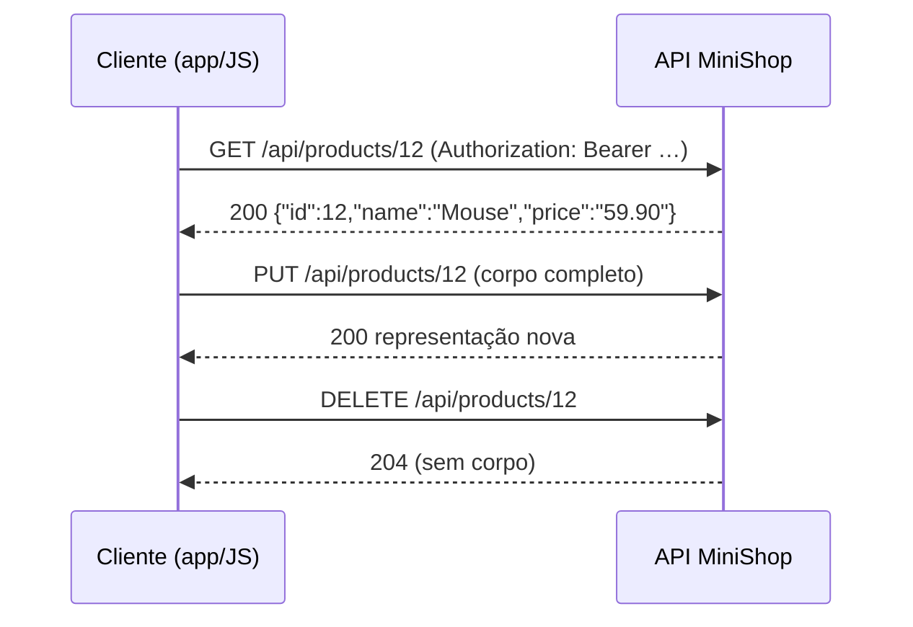

# 1. Princípios REST

> ⏱️ ~1h30 · Módulo 6 · Pré-requisitos: [2.02 HTTP](../02-como-a-web-funciona/02-http-metodos-status-headers.md), [2.03 cookies, sessões e JSON](../02-como-a-web-funciona/03-tls-cookies-sessoes-json-urls.md), [5.16](../05-django/16-carrinho.md) (serviços e regras de negócio)

> ✅ **Verificação.** Todo o código desta aula usa só a biblioteca padrão do Python 3 e **foi executado** em 2026-11-08; as saídas abaixo são as reais. Versões do módulo conferidas no PyPI na mesma data: DRF 3.18.3, simplejwt 5.5.1, drf-spectacular 0.30.0, django-filter 26.2, django-cors-headers 4.9.0 (todos compatíveis com o Django 5.2 adotado).

## 🎯 Objetivos
Ao final desta aula você consegue:
- Explicar o que é uma API REST e os princípios que a definem (recursos, interface uniforme, *stateless*, cache, camadas)
- Classificar métodos HTTP em **seguros** e **idempotentes** e prever o efeito de repeti-los
- Explicar por que uma API *stateless* autentica **cada** requisição, e o que isso muda em relação às sessões da aula 5.11
- Situar uma API no **modelo de maturidade de Richardson** (níveis 0 a 3)
- Usar uma **chave de idempotência** para tornar seguro repetir um `POST`

## 🤔 Por que isso importa
Até aqui o MiniShop devolve **páginas HTML**. Aplicativos de celular, outros sistemas, o front-end em JavaScript e parceiros precisam de **dados**, não de páginas: é a API. Quase toda vaga de júnior pede “API REST”. E a pergunta que mais cai é a mais sutil: “o que é idempotência e por que importa?”. Num pagamento ou pedido, saber que o cliente pode **repetir** a requisição sem duplicar a cobrança é o que separa uma API confiável de uma que gera estorno.

## 💡 Intuição (explicação simples)
Pense num **restaurante com garçom e cardápio padronizado**. Os pratos são os **recursos** (cada um com um nome/endereço); o garçom entende só um punhado de **verbos** (trazer, anotar, trocar, retirar) e age igual em qualquer mesa. O garçom **não guarda memória** de você: a cada pedido você diz o número da mesa e o que quer (*stateless*). Pedir “me traga o cardápio” 10 vezes não muda nada (seguro); pedir “troque meu prato por uma salada” 10 vezes deixa a mesa igual (idempotente); mas pedir “anote mais uma cerveja” 10 vezes traz 10 cervejas (não idempotente).

## 🔬 Como funciona por dentro
**REST** (*Representational State Transfer*) é um **estilo de arquitetura** descrito por Roy Fielding (2000), não um protocolo nem uma biblioteca. Uma API que segue bem o estilo é chamada de “RESTful”, e na prática quase sempre significa **HTTP + JSON + recursos bem nomeados**.



**Os princípios (restrições) do estilo:**
| Princípio | Significa | No MiniShop |
|---|---|---|
| **Recursos e URIs** | Tudo é um *substantivo* com endereço próprio | `/api/products/12`, `/api/orders/7` |
| **Representações** | O cliente manipula uma *representação* (JSON), não o objeto no servidor | corpo JSON com `Content-Type: application/json` |
| **Interface uniforme** | Os mesmos verbos com o mesmo significado em todos os recursos | `GET` lê, `POST` cria, `PUT/PATCH` altera, `DELETE` remove |
| **Sem estado (*stateless*)** | Cada requisição traz **tudo** de que o servidor precisa; ele não guarda contexto de conversa | token no cabeçalho a cada chamada |
| **Cache** | Respostas dizem se podem ser reaproveitadas | `Cache-Control`, `ETag` em `GET` |
| **Camadas** | O cliente não sabe se fala com o servidor, um proxy ou um balanceador | CDN/Nginx na frente do Gunicorn |
| **HATEOAS** (opcional na prática) | A resposta traz *links* para as próximas ações | `"next": "/api/products/?page=2"` |

**Métodos: seguro × idempotente** (RFC 9110):
| Método | Uso | **Seguro** (não altera estado) | **Idempotente** (N vezes = 1 vez) |
|---|---|:---:|:---:|
| `GET` | ler | sim | sim |
| `HEAD` / `OPTIONS` | metadados | sim | sim |
| `PUT` | substituir tudo | não | **sim** |
| `PATCH` | alterar partes | não | depende (`{"stock": 5}` sim; “some 1” não) |
| `DELETE` | remover | não | **sim** (o *estado* final é o mesmo) |
| `POST` | criar / ação | não | **não** |

- **Seguro** quer dizer que o cliente **não pede** efeito colateral: por isso `GET` nunca deve alterar dados (um *crawler* ou *prefetch* o dispara).
- **Idempotente** refere-se ao **estado do servidor**, não ao código da resposta: o 2º `DELETE` devolve `404`, mas o estado é o mesmo do 1º. Isso permite **repetir com segurança** após um *timeout* (“não sei se chegou”).
- **`POST` não é idempotente**, e é o que mais precisa de proteção: duplo clique, retry de rede e fila reprocessada criam duplicatas. A solução é uma **chave de idempotência** (cabeçalho `Idempotency-Key`), que veremos abaixo.
- **Stateless não é “sem sessão”, é “sem *estado de conversa* no servidor”.** A aula 5.11 usava sessão (cookie `sessionid` → tabela). Numa API, o cliente envia a credencial **em toda requisição** (token/JWT, aula 06). Vantagem: qualquer servidor atrás do balanceador atende qualquer chamada (escala horizontal). Custo: a credencial viaja sempre, então HTTPS é obrigatório.
- **Modelo de maturidade de Richardson:**

| Nível | Característica | Exemplo |
|---|---|---|
| 0 | Um único endpoint, tudo por `POST` (RPC sobre HTTP) | `POST /api` `{"acao": "listarProdutos"}` |
| 1 | **Recursos**: URIs distintas | `POST /produtos/12/excluir` |
| 2 | **Verbos HTTP** e **status** corretos | `DELETE /produtos/12` → `204` |
| 3 | **Hipermídia** (HATEOAS) | respostas com links de ações |

  A maioria das APIs “REST” do mercado está no **nível 2**, e é essa a meta do MiniShop.
- **REST não é a única opção:** GraphQL (o cliente escolhe os campos) e gRPC (binário, contratos fortes, serviços internos) resolvem outros problemas; a aula 13 compara.

## 🛠️ Exemplo prático
**1. Um servidor REST mínimo, só com a biblioteca padrão, e um cliente que prova os conceitos**
```python
# rest_demo.py: demonstra segurança, idempotência e statelessness
import json
import threading
from http.server import BaseHTTPRequestHandler, HTTPServer
from urllib import request as rq
from urllib.error import HTTPError

PRODUTOS = {}          # id -> dict
PROXIMO = [1]
TOKEN = "segredo-de-laboratorio"


class Handler(BaseHTTPRequestHandler):
    def log_message(self, *a):
        pass

    def _enviar(self, status, corpo=None, extra=None):
        dados = b"" if corpo is None else json.dumps(corpo).encode()
        self.send_response(status)
        self.send_header("Content-Type", "application/json")
        self.send_header("Content-Length", str(len(dados)))
        for k, v in (extra or {}).items():
            self.send_header(k, v)
        self.end_headers()
        self.wfile.write(dados)

    def _autorizado(self):
        if self.headers.get("Authorization") != f"Bearer {TOKEN}":   # sem estado: confere a CADA requisição
            self._enviar(401, {"erro": "token ausente ou inválido"}, {"WWW-Authenticate": "Bearer"})
            return False
        return True

    def _corpo(self):
        n = int(self.headers.get("Content-Length") or 0)
        return json.loads(self.rfile.read(n) or b"{}")

    def do_GET(self):
        if not self._autorizado():
            return
        if self.path == "/produtos":
            return self._enviar(200, list(PRODUTOS.values()))
        pid = int(self.path.rsplit("/", 1)[1])
        return self._enviar(200, PRODUTOS[pid]) if pid in PRODUTOS else self._enviar(404, {"erro": "não encontrado"})

    def do_POST(self):                                    # cria: NÃO é idempotente
        if not self._autorizado():
            return
        pid = PROXIMO[0]; PROXIMO[0] += 1
        PRODUTOS[pid] = {"id": pid, **self._corpo()}
        self._enviar(201, PRODUTOS[pid], {"Location": f"/produtos/{pid}"})

    def do_PUT(self):                                     # substitui: idempotente
        if not self._autorizado():
            return
        pid = int(self.path.rsplit("/", 1)[1])
        criado = pid not in PRODUTOS
        PRODUTOS[pid] = {"id": pid, **self._corpo()}
        self._enviar(201 if criado else 200, PRODUTOS[pid])

    def do_DELETE(self):                                  # remove: idempotente no ESTADO (status pode variar)
        if not self._autorizado():
            return
        pid = int(self.path.rsplit("/", 1)[1])
        self._enviar(204 if PRODUTOS.pop(pid, None) else 404)


srv = HTTPServer(("127.0.0.1", 0), Handler)
threading.Thread(target=srv.serve_forever, daemon=True).start()
BASE = f"http://127.0.0.1:{srv.server_port}"


def chamar(metodo, caminho, corpo=None, token=True):
    cab = {"Content-Type": "application/json"}
    if token:
        cab["Authorization"] = f"Bearer {TOKEN}"
    req = rq.Request(BASE + caminho, method=metodo, headers=cab, data=None if corpo is None else json.dumps(corpo).encode())
    try:
        with rq.urlopen(req) as r:
            return r.status, r.read().decode()
    except HTTPError as e:
        return e.code, e.read().decode()


def mostrar(titulo, *chamadas):
    print(f"\n--- {titulo}")
    for metodo, caminho, corpo in chamadas:
        status, texto = chamar(metodo, caminho, corpo)
        print(f"{metodo:<6} {caminho:<12} → {status}  estado agora: {len(PRODUTOS)} produto(s)")


mostrar("POST duas vezes (NÃO idempotente: cria dois)", ("POST", "/produtos", {"nome": "Mouse"}), ("POST", "/produtos", {"nome": "Mouse"}))
mostrar("PUT duas vezes no mesmo id (idempotente: um só)", ("PUT", "/produtos/10", {"nome": "Teclado"}), ("PUT", "/produtos/10", {"nome": "Teclado"}))
mostrar("DELETE duas vezes (mesmo estado final)", ("DELETE", "/produtos/10", None), ("DELETE", "/produtos/10", None))
mostrar("GET várias vezes (seguro: não muda nada)", ("GET", "/produtos", None), ("GET", "/produtos", None))

print("\n--- statelessness: sem o cabeçalho, nada é lembrado entre requisições")
print("GET sem token       →", chamar("GET", "/produtos", token=False)[0])
print("GET com token       →", chamar("GET", "/produtos")[0])
print("GET sem token (de novo, o servidor não 'lembra') →", chamar("GET", "/produtos", token=False)[0])
srv.shutdown()
```
```bash
python3 rest_demo.py
```
```text
--- POST duas vezes (NÃO idempotente: cria dois)
POST   /produtos    → 201  estado agora: 1 produto(s)
POST   /produtos    → 201  estado agora: 2 produto(s)

--- PUT duas vezes no mesmo id (idempotente: um só)
PUT    /produtos/10 → 201  estado agora: 3 produto(s)
PUT    /produtos/10 → 200  estado agora: 3 produto(s)

--- DELETE duas vezes (mesmo estado final)
DELETE /produtos/10 → 204  estado agora: 2 produto(s)
DELETE /produtos/10 → 404  estado agora: 2 produto(s)

--- GET várias vezes (seguro: não muda nada)
GET    /produtos    → 200  estado agora: 2 produto(s)
GET    /produtos    → 200  estado agora: 2 produto(s)

--- statelessness: sem o cabeçalho, nada é lembrado entre requisições
GET sem token       → 401
GET com token       → 200
GET sem token (de novo, o servidor não 'lembra') → 401
```
Leia o resultado como um laboratório:
- Dois `POST` → **2** produtos (duplicou). Dois `PUT` no mesmo id → **1** (estado igual; o código muda de `201` para `200`, o que é correto: criou e depois substituiu).
- Dois `DELETE` → estado idêntico, embora o 2º devolva `404`. Idempotência é sobre o **estado**.
- Mesmo com um `GET` autorizado no meio, a requisição seguinte sem token volta a ser `401`: o servidor **não lembra** de você.
- O `POST` devolve `201 Created` com o cabeçalho `Location` apontando para o novo recurso: essa é a convenção.

**2. Tornando o `POST` repetível: chave de idempotência**
```python
# chave.py
import functools


def com_chave_de_idempotencia(funcao):
    """Repetir a MESMA chave devolve o resultado guardado, sem executar de novo."""
    guardado = {}

    @functools.wraps(funcao)
    def interna(chave, *args, **kwargs):
        if chave not in guardado:
            guardado[chave] = funcao(*args, **kwargs)
        return guardado[chave]

    return interna


pedidos = []


@com_chave_de_idempotencia
def criar_pedido(sku, qtd):
    pedidos.append((sku, qtd))
    return {"pedido": len(pedidos), "sku": sku, "qtd": qtd}


print(criar_pedido("k-1", "MOU-1", 2))
print(criar_pedido("k-1", "MOU-1", 2))      # repetição (timeout + retry do cliente): mesmo resultado
print(criar_pedido("k-2", "MOU-1", 2))      # outra intenção do usuário: novo pedido
print("pedidos criados:", len(pedidos))
```
```bash
python3 chave.py
```
```text
{'pedido': 1, 'sku': 'MOU-1', 'qtd': 2}
{'pedido': 1, 'sku': 'MOU-1', 'qtd': 2}
{'pedido': 2, 'sku': 'MOU-1', 'qtd': 2}
pedidos criados: 2
```
O **cliente** gera a chave (um UUID por *intenção* do usuário) e a envia no cabeçalho `Idempotency-Key`; o servidor guarda `chave → resposta`. Em produção isso vive numa tabela com restrição `UNIQUE` (o desafio da aula 5.17 já aponta para isso) e expira depois de horas ou dias. É o padrão de APIs de pagamento.

**3. Olhando uma API real no terminal** (qualquer API pública serve; BrasilAPI é gratuita)
```bash
curl -s -D - -o /dev/null https://brasilapi.com.br/api/cep/v2/01001000 | head -8
curl -s https://brasilapi.com.br/api/cep/v2/01001000 | python3 -m json.tool | head -6
```
Procure `HTTP/… 200`, `content-type: application/json` e os campos do JSON. Veja também o que acontece com um CEP inválido (a API devolve `404` com um JSON de erro, em vez de uma página HTML).

## 🧠 Pausa para lógica
**Problema (repetir com segurança).** Um cliente envia requisições e algumas dão *timeout* (ele não sabe se chegaram). Escreva `pode_repetir(metodo, tem_chave=False)` que diga se é seguro reenviar automaticamente. Regra: métodos **idempotentes** podem; `POST`/`PATCH` só se houver chave de idempotência.

<details><summary>Dica</summary>
Monte um conjunto com <code>GET, HEAD, OPTIONS, PUT, DELETE</code> e aceite o resto apenas com <code>tem_chave</code>. Normalize o método com <code>.upper()</code>.
</details>

<details><summary>Solução comentada</summary>

```python
IDEMPOTENTES = {"GET", "HEAD", "OPTIONS", "PUT", "DELETE"}


def pode_repetir(metodo, tem_chave=False):
    metodo = metodo.upper()
    return metodo in IDEMPOTENTES or tem_chave


casos = [("get", False), ("PUT", False), ("DELETE", False), ("POST", False), ("POST", True), ("PATCH", False)]
for m, k in casos:
    print(f"{m.upper():<7} chave={k!s:<5} → {pode_repetir(m, k)}")
```
```text
GET     chave=False → True
PUT     chave=False → True
DELETE  chave=False → True
POST    chave=False → False
POST    chave=True  → True
PATCH   chave=False → False
```
Clientes HTTP e bibliotecas de *retry* (módulo 7) aplicam exatamente essa regra por padrão: repetem `GET`/`PUT`/`DELETE` e **não** repetem `POST`.
</details>

## ⚠️ Erros comuns e boas práticas
| Sintoma / erro | Causa | Solução |
|---|---|---|
| `GET /produtos/12/excluir` apaga dados | Efeito colateral em método seguro | Use `DELETE`; `GET` nunca altera estado |
| Cliente repete `POST` após timeout e cria 2 pedidos | `POST` não é idempotente | `Idempotency-Key` no servidor |
| Tudo devolve `200`, até o erro | Status ignorado (nível 0 de Richardson) | Use o status certo (`201`, `204`, `400`, `404`…) |
| `PUT` com só um campo apaga os outros | `PUT` **substitui** o recurso inteiro | Use `PATCH` para alteração parcial |
| `401` em toda chamada, “mas eu fiz login” | A API é *stateless*: falta o cabeçalho `Authorization` | Envie a credencial em **cada** requisição |
| Verbos nos caminhos (`/criarProduto`) | Pensar em RPC, não em recursos | Substantivos + método HTTP: `POST /products` |
| Guardar “o passo atual” do cliente no servidor | Estado de conversa quebra a escala | Cliente envia o contexto; servidor guarda apenas dados de negócio |
| `Access-Control-…` / `CORS error` no navegador | Origem diferente (aula 11) | Configurar CORS no servidor |

- **Não é preciso ser “purista”.** Fielding exige hipermídia (nível 3); a indústria usa o nível 2 com documentação OpenAPI. Escolha com consciência e seja **consistente**.
- *Stateless* ≠ sem banco: o servidor guarda **dados do negócio** (produtos, pedidos), não o **estado da conversa** com cada cliente.
- JSON é o formato padrão, mas REST não obriga JSON (poderia ser XML, CSV…).
- Sempre HTTPS: com tokens no cabeçalho, HTTP puro entrega a credencial a quem estiver na rede.

## 🧩 Exercícios
**1. Fixação**
(a) Qual a diferença entre método **seguro** e **idempotente**? (b) Por que `DELETE` é idempotente mesmo devolvendo `404` na segunda vez? (c) O que *stateless* exige do cliente? (d) Em que nível de Richardson está `POST /api {"acao": "excluir", "id": 3}`?

<details><summary>Solução</summary>

(a) Seguro: não altera o estado do servidor (`GET`). Idempotente: repetir N vezes deixa o estado igual a uma vez (`PUT`, `DELETE`, e também `GET`). Todo seguro é idempotente, mas não o contrário. (b) Idempotência vale para o **estado**: após o 1º ou o 2º `DELETE` o recurso não existe; o código de resposta pode diferir. (c) Enviar em **cada** requisição tudo o que o servidor precisa (credencial, parâmetros), pois ele não guarda contexto entre chamadas. (d) Nível 0: um endpoint só, tudo por `POST`, sem recursos nem verbos.
</details>

**2. Aplicação no projeto MiniShop**
Desenhe, **no papel** (ainda sem código Django), a API que o MiniShop vai oferecer.

Critérios de pronto (em `docs/api-desenho.md`):
- [ ] Lista de **recursos** (substantivos): produtos, categorias, carrinho e itens, pedidos
- [ ] Tabela “recurso × método” com o efeito de cada um e se é **seguro**/**idempotente**
- [ ] Quais operações exigem autenticação e quais são públicas (catálogo público; carrinho e pedidos privados)
- [ ] Onde entra `Idempotency-Key` (criação de pedido) e por quê
- [ ] Uma frase justificando por que a API será *stateless* (JWT na aula 06) e o que isso muda em relação às sessões da aula 5.11
- [ ] Commit `docs(api): resource and method design`

<details><summary>Solução de referência</summary>

| Recurso | `GET` | `POST` | `PUT`/`PATCH` | `DELETE` | Acesso |
|---|---|---|---|---|---|
| `/api/products/` | lista (seguro) | cria (gerente) | n/a | n/a | leitura pública; escrita com permissão |
| `/api/products/{id}/` | detalhe | n/a | `PUT` substitui; `PATCH` parcial (estoquista) | remove/desativa (gerente) | idem |
| `/api/categories/` | lista | cria (gerente) | n/a | n/a | idem |
| `/api/cart/` | meu carrinho | n/a | n/a | esvazia | autenticado |
| `/api/cart/items/` | itens | adiciona item | `PATCH` altera quantidade | remove item | autenticado |
| `/api/orders/` | meus pedidos | **cria pedido** (com `Idempotency-Key`) | n/a | n/a | autenticado |
| `/api/orders/{id}/cancel/` | n/a | cancela (ação) | n/a | n/a | dono |

`POST /api/orders/` cria com a chave porque um retry de rede não pode gerar dois pedidos nem baixar o estoque duas vezes. As operações de ação (`cancel`) usam `POST` num sub-recurso, uma convenção comum quando não cabem em `PUT/PATCH`.
</details>

**3. Desafio (opcional)**
Estenda o servidor do exemplo: faça o `POST /produtos` aceitar o cabeçalho `Idempotency-Key`; na repetição com a mesma chave, devolva o **mesmo** `201`/`Location` e **não** crie outro produto; com a mesma chave e **corpo diferente**, devolva `422` (conflito de intenção). Escreva o cliente que prova os três casos.

## 🎤 Na entrevista
- **O que é uma API REST?** Um estilo de arquitetura sobre HTTP: recursos com URIs próprias, manipulados por uma interface uniforme (verbos com semântica fixa), sem estado entre requisições, com possibilidade de cache e camadas; na prática, JSON sobre HTTP com status corretos.
- **O que é idempotência e por que importa?** Repetir a mesma requisição N vezes deixa o servidor no mesmo estado que uma vez (`GET`, `PUT`, `DELETE`); permite *retry* seguro após *timeout*. `POST` não é idempotente, então pagamentos/pedidos usam uma chave de idempotência.
- **Diferença entre `PUT` e `PATCH`?** `PUT` substitui o recurso inteiro (idempotente); `PATCH` altera só os campos enviados.
- **O que significa *stateless* e qual a vantagem?** O servidor não guarda contexto de sessão do cliente; cada requisição é autossuficiente. Qualquer instância atende qualquer chamada, o que facilita escalar horizontalmente.

## 📚 Para ir além
- 📄 Referência: [Métodos de requisição HTTP (MDN)](https://developer.mozilla.org/pt-BR/docs/Web/HTTP/Reference/Methods). Tabela de métodos com segurança e idempotência.
- 📄 Referência: [Idempotente (glossário MDN)](https://developer.mozilla.org/pt-BR/docs/Glossary/Idempotent). Definição curta com exemplos.
- 📄 Referência: [Códigos de status HTTP (MDN)](https://developer.mozilla.org/pt-BR/docs/Web/HTTP/Reference/Status). Para escolher o status certo.
- 📄 Especificação: [RFC 9110 — HTTP Semantics](https://www.rfc-editor.org/rfc/rfc9110). A fonte da definição de método seguro e idempotente (consulte as seções de métodos).
- 📑 Artigo: [Richardson Maturity Model (Martin Fowler)](https://martinfowler.com/articles/richardsonMaturityModel.html). Os quatro níveis com exemplos.
- 📑 Tese: [Fielding — Representational State Transfer (cap. 5)](https://ics.uci.edu/~fielding/pubs/dissertation/rest_arch_style.htm). A origem do termo, para os curiosos.
- 📑 Artigo: [Stripe — Requisições idempotentes](https://docs.stripe.com/api/idempotent_requests). Como uma API de pagamentos usa `Idempotency-Key` (em inglês).
- 📄 Documentação: [Django REST Framework](https://www.django-rest-framework.org/). Usaremos a partir da aula 03.
- 🏋️ Prática extra: use `curl -v` numa API pública e identifique método, status, `Content-Type` e cabeçalhos de cache.

> Links verificados em 2026-11-08 (HTTP 200).

## ✅ Checklist da aula
- [ ] Rodei o servidor de demonstração e expliquei cada linha da saída
- [ ] Sei dizer, de cabeça, quais métodos são seguros e quais são idempotentes
- [ ] Entendi *stateless* e a diferença para a sessão da aula 5.11
- [ ] Consigo classificar uma API no modelo de Richardson
- [ ] Entreguei `docs/api-desenho.md` com recursos, métodos e uso de `Idempotency-Key`
