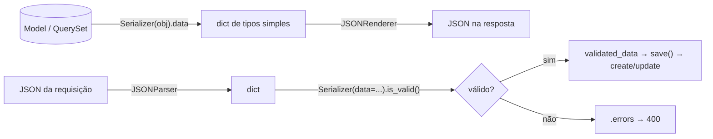

# 3. DRF: serializers

> ⏱️ ~1h30 · Módulo 6 · Pré-requisitos: [6.01](01-principios-rest.md), [6.02](02-design-endpoints.md), [5.04](../05-django/04-models-migracoes.md), [5.07](../05-django/07-n-mais-1.md), [5.10](../05-django/10-formularios.md)

> ✅ **Verificação.** Os exemplos desta aula foram executados em 2026-11-08 num laboratório com **Django 5.2.19 e DRF 3.18.3** (SQLite, modelos do MiniShop das aulas do módulo 5; seed de 64 produtos). As saídas são as reais. O ambiente virtual do laboratório usou Python 3.13, o do curso.

## 🎯 Objetivos
Ao final desta aula você consegue:
- Instalar o DRF e explicar o papel do **serializer**: objeto/QuerySet ↔ tipos simples (JSON) e **validação** da entrada
- Escrever `Serializer` e `ModelSerializer` escolhendo os campos **explicitamente** (sem `__all__`)
- Usar campos somente leitura/escrita, objetos aninhados, `SlugRelatedField` e `SerializerMethodField`
- Validar por campo (`validate_<campo>`) e entre campos (`validate`), e distinguir `create`/`update`/`partial`
- Evitar o N+1 em listas serializadas

## 🤔 Por que isso importa
O serializer é a **fronteira** da API: tudo o que sai passa por ele (por isso decide o que vaza) e tudo o que entra é validado nele (por isso decide o que pode corromper o banco). É a peça que um júnior mais mexe no dia a dia numa API DRF: “adicionar um campo na resposta”, “validar este payload”, “por que a listagem ficou lenta?”.

## 💡 Intuição (explicação simples)
Pense na **alfândega**. Na saída, o fiscal olha o que você leva e converte para a documentação padrão (o JSON), **sem deixar passar o que é restrito** (campos internos). Na entrada, o fiscal confere o passaporte: formato, validade, antecedentes (validação) e só então libera para dentro do país (o banco). O serializer é esse fiscal nas duas direções.

## 🔬 Como funciona por dentro

- **Instalação.** `uv add djangorestframework` e `"rest_framework"` em `INSTALLED_APPS`. Versão do curso: 3.18.x (suporta Django 5.2).
- **Duas direções.** *Serialização*: `Serializer(instancia).data` (ou `many=True` para listas). *Desserialização*: `Serializer(data=dados)`, depois `is_valid()` e `validated_data`/`errors`.
- **`ModelSerializer`** deduz os campos e validadores a partir do model (`max_length`, `unique`, `MinValueValidator`…), e já implementa `create()`/`update()`. É o ponto de partida; `Serializer` puro serve para entradas que não são um model (ex.: “finalizar pedido”).
- **Liste os `fields`.** `fields = "__all__"` expõe qualquer coluna futura (um `cost_price`, um `password`): é o *mass assignment* da aula 5.10, agora em JSON. Escolha os campos um a um.
- **Campos úteis:**
  | Recurso | Para quê |
  |---|---|
  | `read_only_fields` / `read_only=True` | aparece na saída, é ignorado na entrada (`id`, `created_at`, `slug`) |
  | `write_only=True` | só entra (senha); nunca sai |
  | `source="..."` | lê de outro atributo/relação (`source="category"`) |
  | `SlugRelatedField` | relação representada por um campo legível (o `slug`), em vez do id |
  | `SerializerMethodField` | valor calculado por `get_<campo>()`, somente leitura |
  | serializer aninhado | objeto dentro do objeto (`category: {...}`); aninhado é **só leitura** por padrão |
- **Dinheiro.** `DecimalField` sai como **string** (`"57.30"`), pela configuração `COERCE_DECIMAL_TO_STRING = True` (padrão): é a convenção que adotamos na aula 02.
- **Validação em camadas**, nesta ordem: (1) tipo e validadores do campo (inclui os do model), (2) `validate_<campo>()`, (3) `validate()` com todos os campos. Os erros viram `{"campo": ["msg"]}` e `{"non_field_errors": [...]}`.
- **`create`/`update`/`partial`.** `save()` chama `create(validated_data)` se não há instância e `update(instance, validated_data)` se há. Com `partial=True` os campos ausentes não são exigidos (é o `PATCH`).
- **Desempenho.** O serializer percorre relações em Python: sem `select_related`/`prefetch_related` na consulta, cada item dispara consultas extras (**N+1**, aula 5.07).

## 🛠️ Exemplo prático
**1. Instalação**
```bash
uv add djangorestframework
```
```python
# config/settings.py
INSTALLED_APPS += ["rest_framework"]
```

**2. Os serializers do catálogo**
```python
# apps/catalog/serializers.py
import re

from rest_framework import serializers

from .models import Category, Product

SKU_RE = re.compile(r"^[A-Z]{3}-\d{3}$")


class CategorySerializer(serializers.ModelSerializer):
    class Meta:
        model = Category
        fields = ["id", "name", "slug"]


class ProductSerializer(serializers.ModelSerializer):
    category = CategorySerializer(read_only=True)                                   # leitura: objeto aninhado
    category_slug = serializers.SlugRelatedField(                                   # escrita: só o slug
        source="category", slug_field="slug", queryset=Category.objects.all(), write_only=True)
    in_stock = serializers.SerializerMethodField()                                   # campo calculado, só leitura

    class Meta:
        model = Product
        fields = ["id", "sku", "name", "slug", "description", "price", "stock", "in_stock",
                  "is_active", "category", "category_slug", "created_at"]
        read_only_fields = ["slug", "created_at"]

    def get_in_stock(self, obj):
        return obj.stock > 0

    def validate_sku(self, value):
        value = value.strip().upper()
        if not SKU_RE.match(value):
            raise serializers.ValidationError("Use o formato AAA-123 (3 letras, hífen, 3 números).")
        return value

    def validate_price(self, value):
        if value <= 0:
            raise serializers.ValidationError("O preço deve ser maior que zero.")
        return value

    def validate(self, attrs):                                                       # regra entre campos
        if attrs.get("is_active") is False and attrs.get("stock", 0) > 0:
            raise serializers.ValidationError("Não desative um produto que ainda tem estoque.")
        return attrs
```
O produto tem **dois** campos para a categoria: `category` (objeto aninhado, só leitura) e `category_slug` (só escrita). É um padrão comum: o cliente lê o objeto completo e escreve apenas uma referência.

**3. Usando no shell** (`uv run python manage.py shell < aula03.py`)
```python
import json
from django.db import connection
from django.test.utils import CaptureQueriesContext
from apps.catalog.models import Product, Category
from apps.catalog.serializers import ProductSerializer

p = Product.objects.select_related("category").get(sku="INF-002")
print("--- 1) objeto -> dados -> JSON")
dados = ProductSerializer(p).data
print(json.dumps(dados, ensure_ascii=False, indent=2))
print("tipo de price:", type(dados["price"]).__name__, "| tem category_slug?", "category_slug" in dados)

print("\n--- 2) dados inválidos -> errors")
s = ProductSerializer(data={"sku": "abc", "name": "", "price": "-5", "stock": 3, "category_slug": "nao-existe"})
print("válido?", s.is_valid())
print(json.dumps(s.errors, ensure_ascii=False, indent=2))

print("\n--- 3) regra entre campos (validate)")
s = ProductSerializer(data={"sku": "xyz-001", "name": "X", "price": "10", "stock": 3, "is_active": False, "category_slug": "audio"})
print(s.is_valid(), dict(s.errors))

print("\n--- 4) dados válidos -> save() cria")
s = ProductSerializer(data={"sku": " xyz-001 ", "name": "Cabo USB-C", "price": "19.90", "stock": 7, "category_slug": "informatica"})
s.is_valid(raise_exception=True)
novo = s.save()
print("criado:", novo.pk, novo.sku, novo.slug, novo.price, novo.category.name)
print("normalizou o sku:", s.validated_data["sku"])

print("\n--- 5) PATCH parcial (partial=True)")
s = ProductSerializer(novo, data={"stock": 0}, partial=True)
s.is_valid(raise_exception=True); s.save()
novo.refresh_from_db(); print("estoque agora:", novo.stock, "| preço intacto:", novo.price)

print("\n--- 6) many=True e N+1")
with CaptureQueriesContext(connection) as q:
    ProductSerializer(Product.objects.all()[:20], many=True).data
print("sem select_related:", len(q), "consultas")
with CaptureQueriesContext(connection) as q:
    ProductSerializer(Product.objects.select_related("category")[:20], many=True).data
print("com select_related:", len(q), "consulta(s)")
novo.delete()
```
```text
--- 1) objeto -> dados -> JSON
{
  "id": 2,
  "sku": "INF-002",
  "name": "Notebook Plus",
  "slug": "notebook-plus",
  "description": "Notebook, versão Plus.",
  "price": "57.30",
  "stock": 19,
  "in_stock": true,
  "is_active": true,
  "category": {
    "id": 1,
    "name": "Informática",
    "slug": "informatica"
  },
  "created_at": "2026-11-08T14:16:58.713313Z"
}
tipo de price: str | tem category_slug? False

--- 2) dados inválidos -> errors
válido? False
{
  "sku": [
    "Use o formato AAA-123 (3 letras, hífen, 3 números)."
  ],
  "name": [
    "Este campo pode não estar em branco."
  ],
  "price": [
    "Certifque-se de que este valor seja maior ou igual a 0."
  ],
  "category_slug": [
    "Objeto com slug=nao-existe não existe."
  ]
}

--- 3) regra entre campos (validate)
False {'non_field_errors': [ErrorDetail(string='Não desative um produto que ainda tem estoque.', code='invalid')]}

--- 4) dados válidos -> save() cria
criado: 65 XYZ-001 cabo-usb-c 19.90 Informática
normalizou o sku: XYZ-001

--- 5) PATCH parcial (partial=True)
estoque agora: 0 | preço intacto: 19.90

--- 6) many=True e N+1
sem select_related: 21 consultas
com select_related: 1 consulta(s)
```
O que a saída ensina:
- `price` saiu como **`str`** (`"57.30"`) e `category_slug` **não** aparece na leitura (`write_only`).
- Em (2), o preço `-5` foi barrado pelo **validador do model** (`MinValueValidator(0)`: “maior ou igual a 0”) **antes** do nosso `validate_price`, e todos os erros vieram **juntos**, por campo (o cliente corrige tudo de uma vez). O preço `0` passaria pelo model e seria barrado por `validate_price`.
- O SKU `" xyz-001 "` foi normalizado para `XYZ-001` por `validate_sku`: o valor devolvido pelo `validate_<campo>` é o que vai para `validated_data`.
- `partial=True` alterou só o estoque.
- Listar 20 produtos fez **21 consultas** (1 + 20 categorias) e **1** com `select_related`: **o serializer não conserta o N+1; a view (`get_queryset`) tem de preparar a consulta.**

**4. Um serializer que não é de model** (entrada de uma ação)
```python
class AddToCartSerializer(serializers.Serializer):
    product = serializers.IntegerField(min_value=1)
    quantity = serializers.IntegerField(min_value=1, max_value=20, default=1)
```
Esse formato (campos declarados à mão, sem `Meta.model`) é o usado para “adicionar ao carrinho” e “finalizar pedido” na aula 04: o dado de entrada não é uma linha de tabela.

## 🧠 Pausa para lógica
**Problema (um mini serializer).** Sem DRF, implemente `MiniSerializer` com campos declarados (tipo, obrigatório ou não, função validadora). `is_valid()` deve converter os tipos, acumular **todos** os erros por campo (não parar no primeiro) e preencher `validated`.

<details><summary>Dica</summary>
Percorra o dicionário de campos: se ausente e obrigatório, erro; senão tente <code>tipo(valor)</code> (capture <code>TypeError</code>/<code>ValueError</code>); só então chame o validador. Acumule em <code>self.errors[nome]</code>.
</details>

<details><summary>Solução comentada</summary>

```python
class Campo:
    def __init__(self, tipo, obrigatorio=True, validar=None):
        self.tipo, self.obrigatorio, self.validar = tipo, obrigatorio, validar


class MiniSerializer:
    campos = {}

    def __init__(self, dados):
        self.dados, self.errors, self.validated = dados, {}, {}

    def is_valid(self):
        for nome, campo in self.campos.items():
            if nome not in self.dados:
                if campo.obrigatorio:
                    self.errors[nome] = ["Este campo é obrigatório."]
                continue
            try:
                valor = campo.tipo(self.dados[nome])
            except (TypeError, ValueError):
                self.errors[nome] = [f"Valor inválido para {campo.tipo.__name__}."]
                continue
            if campo.validar and (msg := campo.validar(valor)):
                self.errors[nome] = [msg]
                continue
            self.validated[nome] = valor
        return not self.errors


class ProdutoSer(MiniSerializer):
    campos = {
        "name": Campo(str, validar=lambda v: None if v.strip() else "Não pode ficar em branco."),
        "price": Campo(float, validar=lambda v: None if v > 0 else "Deve ser maior que zero."),
        "stock": Campo(int, obrigatorio=False, validar=lambda v: None if v >= 0 else "Não pode ser negativo."),
    }


for entrada in [{"name": "Mouse", "price": "59.9", "stock": "3"}, {"name": " ", "price": "abc"}, {"price": -1, "stock": -2}]:
    s = ProdutoSer(entrada)
    print(entrada, "→", "ok" if s.is_valid() else s.errors, s.validated if not s.errors else "")
```
```text
{'name': 'Mouse', 'price': '59.9', 'stock': '3'} → ok {'name': 'Mouse', 'price': 59.9, 'stock': 3}
{'name': ' ', 'price': 'abc'} → {'name': ['Não pode ficar em branco.'], 'price': ['Valor inválido para float.']} 
{'price': -1, 'stock': -2} → {'name': ['Este campo é obrigatório.'], 'price': ['Deve ser maior que zero.'], 'stock': ['Não pode ser negativo.']}
```
(Executado em 2026-11-08.) O DRF faz o mesmo, com muito mais tipos, mensagens traduzidas e a ordem campo → `validate_<campo>` → `validate`. Note também o uso de `float` no brinquedo: **no DRF dinheiro é `DecimalField`**.
</details>

## ⚠️ Erros comuns e boas práticas
| Mensagem / sintoma | Causa | Solução |
|---|---|---|
| `AssertionError: Creating a ModelSerializer without either the 'fields' attribute or the 'exclude' attribute has been deprecated…` | `Meta` sem `fields` | Liste os `fields` |
| `ImproperlyConfigured` / `Field name 'x' is not valid for model 'Product'` | Nome de campo inexistente em `fields` | Confira o nome; campos calculados precisam ser declarados |
| `AssertionError: You cannot call .save() after accessing serializer.data` / `without calling is_valid()` | Ordem errada | `is_valid(raise_exception=True)` → `save()` |
| `The .create() method does not support writable nested fields by default` | Serializer aninhado gravável | Marque `read_only=True` ou escreva `create()`/`update()` à mão |
| `{"category_slug": ["Este campo é obrigatório."]}` no `PATCH` | Esqueceu `partial=True` (ou a view não o usa) | `partial=True` / `PATCH` |
| Campo sensível aparece na resposta | `fields = "__all__"` ou `exclude` | Lista explícita de campos |
| Listagem lenta (21 consultas para 20 itens) | N+1 na serialização | `select_related`/`prefetch_related` na view |
| `Object of type Decimal is not JSON serializable` | `json.dumps` direto no `.data` com `COERCE_DECIMAL_TO_STRING=False` | Deixe o padrão (string) ou use o renderer do DRF |
| Mensagem em inglês | `LANGUAGE_CODE` | `LANGUAGE_CODE = "pt-br"` (as mensagens do DRF vêm traduzidas) |
| `validate_<campo>` não é chamado | Nome do método não bate com o campo | `validate_` + nome exato do campo (`validate_sku`) |

- **Escolha explícita de campos** = contrato estável (aula 02).
- Regra de negócio com efeito (baixar estoque, criar pedido) vai no **serviço**, não no serializer: o serializer valida **formato e consistência dos dados**.
- Serializer de **leitura** e de **escrita** diferentes são comuns (`ProductReadSerializer`/`ProductWriteSerializer`) quando as formas divergem muito; aqui um só atende com `read_only`/`write_only`.
- `depth = 1` e `__all__` parecem práticos, mas escondem o que sai e provocam N+1. Prefira aninhar explicitamente.

## 🧩 Exercícios
**1. Fixação**
(a) Diferença entre `Serializer` e `ModelSerializer`? (b) O que `read_only` e `write_only` fazem? (c) Em que ordem rodam os validadores? (d) Por que a listagem fez 21 consultas e como corrigir?

<details><summary>Solução</summary>

(a) `ModelSerializer` deduz campos, validadores e `create`/`update` do model; `Serializer` declara tudo à mão (bom para entradas que não são um model). (b) `read_only`: sai, mas é ignorado na entrada; `write_only`: entra, mas nunca sai. (c) Campo (tipo + validadores do campo/model) → `validate_<campo>` → `validate`. (d) N+1: uma consulta para os produtos e uma por categoria; `select_related("category")` na consulta da view.
</details>

**2. Aplicação no projeto MiniShop**
Crie os serializers da API.

Critérios de pronto:
- [ ] `CategorySerializer` e `ProductSerializer` como acima, com campos listados à mão
- [ ] `CartItemSerializer` (leitura: `id`, `product` resumido, `quantity`, `unit_price`, `subtotal`) e `CartSerializer` (itens + `total`), `AddToCartSerializer` e `CartItemUpdateSerializer`
- [ ] `OrderSerializer` (somente leitura, com `items` aninhados e `total`), onde `unit_price` vem do `OrderItem`
- [ ] Nenhum serializer usa `__all__`; nenhum expõe `password` ou campos internos de `User`
- [ ] Testes de serialização (formato do `price`, `read_only`/`write_only`) e de validação (SKU inválido, preço ≤ 0, regra de estoque × ativo)
- [ ] Um teste de contagem de consultas para a lista de produtos usando `select_related`
- [ ] Commit `feat(api): serializers for catalog, cart and orders`

<details><summary>Solução de referência</summary>

```python
# apps/cart/serializers.py
from rest_framework import serializers

from apps.catalog.serializers import ProductSerializer
from .models import CartItem


class CartItemSerializer(serializers.ModelSerializer):
    product = ProductSerializer(read_only=True)
    unit_price = serializers.DecimalField(source="product.price", max_digits=10, decimal_places=2, read_only=True)
    subtotal = serializers.DecimalField(max_digits=12, decimal_places=2, read_only=True)

    class Meta:
        model = CartItem
        fields = ["id", "product", "quantity", "unit_price", "subtotal"]


class CartSerializer(serializers.Serializer):
    items = CartItemSerializer(many=True, read_only=True)
    total = serializers.DecimalField(max_digits=12, decimal_places=2, read_only=True)
    count = serializers.IntegerField(read_only=True)


class AddToCartSerializer(serializers.Serializer):
    product = serializers.IntegerField(min_value=1)
    quantity = serializers.IntegerField(min_value=1, max_value=20, default=1)


class CartItemUpdateSerializer(serializers.Serializer):
    quantity = serializers.IntegerField(min_value=0, max_value=20)       # 0 remove
```
```python
# apps/orders/serializers.py
from rest_framework import serializers

from .models import Order, OrderItem


class OrderItemSerializer(serializers.ModelSerializer):
    product_name = serializers.CharField(source="product.name", read_only=True)
    subtotal = serializers.DecimalField(max_digits=12, decimal_places=2, read_only=True)

    class Meta:
        model = OrderItem
        fields = ["product", "product_name", "quantity", "unit_price", "subtotal"]


class OrderSerializer(serializers.ModelSerializer):
    items = OrderItemSerializer(many=True, read_only=True)

    class Meta:
        model = Order
        fields = ["id", "status", "total", "created_at", "items"]
        read_only_fields = fields
```
O produto dentro do item do carrinho reaproveita o `ProductSerializer`; em listas grandes, considere uma versão resumida para não repetir a descrição em cada item.
</details>

**3. Desafio (opcional)**
Escreva `to_representation()` em um serializer para devolver o preço **também** em centavos (`price_cents`) sem declarar um campo a mais no model, e mostre com um teste que `ProductSerializer(...).data` contém os dois formatos sem quebrar o contrato existente. Discuta: vale a pena ter dois formatos para o mesmo dado?

## 🎤 Na entrevista
- **O que é um serializer no DRF?** A camada que converte objetos/QuerySets em tipos simples (para JSON) e valida e converte os dados de entrada em `validated_data`, podendo criar/atualizar o objeto (`ModelSerializer`).
- **Por que não usar `fields = "__all__"`?** Expõe automaticamente qualquer campo novo do model (inclusive sensíveis) e aceita escrita em campos que não deveria; o contrato da API deve ser explícito.
- **Onde ficam as validações e em que ordem?** Validadores do campo/model, depois `validate_<campo>()` e por fim `validate()` para regras entre campos; os erros voltam agrupados por campo.
- **Como evitar N+1 numa listagem DRF?** Preparar o QuerySet da view com `select_related` (FK) e `prefetch_related` (muitos), pois o serializer só lê as relações; medir com `CaptureQueriesContext`/`assertNumQueries`.

## 📚 Para ir além
- 📄 Documentação oficial: [Serializers (DRF)](https://www.django-rest-framework.org/api-guide/serializers/). Referência de `Serializer`, `ModelSerializer`, `save`, validação.
- 📄 Documentação oficial: [Campos de serializer](https://www.django-rest-framework.org/api-guide/fields/). Todos os tipos de campo e argumentos (`read_only`, `source`…).
- 📄 Documentação oficial: [Relações de serializer](https://www.django-rest-framework.org/api-guide/relations/). `SlugRelatedField`, `PrimaryKeyRelatedField`, aninhamento.
- 📄 Documentação oficial: [Validadores](https://www.django-rest-framework.org/api-guide/validators/). `UniqueValidator`, `UniqueTogetherValidator`.
- 📄 Documentação oficial: [Tutorial 1 — serialização (DRF)](https://www.django-rest-framework.org/tutorial/1-serialization/). Passo a passo oficial.
- 🏋️ Prática extra: crie um `ProductListSerializer` enxuto (só `id`, `name`, `price`) para a listagem e deixe o completo para o detalhe; compare o tamanho do JSON.

> Links verificados em 2026-11-08 (HTTP 200).

## ✅ Checklist da aula
- [ ] DRF instalado e `ProductSerializer` com campos explícitos
- [ ] Entendi `read_only`, `write_only`, `source`, `SlugRelatedField` e `SerializerMethodField`
- [ ] Validação por campo e entre campos, com erros agrupados
- [ ] `create`/`update`/`partial` observados no shell
- [ ] N+1 medido e corrigido com `select_related`
