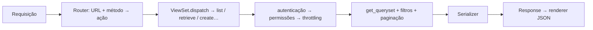

# 4. DRF: views, viewsets e routers

> ⏱️ ~1h30 · Módulo 6 · Pré-requisitos: [6.02](02-design-endpoints.md), [6.03](03-drf-serializers.md), [5.09](../05-django/09-class-based-views.md) (CBVs), [5.16](../05-django/16-carrinho.md) e [5.17](../05-django/17-pedidos-estoque-transacao.md) (serviços)

> ✅ **Verificação.** Código executado em 2026-11-08 num laboratório com Django 5.2.19 e DRF 3.18.3 (SQLite; modelos e serviços do MiniShop; seed de 64 produtos; cliente de teste `APIClient`). As saídas são as reais, com a URL curta e os JSONs cortados quando longos.

## 🎯 Objetivos
Ao final desta aula você consegue:
- Escrever a mesma API em quatro níveis (`@api_view`, `APIView`, views genéricas, `ViewSet`) e escolher o nível certo
- Usar `ModelViewSet`/`ReadOnlyModelViewSet` e `DefaultRouter` para gerar as rotas do contrato
- Preparar o `get_queryset()` (N+1, escopo por usuário) e `get_serializer_class()` por ação
- Criar **ações extras** (`@action`) como `POST /orders/{id}/cancel/`
- Ligar a API aos **serviços** das aulas 5.16 e 5.17 sem duplicar regra de negócio

## 🤔 Por que isso importa
O DRF existe para você **não reescrever** o mesmo CRUD em cada recurso. Entender os níveis de abstração evita dois erros opostos: usar `ModelViewSet` para tudo (e esconder regras num lugar errado) ou escrever `APIView` à mão para tudo (e repetir 100 linhas). Em code review você ouvirá “isso é um `ListAPIView`” ou “essa ação não é CRUD, vira `@action`”.

## 💡 Intuição (explicação simples)
Pense em **montar um móvel**. Você pode cortar a madeira (`@api_view`: tudo à mão), usar peças cortadas com instruções (`APIView`: estrutura pronta, você escreve o miolo), comprar o **kit** do móvel (views genéricas: “lista” ou “detalhe” prontos) ou o **kit completo do quarto** (`ModelViewSet`: lista, cria, lê, altera, apaga). O **router** é quem distribui as peças nos lugares certos da casa (as URLs).

## 🔬 Como funciona por dentro

- **Níveis do DRF** (de baixo para cima, cada um constrói sobre o anterior):

  | Nível | Você escreve | Quando |
  |---|---|---|
  | `@api_view` | uma função por rota | endpoints simples e únicos (`/saude/`) |
  | `APIView` | um método por verbo (`get`, `post`) | lógica própria que não é CRUD (o carrinho) |
  | Genéricas (`ListAPIView`, `RetrieveUpdateDestroyAPIView`…) | `queryset` + `serializer_class` | CRUD parcial |
  | `ViewSet` / `ModelViewSet` | `queryset` + `serializer_class` (+ ações) | CRUD completo de um recurso |

- Todos devolvem `Response` (não `HttpResponse`): o **renderer** escolhe JSON (ou a API navegável do DRF) pelo cabeçalho `Accept`, e os **parsers** leem JSON, formulário ou *multipart* conforme o `Content-Type`.
- **`ModelViewSet`** = `list` + `create` + `retrieve` + `update` + `partial_update` + `destroy`. Use `mixins` para montar um subconjunto (ex.: `Create + Update + Destroy` sem listar).
- **Router.** `router.register("products", ProductViewSet)` produz `products/` (lista/criação) e `products/{pk}/` (detalhe/alteração/remoção) e as ações extras. O `DefaultRouter` também cria a raiz da API (`api-root`) e aceita o sufixo `.json`.
- **`@action(detail=True, methods=["post"])`** acrescenta uma rota ao viewset: `detail=True` → `/orders/{pk}/cancel/`; `detail=False` → `/orders/cancel-all/`.
- **Três ganchos que você usa o tempo todo:**
  - `get_queryset()`: **o que** o usuário pode ver (escopo, `select_related`, filtros).
  - `get_serializer_class()`: serializer diferente por ação (`create` × `list`).
  - `perform_create(serializer)` / `perform_update()`: efeitos na hora de salvar (`serializer.save(owner=self.request.user)`).
- **Escopo = segurança.** `get_queryset()` filtrado pelo usuário faz o pedido alheio dar **404** (não vaza que existe), a mesma defesa contra IDOR da aula 5.12.
- **A regra mora no serviço.** O `POST /orders/` chama `services.create_order(user)` (aula 5.17): a API é só mais uma “porta de entrada”, ao lado das telas HTML.
- **Status de acesso sem login.** Com `SessionAuthentication` como primeira classe, uma chamada sem credencial devolve **403** e não 401: o DRF só responde 401 quando a **primeira** classe de autenticação sabe emitir o cabeçalho `WWW-Authenticate` (o JWT da aula 06). É um detalhe que cai em entrevista.

## 🛠️ Exemplo prático
**1. A mesma listagem em quatro estilos**
```python
# apps/catalog/estilos.py
from rest_framework import generics, viewsets
from rest_framework.decorators import api_view
from rest_framework.response import Response
from rest_framework.views import APIView

from .models import Category
from .serializers import CategorySerializer


@api_view(["GET"])                                          # 1) função
def categorias_fn(request):
    return Response(CategorySerializer(Category.objects.all(), many=True).data)


class CategoriasAPIView(APIView):                           # 2) classe, você escreve o get()
    def get(self, request):
        return Response(CategorySerializer(Category.objects.all(), many=True).data)


class CategoriasGeneric(generics.ListAPIView):              # 3) view genérica: só declara o quê
    queryset = Category.objects.all()
    serializer_class = CategorySerializer


class CategoriasViewSet(viewsets.ReadOnlyModelViewSet):     # 4) viewset: lista + detalhe, rotas pelo router
    queryset = Category.objects.all()
    serializer_class = CategorySerializer
```
```python
from rest_framework.test import APIRequestFactory
from apps.catalog import estilos as e

req = APIRequestFactory().get("/x/")
r1 = e.categorias_fn(req).data
r2 = e.CategoriasAPIView.as_view()(req).data
r3 = e.CategoriasGeneric.as_view()(req).data
r4 = e.CategoriasViewSet.as_view({"get": "list"})(req).data
print("os 4 estilos devolvem o mesmo?", r1 == r2 == r3 == r4, "| itens:", len(r1))
```
```text
os 4 estilos devolvem o mesmo? True | itens: 3
```
Quatro caminhos, o mesmo resultado: o que muda é **quanto você escreve** e **quanto fica implícito**.

**2. Catálogo: viewsets**
```python
# apps/catalog/api.py
from rest_framework import viewsets

from .models import Category, Product
from .serializers import CategorySerializer, ProductSerializer


class CategoryViewSet(viewsets.ReadOnlyModelViewSet):
    queryset = Category.objects.all()
    serializer_class = CategorySerializer


class ProductViewSet(viewsets.ModelViewSet):
    queryset = Product.objects.select_related("category")        # evita N+1 na lista
    serializer_class = ProductSerializer
```

**3. Carrinho: `APIView` para a leitura e viewset parcial para os itens**
```python
# apps/cart/api.py
from rest_framework import mixins, status, viewsets
from rest_framework.exceptions import ValidationError
from rest_framework.permissions import IsAuthenticated
from rest_framework.response import Response
from rest_framework.views import APIView

from . import services
from .models import CartItem
from .serializers import AddToCartSerializer, CartItemSerializer, CartItemUpdateSerializer, CartSerializer


class CartView(APIView):
    permission_classes = [IsAuthenticated]

    def get(self, request):
        cart = services.get_cart(request.user)
        itens = cart.items.select_related("product__category").order_by("product__name")
        return Response(CartSerializer({"items": itens, "total": cart.total(), "count": cart.count()}).data)


class CartItemViewSet(mixins.CreateModelMixin, mixins.UpdateModelMixin, mixins.DestroyModelMixin, viewsets.GenericViewSet):
    permission_classes = [IsAuthenticated]
    http_method_names = ["post", "patch", "delete", "options"]

    def get_queryset(self):                                       # sempre o carrinho DO usuário
        return CartItem.objects.filter(cart__user=self.request.user).select_related("product__category")

    def get_serializer_class(self):
        return AddToCartSerializer if self.action == "create" else CartItemUpdateSerializer

    def create(self, request, *args, **kwargs):
        ser = AddToCartSerializer(data=request.data)
        ser.is_valid(raise_exception=True)
        try:
            services.add_item(request.user, ser.validated_data["product"], ser.validated_data["quantity"])
        except services.CartError as e:
            raise ValidationError({"detail": str(e)}) from e
        item = self.get_queryset().get(product_id=ser.validated_data["product"])
        return Response(CartItemSerializer(item).data, status=status.HTTP_201_CREATED, headers={"Location": f"/api/v1/cart/items/{item.pk}/"})

    def partial_update(self, request, *args, **kwargs):
        item = self.get_object()
        ser = CartItemUpdateSerializer(data=request.data)
        ser.is_valid(raise_exception=True)
        try:
            services.set_quantity(request.user, item.product_id, ser.validated_data["quantity"])
        except services.CartError as e:
            raise ValidationError({"detail": str(e)}) from e
        if ser.validated_data["quantity"] == 0:
            return Response(status=status.HTTP_204_NO_CONTENT)
        item.refresh_from_db()
        return Response(CartItemSerializer(item).data)

    def destroy(self, request, *args, **kwargs):
        item = self.get_object()
        services.remove_item(request.user, item.product_id)
        return Response(status=status.HTTP_204_NO_CONTENT)
```
`mixins.*` + `GenericViewSet` monta só o que o contrato pede (sem `list`/`retrieve` do item). `http_method_names` fecha o resto (um `PUT` devolveria `405`). Aqui `CartError` vira `ValidationError` (`400`), uma solução provisória: a aula 05 a troca por um tratamento padronizado (`422`).

**4. Pedidos: criação via serviço e ação `cancel`**
```python
# apps/orders/api.py
from rest_framework import mixins, status, viewsets
from rest_framework.decorators import action
from rest_framework.exceptions import ValidationError
from rest_framework.permissions import IsAuthenticated
from rest_framework.response import Response

from . import services
from .models import Order
from .serializers import OrderSerializer


class OrderViewSet(mixins.ListModelMixin, mixins.RetrieveModelMixin, mixins.CreateModelMixin, viewsets.GenericViewSet):
    serializer_class = OrderSerializer
    permission_classes = [IsAuthenticated]

    def get_queryset(self):
        return Order.objects.filter(user=self.request.user).prefetch_related("items__product")   # pedido alheio = 404

    def create(self, request, *args, **kwargs):
        try:
            order = services.create_order(request.user)
        except services.OrderError as e:
            raise ValidationError({"detail": str(e)}) from e
        return Response(OrderSerializer(order).data, status=status.HTTP_201_CREATED, headers={"Location": f"/api/v1/orders/{order.pk}/"})

    @action(detail=True, methods=["post"])
    def cancel(self, request, pk=None):
        self.get_object()                                         # 404 se não for do usuário
        try:
            order = services.cancel_order(request.user, pk)
        except services.OrderError as e:
            raise ValidationError({"detail": str(e)}) from e
        return Response(OrderSerializer(order).data)
```
**5. O router e as URLs**
```python
# config/api_urls.py
from django.urls import include, path
from rest_framework.routers import DefaultRouter

from apps.cart.api import CartItemViewSet, CartView
from apps.catalog.api import CategoryViewSet, ProductViewSet
from apps.orders.api import OrderViewSet

router = DefaultRouter()
router.register("products", ProductViewSet, basename="product")
router.register("categories", CategoryViewSet, basename="category")
router.register("cart/items", CartItemViewSet, basename="cart-item")
router.register("orders", OrderViewSet, basename="order")

urlpatterns = [
    path("cart/", CartView.as_view(), name="cart"),
    path("", include(router.urls)),
]
```
```python
# config/urls.py
urlpatterns = [
    path("admin/", admin.site.urls),
    path("api/v1/", include("config.api_urls")),
]
```
```python
# config/settings.py
REST_FRAMEWORK = {
    "DEFAULT_AUTHENTICATION_CLASSES": ["rest_framework.authentication.SessionAuthentication", "rest_framework.authentication.BasicAuthentication"],
    "DEFAULT_PERMISSION_CLASSES": ["rest_framework.permissions.AllowAny"],
}
```
Rotas geradas pelo router para `orders` (as demais seguem o mesmo padrão):
```text
^orders/$                    order-list
^orders/(?P<pk>[^/.]+)/$     order-detail
^orders/(?P<pk>[^/.]+)/cancel/$   order-cancel
```
**6. Percorrendo a API como um cliente** (`APIClient` no shell)
```python
import json
from rest_framework.test import APIClient
from django.contrib.auth import get_user_model

U = get_user_model()
c = APIClient()
def show(r, corpo=True):
    txt = json.dumps(r.json(), ensure_ascii=False)[:160] if corpo and r.content else ""
    print(f"{r.request['REQUEST_METHOD']:<6} {r.request['PATH_INFO']:<26} → {r.status_code} {r.get('Location','')} {txt}")
    return r

show(c.get("/api/v1/products/"), corpo=False)
r = c.get("/api/v1/products/?format=json"); print("itens na lista:", len(r.json()), "| primeiro:", r.json()[0]["sku"])
show(c.get("/api/v1/products/2/"))
show(c.get("/api/v1/products/9999/"))
show(c.delete("/api/v1/categories/1/"))
show(c.get("/api/v1/cart/"))
c.force_authenticate(U.objects.get(username="cliente"))
show(c.get("/api/v1/cart/"))
r = show(c.post("/api/v1/cart/items/", {"product": 2, "quantity": 2}, format="json"))
item_id = r.json()["id"]
show(c.post("/api/v1/cart/items/", {"product": 2, "quantity": 30}, format="json"))
show(c.patch(f"/api/v1/cart/items/{item_id}/", {"quantity": 3}, format="json"))
r = c.get("/api/v1/cart/"); print("carrinho: total", r.json()["total"], "| unidades", r.json()["count"])
r = show(c.post("/api/v1/orders/")); oid = r.json()["id"]
show(c.post("/api/v1/orders/"))
show(c.post(f"/api/v1/orders/{oid}/cancel/"))
show(c.post(f"/api/v1/orders/{oid}/cancel/"))
c.force_authenticate(U.objects.get(username="gerente"))
show(c.get(f"/api/v1/orders/{oid}/"))
```
```text
GET    /api/v1/products/          → 200  
itens na lista: 64 | primeiro: CAS-049
GET    /api/v1/products/2/        → 200  {"id": 2, "sku": "INF-002", "name": "Notebook Plus", "slug": "notebook-plus", "description": "Notebook, versão Plus.", "price": "57.30", "stock": 19, "in_stock"
GET    /api/v1/products/9999/     → 404  {"detail": "No Product matches the given query."}
DELETE /api/v1/categories/1/      → 405  {"detail": "Método \"DELETE\" não é permitido."}
GET    /api/v1/cart/              → 403  {"detail": "As credenciais de autenticação não foram fornecidas."}
GET    /api/v1/cart/              → 200  {"items": [], "total": "0.00", "count": 0}
POST   /api/v1/cart/items/        → 201 /api/v1/cart/items/1/ {"id": 1, "product": {"id": 2, "sku": "INF-002", "name": "Notebook Plus", "slug": "notebook-plus", "description": "Notebook, versão Plus.", "price": "57.30", "s
POST   /api/v1/cart/items/        → 400  {"quantity": ["Certifique-se de que este valor seja inferior ou igual a 20."]}
PATCH  /api/v1/cart/items/1/      → 200  {"id": 1, "product": {"id": 2, "sku": "INF-002", "name": "Notebook Plus", "slug": "notebook-plus", "description": "Notebook, versão Plus.", "price": "57.30", "s
carrinho: total 171.90 | unidades 3
POST   /api/v1/orders/            → 201 /api/v1/orders/1/ {"id": 1, "status": "pending", "total": "171.90", "created_at": "2026-11-08T14:18:55.606452Z", "items": [{"product": 2, "product_name": "Notebook Plus", "quanti
POST   /api/v1/orders/            → 400  {"detail": "Seu carrinho está vazio."}
POST   /api/v1/orders/1/cancel/   → 200  {"id": 1, "status": "cancelled", "total": "171.90", "created_at": "2026-11-08T14:18:55.606452Z", "items": [{"product": 2, "product_name": "Notebook Plus", "quanti
POST   /api/v1/orders/1/cancel/   → 400  {"detail": "Só é possível cancelar pedidos pendentes."}
GET    /api/v1/orders/1/          → 404  {"detail": "No Order matches the given query."}
```
Pontos para observar:
- `DELETE` em categorias → **405**: o `ReadOnlyModelViewSet` simplesmente não tem a ação.
- Sem login o carrinho devolve **403** (e não 401): como explicado acima; no JWT será 401.
- `quantity: 30` foi barrado pelo serializer (`max_value=20`) **antes** de chegar ao serviço.
- O pedido foi criado a partir do carrinho (3 × R$ 57,30 = R$ 171,90), com `201` e `Location`; repetir o `POST` encontra o carrinho vazio.
- A **gerente** recebe `404` ao consultar o pedido da cliente: o `get_queryset()` escopa por usuário (mesmo quem tem permissões amplas só vê os seus pedidos aqui).
- O texto `No Product matches the given query.` está em inglês: mensagens do Django (`Http404`) não passam pela tradução do DRF. A aula 05 padroniza as mensagens de erro.

## 🧠 Pausa para lógica
**Problema (um mini router).** Dado um viewset (classe com métodos `list`, `create`, `retrieve`…), gere a tabela `(verbo, url, método)` como o `DefaultRouter`. Ações extras marcadas por um decorador `@acao(detalhe, verbo)` entram em `/{prefixo}/{id}/{nome}/` (detalhe) ou `/{prefixo}/{nome}/`.

<details><summary>Dica</summary>
Um dicionário mapeia nome do método → (verbo, usa id). Para cada nome, <code>hasattr(viewset, nome)</code> decide se a rota existe. Para as ações extras, o decorador deixa um atributo na função e você varre <code>dir(viewset)</code>.
</details>

<details><summary>Solução comentada</summary>

```python
ROTAS_PADRAO = {                       # método do viewset -> (verbo HTTP, tem id?)
    "list": ("GET", False), "create": ("POST", False),
    "retrieve": ("GET", True), "update": ("PUT", True), "partial_update": ("PATCH", True), "destroy": ("DELETE", True),
}


def gerar_rotas(prefixo, viewset):
    rotas = []
    for acao, (verbo, com_id) in ROTAS_PADRAO.items():
        if hasattr(viewset, acao):
            rotas.append((verbo, f"/{prefixo}/{{id}}/" if com_id else f"/{prefixo}/", acao))
    for nome in dir(viewset):                                   # ações extras marcadas
        f = getattr(viewset, nome)
        if getattr(f, "_acao", None):
            detalhe, verbo = f._acao
            rotas.append((verbo, f"/{prefixo}/{{id}}/{nome}/" if detalhe else f"/{prefixo}/{nome}/", nome))
    return rotas


def acao(detalhe, verbo):
    def deco(f):
        f._acao = (detalhe, verbo)
        return f
    return deco


class PedidoViewSet:
    def list(self): ...
    def create(self): ...
    def retrieve(self): ...

    @acao(True, "POST")
    def cancel(self): ...


class CategoriaViewSet:
    def list(self): ...
    def retrieve(self): ...


for prefixo, vs in [("orders", PedidoViewSet), ("categories", CategoriaViewSet)]:
    for verbo, url, nome in gerar_rotas(prefixo, vs):
        print(f"{verbo:<6} {url:<22} → {vs.__name__}.{nome}")
```
```text
GET    /orders/               → PedidoViewSet.list
POST   /orders/               → PedidoViewSet.create
GET    /orders/{id}/          → PedidoViewSet.retrieve
POST   /orders/{id}/cancel/   → PedidoViewSet.cancel
GET    /categories/           → CategoriaViewSet.list
GET    /categories/{id}/      → CategoriaViewSet.retrieve
```
(Executado em 2026-11-08.) É a ideia do `DefaultRouter`: **convenção sobre configuração**; o viewset só declara o que sabe fazer, e o router deduz as rotas.
</details>

## ⚠️ Erros comuns e boas práticas
| Mensagem / sintoma | Causa | Solução |
|---|---|---|
| `AssertionError: 'ProductViewSet' should either include a 'queryset' attribute, or override the 'get_queryset()' method.` | Faltou `queryset`/`get_queryset` | Defina um dos dois |
| `AssertionError: 'X' should either include a 'serializer_class' attribute…` | Faltou `serializer_class` | Defina-o (ou `get_serializer_class`) |
| `404` no `router.register` com `basename` repetido | Dois registros com o mesmo `basename` | `basename` único por viewset |
| `AssertionError: basename argument not specified, and could not automatically determine the name from the viewset, as it does not have a .queryset attribute.` | `queryset` só em `get_queryset()` | Passe `basename=` |
| `403` mas “eu estou logado” | Autenticação por sessão sem CSRF no `POST` | Envie `X-CSRFToken` ou use token/JWT |
| `405 Method Not Allowed` em `PUT` | Viewset sem `UpdateModelMixin` ou `http_method_names` | Inclua o mixin / método |
| `HTTP 500: 'NoneType' object has no attribute…` no `perform_create` | `serializer.save()` sem o campo obrigatório (dono) | `serializer.save(user=self.request.user)` |
| Cada item da lista dispara consultas | `queryset` sem `select_related` | Preparar a consulta em `get_queryset()` |
| Usuário vê/edita objeto de outro | `queryset = Model.objects.all()` num recurso privado | Filtrar por `request.user` no `get_queryset()` |
| `/api/v1/products` (sem barra) → `301` | `APPEND_SLASH` do Django | Use sempre a barra final (aula 02) |

- **`get_queryset()` é segurança**, não só desempenho. Recursos privados nunca usam `Model.objects.all()` direto.
- **Fine views, fat services.** A view valida a entrada, chama o serviço e formata a saída.
- Use `ModelViewSet` para CRUD de verdade; para uma ação que não é CRUD (`cancel`), `@action`; para um endpoint “solto” (`/cart/`), `APIView`.
- Prefira expor só as ações do contrato (mixins + `GenericViewSet`) a expor um CRUD inteiro “por via das dúvidas”.
- O `api-root` e a *browsable API* ajudam no desenvolvimento; desligue o renderer navegável em produção se não quiser expô-lo (`DEFAULT_RENDERER_CLASSES`).

## 🧩 Exercícios
**1. Fixação**
(a) Qual a diferença entre `GenericViewSet` e `ModelViewSet`? (b) Para que servem `get_queryset()` e `get_serializer_class()`? (c) Por que `DELETE /categories/1/` devolveu `405`? (d) Como a ação `cancel` virou a URL `/orders/{pk}/cancel/`?

<details><summary>Solução</summary>

(a) `GenericViewSet` não traz ações; você monta com `mixins`. `ModelViewSet` já inclui as seis ações de CRUD. (b) O primeiro define quais objetos a requisição enxerga (escopo, `select_related`); o segundo escolhe o serializer por ação. (c) `CategoryViewSet` é `ReadOnlyModelViewSet`: não implementa `destroy`. (d) `@action(detail=True, methods=["post"])` registra a ação, e o router acrescenta `/{pk}/{nome_do_método}/`.
</details>

**2. Aplicação no projeto MiniShop**
Entregue as views do contrato.

Critérios de pronto:
- [ ] `ProductViewSet` (CRUD), `CategoryViewSet` (leitura), `CartView`, `CartItemViewSet` e `OrderViewSet` (com `cancel`) em `/api/v1/…`
- [ ] Todas as consultas privadas escopadas por `request.user`; pedido alheio dá `404`
- [ ] Nenhuma regra de negócio duplicada: carrinho e pedido usam `services.py`
- [ ] Listas sem N+1 (teste com `django_assert_max_num_queries`)
- [ ] `/api/v1/` mostra o `api-root` com os recursos
- [ ] Testes de rotas e status para cada recurso (200/201/204/404/405)
- [ ] Commit `feat(api): viewsets and router for v1`

<details><summary>Solução de referência (teste de rotas)</summary>

```python
import pytest
from rest_framework.test import APIClient

pytestmark = pytest.mark.django_db


@pytest.fixture
def api(cliente):
    c = APIClient()
    c.force_authenticate(cliente)
    return c


def test_categoria_nao_aceita_delete(api):
    assert api.delete("/api/v1/categories/1/").status_code == 405


def test_pedido_alheio_da_404(api, gerente, seed):
    from apps.cart import services as carrinho
    from apps.orders import services as pedidos
    carrinho.add_item(gerente, 2, 1)
    pedido = pedidos.create_order(gerente)
    assert api.get(f"/api/v1/orders/{pedido.pk}/").status_code == 404


def test_lista_de_produtos_nao_faz_n_mais_1(api, django_assert_max_num_queries):
    with django_assert_max_num_queries(3):
        assert api.get("/api/v1/products/").status_code == 200
```
</details>

**3. Desafio (opcional)**
Troque `CartItemViewSet` por **dois** endpoints de função (`@api_view`) e compare: quantas linhas, quanta coisa o DRF deixou de fazer por você (404 automático em `get_object`, `405` por `http_method_names`, browsable API). Escreva três linhas dizendo quando a abstração compensa.

## 🎤 Na entrevista
- **Qual a diferença entre `APIView`, `GenericAPIView` e `ViewSet`?** `APIView`: você escreve cada método HTTP; `GenericAPIView`: acrescenta `queryset`/`serializer_class`/`get_object()` e se combina com mixins; `ViewSet`: agrupa as ações (`list`, `retrieve`…) numa classe e delega as URLs ao router.
- **Para que serve o router?** Gerar as rotas de um viewset (lista/detalhe e ações extras) a partir de uma convenção, evitando declarar cada `path()` à mão.
- **Como você garante que um usuário só veja os próprios pedidos?** No `get_queryset()`, filtrando por `request.user`; assim o pedido alheio dá `404` e a regra vale para lista, detalhe e ações.
- **Por que sem login a API devolve 403 e não 401 em alguns casos?** Porque o DRF só envia `401` (com `WWW-Authenticate`) se a primeira classe de autenticação define o cabeçalho; `SessionAuthentication` não define, então vira `403`.

## 📚 Para ir além
- 📄 Documentação oficial: [Views (DRF)](https://www.django-rest-framework.org/api-guide/views/). `@api_view` e `APIView`.
- 📄 Documentação oficial: [Generic views](https://www.django-rest-framework.org/api-guide/generic-views/). Mixins e `GenericAPIView`.
- 📄 Documentação oficial: [ViewSets](https://www.django-rest-framework.org/api-guide/viewsets/). `ModelViewSet`, `@action`.
- 📄 Documentação oficial: [Routers](https://www.django-rest-framework.org/api-guide/routers/). `DefaultRouter` e `SimpleRouter`.
- 📄 Documentação oficial: [Tutorial 6 — ViewSets e Routers](https://www.django-rest-framework.org/tutorial/6-viewsets-and-routers/). O mesmo caminho, passo a passo.
- 📄 Documentação oficial: [Requests](https://www.django-rest-framework.org/api-guide/requests/) e [Responses](https://www.django-rest-framework.org/api-guide/responses/). `request.data`, `Response`.
- 🏋️ Prática extra: abra `/api/v1/` no navegador e explore a *browsable API*.

> Links verificados em 2026-11-08 (HTTP 200).

## ✅ Checklist da aula
- [ ] Escrevi a mesma listagem em quatro níveis e vi que o resultado é igual
- [ ] Router gerando as rotas do contrato, incluindo `/orders/{id}/cancel/`
- [ ] `get_queryset()` escopado por usuário e com `select_related`/`prefetch_related`
- [ ] Carrinho e pedido usam os serviços (sem duplicar regra)
- [ ] Entendi por que a API devolveu 403 (e não 401) sem login
