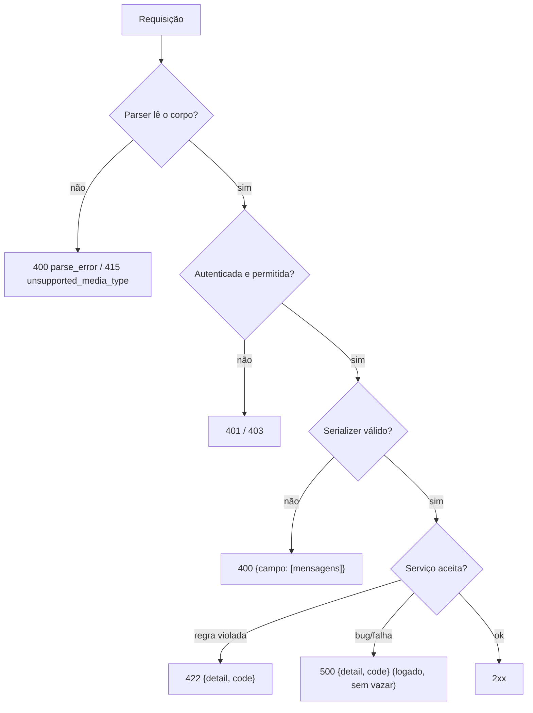

# 5. Validação e tratamento de erros padronizado

> ⏱️ ~1h30 · Módulo 6 · Pré-requisitos: [6.02](02-design-endpoints.md), [6.03](03-drf-serializers.md), [6.04](04-drf-views-viewsets-routers.md), [5.14](../05-django/14-config-env-logging.md) (logging)

> ✅ **Verificação.** Código executado em 2026-11-08 (Django 5.2.19, DRF 3.18.3, SQLite, seed de 64 produtos). As saídas são as reais; 7 testes do laboratório passaram.

## 🎯 Objetivos
Ao final desta aula você consegue:
- Distinguir **erro de validação** (400), **violação de regra de negócio** (422), **erros de protocolo** (415, 405) e **falha inesperada** (500)
- Validar entradas com serializers (campo, objeto, unicidade) e também **parâmetros de query**
- Escrever um **exception handler** que entrega um formato único de erro em toda a API
- Mapear exceções do domínio (`CartError`, `OrderError`) para respostas HTTP **sem** `try/except` nas views
- Garantir que um erro 500 volte em JSON e **não vaze** detalhes internos

## 🤔 Por que isso importa
Quem consome sua API escreve código para tratar os erros dela. Se cada endpoint erra num formato (`{"erro": ...}`, `{"detail": ...}`, uma página HTML de erro), o front-end precisa de `if`s para cada caso e o app do celular quebra. Um formato **previsível** e códigos de erro **estáveis** (`insufficient_stock`) são o que torna uma API agradável de integrar. E o erro 500 que mostra o *traceback* é uma falha de segurança.

## 💡 Intuição (explicação simples)
Pense nos **avisos do caixa eletrônico**. Se você digita um valor com letras, ele diz “valor inválido” (erro seu, corrija o campo). Se o valor é válido mas o saldo não cobre, diz “saldo insuficiente” (a regra do banco impede). Se a máquina quebra, diz “serviço indisponível, tente depois”, **sem** mostrar o circuito interno. Os três avisos têm a mesma **cara** (tela, botão “OK”), mas significados diferentes: é o que a API deve fazer.

## 🔬 Como funciona por dentro

- **400 × 422.** `400 Bad Request`: a requisição está **malformada ou os campos são inválidos** (formato, tipo, faltando). `422 Unprocessable Content`: o formato está correto, mas o **significado** viola uma regra (sem estoque, carrinho vazio). A fronteira é discutível; o que importa é **o time escolher e ser consistente** (aula 02).
- **Onde cada coisa é validada:**
  | O quê | Onde | Resultado |
  |---|---|---|
  | Tipo, tamanho, obrigatório, formato | campo do serializer | 400 por campo |
  | Unicidade (`sku`) | `UniqueValidator` (o `ModelSerializer` já põe) | 400 por campo |
  | Relação entre campos | `validate()` do serializer | 400 em `non_field_errors` ou no campo indicado |
  | Regra que depende do estado do banco e tem efeito (estoque, carrinho) | **serviço** | `DomainError` → 422 |
  | Parâmetros de query (`?ordering=`) | serializer só para validar | 400 |
- **Ordem de validação do DRF:** (1) validadores do campo → (2) `validate_<campo>` → (3) `validate()`. Atenção: **`validate()` só roda se todos os campos passaram**; por isso um erro de campo pode esconder uma regra entre campos até ser corrigido.
- **Exception handler.** O DRF captura `APIException` (e `Http404`, `PermissionDenied`) e chama a função configurada em `EXCEPTION_HANDLER`. É o **ponto único** para padronizar o formato, traduzir mensagens e converter exceções do seu domínio. Exceções que não são `APIException` e que o handler não trata sobem para o Django (resultando em 500).
- **Formato escolhido** (coerente com o contrato da aula 02):
  - erros de **campo**: `{"campo": ["mensagem", ...]}` (formato nativo do DRF);
  - **todo o resto**: `{"detail": "mensagem", "code": "codigo_estavel"}`.
  O `code` é para o **programa** decidir (mostrar um modal de “sem estoque”, por exemplo); `detail` é para a **pessoa** ler (e pode mudar de redação sem quebrar o cliente).
- **Padrão alternativo:** a RFC 9457 (*Problem Details*) define `type`, `title`, `status`, `detail`; vale conhecer, mas um formato simples e consistente já resolve a maioria dos projetos.
- **500 não vaza.** Com `DEBUG=False` o Django mostra uma página genérica; para a API devolvemos JSON genérico e registramos o *traceback* no log (aula 5.14), nunca na resposta. O `handler500` do Django é o gancho.
- **Exceções do domínio** (`CartError`, `StockError`…) nascem nos **serviços**, que não conhecem HTTP. O mapeamento para 422 fica na borda (o handler): assim o mesmo serviço serve a tela HTML, a API e tarefas assíncronas.

## 🛠️ Exemplo prático
**1. O handler e o `handler500`**
```python
# config/errors.py
import logging

from django.http import Http404, JsonResponse
from rest_framework import status
from rest_framework.exceptions import APIException, NotFound
from rest_framework.views import exception_handler as drf_exception_handler

from apps.cart.services import CartError
from apps.orders.services import EmptyCartError, OrderError, StockError

logger = logging.getLogger(__name__)


class BusinessRuleError(APIException):
    """Dados válidos, mas a regra de negócio impede a operação: 422."""
    status_code = status.HTTP_422_UNPROCESSABLE_ENTITY
    default_detail = "A operação viola uma regra de negócio."
    default_code = "business_rule"


class _NaoEncontrado(NotFound):
    default_detail = "Não encontrado."


CODIGOS = {EmptyCartError: "empty_cart", StockError: "insufficient_stock"}


def api_exception_handler(exc, context):
    """Formato único: erros de campo ficam como {"campo": [..]}; todo o resto vira {"detail", "code"}."""
    if isinstance(exc, (CartError, OrderError)):                      # exceções do domínio → 422
        codigo = next((c for tipo, c in CODIGOS.items() if isinstance(exc, tipo)), "business_rule")
        exc = BusinessRuleError(detail=str(exc), code=codigo)
    elif isinstance(exc, Http404):
        exc = _NaoEncontrado()
    response = drf_exception_handler(exc, context)
    if response is not None and isinstance(response.data, dict) and "detail" in response.data:
        detalhe = response.data["detail"]
        response.data = {"detail": str(detalhe), "code": getattr(detalhe, "code", "error")}
    return response


def json_500(request, *args, **kwargs):
    """handler500: erro inesperado também em JSON para quem chama /api/ (sem vazar detalhes)."""
    logger.exception("unhandled_error path=%s", request.path)
    if request.path.startswith("/api/"):
        return JsonResponse({"detail": "Erro interno. Tente novamente mais tarde.", "code": "server_error"}, status=500)
    from django.views.defaults import server_error
    return server_error(request, *args, **kwargs)
```
```python
# config/settings.py (dentro de REST_FRAMEWORK)
"EXCEPTION_HANDLER": "config.errors.api_exception_handler",
# config/urls.py
handler500 = "config.errors.json_500"
```
**2. As views ficam mais simples** (sem `try/except` do domínio; compare com a aula 04)
```python
# apps/orders/api.py (trechos)
def create(self, request, *args, **kwargs):
    order = services.create_order(request.user)               # StockError/EmptyCartError → 422 pelo handler
    return Response(OrderSerializer(order).data, status=status.HTTP_201_CREATED,
                    headers={"Location": f"/api/v1/orders/{order.pk}/"})

@action(detail=True, methods=["post"])
def cancel(self, request, pk=None):
    self.get_object()                                         # 404 se não for do usuário
    return Response(OrderSerializer(services.cancel_order(request.user, pk)).data)
```
O mesmo vale para `CartItemViewSet.create` e `partial_update`: chamam o serviço direto.

**3. Todos os tipos de erro, numa tabela real**
```python
import json
from unittest import mock
from rest_framework.test import APIClient
from django.contrib.auth import get_user_model
from django.test import override_settings

U = get_user_model()
c = APIClient(raise_request_exception=False)
c.force_authenticate(U.objects.get(username="cliente"))

def caso(titulo, r):
    print(f"{titulo:<34} → {r.status_code}  {json.dumps(r.json(), ensure_ascii=False)}")

caso("JSON malformado", c.post("/api/v1/cart/items/", data='{"product": 2,', content_type="application/json"))
caso("Content-Type errado", c.post("/api/v1/cart/items/", data="product=2", content_type="text/plain"))
caso("campo obrigatório ausente", c.post("/api/v1/cart/items/", {"quantity": 1}, format="json"))
caso("campo inválido (qtd=0)", c.post("/api/v1/cart/items/", {"product": 2, "quantity": 0}, format="json"))
caso("tipo errado (product='abc')", c.post("/api/v1/cart/items/", {"product": "abc"}, format="json"))
caso("produto inexistente (regra)", c.post("/api/v1/cart/items/", {"product": 9999}, format="json"))
caso("estoque insuficiente (regra)", c.post("/api/v1/cart/items/", {"product": 2, "quantity": 20}, format="json"))
caso("recurso inexistente", c.get("/api/v1/products/9999/"))
caso("método não permitido", c.delete("/api/v1/categories/1/"))
caso("pedido com carrinho vazio", c.post("/api/v1/orders/"))
c.force_authenticate(None)
caso("sem credenciais", c.get("/api/v1/cart/"))
c.force_authenticate(U.objects.get(username="cliente"))
with override_settings(DEBUG=False), mock.patch("apps.cart.services.get_cart", side_effect=RuntimeError("falha interna secreta")):
    caso("erro inesperado (500)", c.get("/api/v1/cart/"))
```
```text
JSON malformado                    → 400  {"detail": "JSON parse error - Expecting property name enclosed in double quotes: line 1 column 15 (char 14)", "code": "parse_error"}
Content-Type errado                → 415  {"detail": "Tipo de mídia \"text/plain\" não é suportado.", "code": "unsupported_media_type"}
campo obrigatório ausente          → 400  {"product": ["Este campo é obrigatório."]}
campo inválido (qtd=0)             → 400  {"quantity": ["Certifique-se de que este valor seja maior ou igual a 1."]}
tipo errado (product='abc')        → 400  {"product": ["Um número inteiro válido é exigido."]}
produto inexistente (regra)        → 422  {"detail": "Produto indisponível.", "code": "business_rule"}
estoque insuficiente (regra)       → 422  {"detail": "Estoque insuficiente: restam 19 unidade(s) de Notebook Plus.", "code": "business_rule"}
recurso inexistente                → 404  {"detail": "Não encontrado.", "code": "not_found"}
método não permitido               → 405  {"detail": "Método \"DELETE\" não é permitido.", "code": "method_not_allowed"}
pedido com carrinho vazio          → 422  {"detail": "Seu carrinho está vazio.", "code": "empty_cart"}
sem credenciais                    → 403  {"detail": "As credenciais de autenticação não foram fornecidas.", "code": "not_authenticated"}
erro inesperado (500)              → 500  {"detail": "Erro interno. Tente novamente mais tarde.", "code": "server_error"}
```
Leitura da tabela:
- **Erros de campo** (400) mantêm o formato por campo; **todos os demais** têm `detail` + `code`.
- O `404` agora está em português (antes: `No Product matches the given query.`).
- O erro **500** devolveu JSON genérico: a causa (“falha interna secreta”) não aparece na resposta, só no log.
- O `code` do estoque no **carrinho** é `business_rule`, enquanto no **pedido** é `insufficient_stock`/`empty_cart`: um bom exercício é dar códigos específicos a todas as exceções do domínio (veja o exercício 2).

**4. Unicidade, mensagens próprias e validação de parâmetros de query**
```python
from rest_framework import serializers
from apps.catalog.serializers import ProductSerializer

s = ProductSerializer(data={"sku": "INF-002", "name": "Dup", "price": "5", "category_slug": "audio"})
s.is_valid()
print("SKU duplicado →", dict(s.errors))

class FiltroSerializer(serializers.Serializer):          # valida parâmetros de query, não só o corpo
    price_min = serializers.DecimalField(max_digits=10, decimal_places=2, required=False, min_value=0)
    price_max = serializers.DecimalField(max_digits=10, decimal_places=2, required=False, min_value=0)
    ordering = serializers.ChoiceField(choices=["price", "-price", "name"], required=False,
                                       error_messages={"invalid_choice": "Ordenação inválida. Use: price, -price ou name."})

    def validate(self, a):
        if "price_min" in a and "price_max" in a and a["price_min"] > a["price_max"]:
            raise serializers.ValidationError({"price_min": "Deve ser menor ou igual a price_max."})
        return a

f = FiltroSerializer(data={"price_min": "50", "price_max": "10", "ordering": "senha"})
f.is_valid(); print("filtros inválidos →", dict(f.errors))
f = FiltroSerializer(data={"price_min": "50", "price_max": "10", "ordering": "price"})
f.is_valid(); print("só a regra entre campos →", dict(f.errors))
```
```text
SKU duplicado → {'sku': [ErrorDetail(string='product com este sku já existe.', code='unique')]}
filtros inválidos → {'ordering': [ErrorDetail(string='Ordenação inválida. Use: price, -price ou name.', code='invalid_choice')]}
só a regra entre campos → {'price_min': [ErrorDetail(string='Deve ser menor ou igual a price_max.', code='invalid')]}
```
Três lições: (1) o `UniqueValidator` veio **de graça** do `unique=True` do model (a mensagem usa o `verbose_name` do model; defina `verbose_name = "produto"` para ficar “produto com este sku já existe”); (2) com `ordering` inválido, o erro de campo **escondeu** o erro de `price_min > price_max`: `validate()` só roda quando os campos estão ok; (3) `ErrorDetail` é uma `str` com `code`, e é isso que o handler usa para o `code` da resposta.

**5. Testes do formato de erro**
```python
# tests/test_erros.py
import pytest
from unittest import mock
from rest_framework.test import APIClient

pytestmark = pytest.mark.django_db


@pytest.fixture
def api(cliente):
    c = APIClient(raise_request_exception=False)
    c.force_authenticate(cliente)
    return c


def test_regra_de_negocio_e_422_com_codigo(api):
    r = api.post("/api/v1/orders/")
    assert r.status_code == 422 and r.json() == {"detail": "Seu carrinho está vazio.", "code": "empty_cart"}


def test_validacao_e_400_por_campo(api):
    r = api.post("/api/v1/cart/items/", {"quantity": 1}, format="json")
    assert r.status_code == 400 and "product" in r.json() and "detail" not in r.json()


def test_404_em_portugues(api):
    assert api.get("/api/v1/products/9999/").json()["detail"] == "Não encontrado."


def test_toda_resposta_de_erro_tem_json(api, settings):
    settings.DEBUG = False
    with mock.patch("apps.cart.services.get_cart", side_effect=RuntimeError("segredo")):
        r = api.get("/api/v1/cart/")
    assert r.status_code == 500 and r["Content-Type"].startswith("application/json")
    assert "segredo" not in r.content.decode()                       # nunca vaza a causa interna
```
```bash
uv run pytest -q tests
```
```text
.......                                                                  [100%]
7 passed in 2.70s
```
(7 testes no total do laboratório, somando os da aula 04.) O teste do 500 usa `raise_request_exception=False`: sem isso o cliente de teste relança a exceção em vez de devolver a resposta.

## 🧠 Pausa para lógica
**Problema (achatar erros).** O front quer mostrar uma lista simples de mensagens. Escreva `achatar(erros)` que transforma o dicionário de erros do DRF (com listas e, às vezes, listas de dicionários para campos aninhados) em linhas `"caminho: mensagem"`, como `items[1].quantity: Deve ser >= 1.`

<details><summary>Dica</summary>
Recursão: dicionário → percorra as chaves acumulando o caminho com ponto; lista de strings → uma linha por mensagem; lista de dicionários → inclua o índice <code>[i]</code> no caminho.
</details>

<details><summary>Solução comentada</summary>

```python
def achatar(erros, prefixo=""):
    linhas = []
    if isinstance(erros, dict):
        for campo, valor in erros.items():
            linhas += achatar(valor, f"{prefixo}.{campo}" if prefixo else campo)
    elif isinstance(erros, list):
        if erros and all(isinstance(e, str) for e in erros):
            linhas += [f"{prefixo}: {e}" for e in erros]
        else:
            for i, item in enumerate(erros):
                linhas += achatar(item, f"{prefixo}[{i}]")
    else:
        linhas.append(f"{prefixo}: {erros}")
    return linhas


exemplo = {"sku": ["Formato inválido.", "Já existe."], "items": [{}, {"quantity": ["Deve ser >= 1."]}], "detail": "Falha geral."}
print("\n".join(achatar(exemplo)))
```
```text
sku: Formato inválido.
sku: Já existe.
items[1].quantity: Deve ser >= 1.
detail: Falha geral.
```
(Executado em 2026-11-08.) Repare que o item `{}` (sem erros) do índice 0 não gera linha.
</details>

## ⚠️ Erros comuns e boas práticas
| Mensagem / sintoma | Causa | Solução |
|---|---|---|
| Resposta de erro é uma **página HTML** | Exceção não tratada com `DEBUG=False` | `handler500` em JSON para `/api/` |
| `AttributeError: 'ErrorDetail' ...` ou `code` sempre `"error"` | Usou `str(detail)` e perdeu o `code` | `detail.code` (o `ErrorDetail` guarda o código) |
| `try/except CartError` repetido em cada view | Mapeamento no lugar errado | Converter no `EXCEPTION_HANDLER` |
| `serializer.errors` acessado antes de `is_valid()` | Ordem | `is_valid()` primeiro (ou `raise_exception=True`) |
| O cliente recebe o *traceback* | `DEBUG=True` em produção | `DEBUG=False`; `handler500`; logs no servidor |
| Cliente decide por texto da mensagem | Sem `code` estável | Use `code` para lógica, `detail` para exibição |
| `422` e `400` misturados para a mesma situação | Time sem convenção | Documente a regra no contrato (aula 02) |
| `APIClient` relança a exceção no teste | `raise_request_exception=True` (padrão) | `APIClient(raise_request_exception=False)` para testar o 500 |
| Mensagens em inglês | `LANGUAGE_CODE` ou textos de `Http404` | `pt-br` e converter `Http404` no handler |
| `except Exception: return Response(500)` em toda view | Engole o erro (sem log nem *traceback*) | Deixe subir; o `handler500` registra e responde |

- **Nunca** exponha mensagens de exceção cruas (`str(e)` de um erro de banco revela nomes de tabela).
- **Nunca** use mensagens de erro de login diferentes para “usuário não existe” e “senha errada” (aula 5.11).
- Registre (`logger.exception`) o que for 5xx; erros 4xx são do cliente e raramente merecem alerta.
- Documente os `code`s num arquivo do contrato; mudar um `code` é uma mudança **incompatível**.
- Valide **na borda** (serializer) e **no domínio** (serviço): a API não é a única porta de entrada.

## 🧩 Exercícios
**1. Fixação**
(a) Quando devolver 400 e quando 422? (b) Por que `validate()` pode “não rodar”? (c) Para que serve o `code` além do `detail`? (d) Por que o mapeamento `CartError → 422` fica no handler e não no serviço?

<details><summary>Solução</summary>

(a) 400: formato/campos inválidos ou corpo ilegível; 422: dados bem formados que violam uma regra de negócio (a convenção do projeto). (b) Só roda depois que todos os campos foram validados com sucesso. (c) O programa cliente decide o comportamento pelo `code` estável, enquanto o `detail` é texto para pessoas e pode mudar. (d) O serviço não conhece HTTP (também serve à tela e a tarefas); a tradução para status é da camada de borda.
</details>

**2. Aplicação no projeto MiniShop**
Padronize os erros da API.

Critérios de pronto:
- [ ] `api_exception_handler` ativo, com formato `{"campo": [...]}` para validação e `{"detail", "code"}` para o resto
- [ ] Exceções do domínio com `code` próprio (`product_unavailable`, `insufficient_stock`, `quantity_limit`, `empty_cart`, `order_not_pending`…); views sem `try/except`
- [ ] `handler500` em JSON, com *traceback* só no log
- [ ] Validação de parâmetros de query com serializer na listagem de produtos (aula 08 retomará)
- [ ] Tabela de erros no `docs/api-contrato.md`: situação, status, exemplo de corpo e `code`
- [ ] Testes: um por tipo de erro (400, 404, 405, 415, 422, 500) conferindo o corpo
- [ ] Commit `feat(api): standardized error format and exception handler`

<details><summary>Solução de referência (códigos no domínio)</summary>

```python
# apps/cart/services.py
class CartError(Exception):
    code = "cart_error"


class ProductUnavailable(CartError):
    code = "product_unavailable"


class QuantityLimit(CartError):
    code = "quantity_limit"

# no handler: codigo = getattr(exc, "code", "business_rule")
# nos serviços: raise ProductUnavailable("Produto indisponível.")
```
Com um atributo `code` na exceção, o handler deixa de precisar de um dicionário: `BusinessRuleError(detail=str(exc), code=exc.code)`.
</details>

**3. Desafio (opcional)**
Troque o formato pelo da **RFC 9457** (`type`, `title`, `status`, `detail`, mais `errors` para campos) usando `application/problem+json`. Escreva o handler, atualize os testes e discuta o que ganhou e o que custou para o front.

## 🎤 Na entrevista
- **Como você padroniza erros numa API DRF?** Com um `EXCEPTION_HANDLER` próprio que converte exceções (inclusive as do domínio) para um formato único, mantendo erros de campo por campo e o restante como `detail` + `code`; mais um `handler500` em JSON que não vaza detalhes.
- **Qual a diferença entre 400 e 422?** 400: requisição malformada ou campos inválidos; 422: dados válidos no formato, mas rejeitados por regra de negócio. O essencial é a consistência documentada.
- **Onde fica a validação: serializer, model ou serviço?** Formato e consistência dos dados no serializer; integridade que não pode falhar nunca nas constraints do banco/model; regras que dependem do estado e têm efeito (estoque) no serviço. Cada camada protege o que conhece.
- **O que não pode aparecer numa resposta 500?** *Traceback*, mensagens de exceção cruas, SQL, caminhos de arquivos, versões; isso vai para o log, e o cliente recebe uma mensagem genérica.

## 📚 Para ir além
- 📄 Documentação oficial: [Exceptions (DRF)](https://www.django-rest-framework.org/api-guide/exceptions/). `APIException`, handler customizado e códigos.
- 📄 Documentação oficial: [Validators (DRF)](https://www.django-rest-framework.org/api-guide/validators/). Validadores de unicidade e personalizados.
- 📄 Documentação oficial: [Customizing error views (Django)](https://docs.djangoproject.com/en/5.2/topics/http/views/#customizing-error-views). `handler404/500`.
- 📄 Especificação: [RFC 9457 — Problem Details for HTTP APIs](https://www.rfc-editor.org/rfc/rfc9457). Um padrão para corpo de erro.
- 📄 Referência: [Códigos de status HTTP (MDN)](https://developer.mozilla.org/pt-BR/docs/Web/HTTP/Reference/Status). Para decidir entre 400, 409, 422.
- 🏋️ Prática extra: provoque cada erro da tabela com `curl` contra o `runserver` e confira o `Content-Type` de cada resposta.

> Links verificados em 2026-11-08 (HTTP 200).

## ✅ Checklist da aula
- [ ] Sei distinguir 400, 422, 404, 405, 415 e 500 e dar um exemplo de cada
- [ ] Handler único converte as exceções do domínio em 422 com `code`
- [ ] Erros de campo continuam por campo; o resto tem `detail` + `code`
- [ ] `handler500` devolve JSON sem vazar detalhes
- [ ] Testes cobrem cada tipo de erro
