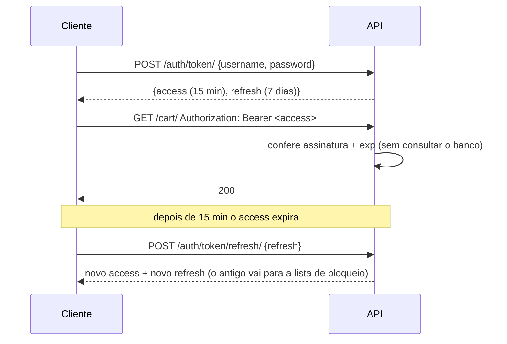

# 6. Autenticação por token/JWT

> ⏱️ ~1h30 · Módulo 6 · Pré-requisitos: [6.01](01-principios-rest.md) (stateless), [6.04](04-drf-views-viewsets-routers.md), [5.11](../05-django/11-autenticacao.md) (senhas, sessões, autenticação × autorização); noções de Base64 e HMAC

> ✅ **Verificação.** Código executado em 2026-11-08 (Python 3.13, Django 5.2.19, DRF 3.18.3, djangorestframework-simplejwt 5.5.1, SQLite). As saídas são as reais.

## 🎯 Objetivos
Ao final desta aula você consegue:
- Explicar por que uma API *stateless* usa **tokens** em vez de sessão, e como um **JWT** é montado (cabeçalho, *payload*, assinatura)
- Configurar o `simplejwt` com tokens de **acesso curto** e **refresh com rotação e lista de bloqueio**
- Implementar login, uso do `Authorization: Bearer`, renovação e logout
- Reconhecer o que o JWT **não** garante (não é criptografado; difícil de revogar) e as práticas seguras
- Entender por que sem credencial o DRF passa a responder **401** (e não 403)

## 🤔 Por que isso importa
A sessão da aula 5.11 funciona bem para o navegador do mesmo site, mas um app de celular, um front em outro domínio e outros sistemas precisam de uma credencial que viaje no **cabeçalho** e que qualquer servidor valide sem consultar uma tabela de sessões. Autenticação mal feita é a falha mais cara; ao mesmo tempo, JWT é cercado de mitos (“é seguro porque é criptografado”: não é). Entrevistas perguntam as duas coisas.

## 💡 Intuição (explicação simples)
Pense num **ingresso de show com holograma**. Na bilheteria (login) você prova quem é e recebe um ingresso **assinado**: ele diz seu nome e até quando vale. Na porta, o segurança não liga para a bilheteria: só confere se o holograma (a assinatura) é verdadeiro e se não venceu. Qualquer segurança de qualquer porta faz a mesma conferência (escala sem estado compartilhado). Mas há dois cuidados: o texto do ingresso é **legível** por quem o segurar (não é um cofre), e se você o perder, ele vale até vencer. Por isso o ingresso do dia tem validade **curta** e há um segundo papel (o *refresh*), guardado com mais cuidado, para trocar por um novo.

## 🔬 Como funciona por dentro

- **JWT (JSON Web Token)** são três partes em Base64URL separadas por ponto: `cabeçalho.payload.assinatura`.
  - *Cabeçalho*: algoritmo e tipo (`{"alg":"HS256","typ":"JWT"}`).
  - *Payload*: as **claims**: `user_id`, `exp` (expira), `iat` (emitido em), `jti` (id do token), `token_type`.
  - *Assinatura*: `HMAC-SHA256(cabeçalho.payload, SECRET_KEY)`. Quem não tem a chave não consegue forjar nem alterar o payload sem invalidar a assinatura.
- **Assinado ≠ criptografado.** Qualquer pessoa decodifica o payload (você verá no exemplo). **Nunca** ponha senha, CPF ou dados sensíveis nas claims.
- **Dois tokens:** o **access** (curto, vai em toda requisição; se vazar, o estrago dura minutos) e o **refresh** (longo, usado só para pedir novos access; fica guardado com mais cuidado).
- **Rotação do refresh + lista de bloqueio (*blacklist*).** Cada refresh gera um refresh **novo** e coloca o antigo na lista; se alguém reusar um refresh antigo (sinal de roubo), é rejeitado. O **logout** também põe o refresh na lista. Isso reintroduz um pouco de estado (uma tabela), apenas para os refresh, preservando o access *stateless*.
- **Revogação é o ponto fraco do JWT.** O access é válido até `exp` mesmo após o logout, pois o servidor não consulta nada. Por isso: validade curta (minutos), HTTPS e, se precisar de revogação imediata, uma lista de bloqueio também para o access ou sessões opacas. É um *trade-off*, não uma falha do `simplejwt`.
- **Onde o cliente guarda os tokens?** `localStorage` é legível por qualquer JavaScript da página (um XSS rouba os tokens). *Cookies* `HttpOnly` evitam isso, mas trazem CSRF de volta. Em apps nativos, o armazenamento seguro do sistema. A aula 14 mostra a escolha feita no front do curso e o módulo 9 (segurança) aprofunda.
- **Chave de assinatura.** O `simplejwt` assina com a `SECRET_KEY` do Django (HS256). Ela precisa ser **longa e secreta** (≥ 32 bytes); a biblioteca avisa se não for. Quem vaza a `SECRET_KEY` forja tokens de qualquer usuário.
- **401 × 403.** Com `JWTAuthentication` como primeira classe, uma chamada sem credencial devolve **401** com o cabeçalho `WWW-Authenticate: Bearer realm="api"` (a classe sabe emitir o cabeçalho; compare com a aula 04).
- **Alternativas:** *token opaco* do DRF (`rest_framework.authtoken`; uma linha no banco por token, revogável na hora), OAuth2/OIDC (login com terceiros) e sessão + cookie (SPA do mesmo domínio). Para uma API pública com apps, JWT de acesso curto + refresh é um meio-termo comum.

## 🛠️ Exemplo prático
**1. Instalação e configuração**
```bash
uv add djangorestframework-simplejwt
```
```python
# config/settings.py
from datetime import timedelta

INSTALLED_APPS += ["rest_framework_simplejwt", "rest_framework_simplejwt.token_blacklist"]

REST_FRAMEWORK = {
    "DEFAULT_AUTHENTICATION_CLASSES": ["rest_framework_simplejwt.authentication.JWTAuthentication"],
    "DEFAULT_PERMISSION_CLASSES": ["rest_framework.permissions.AllowAny"],     # as permissões vêm na aula 07
    "EXCEPTION_HANDLER": "config.errors.api_exception_handler",
}

SIMPLE_JWT = {
    "ACCESS_TOKEN_LIFETIME": timedelta(minutes=15),
    "REFRESH_TOKEN_LIFETIME": timedelta(days=7),
    "ROTATE_REFRESH_TOKENS": True,          # cada refresh devolve um refresh NOVO...
    "BLACKLIST_AFTER_ROTATION": True,       # ...e o antigo deixa de valer
    "AUTH_HEADER_TYPES": ("Bearer",),
    "UPDATE_LAST_LOGIN": True,
}
```
```python
# config/api_urls.py (acrescentar)
from rest_framework_simplejwt.views import TokenBlacklistView, TokenObtainPairView, TokenRefreshView

urlpatterns = [
    path("auth/token/", TokenObtainPairView.as_view(), name="token"),
    path("auth/token/refresh/", TokenRefreshView.as_view(), name="token-refresh"),
    path("auth/logout/", TokenBlacklistView.as_view(), name="logout"),
    ...
]
```
```bash
uv run python manage.py migrate        # cria as tabelas da lista de bloqueio
```
Em produção, `SECRET_KEY` vem do ambiente e tem 50+ caracteres (aula 5.14). Em tempo de execução o `simplejwt` (via PyJWT) emite `InsecureKeyLengthWarning` se a chave for curta: o laboratório usou uma chave de 19 bytes de propósito e a viu.

**2. O ciclo completo (executado)**
```python
import base64, json
from rest_framework.test import APIClient
from django.contrib.auth import get_user_model
from rest_framework_simplejwt.tokens import AccessToken

U = get_user_model()
c = APIClient()
def corpo(r):
    return json.dumps(r.json(), ensure_ascii=False)[:140]

print("--- 1) login")
r = c.post("/api/v1/auth/token/", {"username": "cliente", "password": "dev-somente-local-123"}, format="json")
tok = r.json()
print(r.status_code, "chaves:", list(tok), "| access:", len(tok["access"]), "chars | refresh:", len(tok["refresh"]), "chars")

print("\n--- 2) o token NÃO é criptografado: qualquer um lê o conteúdo")
def decodificar(parte):
    return json.loads(base64.urlsafe_b64decode(parte + "=" * (-len(parte) % 4)))
h, p, s = tok["access"].split(".")
print("cabeçalho:", decodificar(h)); print("payload  :", decodificar(p)); print("assinatura:", s[:20] + "…")

print("\n--- 3) usando o access no cabeçalho")
r = c.get("/api/v1/cart/"); print("sem cabeçalho  →", r.status_code, corpo(r), "| WWW-Authenticate:", r.get("WWW-Authenticate"))
c.credentials(HTTP_AUTHORIZATION="Bearer " + tok["access"]); r = c.get("/api/v1/cart/"); print("com Bearer     →", r.status_code, corpo(r))
c.credentials(HTTP_AUTHORIZATION="Bearer " + tok["access"][:-3] + "abc"); r = c.get("/api/v1/cart/"); print("assinatura adulterada →", r.status_code, corpo(r))
c.credentials(HTTP_AUTHORIZATION="Token " + tok["access"]); r = c.get("/api/v1/cart/"); print("prefixo errado (Token) →", r.status_code)

print("\n--- 4) token expirado")
exp = AccessToken.for_user(U.objects.get(username="cliente")); exp.set_exp(lifetime=__import__("datetime").timedelta(seconds=-5))
c.credentials(HTTP_AUTHORIZATION="Bearer " + str(exp)); r = c.get("/api/v1/cart/"); print(r.status_code, corpo(r))

print("\n--- 5) refresh com rotação")
c.credentials()
r1 = c.post("/api/v1/auth/token/refresh/", {"refresh": tok["refresh"]}, format="json"); print("1º refresh →", r1.status_code, list(r1.json()))
r2 = c.post("/api/v1/auth/token/refresh/", {"refresh": tok["refresh"]}, format="json"); print("reuso do refresh antigo →", r2.status_code, corpo(r2))
novo = r1.json()

print("\n--- 6) logout (invalida o refresh)")
r = c.post("/api/v1/auth/logout/", {"refresh": novo["refresh"]}, format="json"); print("logout →", r.status_code, r.json())
r = c.post("/api/v1/auth/token/refresh/", {"refresh": novo["refresh"]}, format="json"); print("refresh após logout →", r.status_code)
c.credentials(HTTP_AUTHORIZATION="Bearer " + novo["access"]); print("o access ainda vale até expirar →", c.get("/api/v1/cart/").status_code)

print("\n--- 7) credenciais ruins")
c.credentials()
print("senha errada  →", c.post("/api/v1/auth/token/", {"username": "cliente", "password": "x"}, format="json").status_code, corpo(c.post("/api/v1/auth/token/", {"username": "cliente", "password": "x"}, format="json")))
print("usuário inexistente →", corpo(c.post("/api/v1/auth/token/", {"username": "fantasma", "password": "x"}, format="json")))
U.objects.filter(username="estoquista").update(is_active=False)
print("usuário inativo →", c.post("/api/v1/auth/token/", {"username": "estoquista", "password": "dev-somente-local-123"}, format="json").status_code)
```
```text
--- 1) login
200 chaves: ['refresh', 'access'] | access: 231 chars | refresh: 232 chars

--- 2) o token NÃO é criptografado: qualquer um lê o conteúdo
cabeçalho: {'alg': 'HS256', 'typ': 'JWT'}
payload  : {'token_type': 'access', 'exp': 1794148665, 'iat': 1794147765, 'jti': 'ccf9fc13c7684043bb2e08a1b42095cf', 'user_id': '3'}
assinatura: wTC0RFsqYUbWuagrk1i7…

--- 3) usando o access no cabeçalho
sem cabeçalho  → 401 {"detail": "As credenciais de autenticação não foram fornecidas.", "code": "not_authenticated"} | WWW-Authenticate: Bearer realm="api"
com Bearer     → 200 {"items": [], "total": "0.00", "count": 0}
assinatura adulterada → 401 {"detail": "O token informado não é válido para qualquer tipo de token", "code": "token_not_valid"}
prefixo errado (Token) → 401

--- 4) token expirado
401 {"detail": "O token informado não é válido para qualquer tipo de token", "code": "token_not_valid"}

--- 5) refresh com rotação
1º refresh → 200 ['access', 'refresh']
reuso do refresh antigo → 401 {"detail": "Token está na blacklist", "code": "token_not_valid"}

--- 6) logout (invalida o refresh)
logout → 200 {}
refresh após logout → 401
o access ainda vale até expirar → 200

--- 7) credenciais ruins
senha errada  → 401 {"detail": "Usuário e/ou senha incorreto(s)", "code": "no_active_account"}
usuário inexistente → {"detail": "Usuário e/ou senha incorreto(s)", "code": "no_active_account"}
usuário inativo → 401
```
Leia assim:
- **(2)** O payload mostra `user_id`, `exp`, `iat` e `jti` em texto claro: JWT **assinado, não secreto**. Os valores de `exp`/`iat` são *timestamps* Unix (segundos desde 1970-01-01 UTC).
- **(3)** Agora a chamada sem token devolve **401** com `WWW-Authenticate: Bearer realm="api"` (na aula 04 era 403). Assinatura adulterada, prefixo errado e token vencido dão todos **401**: o cliente deve, ao receber 401 com `token_not_valid`, tentar o *refresh* uma vez e, se falhar, mandar o usuário ao login.
- **(5)** A **rotação** funciona: reusar o refresh antigo é rejeitado (“Token está na blacklist”).
- **(6)** Depois do logout o refresh morre, mas o **access continua válido** até expirar: a limitação de revogação do JWT.
- **(7)** A mesma mensagem para senha errada e para usuário inexistente (sem enumeração de usuários, como na aula 5.11); o usuário inativo também não consegue token.
- O formato de erro é o **padronizado** na aula 05 (`detail` + `code`), inclusive nos erros do `simplejwt`, porque passam pelo mesmo `EXCEPTION_HANDLER`.

**3. Chamando com `curl` contra o `runserver`** (executado: `uv run python manage.py runserver 8131 --noreload`)
```bash
TOKENS=$(curl -s -X POST http://127.0.0.1:8131/api/v1/auth/token/ \
  -H "Content-Type: application/json" \
  -d '{"username":"cliente","password":"dev-somente-local-123"}')
ACCESS=$(echo "$TOKENS" | python3 -c "import sys,json; print(json.load(sys.stdin)['access'])")
curl -s http://127.0.0.1:8131/api/v1/cart/ -H "Authorization: Bearer $ACCESS"; echo
curl -s -i http://127.0.0.1:8131/api/v1/cart/ | tr -d '\r' | grep -iE "^(HTTP|WWW-Auth|Content-Type)|detail"
```
```text
{"items":[],"total":"0.00","count":0}
HTTP/1.1 401 Unauthorized
Content-Type: application/json
WWW-Authenticate: Bearer realm="api"
{"detail":"As credenciais de autenticação não foram fornecidas.","code":"not_authenticated"}
```
O mesmo comportamento do cliente de teste, agora pela rede de verdade: com o Bearer, `200`; sem ele, `401` + `WWW-Authenticate`.

## 🧠 Pausa para lógica
**Problema (um JWT na mão).** Com a biblioteca padrão (`hmac`, `hashlib`, `base64`, `json`), implemente `assinar(payload, chave)` e `verificar(token, chave)` para HS256: Base64URL **sem** `=`, expiração (`exp`), comparação da assinatura em **tempo constante** e rejeição de um cabeçalho com `alg` diferente de `HS256` (o ataque `alg: none`).

<details><summary>Dica</summary>
<code>base64.urlsafe_b64encode(...).rstrip(b"=")</code> para codificar e reponha o preenchimento ao decodificar. Assine <code>f"{cabecalho}.{payload}"</code> com <code>hmac.new(chave, msg, hashlib.sha256)</code> e compare com <code>hmac.compare_digest</code>.
</details>

<details><summary>Solução comentada</summary>

```python
import base64, hashlib, hmac, json, time


def b64(dados: bytes) -> str:
    return base64.urlsafe_b64encode(dados).rstrip(b"=").decode()


def desb64(texto: str) -> bytes:
    return base64.urlsafe_b64decode(texto + "=" * (-len(texto) % 4))


def assinar(payload, chave, validade=900, agora=None):
    agora = int(agora if agora is not None else time.time())
    payload = {**payload, "iat": agora, "exp": agora + validade}
    cab = b64(json.dumps({"alg": "HS256", "typ": "JWT"}, separators=(",", ":")).encode())
    corpo = b64(json.dumps(payload, separators=(",", ":")).encode())
    sig = b64(hmac.new(chave, f"{cab}.{corpo}".encode(), hashlib.sha256).digest())
    return f"{cab}.{corpo}.{sig}"


def verificar(token, chave, agora=None):
    try:
        cab, corpo, sig = token.split(".")
    except ValueError:
        raise ValueError("formato inválido")
    if json.loads(desb64(cab)).get("alg") != "HS256":                       # nunca aceite o 'alg' que o token escolhe
        raise ValueError("algoritmo não permitido")
    esperado = b64(hmac.new(chave, f"{cab}.{corpo}".encode(), hashlib.sha256).digest())
    if not hmac.compare_digest(esperado, sig):                              # tempo constante
        raise ValueError("assinatura inválida")
    payload = json.loads(desb64(corpo))
    if payload["exp"] <= int(agora if agora is not None else time.time()):
        raise ValueError("token expirado")
    return payload
```
```python
CHAVE = b"uma-chave-longa-e-aleatoria-com-32+-bytes"
t = assinar({"user_id": 3}, CHAVE, agora=1_000_000)
print("válido    :", verificar(t, CHAVE, agora=1_000_100))
# expirado, adulterado, chave errada e alg=none são rejeitados
```
```text
token: eyJhbGciOiJIUzI1NiIsInR5cCI6IkpXVCJ9.eyJ…
válido    : {'user_id': 3, 'iat': 1000000, 'exp': 1000900}
expirado  : token expirado
adulterado: assinatura inválida
chave errada: assinatura inválida
alg=none  : algoritmo não permitido
```
(Executado em 2026-11-08, com um script que testa os quatro casos de rejeição.) Isto é o que a biblioteca faz por você, mais cuidados que um iniciante esqueceria. **Em produção use `simplejwt`/PyJWT**; escrever criptografia própria é o erro que a aula 5.11 mandou evitar. O valor da implementação à mão é entender que não há mágica: é uma assinatura sobre um texto.
</details>

## ⚠️ Erros comuns e boas práticas
| Mensagem / sintoma | Causa | Solução |
|---|---|---|
| `401 "Authentication credentials were not provided"` | Faltou `Authorization` | `Authorization: Bearer <access>` |
| `401 token_not_valid` | Token expirado, adulterado ou prefixo errado | Renovar com o refresh; conferir `Bearer ` |
| `401 "Token está na blacklist"` | Refresh já usado/encerrado | Fazer login novamente |
| `no such table: token_blacklist_outstandingtoken` | Esqueceu o `migrate` do app de blacklist | `migrate` |
| `InsecureKeyLengthWarning: The HMAC key is N bytes long…` | `SECRET_KEY` curta | Chave de 50+ caracteres vinda do ambiente |
| Logout “não derruba” o acesso | O access segue válido até `exp` | Validade curta; blacklist de access só se precisar |
| Senha ou dado pessoal nas claims | JWT é legível | Só identificadores; sem dados sensíveis |
| Aceitar `alg: none` ou `alg` do token | Validação própria insegura | Usar biblioteca madura e fixar o algoritmo |
| Token na URL (`?token=…`) | Vai para logs e histórico | Sempre no cabeçalho |
| `localStorage` com tokens e XSS no site | JS malicioso lê tudo | Evitar XSS (aula 4.05), CSP; considerar cookie `HttpOnly` |
| Login sem limite de tentativas | Força bruta | Throttling (aula 09) |

- Access de **minutos**, refresh de **dias**, rotação ligada.
- **HTTPS sempre**: o Bearer token vale como senha enquanto não expira.
- Não confunda: o JWT autentica (“quem”); **quem pode o quê** continua sendo a autorização (aula 07).
- Para desligar uma conta na hora, `is_active=False` impede novos tokens e novos refresh (o access já emitido vale até expirar; por isso a validade é curta).
- Não guarde sessão **e** JWT para o mesmo fluxo sem necessidade: escolha um mecanismo por cliente.

## 🧩 Exercícios
**1. Fixação**
(a) O JWT é criptografado? O que impede alguém de alterar o `user_id`? (b) Por que dois tokens (access e refresh)? (c) O que a rotação do refresh protege? (d) Por que o logout não invalida o access?

<details><summary>Solução</summary>

(a) Não: é só Base64URL, legível por todos. A **assinatura** (HMAC com a chave secreta) quebra se o payload mudar. (b) O access, curto, trafega o tempo todo e limita o estrago se vazar; o refresh, longo, é usado raramente para obter novos access. (c) Detecta e bloqueia o reuso de um refresh roubado (o antigo vai para a lista de bloqueio). (d) O servidor valida o access só pela assinatura e `exp`, sem consultar estado; revogação imediata exigiria consultar uma lista a cada requisição.
</details>

**2. Aplicação no projeto MiniShop**
Proteja a API com JWT.

Critérios de pronto:
- [ ] `simplejwt` configurado (15 min / 7 dias / rotação / blacklist) e migrações aplicadas
- [ ] Rotas `auth/token/`, `auth/token/refresh/` e `auth/logout/` no contrato, com exemplos de requisição e resposta
- [ ] Sem credencial, o carrinho e os pedidos devolvem **401** com `WWW-Authenticate`
- [ ] Endpoint `GET /api/v1/auth/me/` (autenticado) com `id`, `username` e `email` (e nada mais)
- [ ] Testes: login, uso do token, token adulterado, expirado, refresh com reuso rejeitado, logout e usuário inativo
- [ ] `SECRET_KEY` longa vinda do ambiente (sem `InsecureKeyLengthWarning`)
- [ ] Commit `feat(api): JWT authentication with refresh rotation`

<details><summary>Solução de referência (me)</summary>

```python
# apps/accounts/api.py
from rest_framework import serializers
from rest_framework.permissions import IsAuthenticated
from rest_framework.response import Response
from rest_framework.views import APIView


class MeSerializer(serializers.Serializer):
    id = serializers.IntegerField()
    username = serializers.CharField()
    email = serializers.EmailField()


class MeView(APIView):
    permission_classes = [IsAuthenticated]

    def get(self, request):
        return Response(MeSerializer(request.user).data)

# config/api_urls.py: path("auth/me/", MeView.as_view(), name="me")
```
```python
def test_token_expirado_da_401(api_anonimo, cliente):
    from datetime import timedelta
    from rest_framework_simplejwt.tokens import AccessToken
    t = AccessToken.for_user(cliente)
    t.set_exp(lifetime=timedelta(seconds=-1))
    api_anonimo.credentials(HTTP_AUTHORIZATION=f"Bearer {t}")
    assert api_anonimo.get("/api/v1/cart/").status_code == 401
```
</details>

**3. Desafio (opcional)**
Registre o `jti` do access em uma lista de bloqueio no Redis (ou, por enquanto, numa tabela) e confira-o em uma classe `JWTAuthentication` customizada, permitindo logout **imediato**. Meça o custo (uma consulta por requisição) e discuta se ainda vale chamar de *stateless*.

## 🎤 Na entrevista
- **O que é um JWT e como funciona a assinatura?** Um token com três partes em Base64URL (cabeçalho, claims, assinatura); a assinatura é um HMAC (ou assinatura assimétrica) sobre as duas primeiras partes com uma chave secreta, então qualquer alteração invalida o token. É assinado, **não** criptografado.
- **Por que usar access e refresh?** O access de vida curta limita o impacto do vazamento; o refresh de vida longa gera novos access. A rotação com lista de bloqueio detecta reuso de refresh roubado.
- **Quais os riscos do JWT e como mitigar?** Roubo (use HTTPS, validade curta, evite XSS), dificuldade de revogar (validade curta, blacklist), dados sensíveis nas claims (nunca), algoritmo e chave fracos (fixar o algoritmo, chave longa e secreta).
- **Sessão ou token numa API?** Sessão + cookie combina com o mesmo domínio e navegador; token no cabeçalho serve a apps móveis, outros domínios e serviços, e permite escalar sem estado compartilhado.

## 📚 Para ir além
- 📄 Documentação oficial: [Authentication (DRF)](https://www.django-rest-framework.org/api-guide/authentication/). Classes de autenticação e `WWW-Authenticate`.
- 📄 Documentação: [Simple JWT](https://django-rest-framework-simplejwt.readthedocs.io/). Configurações (`SIMPLE_JWT`), blacklist e rotação.
- 📄 Especificação: [RFC 7519 — JSON Web Token](https://www.rfc-editor.org/rfc/rfc7519). As claims `exp`, `iat`, `jti` etc.
- 📄 Referência: [jwt.io — Introdução](https://jwt.io/introduction). Visualizador e explicação das três partes.
- 📑 Artigo/tutorial: [OWASP — JSON Web Token Cheat Sheet](https://cheatsheetseries.owasp.org/cheatsheets/JSON_Web_Token_Cheat_Sheet.html). Ataques e defesas comuns em JWT (em inglês).
- 📄 Referência: [Authorization (MDN)](https://developer.mozilla.org/pt-BR/docs/Web/HTTP/Reference/Headers/Authorization). O esquema `Bearer`.
- 🏋️ Prática extra: cole um access token em jwt.io e compare o payload com o que você decodificou; depois altere uma letra e veja a assinatura quebrar.

> Links verificados em 2026-11-08 (HTTP 200).

## ✅ Checklist da aula
- [ ] Decodifiquei um JWT e entendi por que não é secreto
- [ ] Login, uso do Bearer, refresh com rotação e logout funcionando
- [ ] Sem credencial = 401 com `WWW-Authenticate` (e entendi o porquê)
- [ ] Sei o que o JWT não resolve (revogação imediata) e como mitigar
- [ ] `SECRET_KEY` longa, no ambiente, e HTTPS como regra
