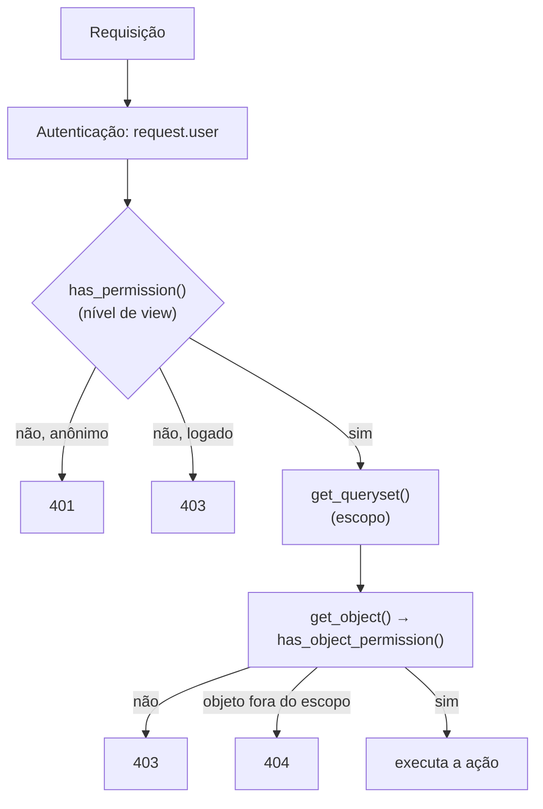

# 7. Permissões

> ⏱️ ~1h30 · Módulo 6 · Pré-requisitos: [6.04](04-drf-views-viewsets-routers.md), [6.05](05-validacao-erros.md), [6.06](06-autenticacao-token-jwt.md), [5.12](../05-django/12-permissoes.md) (grupos, permissões, IDOR)

> ✅ **Verificação.** Código executado em 2026-11-08 (Python 3.13, Django 5.2.19, DRF 3.18.3, simplejwt 5.5.1, SQLite). As matrizes de resultado abaixo são as reais; os 21 testes do laboratório passaram.

## 🎯 Objetivos
Ao final desta aula você consegue:
- Aplicar a política **“negar por padrão”** (`IsAuthenticated` global) e abrir exceções explícitas
- Usar `IsAuthenticatedOrReadOnly`, `DjangoModelPermissions` e as permissões por **grupo** da aula 5.12 na API
- Escrever uma permissão própria com `has_permission` (nível de **view**) e `has_object_permission` (nível de **objeto**)
- Distinguir **escopo por `queryset`** (404) de **permissão de objeto** (403) e escolher entre os dois
- Provar a política com uma **matriz de testes** papel × ação

## 🤔 Por que isso importa
Autenticar diz quem é; **autorizar** diz o que pode. Na API, cada rota é uma porta para o banco. *Broken Access Control* é a falha nº 1 da OWASP, e numa API ela costuma ser **a rota esquecida**: um `DELETE` que ninguém protegeu, um id alheio aceito. Como júnior, você será cobrado a mostrar, para cada endpoint, **quem pode** e **o teste que prova**.

## 💡 Intuição (explicação simples)
Voltando ao **prédio com crachás** (aula 5.12): o crachá (JWT) identifica a pessoa. Agora há três tipos de controle: a **catraca da portaria** (`IsAuthenticated`: entra quem tem crachá válido), a **chave da sala** (`DjangoModelPermissions`: só quem tem o cargo “Gerente” abre a sala de cadastro) e a **gaveta pessoal** (`IsOwner`: mesmo dentro da sala, você só abre a sua gaveta). E a regra de ouro do prédio: **toda porta fica trancada por padrão**; só se destranca quando alguém decide.

## 🔬 Como funciona por dentro

- **Duas perguntas, em momentos diferentes.** `has_permission(request, view)` roda **antes** da ação (vale para lista e criação). `has_object_permission(request, view, obj)` roda só quando a view chama `self.get_object()` (detalhe, `PATCH`, `DELETE`, ações de detalhe): **nunca na lista**. Por isso, para listas, a proteção é o **`get_queryset()`**.
- **401 × 403.** Sem identidade → `401`; identificado sem direito → `403`. Isso depende de a classe de autenticação enviar `WWW-Authenticate` (o JWT envia; aula 06).
- **Política global: negar por padrão.** `DEFAULT_PERMISSION_CLASSES = [IsAuthenticated]`. Quem esquece de configurar uma view fica **fechada**, não aberta. O catálogo público declara `AllowAny`/`...OrAnonReadOnly` **explicitamente**: a exceção fica visível no código.
- **Permissões prontas do DRF:**
  | Classe | Efeito |
  |---|---|
  | `AllowAny` | todos |
  | `IsAuthenticated` | só autenticados |
  | `IsAuthenticatedOrReadOnly` | leitura para todos; escrita só autenticados |
  | `IsAdminUser` | só `is_staff` |
  | `DjangoModelPermissions` | escrita exige `add/change/delete` do model (as do Django, atribuídas por **grupo**); `GET` não exige |
  | `DjangoModelPermissionsOrAnonReadOnly` | igual, mas anônimos podem ler |
- **`DjangoModelPermissions`** reaproveita o trabalho da aula 5.12 (grupos `Estoquista`/`Gerente` criados por *data migration*): `POST` → `add_product`, `PUT/PATCH` → `change_product`, `DELETE` → `delete_product`. Exige que a view tenha `queryset` (para saber o model).
- **Composição.** Permissões se combinam com `&` (e), `|` (ou) e `~` (não): `permission_classes = [IsAuthenticated & (IsOwner | IsAdminUser)]`. Uma lista `[A, B]` é “A **e** B”.
- **Escopo (`queryset`) × objeto (`has_object_permission`):**
  | | Escopo no `get_queryset()` | `has_object_permission` |
  |---|---|---|
  | Objeto alheio | **404** (não revela que existe) | **403** (revela que existe) |
  | Lista | filtrada automaticamente | **não é chamada** |
  | Melhor para | “cada um vê só o seu” | “vê, mas não pode agir” (ex.: atendimento vê o pedido, só o dono cancela) |

  Costumam ser usados **juntos** (defesa em profundidade).
- **Superusuário** tem todas as permissões do Django (`has_perm` devolve `True`), mas **não** ignora regras que você escreveu à mão (como `IsOwner`).
- **Permissão de campo** (alguém edita só o estoque, não o preço) não é nativa: resolve-se com serializers diferentes por papel ou validando no `update`. Aparece no desafio.

## 🛠️ Exemplo prático
**1. Política global e exceções explícitas**
```python
# config/settings.py
REST_FRAMEWORK = {
    "DEFAULT_AUTHENTICATION_CLASSES": ["rest_framework_simplejwt.authentication.JWTAuthentication"],
    "DEFAULT_PERMISSION_CLASSES": ["rest_framework.permissions.IsAuthenticated"],   # negar por padrão
    "EXCEPTION_HANDLER": "config.errors.api_exception_handler",
}
```
```python
# apps/catalog/api.py
from rest_framework import viewsets
from rest_framework.permissions import AllowAny, DjangoModelPermissionsOrAnonReadOnly


class CategoryViewSet(viewsets.ReadOnlyModelViewSet):
    queryset = Category.objects.all()
    serializer_class = CategorySerializer
    permission_classes = [AllowAny]                               # catálogo público, somente leitura


class ProductViewSet(viewsets.ModelViewSet):
    queryset = Product.objects.select_related("category")
    serializer_class = ProductSerializer
    permission_classes = [DjangoModelPermissionsOrAnonReadOnly]   # leitura pública; escrita exige catalog.add/change/delete_product
```
As views `TokenObtainPairView` e `TokenRefreshView` do `simplejwt` já declaram `permission_classes = ()` (abertas), como deve ser: não dá para exigir login para obter o login.

**2. Permissão de objeto própria e escopo dos pedidos**
```python
# apps/orders/permissions.py
from rest_framework.permissions import BasePermission


class IsOwner(BasePermission):
    """Autorização POR OBJETO: só o dono. Roda em get_object() (detalhe e ações), nunca na lista."""
    message = "Você não é o dono deste pedido."

    def has_object_permission(self, request, view, obj):
        return obj.user_id == request.user.id
```
```python
# apps/orders/api.py (trechos)
class OrderViewSet(mixins.ListModelMixin, mixins.RetrieveModelMixin, mixins.CreateModelMixin, viewsets.GenericViewSet):
    serializer_class = OrderSerializer
    permission_classes = [IsAuthenticated]

    def get_queryset(self):
        qs = Order.objects.prefetch_related("items__product")
        if self.request.user.has_perm("orders.view_order"):         # atendimento/superusuário: vê todos (só leitura)
            return qs
        return qs.filter(user=self.request.user)                    # cliente: só os seus; o alheio é 404

    def get_permissions(self):
        if self.action == "cancel":                                   # cancelar: autenticado E dono do pedido
            return [IsAuthenticated(), IsOwner()]
        return super().get_permissions()

    @action(detail=True, methods=["post"])
    def cancel(self, request, pk=None):
        self.get_object()                                         # checa has_object_permission (403 se não for o dono)
        return Response(OrderSerializer(services.cancel_order(request.user, pk)).data)
```
Repare no desenho: quem tem `orders.view_order` **enxerga** todos os pedidos (leitura), mas só o **dono** cancela. Sem o `IsOwner`, a gerente/atendente que enxerga o pedido passaria pelo `get_object()` e o erro viria do serviço como um `422` confuso (“Pedido não encontrado”): foi o que o laboratório mostrou na primeira tentativa, e é um bom exemplo de por que a regra de autorização deve ser **explícita** e não um efeito colateral.

**3. A matriz papel × ação (executada)**
```python
from itertools import count
from rest_framework.test import APIClient
from django.contrib.auth import get_user_model
from apps.catalog.models import Category, Product
U = get_user_model()
U.objects.filter(username="admin").exists() or U.objects.create_superuser("admin", "admin@minishop.local", "dev-somente-local-123")
audio = Category.objects.get(slug="audio")
serie = count(1)

def api(username):
    c = APIClient()
    if username:
        tok = c.post("/api/v1/auth/token/", {"username": username, "password": "dev-somente-local-123"}, format="json").json()["access"]
        c.credentials(HTTP_AUTHORIZATION="Bearer " + tok)
    return c

print(f"{'papel':<11} {'GET lista':<10} {'POST':<6} {'PATCH':<6} {'DELETE':<6}")
for nome, user in [("anônimo", None), ("cliente", "cliente"), ("estoquista", "estoquista"), ("gerente", "gerente"), ("admin", "admin")]:
    c = api(user)
    alvo = Product.objects.create(category=audio, sku=f"TST-{next(serie):03}", name="Alvo do teste", price=10, stock=5)   # produto descartável
    get = c.get("/api/v1/products/").status_code
    post = c.post("/api/v1/products/", {"sku": f"NEW-{next(serie):03}", "name": "Novo", "price": "10.00", "stock": 1, "category_slug": "audio"}, format="json").status_code
    patch = c.patch(f"/api/v1/products/{alvo.pk}/", {"stock": 9}, format="json").status_code
    delete = c.delete(f"/api/v1/products/{alvo.pk}/").status_code
    print(f"{nome:<11} {get:<10} {post:<6} {patch:<6} {delete:<6}")
    Product.objects.filter(sku__startswith="TST-").delete(); Product.objects.filter(sku__startswith="NEW-").delete()

print("\n--- pedidos: leitura (escopo) e cancelamento (objeto)")
cli = api("cliente"); cli.post("/api/v1/cart/items/", {"product": 3, "quantity": 1}, format="json")
oid = cli.post("/api/v1/orders/").json()["id"]
print(f"{'quem':<15} {'GET detalhe':<12} {'itens na lista':<15} {'POST cancel':<12}")
for nome, user in [("anônimo", None), ("gerente", "gerente"), ("admin", "admin"), ("cliente (dono)", "cliente")]:
    c = api(user)
    det = c.get(f"/api/v1/orders/{oid}/").status_code
    lista = c.get("/api/v1/orders/")
    n = len(lista.json()) if lista.status_code == 200 else "—"
    canc = c.post(f"/api/v1/orders/{oid}/cancel/").status_code
    print(f"{nome:<15} {det:<12} {n!s:<15} {canc:<12}")
```
```text
papel       GET lista  POST   PATCH  DELETE
anônimo     200        401    401    401   
cliente     200        403    403    403   
estoquista  200        403    200    403   
gerente     200        201    200    204   
admin       200        201    200    204   

--- pedidos: leitura (escopo) e cancelamento (objeto)
quem            GET detalhe  itens na lista  POST cancel 
anônimo         401          —               401         
gerente         404          0               404         
admin           200          1               403         
cliente (dono)  200          1               200         
```
Como ler:
- **Catálogo:** a leitura é pública (200 para todos); o **anônimo** que tenta escrever recebe **401** (não está identificado); a **cliente** logada recebe **403** (identificada, sem permissão); o **estoquista** altera (`PATCH` 200) mas não cria nem exclui; o **gerente** e o **admin** fazem tudo. É a matriz da aula 5.12, agora na API.
- **Pedidos:** a **gerente** recebe **404** (o escopo esconde o pedido alheio: ela não tem `view_order`); o **admin** enxerga (200, lista com 1), mas ao cancelar recebe **403**: viu, **não é dono**; só a **cliente** cancela (200).
- Observe que **a mesma regra** foi decidida em dois lugares (escopo e permissão de objeto): por isso o teste precisa cobrir **ambos**.

**4. Testes que fixam a política**
```python
# tests/test_permissoes.py
import pytest
from rest_framework.test import APIClient

pytestmark = pytest.mark.django_db
SENHA = "dev-somente-local-123"


def login(username):
    c = APIClient()
    if username:
        t = c.post("/api/v1/auth/token/", {"username": username, "password": SENHA}, format="json").json()["access"]
        c.credentials(HTTP_AUTHORIZATION="Bearer " + t)
    return c


@pytest.mark.parametrize("quem,get,post", [
    (None, 200, 401), ("cliente", 200, 403), ("estoquista", 200, 403), ("gerente", 200, 201),
])
def test_matriz_do_catalogo(seed, quem, get, post):
    c = login(quem)
    assert c.get("/api/v1/products/").status_code == get
    novo = {"sku": "NEW-001", "name": "Novo", "price": "10.00", "stock": 1, "category_slug": "audio"}
    assert c.post("/api/v1/products/", novo, format="json").status_code == post


def test_rotas_privadas_sao_fechadas_por_padrao(seed):
    anon = login(None)
    for url in ["/api/v1/cart/", "/api/v1/orders/", "/api/v1/auth/me/"]:
        assert anon.get(url).status_code == 401


def test_so_o_dono_cancela(seed):
    cliente = login("cliente")
    cliente.post("/api/v1/cart/items/", {"product": 3, "quantity": 1}, format="json")
    oid = cliente.post("/api/v1/orders/").json()["id"]
    assert login("gerente").post(f"/api/v1/orders/{oid}/cancel/").status_code == 404   # fora do escopo
    assert cliente.post(f"/api/v1/orders/{oid}/cancel/").status_code == 200
```
```bash
uv run pytest -q tests
```
```text
.....................                                                [100%]
21 passed
```
(Executado: 21 testes passaram no laboratório até aqui, somando os das aulas 04 a 07; os da matriz estão neste arquivo.)

## 🧠 Pausa para lógica
**Problema (permissões compostas).** Implemente, em Python puro, classes `Permissao` que se combinam com `&`, `|` e `~` (métodos especiais `__and__`, `__or__`, `__invert__`, aula 1.14), como o DRF. Defina `Autenticado`, `TemPerm("codigo")` e `Dono`, e avalie três regras: **ver** = autenticado e (dono ou `orders.view_order`); **cancelar** = autenticado e dono; **excluir** = `orders.delete_order` e **não** dono.

<details><summary>Dica</summary>
Cada operador devolve uma nova permissão cujo <code>tem(usuario, objeto)</code> combina as duas. Uma classe auxiliar <code>_Op</code> guarda uma função (<code>lambda</code>) com o resultado.
</details>

<details><summary>Solução comentada</summary>

```python
class Permissao:
    def tem(self, usuario, objeto=None):
        raise NotImplementedError

    def __and__(self, outra):
        return _Op(lambda u, o: self.tem(u, o) and outra.tem(u, o))

    def __or__(self, outra):
        return _Op(lambda u, o: self.tem(u, o) or outra.tem(u, o))

    def __invert__(self):
        return _Op(lambda u, o: not self.tem(u, o))


class _Op(Permissao):
    def __init__(self, fn):
        self.fn = fn

    def tem(self, usuario, objeto=None):
        return self.fn(usuario, objeto)


class Autenticado(Permissao):
    def tem(self, usuario, objeto=None):
        return usuario is not None


class TemPerm(Permissao):
    def __init__(self, codigo):
        self.codigo = codigo

    def tem(self, usuario, objeto=None):
        return usuario is not None and (usuario.get("superuser") or self.codigo in usuario["perms"])


class Dono(Permissao):
    def tem(self, usuario, objeto=None):
        return usuario is not None and objeto is not None and objeto["dono"] == usuario["id"]


cancelar = Autenticado() & Dono()                                   # só o dono
ver = Autenticado() & (Dono() | TemPerm("orders.view_order"))       # dono OU atendimento
excluir = TemPerm("orders.delete_order") & ~Dono()                  # quem tem a permissão, exceto o próprio dono

pedido = {"id": 7, "dono": 1}
atores = {"anônimo": None, "dono": {"id": 1, "perms": set()}, "atendimento": {"id": 2, "perms": {"orders.view_order"}},
          "super": {"id": 3, "perms": set(), "superuser": True}}
print(f"{'ator':<12} {'ver':<6} {'cancelar':<9} {'excluir'}")
for nome, u in atores.items():
    print(f"{nome:<12} {ver.tem(u, pedido)!s:<6} {cancelar.tem(u, pedido)!s:<9} {excluir.tem(u, pedido)}")
```
```text
ator         ver    cancelar  excluir
anônimo      False  False     False
dono         True   True      False
atendimento  True   False     False
super        True   False     True
```
(Executado em 2026-11-08.) Repare no *superusuário*: vê e exclui (permissões do Django), mas **não cancela**, porque `Dono` é uma regra escrita à mão que nem ele ignora. É o mesmo comportamento observado na API.
</details>

## ⚠️ Erros comuns e boas práticas
| Mensagem / sintoma | Causa | Solução |
|---|---|---|
| Rota nova ficou aberta para o mundo | `DEFAULT_PERMISSION_CLASSES = AllowAny` | Padrão `IsAuthenticated`; abra só o necessário |
| `401` quando eu esperava `403` (ou o contrário) | Anônimo × sem permissão | 401 = não identificado; 403 = identificado sem direito |
| `AssertionError: Cannot apply DjangoModelPermissions on a view that does not set .queryset or have a .get_queryset() method.` | View sem `queryset` | Defina `queryset` (ou `get_queryset`) |
| `has_object_permission` “não é chamado” na lista | Só é chamado por `get_object()` | Filtre a lista no `get_queryset()` |
| Cliente consegue ver pedido alheio mudando o id (IDOR) | `Order.objects.all()` no recurso privado | Escopo por `request.user` |
| Usuário no grupo certo continua com 403 | Cache de permissões no objeto `user` (testes) | Recarregar o usuário; no JWT cada requisição carrega o usuário do banco |
| Permissão custom devolve `None` (falsy) em vez de `True` | Esqueceu o `return` | Sempre `return True/False` |
| Mensagem de 403 genérica demais | Falta `message` | `message = "…"` na classe de permissão |
| Esconder o botão no front e achar que está seguro | Autorização no cliente | A API decide; o front só reflete |
| `is_staff` usado como “administrador” | `is_staff` só libera o Admin | Autorize por permissão/grupo |

- **Deny by default** e **menor privilégio** (aulas 5.12 e 9).
- **Teste a matriz.** Cada recurso × papel × ação deve ter um teste; é a única forma de pegar a “rota esquecida”.
- 404 para o alheio (não vaza que existe) quando a existência é sensível; 403 quando o usuário já sabe que existe (visão de atendimento).
- Permissões de **leitura** também importam: dados pessoais (pedidos, endereços) não saem de listas amplas.
- Operações em lote e ações customizadas (`@action`) herdam as permissões da classe; revise **cada** `@action`.

## 🧩 Exercícios
**1. Fixação**
(a) Quando o DRF chama `has_object_permission`? (b) Diferença entre escopo no `queryset` e permissão de objeto? (c) Por que `IsAuthenticated` como padrão global? (d) O que o `DjangoModelPermissions` mapeia para `POST`, `PATCH` e `DELETE`?

<details><summary>Solução</summary>

(a) Quando a view chama `get_object()` (detalhe, `PUT/PATCH/DELETE` e ações de detalhe); nunca na lista. (b) O escopo filtra o que a requisição enxerga (objeto alheio = 404); a permissão de objeto decide se pode agir num objeto que já foi encontrado (403). (c) Esquecer de proteger uma view a deixa fechada, não aberta; as exceções ficam explícitas. (d) `add_<model>`, `change_<model>` e `delete_<model>`.
</details>

**2. Aplicação no projeto MiniShop**
Feche a API com permissões.

Critérios de pronto:
- [ ] `IsAuthenticated` global; exceções explícitas só para catálogo (leitura) e rotas de token
- [ ] Produtos: leitura pública; `POST`/`PATCH`/`DELETE` por permissão de grupo (`Estoquista` altera; `Gerente` cria e exclui)
- [ ] Carrinho e pedidos escopados por usuário; `IsOwner` no `cancel`; atendimento (`orders.view_order`) só lê
- [ ] Matriz papel × ação em testes parametrizados para **todos** os recursos
- [ ] Toda `@action` com permissão revisada e documentada no contrato (coluna “Acesso”)
- [ ] Teste de que um usuário **inativo** perde o acesso (novo token negado; ver aula 06)
- [ ] Commit `feat(api): deny-by-default permissions and role matrix`

<details><summary>Solução de referência (teste parametrizado)</summary>

```python
RECURSOS = [("GET", "/api/v1/products/"), ("GET", "/api/v1/categories/"), ("GET", "/api/v1/cart/"),
            ("GET", "/api/v1/orders/"), ("POST", "/api/v1/orders/"), ("GET", "/api/v1/auth/me/")]
PUBLICOS = {("GET", "/api/v1/products/"), ("GET", "/api/v1/categories/")}


@pytest.mark.parametrize("metodo,url", RECURSOS)
def test_anonimo_so_acessa_o_que_e_publico(seed, metodo, url):
    r = getattr(login(None), metodo.lower())(url)
    esperado_aberto = (metodo, url) in PUBLICOS
    assert (r.status_code != 401) == esperado_aberto
```
Se alguém adicionar uma rota nova e esquecer de listá-la, o teste sobre as rotas conhecidas não pega; por isso vale também um teste que **percorre o router** (`router.urls`) e exige que cada rota privada devolva 401 sem token.
</details>

**3. Desafio (opcional)**
Crie a permissão personalizada `catalog.change_price` (em `Meta.permissions` do `Product`). O estoquista altera o estoque, **mas não o preço**: escreva um serializer de atualização que remove `price` quando o usuário não tem essa permissão (ou rejeita com `403`) e teste as duas situações.

## 🎤 Na entrevista
- **Como você protege endpoints numa API DRF?** Autenticação (JWT) mais uma política de permissões “negar por padrão” (`IsAuthenticated` global), abrindo exceções explícitas; permissões por papel via grupos (`DjangoModelPermissions`), escopo por usuário no `get_queryset()` e permissões de objeto para regras como “só o dono”.
- **Qual a diferença entre `has_permission` e `has_object_permission`?** O primeiro roda antes da ação para a view toda (lista e criação); o segundo roda quando se obtém um objeto específico via `get_object()`, nunca na lista, então listas dependem do `get_queryset()`.
- **O que é IDOR e como evitar?** Acesso a objetos de outros trocando o identificador; evita-se filtrando a consulta pelo dono/escopo e testando com dois usuários.
- **404 ou 403 para recurso alheio?** 404 quando não se deve revelar que o recurso existe (escopo); 403 quando o usuário já pode ver o objeto mas não executar a ação.

## 📚 Para ir além
- 📄 Documentação oficial: [Permissions (DRF)](https://www.django-rest-framework.org/api-guide/permissions/). Todas as classes, composição e `has_object_permission`.
- 📄 Documentação oficial: [Autenticação e autorização do Django](https://docs.djangoproject.com/en/5.2/topics/auth/default/#permissions-and-authorization). Base de grupos e permissões.
- 📑 Artigo/tutorial: [OWASP API Security Top 10 — BOLA](https://owasp.org/API-Security/editions/2023/en/0xa1-broken-object-level-authorization/). O IDOR em APIs (em inglês).
- 📑 Artigo/tutorial: [OWASP Top 10 — A01 Broken Access Control](https://owasp.org/Top10/A01_2021-Broken_Access_Control/). O panorama geral.
- 📄 Documentação: [django-guardian](https://django-guardian.readthedocs.io/). Permissões por objeto prontas, para casos complexos.
- 🏋️ Prática extra: percorra `router.urls` num teste e garanta que toda rota fora de uma lista de públicas devolve 401 sem token.

> Links verificados em 2026-11-08 (HTTP 200).

## ✅ Checklist da aula
- [ ] `IsAuthenticated` global e exceções explícitas
- [ ] Permissões por grupo funcionando na API (matriz papel × ação)
- [ ] `IsOwner` em ação de detalhe e escopo no `get_queryset()`
- [ ] Sei dizer quando usar 401, 403 e 404
- [ ] Testes provam a política de cada recurso
