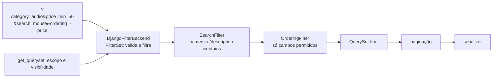

# 8. Filtros, busca e ordenação

> ⏱️ ~1h30 · Módulo 6 · Pré-requisitos: [6.02](02-design-endpoints.md), [6.04](04-drf-views-viewsets-routers.md), [6.05](05-validacao-erros.md), [6.07](07-drf-permissoes.md), [5.05](../05-django/05-orm-consultas.md) e [5.15](../05-django/15-paginacao-busca.md) (busca no HTML)

> ✅ **Verificação.** Código executado em 2026-11-08 (Python 3.13, Django 5.2.19, DRF 3.18.3, django-filter 26.2, SQLite, seed de 64 produtos). As saídas são as reais; 29 testes do laboratório passaram. O SQL mostrado é o do SQLite (`LIKE`); no PostgreSQL o `icontains` vira `ILIKE`.

## 🎯 Objetivos
Ao final desta aula você consegue:
- Expor **filtros** por query string (`?category=audio&price_min=50`) com `django-filter` e `FilterSet`
- Ativar **busca** (`?search=`) e **ordenação** (`?ordering=-price`) com uma **lista permitida** de campos
- Explicar como cada filtro vira `WHERE`/`ORDER BY` e verificar que a lista segue com **consulta fixa** (sem N+1)
- Distinguir o que é **filtro de interface** do que é **regra de visibilidade** (produtos inativos não saem para o público)
- Prever como cada backend reage a parâmetros inválidos (400, ignorar, ignorar em silêncio)

## 🤔 Por que isso importa
Um catálogo sem busca nem filtros é inútil; um com filtros mal feitos vira porta de ataque ou fonte de lentidão (ordenar por qualquer campo, busca sem limite, filtros que vazam dados). Na aula 5.15 você fez isso na tela HTML; a API precisa da mesma capacidade, em formato previsível para qualquer cliente (app, front, parceiro).

## 💡 Intuição (explicação simples)
Pense no **fichário de uma biblioteca com atendente**. Você pede: “livros de ficção (filtro), do autor X (filtro), que falem de ‘mar’ (busca), do mais novo para o mais antigo (ordenação)”. O atendente só aceita critérios que **existem na ficha** (lista permitida) e **nunca mostra** livros que a biblioteca retirou do acervo, por mais que você peça (visibilidade). Se você pede “ordene pela senha do diretor”, ele ignora ou avisa que isso não existe.

## 🔬 Como funciona por dentro

- **Backends de filtro** são encadeados na ordem de `filter_backends`: cada um recebe o QuerySet do anterior e devolve outro, **após** o `get_queryset()` (o escopo/visibilidade vem primeiro e **nunca** é contornado pelos filtros).
- **`DjangoFilterBackend` + `FilterSet`** (pacote `django-filter`): cada filtro declara o nome do parâmetro (`price_min`), o campo (`price`) e o *lookup* (`gte`). Ele **valida o tipo** (um número, uma data) e devolve **400 por campo** quando o valor não serve.
- **`SearchFilter`**: `?search=mouse` faz `icontains` em **OR** nos `search_fields`. Vários termos separados por espaço viram **AND** entre termos. Prefixos nos campos mudam o *lookup* (`^name` = começa com, `=sku` = exato).
- **`OrderingFilter`**: `?ordering=-price,name`. **`ordering_fields` é a lista permitida**: campos fora dela são **ignorados** em silêncio e vale o `ordering` padrão. Sem `ordering_fields`, o DRF permite os campos do serializer: declare sempre.
- **Parâmetros que o DRF ignora:** desconhecidos (`?foo=bar`) passam sem erro. Um booleano inválido (`?in_stock=talvez`) é tratado como “sem filtro”. Se o seu contrato exige erro, valide com um serializer (aula 05).
- **Visibilidade não é filtro.** `?is_active=...` **não** deve existir para o público: quem decide o que cada papel enxerga é o `get_queryset()` (aula 04/07). Produtos inativos ficam só para quem tem `catalog.change_product`.
- **Desempenho.** Cada filtro vira condição `WHERE`; `ORDER BY` e `LIKE '%x%'` não usam índices comuns: em tabelas grandes use índices nos campos filtrados/ordenados e busca de texto do banco (`pg_trgm`, `SearchVector`; aula 5.15). A lista segue com `select_related` (uma consulta).
- **Segurança.** Nunca monte `order_by(request.query_params["ordering"])` à mão (aula 5.15): o filtro com lista permitida existe para isso. Não aceite filtros por campos sensíveis (`?user__password__startswith=a` seria um vazamento por tentativa).
- **Convenções de nome** (aula 02): minúsculas, `snake_case`, `price_min`/`price_max` para intervalos (ou `price__gte` se preferir expor lookups, o que cresce sem controle).

## 🛠️ Exemplo prático
**1. Instalação**
```bash
uv add django-filter
```
```python
# config/settings.py
INSTALLED_APPS += ["django_filters"]
```

**2. O `FilterSet` de produtos**
```python
# apps/catalog/filters.py
import django_filters

from .models import Product


class ProductFilter(django_filters.FilterSet):
    category = django_filters.CharFilter(field_name="category__slug")                        # ?category=audio
    price_min = django_filters.NumberFilter(field_name="price", lookup_expr="gte")           # ?price_min=50
    price_max = django_filters.NumberFilter(field_name="price", lookup_expr="lte")
    in_stock = django_filters.BooleanFilter(method="filter_in_stock")                        # ?in_stock=true

    class Meta:
        model = Product
        fields = ["category", "price_min", "price_max", "in_stock"]

    def filter_in_stock(self, queryset, name, value):
        return queryset.filter(stock__gt=0) if value else queryset.filter(stock=0)
```
**3. O viewset com filtros, busca, ordenação e visibilidade**
```python
# apps/catalog/api.py
from django_filters.rest_framework import DjangoFilterBackend
from rest_framework import filters, viewsets
from rest_framework.permissions import AllowAny, DjangoModelPermissionsOrAnonReadOnly

from .filters import ProductFilter
from .models import Category, Product
from .serializers import CategorySerializer, ProductSerializer


class ProductViewSet(viewsets.ModelViewSet):
    queryset = Product.objects.select_related("category")
    serializer_class = ProductSerializer
    permission_classes = [DjangoModelPermissionsOrAnonReadOnly]
    filter_backends = [DjangoFilterBackend, filters.SearchFilter, filters.OrderingFilter]
    filterset_class = ProductFilter
    search_fields = ["name", "sku", "description"]                # ?search=mouse  (icontains em OR)
    ordering_fields = ["price", "name", "created_at"]             # lista permitida: ?ordering=-price
    ordering = ["name"]                                           # padrão

    def get_queryset(self):
        qs = super().get_queryset()
        if self.request.user.has_perm("catalog.change_product"):  # equipe vê inativos; público só os ativos
            return qs
        return qs.filter(is_active=True)
```
Para ativar os backends em **todas** as views, use `REST_FRAMEWORK["DEFAULT_FILTER_BACKENDS"]`; aqui os declaramos por view para deixar visível o que cada recurso aceita.

**4. Experimentando (executado)**
```python
import json
from django.db import connection
from django.test.utils import CaptureQueriesContext
from rest_framework.test import APIClient
c = APIClient()

def q(qs, titulo, mostrar=3):
    with CaptureQueriesContext(connection) as ctx:
        r = c.get("/api/v1/products/" + qs)
    d = r.json()
    if r.status_code != 200:
        print(f"{titulo:<34} → {r.status_code} {json.dumps(d, ensure_ascii=False)}")
        return
    itens = d if isinstance(d, list) else d["results"]
    print(f"{titulo:<34} → 200  {len(itens):>2} itens | {len(ctx)} consultas | " + ", ".join(f"{i['sku']}:{i['price']}" for i in itens[:mostrar]))

q("", "sem filtro (só ativos, por nome)")
q("?category=audio", "categoria=audio")
q("?price_min=500&price_max=900", "preço entre 500 e 900")
q("?in_stock=false", "sem estoque")
q("?search=mouse", "busca 'mouse'")
q("?search=INF-00", "busca por trecho do SKU")
q("?search=mouse&category=informatica&ordering=-price", "busca + categoria + ordenação")
q("?ordering=price", "ordenar por preço (asc)")
q("?ordering=-price", "ordenar por preço (desc)")
q("?ordering=password", "ordering fora da lista permitida")
q("?price_min=abc", "valor inválido (price_min=abc)")
q("?in_stock=talvez", "booleano inválido")
q("?foo=bar", "parâmetro desconhecido")
```
```text
sem filtro (só ativos, por nome)   → 200  61 itens | 1 consultas | CAS-049:701.20, CAS-052:742.30, CAS-050:714.90
categoria=audio                    → 200  19 itens | 1 consultas | AUD-029:427.20, AUD-032:468.30, AUD-030:440.90
preço entre 500 e 900              → 200  28 itens | 1 consultas | CAS-049:701.20, CAS-052:742.30, CAS-050:714.90
sem estoque                        → 200   0 itens | 1 consultas | 
busca 'mouse'                      → 200   4 itens | 1 consultas | INF-005:98.40, INF-008:139.50, INF-006:112.10
busca por trecho do SKU            → 200   9 itens | 1 consultas | INF-005:98.40, INF-008:139.50, INF-006:112.10
busca + categoria + ordenação      → 200   4 itens | 1 consultas | INF-008:139.50, INF-007:125.80, INF-006:112.10
ordenar por preço (asc)            → 200  61 itens | 1 consultas | INF-001:43.60, INF-002:57.30, INF-003:71.00
ordenar por preço (desc)           → 200  61 itens | 1 consultas | CAS-064:906.70, CAS-063:893.00, CAS-062:879.30
ordering fora da lista permitida   → 200  61 itens | 1 consultas | CAS-049:701.20, CAS-052:742.30, CAS-050:714.90
valor inválido (price_min=abc)     → 400 {"price_min": ["Informe um número."]}
booleano inválido                  → 200  61 itens | 1 consultas | CAS-049:701.20, CAS-052:742.30, CAS-050:714.90
parâmetro desconhecido             → 200  61 itens | 1 consultas | CAS-049:701.20, CAS-052:742.30, CAS-050:714.90
```
Como ler:
- Sem filtro vieram **61** itens, não 64: os **3 inativos** do seed ficam de fora para o público. Isso é o `get_queryset()`, e **nenhum parâmetro de URL** consegue contorná-lo.
- **Uma consulta** em todos os casos (o `select_related` traz a categoria no `JOIN`): filtrar, buscar e ordenar não criam N+1.
- `?ordering=password` **não deu erro**: foi ignorado e valeu a ordem padrão por nome (mesmo primeiro item do caso sem filtro). Já `price_min=abc` deu **400** com a mensagem por campo. E o booleano inválido e o parâmetro desconhecido foram **ignorados em silêncio**. Anote isso no contrato: “parâmetros desconhecidos são ignorados”.

O SQL gerado por `?search=mouse&price_min=10&category=informatica&ordering=-price`:
```sql
FROM "catalog_product" INNER JOIN "catalog_category" ON ("catalog_product"."category_id" = "catalog_category"."id")
WHERE ("catalog_product"."is_active" AND "catalog_category"."slug" = 'informatica' AND "catalog_product"."price" >= '10'
  AND ("catalog_product"."name" LIKE '%mouse%' ESCAPE '\' OR "catalog_product"."sku" LIKE '%mouse%' ESCAPE '\'
       OR "catalog_product"."description" LIKE '%mouse%' ESCAPE '\'))
ORDER BY "catalog_product"."price" DESC
```
A condição `is_active` (visibilidade) vem **junto** com os filtros do usuário e em `AND`.

**5. Testes**
```python
# tests/test_filtros.py
import pytest
from decimal import Decimal
from rest_framework.test import APIClient

pytestmark = pytest.mark.django_db


@pytest.fixture
def api(seed):
    return APIClient()


def skus(r):
    return [i["sku"] for i in r.json()]


def test_publico_nao_ve_produtos_inativos(api):
    assert all(i["is_active"] for i in api.get("/api/v1/products/").json())


def test_equipe_ve_inativos(seed):
    from django.contrib.auth import get_user_model
    c = APIClient()
    c.force_authenticate(get_user_model().objects.get(username="gerente"))
    assert any(not i["is_active"] for i in c.get("/api/v1/products/").json())


def test_filtro_por_categoria_e_preco(api):
    r = api.get("/api/v1/products/", {"category": "audio", "price_min": "400", "price_max": "450"})
    itens = r.json()
    assert itens and all(i["category"]["slug"] == "audio" and Decimal("400") <= Decimal(i["price"]) <= Decimal("450") for i in itens)


def test_busca_ignora_maiusculas_e_acha_por_sku(api):
    assert "INF-005" in skus(api.get("/api/v1/products/", {"search": "MOUSE"}))
    assert skus(api.get("/api/v1/products/", {"search": "inf-001"})) == ["INF-001"]


def test_ordenacao_por_preco(api):
    precos = [Decimal(i["price"]) for i in api.get("/api/v1/products/", {"ordering": "-price"}).json()]
    assert precos == sorted(precos, reverse=True)


def test_ordenacao_fora_da_lista_e_ignorada(api):
    r = api.get("/api/v1/products/", {"ordering": "password"})
    assert r.status_code == 200 and skus(r) == skus(api.get("/api/v1/products/"))        # cai na ordem padrão


def test_valor_invalido_da_400_por_campo(api):
    r = api.get("/api/v1/products/", {"price_min": "abc"})
    assert r.status_code == 400 and "price_min" in r.json()


def test_lista_tem_consulta_fixa(api, django_assert_max_num_queries):
    with django_assert_max_num_queries(2):
        api.get("/api/v1/products/", {"search": "a", "ordering": "price"})
```
```bash
uv run pytest -q tests
```
```text
29 passed
```
(29 é o total do laboratório até aqui; os 8 acima passaram.)

## 🧠 Pausa para lógica
**Problema (ordenação multi-campo segura).** Implemente `ordenar(itens, ordering, permitidos)` que aceite `"-price,name"` (vários campos, `-` para decrescente), **rejeite** campos fora da lista permitida e use uma ordenação **estável** para o desempate.

<details><summary>Dica</summary>
O `sort()` do Python é estável: ordene pela chave <strong>menos importante</strong> primeiro e pela mais importante por último (percorrendo a lista de chaves de trás para frente).
</details>

<details><summary>Solução comentada</summary>

```python
def ordenar(itens, ordering, permitidos):
    """'-price,name' -> ordena por preço desc e, em empate, por nome asc. Rejeita campos fora da lista."""
    chaves = []
    for parte in filter(None, (p.strip() for p in ordering.split(","))):
        campo, desc = (parte[1:], True) if parte.startswith("-") else (parte, False)
        if campo not in permitidos:
            raise ValueError(f"ordenação por '{campo}' não permitida (use: {', '.join(sorted(permitidos))})")
        chaves.append((campo, desc))
    resultado = list(itens)
    for campo, desc in reversed(chaves):            # sort estável: aplica a chave menos importante primeiro
        resultado.sort(key=lambda i: i[campo], reverse=desc)
    return resultado


produtos = [{"name": "Mouse", "price": 59.9}, {"name": "Teclado", "price": 120.5}, {"name": "Cabo", "price": 59.9}, {"name": "Hub", "price": 120.5}]
for o in ["name", "-price,name", "price,-name"]:
    print(f"{o:<12}", [p["name"] for p in ordenar(produtos, o, {"price", "name"})])
try:
    ordenar(produtos, "password", {"price", "name"})
except ValueError as e:
    print("erro:", e)
```
```text
name         ['Cabo', 'Hub', 'Mouse', 'Teclado']
-price,name  ['Hub', 'Teclado', 'Cabo', 'Mouse']
price,-name  ['Mouse', 'Cabo', 'Teclado', 'Hub']
erro: ordenação por 'password' não permitida (use: name, price)
```
(Executado em 2026-11-08.) Observação: o `OrderingFilter` do DRF **ignora** o campo proibido em vez de lançar erro; o brinquedo acima é mais rígido (rejeita). Qual comportamento seu contrato quer? Decida e documente.
</details>

## ⚠️ Erros comuns e boas práticas
| Mensagem / sintoma | Causa | Solução |
|---|---|---|
| Filtro não faz nada | Faltou `filter_backends` ou `filterset_class` | Declare o backend e o `FilterSet` |
| `ModuleNotFoundError: No module named 'django_filters'` | Pacote/app não instalado | `uv add django-filter` e `"django_filters"` em `INSTALLED_APPS` |
| `AssertionError: ... FilterSet ... Meta.fields` / `TypeError: 'Meta.fields' must not contain non-model field names` | Campo declarado fora do model em `Meta.fields` sem filtro declarado | Declare o filtro explicitamente na classe |
| `?ordering=` por campo sensível funciona | `ordering_fields = "__all__"` ou ausente | Lista explícita |
| Produto inativo aparece para o público | Visibilidade feita só por filtro opcional | Regra no `get_queryset()` |
| N+1 ao filtrar por categoria | Sem `select_related` | Preparar a consulta na view |
| Busca lenta com muitos registros | `LIKE '%x%'` sem índice | Busca de texto do banco (`pg_trgm`, `SearchVector`) ou serviço de busca |
| `?in_stock=talvez` “funciona” | Valor inválido tratado como vazio | Valide com serializer se o contrato exigir 400 |
| Resultado “aleatório” entre páginas | Ordenação instável | Sempre um desempate (`id`) no `ordering` (aula 5.15) |
| Filtros mudam entre versões e quebram clientes | Contrato implícito | Documente os parâmetros (OpenAPI, aula 10) |

- Todo parâmetro aceito faz parte do **contrato**: documente nome, tipo e comportamento ao receber valor inválido.
- Limite o **comprimento** do termo de busca e o número de termos se a API for pública.
- **Visibilidade** e **escopo** no `get_queryset()`; **conveniência** nos filtros.
- Sempre combine filtros com **paginação** (aula 09): sem ela, `?search=a` devolve a tabela inteira.
- Prefira nomes de filtro de negócio (`in_stock`, `price_min`) a expor `lookups` do ORM (`stock__gt`): o contrato não depende da implementação.

## 🧩 Exercícios
**1. Fixação**
(a) Qual a diferença de comportamento entre `price_min=abc` e `ordering=password`? (b) Por que `is_active` não é um filtro público? (c) Como o `SearchFilter` combina vários `search_fields` e vários termos? (d) Por que `ordering_fields` precisa existir?

<details><summary>Solução</summary>

(a) `price_min=abc` falha na validação do `FilterSet` (400 por campo); `ordering=password` é ignorado pelo `OrderingFilter` e vale a ordem padrão. (b) É uma regra de visibilidade: o público não pode ver inativos nem tentar alterar isso por URL; vive no `get_queryset()`. (c) `icontains` em OR entre os campos para cada termo e AND entre os termos. (d) É a lista permitida: sem ela, o cliente poderia ordenar por campos que não deveria (e o contrato deixaria de ser explícito).
</details>

**2. Aplicação no projeto MiniShop**
Complete as consultas da API.

Critérios de pronto:
- [ ] Produtos com `category`, `price_min`, `price_max`, `in_stock`, `search` (nome, SKU, descrição) e `ordering` (`price`, `name`, `created_at`)
- [ ] Pedidos com filtro por `status` e ordenação por `created_at` (escopo por usuário preservado)
- [ ] Visibilidade de inativos só para quem tem `catalog.change_product`
- [ ] Contrato documentado: cada parâmetro, tipo, exemplo e o que acontece com valor inválido
- [ ] Testes: cada filtro, a combinação de filtros, valor inválido, ordenação proibida e contagem de consultas
- [ ] Índice composto no model para a consulta mais comum (`is_active`, `price`), com a migração
- [ ] Commit `feat(api): filtering, search and ordering for products and orders`

<details><summary>Solução de referência (pedidos)</summary>

```python
# apps/orders/filters.py
import django_filters
from .models import Order


class OrderFilter(django_filters.FilterSet):
    status = django_filters.ChoiceFilter(choices=Order.Status.choices)

    class Meta:
        model = Order
        fields = ["status"]

# OrderViewSet:
#   filter_backends = [DjangoFilterBackend, filters.OrderingFilter]
#   filterset_class = OrderFilter
#   ordering_fields = ["created_at", "total"]
#   ordering = ["-created_at", "-id"]
```
O `ChoiceFilter` rejeita `?status=hackeado` com 400 (“Faça uma escolha válida”), o que é melhor do que ignorar em silêncio.
</details>

**3. Desafio (opcional)**
Troque o `OrderingFilter` por um que responda `400` quando o campo não é permitido (herde de `OrderingFilter` e sobrescreva `remove_invalid_fields`), e escreva um teste. Depois discuta: ignorar em silêncio é melhor ou pior para quem integra com a API?

## 🎤 Na entrevista
- **Como implementar filtros numa API DRF?** Com `django-filter`: um `FilterSet` declara os parâmetros e o `DjangoFilterBackend` valida e aplica; busca com `SearchFilter` e ordenação com `OrderingFilter` e `ordering_fields` explícito.
- **Qual o risco de ordenar por qualquer campo vindo da URL?** Expor ou inferir dados sensíveis, erros de consulta e abrir caminho para consultas lentas; por isso usa-se uma lista permitida.
- **Filtro ou permissão: quando cada um?** Filtro é conveniência do cliente (pode ser trocado por ele); permissão e visibilidade são regras do servidor, aplicadas no `get_queryset()` antes de qualquer filtro.
- **Como saber se a busca ficou lenta?** Contar e medir as consultas (`CaptureQueriesContext`, `EXPLAIN`), verificar índices e considerar busca de texto do banco quando `LIKE '%x%'` não escala.

## 📚 Para ir além
- 📄 Documentação oficial: [Filtering (DRF)](https://www.django-rest-framework.org/api-guide/filtering/). `SearchFilter`, `OrderingFilter`, backends.
- 📄 Documentação: [django-filter com o DRF](https://django-filter.readthedocs.io/en/stable/guide/rest_framework.html). `DjangoFilterBackend` e `filterset_class`.
- 📄 Documentação: [Referência de filtros](https://django-filter.readthedocs.io/en/stable/ref/filters.html). `NumberFilter`, `ChoiceFilter`, `method=`.
- 📄 Documentação oficial: [Busca de texto no PostgreSQL (Django)](https://docs.djangoproject.com/en/5.2/ref/contrib/postgres/search/). Quando `icontains` não basta.
- 📑 Artigo/tutorial: [Use The Index, Luke](https://use-the-index-luke.com/). Como índices ajudam filtros e ordenação.
- 🏋️ Prática extra: ative `django.db.backends` em `DEBUG` e observe o SQL de cada combinação de parâmetros.

> Links verificados em 2026-11-08 (HTTP 200).

## ✅ Checklist da aula
- [ ] `FilterSet` com `category`, `price_min`/`price_max` e `in_stock`
- [ ] Busca e ordenação com lista permitida
- [ ] Visibilidade de inativos resolvida no `get_queryset()`
- [ ] Uma consulta por listagem (sem N+1) comprovada em teste
- [ ] Comportamento para valores inválidos documentado no contrato
