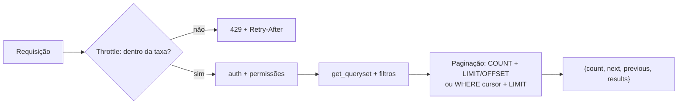

# 9. Paginação e throttling

> ⏱️ ~1h30 · Módulo 6 · Pré-requisitos: [6.02](02-design-endpoints.md), [6.05](05-validacao-erros.md), [6.06](06-autenticacao-token-jwt.md), [6.08](08-filtros-busca-ordenacao.md), [5.15](../05-django/15-paginacao-busca.md) (`OFFSET` × cursor)

> ✅ **Verificação.** Código executado em 2026-11-08 (Python 3.13, Django 5.2.19, DRF 3.18.3, SQLite, cache em memória). As saídas são as reais; 33 testes do laboratório passaram (com os ajustes descritos no fim do exemplo 1).

## 🎯 Objetivos
Ao final desta aula você consegue:
- Paginar listas na API com `PageNumberPagination` e `CursorPagination`, e explicar o envelope `count/next/previous/results`
- Limitar o tamanho de página pedido pelo cliente (`page_size` com `max_page_size`)
- Escolher entre paginação por **página** e por **cursor** conforme o recurso
- Configurar **throttling** global e **por escopo** (login) e interpretar `429` e `Retry-After`
- Explicar por que o contador de throttling vive no **cache** e o que muda com vários servidores

## 🤔 Por que isso importa
Uma API sem paginação é uma bomba-relógio: com 200 mil produtos, `GET /products/` derruba o banco, o servidor e o app do cliente. E uma API sem limite de taxa convida a força bruta no login, a raspagem em massa do catálogo e a um cliente com *bug* em laço que a derruba sem querer. As duas coisas protegem o **sistema** e os **demais usuários**; em entrevista aparecem como “como você evita que sua API seja abusada?”.

## 💡 Intuição (explicação simples)
**Paginação** é o **cardápio em páginas**: o garçom não despeja a cozinha inteira na mesa, entrega uma bandeja por vez e diz onde está a próxima. **Throttling** é a **fila do caixa com senha**: cada cliente pode ser atendido algumas vezes por minuto; passou disso, o atendente diz “volte em 60 segundos” (e diz exatamente quando). Quem chega em massa não impede os outros de comprar.

## 🔬 Como funciona por dentro

**Paginação**
- **Envelope.** A lista deixa de ser um *array* solto e vira um objeto: `count` (total), `next`, `previous` (URLs prontas, já com os filtros) e `results`. Mudar de lista para envelope **quebra clientes**: faça isso desde o início (aula 02). Os testes da aula 08 foram ajustados para ler `results`.
- **Três estratégias do DRF:**
  | Classe | Parâmetros | Custo | Quando |
  |---|---|---|---|
  | `PageNumberPagination` | `?page=2` (e `?page_size=`) | `COUNT(*)` + `OFFSET` | telas com “página 3 de 20” (catálogo) |
  | `LimitOffsetPagination` | `?limit=20&offset=40` | idem | clientes que pedem “janelas” arbitrárias |
  | `CursorPagination` | `?cursor=<opaco>` | **sem `COUNT`**; usa o índice da ordenação | *feeds*, pedidos, logs, dados que crescem e mudam |
- **`OFFSET` × cursor** (aula 5.15): com `OFFSET`, se um item novo chega entre a leitura da página 1 e a da 2, um item **repete** (ou some). O cursor “lembra” o último item visto e não sofre isso. O custo: **não se pode saltar** para a página 50 nem mostrar o total.
- **Limite de tamanho.** `page_size_query_param` deixa o cliente escolher, e `max_page_size` **impõe um teto**: sem ele, `?page_size=1000000` reconstrói o problema que a paginação resolve.
- **Página inválida.** `?page=99` ou `?page=abc` devolve `404` (“Página inválida.”), passando pelo nosso handler de erros.
- **Ordem estável.** Paginar exige `ORDER BY` determinístico (desempate por `id`, aula 5.15); o `CursorPagination` exige um campo de ordenação (`ordering`), idealmente **imutável e único** (`created_at`).
- **Custo do `COUNT`.** Em tabelas enormes o `COUNT(*)` é caro; por isso APIs grandes preferem cursor e omitem `count`.

**Throttling**
- **O que é:** limitar quantas requisições um cliente faz por unidade de tempo. Ao exceder: `429 Too Many Requests` com o cabeçalho **`Retry-After`** (segundos).
- **Como o cliente é identificado:** `AnonRateThrottle` usa o **IP** (`X-Forwarded-For`/`REMOTE_ADDR`); `UserRateThrottle` usa o **id do usuário**; `ScopedRateThrottle` usa o **escopo** declarado na view (`throttle_scope = "login"`), com taxa própria em `DEFAULT_THROTTLE_RATES`.
- **Onde fica o contador:** no **cache** do Django. Em desenvolvimento, o cache em memória (por processo); em produção com vários processos/servidores é preciso um cache **compartilhado** (Redis; módulo 14), senão cada processo conta sozinho e o limite efetivo se multiplica.
- **Atrás de proxy/balanceador**, o IP visto é o do proxy: configure `NUM_PROXIES` (DRF) e o cabeçalho confiável, ou todos os anônimos dividirão a mesma cota.
- **Para que serve cada taxa do projeto:** `anon` (100/hora) protege contra raspagem; `user` (1000/hora) contra *bugs* e abuso autenticado; `login` (5/min) contra **força bruta**.
- **Limites do throttle:** não substitui um WAF, detecção de bots nem *rate limit* na borda (Nginx/CDN); é a **última linha** dentro da aplicação. Também não impede ataques distribuídos (muitos IPs).
- **Contrato:** documente as taxas e o `Retry-After`; clientes bem-comportados esperam e tentam de novo (com *backoff*; módulo 7).

## 🛠️ Exemplo prático
**1. Configuração**
```python
# config/pagination.py
from rest_framework.pagination import CursorPagination, PageNumberPagination


class StandardPagination(PageNumberPagination):
    page_size = 20                      # padrão
    page_size_query_param = "page_size"  # ?page_size=50 (o cliente pode pedir...)
    max_page_size = 100                  # ...mas nunca mais que isso


class NewestFirstCursorPagination(CursorPagination):
    """Cursor opaco: estável com dados mudando e custo constante; não permite 'pular para a página 50'."""
    page_size = 10
    ordering = "-created_at"
```
```python
# config/settings.py (dentro de REST_FRAMEWORK)
"DEFAULT_PAGINATION_CLASS": "config.pagination.StandardPagination",
"DEFAULT_THROTTLE_CLASSES": ["rest_framework.throttling.AnonRateThrottle", "rest_framework.throttling.UserRateThrottle"],
"DEFAULT_THROTTLE_RATES": {"anon": "100/hour", "user": "1000/hour", "login": "5/min"},
```
```python
# apps/accounts/throttles.py: o login ganha uma taxa própria
from rest_framework.throttling import ScopedRateThrottle
from rest_framework_simplejwt.views import TokenObtainPairView


class ThrottledTokenView(TokenObtainPairView):
    throttle_classes = [ScopedRateThrottle]
    throttle_scope = "login"            # taxa própria, bem mais baixa que a geral

# config/api_urls.py: path("auth/token/", ThrottledTokenView.as_view(), name="token")
```
```python
# apps/orders/api.py: pedidos crescem sem parar → cursor
class OrderViewSet(...):
    filter_backends = [DjangoFilterBackend, filters.OrderingFilter]
    filterset_class = OrderFilter
    pagination_class = NewestFirstCursorPagination
    ordering_fields = ["created_at", "total"]
    ordering = ["-created_at"]
```
Duas consequências da paginação ligada **globalmente**: as listas viram envelope (os testes passam a ler `["results"]`) e os limites de consultas dos testes sobem em um (o `COUNT`): na aula 04 o teste da lista de produtos permitia 3 consultas e passa a permitir **4** (`COUNT`, `SELECT`, e as duas consultas de `has_perm` do `get_queryset()` da aula 08).

**2. Paginação na prática (executado)**
```python
from rest_framework.test import APIClient
c = APIClient()

r = c.get("/api/v1/products/"); d = r.json()
print("chaves:", list(d), "| count:", d["count"], "| itens na página:", len(d["results"]))
print("next    :", d["next"]); print("previous:", d["previous"])
d2 = c.get("/api/v1/products/?page=4").json(); print("página 4 → itens:", len(d2["results"]), "| next:", d2["next"], "| previous:", d2["previous"])
r = c.get("/api/v1/products/?page=99"); print("página 99 →", r.status_code, r.json())
r = c.get("/api/v1/products/?page=abc"); print("página 'abc' →", r.status_code, r.json())
print("page_size=5 →", len(c.get("/api/v1/products/?page_size=5").json()["results"]), "itens | page_size=5000 →", len(c.get("/api/v1/products/?page_size=5000").json()["results"]), "itens")
print("filtro + página:", c.get("/api/v1/products/?category=audio&page_size=5").json()["next"])
```
```text
chaves: ['count', 'next', 'previous', 'results'] | count: 61 | itens na página: 20
next    : http://testserver/api/v1/products/?page=2
previous: None
página 4 → itens: 1 | next: None | previous: http://testserver/api/v1/products/?page=3
página 99 → 404 {'detail': 'Página inválida.', 'code': 'not_found'}
página 'abc' → 404 {'detail': 'Página inválida.', 'code': 'not_found'}
page_size=5 → 5 itens | page_size=5000 → 61 itens
filtro + página: http://testserver/api/v1/products/?category=audio&page=2&page_size=5
```
Leitura: 61 produtos ativos, 20 por página, 4 páginas (a última com 1 item). O `next` **mantém** os filtros e o `page_size`. O pedido de `page_size=5000` devolveu os 61 itens: o teto é 100, e o catálogo de demonstração tem menos que isso (com mais itens, o teto de 100 apareceria). A página inexistente vira `404` no nosso formato `detail`/`code`.

**3. Cursor (executado, com 12 pedidos do gerente)**
```python
r = cg.get("/api/v1/orders/"); d = r.json()
print(r.status_code, list(d), len(d["results"]), d["next"][:70])
d2 = cg.get(d["next"]).json(); print(len(d2["results"]), d2["next"], d2["previous"] is not None)
ids = [o["id"] for o in d["results"]] + [o["id"] for o in d2["results"]]
print("ids sem repetição:", len(ids) == len(set(ids)), "| decrescente:", ids == sorted(ids, reverse=True))
```
```text
200 ['next', 'previous', 'results'] 10 http://testserver/api/v1/orders/?cursor=cD0yMDI2LTExLTA4KzE0JTNBMzAlM0
2 None True
ids sem repetição: True | decrescente: True
```
O envelope **não tem `count`** (o cursor não conta), o `cursor` é um texto opaco (Base64 de um par de valores), e a 2ª página traz os 2 pedidos restantes, sem repetição.

**4. Throttling (executado)**
```python
cache.clear()
codigos = []
for i in range(7):
    r = APIClient().post("/api/v1/auth/token/", {"username": "cliente", "password": "errada"}, format="json")
    codigos.append(r.status_code)
print("tentativas:", codigos)
print("429 →", r.json(), "| Retry-After:", r.get("Retry-After"), "s")
print("login correto também bloqueado:", APIClient().post("/api/v1/auth/token/", {"username": "cliente", "password": "dev-somente-local-123"}, format="json").status_code)

AnonRateThrottle.THROTTLE_RATES = {**AnonRateThrottle.THROTTLE_RATES, "anon": "3/hour"}    # reduzido só para demonstrar
cache.clear()
print([APIClient().get("/api/v1/categories/").status_code for _ in range(5)])
```
```text
tentativas: [401, 401, 401, 401, 401, 429, 429]
429 → {'detail': 'Pedido foi suprimido. Espera-se que esteja diponível em 60 segundos.', 'code': 'throttled'} | Retry-After: 60 s
login correto também bloqueado: 429
[200, 200, 200, 429, 429]
```
Pontos importantes:
- As **5 primeiras** tentativas erradas voltaram `401`; a **6ª** já é `429`, e o cabeçalho `Retry-After: 60` diz quando tentar de novo. Um atacante testando senhas é freado a **5 por minuto** por IP.
- O login **correto** também foi bloqueado durante a janela: o limite é por origem, não por acerto. É o preço de proteger; por isso a taxa não deve ser tão baixa a ponto de punir um usuário legítimo que errou a senha.
- A mensagem em português é a tradução do próprio DRF (inclui um erro de digitação, “diponível”, da tradução); o que o cliente deve usar é o `code` (`throttled`) e o `Retry-After`.
- Na segunda demonstração, a cota de anônimos (reduzida para 3 só para o exemplo) estoura na 4ª chamada.

**5. Testes**
```python
# conftest.py: o contador vive no cache, então ele é zerado entre os testes
@pytest.fixture(autouse=True)
def _limpa_cache():
    from django.core.cache import cache
    cache.clear()
    yield
```
```python
# tests/test_paginacao_throttle.py
import pytest
from rest_framework.test import APIClient

pytestmark = pytest.mark.django_db


def test_lista_vem_em_envelope_com_20_itens(seed):
    d = APIClient().get("/api/v1/products/").json()
    assert set(d) == {"count", "next", "previous", "results"} and len(d["results"]) == 20


def test_page_size_tem_teto(seed):
    assert len(APIClient().get("/api/v1/products/", {"page_size": 100000}).json()["results"]) <= 100


def test_pagina_invalida_da_404_no_formato_padrao(seed):
    r = APIClient().get("/api/v1/products/", {"page": 999})
    assert r.status_code == 404 and r.json()["code"] == "not_found"


def test_login_e_limitado_a_5_por_minuto(seed):
    codigos = [APIClient().post("/api/v1/auth/token/", {"username": "x", "password": "y"}, format="json").status_code for _ in range(6)]
    assert codigos == [401] * 5 + [429]
```
```bash
uv run pytest -q tests
```
```text
33 passed
```
(33 é o total do laboratório até aqui, somando as aulas 04 a 09; os 4 testes acima passaram.)

## 🧠 Pausa para lógica
**Problema (por que o cursor não repete).** Simule uma lista de pedidos em ordem decrescente de id (20 a 1) lida de 5 em 5. Entre a leitura da página 1 e a da página 2 chega o pedido 21. Implemente `por_offset` e `por_cursor` e mostre que o offset **repete** um item e o cursor, não.

<details><summary>Dica</summary>
Offset: <code>itens[(pagina-1)*tamanho : ...]</code>. Cursor: guarde o <strong>último id visto</strong> e peça os itens com id menor que ele (<code>WHERE id &lt; cursor</code>), pegando os primeiros <code>tamanho</code>.
</details>

<details><summary>Solução comentada</summary>

```python
def por_offset(itens, pagina, tamanho):
    ini = (pagina - 1) * tamanho
    return itens[ini:ini + tamanho]


def por_cursor(itens, tamanho, depois_de=None):
    """Itens em ordem decrescente de id. O cursor é o id do último item visto."""
    restantes = [i for i in itens if depois_de is None or i < depois_de]
    pagina = restantes[:tamanho]
    return pagina, (pagina[-1] if pagina else None)


# pedidos 20..1, mais novo primeiro; o cliente lê de 5 em 5
pedidos = list(range(20, 0, -1))

# --- offset: um pedido novo (21) chega entre a leitura da página 1 e da página 2
p1 = por_offset(pedidos, 1, 5)
pedidos = [21] + pedidos
p2 = por_offset(pedidos, 2, 5)
print("OFFSET  p1:", p1, "p2:", p2, "→ repetido:", set(p1) & set(p2))

# --- cursor: mesma situação
pedidos = list(range(20, 0, -1))
c1, cursor = por_cursor(pedidos, 5)
pedidos = [21] + pedidos
c2, _ = por_cursor(pedidos, 5, cursor)
print("CURSOR  p1:", c1, "p2:", c2, "→ repetido:", set(c1) & set(c2) or "nenhum")
```
```text
OFFSET  p1: [20, 19, 18, 17, 16] p2: [16, 15, 14, 13, 12] → repetido: {16}
CURSOR  p1: [20, 19, 18, 17, 16] p2: [15, 14, 13, 12, 11] → repetido: nenhum
```
(Executado em 2026-11-08.) O novo pedido empurrou tudo uma posição para baixo e o `OFFSET` releu o 16. O cursor pergunta “o que vem **depois do 16**?”, uma pergunta que não muda quando entram itens no topo.
</details>

## ⚠️ Erros comuns e boas práticas
| Mensagem / sintoma | Causa | Solução |
|---|---|---|
| Front quebra: “results is undefined” / `TypeError: ... is not iterable` | Lista virou envelope | Ler `data.results` e usar `next`/`previous` |
| `UnorderedObjectListWarning` | Paginação sem `ORDER BY` | Defina `ordering` (com desempate por `id`) |
| `AssertionError: Cannot use ... CursorPagination ... ordering` / resultados fora de ordem | Cursor com campo de ordenação inadequado | `ordering` num campo estável e único (`created_at`) |
| `404 Página inválida` ao pular para uma página que sumiu | Total diminuiu | Tratar o 404 voltando à primeira página |
| `page_size=100000` derruba o servidor | Sem `max_page_size` | Defina o teto |
| `429` em testes que não deveriam | Contador no cache compartilhado entre testes | `cache.clear()` autouse |
| Limite “não funciona” em produção | Cache por processo (LocMem) em vários workers | Cache compartilhado (Redis) |
| Todos os anônimos bloqueados juntos | IP do proxy usado como identidade | `NUM_PROXIES` e `X-Forwarded-For` confiável |
| Cliente em laço infinito após `429` | Ignora `Retry-After` | Esperar o tempo indicado, com *backoff* |
| Login travado para um usuário legítimo | Taxa muito agressiva | Equilibrar; considerar também bloqueio por conta (módulo 9) |

- Toda lista **pública** precisa de paginação *e* teto de tamanho.
- Throttle por **IP** não pega ataques distribuídos; por **conta** protege usuários específicos. Combine com limites na borda (Nginx/CDN).
- Devolva sempre `Retry-After` (o DRF faz) e documente as taxas no contrato.
- Para exportar muitos dados, ofereça um *job* assíncrono (módulo 7), não uma página gigante.
- Não use `count` em tabelas enormes se o cliente não precisa dele: prefira cursor.

## 🧩 Exercícios
**1. Fixação**
(a) O que muda para o cliente quando a lista vira envelope? (b) Qual a vantagem do cursor e o que se perde? (c) Para que serve `max_page_size`? (d) Onde o DRF guarda o contador do throttling e por que isso importa com vários servidores?

<details><summary>Solução</summary>

(a) Os itens ficam em `results` e a navegação usa `next`/`previous`; quem lia o *array* direto precisa ser ajustado. (b) Custo constante e estabilidade com dados mudando, mas sem `count` nem saltos para páginas arbitrárias. (c) Impede que o cliente peça uma página gigante. (d) No cache do Django; com vários processos/servidores precisa ser um cache compartilhado (Redis), senão cada um conta sozinho.
</details>

**2. Aplicação no projeto MiniShop**
Proteja a API contra volume e abuso.

Critérios de pronto:
- [ ] Paginação global (20 por página, máx. 100) e cursor nos pedidos
- [ ] Taxas `anon` 100/hora, `user` 1000/hora e `login` 5/min, documentadas no contrato com o formato do `429`
- [ ] Throttle específico também para `POST /orders/` (por exemplo `orders` 10/min) com `ScopedRateThrottle`
- [ ] `cache.clear()` automático entre os testes; testes de envelope, teto, página inválida, cursor sem repetição e `429` com `Retry-After`
- [ ] Nota no `docs/producao.md`: cache compartilhado (Redis) e `NUM_PROXIES` quando houver proxy
- [ ] O front (aula 14) lê `results`/`next`
- [ ] Commit `feat(api): pagination and throttling`

<details><summary>Solução de referência (throttle do pedido)</summary>

```python
# settings: "DEFAULT_THROTTLE_RATES": {..., "orders": "10/min"}
class OrderViewSet(...):
    def get_throttles(self):
        if self.action == "create":
            self.throttle_scope = "orders"
            return [ScopedRateThrottle(), *super().get_throttles()]
        return super().get_throttles()
```
Antes de adotar esse padrão, teste que o throttle global continua valendo (as classes globais vêm do `super()`).
</details>

**3. Desafio (opcional)**
Implemente uma `CustomPagination` que devolva também `page` e `total_pages` no envelope e o cabeçalho `X-Total-Count`, mantendo `next`/`previous`. Escreva testes e discuta: vale a pena duplicar o total em dois lugares?

## 🎤 Na entrevista
- **Por que paginar uma API e qual estratégia usar?** Para limitar custo de banco, memória e rede. Por página/`OFFSET` quando o cliente precisa “ir à página N” e o total; por cursor para listas grandes ou que mudam, pois evita repetição/omissão e `OFFSET` lento.
- **O que é throttling e como é implementado no DRF?** Limitar requisições por tempo para proteger contra abuso e bugs; `AnonRateThrottle` (IP), `UserRateThrottle` (usuário) e `ScopedRateThrottle` (por endpoint), com contador no cache; ao exceder, `429` com `Retry-After`.
- **Como você protege o login de força bruta?** Throttle específico por IP e, idealmente, por conta, mensagens de erro iguais para usuário inexistente/senha errada, senhas fortes e bloqueios progressivos; limites também na borda (Nginx/WAF).
- **O que acontece com o throttle atrás de um balanceador?** O IP visto é o do balanceador; é preciso configurar proxies confiáveis (`NUM_PROXIES`/`X-Forwarded-For`) e um cache compartilhado.

## 📚 Para ir além
- 📄 Documentação oficial: [Pagination (DRF)](https://www.django-rest-framework.org/api-guide/pagination/). As três estratégias e como personalizar.
- 📄 Documentação oficial: [Throttling (DRF)](https://www.django-rest-framework.org/api-guide/throttling/). Classes, escopos e `NUM_PROXIES`.
- 📄 Referência: [429 Too Many Requests (MDN)](https://developer.mozilla.org/pt-BR/docs/Web/HTTP/Reference/Status/429). Significado e `Retry-After`.
- 📄 Referência: [Retry-After (MDN)](https://developer.mozilla.org/pt-BR/docs/Web/HTTP/Reference/Headers/Retry-After). Formato do cabeçalho.
- 📑 Artigo/tutorial: [Use The Index, Luke — paginação sem OFFSET](https://use-the-index-luke.com/no-offset). Por que o cursor (*keyset*) escala.
- 📄 Documentação oficial: [Cache do Django](https://docs.djangoproject.com/en/5.2/topics/cache/). Backends (LocMem, Redis) usados pelo throttle.
- 🏋️ Prática extra: escreva um cliente Python que respeita `Retry-After` e tenta de novo.

> Links verificados em 2026-11-08 (HTTP 200).

## ✅ Checklist da aula
- [ ] Envelope `count/next/previous/results` com `max_page_size`
- [ ] Cursor nos pedidos e entendi o que ele não faz
- [ ] Login limitado a 5/min com `429` + `Retry-After`
- [ ] Contadores do throttle no cache e zerados nos testes
- [ ] Sei o que muda com vários servidores e proxy
