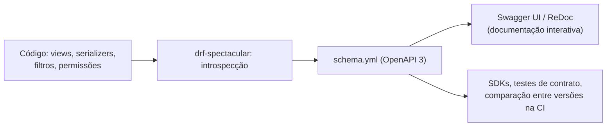

# 10. Versionamento e documentação OpenAPI/Swagger

> ⏱️ ~1h30 · Módulo 6 · Pré-requisitos: [6.02](02-design-endpoints.md), [6.05](05-validacao-erros.md), [6.06](06-autenticacao-token-jwt.md), [6.08](08-filtros-busca-ordenacao.md), [6.09](09-paginacao-throttling.md)

> ✅ **Verificação.** Código executado em 2026-11-08 (Python 3.13, Django 5.2.19, DRF 3.18.3, drf-spectacular 0.30.0, simplejwt 5.5.1, django-filter 26.2, SQLite). As saídas são as reais; `spectacular --validate` terminou com **0 avisos** e os 37 testes do laboratório passaram. O trecho de `v2` (exemplo 5) é ilustrativo e **não foi executado**.

## 🎯 Objetivos
Ao final desta aula você consegue:
- Explicar o que é **OpenAPI** e como o `drf-spectacular` gera o contrato a partir do código
- Publicar o schema em `/api/schema/` e a documentação interativa (Swagger UI) em `/api/docs/`
- Corrigir os avisos do gerador e **documentar erros, respostas e autenticação** (JWT)
- Configurar **versionamento por URL** (`/api/v1/`) e saber quando criar uma nova versão
- Distinguir mudanças **compatíveis** de mudanças que **quebram** clientes e detectá-las comparando schemas

## 🤔 Por que isso importa
A documentação desatualizada é pior que nenhuma. Quando o contrato é **gerado do código** e conferido na CI, ele nunca mente, e clientes (front, app, parceiros) podem até gerar SDKs a partir dele. Já o versionamento é o que permite evoluir a API **sem derrubar** quem já a usa. Em entrevistas: “como você documenta e evolui uma API sem quebrar os clientes?”.

## 💡 Intuição (explicação simples)
O **contrato** é o **cardápio impresso** do restaurante: nomes, ingredientes, preços. Se a cozinha muda um prato e o cardápio fica igual, o cliente é enganado. Gerar o cardápio **a partir da cozinha** garante que bate. O **versionamento** é a **edição do cardápio**: a “edição 1” continua valendo para quem pediu por ela, mesmo que a “edição 2” já esteja nas mesas; trocar um ingrediente sem avisar (mudança que quebra) exige uma edição nova.

## 🔬 Como funciona por dentro

- **OpenAPI** é uma especificação (YAML/JSON) que descreve uma API HTTP: caminhos, métodos, parâmetros, corpos, respostas, esquemas de dados e autenticação. *Swagger* é o nome antigo e das ferramentas (Swagger UI, Swagger Editor).
- **`drf-spectacular`** percorre as views e serializers e **gera** o schema OpenAPI 3: tipos dos campos, paginação, filtros (`django-filter`), permissões e autenticação (reconhece o `simplejwt` e cria o esquema `jwtAuth`). `SpectacularAPIView` serve o schema; `SpectacularSwaggerView` e `SpectacularRedocView` o exibem.
- **O gerador é honesto:** o que não consegue deduzir, ele **avisa** (tipo de um `SerializerMethodField`, serializer de uma `APIView`, o parâmetro de caminho quando o `get_queryset()` depende do usuário). O comando `manage.py spectacular --validate` lista os avisos e falha em erro: ótimo para a CI.
- **`@extend_schema`** acrescenta o que o código não diz: resumo, `request`/`responses` (inclusive **erros** `401/403/404/422`), parâmetros extras e exemplos. `@extend_schema_view` faz isso por ação de um viewset.
- **Documentar erros** é parte do contrato: o schema `Error` (`detail`, `code`; aula 05) aparece nas respostas de cada operação.
- **Versionamento da API** (formas comuns):
  | Estratégia | Exemplo | Observações |
  |---|---|---|
  | **No caminho** (`URLPathVersioning`) | `/api/v1/products/` | mais visível e cacheável; a que adotamos |
  | Cabeçalho (`AcceptHeaderVersioning`) | `Accept: application/json; version=2` | URL limpa, mas menos óbvio |
  | Query string | `/api/products/?version=2` | simples, pouco recomendado |
  | Domínio/subdomínio | `v2.api.minishop.com` | isolamento total, mais infraestrutura |
- **Mudança compatível × que quebra:**
  | Compatível (não precisa de nova versão) | Quebra (nova versão) |
  |---|---|
  | campo **novo opcional** na resposta | **remover** ou **renomear** campo/rota |
  | rota ou parâmetro **novo opcional** | mudar o **tipo** de um campo (`string` → `number`) |
  | novo valor aceito em filtro | tornar um campo da requisição **obrigatório** |
  | corrigir *bug* sem mudar o contrato | mudar o significado/regra de um campo |
- **Boas práticas de evolução:** mudanças compatíveis entram na versão atual; as que quebram vão para `v2`, mantendo `v1` por um período de **depreciação** anunciado (cabeçalhos `Deprecation`/`Sunset`, changelog, e-mails aos integradores) antes de desligá-la. Cada versão tem seu schema.
- **Segurança da documentação:** `/api/docs/` expõe a estrutura da API. Em produção, decida: pública (API aberta) ou atrás de autenticação/VPN (API interna). Nada de segredos em exemplos.

## 🛠️ Exemplo prático
**1. Instalação e URLs**
```bash
uv add drf-spectacular
```
```python
# config/settings.py
INSTALLED_APPS += ["drf_spectacular"]

REST_FRAMEWORK = {
    # ... (as chaves das aulas anteriores)
    "DEFAULT_SCHEMA_CLASS": "drf_spectacular.openapi.AutoSchema",
    "DEFAULT_VERSIONING_CLASS": "rest_framework.versioning.URLPathVersioning",
    "DEFAULT_VERSION": "v1",
    "ALLOWED_VERSIONS": ["v1"],
}

SPECTACULAR_SETTINGS = {
    "TITLE": "MiniShop API",
    "DESCRIPTION": "API do MiniShop: catálogo, carrinho e pedidos. Autenticação por JWT (Bearer).",
    "VERSION": "1.0.0",
    "SERVE_INCLUDE_SCHEMA": False,
    "SCHEMA_PATH_PREFIX": r"/api/v[0-9]",
}
```
```python
# config/urls.py
from drf_spectacular.views import SpectacularAPIView, SpectacularRedocView, SpectacularSwaggerView

urlpatterns = [
    path("admin/", admin.site.urls),
    path("api/schema/", SpectacularAPIView.as_view(), name="schema"),
    path("api/docs/", SpectacularSwaggerView.as_view(url_name="schema"), name="docs"),
    path("api/redoc/", SpectacularRedocView.as_view(url_name="schema"), name="redoc"),
    path("api/<str:version>/", include("config.api_urls")),       # /api/v1/..., /api/v2/... (só as permitidas)
]
```
O prefixo fixo `api/v1/` virou `api/<str:version>/`: o `URLPathVersioning` lê a versão do caminho (`request.version`) e responde `404` para as não permitidas.

**2. Rodando o gerador pela primeira vez (avisos reais)**
```bash
uv run python manage.py spectacular --file schema.yml --validate
```
```text
Error [MeView]: unable to guess serializer. ... Consider using GenericAPIView as view base class ... you may want to add a serializer_class (or method). Ignoring view for now.
Error [CartView]: unable to guess serializer. ...
Warning [CartItemViewSet]: could not derive type of path parameter "id" because it is untyped and obtaining queryset from the viewset failed. ...
Warning [OrderViewSet]: Failed to obtain model through view's queryset due to raised exception. Prevent this either by setting "queryset = Model.objects.none()" on the view, checking for "getattr(self, "swagger_fake_view", False)" in get_queryset() or by simply using @extend_schema. (Exception: Field 'id' expected a number but got <django.contrib.auth.models.AnonymousUser object ...>.)
Warning [ProductViewSet > ProductSerializer]: unable to resolve type hint for function "get_in_stock". Consider using a type hint or @extend_schema_field. Defaulting to string.

Schema generation summary:
Warnings: 7 (4 unique)
Errors:   8 (2 unique)
```
(Mensagens abreviadas.) Cada aviso aponta o arquivo e a solução. Os quatro tipos:
1. **`APIView` sem serializer** (`MeView`, `CartView`): o gerador não adivinha a resposta → `@extend_schema(responses=...)`.
2. **`get_queryset()` que depende de `request.user`**: na geração do schema não há usuário → devolva `queryset.none()` quando `getattr(self, "swagger_fake_view", False)`.
3. **`SerializerMethodField` sem tipo** → anotação de retorno (`-> bool`) ou `@extend_schema_field`.
4. **Erros e respostas** não deduzidos → documentar com `@extend_schema`.

**3. Corrigindo e documentando**
```python
# config/schemas.py
from rest_framework import serializers


class ErrorSerializer(serializers.Serializer):
    """Formato de erro geral da API (aula 05). Erros de validação usam {campo: [mensagens]}."""
    detail = serializers.CharField()
    code = serializers.CharField()
```
```python
# apps/catalog/serializers.py
def get_in_stock(self, obj) -> bool:            # a anotação resolve o tipo no schema
    return obj.stock > 0
```
```python
# apps/accounts/api.py
class MeView(APIView):
    permission_classes = [IsAuthenticated]

    @extend_schema(responses=MeSerializer, summary="Dados do usuário autenticado")
    def get(self, request, *args, **kwargs):          # *args, **kwargs: a URL passa `version` (ver "Erros comuns")
        return Response(MeSerializer(request.user).data)
```
```python
# apps/cart/api.py (trechos)
class CartView(APIView):
    @extend_schema(responses=CartSerializer, summary="Carrinho do usuário, com total")
    def get(self, request, *args, **kwargs): ...


@extend_schema_view(
    create=extend_schema(summary="Adiciona um item ao carrinho", request=AddToCartSerializer,
                         responses={201: CartItemSerializer, 400: ErrorSerializer, 422: ErrorSerializer}),
    partial_update=extend_schema(summary="Altera a quantidade (0 remove)", request=CartItemUpdateSerializer,
                                 responses={200: CartItemSerializer, 204: None, 422: ErrorSerializer}),
    destroy=extend_schema(summary="Remove o item", responses={204: None}),
)
class CartItemViewSet(...):
    def get_queryset(self):
        if getattr(self, "swagger_fake_view", False):             # geração do schema: sem usuário real
            return CartItem.objects.none()
        return CartItem.objects.filter(cart__user=self.request.user).select_related("product__category")
```
```python
# apps/orders/api.py (trechos)
@extend_schema_view(
    list=extend_schema(summary="Meus pedidos (paginação por cursor)"),
    retrieve=extend_schema(summary="Detalhe de um pedido", responses={200: OrderSerializer, 404: ErrorSerializer}),
    create=extend_schema(summary="Finaliza o carrinho e cria o pedido", request=None,
                         responses={201: OrderSerializer, 422: ErrorSerializer}),
)
class OrderViewSet(...):
    ...
    @extend_schema(summary="Cancela o pedido e devolve o estoque", request=None,
                   responses={200: OrderSerializer, 403: ErrorSerializer, 404: ErrorSerializer, 422: ErrorSerializer})
    @action(detail=True, methods=["post"])
    def cancel(self, request, pk=None, **kwargs): ...
```
**4. O resultado (executado)**
```bash
uv run python manage.py spectacular --file schema.yml --validate
echo "exit=$?"
```
```text
exit=0        # nenhum aviso: o schema tem 962 linhas
```
```python
import yaml
s = yaml.safe_load(open("schema.yml"))
print("openapi:", s["openapi"], "| título:", s["info"]["title"], "| versão:", s["info"]["version"])
ops = [(m.upper(), p) for p, v in s["paths"].items() for m in v if m in ("get", "post", "put", "patch", "delete")]
print(f"{len(s['paths'])} caminhos, {len(ops)} operações")
for m, p in ops: print(f"  {m:<6} {p}")
print("segurança:", s["components"].get("securitySchemes"))
lst = s["paths"]["/api/v1/products/"]["get"]
print("\nGET /products/ → parâmetros:", [p["name"] for p in lst["parameters"]])
print("resposta 200 →", lst["responses"]["200"]["content"]["application/json"]["schema"])
post = s["paths"]["/api/v1/orders/"]["post"]
print("POST /orders/ respostas:", sorted(post["responses"]), "| requer auth:", post.get("security"))
print("schemas:", sorted(s["components"]["schemas"])[:12], "…")
c = APIClient()
print("\nGET /api/schema/   →", c.get("/api/schema/").status_code, c.get("/api/schema/")["Content-Type"])
print("GET /api/docs/     →", c.get("/api/docs/").status_code, "| contém swagger-ui:", b"swagger-ui" in c.get("/api/docs/").content)
print("GET /api/v1/categories/ →", c.get("/api/v1/categories/").status_code, "| GET /api/v2/categories/ →", c.get("/api/v2/categories/").status_code, c.get("/api/v2/categories/").json())
```
```text
openapi: 3.0.3 | título: MiniShop API | versão: 1.0.0
14 caminhos, 20 operações
  POST   /api/v1/auth/logout/
  GET    /api/v1/auth/me/
  POST   /api/v1/auth/token/
  POST   /api/v1/auth/token/refresh/
  GET    /api/v1/cart/
  POST   /api/v1/cart/items/
  PATCH  /api/v1/cart/items/{id}/
  DELETE /api/v1/cart/items/{id}/
  GET    /api/v1/categories/
  GET    /api/v1/categories/{id}/
  GET    /api/v1/orders/
  POST   /api/v1/orders/
  GET    /api/v1/orders/{id}/
  POST   /api/v1/orders/{id}/cancel/
  GET    /api/v1/products/
  POST   /api/v1/products/
  GET    /api/v1/products/{id}/
  PUT    /api/v1/products/{id}/
  PATCH  /api/v1/products/{id}/
  DELETE /api/v1/products/{id}/
segurança: {'jwtAuth': {'type': 'http', 'scheme': 'bearer', 'bearerFormat': 'JWT'}}

GET /products/ → parâmetros: ['category', 'in_stock', 'ordering', 'page', 'page_size', 'price_max', 'price_min', 'search']
resposta 200 → {'$ref': '#/components/schemas/PaginatedProductList'}
POST /orders/ respostas: ['201', '422'] | requer auth: [{'jwtAuth': []}]
schemas: ['AddToCart', 'Cart', 'CartItem', 'Category', 'Error', 'Me', 'Order', 'OrderItem', 'PaginatedCategoryList', 'PaginatedOrderList', 'PaginatedProductList', 'PatchedCartItemUpdate'] …

GET /api/schema/   → 200 application/vnd.oai.openapi; charset=utf-8
GET /api/docs/     → 200 | contém swagger-ui: True
GET /api/v1/categories/ → 200 | GET /api/v2/categories/ → 404 {'detail': 'Versão inválida no caminho de URL.', 'code': 'not_found'}
```
Observe: **20 operações** descritas sem escrever um YAML à mão; os **parâmetros de listagem** (`category`, `price_min`, `search`, `ordering`, `page`, `page_size`…) vieram dos filtros e da paginação das aulas 08 e 09; o esquema `jwtAuth` (Bearer) foi detectado sozinho; o `404 "Versão inválida no caminho de URL."` da `v2` mostra o versionamento recusando o que não é permitido. Um trecho real do YAML gerado para uma operação:
```yaml
/api/v1/orders/{id}/cancel/:
  post:
    operationId: orders_cancel_create
    summary: Cancela o pedido e devolve o estoque
    parameters:
    - in: path
      name: id
      schema:
        type: integer
      required: true
    tags:
    - orders
    security:
    - jwtAuth: []
    responses:
      '200':
        content: {application/json: {schema: {$ref: '#/components/schemas/Order'}}}
      '403':
        content: {application/json: {schema: {$ref: '#/components/schemas/Error'}}}
      '404': ...
      '422': ...
```
(O YAML completo lista cada resposta com `content`/`schema`; aqui foi abreviado em linha.) Abra `http://127.0.0.1:8000/api/docs/` no navegador, clique em **Authorize**, cole o `access` token e execute chamadas pela própria página.

**5. Versionamento na prática** *(ilustrativo, não executado)*
Quando a `v2` precisar quebrar o contrato (por exemplo, `price` passar a ser `{"amount": "59.90", "currency": "BRL"}`):
```python
ALLOWED_VERSIONS = ["v1", "v2"]

class ProductViewSet(viewsets.ModelViewSet):
    def get_serializer_class(self):
        if self.request.version == "v2":
            return ProductSerializerV2
        return ProductSerializer            # v1 permanece exatamente como era
```
e a `v1` segue funcionando, documentada e testada, até a data anunciada de desligamento. O schema por versão sai com filtros por prefixo (`SCHEMA_PATH_PREFIX`/`SpectacularAPIView` por versão).

**6. Detectar mudanças que quebram (executado)**
Um *diff* de schemas na CI evita quebrar clientes por distração. Versão simples, com o schema real:
```python
import copy, yaml

METODOS = ("get", "post", "put", "patch", "delete")


def quebras(antigo, novo):
    """Mudanças que QUEBRAM clientes existentes: rota/método/propriedade removidos, tipo alterado, campo novo obrigatório."""
    achados = []
    for caminho, ops in antigo["paths"].items():
        for m in (m for m in ops if m in METODOS):
            if caminho not in novo["paths"] or m not in novo["paths"][caminho]:
                achados.append(f"removido: {m.upper()} {caminho}")
    for nome, sch in antigo["components"]["schemas"].items():
        nsch = novo["components"]["schemas"].get(nome)
        if nsch is None:
            achados.append(f"schema removido: {nome}")
            continue
        for prop, definicao in sch.get("properties", {}).items():
            if prop not in nsch.get("properties", {}):
                achados.append(f"propriedade removida: {nome}.{prop}")
            elif definicao.get("type") != nsch["properties"][prop].get("type") and "$ref" not in definicao:
                achados.append(f"tipo alterado: {nome}.{prop} {definicao.get('type')} → {nsch['properties'][prop].get('type')}")
        for r in set(nsch.get("required", [])) - set(sch.get("required", [])):
            achados.append(f"campo agora obrigatório: {nome}.{r}")
    return achados


v1 = yaml.safe_load(open("schema.yml"))
v2 = copy.deepcopy(v1)
del v2["paths"]["/api/v1/orders/{id}/cancel/"]                         # rota removida
del v2["components"]["schemas"]["Category"]["properties"]["slug"]        # campo removido
v2["components"]["schemas"]["Order"]["properties"]["total"]["type"] = "number"   # tipo alterado
v2["components"]["schemas"]["AddToCart"]["required"].append("note")       # campo novo obrigatório
v2["components"]["schemas"]["Product"]["properties"]["promo"] = {"type": "string"}  # acréscimo opcional: compatível

print("v1 → v1:", quebras(v1, v1) or "nenhuma quebra")
print("v1 → v2 modificado:")
for a in quebras(v1, v2): print("  -", a)
```
```text
v1 → v1: nenhuma quebra
v1 → v2 modificado:
  - removido: POST /api/v1/orders/{id}/cancel/
  - campo agora obrigatório: AddToCart.note
  - propriedade removida: Category.slug
  - tipo alterado: Order.total string → number
```
Quatro quebras detectadas; o campo **opcional novo** (`Product.promo`) foi corretamente tratado como compatível. Ferramentas prontas fazem isso melhor (`oasdiff`, `openapi-diff`), mas o princípio é este.

**7. Testes**
```python
# tests/test_schema.py
import pytest
from django.core.management import call_command
from rest_framework.test import APIClient


def test_schema_gera_sem_avisos(tmp_path):
    destino = tmp_path / "schema.yml"
    call_command("spectacular", "--file", str(destino), "--validate", "--fail-on-warn")
    assert destino.stat().st_size > 0


def test_docs_estao_no_ar():
    c = APIClient()
    assert c.get("/api/schema/").status_code == 200 and c.get("/api/docs/").status_code == 200


def test_versao_nao_permitida_da_404():
    assert APIClient().get("/api/v2/categories/").status_code == 404
```
`--fail-on-warn` faz o comando falhar com qualquer aviso, ótimo para a CI. Com esses testes e o do exercício 2 (`schema.yml` commitado em dia), o laboratório chegou a **37 testes passando**.

## 🧠 Pausa para lógica
**Problema (compatível ou quebra?).** Dada uma lista de mudanças descritas como texto (`remove_field`, `add_optional_field`, `add_required_request_field`, `change_type`, `add_endpoint`, `remove_endpoint`), classifique cada uma como `compatível` ou `quebra` e diga o número de versão sugerido (semver): só compatíveis → incremento *minor*; qualquer quebra → *major*; só correções → *patch*.

<details><summary>Dica</summary>
Um conjunto com os tipos que quebram: <code>remove_field</code>, <code>add_required_request_field</code>, <code>change_type</code>, <code>remove_endpoint</code>. Depois: se algum item está nesse conjunto → major; senão se há alguma adição → minor; senão patch.
</details>

<details><summary>Solução comentada</summary>

```python
QUEBRAM = {"remove_field", "add_required_request_field", "change_type", "remove_endpoint"}
ADICOES = {"add_optional_field", "add_endpoint"}


def classificar(mudancas, versao):
    major, minor, patch = (int(x) for x in versao.split("."))
    quebras = [m for m in mudancas if m in QUEBRAM]
    if quebras:
        return [(m, "quebra" if m in QUEBRAM else "compatível") for m in mudancas], f"{major + 1}.0.0"
    if any(m in ADICOES for m in mudancas):
        return [(m, "compatível") for m in mudancas], f"{major}.{minor + 1}.0"
    return [(m, "compatível") for m in mudancas], f"{major}.{minor}.{patch + 1}"


for mudancas in [["add_optional_field", "add_endpoint"], ["add_optional_field", "change_type"], ["bugfix"]]:
    print(mudancas, "→", classificar(mudancas, "1.4.2"))
```
```text
['add_optional_field', 'add_endpoint'] → ([('add_optional_field', 'compatível'), ('add_endpoint', 'compatível')], '1.5.0')
['add_optional_field', 'change_type'] → ([('add_optional_field', 'compatível'), ('change_type', 'quebra')], '2.0.0')
['bugfix'] → ([('bugfix', 'compatível')], '1.4.3')
```
(Executado em 2026-11-08.) Observação: a versão **do schema** (`1.4.2`) e a versão **da URL** (`/v1/`) são coisas diferentes: a primeira muda a cada release; a segunda só muda numa quebra (major).
</details>

## ⚠️ Erros comuns e boas práticas
| Mensagem / sintoma | Causa | Solução |
|---|---|---|
| `TypeError: MeView.get() got an unexpected keyword argument 'version'` | A URL `api/<str:version>/` passa `version` para a view | `def get(self, request, *args, **kwargs)` (e `**kwargs` nas `@action`) |
| `Error [X]: unable to guess serializer` | `APIView` sem serializer | `@extend_schema(responses=...)` ou `GenericAPIView` |
| `Warning ... could not derive type of path parameter "id"` | `get_queryset()` usa o usuário | `if getattr(self, "swagger_fake_view", False): return Model.objects.none()` |
| `unable to resolve type hint for function "get_x"` | `SerializerMethodField` sem tipo | `-> bool` ou `@extend_schema_field(...)` |
| `404 Versão inválida no caminho de URL` | Versão fora de `ALLOWED_VERSIONS` | Acrescente a versão ou corrija o cliente |
| Swagger não mostra “Authorize” | Esquema de segurança não detectado | Conferir a classe de autenticação ou `SPECTACULAR_SETTINGS["SECURITY"]` |
| Documentação diz uma coisa e a API faz outra | Schema escrito à mão e esquecido | Gerar do código e validar na CI (`--fail-on-warn`) |
| Clientes quebraram após um deploy | Mudança incompatível na mesma versão | Diff de schema na CI; nova versão para quebras |
| `/api/docs/` expõe API interna em produção | Documentação pública por padrão | Proteger com autenticação ou desligar fora do ambiente de desenvolvimento |
| Schemas duplicados com nomes estranhos (`PatchedX`) | Serializers de leitura/escrita parecidos | Nomear com `ref_name`/`COMPONENT_SPLIT_REQUEST` ou reaproveitar serializers |

- Trate o **schema como artefato versionado**: commite o `schema.yml` (ou publique-o na CI) e revise o *diff* nos pull requests.
- **Descreva os erros** com a mesma disciplina das respostas de sucesso.
- Não crie `v2` por capricho: cada versão é um **custo de manutenção**. Prefira evoluir de modo compatível.
- Anuncie a **depreciação** (cabeçalho `Sunset`, changelog) com antecedência generosa.
- Evite expor `PUT` se o contrato só usa `PATCH`: menos superfície, menos documentação (veja o exercício 2).

## 🧩 Exercícios
**1. Fixação**
(a) Qual a diferença entre OpenAPI e Swagger? (b) O que é `swagger_fake_view` e por que existe? (c) Cite duas mudanças compatíveis e duas que quebram. (d) Por que gerar o contrato do código em vez de escrevê-lo à mão?

<details><summary>Solução</summary>

(a) OpenAPI é a especificação do formato; Swagger é o nome anterior e das ferramentas (Swagger UI/Editor). (b) Um atributo que indica que a view está sendo instanciada só para gerar o schema (sem requisição real); permite evitar acessar `request.user` no `get_queryset()`. (c) Compatíveis: campo novo opcional; rota nova. Quebram: remover/renomear campo; tornar campo obrigatório. (d) Evita divergência: o contrato sempre reflete o que o código faz e pode ser validado na CI.
</details>

**2. Aplicação no projeto MiniShop**
Publique e proteja o contrato.

Critérios de pronto:
- [ ] `/api/schema/`, `/api/docs/` (Swagger) e `/api/redoc/` funcionando; botão **Authorize** com JWT
- [ ] `spectacular --validate --fail-on-warn` com **zero** avisos
- [ ] Todas as operações com `summary`; erros `401/403/404/422` documentados com o schema `Error`
- [ ] Parâmetros de busca/filtro/paginação visíveis e com descrição
- [ ] `schema.yml` commitado e um teste que falha se o schema gerado diferir do commitado (ou diff de quebras na CI)
- [ ] Versionamento por caminho com `ALLOWED_VERSIONS = ["v1"]` e teste de `v2` → 404
- [ ] Documentação protegida atrás de login em produção (`SERVE_PERMISSIONS`/permissões da view)
- [ ] `docs/versionamento.md`: o que é compatível, o que quebra e a política de depreciação
- [ ] Commit `docs(api): OpenAPI schema, Swagger UI and versioning policy`

<details><summary>Solução de referência (teste de schema versionado)</summary>

```python
import pathlib
import yaml
from django.core.management import call_command


def test_schema_commitado_esta_em_dia(tmp_path):
    novo = tmp_path / "schema.yml"
    call_command("spectacular", "--file", str(novo), "--fail-on-warn")
    assert yaml.safe_load(novo.read_text()) == yaml.safe_load(pathlib.Path("schema.yml").read_text()), \
        "O schema mudou: rode `manage.py spectacular --file schema.yml` e revise o diff."
```
Esse teste transforma qualquer mudança de contrato em uma decisão consciente no pull request.
</details>

**3. Desafio (opcional)**
Gere um cliente tipado do schema (por exemplo com `openapi-generator`, em TypeScript ou Python) e use-o para consumir a API. Depois quebre o contrato de propósito (renomeie um campo) e veja onde o cliente gerado falha na compilação ou nos testes.

## 🎤 Na entrevista
- **Como você documenta uma API Django/DRF?** Gero o schema OpenAPI do próprio código com `drf-spectacular`, complemento com `@extend_schema` (resumos, erros, exemplos), exponho Swagger UI/ReDoc e valido na CI para a documentação nunca divergir do comportamento.
- **Como evolui uma API sem quebrar clientes?** Versionando (no caminho, por exemplo `/v1/`), mantendo mudanças compatíveis na versão atual, criando uma nova versão para quebras e anunciando a depreciação da antiga; comparo schemas na CI para detectar quebras.
- **O que é uma mudança que quebra?** Remover ou renomear campo/rota, mudar tipo ou significado de campo, tornar obrigatório um campo da requisição.
- **Qual a diferença entre a versão da API e a versão do schema?** A da API (URL) só muda em quebras; a do schema/`info.version` acompanha cada release, inclusive as compatíveis.

## 📚 Para ir além
- 📄 Documentação: [drf-spectacular](https://drf-spectacular.readthedocs.io/). Instalação, `@extend_schema`, avisos e personalização.
- 📄 Especificação: [OpenAPI Specification](https://spec.openapis.org/oas/latest.html). O formato que o gerador produz.
- 📄 Documentação oficial: [Versioning (DRF)](https://www.django-rest-framework.org/api-guide/versioning/). Estratégias de versionamento.
- 📄 Ferramenta: [Swagger UI](https://swagger.io/tools/swagger-ui/). A interface interativa.
- 📄 Ferramenta: [Swagger Editor](https://editor.swagger.io/). Para colar um schema e visualizar.
- 📑 Artigo/tutorial: [Semantic Versioning](https://semver.org/lang/pt-BR/). A base de major/minor/patch.
- 📄 Especificação: [RFC 8594 — The Sunset HTTP Header Field](https://www.rfc-editor.org/rfc/rfc8594). Como anunciar a desativação de uma versão.
- 🏋️ Prática extra: abra `/api/docs/`, autorize com um token e execute `POST /cart/items/` e `POST /orders/` pela interface.

> Links verificados em 2026-11-08 (HTTP 200).

## ✅ Checklist da aula
- [ ] Schema OpenAPI gerado do código, sem avisos, e documentação interativa no ar
- [ ] Erros e autenticação documentados
- [ ] Versionamento por caminho configurado (`v1`) e `v2` recusada
- [ ] Sei dizer o que é mudança compatível e o que quebra
- [ ] Verificação do schema (e do diff) pensada para a CI
