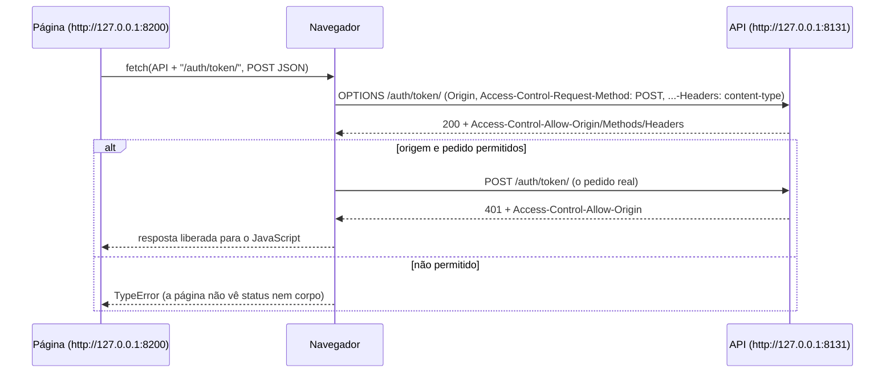

# 11. CORS

> ⏱️ ~1h30 · Módulo 6 · Pré-requisitos: [4.06 (fetch e CORS no navegador)](../04-front-end-essencial/06-js-promises-fetch.md), [6.01](01-principios-rest.md), [6.06](06-autenticacao-token-jwt.md); noção de origem (esquema + host + porta)

> ✅ **Verificação.** Código executado em 2026-11-08: API Django 5.2.19 + DRF 3.18.3 + django-cors-headers 4.9.0 num `runserver`, `curl` real e **Google Chrome em modo headless** carregando uma página de outra origem. As saídas são as reais; 42 testes do laboratório passaram.

## 🎯 Objetivos
Ao final desta aula você consegue:
- Explicar o que é a **política de mesma origem** e o que o **CORS** libera (e o que ele **não** protege)
- Distinguir requisições **simples** de requisições com **preflight** (`OPTIONS`) e ler os cabeçalhos `Access-Control-*`
- Configurar o `django-cors-headers` com **lista explícita de origens**, sem curingas perigosos
- Reproduzir e diagnosticar o erro clássico “blocked by CORS policy”
- Explicar por que CORS **não** substitui autenticação, CSRF nem autorização

## 🤔 Por que isso importa
Assim que o front-end (`http://localhost:3000`, `https://loja.minishop.com`) fica em outra origem que a API (`https://api.minishop.com`), o navegador passa a bloquear as respostas. É o erro que **todo** dev júnior encontra na primeira integração e que muita gente “resolve” com `CORS_ALLOW_ALL_ORIGINS = True`, abrindo um buraco. Entender CORS é saber **quem impõe** a regra (o navegador, não o servidor) e como liberar só o necessário.

## 💡 Intuição (explicação simples)
Pense num **condomínio com porteiro**. Seu apartamento (a API) recebe cartas de qualquer pessoa; mas quando um **morador de outro prédio** (uma página de outra origem) pede ao porteiro do **navegador** “abra a resposta que o apartamento mandou”, o porteiro só entrega se o apartamento tiver deixado um **bilhete** autorizando aquele prédio (`Access-Control-Allow-Origin`). Para pedidos mais delicados (mudar algo, com credenciais), o porteiro **telefona antes** perguntando “vocês aceitam esse tipo de pedido?” (o *preflight*). Atenção: o bilhete protege o **morador** (quem está no navegador) de páginas maliciosas; não impede um ladrão de bater direto na porta do apartamento com `curl`.

## 🔬 Como funciona por dentro

- **Origem** = esquema + host + porta. `http://127.0.0.1:8200` e `http://127.0.0.1:8131` são origens **diferentes** (a porta conta). A **política de mesma origem** impede que o JavaScript de uma origem **leia** respostas de outra.
- **CORS (*Cross-Origin Resource Sharing*)** é o mecanismo, baseado em cabeçalhos HTTP, pelo qual o **servidor** declara quais outras origens podem ler suas respostas. **Quem aplica é o navegador.**
- **Requisição simples** (`GET`/`HEAD`/`POST` com `Content-Type` de formulário e sem cabeçalhos especiais): o navegador **envia direto** e, na volta, só entrega a resposta ao JavaScript se `Access-Control-Allow-Origin` combinar com a origem.
- **Requisição com *preflight***: métodos como `PUT`/`PATCH`/`DELETE`, `Content-Type: application/json`, ou cabeçalhos como `Authorization` fazem o navegador mandar antes um **`OPTIONS`** perguntando se pode. Se a resposta não autorizar, o pedido real **nem é enviado**.
- **Cabeçalhos da resposta:**
  | Cabeçalho | Significado |
  |---|---|
  | `Access-Control-Allow-Origin` | a origem liberada (ou `*`) |
  | `Access-Control-Allow-Methods` | métodos aceitos (no preflight) |
  | `Access-Control-Allow-Headers` | cabeçalhos de requisição aceitos (`authorization`, `content-type`) |
  | `Access-Control-Max-Age` | por quanto tempo o navegador reaproveita o preflight |
  | `Access-Control-Expose-Headers` | cabeçalhos de **resposta** que o JavaScript pode ler (`Location`, `Retry-After`) |
  | `Access-Control-Allow-Credentials` | permite enviar/receber *cookies* entre origens |
  | `Vary: Origin` | avisa caches que a resposta muda conforme a origem |
- **Curinga (`*`) e credenciais.** `Allow-Origin: *` é aceito só **sem** credenciais; com cookies, o servidor precisa devolver a origem exata. Por isso `CORS_ALLOW_ALL_ORIGINS = True` + `CORS_ALLOW_CREDENTIALS = True` é a combinação a evitar: qualquer site passaria a ler respostas autenticadas.
- **O que o CORS NÃO é:**
  - **Não é autenticação nem autorização.** Quem chama de `curl`, de outro servidor ou do Postman **ignora** o CORS; a API continua processando. A proteção real é o JWT/permissões (aulas 06 e 07).
  - **Não substitui o CSRF.** O CSRF trata de requisições que o navegador **envia** com cookies; o CORS trata do que o JavaScript pode **ler**. Com JWT em cabeçalho, não há cookie automático, então o CSRF não se aplica à API.
- **Quando nem precisa:** se o front e a API ficam atrás do **mesmo domínio** (um proxy reverso serve `/` para o front e `/api/` para o Django), não há CORS. É uma opção boa em produção.

## 🛠️ Exemplo prático
**1. Instalação e configuração**
```bash
uv add django-cors-headers
```
```python
# config/settings.py
INSTALLED_APPS += ["corsheaders"]

MIDDLEWARE = [
    "django.middleware.security.SecurityMiddleware",
    "corsheaders.middleware.CorsMiddleware",          # antes do CommonMiddleware (e de qualquer um que gere respostas)
    "django.contrib.sessions.middleware.SessionMiddleware",
    "django.middleware.common.CommonMiddleware",
    # ... os demais
]

import os

CORS_ALLOWED_ORIGINS = [o for o in os.environ.get("CORS_ALLOWED_ORIGINS", "http://127.0.0.1:8200").split(",") if o]
CORS_URLS_REGEX = r"^/api/.*$"                         # só a API fala com outras origens (o /admin/ não)
CORS_ALLOW_CREDENTIALS = False                         # JWT vai no cabeçalho; sem cookies entre origens
CORS_EXPOSE_HEADERS = ["Location", "Retry-After"]      # cabeçalhos que o JavaScript pode LER na resposta
CORS_PREFLIGHT_MAX_AGE = 600                           # o navegador reaproveita o preflight por 10 min
```
Em produção: `CORS_ALLOWED_ORIGINS=https://loja.minishop.com` (variável de ambiente, aula 5.14), **sem** `localhost`. Por padrão, o `django-cors-headers` já aceita os cabeçalhos `authorization`, `content-type`, `accept`, `x-csrftoken` e os métodos `DELETE, GET, OPTIONS, PATCH, POST, PUT`.

**2. Inspecionando com `curl` (executado; API em `127.0.0.1:8131`, origem permitida `http://127.0.0.1:8200`)**
```bash
B=http://127.0.0.1:8131/api/v1
hdrs() { tr -d '\r' | grep -iE "^(HTTP|access-control|vary)"; }
echo "=== 1) GET simples de origem PERMITIDA"
curl -s -D - -o /dev/null -H "Origin: http://127.0.0.1:8200" $B/categories/ | hdrs
echo "=== 2) GET simples de origem NÃO permitida"
curl -s -D - -o /dev/null -H "Origin: https://site-malicioso.example" $B/categories/ | hdrs
echo "=== 3) PREFLIGHT (OPTIONS) de origem permitida, para POST com JSON + Authorization"
curl -s -D - -o /dev/null -X OPTIONS -H "Origin: http://127.0.0.1:8200" -H "Access-Control-Request-Method: POST" -H "Access-Control-Request-Headers: authorization,content-type" $B/cart/items/ | hdrs
echo "=== 4) PREFLIGHT de origem NÃO permitida"
curl -s -D - -o /dev/null -X OPTIONS -H "Origin: https://site-malicioso.example" -H "Access-Control-Request-Method: POST" -H "Access-Control-Request-Headers: authorization,content-type" $B/cart/items/ | hdrs
echo "=== 5) o servidor PROCESSA mesmo assim (CORS é o navegador): login de origem maliciosa"
curl -s -o /dev/null -w "status=%{http_code}\n" -H "Origin: https://site-malicioso.example" -H "Content-Type: application/json" -d '{"username":"cliente","password":"errada"}' $B/auth/token/
echo "=== 6) /admin/ não recebe cabeçalhos CORS"
curl -s -D - -o /dev/null -H "Origin: http://127.0.0.1:8200" http://127.0.0.1:8131/admin/login/ | hdrs
```
```text
=== 1) GET simples de origem PERMITIDA
HTTP/1.1 200 OK
Vary: Accept, origin
access-control-allow-origin: http://127.0.0.1:8200
access-control-expose-headers: Location, Retry-After
=== 2) GET simples de origem NÃO permitida
HTTP/1.1 200 OK
Vary: Accept, origin
=== 3) PREFLIGHT (OPTIONS) de origem permitida, para POST com JSON + Authorization
HTTP/1.1 200 OK
Vary: origin
access-control-allow-origin: http://127.0.0.1:8200
access-control-expose-headers: Location, Retry-After
access-control-allow-headers: accept, authorization, content-type, user-agent, x-csrftoken, x-requested-with
access-control-allow-methods: DELETE, GET, OPTIONS, PATCH, POST, PUT
access-control-max-age: 600
=== 4) PREFLIGHT de origem NÃO permitida
HTTP/1.1 200 OK
Vary: origin
=== 5) o servidor PROCESSA mesmo assim (CORS é o navegador): login de origem maliciosa
status=401
=== 6) /admin/ não recebe cabeçalhos CORS
HTTP/1.1 200 OK
Vary: Cookie
```
Leitura: (1) e (3) trazem `access-control-allow-origin` com a origem exata, e o preflight (3) lista métodos, cabeçalhos e a validade (`max-age: 600`); (2) e (4) respondem `200`, mas **sem** os cabeçalhos `access-control-*`: é a ausência deles que faz o navegador bloquear. (5) mostra o ponto central: **a API processou** o login vindo da origem “maliciosa” (`401` porque a senha estava errada): quem não é navegador ignora o CORS. (6) o `/admin/` ficou fora (`CORS_URLS_REGEX`).

**3. O navegador de verdade (executado: Chrome headless)**
Uma página mínima, servida em **duas** origens (portas 8200, permitida, e 8201, não permitida), faz dois `fetch` para a API:
```html
<!doctype html><meta charset="utf-8"><title>cors</title>
<pre id="out">aguardando…</pre>
<script>
const API = "http://127.0.0.1:8131/api/v1";
(async () => {
  const out = [`página servida de: ${location.origin}`];
  try {
    const r = await fetch(API + "/categories/");
    out.push(`GET simples: status ${r.status} | categorias lidas: ${(await r.json()).count}`);
  } catch (e) { out.push(`GET simples: BLOQUEADO pelo navegador (${e.name})`); }
  try {
    const r = await fetch(API + "/auth/token/", { method: "POST", headers: { "Content-Type": "application/json" },
      body: JSON.stringify({ username: "cliente", password: "errada" }) });
    out.push(`POST JSON (com preflight): status ${r.status} | detail: ${(await r.json()).detail}`);
  } catch (e) { out.push(`POST JSON (com preflight): BLOQUEADO pelo navegador (${e.name})`); }
  document.getElementById("out").textContent = out.join("\n");
})();
</script>
```
```bash
(cd site && python3 -m http.server 8200 --bind 127.0.0.1 &) ; (cd site && python3 -m http.server 8201 --bind 127.0.0.1 &)
google-chrome --headless=new --no-sandbox --disable-gpu --user-data-dir=/tmp/chrome-8200 --virtual-time-budget=8000 --dump-dom http://127.0.0.1:8200/cors.html
google-chrome --headless=new --no-sandbox --disable-gpu --user-data-dir=/tmp/chrome-8201 --virtual-time-budget=8000 --dump-dom http://127.0.0.1:8201/cors.html
```
```text
=== origem http://127.0.0.1:8200
página servida de: http://127.0.0.1:8200
GET simples: status 200 | categorias lidas: 3
POST JSON (com preflight): status 401 | detail: Usuário e/ou senha incorreto(s)
=== origem http://127.0.0.1:8201
página servida de: http://127.0.0.1:8201
GET simples: BLOQUEADO pelo navegador (TypeError)
POST JSON (com preflight): BLOQUEADO pelo navegador (TypeError)
```
E o log do servidor Django conta o que realmente aconteceu na rede:
```text
"OPTIONS /api/v1/auth/token/ HTTP/1.1" 200 0     ← preflight da origem 8200
"POST /api/v1/auth/token/ HTTP/1.1" 401 72       ← o pedido real, depois do preflight liberado
"GET /api/v1/categories/ HTTP/1.1" 200 180       ← origem 8201: o GET CHEGOU e foi respondido...
"OPTIONS /api/v1/auth/token/ HTTP/1.1" 200 0     ← origem 8201: preflight negado (sem allow-origin)...
                                                   (...e nenhum POST depois: o navegador nem o enviou)
```
Duas lições práticas:
- **GET simples bloqueado ≠ não enviado.** O servidor **recebeu e respondeu** o GET da origem proibida; o navegador só não entregou a resposta à página. Por isso CORS **não** protege contra efeitos colaterais de requisições simples (mais um motivo para `GET` nunca alterar estado, aula 06.01).
- **Preflight negado = o pedido real não sai.** Para o `POST` com JSON, a origem proibida parou no `OPTIONS`.
- A página só viu `TypeError` genérico, **sem** status nem mensagem. Para diagnosticar, abra o console do navegador (`...has been blocked by CORS policy: No 'Access-Control-Allow-Origin' header...`) e a aba **Rede**.

**4. Testes**
```python
# tests/test_cors.py
import pytest
from rest_framework.test import APIClient

pytestmark = pytest.mark.django_db
PERMITIDA = "http://127.0.0.1:8200"
MALICIOSA = "https://site-malicioso.example"


def test_origem_permitida_recebe_cabecalho():
    r = APIClient().get("/api/v1/categories/", HTTP_ORIGIN=PERMITIDA)
    assert r["Access-Control-Allow-Origin"] == PERMITIDA


def test_origem_nao_permitida_nao_recebe_cabecalho():
    r = APIClient().get("/api/v1/categories/", HTTP_ORIGIN=MALICIOSA)
    assert "Access-Control-Allow-Origin" not in r


def test_preflight_lista_metodos_e_cabecalhos():
    r = APIClient().options("/api/v1/cart/items/", HTTP_ORIGIN=PERMITIDA,
                            HTTP_ACCESS_CONTROL_REQUEST_METHOD="POST", HTTP_ACCESS_CONTROL_REQUEST_HEADERS="authorization,content-type")
    assert r.status_code == 200 and "authorization" in r["Access-Control-Allow-Headers"] and "POST" in r["Access-Control-Allow-Methods"]


def test_nunca_curinga_com_credenciais(settings):
    assert settings.CORS_ALLOW_CREDENTIALS is False and "*" not in settings.CORS_ALLOWED_ORIGINS


def test_admin_fica_fora_do_cors():
    assert "Access-Control-Allow-Origin" not in APIClient().get("/admin/login/", HTTP_ORIGIN=PERMITIDA)
```
```bash
uv run pytest -q tests
```
```text
42 passed
```
(42 é o total do laboratório até aqui; os 5 testes acima passaram.)

## 🧠 Pausa para lógica
**Problema (simular a decisão do CORS).** Escreva `decidir(config, origem, metodo, pede_metodo, pede_cabecalhos)` que devolve os cabeçalhos CORS que o servidor responderia. Regras: origem fora da lista → nada; preflight (`OPTIONS` com método pedido) só libera se o método estiver na lista e **todos** os cabeçalhos pedidos estiverem permitidos; caso contrário, devolver `{}` (o navegador bloqueia).

<details><summary>Dica</summary>
Compare conjuntos em minúsculas: <code>{h.lower() for h in pede_cabecalhos} - set(config["cabecalhos"])</code> deve ser vazio. Origens são comparadas por igualdade exata (esquema + host + porta).
</details>

<details><summary>Solução comentada</summary>

```python
def mesma_origem(a, b):
    return a == b                                   # esquema + host + porta, tudo igual


def decidir(config, origem, metodo, pede_metodo=None, pede_cabecalhos=()):
    """Devolve os cabeçalhos CORS que o servidor responderia (vazio = o navegador bloqueia a leitura)."""
    if origem not in config["origens"]:
        return {}
    cab = {"Access-Control-Allow-Origin": origem, "Vary": "Origin"}
    if metodo == "OPTIONS" and pede_metodo:                                   # preflight
        if pede_metodo not in config["metodos"]:
            return {}
        extra = {h.lower() for h in pede_cabecalhos} - set(config["cabecalhos"])
        if extra:
            return {}
        cab |= {"Access-Control-Allow-Methods": ", ".join(config["metodos"]),
                "Access-Control-Allow-Headers": ", ".join(config["cabecalhos"]), "Access-Control-Max-Age": "600"}
    return cab


cfg = {"origens": {"http://127.0.0.1:8200"}, "metodos": ["GET", "POST", "PATCH", "DELETE"],
       "cabecalhos": ["authorization", "content-type"]}
casos = [
    ("GET de origem permitida", ("http://127.0.0.1:8200", "GET")),
    ("GET de origem estranha", ("https://site-malicioso.example", "GET")),
    ("preflight POST + Authorization", ("http://127.0.0.1:8200", "OPTIONS", "POST", ["Authorization", "Content-Type"])),
    ("preflight com cabeçalho não listado", ("http://127.0.0.1:8200", "OPTIONS", "POST", ["X-Segredo"])),
    ("preflight de PUT (não listado)", ("http://127.0.0.1:8200", "OPTIONS", "PUT", [])),
]
for titulo, args in casos:
    r = decidir(cfg, *args)
    print(f"{titulo:<38} → {'LIBERA ' + r['Access-Control-Allow-Origin'] if r else 'BLOQUEIA'}")
print("mesma origem?", mesma_origem("http://127.0.0.1:8200", "http://127.0.0.1:8131"), "(a porta conta)")
```
```text
GET de origem permitida                → LIBERA http://127.0.0.1:8200
GET de origem estranha                 → BLOQUEIA
preflight POST + Authorization         → LIBERA http://127.0.0.1:8200
preflight com cabeçalho não listado    → BLOQUEIA
preflight de PUT (não listado)         → BLOQUEIA
mesma origem? False (a porta conta)
```
(Executado em 2026-11-08.) É uma simplificação: na prática é o **navegador** que decide e o servidor só emite cabeçalhos; a função mostra, porém, a lógica do `django-cors-headers`.
</details>

## ⚠️ Erros comuns e boas práticas
| Mensagem / sintoma | Causa | Solução |
|---|---|---|
| Console: `has been blocked by CORS policy: No 'Access-Control-Allow-Origin' header is present` | Origem do front não está em `CORS_ALLOWED_ORIGINS` | Acrescentar a origem **exata** (com esquema e porta) |
| `Response to preflight request doesn't pass access control check` | Preflight negado (método/cabeçalho não permitido) | Conferir `CORS_ALLOW_METHODS`/`CORS_ALLOW_HEADERS`; `OPTIONS` não pode exigir login |
| `The value of the 'Access-Control-Allow-Origin' header ... must not be the wildcard '*' when the request's credentials mode is 'include'` | `*` com credenciais | Origem exata + `CORS_ALLOW_CREDENTIALS = True` (só se precisar de cookies) |
| `CORS_ALLOWED_ORIGINS` com barra final ou sem esquema | Formato inválido (`corsheaders.E013/E014`) | `https://loja.exemplo.com` (sem `/`, com esquema) |
| Funciona no Postman/curl e falha no navegador | CORS só o navegador impõe | Corrigir os cabeçalhos no servidor |
| Funciona no navegador e o servidor mostra `401` no preflight | Autenticação exigida no `OPTIONS` | O `CorsMiddleware` deve responder ao preflight antes da autenticação (ordem do middleware) |
| `CORS_ALLOW_ALL_ORIGINS = True` “para destravar” | Atalho inseguro | Lista explícita por ambiente |
| JavaScript não lê `Location`/`Retry-After` | Cabeçalho não exposto | `CORS_EXPOSE_HEADERS` |
| Cache serve resposta para a origem errada | Faltou `Vary: Origin` | O middleware já adiciona; cuidado com CDNs |
| `/admin/` ou rotas HTML respondendo CORS | `CORS_URLS_REGEX` ausente | Restringir a `^/api/.*$` |

- **Lista explícita, por ambiente**, vinda de variável de ambiente.
- **Não libere mais do que precisa:** métodos, cabeçalhos e rotas.
- **Prefira o mesmo domínio** em produção (proxy reverso): sem CORS, sem preflight, uma viagem a menos por requisição.
- CORS **não** é um controle de acesso: a API deve ser segura mesmo que todos os cabeçalhos CORS sumam.
- Depure com a aba **Rede** (veja o `OPTIONS` e os cabeçalhos) e o console, não só com a mensagem genérica do `fetch`.

## 🧩 Exercícios
**1. Fixação**
(a) O que define “mesma origem”? (b) O que é um preflight e quando ele ocorre? (c) Por que `curl` não sofre bloqueio de CORS? (d) Por que `CORS_ALLOW_ALL_ORIGINS=True` junto com credenciais é perigoso?

<details><summary>Solução</summary>

(a) Esquema, host e porta iguais. (b) Um `OPTIONS` que o navegador envia antes do pedido real quando ele não é “simples” (método diferente de GET/HEAD/POST, `Content-Type: application/json`, cabeçalho como `Authorization`); se o servidor não autorizar, o pedido real não é enviado. (c) A regra é imposta pelo navegador para proteger o usuário; qualquer outro cliente ignora os cabeçalhos. (d) Qualquer site poderia ler respostas feitas com as credenciais do usuário.
</details>

**2. Aplicação no projeto MiniShop**
Libere o front do MiniShop com segurança.

Critérios de pronto:
- [ ] `django-cors-headers` instalado; `CorsMiddleware` na posição correta
- [ ] `CORS_ALLOWED_ORIGINS` por variável de ambiente (`http://127.0.0.1:8200` em desenvolvimento; um domínio `https` no `.env.example` de produção)
- [ ] `CORS_URLS_REGEX` só para `/api/`; `CORS_ALLOW_CREDENTIALS = False`; `CORS_EXPOSE_HEADERS` com `Location` e `Retry-After`
- [ ] Página de teste em outra porta provando o sucesso e o bloqueio (capturas ou saída do Chrome headless)
- [ ] Testes: origem permitida, origem proibida, preflight e `/admin/` fora do CORS
- [ ] `docs/cors.md`: o que é, quem impõe, a configuração por ambiente e o diagnóstico passo a passo
- [ ] Commit `feat(api): CORS for the frontend origin`

<details><summary>Solução de referência (diagnóstico em `docs/cors.md`)</summary>

```markdown
## Diagnóstico de erro de CORS
1. Console do navegador: copie a mensagem exata. Ela diz se faltou `Allow-Origin`, `Allow-Headers` ou `Allow-Methods`.
2. Aba Rede: ache o `OPTIONS`. Status 200 e cabeçalhos `access-control-*`? Se não, a origem não está na lista.
3. `curl -X OPTIONS -H "Origin: <origem>" -H "Access-Control-Request-Method: POST" <url>`: o servidor responde os cabeçalhos?
4. Confira `CORS_ALLOWED_ORIGINS` (esquema + host + porta, sem barra final) e a posição do `CorsMiddleware`.
5. Se o preflight dá 401/403: o middleware não está antes da autenticação.
```
</details>

**3. Desafio (opcional)**
Sirva o front (aula 14) e a API pelo **mesmo domínio** com um proxy reverso simples (por exemplo, `python -m http.server` + um pequeno proxy em Python ou Nginx em Docker, módulo 11) e prove que **não há mais preflight** na aba Rede. Compare o número de requisições antes e depois.

## 🎤 Na entrevista
- **O que é CORS e quem o impõe?** Mecanismo em que o servidor, por cabeçalhos HTTP, declara quais origens podem ler suas respostas; é o **navegador** quem aplica. Não protege a API de outros clientes.
- **O que é o preflight?** Um `OPTIONS` que o navegador envia antes de requisições não simples (JSON, `Authorization`, `PUT/PATCH/DELETE`) para saber se o servidor aceita; sem autorização, o pedido real não é enviado.
- **Como configurar CORS no Django com segurança?** `django-cors-headers` com `CORS_ALLOWED_ORIGINS` explícito por ambiente, restrito a `/api/`, sem `ALLOW_ALL` e sem credenciais desnecessárias; ou evitar CORS servindo front e API pelo mesmo domínio.
- **CORS substitui CSRF ou autenticação?** Não. CORS regula quem pode **ler** respostas no navegador; CSRF trata de requisições com cookies enviadas pelo navegador; autenticação/autorização protegem os dados.

## 📚 Para ir além
- 📄 Referência: [CORS (MDN)](https://developer.mozilla.org/pt-BR/docs/Web/HTTP/Guides/CORS). Guia completo: simples, preflight e credenciais.
- 📄 Referência: [Política de mesma origem (MDN, em inglês)](https://developer.mozilla.org/en-US/docs/Web/Security/Same-origin_policy). A regra que o CORS flexibiliza.
- 📄 Documentação: [django-cors-headers](https://github.com/adamchainz/django-cors-headers). Todas as configurações.
- 📄 Especificação: [Fetch Standard — CORS protocol](https://fetch.spec.whatwg.org/#http-cors-protocol). A definição formal.
- 📑 Artigo/tutorial: [OWASP — HTML5 Security: CORS](https://cheatsheetseries.owasp.org/cheatsheets/HTML5_Security_Cheat_Sheet.html#cross-origin-resource-sharing). Riscos de configuração frouxa.
- 🏋️ Prática extra: use a aba **Rede** do Chrome com a página de teste e identifique o preflight, o `max-age` e o pedido real.

> Links verificados em 2026-11-08 (HTTP 200).

## ✅ Checklist da aula
- [ ] Reproduzi o bloqueio de CORS no navegador e o corrigi com uma origem explícita
- [ ] Li um preflight (`OPTIONS`) e os cabeçalhos `Access-Control-*`
- [ ] Configuração por ambiente, só em `/api/`, sem curinga
- [ ] Sei que CORS não protege a API de `curl` nem substitui autenticação/CSRF
- [ ] Sei quando evitar CORS usando o mesmo domínio
