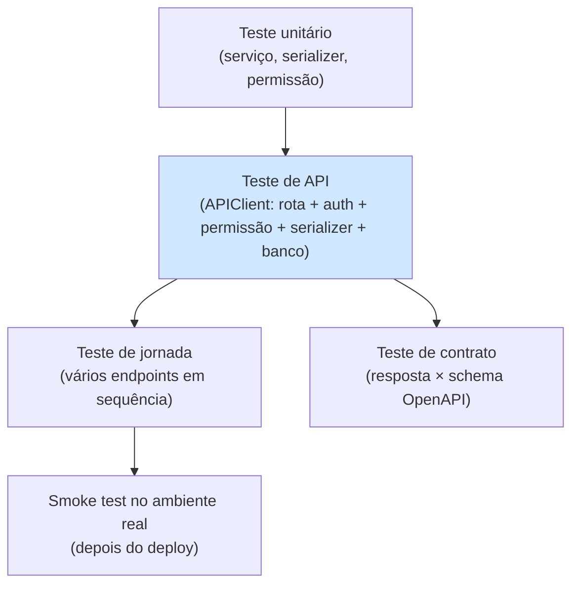

# 12. Testes de API

> ⏱️ ~1h30 · Módulo 6 · Pré-requisitos: [1.11 (pytest)](../01-python-logica/11-pytest-intro.md), [6.04](04-drf-views-viewsets-routers.md) a [6.11](11-cors.md), [5.18](../05-django/18-consolidacao-seed.md) (testes de ponta a ponta)

> ✅ **Verificação.** Código executado em 2026-11-08 (Python 3.13, Django 5.2.19, DRF 3.18.3, pytest-django, pytest-cov, SQLite). As saídas são as reais. O laboratório chegou a **57 testes passando**, com **93% de cobertura** de `apps/`. Os arquivos de teste das aulas anteriores fazem parte dessa conta.

## 🎯 Objetivos
Ao final desta aula você consegue:
- Testar uma API com o `APIClient` do DRF, autenticando por `force_authenticate` ou por **login JWT real**
- Cobrir cada endpoint em cinco frentes: **caminho feliz, validação, autenticação, permissão e regra de negócio** (mais efeitos no banco)
- Escrever um **teste de jornada** (o fluxo do cliente de ponta a ponta) e um **teste de contrato** (a resposta bate com o OpenAPI)
- Medir **cobertura** (de linhas e de **rotas do contrato**) e usar uma **mutação** manual para provar que um teste realmente protege
- Organizar *fixtures* e *factories* para testes rápidos, isolados e legíveis

## 🤔 Por que isso importa
Numa API, o teste é a única forma de dizer “mexi aqui e nada quebrou lá” sem abrir o Postman 30 vezes. Como a API é um **contrato com outros sistemas**, uma regressão (um 403 que virou 200, um campo que sumiu) afeta clientes que você não controla. Em vagas de júnior, “escrevo testes de API com pytest” é diferencial concreto; e em *code review* a pergunta é sempre “cadê o teste?”.

## 💡 Intuição (explicação simples)
Pense na **vistoria de um carro antes de vender**. Não basta ligar o motor (caminho feliz): o vistoriador testa o freio (permissão), tenta abrir a porta sem a chave (autenticação), enche o tanque com combustível errado (validação), anda com o porta-malas lotado (regra de negócio) e confere o documento (contrato). A **cobertura** é a lista de itens da vistoria já conferidos; a **mutação** é soltar de propósito um parafuso para ver se a vistoria percebe. Uma vistoria que passa com o parafuso solto não vale nada.

## 🔬 Como funciona por dentro

- **`APIClient`** (de `rest_framework.test`) é um cliente HTTP que chama a aplicação **sem rede**, passando por *middlewares*, roteamento, autenticação, permissões, serializers e banco. Métodos: `get/post/put/patch/delete/options`; `format="json"` serializa o corpo; `response.json()` lê a resposta.
- **Duas formas de autenticar:**
  | Forma | Como | Quando |
  |---|---|---|
  | `client.force_authenticate(user)` | pula a autenticação; injeta o usuário | testes de **permissão** e regras (rápido) |
  | Login real + `client.credentials(HTTP_AUTHORIZATION="Bearer ...")` | passa pelo JWT de verdade | jornada, contrato e **testes de autenticação** |
- **O que testar em cada endpoint** (checklist de cinco frentes):
  1. **Caminho feliz**: status, corpo, cabeçalhos (`Location`).
  2. **Validação**: campos ausentes/inválidos → `400` com o formato certo.
  3. **Autenticação**: sem token → `401`.
  4. **Permissão/escopo**: papel errado → `403`; recurso alheio → `404`.
  5. **Regra de negócio**: sem estoque → `422` com `code`.
  Mais: **efeitos no banco** (estoque baixou? carrinho esvaziou?) e **número de consultas** (aula 07).
- **Isolamento.** O `pytest-django` envolve cada teste numa transação revertida (`@pytest.mark.django_db`); o cache (throttling) é zerado por uma *fixture* automática (aula 09); relógio e aleatoriedade devem ser controlados.
- **Fixtures e factories.** Em vez de repetir `User.objects.create_user(...)` em cada teste, centralize em *fixtures* (`seed`, `api_as("gerente")`). *Factories* (Factory Boy) ajudam quando há muitos modelos; aqui o `seed` determinístico basta.
- **Teste de jornada** = os mesmos passos que o front faz. Poucos, valiosos, lentos: protegem o que mais importa (comprar).
- **Teste de contrato** = a resposta bate com o schema OpenAPI **commitado** (aula 10). Detecta o campo que sumiu ou mudou de nome antes do cliente.
- **Cobertura.** `pytest --cov=apps` mostra as linhas executadas. Cobertura alta **não** prova qualidade (execução ≠ verificação), mas **baixa** mostra onde ninguém olhou. Use-a para achar buracos, não como meta cega.
- **Cobertura de rotas.** Para APIs, mais útil que linhas: *cada operação do contrato tem pelo menos um teste?* Dá para checar comparando o `schema.yml` com os testes (exemplo 4).
- **Mutação** (verificar o teste): quebre o código de propósito (remover um filtro de segurança) e confirme que **algum teste falha**. Ferramentas automatizam (`mutmut`), mas a versão manual já ensina o essencial.
- **O que não testar:** o DRF/Django em si (que `ModelSerializer` valida `max_length`) e *getters* triviais. Teste o **seu** comportamento.

## 🛠️ Exemplo prático
**1. Instalação e fixtures**
```bash
uv add --dev pytest pytest-django pytest-cov
```
```ini
# pytest.ini
[pytest]
DJANGO_SETTINGS_MODULE = config.settings
python_files = test_*.py
```
```python
# conftest.py
import pytest
from django.core.management import call_command


@pytest.fixture
def seed(db):
    call_command("seed")                                  # dados determinísticos (aula 5.18)


@pytest.fixture(autouse=True)
def _limpa_cache():
    from django.core.cache import cache
    cache.clear()                                         # o contador do throttling vive no cache (aula 09)
    yield


@pytest.fixture
def api_as(seed):
    """Fábrica: api_as("gerente") devolve um APIClient autenticado por JWT REAL (login de verdade); api_as(None) é anônimo."""
    from rest_framework.test import APIClient

    def _fabrica(username=None, senha="dev-somente-local-123"):
        c = APIClient()
        if username:
            r = c.post("/api/v1/auth/token/", {"username": username, "password": senha}, format="json")
            assert r.status_code == 200, r.content
            c.credentials(HTTP_AUTHORIZATION="Bearer " + r.json()["access"])
        return c
    return _fabrica
```
`api_as("gerente")` faz o **login de verdade** (passa por `ThrottledTokenView`, JWT e permissões): ideal para jornada e contrato. Para testes de permissão em massa, `force_authenticate` é mais rápido.

**2. Teste de jornada**
```python
# tests/test_jornada.py
from decimal import Decimal

import pytest

from apps.catalog.models import Product

pytestmark = pytest.mark.django_db


def test_jornada_login_busca_carrinho_pedido_e_cancelamento(api_as):
    anon = api_as(None)
    # 1) navegar no catálogo sem login
    r = anon.get("/api/v1/products/", {"search": "mouse", "ordering": "price"})
    assert r.status_code == 200 and r.json()["count"] >= 1
    produto = r.json()["results"][0]
    estoque_inicial = Product.objects.get(pk=produto["id"]).stock

    # 2) login e carrinho
    cli = api_as("cliente")
    r = cli.post("/api/v1/cart/items/", {"product": produto["id"], "quantity": 2}, format="json")
    assert r.status_code == 201 and r["Location"].startswith("/api/v1/cart/items/")
    carrinho = cli.get("/api/v1/cart/").json()
    assert carrinho["count"] == 2 and Decimal(carrinho["total"]) == 2 * Decimal(produto["price"])

    # 3) pedido: estoque baixa, carrinho esvazia, preço congelado
    r = cli.post("/api/v1/orders/")
    assert r.status_code == 201
    pedido = r.json()
    assert pedido["status"] == "pending" and Decimal(pedido["total"]) == Decimal(carrinho["total"])
    assert Product.objects.get(pk=produto["id"]).stock == estoque_inicial - 2
    assert cli.get("/api/v1/cart/").json()["count"] == 0
    assert cli.post("/api/v1/orders/").status_code == 422                          # carrinho vazio

    # 4) cancelamento devolve o estoque, só uma vez
    assert cli.post(f"/api/v1/orders/{pedido['id']}/cancel/").status_code == 200
    assert Product.objects.get(pk=produto["id"]).stock == estoque_inicial
    assert cli.post(f"/api/v1/orders/{pedido['id']}/cancel/").status_code == 422

    # 5) outro usuário não enxerga o pedido
    assert api_as("gerente").get(f"/api/v1/orders/{pedido['id']}/").status_code == 404
```
O teste lê como uma **história** (comentários numerados) e checa os efeitos no banco (`stock`), não só os status.

**3. Teste de contrato**
```python
# tests/test_contrato.py
from pathlib import Path

import pytest
import yaml

pytestmark = pytest.mark.django_db
SCHEMA = yaml.safe_load(Path("schema.yml").read_text())["components"]["schemas"]


def campos_do_schema(nome):
    return set(SCHEMA[nome]["properties"])


def test_produto_devolve_exatamente_os_campos_do_schema(api_as):
    item = api_as(None).get("/api/v1/products/").json()["results"][0]
    assert set(item) == campos_do_schema("Product") - {"category_slug"}      # write_only: não vem na leitura


def test_pedido_devolve_exatamente_os_campos_do_schema(api_as):
    cli = api_as("cliente")
    cli.post("/api/v1/cart/items/", {"product": 2, "quantity": 1}, format="json")
    pedido = cli.post("/api/v1/orders/").json()
    assert set(pedido) == campos_do_schema("Order")
    assert set(pedido["items"][0]) == campos_do_schema("OrderItem")


def test_erro_segue_o_schema_error(api_as):
    erro = api_as("cliente").post("/api/v1/orders/").json()
    assert set(erro) == campos_do_schema("Error") == {"detail", "code"}
```
Se alguém renomear `total` para `amount` no serializer sem atualizar o contrato (`spectacular --file schema.yml`, aula 10), este teste falha. Para validar também **tipos e valores** use bibliotecas como `openapi-core` ou `schemathesis` (desafio).

**4. Cobertura de linhas (executado)**
```bash
uv run pytest --cov=apps --cov-report=term-missing -q tests
```
Antes de acrescentar os testes do carrinho (a primeira medição, com 46 testes):
```text
apps/cart/api.py                                      45     12    73%   41, 51-58, 61-63
apps/cart/services.py                                 49     23    53%   23, 26-27, 32, 34, 36, 45-60, 64
apps/catalog/estilos.py                               18     18     0%   2-28
apps/orders/services.py                               59      6    90%   42, 44, 46, 54, 65-66
...
TOTAL                                                517     66    87%
```
Os números contam uma história: `cart/services.py` com **53%** e `cart/api.py` com **73%**: as linhas “Missing” (45-60, 51-58…) são justamente `set_quantity`, a alteração e a remoção de itens, que nenhum teste exercitava. `estilos.py` (0%) é o arquivo didático da aula 04, que nem faz parte do produto. Depois de escrever os testes que faltavam:
```python
# tests/test_carrinho_api.py (trechos)
def test_adicionar_duas_vezes_soma_a_quantidade(cli):
    adicionar(cli, 2, 1)
    r = adicionar(cli, 2, 2)
    assert r.status_code == 201 and r.json()["quantity"] == 3


def test_produto_inativo_nao_entra(cli):
    inativo = Product.objects.filter(is_active=False).first()
    r = adicionar(cli, inativo.pk)
    assert r.status_code == 422 and r.json()["detail"] == "Produto indisponível."


def test_alterar_quantidade_e_remover_com_zero(cli):
    item = adicionar(cli, 2, 1).json()["id"]
    assert cli.patch(f"/api/v1/cart/items/{item}/", {"quantity": 5}, format="json").json()["quantity"] == 5
    assert cli.patch(f"/api/v1/cart/items/{item}/", {"quantity": 0}, format="json").status_code == 204
    assert cli.get("/api/v1/cart/").json()["count"] == 0


def test_item_de_outro_usuario_da_404(cli, api_as):
    item = adicionar(cli, 2, 1).json()["id"]
    outro = api_as("gerente")
    assert outro.patch(f"/api/v1/cart/items/{item}/", {"quantity": 1}, format="json").status_code == 404
    assert outro.delete(f"/api/v1/cart/items/{item}/").status_code == 404
```
```text
apps/cart/api.py                                      45      1    98%   41
apps/cart/services.py                                 49      5    90%   23, 34, 50, 53, 57
TOTAL                                                517     37    93%
53 passed
```
Cobertura total de **87% → 93%** acrescentando sete testes pequenos. As linhas que sobram (`cart/services.py` 23, 34, 50…) são ramos raros (limite de 20 unidades, quantidade negativa) e viram exercício. Lembre: 93% de linhas **não** significa 93% de qualidade; significa que 93% das linhas **rodaram**.

**5. Mutação manual: o teste protege de verdade? (executado)**
Quebre de propósito a defesa mais importante, o filtro por usuário nos pedidos:
```python
# apps/orders/api.py: ANTES
return qs.filter(user=self.request.user)      # cliente: só os seus; o alheio é 404
# MUTAÇÃO: retorna todos os pedidos
return qs
```
```bash
uv run pytest -q tests
```
```text
FAILED tests/test_aula04.py::test_pedido_alheio_da_404 - assert 200 == 404
FAILED tests/test_jornada.py::test_jornada_login_busca_carrinho_pedido_e_cancelamento
FAILED tests/test_permissoes.py::test_so_o_dono_cancela - assert 403 == 404
3 failed, 43 passed
```
**Três** testes diferentes acusaram a falha (o do escopo, o da jornada e o do cancelamento), e a mensagem diz o que mudou (`200 == 404`: o pedido alheio passou a ser visível). Depois de reverter, `46 passed`. Se nenhum teste falhasse, você teria descoberto um **buraco real**: o teste não protegia nada. Faça isso com as regras que mais importam (escopo por usuário, permissões, estoque).

**6. Cobertura de rotas do contrato (executado)**
```python
# cobertura_de_rotas.py
import re
from pathlib import Path

import yaml

schema = yaml.safe_load(Path("schema.yml").read_text())
codigo_dos_testes = "\n".join(p.read_text() for p in Path("tests").glob("test_*.py"))

nao_cobertas = []
total = 0
for caminho, ops in schema["paths"].items():
    padrao = re.escape(caminho).replace(re.escape("{id}"), r"[^\"'?]+")
    for metodo in (m for m in ops if m in ("get", "post", "put", "patch", "delete")):
        total += 1
        achou = any(re.search(rf"\.{metodo}\(\s*f?[\"']{padrao}", linha) for linha in codigo_dos_testes.splitlines())
        if not achou:
            nao_cobertas.append(f"{metodo.upper():<6} {caminho}")

print(f"{total - len(nao_cobertas)}/{total} operações do contrato aparecem em algum teste")
print("sem teste:" if nao_cobertas else "todas cobertas")
for n in nao_cobertas:
    print("  -", n)
```
Na primeira execução (com 53 testes):
```text
14/20 operações do contrato aparecem em algum teste
sem teste:
  - POST   /api/v1/auth/logout/
  - POST   /api/v1/auth/token/refresh/
  - GET    /api/v1/categories/{id}/
  - PUT    /api/v1/products/{id}/
  - PATCH  /api/v1/products/{id}/
  - DELETE /api/v1/products/{id}/
```
A verificação encontrou **6 operações sem teste**, inclusive `DELETE /products/{id}/`, uma operação **destrutiva** e protegida por permissão, justamente a que mais merece um. (Os testes das aulas 06 e 07 exercitaram esses endpoints só em *scripts* de demonstração, não em testes.) Depois de escrever os que faltavam:
```python
# tests/test_lacunas.py (trechos)
def test_produto_put_patch_delete_como_gerente(api_as, alvo):
    ger = api_as("gerente")
    corpo = {"sku": "TST-001", "name": "Alvo 2", "price": "12.50", "stock": 4, "category_slug": "audio"}
    assert ger.put(f"/api/v1/products/{alvo.pk}/", corpo, format="json").json()["name"] == "Alvo 2"
    assert ger.patch(f"/api/v1/products/{alvo.pk}/", {"stock": 9}, format="json").json()["stock"] == 9
    assert ger.delete(f"/api/v1/products/{alvo.pk}/").status_code == 204


def test_estoquista_nao_exclui(api_as, alvo):
    assert api_as("estoquista").delete(f"/api/v1/products/{alvo.pk}/").status_code == 403


def test_refresh_e_logout_invalidam_o_refresh_antigo(seed):
    c = APIClient()
    tok = c.post("/api/v1/auth/token/", {"username": "cliente", "password": "dev-somente-local-123"}, format="json").json()
    novo = c.post("/api/v1/auth/token/refresh/", {"refresh": tok["refresh"]}, format="json").json()
    assert c.post("/api/v1/auth/token/refresh/", {"refresh": tok["refresh"]}, format="json").status_code == 401     # rotação
    assert c.post("/api/v1/auth/logout/", {"refresh": novo["refresh"]}, format="json").status_code == 200
    assert c.post("/api/v1/auth/token/refresh/", {"refresh": novo["refresh"]}, format="json").status_code == 401
```
```text
57 passed
20/20 operações do contrato aparecem em algum teste
todas cobertas
```
O verificador é **aproximado** (procura a chamada `.metodo("rota...")` no código dos testes), mas já pega o esquecimento. Coloque-o na CI (módulo 12) junto com `--cov-fail-under`.

**7. Organização dos testes (como ficou)**
```text
tests/
├── test_aula04.py        rotas e status básicos
├── test_aula05.py        formato dos erros (400/404/405/415/422/500)
├── test_aula06.py        JWT: expirado, /me
├── test_permissoes.py    matriz papel × ação
├── test_filtros.py       busca, filtros e ordenação
├── test_paginacao_throttle.py
├── test_schema.py        schema OpenAPI sem avisos e em dia
├── test_cors.py
├── test_carrinho_api.py  regras do carrinho pela API
├── test_jornada.py       fluxo completo
├── test_contrato.py      resposta × schema
└── test_lacunas.py       operações antes descobertas
```
(Em um projeto real, os arquivos levam o nome do **assunto**, como `test_pedidos.py`, e não o da aula; a organização por aula é só deste curso.)

## 🧠 Pausa para lógica
**Problema (cobertura de rotas).** Dado o conjunto de operações do contrato (`{(metodo, caminho)}`) e o texto do código dos testes, produza a lista de operações **sem nenhum teste**. Trate `{id}` do caminho como “qualquer valor” e procure o padrão `.metodo("caminho` em alguma linha. Explique um falso negativo e um falso positivo possíveis desse método.

<details><summary>Dica</summary>
Converta cada caminho em regex: <code>re.escape(caminho)</code> e substitua <code>{id}</code> por <code>[^"'?]+</code>. Procure <code>\.get\(\s*f?["']&lt;padrão&gt;</code> linha a linha.
</details>

<details><summary>Solução comentada</summary>

A solução é o próprio `cobertura_de_rotas.py` do exemplo 6 (executado: 14/20 antes dos testes extras, 20/20 depois). Limitações:
- **Falso negativo:** um teste que monta a URL numa variável (`url = "/api/v1/..."; client.get(url)`) ou usa `reverse()` não é encontrado, e a rota parece descoberta mesmo estando testada.
- **Falso positivo:** a chamada existe, mas a **asserção é fraca** (não confere status nem corpo) ou o teste está comentado/dentro de um `skip`; a rota parece coberta sem estar protegida. A **mutação manual** (exemplo 5) é o antídoto: ela mede se o teste realmente falha.
</details>

## ⚠️ Erros comuns e boas práticas
| Mensagem / sintoma | Causa | Solução |
|---|---|---|
| `Database access not allowed, use the "django_db" mark` | Teste usa o banco sem a marca | `@pytest.mark.django_db` ou `pytestmark` |
| `429` aparece do nada em testes | Contador do throttling no cache entre testes | `cache.clear()` autouse (aula 09) |
| Teste passa sozinho e falha na suíte | Dependência de ordem/dados de outro teste | Cada teste monta o que precisa (fixtures) |
| `AttributeError: 'NoneType'`/`403` em teste de API | Esqueceu a autenticação | `api_as("...")` ou `force_authenticate` |
| `415 Unsupported Media Type` ao postar dict | Faltou `format="json"` (ou `content_type`) | `client.post(url, dados, format="json")` |
| Testes só do caminho feliz | Cobertura de erro esquecida | Checklist de cinco frentes por endpoint |
| Asserção `assert r.status_code` sem checar o corpo | Teste fraco | Conferir corpo e efeitos no banco |
| Teste lento (minutos) | Login real em todos, banco recriado | `force_authenticate` nos de permissão; `--reuse-db`; paralelizar (`pytest-xdist`) |
| Cobertura 100% mas bug em produção | Linhas executadas ≠ comportamento verificado | Mutação, asserções fortes, testes de contrato |
| Teste que depende de data/hora | Relógio real | Controlar o tempo (`freezegun`, `time-machine`) |
| Dados de teste “mágicos” e ilegíveis | Fixtures gigantes | Fábricas pequenas e nomes que contam a história |

- **Um conceito por teste**, nome que diz o comportamento (`test_nao_cancela_pedido_alheio`).
- Padrão **AAA**: *Arrange* (preparar), *Act* (agir), *Assert* (verificar).
- **Não teste implementação**, teste comportamento observável (status, corpo, banco).
- Testes de API são mais lentos que unitários: mantenha a **maioria da regra em serviços testados sem HTTP** (aulas 5.16/5.17) e use a API para testar a **fiação** (rota, auth, permissão, formato).
- Rode a suíte **sempre** antes do commit e na CI (módulo 12).

## 🧩 Exercícios
**1. Fixação**
(a) Quando usar `force_authenticate` e quando o login JWT real? (b) Quais as cinco frentes de teste de um endpoint? (c) O que a mutação manual prova que a cobertura não prova? (d) Por que um teste de contrato complementa o schema gerado?

<details><summary>Solução</summary>

(a) `force_authenticate` em testes de permissão/regra (rápidos); login real na jornada, no contrato e nos testes de autenticação (que precisam do JWT de verdade). (b) Caminho feliz, validação, autenticação (401), permissão/escopo (403/404) e regra de negócio (422). (c) Que o teste **falha** quando a regra é quebrada (que ele de fato verifica), enquanto a cobertura só diz que a linha **rodou**. (d) O schema é gerado do código e descreve o que há; o teste de contrato **trava** o que foi publicado, de modo que uma mudança acidental na resposta vira falha imediata.
</details>

**2. Aplicação no projeto MiniShop**
Feche a suíte de testes da API.

Critérios de pronto:
- [ ] Cada operação do contrato tem pelo menos um teste (script de cobertura de rotas em 100%)
- [ ] Matriz de permissões papel × ação (aula 07) e testes de formato de erro (aula 05)
- [ ] Teste de jornada (cliente) e de contrato (produto, pedido, erro)
- [ ] Cobertura de `apps/` ≥ 90% e **`services.py` ≥ 95%** (`--cov-fail-under`)
- [ ] Ao menos três mutações manuais registradas em `docs/testes.md` (qual regra quebrei, qual teste falhou)
- [ ] Testes de idempotência/duplo envio do pedido (preparação para a aula 13)
- [ ] `uv run pytest` verde e rápido (< 30 s no laboratório)
- [ ] Commit `test(api): full API suite with journey, contract and route coverage`

<details><summary>Solução de referência (mutações em `docs/testes.md`)</summary>

```markdown
| Mutação (arquivo) | O que quebrei | Teste que falhou |
|---|---|---|
| orders/api.py `get_queryset` | removi `filter(user=...)` | test_pedido_alheio_da_404; jornada; test_so_o_dono_cancela |
| orders/permissions.py | `has_object_permission` devolve True | test_so_o_dono_cancela (admin recebe 200 em vez de 403) |
| cart/services.py | removi a checagem de estoque | test_acima_do_estoque_da_422 |
| orders/services.py | não baixei o estoque no pedido | jornada (estoque_inicial - 2) |
```
Se alguma mutação **não** derrubar teste algum, escreva o teste que faltava e repita.
</details>

**3. Desafio (opcional)**
Use o `schemathesis` (testes baseados em propriedades a partir do OpenAPI) contra a API em execução e leia o relatório: quantas falhas ele encontra que seus testes manuais não encontraram? Corrija uma delas.

## 🎤 Na entrevista
- **Como você testa uma API REST?** Com o cliente de teste do framework (`APIClient`) e pytest: para cada endpoint, caminho feliz, validação, autenticação, permissão e regra de negócio, conferindo status, corpo e efeitos no banco; mais uma jornada de ponta a ponta e um teste de contrato contra o OpenAPI.
- **Diferença entre teste unitário e de API?** Unitário isola uma peça (serviço/serializer); de API atravessa roteamento, autenticação, permissões, serialização e banco para provar que as peças estão ligadas.
- **Cobertura alta garante qualidade?** Não: só mostra o que foi executado. Complementa-se com asserções fortes, testes de mutação e de contrato.
- **Como evitar testes frágeis ou lentos?** Isolamento por transação, dados determinísticos (seed/factories), controle de tempo e cache, testes pequenos e focados, regra de negócio testada sem HTTP e poucos testes de jornada.

## 📚 Para ir além
- 📄 Documentação oficial: [Testing (DRF)](https://www.django-rest-framework.org/api-guide/testing/). `APIClient`, `force_authenticate`, `APIRequestFactory`.
- 📄 Documentação: [pytest-django](https://pytest-django.readthedocs.io/). Marca `django_db`, `client`, `settings`, `--reuse-db`.
- 📄 Documentação: [pytest-cov](https://pytest-cov.readthedocs.io/). Opções de relatório e `--cov-fail-under`.
- 📄 Documentação: [Schemathesis](https://schemathesis.readthedocs.io/). Testes de propriedade a partir do OpenAPI.
- 📄 Documentação: [Factory Boy](https://factoryboy.readthedocs.io/). Fábricas de objetos para testes.
- 📑 Artigo/tutorial: [Practical Test Pyramid (Martin Fowler)](https://martinfowler.com/articles/practical-test-pyramid.html). Quantos testes de cada tipo (em inglês).
- 🏋️ Prática extra: instale `mutmut` e rode contra `apps/orders/services.py` para ver mutações automáticas.

> Links verificados em 2026-11-08 (HTTP 200).

## ✅ Checklist da aula
- [ ] `api_as(...)` e `seed` como base de todos os testes
- [ ] Cinco frentes testadas por endpoint
- [ ] Jornada e contrato escritos
- [ ] Cobertura de linhas e de rotas medidas e lacunas fechadas
- [ ] Fiz ao menos uma mutação e vi o teste falhar
